# Audit alur operasi ISP end-to-end, 17 Oktober 2026

Basis data dev `inbils` (Sail, http://localhost). Kode: web `main` a6348bb, mobile `main` fab0a56. Tujuh agen QA (FlowAudit1 sampai FlowAudit7) menjalankan alur 0 sampai 12 lewat UI web dan aplikasi di emulator Android, per persona, dan agen MidtransCallback menambahkan Alur 5b (callback Midtrans nyata lewat tunel). Tenant uji AUDIT-ISP dan AUDIT-SUP dibuat lewat panel platform, bukan seeder. Tidak ada reset, truncate, atau pembersihan data; penghapusan hanya lewat UI sebagai bagian uji (satu profil bandwidth uji, satu lampiran tiket), dan rekaman berawalan AUDIT tidak dihapus. Satu perubahan kode dibuat selama audit (F8-D01, belum di-commit); tidak ada commit lain.

## 1. Putusan

Alur inti ISP berjalan dari ujung ke ujung dan terasa cepat: pendaftaran pelanggan, pemasangan oleh teknisi, tagihan, pembayaran lewat Midtrans sandbox (termasuk callback nyata lewat tunel), isolir otomatis dan pemulihannya, tiket dukungan, pengumuman gangguan, dan dukungan platform selesai di tenant uji, dengan aksi web 0,3 sampai 3,5 detik dan gerbang regresi 265 lulus (4 dilewati). Sistem belum layak dipakai ISP sungguhan sebelum 5 blocker ditutup: persetujuan SPK gagal atau memotong stok dua kali bila teknisi meminta material lewat aplikasi (F4-D06); tagihan pro-rata berpecahan rupiah tidak bisa dibayar online (F5-D01); satu kunci Midtrans dipakai semua tenant, sehingga uang pelanggan ISP masuk ke rekening platform (F5-D10); balasan pelanggan pada tiket Diselesaikan atau Ditutup diterima tanpa ada yang diberi tahu (F6-D01); dan aksi pengembalian fisik gagal "CSRF token mismatch" (F8-D01), yang sudah diperbaiki tetapi belum di-commit. Callback yang dikirim Midtrans sendiri lewat tunel terbukti benar untuk pembayaran sukses, ditolak, batal, dan kedaluwarsa; pengiriman ulang tidak menggandakan pembayaran dan isi yang dirusak ditolak. Celahnya ada di kartu tanpa 3-D Secure (F5-D14) dan pembayaran VA setelah tunai yang tidak terbukukan (F5-D16). Di luar blocker, temuan terbanyak jatuh pada dua tema: data basi dan pemberitahuan yang tidak sampai (aplikasi tidak memuat ulang, ketuk push tidak membuka tujuannya, staf dan pelanggan tidak diberi tahu), dan onboarding tenant baru yang panjang (tanpa daftar periksa, data contoh bercampur dengan data nyata, peran staf terlalu lebar). Totalnya 142 defect (5 blocker, 64 friction, 70 polish, 3 info atau catatan) dan 114 rekomendasi UX; 37 keputusan menunggu owner, dan urutan perbaikan yang diusulkan ada di bagian 5.

Isi laporan: [1. Putusan](#1-putusan) · [2. Defect di seluruh alur](#2-defect-di-seluruh-alur) · [3. Rekomendasi UX](#3-rekomendasi-ux) · [4. Keputusan pemilik](#4-keputusan-pemilik) · [5. Urutan perbaikan yang diusulkan](#5-urutan-perbaikan-yang-diusulkan) · [6. Batasan audit](#6-batasan-audit) · [7. Rekaman AUDIT-* yang tertinggal di DB inbils](#7-rekaman-audit--yang-tertinggal-di-db-inbils) · [Cara membaca rincian per alur](#cara-membaca-rincian-per-alur) · [Rincian per alur](#rincian-per-alur) · [Lingkungan dan pembersihan](#lingkungan-dan-pembersihan) · [Lampiran](#lampiran)

## 2. Defect di seluruh alur

142 defect dari alur 0 sampai 12. Urutan: keparahan, lalu alur. Kolom keputusan merujuk ke nomor K di bagian 4. Rincian tiap defect (langkah, yang terjadi, yang diharapkan ISP, saran perbaikan, bukti) ada di tabel "Temuan cacat" tiap alur.

**Jumlah menurut keparahan**

| Keparahan | Jumlah | Keterangan |
|---|---|---|
| blocker | 5 | F4-D06, F5-D01, F5-D10, F6-D01, F8-D01 (F5-D10 blocker bisnis; F8-D01 sudah diperbaiki, belum di-commit) |
| friction | 64 | mengganggu pekerjaan atau menyesatkan, ada jalan keluar |
| polish | 70 | kerapian, bahasa, konsistensi |
| info | 1 | F12-D03 (tidak perlu tindakan) |
| catatan | 2 | F12-D05, F12-D20 (belum teruji atau belum dipastikan) |
| **Total** | **142** |  |

**Jumlah menurut alur**

| Alur | blocker | friction | polish | info/catatan | Defect | Rekomendasi UX |
|---|---|---|---|---|---|---|
| 0 Gerbang regresi | 0 | 1 | 2 | 0 | 3 | 0 |
| 1 Platform | 0 | 2 | 3 | 0 | 5 | 7 |
| 2 Katalog | 0 | 1 | 3 | 0 | 4 | 11 |
| 3 Tim | 0 | 2 | 1 | 0 | 3 | 6 |
| 4 Onboarding pelanggan | 1 | 9 | 9 | 0 | 19 | 18 |
| 5 Penagihan (termasuk 5b) | 2 | 14 | 5 | 0 | 21 | 17 |
| 6 Dukungan | 1 | 12 | 11 | 0 | 24 | 20 |
| 7 Operasi jaringan | 0 | 2 | 3 | 0 | 5 | 5 |
| 8 Inventaris | 1 | 5 | 7 | 0 | 13 | 6 |
| 9 Laporan dan ekspor | 0 | 3 | 6 | 0 | 9 | 3 |
| 10 Anak dan induk perusahaan | 0 | 2 | 2 | 0 | 4 | 2 |
| 11 Dukungan platform | 0 | 4 | 8 | 0 | 12 | 10 |
| 12 Aplikasi lintas fungsi | 0 | 7 | 10 | 3 | 20 | 9 |
| **Total** | **5** | **64** | **70** | **3** | **142** | **114** |

**Semua defect**

| ID | Alur | Judul singkat | Keparahan | Keputusan pemilik diperlukan |
|---|---|---|---|---|
| F4-D06 | 4 | Persetujuan SPK gagal dan stok bisa terpotong dua kali (permintaan dari aplikasi tanpa rujukan SPK) | blocker | ya (K6) |
| F5-D01 | 5 | Tagihan pro-rata berpecahan rupiah tidak bisa dibayar online; angka beda antar layar | blocker | ya (K1) |
| F5-D10 | 5 | Satu kunci Midtrans untuk semua tenant; uang pelanggan masuk ke rekening platform | blocker (bisnis) | ya (K2) |
| F6-D01 | 6 | Balasan pelanggan pada tiket Diselesaikan atau Ditutup diterima, tetapi tak seorang pun diberi tahu | blocker | ya (K13) |
| F8-D01 | 8 | Aksi pengembalian fisik gagal "CSRF token mismatch" 419 (sudah diperbaiki) | blocker (diperbaiki) | tidak |
| F0-D01 | 0 | Kunci E2E basi tidak direklamasi otomatis di Linux | friction | tidak |
| F1-D01 | 1 | Logo terunggah tidak tampil (403; di dev public/storage bukan symlink) | friction | tidak |
| F1-D05 | 1 | Status undangan admin tidak terlihat di halaman perusahaan | friction | tidak |
| F2-D04 | 2 | Profil bandwidth yang dipakai paket bisa dihapus tanpa peringatan | friction | tidak |
| F3-D01 | 3 | Dialog buat Karyawan dan Kendaraan menyimpan isian lama | friction | tidak |
| F3-D02 | 3 | Menu Dokumen hanya mengelola jenis dokumen, tanpa unggah berkas | friction | ya (K26) |
| F4-D01 | 4 | Staf CS tidak bisa mendaftarkan pelanggan dan tidak diberi tahu | friction | ya (K15) |
| F4-D02 | 4 | Jadwal kunjungan pemasangan tidak bisa diisi; edit SPK ditolak 422 mentah | friction | ya (K16) |
| F4-D07 | 4 | Alasan penolakan persetujuan SPK tidak sampai ke layar | friction | tidak |
| F4-D08 | 4 | Antrean persetujuan memakai waktu dan pemohon pembuatan SPK, bukan pengajuan teknisi | friction | tidak |
| F4-D11 | 4 | Tab Material teknisi basi dan menampilkan jumlah diminta, bukan diserahkan | friction | tidak |
| F4-D13 | 4 | Ajukan review tanpa konfirmasi dan peninjau tidak diberi tahu | friction | tidak |
| F4-D15 | 4 | Halaman langganan tidak terjangkau dari detail pelanggan | friction | tidak |
| F4-D16 | 4 | Tagihan pertama berstatus Draf tanpa ada yang diberi tahu | friction | ya (K17) |
| F4-D17 | 4 | Pelanggan aktif tanpa akun jaringan; kredensial PPPoE tidak sampai ke teknisi | friction | ya (K18) |
| F5-D02 | 5 | Tagihan bulanan menerima bulan depan; sebab "0 tagihan" tidak ditulis | friction | tidak |
| F5-D03 | 5 | Kirim tagihan tanpa konfirmasi atau pratinjau | friction | tidak |
| F5-D04 | 5 | Staf CS: tombol tanpa izin (403 setelah Simpan) dan tagihan Rp 0 bisa dikirim | friction | tidak |
| F5-D05 | 5 | Tanggal jatuh tempo yang diketik diabaikan saat Simpan | friction | tidak |
| F5-D06 | 5 | Aplikasi pelanggan menampilkan data basi sampai tarik-untuk-muat-ulang | friction | tidak |
| F5-D07 | 5 | Ketuk push tagihan membuka Beranda, bukan tagihannya | friction | tidak |
| F5-D09 | 5 | Bukti bayar adalah tagihan berstempel LUNAS, bukan kuitansi | friction | tidak |
| F5-D12 | 5 | Isolir dan pemulihan layanan tidak memberi notifikasi | friction | tidak |
| F5-D14 | 5 | Kartu tanpa 3-D Secure: payload Snap tidak memakai credit_card.secure | friction | ya (K3) |
| F5-D15 | 5 | Callback Midtrans tidak meninggalkan baris log; last_notification menyimpan jawaban Status API | friction | tidak |
| F5-D16 | 5 | Tunai saat VA pending: pembayaran VA berikutnya menjadi exception, uang masuk tanpa baris pembayaran | friction | ya (K4) |
| F5-D18 | 5 | Merchant Midtrans dipakai bersama proyek lain: notifikasi pesanan Inbils ikut dikirim ke URL proyek lain | friction | ya (K2) |
| F5-D19 | 5 | Stack Sail tanpa pekerja antrean dan penjadwal: bel dan reaktivasi menunggu queue:work manual | friction | tidak |
| F5-D20 | 5 | Bayar tagihan penyebab isolir tidak mengaktifkan kembali bila tagihan lain sudah jatuh tempo | friction | ya (K5) |
| F6-D02 | 6 | Tidak ada jalur "perlu perbaikan" atau buka kembali tiket | friction | ya (K13) |
| F6-D03 | 6 | Pelanggan tidak bisa menilai tiket; evaluasi diketik penilai | friction | ya (K14) |
| F6-D04 | 6 | Pelanggan tidak mendapat push untuk sebagian besar peristiwa tiket | friction | tidak |
| F6-D05 | 6 | Staf tidak diberi tahu tiket baru, balasan pelanggan, atau respons yang hampir terlampaui | friction | tidak |
| F6-D06 | 6 | Respons pertama hanya terhitung saat teknisi menekan Mulai | friction | ya (K9) |
| F6-D07 | 6 | Check-in 119 km dari lokasi diterima tanpa peringatan | friction | ya (K10) |
| F6-D08 | 6 | Aplikasi teknisi memakai alamat POP, bukan alamat pelanggan, untuk lokasi tiket | friction | tidak |
| F6-D09 | 6 | Prioritas dan sumber SLA berbeda menurut kanal pembuatan tiket | friction | tidak |
| F6-D10 | 6 | Tombol Selesaikan dan Buat SPK tampil tanpa izin dan berujung layar 403 penuh | friction | tidak |
| F6-D11 | 6 | Drill-down Laporan SLA memakai jam UTC, bagian lain WIB | friction | tidak |
| F6-D12 | 6 | Ketuk push teknisi membuka layar terakhir, bukan tiketnya | friction | tidak |
| F6-D13 | 6 | Layar tiket pelanggan basi sampai tarik-untuk-muat-ulang | friction | tidak |
| F7-D01 | 7 | Halaman isolir: tombol Masuk berujung /app-only dan teks selalu menyalahkan tagihan | friction | ya (K25) |
| F7-D02 | 7 | Pesan saat RADIUS mati menyesatkan ("dijadwalkan", "sesinya diputus") | friction | tidak |
| F8-D02 | 8 | Permintaan barang dari aplikasi teknisi tidak terhubung ke SPK atau tiket | friction | tidak |
| F8-D03 | 8 | Permintaan stok kosong diterima; galat saat setujui tanpa info stok | friction | tidak |
| F8-D04 | 8 | Dialog terima pengembalian tanpa kolom Hilang dan Lainnya | friction | tidak |
| F8-D05 | 8 | Teknisi hanya dapat surel saat persetujuan; surel massal ke 10 sampai 15 orang | friction | ya (K28) |
| F8-D06 | 8 | Kolom Rujukan menampilkan ULID, bukan kode SPK | friction | tidak |
| F9-D01 | 9 | Ekspor PDF Log Audit tanpa filter gagal HTTP 500 setelah 30 detik | friction | ya (K31) |
| F9-D02 | 9 | Ekspor memuat token mesin (currency, sent, ULID), bukan label Indonesia | friction | tidak |
| F9-D03 | 9 | PDF ekspor tanpa kop, periode, dan format Rp; ± 880 KB per berkas | friction | ya (K32) |
| F10-D01 | 10 | Admin tenant tidak bisa membuat anak perusahaan | friction | ya (K34) |
| F10-D02 | 10 | Laporan Konsolidasi di konteks anak berujung 403 generik | friction | tidak |
| F11-D01 | 11 | Tangguhkan, ekspor, atur ulang 2FA berhasil tetapi layar menjadi "Halaman tidak dapat ditampilkan" | friction | tidak |
| F11-D02 | 11 | "Buka kunci masuk" hanya menghapus hitungan 2FA dan tersembunyi tanpa 2FA | friction | ya (K19) |
| F11-D03 | 11 | Delapan dari sepuluh tindakan dukungan terbaca sama di audit tenant | friction | ya (K20) |
| F11-D04 | 11 | ZIP ekspor memuat berkas milik tenant lain (dipilih menurut folder) | friction | ya (K21) |
| F12-D01 | 12 | Antrean luring teknisi hanya untuk foto; aksi lain gagal seketika | friction | tidak |
| F12-D07 | 12 | Ketuk grup push yang tertutup membuka Beranda (grup otomatis Android) | friction | tidak |
| F12-D09 | 12 | Layar dari push menampilkan status SPK lama | friction | tidak |
| F12-D10 | 12 | SLA terlampaui dikirim ke pembuat tiket (pelanggan), bukan ke penangani | friction | ya (K8) |
| F12-D11 | 12 | Heads-up terpotong awalan nama ISP dan isinya generik | friction | tidak |
| F12-D13 | 12 | Luring: tombol aktif sampai gagal, catatan ganda, kirim review tanpa konfirmasi | friction | tidak |
| F12-D17 | 12 | Tagihan dengan jatuh tempo sebelum tanggal terbit diterima | friction | tidak |
| F0-D02 | 0 | Berkas sisa terlacak git di root repo | polish | ya (K36) |
| F0-D03 | 0 | Dev dan uji menulis ke pohon storage yang sama | polish | tidak |
| F1-D02 | 1 | Pesan validasi bawaan browser berbahasa Inggris | polish | tidak |
| F1-D03 | 1 | Aktivitas terbaru memuat kunci audit mentah berbahasa Inggris | polish | tidak |
| F1-D04 | 1 | Email undangan dikirim dari "Laravel hello@example.com" | polish | ya (K22) |
| F2-D01 | 2 | Id ganda "tipe" di halaman Lokasi | polish | tidak |
| F2-D02 | 2 | Pesan "RADIUS is switched off." berbahasa Inggris dan tampil sebagai galat | polish | tidak |
| F2-D03 | 2 | Dua skema kode aset (AST- dan NA-) dalam satu daftar | polish | ya (K23) |
| F3-D03 | 3 | Nama peran mentah berbahasa Inggris; peran customer ditawarkan di formulir pengguna | polish | tidak |
| F4-D03 | 4 | Toast penugasan muncul dua kali dengan kalimat "SPK SPK-..." | polish | tidak |
| F4-D04 | 4 | Biaya paket terisi mentah "275000.00" di formulir pelanggan | polish | tidak |
| F4-D05 | 4 | Toast "link akses dikirim" padahal email baru antre | polish | tidak |
| F4-D09 | 4 | "Dampak material" menjumlahkan meter dengan pcs | polish | tidak |
| F4-D10 | 4 | Aplikasi teknisi menulis jenis SPK mentah "installation" | polish | tidak |
| F4-D12 | 4 | Pesan stok memakai kode barang dan gudang, bukan nama | polish | tidak |
| F4-D14 | 4 | Aktivitas terbaru memuat kunci mentah campuran Inggris (stok, SPK) | polish | tidak |
| F4-D18 | 4 | Item tagihan "Biaya Instalasi installation" memuat jenis mentah | polish | tidak |
| F4-D19 | 4 | Tagihan pemasangan menagih material terpakai tanpa penjelasan | polish | ya (K7) |
| F5-D08 | 5 | Judul dan isi push tagihan generik dan tidak seragam | polish | tidak |
| F5-D11 | 5 | Halaman selesai Midtrans tanpa tombol kembali ke aplikasi | polish | tidak |
| F5-D13 | 5 | Daftar tagihan menulis "Belum dibayar" untuk tagihan yang sudah lewat jatuh tempo | polish | tidak |
| F5-D17 | 5 | Halaman selesai menulis "Pembayaran sedang diproses" untuk settlement, capture, dan cancel | polish | tidak |
| F5-D21 | 5 | Callback sah bisa diulang tanpa batas (signature tanpa waktu; pembatas hanya untuk yang tidak sah) | polish | tidak |
| F6-D14 | 6 | Keterangan, pengunggah, dan nama berkas lampiran tidak konsisten | polish | tidak |
| F6-D15 | 6 | Dokumen non-gambar tidak terbuka di aplikasi; tipe berkas tidak seragam; toast ganda | polish | tidak |
| F6-D16 | 6 | Balasan baru pelanggan tak terlihat; tombol Kirim tertutup keyboard | polish | tidak |
| F6-D17 | 6 | Back setelah membuat tiket kembali ke petunjuk, bukan daftar tiket | polish | tidak |
| F6-D18 | 6 | Petunjuk "Coba dulu" generik (customer_hint kosong) | polish | ya (K12) |
| F6-D19 | 6 | Nama kategori tiket bawaan berbahasa Inggris | polish | tidak |
| F6-D20 | 6 | SLA berjalan 24/7 walau jam layanan Senin-Sabtu 08.00-20.00 | polish | ya (K11) |
| F6-D21 | 6 | Dialog Tutup tiket tanpa dampak; label dan tanda wajib membingungkan | polish | tidak |
| F6-D22 | 6 | Pesan validasi nilai evaluasi berbahasa Inggris | polish | tidak |
| F6-D23 | 6 | Istilah status dan pembuatan tiket tidak seragam | polish | tidak |
| F6-D24 | 6 | Surel penugasan tiket memakai templat Laravel bawaan | polish | tidak |
| F7-D03 | 7 | Router NAS tanpa tombol sinkron manual | polish | tidak |
| F7-D04 | 7 | "Aktifkan kembali" menggeser tanggal tagihan berikutnya tanpa pemberitahuan | polish | ya (K27) |
| F7-D05 | 7 | Tangguhkan dan Isolir tampil berbeda di aplikasi pelanggan, operator tidak diberi tahu | polish | tidak |
| F8-D07 | 8 | Satuan "m" dan "meter" tidak seragam antar tabel | polish | tidak |
| F8-D08 | 8 | Kode permintaan terpotong dua baris; format kode beda antarmodul | polish | ya (K29) |
| F8-D09 | 8 | Kolom angka dialog pengembalian tanpa nama aksesibel | polish | tidak |
| F8-D10 | 8 | Mutasi Stok tanpa pelaku dan saldo; penerimaan retur berlabel "Masuk" | polish | tidak |
| F8-D11 | 8 | Permintaan ditolak tidak ditandai di alur status | polish | tidak |
| F8-D12 | 8 | Transfer antar gudang tidak punya tombol di UI | polish | ya (K30) |
| F8-D13 | 8 | Katalog dan gudang demo memuat data uji dan nama yang mirip | polish | tidak |
| F9-D04 | 9 | Kinerja Teknisi kosong sampai satu teknisi dipilih; kartu tanpa satuan | polish | tidak |
| F9-D05 | 9 | Pemisah desimal dan singkatan angka tidak seragam | polish | tidak |
| F9-D06 | 9 | Dua tautan berurutan bernama sama "Lihat data" | polish | tidak |
| F9-D07 | 9 | Kartu Kecocokan memuat nama kolom mentah | polish | tidak |
| F9-D08 | 9 | Log Audit: aksi mentah berbahasa Inggris, subjek ULID, waktu ganda | polish | tidak |
| F9-D09 | 9 | Tunggakan tanpa ekspor dan filter tanggal; Kartu Stok kosong di awal | polish | ya (K33) |
| F10-D03 | 10 | Toast pindah perusahaan tidak tertangkap; klik ganda bisa mengirim dua POST | polish | tidak |
| F10-D04 | 10 | Anak perusahaan demo bernama E2E-SUB ikut konsolidasi | polish | tidak |
| F11-D05 | 11 | Admin yang sedang bekerja dilempar ke /login tanpa pesan penangguhan | polish | tidak |
| F11-D06 | 11 | Atur ulang 2FA menjanjikan semua sesi berakhir, sesi terbuka tetap hidup (driver file) | polish | tidak |
| F11-D07 | 11 | Akun pribadi saat akses dukungan: teks mentah atau halaman putih | polish | tidak |
| F11-D08 | 11 | Toast banner dukungan menutupi tombol mode | polish | tidak |
| F11-D09 | 11 | Parameter alamat audit platform tidak sah: tabel kosong dan toast galat | polish | tidak |
| F11-D10 | 11 | Kata cari picker Pengguna bocor ke URL daftar Karyawan | polish | tidak |
| F11-D11 | 11 | Audit platform menulis dua baris per tindakan | polish | tidak |
| F11-D12 | 11 | Langkah-naik kata sandi mode ubah (423) belum teruji | polish | tidak |
| F12-D02 | 12 | Kurangi gerak: hanya disableAnimations yang dibaca (belum teruji di perangkat) | polish | tidak |
| F12-D04 | 12 | Istilah status dan label tidak seragam antara web dan aplikasi | polish | tidak |
| F12-D06 | 12 | Beranda aplikasi lama sampai tarik-untuk-muat-ulang setelah push | polish | tidak |
| F12-D08 | 12 | Aksi web tidak mengantre push bila FIREBASE_CREDENTIALS kosong (dev Sail) | polish | tidak |
| F12-D12 | 12 | SPK perawatan memakai kata "Selesai dipasang" dan tipe mentah | polish | tidak |
| F12-D14 | 12 | Picker material tanpa stok; permintaan ditolak saat disetujui | polish | tidak |
| F12-D15 | 12 | SPK dikembalikan tanpa petunjuk atau tombol kerja ulang | polish | ya (K35) |
| F12-D16 | 12 | Beranda tetap "belum dibayar" setelah push pembayaran | polish | tidak |
| F12-D18 | 12 | adb reverse menyembunyikan mode luring (lingkungan dev) | polish | tidak |
| F12-D19 | 12 | Emulator mati tiga kali karena memori host (lingkungan uji) | polish | tidak |
| F12-D03 | 12 | Mode gelap: token tema dipakai; tiga pasangan warna lulus AA tipis | info | tidak |
| F12-D05 | 12 | Login aplikasi pada tenant yang ditangguhkan belum teruji | catatan | tidak |
| F12-D20 | 12 | Tiga notifikasi kosong setelah "Clear all" (sekali, belum dipastikan) | catatan | tidak |

## 3. Rekomendasi UX

114 rekomendasi UX. Peringkat memakai skor manfaat dibagi usaha (manfaat: Tinggi 3, Sedang-tinggi 2,5, Sedang 2, Rendah 1; usaha: S 1, S/M 1,5, M 2, L 4). Skor sama diurutkan dengan usaha kecil dahulu, lalu manfaat, lalu ID. Rincian (langkah, catatan mockup, lensa) ada di tabel "Temuan UX" tiap alur.

**Jumlah menurut manfaat dan usaha**

| Manfaat | Usaha S | Usaha S/M | Usaha M | Jumlah |
|---|---|---|---|---|
| Tinggi | 19 | 3 | 17 | 39 |
| Sedang-tinggi | 1 | 0 | 1 | 2 |
| Sedang | 44 | 0 | 12 | 56 |
| Rendah | 17 | 0 | 0 | 17 |
| **Total** | **81** | **3** | **30** | **114** |

| Peringkat | ID | Alur | Sekarang → seharusnya | Manfaat | Usaha |
|---|---|---|---|---|---|
| 1 | F1-U05 | 1 | Saklar tagihan otomatis dan isolir otomatis mati secara awal → ditanyakan sekali saat tenant dibuat atau di daftar periksa awal, dengan default | Tinggi: Menghindari pelanggan yang aktif tanpa tagihan pertama | S |
| 2 | F2-U11 | 2 | Tenant baru langsung berisi paket, barang, dan 10 aset berserial palsu → pilihan "Katalog awal" atau kosong; aset berserial palsu tidak ikut | Tinggi: Stok dan aset sungguhan tidak tercampur data contoh; laporan aset tidak menyesatkan | S |
| 3 | F4-U07 | 4 | Deklarasi material: enam angka default 0 diketik teknisi → Terpakai = diserahkan, selisih otomatis, tombol "Semua terpakai" | Tinggi: 6 isian menjadi 0-2 pada kasus umum; salah hitung berkurang | S |
| 4 | F4-U11 | 4 | Dialog setujui SPK hanya judul dan dua tombol → dialog menyebut dampak; panel Tinjau dengan foto, teknisi, jarak check-in, barang | Tinggi: Penyetuju memutuskan tanpa membuka tiga layar; salah setuju berkurang | S |
| 5 | F4-U18 | 4 | Setelah SPK disetujui tidak ada langkah berikut → kartu "Langkah berikut": kirim tagihan dan buat akun jaringan, satu klik tiap langkah | Tinggi: Tiga pencarian menjadi tiga klik; tidak ada pelanggan aktif tanpa tagihan atau akun | S |
| 6 | F5-U01 | 5 | Catat pembayaran: Jumlah kosong, tanpa tombol lunas → Jumlah terisi sisa, tombol "Lunas penuh", tanggal bayar, metode terakhir | Tinggi: Satu ketikan hilang dan galat pembulatan berhenti | S |
| 7 | F5-U13 | 5 | Dasbor keuangan tidak menampilkan percobaan exception dan transaksi pending → kartu "Pembayaran online bermasalah" dan "Menunggu > 1 jam" dengan bel ke peran keuangan | Tinggi: Uang tak terbukukan terlihat hari itu juga | S |
| 8 | F6-U01 | 6 | Judul tiket wajib diketik tanpa penanda → judul terisi dari kategori, tiga pertanyaan cepat di deskripsi | Tinggi: Nol ketikan wajib; tiket lebih lengkap | S |
| 9 | F6-U07 | 6 | Teknisi: kartu tiket tanpa prioritas, Beranda hanya SPK → chip prioritas dan hitung mundur respons, tiket mendesak di Beranda | Tinggi: Pekerjaan pertama terlihat dalam 1 layar | S |
| 10 | F6-U09 | 6 | Balasan pertama teknisi: gulir, ketik, tutup keyboard, Kirim → balasan cepat satu ketukan yang dihitung respons pertama | Tinggi: Respons < 10 detik | S |
| 11 | F6-U12 | 6 | Daftar Tiket web enam kolom tanpa Petugas dan tenggat → kolom Petugas dan "Respons sebelum" berwarna; saringan Belum ditugaskan, Hampir terlampaui, Tiket saya | Tinggi: Antrean harian terbaca tanpa membuka tiket | S |
| 12 | F6-U15 | 6 | Evaluasi teknisi: 8 aksi dari menu Evaluasi → tombol "Evaluasi teknisi" pada tiket Ditutup membuka formulir terisi | Tinggi: 8 aksi menjadi 3; tidak bias 5.0 | S |
| 13 | F6-U18 | 6 | Dasbor tiket: hanya Belum ditugaskan dan SLA terlampaui → kartu Hampir terlampaui dan Pelanggan membalas; peringatan juga untuk tiket belum ditugaskan | Tinggi: Tiket belum ditugaskan ikut dijaga | S |
| 14 | F8-U02 | 8 | Penyetuju tidak melihat stok sebelum klik → kolom "Tersedia" dan peringatan bila melebihi | Tinggi: Tanpa pesan galat tidak jelas; hemat satu putaran | S |
| 15 | F8-U03 | 8 | Terima pengembalian: dua kolom, nol → tiga kolom (Baik, Rusak, Hilang) terisi dari deklarasi teknisi | Tinggi: Tanpa pemalsuan kategori; hemat ketikan | S |
| 16 | F11-U01 | 11 | Delapan tindakan dukungan sama bunyinya di audit tenant → kalimat per tindakan dan pencarian pada teks terlihat | Tinggi: Admin tenant tahu 2FA siapa yang diatur ulang | S |
| 17 | F11-U02 | 11 | Buka kunci hanya 2FA, tersembunyi tanpa 2FA, tanpa status → satu tombol dengan status kunci dan sisa waktu | Tinggi: Tiket "tidak bisa masuk" selesai dalam 1 klik | S |
| 18 | F12-U02 | 12 | Layar dari push menampilkan status lama → data segar dengan kerangka kecil | Tinggi: Teknisi melihat alasan penolakan | S |
| 19 | F12-U03 | 12 | SLA terlampaui: pelanggan dapat surel, teknisi tak tahu → penangani dan manajer diberi tahu (push dan bel) | Tinggi: SLA dijaga | S |
| 20 | F6-U13 | 6 | Detail tiket web: tenggat statis, sumber SLA tak dijelaskan → sisa waktu berwarna, "2 jam ÷ 2 karena Mendesak", pelanggan sebagai tautan dan telepon | Sedang-tinggi: Keputusan tanpa membuka layar lain | S |
| 21 | F1-U03 | 1 | Pengaturan Perusahaan satu halaman panjang, Simpan hanya di dasar → bilah Simpan menempel, navigasi bagian, penanda belum tersimpan | Sedang: Mengurangi gulir ± 2.500 px dan risiko lupa menyimpan | S |
| 22 | F1-U04 | 1 | Wilayah peta bawaan seluruh Indonesia, nama berhuruf kapital → wilayah disarankan dari alamat profil, huruf judul | Sedang: Menghemat satu pencarian dan peta langsung benar untuk semua alamat pelanggan | S |
| 23 | F2-U03 | 2 | Harga diketik angka mentah → kolom uang dengan pemisah ribuan dan awalan Rp | Sedang: Menghindari salah nol pada harga | S |
| 24 | F2-U04 | 2 | Lintang dan Bujur lokasi diketik → pemilih peta yang sama dengan Pengaturan Perusahaan | Sedang: Koordinat benar tanpa salin-tempel; konsisten | S |
| 25 | F2-U05 | 2 | Site wajib berinduk Rak, jadi harus membuat Rak palsu → Site langsung di bawah POP atau Area | Sedang: Menghemat 1 formulir dan data palsu per lokasi lapangan | S |
| 26 | F2-U06 | 2 | Tab Peta tampil dulu dan menulis "0 lokasi" → buka tab Tabel bila tidak ada koordinat, atau tulis "3 lokasi belum punya koordinat" | Sedang: Menghilangkan kebingungan layar pertama | S |
| 27 | F2-U07 | 2 | Kondisi kosong ODN tanpa tombol, 5 layar menuju splitter → tombol "Daftarkan ODP" lalu langsung ke dialog splitter (2 layar) | Sedang: Memangkas 5 layar menjadi 2 | S |
| 28 | F2-U10 | 2 | Kolom Aksi tidak seragam antar daftar katalog → satu pola aksi baris | Sedang: Pengguna belajar sekali; mencegah salah klik Hapus | S |
| 29 | F3-U05 | 3 | Halaman /app-only tanpa tautan unduh → tautan APK atau Play Store, QR, atau "Minta tautan aplikasi ke admin ISP Anda" | Sedang: Teknisi baru menyelesaikan pemasangan aplikasi < 1 menit tanpa bantuan | S |
| 30 | F4-U01 | 4 | Tab Kontak meminta ulang nama, telepon, email → kontak utama terisi dari data pelanggan ("Sama dengan data pelanggan") | Sedang: Menghemat 3 isian dan satu tab untuk setiap pelanggan perorangan | S |
| 31 | F4-U05 | 4 | Manajer melihat tombol Mulai dan Batalkan pada SPK yang sudah ditugaskan → tombol menurut peran (Ganti teknisi/Batalkan untuk manajer) | Sedang: Mencegah salah klik yang melompati tahap kunjungan dan check-in | S |
| 32 | F4-U08 | 4 | Material dan foto bukti tiga layar di bawah Pelanggan/POP → Bukti kerja dan Material di atas, atau chip "Foto 0/1" yang menggulir | Sedang: 2 gulir dan beberapa detik per SPK; teknisi tidak mencari | S |
| 33 | F4-U09 | 4 | Satu foto = 6 ketukan → setelah Selesai langsung antre, keterangan opsional, beberapa foto berturut-turut | Sedang: 2-3 ketukan per foto, 3 foto per pemasangan umum | S |
| 34 | F4-U10 | 4 | Picker material tanpa stok, alat dan bahan tercampur → tampilkan stok, pisahkan Alat dan Bahan, peringatan bila melebihi stok | Sedang: Menghindari permintaan yang pasti ditolak sebagian | S |
| 35 | F4-U12 | 4 | Kartu antrean gudang menghitung yang menunggu manajer → hitung hanya yang bisa dikerjakan gudang; tulis "Menunggu persetujuan Manajer/Admin" | Sedang: Staf tidak mencari tombol yang memang belum ada | S |
| 36 | F5-U05 | 5 | "Hubungi kami untuk membayar" tanpa tombol → tombol "Hubungi ISP" (telepon atau WhatsApp) di setiap keadaan tak bisa bayar | Sedang: Pelanggan tidak berhenti buntu | S |
| 37 | F5-U06 | 5 | Isi push dan bel tagihan generik → "INV-... Rp ... jatuh tempo ..." dan tindakan Bayar | Sedang: Pelanggan memutuskan dari bayangan notifikasi | S |
| 38 | F5-U07 | 5 | Dasbor keuangan hanya "Tagihan jatuh tempo" → kartu Draf menunggu dikirim, Jatuh tempo 3 hari, Pembayaran online tertunda | Sedang: Pekerjaan harian terlihat tanpa membuka Tagihan | S |
| 39 | F5-U08 | 5 | Pratinjau tagihan bulanan tanpa daftar yang dilewati → daftar dilewati dengan alasan, periode bawaan dari langganan yang belum ditagih | Sedang: Tidak ada pelanggan terlewat diam-diam | S |
| 40 | F5-U09 | 5 | Kirim tagihan satu klik tanpa pratinjau → pratinjau "Pelanggan melihat: ..." dan konfirmasi | Sedang: Salah kirim berkurang | S |
| 41 | F5-U10 | 5 | Snap dimuat ± 8 s tanpa penanda, harus tutup tab sendiri → layar "Menyiapkan pembayaran", tombol kembali ke aplikasi, VA di aplikasi | Sedang: Pelanggan tidak mengira macet | S |
| 42 | F5-U11 | 5 | Panel "Pembayaran online" staf: alasan dan metode mentah, tanpa bank atau pesan penerbit → alasan Indonesia, metode manusiawi, waktu gagal, tombol "Batalkan di Midtrans" | Sedang: Staf menjawab pelanggan tanpa membuka dashboard Midtrans | S |
| 43 | F5-U15 | 5 | Halaman selesai Snap satu teks untuk semua hasil, tanpa tombol aplikasi → judul sesuai hasil, "Buka aplikasi Inbils", tutup otomatis | Sedang | S |
| 44 | F5-U17 | 5 | Uji callback nyata butuh tunel dan pekerja dipasang manual → satu perintah Sail "dev:payments" (tunel, queue:work, schedule:work) | Sedang: Bukti callback nyata dapat diulang | S |
| 45 | F6-U02 | 6 | Tiga pintu masuk tiket, lima istilah → satu pintu lewat kategori dan petunjuk, satu istilah ("Lapor masalah") | Sedang: Kategori selalu terisi, SLA benar | S |
| 46 | F6-U03 | 6 | Tiket ganda sekategori tanpa peringatan → "Anda sudah punya tiket aktif TKT-... Lihat / Tetap buat baru" | Sedang: Lebih sedikit tiket ganda | S |
| 47 | F6-U08 | 6 | Detail tiket teknisi tanpa prioritas dan tenggat, alamat POP → prioritas, tenggat, alamat pelanggan, Maps, Telepon/WhatsApp di kepala kartu | Sedang: Tanpa gulir dan telepon untuk menanyakan alamat | S |
| 48 | F6-U10 | 6 | Mulai tiket: dialog dua ketukan tanpa hasil check-in → satu ketukan, snackbar "Check-in tercatat 0 m · Urungkan", peringatan bila jauh | Sedang: -1 ketukan; salah lokasi terdeteksi saat itu | S |
| 49 | F6-U17 | 6 | Isi push tiket tanpa prioritas, judul, nomor → "MENDESAK · TKT-... respons sebelum 21:17" dan "TKT-... selesai: ... Sudah beres?" | Sedang: Keputusan dari bayangan notifikasi | S |
| 50 | F6-U19 | 6 | Kategori tenant baru tanpa petunjuk → isi bawaan per kategori dan pratinjau di web | Sedang: Sebagian tiket selesai swalayan | S |
| 51 | F6-U20 | 6 | Halaman tiket 15 Tab sebelum aksi pertama → "Lewati ke konten" dan fokus awal ke aksi utama | Sedang: -14 Tab per tiket | S |
| 52 | F7-U02 | 7 | Terbitkan pengumuman tanpa jumlah penerima, tiga langkah → "± 8 pelanggan akan menerima" di dialog dan "Simpan & Terbitkan" | Sedang: Hindari salah target; hemat 3 klik per gangguan | S |
| 53 | F7-U03 | 7 | Dialog Blokir/Tangguhkan tanpa efek ke pelanggan → satu kalimat "Pelanggan akan melihat: ...; tagihan tetap berjalan" | Sedang: Mengurangi salah pilih Tangguhkan vs Blokir | S |
| 54 | F7-U04 | 7 | Router NAS tanpa tombol sinkron → "Sinkronkan sekarang" dan status terakhir | Sedang: Operator tidak menunggu 15 menit setelah ganti rahasia NAS | S |
| 55 | F8-U06 | 8 | Pemilih barang dan lokasi kosong sebelum mengetik 2 huruf → 10 pilihan terakhir muncul saat dibuka | Sedang: ± 3 ketikan per pilihan, 8 klik jadi 6 | S |
| 56 | F9-U02 | 9 | Kinerja Teknisi wajib memilih satu teknisi → tabel semua teknisi dengan peringkat, baris membuka detail | Sedang: Pemilik membandingkan teknisi dalam satu layar (hemat 3 klik per teknisi) | S |
| 57 | F11-U03 | 11 | Kata sandi operator diketik di tiap dialog → lewati bila sudah dikonfirmasi < 5 menit, tulis "Terkonfirmasi sampai ..." | Sedang: 3 ketikan dan 3 klik lebih sedikit | S |
| 58 | F11-U04 | 11 | Unduh ekspor hanya di halaman Ekspor → tombol Unduh di baris ekspor halaman perusahaan | Sedang: 2 klik dan 1 layar | S |
| 59 | F11-U05 | 11 | "Coba lagi dalam 663 detik" → "Coba lagi dalam 11 menit" | Sedang: Terbaca sekali lihat | S |
| 60 | F11-U07 | 11 | Akun pribadi saat akses dukungan: teks putih mentah → kartu bertata letak dengan tombol Kembali | Sedang: Tidak buntu | S |
| 61 | F12-U04 | 12 | Isi push generik, awalan ISP memotong → "INV-...: Rp 99.000 jatuh tempo 18 Okt" | Sedang | S |
| 62 | F12-U05 | 12 | Teknisi luring: tombol mati tanpa alasan → spanduk luring dan satu "Coba lagi" | Sedang | S |
| 63 | F12-U06 | 12 | Permintaan barang: gudang bebas, tanpa stok → gudang bawaan yang punya stok, stok di baris | Sedang | S |
| 64 | F12-U08 | 12 | Kirim review tanpa konfirmasi, kata "pemasangan" → konfirmasi dan kata menurut tipe SPK | Sedang | S |
| 65 | F5-U12 | 5 | Aplikasi pelanggan setelah gagal bayar tanpa alasan, exception tampil "failed" → banner hasil percobaan terakhir dengan "Coba lagi" dan "Pakai metode lain"; exception "Sedang diperiksa, hubungi ISP" | Tinggi: Pelanggan tahu langkah berikutnya | S/M |
| 66 | F5-U14 | 5 | Dialog "Catat pembayaran" tanpa peringatan walau ada VA atau QR pending → banner "Ada pembayaran online tertunda. Batalkan dulu?" dengan satu klik batal | Tinggi: Mencegah pembayaran ganda | S/M |
| 67 | F12-U01 | 12 | Banyak push tertunda digabung Android, ketukan pertama salah → ringkasan "N notifikasi" membuka kotak masuk, anak membuka subjeknya | Tinggi: Ketuk pertama tepat | S/M |
| 68 | F1-U01 | 1 | Dasbor tenant baru hanya berisi kartu bernilai 0 → kartu "Mulai dari sini" dengan daftar periksa langkah awal, tiap baris tertaut dan berpersen selesai | Tinggi: Admin baru tahu langkah berikutnya tanpa membuka panduan; mempercepat onboarding dari ± 1 jam menjadi beberapa menit | M |
| 69 | F1-U06 | 1 | 2FA opsional untuk admin ISP, tanpa ajakan → ajakan aktifkan 2FA saat login pertama dan opsi "wajib 2FA untuk admin" per perusahaan | Tinggi: Akun admin memegang data seluruh pelanggan dan tagihan; satu kebocoran kata sandi kini cukup untuk masuk | M |
| 70 | F2-U01 | 2 | Satu paket butuh 4 formulir dan ± 25 isian → picker dengan "+ Baru" di tempat; kecepatan terisi dari profil bandwidth, atau satukan jadi "Profil layanan" | Tinggi: Menghemat ± 10 klik dan 6 ketikan angka per paket; mencegah selisih bandwidth vs kecepatan | M |
| 71 | F3-U01 | 3 | Satu teknisi butuh dua layar admin (Pengguna lalu Karyawan) → bagian "Profil karyawan" di formulir yang sama atau arahkan otomatis | Tinggi: Menghemat ± 12 klik per teknisi dan menutup jebakan "teknisi tidak bisa dipilih" | M |
| 72 | F3-U04 | 3 | Satu peran "staff" untuk CS, gudang, keuangan (26 menu) → peran CS, Gudang, Keuangan bawaan; menu mengikuti pekerjaan (± 12) | Tinggi: Menu staf CS turun dari 26 ke ± 12 butir; risiko salah klik dan akses data berlebih berkurang | M |
| 73 | F4-U04 | 4 | Pelanggan sampai teknisi ditugaskan butuh 3 layar dan 17+ isian → opsi "Tugaskan sekarang" (teknisi dan jadwal) di tab Langganan & SPK | Tinggi: Menghapus dua layar dan ± 6 klik untuk pemasangan yang sudah disepakati jadwalnya | M |
| 74 | F4-U06 | 4 | Permintaan barang tanpa pilihan SPK, teknisi mengetik rujukan → tombol "Minta material" di SPK aktif, SPK terisi otomatis | Tinggi: Menghapus ketikan, menutup blocker F4-D06, gudang tahu untuk pelanggan mana | M |
| 75 | F4-U14 | 4 | Login pertama pelanggan ± 8 langkah (email, tautan, kata sandi, buka app, ketik ulang) → tombol "Buka aplikasi Inbils" dengan email terisi (± 4 langkah) | Tinggi: Login pertama pelanggan dari ± 8 langkah menjadi ± 4 | M |
| 76 | F5-U02 | 5 | Tagihan manual: tiga layar, kode langganan diketik, pajak 0 → satu formulir dengan item, langganan dari daftar, pajak 11% bawaan | Tinggi: 3 layar menjadi 1, salah pajak hilang | M |
| 77 | F5-U04 | 5 | Halaman isolir hanya "Masuk" → tombol "Bayar tagihan" tanpa login, WhatsApp ISP, tautan aplikasi, dua varian teks | Tinggi: Pelanggan terisolir bisa bayar dalam 1 menit tanpa app | M |
| 78 | F6-U04 | 6 | Kategori dan petunjuk tidak membaca pengumuman gangguan → kartu "Ada gangguan di area Anda" sebelum kategori, dengan "Ikuti pembaruan" | Tinggi: Saat gangguan massal: tiket serupa tak terbuat | M |
| 79 | F6-U06 | 6 | Setelah Selesai hanya kotak balasan → kartu "Masalah sudah beres?": Sudah beres (tutup + bintang) atau Masih bermasalah (buka kembali) | Tinggi: Pelanggan menutup, CSAT terkumpul, tak ada balasan hilang | M |
| 80 | F6-U11 | 6 | Daftar petugas: nama dan email, alfabet → peran, beban tiket/SPK aktif, jarak ke pelanggan, rekomendasi, "Tugaskan ke saya" | Tinggi: Pada ISP > 3 teknisi: beban merata, respons cepat | M |
| 81 | F6-U14 | 6 | Buat tiket oleh staf: pelanggan, langganan, prioritas diisi satu per satu → pilih pelanggan, lainnya terisi; tampil target SLA; judul dari kategori | Tinggi: 6 isian menjadi 2; kanal telepon tak menurunkan SLA | M |
| 82 | F7-U01 | 7 | Halaman isolir satu teks, tombol berujung /app-only → teks mengikuti penyebab, tombol telepon dan WhatsApp, tautan aplikasi | Tinggi: Pelanggan terisolir tidak berputar; panggilan "sudah bayar tapi mati" turun | M |
| 83 | F8-U01 | 8 | Permintaan barang teknisi mandiri, tanpa SPK dan stok → dibuka dari SPK dengan gudang dan barang disarankan, "Tersedia: N" | Tinggi: Biaya per pekerjaan, tidak ada permintaan yang pasti ditolak | M |
| 84 | F9-U01 | 9 | Ekspor berupa dump mentah → label, kop, format id-ID, batas aman PDF | Tinggi: Laporan bulanan bisa langsung dikirim; tidak ada kegagalan 30 s | M |
| 85 | F6-U16 | 6 | Laporan Kepatuhan SLA tanpa teknisi, prioritas, pelanggar → rincian per teknisi, prioritas, sumber target, pelanggar teratas, respons pertama, CSAT | Sedang-tinggi: Laporan menjawab "siapa dan mengapa" | M |
| 86 | F1-U02 | 1 | Kode perusahaan diketik tangan → saran kode dari nama dengan cek unik langsung | Rendah: Menghindari kode salah/duplikat yang tidak bisa diubah lagi | S |
| 87 | F1-U07 | 1 | Penomoran sudah jelas (contoh baik) → pertahankan; tambah ringkasan prefiks per entitas di daftar periksa awal | Rendah: Konsistensi kode sejak data pertama | S |
| 88 | F2-U02 | 2 | Kode paket diketik tangan → disarankan dari kategori dan kecepatan, bisa diubah | Rendah: Kode seragam, tidak ada duplikat | S |
| 89 | F2-U09 | 2 | Tipe aset (12 pilihan) tanpa pencarian, dua label IP → picker yang bisa dicari, satu label IP dengan keterangan | Rendah: Memilih lebih cepat, tidak salah isi IP | S |
| 90 | F3-U03 | 3 | Kode unit diketik, Jenis kendaraan teks bebas → kode disarankan dari nama, Jenis berupa pilihan (Motor, Mobil, Pikap) | Rendah: Data seragam untuk laporan; salah ketik hilang | S |
| 91 | F3-U06 | 3 | Peran read-only tanpa jalur meminta perubahan → tombol "Minta perubahan peran" ke operator | Rendah: Menghindari tiket di luar sistem; jejak permintaan | S |
| 92 | F4-U02 | 4 | Alamat jalan tetap kosong setelah geocoder mengisi wilayah → alamat jalan terisi dari hasil geocoder, bisa diedit | Rendah: Menghemat satu ketikan panjang per alamat | S |
| 93 | F4-U13 | 4 | Istilah permintaan barang beda antara aplikasi dan web → satu glosarium (R6) untuk serah terima dan retur | Rendah: Kurang bingung lintas peran | S |
| 94 | F4-U16 | 4 | Dasbor manajer "Menunggu persetujuan saya 0" tanpa penjelasan → "1 SPK menunggu admin (Anda pembuatnya)" atau jalur "Minta admin" | Rendah: Manajer tidak menyangka antrean kosong | S |
| 95 | F4-U17 | 4 | Berangkat dan Mulai: dua ketukan dan dialog → satu ketukan dengan Urungkan 10 detik | Rendah: 2 ketukan per langkah | S |
| 96 | F7-U05 | 7 | Perawatan aset sudah jelas (contoh baik) → pertahankan; tambah filter "Dalam perawatan" | Rendah: Temukan aset perawatan cepat | S |
| 97 | F10-U02 | 10 | Konsolidasi di anak perusahaan: 403 → penjelasan dan tombol ganti ke induk | Rendah: Tidak buntu | S |
| 98 | F11-U08 | 11 | Audit platform dua baris per tindakan → satu baris, atau saring bawaan ke sumber Platform | Rendah: Daftar separuh panjang | S |
| 99 | F11-U09 | 11 | Toast menutupi tombol banner dukungan → toast di bawah banner | Rendah | S |
| 100 | F11-U10 | 11 | Daftar zona waktu terbuka di Africa/Abidjan → terbuka di nilai terpilih (Asia/Jakarta) | Rendah | S |
| 101 | F12-U07 | 12 | SPK dikembalikan hanya teks → status "Menunggu penugasan ulang" | Rendah | S |
| 102 | F12-U09 | 12 | Daftar bel melompat ke atas setelah kembali → pertahankan posisi gulir | Rendah | S |
| 103 | F2-U08 | 2 | Router harus dibuat dulu sebagai aset, lalu didaftarkan sebagai NAS → buat aset di tempat atau satu formulir "Router" | Sedang: Menghemat satu layar dan satu pindah menu | M |
| 104 | F3-U02 | 3 | Admin mengetik kata sandi awal dan menyampaikannya sendiri → undangan email atau WhatsApp dengan tautan atur kata sandi | Sedang: Kata sandi tidak beredar lewat chat; satu pola yang sama | M |
| 105 | F4-U03 | 4 | POP dipilih manual, port drop tampil kode aset tanpa urutan jarak → POP terdekat disarankan; port drop dengan nama ODP, sisa port, jarak | Sedang: Pemilihan POP/port 3 klik lebih sedikit dan salah-pilih ODP jauh berkurang | M |
| 106 | F4-U15 | 4 | Pemakaian material dicatat dua kali di dua tempat → satu catatan: deklarasi mengisi item SPK, atau sebaliknya | Sedang: Separuh ketikan dan tidak ada angka yang berbeda antar layar | M |
| 107 | F5-U03 | 5 | Tunggakan per pelanggan tanpa umur, pencarian, ekspor, pengingat → tabel per tagihan dengan umur, kontak, Pengingat; Isolir terpisah dan berkonfirmasi | Sedang: Penagih tidak membuka dua layar per pelanggan | M |
| 108 | F5-U16 | 5 | Tidak ada jejak callback per percobaan → baris "Diterima 23:18:33 · settlement · 200" di panel percobaan | Sedang: Staf tidak perlu membuka dashboard Midtrans | M |
| 109 | F6-U05 | 6 | Lampiran dan balasan dua rute, foto terpotong → satu kotak balasan dengan ikon klip, foto utuh, pengirim di tiap pesan | Sedang: ±8 menjadi ±4 ketukan | M |
| 110 | F8-U04 | 8 | Siapkan, Siap diambil, Serah terima: tiga dialog (6 klik) → satu layar "Siapkan barang" dengan daftar ambil; konfirmasi hanya serah terima | Sedang: 6 klik jadi 3; tidak ada status perantara yang tidak berguna | M |
| 111 | F8-U05 | 8 | Penyesuaian tanpa stok sistem; Terima Barang tanpa pemasok, PO, harga → stok sistem tampil; pemasok, PO, harga satuan, satuan di angka | Sedang: Nilai stok dan penelusuran pembelian | M |
| 112 | F9-U03 | 9 | Log Audit: aksi mentah, subjek ULID → kalimat "Demo Manager membatalkan permintaan REQ-..." dengan tautan | Sedang: Audit dapat dibaca owner non-teknis | M |
| 113 | F10-U01 | 10 | Anak perusahaan dibuat di luar tenant, konteks aktif sulit terlihat → pembuatan mandiri atau permintaan satu klik; pita "Sedang di anak perusahaan X" | Sedang: Mencegah salah catat di perusahaan yang keliru | M |
| 114 | F11-U06 | 11 | Dialog Tangguhkan bersifat umum → tampilkan jumlah pengguna, yang sedang masuk, token aplikasi, tagihan berikutnya | Sedang: Operator tahu dampaknya | M |

## 4. Keputusan pemilik

37 keputusan (K1 sampai K37) mencakup semua temuan yang ditandai "ya" di kolom keputusan owner (37 defect), dua rekomendasi UX yang ditandai di ringkasan (F2-U11 dan F1-U06), dan satu pertanyaan metode uji dari FlowAudit5. Tiap baris memuat rekomendasi auditor yang bisa diterima atau diganti. Dikelompokkan menurut tema.

### Pembulatan tagihan

| No | ID | Keputusan yang diminta | Rekomendasi auditor |
|---|---|---|---|
| K1 | F5-D01 | Bagaimana tagihan pro-rata dibulatkan? Aktivasi tengah bulan menghasilkan pecahan rupiah (Rp 147.701,62) yang tidak bisa dibayar online dan tampil berbeda di web (Rp 147.702) dan aplikasi. | Bulatkan harga baris dan pajak ke rupiah penuh saat tagihan dibuat, isi "Jumlah" pembayaran otomatis dengan sisa tagihan (F5-U01), dan tampilkan angka yang sama di web, aplikasi, dan PDF. Arah pembulatan (atas, bawah, terdekat) perlu ditetapkan. |

### Midtrans per ISP

| No | ID | Keputusan yang diminta | Rekomendasi auditor |
|---|---|---|---|
| K2 | F5-D10, F5-D18 | Uang pelanggan ISP masuk ke akun Midtrans siapa, dan merchant siapa yang dipakai bersama? Satu kunci di `.env` platform dipakai semua tenant, Snap menampilkan merchant "FHTS", tidak ada laporan settlement per tenant, dan merchant yang sama dipakai proyek lain: tiap notifikasi pesanan Inbils (nama dan email pelanggan, nomor VA) ikut di-POST ke URL proyek lain, dan notifikasi proyek lain akan sampai ke endpoint Inbils dan dijawab 404. | Kunci Midtrans per perusahaan, supaya uang masuk langsung ke ISP dan nama ISP tampil di halaman bayar. Alternatifnya skema pencairan dari platform ke ISP dengan laporan settlement per tenant. Pisahkan merchant atau URL notifikasi dari proyek lain, atau jawab 200 dan catat log untuk `order_id` asing yang bertanda tangan sah. |

### Pembayaran online: kartu, pembayaran ganda, reaktivasi

| No | ID | Keputusan yang diminta | Rekomendasi auditor |
|---|---|---|---|
| K3 | F5-D14 | Apakah kartu selalu lewat 3-D Secure? Payload Snap tidak memakai `credit_card.secure`, kartu uji 3DS langsung berhasil tanpa OTP, dan notifikasi `capture` tidak memuat `eci`. Dokumentasi Midtrans menyarankan 3DS selalu aktif. | Aktifkan `credit_card.secure => true` di `MidtransGateway::createSnapTransaction` dengan tes payload, sebelum produksi. Kebijakan kartu dan tanggung jawab chargeback ditetapkan owner. |
| K4 | F5-D16 | Apa alur pengembalian dana bila pelanggan membayar VA setelah staf mencatat tunai untuk tagihan yang sama? Uang Rp 16.000 masuk ke Midtrans tanpa baris pembayaran, staf tidak diberi tahu, dan API pelanggan menampilkan "failed". | Pencatatan tunai membatalkan transaksi Midtrans yang pending (`POST /v2/{order_id}/cancel`); bila tetap terjadi, staf keuangan mendapat bel dan kartu dasbor untuk `exception`, dan ada langkah pengembalian dana. Alur pengembalian dana ditetapkan owner. |
| K5 | F5-D20 | Apakah aturan Q16 opsi b dipertahankan? Membayar tagihan penyebab isolir (INV-12) tidak mengaktifkan kembali langganan karena INV-7 sudah jatuh tempo saat isolir, dan API hanya memberi alasan "overdue" tanpa daftar tagihan penahan. | Pertahankan aturan bila memang dikehendaki, tetapi beri tahu pelanggan tagihan mana lagi yang harus dilunasi ("Lunasi juga INV-...") dengan tombol bayar semua dan notifikasi. |

### Material: penagihan dan konsumsi ganda

| No | ID | Keputusan yang diminta | Rekomendasi auditor |
|---|---|---|---|
| K6 | F4-D06 | Dari gudang mana stok SPK dikonsumsi bila teknisi meminta material lewat aplikasi? Persetujuan SPK gagal bila stok POP pelayan kosong, dan material terpotong dua kali (serah terima dan persetujuan) bila stoknya ada. | Permintaan dari SPK aktif membawa `source_type=work_order` (pilihan SPK terisi otomatis di aplikasi, F4-U06); konsumsi SPK memakai gudang asal permintaan, bukan lokasi SPK; penolakan persetujuan menjelaskan sebabnya (F4-D07). Jalan pintas audit (menerima stok manual di AUDIT-POP-TMR) bukan perbaikan. |
| K7 | F4-D19 | Apakah material terpakai ditagihkan pada tagihan pemasangan? Tagihan pertama menagih kabel 18 m (Rp 270.000) dan konektor (Rp 10.000) di luar biaya pasang Rp 300.000, tanpa penjelasan ke pelanggan. | Tetapkan kebijakan: bahan standar masuk biaya pasang, atau ditagihkan dengan rincian dan batas standar. Bila ditagihkan, beri catatan "Bahan terpakai". |

### Penerima pelanggaran SLA dan aturan SLA

| No | ID | Keputusan yang diminta | Rekomendasi auditor |
|---|---|---|---|
| K8 | F12-D10, F6-D05 | Siapa diberi tahu saat SLA terlampaui? Pemberitahuan memakai `created_by`, sehingga tiket dari aplikasi pelanggan mengirim surel SLA internal ke pelanggan, teknisi tidak mendapat push, dan jenis `response` tidak dihitung. | Kirim ke penangani dan manajer (push dan bel), jangan surel ke pelanggan, hitung juga jenis `response`. Pemberitahuan tiket baru, balasan pelanggan, dan respons yang hampir lewat juga ke dispatch dan manajer (F6-D05). |
| K9 | F6-D06 | Apa yang dihitung sebagai respons pertama? Hanya tombol Mulai; balasan publik teknisi atau admin tidak dihitung, sehingga "tingkat respons 100%" mengukur tombol Mulai. | Balasan publik pertama dari petugas menghitung; Mulai menghitung bila belum ada balasan; tampilkan sumbernya. |
| K10 | F6-D07 | Berapa jarak check-in yang dianggap terlalu jauh dari lokasi pelanggan? Mulai dari 119 km diterima tanpa peringatan. | Ambang jarak (contoh 500 m) dengan peringatan dan alasan, jarak dalam km di web, foto bukti opsional. |
| K11 | F6-D20 | Apakah tenggat SLA berjalan 24 jam atau menurut jam layanan? Tiket pukul 20.31 mendapat "sisa 2 jam" padahal jam layanan Senin sampai Sabtu 08.00 sampai 20.00. | Opsi per tier: kalender atau jam layanan perusahaan; bila tenggat berjalan dalam jam kerja, beri tahu pelanggan "Dijawab sebelum 08.30 besok". |
| K12 | F6-D18 | Siapa menulis teks petunjuk "Coba dulu" per kategori tiket? Kelima kategori bawaan memakai tiga langkah generik karena `customer_hint` kosong. | Isi bawaan `customer_hint` per kategori di seeder tenant dan beri pratinjau di web Kategori Tiket. Teks ditentukan owner. |

### Tutup, buka kembali, dan penilaian tiket

| No | ID | Keputusan yang diminta | Rekomendasi auditor |
|---|---|---|---|
| K13 | F6-D01, F6-D02 | Apa aturan tutup dan buka kembali tiket? Kotak balasan pelanggan tetap aktif pada tiket Diselesaikan dan Ditutup, balasannya diterima tanpa pemberitahuan, dan tidak ada aksi buka kembali di layar mana pun (izin `ticket.reopen` ada tetapi tak dipakai). | Tiket Ditutup menolak balasan ("Tiket ditutup. Masih bermasalah? Buat tiket baru"); balasan pelanggan pada tiket Diselesaikan membuka kembali tiket dan memberi tahu penangani serta antrean dispatch; staf membuka kembali tiket Ditutup dengan alasan. |
| K14 | F6-D03 | Siapa menilai tiket yang selesai? "Penilaian pelanggan" saat ini diketik penilai staf, tanpa sumber, dan tidak muncul di Laporan Kepatuhan SLA. | Pelanggan memberi bintang 1 sampai 5 dan komentar di aplikasi (kolom `customer_rating` sudah ada); tombol "Evaluasi teknisi" pada tiket Ditutup membuka formulir terisi (F6-U15). |

### Siapa mendaftarkan pelanggan

| No | ID | Keputusan yang diminta | Rekomendasi auditor |
|---|---|---|---|
| K15 | F4-D01 | Peran mana yang boleh membuka "Buat Pelanggan"? Staf CS tidak melihat tombolnya dan tidak diberi tahu mengapa. | Beri izin pendaftaran pada peran CS atau penjualan (atau peran baru, lihat F3-U04); untuk yang tidak berwenang, kondisi kosong menulis "Minta manajer atau admin untuk mendaftarkan". |

### Penjadwalan pemasangan

| No | ID | Keputusan yang diminta | Rekomendasi auditor |
|---|---|---|---|
| K16 | F4-D02 | Kapan jadwal kunjungan pemasangan ditentukan: saat mendaftar atau saat menugaskan? SPK pemasangan lahir tanpa jadwal dan jadwal tidak bisa diisi setelah penugasan, sehingga pelanggan tidak menerima pesan jadwal. | Isian Jadwal di pendaftaran pelanggan dan di dialog Tugaskan; ganti halaman 422 mentah dengan pesan ramah; opsi "Tugaskan sekarang" (F4-U04). |

### Tagihan pertama dan akun PPPoE

| No | ID | Keputusan yang diminta | Rekomendasi auditor |
|---|---|---|---|
| K17 | F4-D16 | Apakah tagihan pemasangan terkirim otomatis atau ditinjau dulu? Tagihan lahir berstatus Draf tanpa memberi tahu siapa pun, sehingga pelanggan aktif tanpa tagihan sampai seseorang membuka Tagihan. | Pilih per perusahaan: saklar "kirim otomatis", atau kartu dasbor "Tagihan draf menunggu dikirim" dengan notifikasi ke pemegang izin `billing.send`. Dua saklar tagihan di Pengaturan Perusahaan sebaiknya ditanyakan sekali saat tenant dibuat (F1-U05). |
| K18 | F4-D17 | Apakah akun jaringan PPPoE dibuat otomatis? Pelanggan dan langganan Aktif tanpa akun jaringan, dan teknisi tidak pernah melihat kredensial untuk ONT. | Buat otomatis saat SPK dibuat atau disetujui (nama pengguna dari kode pelanggan, kata sandi acak), sampaikan kredensial ke teknisi atau pelanggan dengan jejak audit; atau tambah daftar periksa aktivasi (F4-U18). |

### Lingkup "Buka kunci masuk"

| No | ID | Keputusan yang diminta | Rekomendasi auditor |
|---|---|---|---|
| K19 | F11-D02 | Apa yang harus dibuka tombol "Buka kunci masuk"? Tombol hanya menghapus hitungan kode 2FA; pengguna yang terkunci karena 6 kata sandi salah tetap terkunci, dan menu tidak muncul bagi pengguna tanpa 2FA. | Hapus juga batas kata sandi dan tampilkan menu untuk semua pengguna; atau ganti nama menjadi "Buka kunci 2FA". |

### Rincian tindakan dukungan di audit tenant

| No | ID | Keputusan yang diminta | Rekomendasi auditor |
|---|---|---|---|
| K20 | F11-D03 | Seberapa rinci admin tenant boleh melihat tindakan tim dukungan? Delapan dari sepuluh jenis tindakan hanya terbaca "Akses dukungan oleh tim Inbils". | Satu kalimat per tindakan untuk semua kode `user.*` dan `tenant.*` (atur ulang 2FA, buka kunci, kirim ulang undangan, tangguhkan, aktifkan kembali, ekspor), dan pencarian teks pada teks yang terlihat. |

### Pemilihan berkas ekspor

| No | ID | Keputusan yang diminta | Rekomendasi auditor |
|---|---|---|---|
| K21 | F11-D04 | Berkas media ekspor dipilih menurut apa? Sekarang menurut folder disk `companies/{id}/`, sehingga ZIP AUDIT-SUP memuat 29 berkas sisa uji yang bukan miliknya; ZIP juga tidak memuat penetapan peran dan tabel `media`. | Ambil berkas dari baris `media` milik tenant (`mediaOwnedBy` sudah ada), tulis `media.csv` dan peran pengguna ke ZIP, dan jangan memindai folder. |

### Pengirim dan merek email

| No | ID | Keputusan yang diminta | Rekomendasi auditor |
|---|---|---|---|
| K22 | F1-D04 | Apa nama pengirim dan tanda tangan email platform dan email ke pelanggan? Email berasal dari "Laravel hello@example.com" dan ditutup "Salam, Laravel", tanpa logo atau nama ISP. | Merek Inbils untuk email platform dan nama ISP untuk email ke pelanggan; isi default di contoh env dan tambah cek `/ready` yang menolak `MAIL_FROM` berakhiran example.com di produksi. Berlaku juga untuk surel penugasan tiket (F6-D24) dan email akses pelanggan (F4-U14). |

### Data contoh di tenant baru

| No | ID | Keputusan yang diminta | Rekomendasi auditor |
|---|---|---|---|
| K23 | F2-U11, F2-D03 | Apakah tenant baru langsung berisi katalog contoh? Tenant baru berisi 8 paket (termasuk "Trial 5Mbps"), 10 barang, 10 aset berserial palsu, 5 profil bandwidth, 3 tingkat SLA, dan 5 kategori tiket; dasbor menghitungnya sebagai data sungguhan. Aset contoh berkode AST- sedangkan aset baru berkode NA-. | Beri pilihan "Katalog awal" (siap pakai, bisa diedit) atau kosong saat tenant dibuat; aset berserial palsu tidak ikut. Bila aset contoh tetap dibuat, samakan prefiks kodenya dengan urutan Penomoran. |

### 2FA wajib untuk admin

| No | ID | Keputusan yang diminta | Rekomendasi auditor |
|---|---|---|---|
| K24 | F1-U06 | Apakah 2FA wajib untuk admin ISP? Hanya operator platform yang dipaksa; admin ISP memegang data seluruh pelanggan dan tagihan dan tidak mendapat ajakan setelah login pertama. | Ajakan aktifkan 2FA saat login pertama admin (dapat dilewati 7 hari) dan opsi kebijakan "wajib 2FA untuk admin" per perusahaan. |

### Halaman isolir

| No | ID | Keputusan yang diminta | Rekomendasi auditor |
|---|---|---|---|
| K25 | F7-D01 | Ke mana pelanggan yang terisolir diarahkan untuk membayar? Pelanggan yang hanya punya aplikasi berujung di `/app-only` tanpa tautan unduh atau bayar, dan teks halaman selalu menyalahkan tagihan, juga untuk blokir manual. | Dua varian teks (tagihan, dibatasi ISP), tombol telepon dan WhatsApp, tautan aplikasi, dan hapus tautan login web. Tombol "Bayar tagihan" tanpa login (F5-U04) perlu keputusan terpisah. |

### Keputusan lain

| No | ID | Keputusan yang diminta | Rekomendasi auditor |
|---|---|---|---|
| K26 | F3-D02 | Apakah unggah dokumen pelanggan dan karyawan masuk lingkup? Menu Dokumen hanya mengelola jenis dokumen; saklar "Wajib" tidak mengingatkan apa pun. | Tambah tab Dokumen di detail pelanggan (unggah, lihat, hapus, pengingat kedaluwarsa). Sebelum itu ganti label menu menjadi "Jenis Dokumen". |
| K27 | F7-D04 | Apakah "Aktifkan kembali" boleh menggeser tanggal tagihan berikutnya? SUB-2026-00006 bergeser dari 03/06 ke 03/11 tanpa pemberitahuan. | Tampilkan "Tagihan berikutnya akan menjadi ..." di dialog dan putuskan aturan untuk tagihan yang terlewat. |
| K28 | F8-D05 | Siapa diberi tahu pada alur permintaan barang, lewat kanal apa? Teknisi hanya mendapat surel; tiap permintaan baru mengirim surel ke 10 penyetuju dan tiap deklarasi ke 15 staf. | Teknisi: bel dan push. Penyetuju dan gudang: bel atau dasbor, surel hanya ringkasan harian atau pilihan per orang. |
| K29 | F8-D08 | Apakah format kode dokumen diseragamkan? REQ-tanggal-nomor, SPK-tahun-nomor, dan TKT-tahun-nomor berbeda, dan kode permintaan terpotong dua baris di judul halaman. | Seragamkan lewat `number_sequences` dan buat judul halaman satu baris. |
| K30 | F8-D12 | Apakah staf boleh memindahkan stok antar gudang dari UI? Endpoint transfer, keluarkan, dan penyesuaian langsung ada, tombolnya tidak. | Modal "Transfer" di halaman Stok. |
| K31 | F9-D01 | Bagaimana PDF Log Audit yang besar ditangani? Ekspor PDF tanpa filter gagal HTTP 500 setelah 30 detik. | Batasi PDF (contoh 500 baris) dengan pesan, atau antrekan seperti ekspor tenant; CSV tetap sampai 5.000 baris. |
| K32 | F9-D03 | Seperti apa isi PDF ekspor laporan? Sekarang tabel mentah tanpa nama perusahaan, periode, atau waktu cetak, dan angka tanpa "Rp". | Templat PDF dengan kop (perusahaan, periode, filter, waktu cetak), format id-ID, dan font di-subset. |
| K33 | F9-D09 | Apakah Tunggakan perlu ekspor? KPI Penjualan memang tanpa ekspor menurut kontrak; Tunggakan adalah alat penagihan utama. | Tambah ekspor Tunggakan. |
| K34 | F10-D01 | Siapa boleh membuat anak perusahaan? Admin tenant tidak punya tombol; hanya operator platform atau perintah konsol. | Tombol "Minta anak perusahaan" yang membuat tiket ke operator, atau formulir untuk admin induk. |
| K35 | F12-D15 | Apa yang dilihat dan dilakukan teknisi pada SPK yang dikembalikan? Tidak ada tombol kerja ulang dan tidak ada teks menunggu penugasan ulang. | Teks status "Menunggu penugasan ulang dari kantor" dengan tombol hubungi, atau tombol kerja ulang. |
| K36 | F0-D02 | Boleh menghapus dari git boards_raw.bin, create-issues.sh, login-modern-theme.png, dan phpunit.xml.bak di root repo? | `git rm` berkas-berkas itu. |
| K37 | F5 (metode uji) | Apakah pengujian pengingat H-3 lewat tanggal jatuh tempo yang diketik di formulir tagihan manual dianggap wajar? Jatuh tempo bawaan 14 hari, jadi H-3 tidak muncul alami (FlowAudit5 menyatakan owner yang menentukan). | Bila tidak dianggap wajar, ulangi dengan tagihan yang tanggalnya benar-benar berjalan. |

## 5. Urutan perbaikan yang diusulkan

Urutan ini mengikuti tiga aturan: (1) blocker dan temuan yang membuat data salah atau hilang lebih dulu, (2) rekomendasi UX bermanfaat tinggi dengan usaha kecil berikutnya, (3) sisanya. Setiap ID defect dan UX muncul tepat satu kali di tiga gelombang. Kolom K merujuk ke keputusan di bagian "Keputusan pemilik".

### Gelombang 1: blocker dan integritas data (29 ID)

| Kelompok | ID | Isi dan catatan |
|---|---|---|
| Blocker | F4-D06, F5-D01, F5-D10, F6-D01, F8-D01 | F8-D01 sudah diperbaiki di working tree (`Show.tsx`, spesifikasi `inventory-returns.spec.ts`) dan menunggu commit serta gerbang E2E penuh. Empat blocker lain butuh keputusan owner lebih dulu. Keputusan: K1, K2, K6, K13. |
| Stok dan material (sisi aplikasi dan galat) | F4-D07, F8-D02, F4-U06, F8-U01 | Permintaan barang dari aplikasi membawa SPK aktif, tombol "Minta material" di halaman SPK, dan alasan penolakan stok sampai ke layar. Ini bagian dari perbaikan F4-D06. |
| Uang dan tagihan | F5-D02, F5-D04, F5-D05, F12-D17, F4-D16, F4-D17, F4-D19 | Periode masa depan ditolak, tagihan Rp 0 tidak bisa dikirim, tanggal jatuh tempo yang diketik tidak diabaikan dan tidak boleh sebelum tanggal terbit, tagihan Draf dan akun jaringan tidak tertinggal tanpa pemberitahuan, serta kebijakan penagihan material. Keputusan: K7, K17, K18. |
| Pembayaran online (Midtrans) | F5-D14, F5-D16, F5-D18, F5-D20 | Kartu selalu 3-D Secure, pembayaran VA setelah tunai tidak hilang dan staf diberi tahu, merchant Midtrans tidak dibagi dengan proyek lain, dan pelanggan yang sudah membayar diberi tahu tagihan lain yang menahan reaktivasi. Keputusan: K2, K3, K4, K5. |
| Data yang tersimpan atau tampil salah | F3-D01, F2-D04, F4-D08, F6-D06, F6-D11 | Dialog buat dikosongkan setelah simpan, hapus profil yang dipakai paket ditolak atau diperingatkan (tiga katalog), antrean persetujuan memakai waktu dan teknisi yang mengajukan, respons pertama dihitung dari balasan petugas, jam Laporan SLA memakai zona waktu perusahaan. Keputusan: K9. |
| Pemberitahuan SLA ke pihak yang salah | F6-D05, F12-D10 | Pelanggan menerima surel SLA internal, sementara penangani dan staf tidak diberi tahu. Keputusan: K8. |
| Data lintas lingkungan dan tenant | F11-D04, F0-D03 | ZIP ekspor memilih berkas menurut baris media milik tenant, dan jalur storage dev dan uji dipisah (F0-D03 adalah akar penyebab F11-D04). Keputusan: K21. |

### Gelombang 2: UX bermanfaat tinggi dengan usaha kecil (29 ID)

| Kelompok | ID | Isi dan catatan |
|---|---|---|
| Onboarding dan alur uang | F1-U05, F2-U11, F4-U18, F5-U01 | Dua saklar tagihan ditanyakan sekali, katalog awal opsional, kartu "Langkah berikut" setelah SPK disetujui, dan pembayaran manual terisi sisa tagihan. Keputusan: K23. |
| Persetujuan dan inventaris | F4-U07, F4-U11, F8-U02, F8-D03, F8-U03, F8-D04 | Deklarasi material terisi dari yang diserahkan, dialog persetujuan SPK menyebut dampak, stok tersedia terlihat saat menyetujui, dan penerimaan pengembalian punya kolom Hilang yang terisi dari deklarasi. |
| Tiket | F6-U01, F6-U07, F6-U09, F6-U12, F6-U13, F6-U15, F6-U18 | Judul tiket terisi dari kategori, prioritas dan hitung mundur respons terlihat teknisi, balasan cepat satu ketukan, daftar Tiket web dengan petugas dan tenggat, evaluasi dari tiket, dan peringatan SLA untuk tiket yang belum ditugaskan. |
| Dukungan platform | F11-U01, F11-D03, F11-U02, F11-D02 | Satu kalimat per tindakan dukungan di audit tenant dan satu tombol "Buka kunci" dengan status kunci. Keputusan: K19, K20. |
| Push dan aplikasi | F12-U01, F12-D07, F12-U02, F12-D09, F12-U03 | Ketuk push selalu membuka subjeknya, layar dari push segar, dan SLA terlampaui sampai ke penangani dan manajer. |
| Pembayaran online (staf dan pelanggan) | F5-U12, F5-U13, F5-U14 | Banner hasil percobaan terakhir di aplikasi pelanggan, kartu dasbor untuk pembayaran online bermasalah, dan peringatan di dialog Catat pembayaran bila ada VA atau QR pending. |

### Gelombang 3: sisanya (198 ID)

Urutan di dalam gelombang ini: friction dahulu, lalu perubahan UX bernilai tinggi yang butuh usaha M, lalu UX sedang dengan usaha S, UX sedang dengan usaha M, polish, dan UX rendah. Tabel "Kelompok perbaikan berakar sama" di bawahnya menunjukkan ID yang bisa ditutup oleh satu perubahan.

| Kelompok | Jumlah | ID |
|---|---|---|
| 3a. Defect friction | 38 | F0-D01, F1-D01, F1-D05, F3-D02, F4-D01, F4-D02, F4-D11, F4-D13, F4-D15, F5-D03, F5-D06, F5-D07, F5-D09, F5-D12, F5-D15, F5-D19, F6-D02, F6-D03, F6-D04, F6-D07, F6-D08, F6-D09, F6-D10, F6-D12, F6-D13, F7-D01, F7-D02, F8-D05, F8-D06, F9-D01, F9-D02, F9-D03, F10-D01, F10-D02, F11-D01, F12-D01, F12-D11, F12-D13 |
| 3b. UX manfaat tinggi, usaha M | 16 | F1-U01, F1-U06, F2-U01, F3-U01, F3-U04, F4-U04, F4-U14, F5-U02, F5-U04, F6-U04, F6-U06, F6-U11, F6-U14, F6-U16, F7-U01, F9-U01 |
| 3c. UX manfaat sedang, usaha S | 44 | F1-U03, F1-U04, F2-U03, F2-U04, F2-U05, F2-U06, F2-U07, F2-U10, F3-U05, F4-U01, F4-U05, F4-U08, F4-U09, F4-U10, F4-U12, F5-U05, F5-U06, F5-U07, F5-U08, F5-U09, F5-U10, F5-U11, F5-U15, F5-U17, F6-U02, F6-U03, F6-U08, F6-U10, F6-U17, F6-U19, F6-U20, F7-U02, F7-U03, F7-U04, F8-U06, F9-U02, F11-U03, F11-U04, F11-U05, F11-U07, F12-U04, F12-U05, F12-U06, F12-U08 |
| 3d. UX manfaat sedang, usaha M | 12 | F2-U08, F3-U02, F4-U03, F4-U15, F5-U03, F5-U16, F6-U05, F8-U04, F8-U05, F9-U03, F10-U01, F11-U06 |
| 3e. Defect polish | 68 | F0-D02, F1-D02, F1-D03, F1-D04, F2-D01, F2-D02, F2-D03, F3-D03, F4-D03, F4-D04, F4-D05, F4-D09, F4-D10, F4-D12, F4-D14, F4-D18, F5-D08, F5-D11, F5-D13, F5-D17, F5-D21, F6-D14, F6-D15, F6-D16, F6-D17, F6-D18, F6-D19, F6-D20, F6-D21, F6-D22, F6-D23, F6-D24, F7-D03, F7-D04, F7-D05, F8-D07, F8-D08, F8-D09, F8-D10, F8-D11, F8-D12, F8-D13, F9-D04, F9-D05, F9-D06, F9-D07, F9-D08, F9-D09, F10-D03, F10-D04, F11-D05, F11-D06, F11-D07, F11-D08, F11-D09, F11-D10, F11-D11, F11-D12, F12-D02, F12-D04, F12-D06, F12-D08, F12-D12, F12-D14, F12-D15, F12-D16, F12-D18, F12-D19 |
| 3f. UX manfaat rendah | 17 | F1-U02, F1-U07, F2-U02, F2-U09, F3-U03, F3-U06, F4-U02, F4-U13, F4-U16, F4-U17, F7-U05, F10-U02, F11-U08, F11-U09, F11-U10, F12-U07, F12-U09 |
| 3g. Info dan catatan | 3 | F12-D03, F12-D05, F12-D20 |

#### Kelompok perbaikan berakar sama

Satu perubahan menutup beberapa ID sekaligus. ID yang sudah ada di gelombang 1 atau 2 ikut disebut supaya perubahan itu dikerjakan sekali.

| Kelompok | ID | Satu perubahan |
|---|---|---|
| Kamus event audit: kunci mentah berbahasa Inggris di aktivitas dan log | F1-D03, F4-D14, F9-D08, F9-U03 | Satu kamus event Indonesia dan resolver subjek. |
| Label jenis SPK mentah ("installation", "maintenance") | F4-D10, F4-D18, F12-D12 | Petakan jenis SPK ke label Indonesia di aplikasi teknisi, deskripsi item tagihan, dan hero teknisi. |
| Glosarium istilah dan status (R6) | F4-U13, F6-D23, F6-U02, F12-D04, F8-D07, F8-D08 | Satu kamus label status dan satuan di web dan kedua aplikasi. |
| Data basi di aplikasi (tidak dimuat ulang saat dibuka, kembali, atau ada push) | F4-D11, F5-D06, F6-D13, F12-D06, F12-D09, F12-D16, F12-U02 | Muat ulang saat resume, saat tab dipilih, dan saat push masuk. |
| Ketuk push tidak membuka tujuannya | F5-D07, F6-D12, F12-D07, F12-U01 | Tangani `onMessageOpenedApp` dan `getInitialMessage`, kunci grup notifikasi. |
| Isi dan judul push serta bel generik | F5-D08, F5-U06, F6-U17, F12-D11, F12-U04 | Satu pembuat teks dengan nomor, jumlah, dan jatuh tempo. |
| Pesan validasi bawaan browser berbahasa Inggris | F1-D02, F6-D22 | `noValidate` pada formulir bersama dan pesan Indonesia di samping kolom. |
| Format uang dan angka | F2-U03, F4-D04, F5-D01, F9-D03, F9-D05 | Satu komponen dan util format id-ID untuk rupiah, persen, dan angka. |
| Email bawaan Laravel (pengirim, tanda tangan, templat) | F1-D04, F6-D24, F4-U14 | Templat mail bermerek dengan data dan tautan. |
| Aksi yang tidak bisa ditarik tanpa konfirmasi seragam | F4-D13, F5-D03, F12-D13, F4-U17, F5-U09, F6-U10, F12-U08 | Satu aturan: konfirmasi ringkas atau Urungkan beberapa detik. |
| Tombol tampil tanpa izin; penolakan berupa layar mentah | F5-D04, F6-D10, F4-U05, F4-D02, F10-D02, F11-D07 | Sembunyikan tombol tanpa izin dan ganti halaman 403 atau 422 dengan pesan di halaman yang sama. |
| Pemberitahuan yang tidak ada untuk staf atau pelanggan | F4-D13, F4-D16, F5-D12, F6-D04, F6-D05, F8-D05, F12-D10, F5-D16, F5-U13 | Matriks pemberitahuan per peristiwa (bel, push, surel, dasbor) dan penerimanya. |
| Toast ganda atau tidak terlihat | F4-D03, F6-D15, F10-D03, F11-D08 | Satu sumber toast dan posisi yang tidak menutupi kendali. |
| Isolir dan status RADIUS mati | F2-D02, F5-D12, F5-U04, F7-D01, F7-D02, F7-D05, F7-U01, F7-U03, F5-D20 | Teks mengikuti penyebab dan mode, dengan jalan bayar atau hubungi ISP. |
| Peran dan menu | F3-D03, F3-U04, F3-U06, F4-D01 | Peran CS, Gudang, Keuangan bawaan, label Indonesia, dan jalur meminta perubahan peran. |
| Onboarding tenant baru | F1-D05, F1-U01, F1-U03, F1-U04, F1-U05, F1-U06, F2-U11 | Daftar periksa awal, dua saklar tagihan, 2FA, katalog awal opsional, status undangan. |
| Isian yang diketik padahal bisa dipilih | F1-U02, F2-U02, F2-U04, F2-U09, F3-U03, F5-U02, F6-U14, F8-U06 | Picker dengan pencarian dan isian bawaan. |
| Lingkungan dev dan alat uji | F0-D01, F0-D03, F1-D01, F12-D08, F12-D18, F12-D19, F5-D19, F5-U17 | Perbaikan tooling dan dokumen operasi; tidak mengubah produk. |
| Halaman selesai Midtrans | F5-D11, F5-D17, F5-U15 | Pilih teks dari `transaction_status` dan tambah tautan "Buka aplikasi Inbils". |

## 6. Batasan audit

| Alur | Yang tidak dijalankan atau dibatasi | Akibat pada hasil |
|---|---|---|
| Semua | Pengujian berjalan di basis data dev `inbils` (Sail) pada tiga tenant: AUDIT-ISP (id 3, alur 1 sampai 6 dan 12), AUDIT-SUP (id 4, alur 11), dan DEMO (id 1, alur 7 sampai 10). | Tenant DEMO berisi data demo lama (barang DTC-*, perusahaan anak E2E-SUB); F8-D13 dan F10-D04 berasal dari data itu. Alur 7 dan 8 mengubah rekaman DEMO yang sudah ada (langganan, aset, stok). |
| Semua | Stack Sail dev tidak menjalankan pekerja antrean maupun penjadwal. Agen audit menjalankan pekerja antrean sendiri (`queue:work`, layanan sementara `fa4-queue-default` dan `fa4-queue-platform`). | Email, push, dan bel baru sampai setelah pekerja berjalan (F1-D05, F4-D05). Di produksi, kontainer queue dan scheduler berjalan sendiri. |
| 5, 6, 12 | `schedule:run` tidak dijalankan. Perintah terjadwal (`billing:whatsapp-reminders`, `billing:check-overdue`, `billing:suspend-overdue`, `tickets:sla`) dijalankan langsung dengan `--company=3`, karena tanpa batas perusahaan perintah itu menyentuh tenant DEMO. | Logika tiap perintah teruji; pemicu waktu nyata (jam berapa tugas jatuh) tidak. |
| 5, 12 | Tanggal jatuh tempo diketik lewat formulir tagihan manual (20 Okt untuk H-3, 8 Okt untuk lewat jatuh tempo) karena jatuh tempo bawaan 14 hari tidak menghasilkan H-3 alami. FlowAudit7 menggeser `sla_deadline` TKT-2026-00004 ke masa lalu dengan satu UPDATE (SLA minimum 1 jam, tidak bisa lewat formulir). | Pengingat H-3, isolir, dan pelanggaran SLA diuji dengan data yang dibuat. Owner menentukan apakah itu wajar (K37). Pelanggaran SLA tiga jam tidak ditunggu. |
| 5, 5b | Midtrans sandbox. Alur 5 mengirim notifikasi `settlement` sendiri dengan `signature_key` sah dari dalam kontainer, karena Midtrans tidak menjangkau `localhost`. Alur 5b memakai Cloudflare Tunnel sehingga Midtrans mengirim notifikasi sendiri (17 pengiriman tertangkap). Tidak teruji di 5b: 3-D Secure (tidak pernah muncul), kedaluwarsa alami (payload memaksa 24 jam, dikedaluwarsakan lewat API), callback yang gagal terkirim lalu diulang Midtrans, `midtrans:reconcile`, pesanan proyek lain yang masuk ke endpoint, dan WhatsApp. | Jalur Midtrans ke server teruji dari luar untuk pembayaran sukses, gagal, batal, dan kedaluwarsa. Belum diuji: pembayaran sebagian dan tombol "Unduh PDF" tagihan di web. |
| 2, 4, 7 | RADIUS dimatikan di dev: akun jaringan hanya berstatus "Menunggu" dan sinkron ke router tidak dijalankan. | F2-D02, F7-D02, dan F4-D17 menilai tampilan dan alurnya saja, bukan efek di router. |
| 5, 6 | WhatsApp dimatikan di AUDIT-ISP. | Kanal WhatsApp tidak diuji (hanya bel, push, dan surel). |
| 4, 6, 12 | Perangkat adalah emulator AVD `inbils_pixel7` (Android 15), bukan ponsel fisik. GPS diset dengan `adb emu geo fix`. `adb reverse` membuat aplikasi tetap daring di mode pesawat, sehingga luring sungguhan memerlukan `adb reverse --remove tcp:8010`. Emulator mati tiga kali pada FlowAudit7 (memori host penuh). | Perilaku di ponsel fisik tidak teruji. |
| 12 | Mode gelap diuji sebagian: 14 layar (6 teknisi, 8 pelanggan) dengan pemilih Tampilan = Sistem. Belum dilihat: layar masuk dan splash, detail SPK dan tiket, Notifikasi teknisi, Ubah profil, Ganti kata sandi, Perangkat, Tentang, pemirsa foto, dialog dan bottom sheet, alur buat tiket, dan kedua aplikasi pada pemilih "Gelap" saat sistem terang. | F12-D03 hanya mencakup layar yang dilihat. Tiga pasangan warna lulus AA dengan selisih tipis (4,56; 4,58; 6,93). |
| 12 | "Kurangi gerak" tidak teruji di perangkat: percobaan selisih bingkai tidak bisa memisahkan animasi dari pemuatan jaringan, lalu emulator mati. | F12-D02 tetap [dari kode]. |
| 12 | Push saat ponsel luring tidak diuji. Tiga notifikasi kosong setelah "Clear all" terjadi sekali dan tidak terulang. | F12-D20 belum dipastikan. |
| 2 | Rantai OLT, ODC, ODP tidak dijalankan di alur 2 (IPAM diaudit di alur 7). Hapus-dipakai hanya terbukti untuk Profil Bandwidth. | F2-D04 mungkin berlaku juga untuk Profil Kecepatan dan Tingkat SLA; belum dicoba. |
| 4 | Retur 2 m belum diterima staf gudang (kasus 22 masih `awaiting_receipt`). Check-in jauh dari lokasi belum diuji untuk SPK (diuji untuk tiket, F6-D07). | Penerimaan retur kasus 22 tidak punya bukti layar; jalur penerimaan retur diuji di alur 8 (REQ-20261017-0002 dan spesifikasi E2E baru). |
| 6 | Belum diuji: tombol "Buat SPK" dari tiket, tugaskan ulang, ekspor tiket, kamera pelanggan, dan angka Laporan SLA setelah TKT-2026-00002 diselesaikan. | - |
| 8 | Teknisi memakai API yang dipakai aplikasi (login web teknisi berujung `/app-only`), bukan layar aplikasi. Jalur "Tolak fisik" hanya diuji lewat spesifikasi E2E baru. | Layar aplikasi teknisi untuk alur 8 diaudit di alur 4 dan 12. |
| 10 | Membuat anak perusahaan lewat panel platform tidak dijalankan; anak perusahaan yang dipakai adalah E2E-SUB. | F10-D01 berasal dari pembacaan kode. |
| 11 | Langkah-naik kata sandi pada mode ubah (respons 423 lalu halaman konfirmasi) tidak teruji karena semua percobaan terjadi kurang dari 5 menit setelah konfirmasi. Login aplikasi pada tenant yang ditangguhkan belum diuji di layar. | F11-D12 dan F12-D05. |
| Semua | Temuan berlabel [dari kode] belum dicoba di layar: F0-D03 (hipotesis), F6-D05 (sebagian), F7-D05, F8-D04, F10-D01, F10-D03, F11-D06, F12-D02. Penilaian manfaat dan usaha rekomendasi UX adalah penilaian auditor. | Verifikasi dulu di layar sebelum mengerjakan temuan itu. |
| 0, 8 | Gerbang E2E penuh lulus pada percobaan kedua di `inbils_test` (265 lulus, 4 dilewati, 17,6 menit; percobaan pertama berhenti di `e2e-setup` karena kunci basi), sebelum perbaikan F8-D01. Setelah perbaikan hanya tiga spesifikasi inventaris yang dijalankan (11 lulus, 55,9 detik); E2E penuh dan PHPUnit penuh tidak dijalankan ulang. | Belum ada bukti regresi penuh setelah perubahan F8-D01. |
| Semua | 16 referensi tangkapan layar menunjuk berkas yang tidak ada di `docs/plans/flow-audit/` (daftar di Lampiran B). | Bukti visual untuk temuan terkait hilang; teks temuan tetap berlaku. |

## 7. Rekaman AUDIT-\* yang tertinggal di DB inbils

Semua rekaman di bawah sengaja tidak dihapus supaya owner bisa memeriksanya manual (aturan owner 2026-10-16). Kolom Tenant memakai kode perusahaan; "platform" berarti rekaman tingkat platform. Alur 7 dan 8 juga mengubah rekaman DEMO yang sudah ada (langganan, aset, stok), jadi tidak semua barisnya berawalan AUDIT.

| Alur | Tenant | Jenis | Kode / nama | Keterangan |
|---|---|---|---|---|
| 1 | AUDIT-ISP | company | AUDIT-ISP | AUDIT ISP 2026-10-17, id publik 01m54s9jfnt05chtnb5nfmqx1q, company_id 3 |
| 1 | AUDIT-ISP | platform_admin | audit-operator@inbils.test | operator uji; 2FA aktif |
| 1 | AUDIT-ISP | user | audit-admin@inbils.test | admin pertama AUDIT-ISP; 2FA diaktifkan |
| 2 | AUDIT-ISP | bandwidth_profile | AUDIT Home 30Mbps | 30/6 Mbps, dipakai paket AUDIT Home 30Mbps |
| 2 | AUDIT-ISP | speed_profile | AUDIT SP-Home-30 | 30/6, burst 40/8, RADIUS audit-home-30 |
| 2 | AUDIT-ISP | sla_tier | AUDIT SLA Prioritas | respons 2 jam, penyelesaian 6 jam |
| 2 | AUDIT-ISP | service_package | PKG-AUDIT-HOME-30 | AUDIT Home 30Mbps, Rp 275.000/bln, pemasangan Rp 300.000, kategori Rumahan |
| 2 | AUDIT-ISP | service_package | PKG-AUDIT-UJI-HAPUS | paket uji hapus profil (profil bandwidth sengaja dihapus; biarkan) |
| 2 | AUDIT-ISP | location | AUDIT-POP-TMR | AUDIT POP Bandung Timur (POP) di bawah Default Area |
| 2 | AUDIT-ISP | location | AUDIT-RAK-01 | Rak di bawah POP (diperlukan agar Site bisa dibuat) |
| 2 | AUDIT-ISP | location | AUDIT-SITE-ODP01 | AUDIT Tiang ODP-01 Antapani (Site) |
| 2 | AUDIT-ISP | network_asset | NA-2026-00001 | AUDIT Router Edge Timur (router, IP manajemen 10.20.0.1) |
| 2 | AUDIT-ISP | nas_device | NA-2026-00001 | NAS AUDIT Router Edge Timur 10.20.0.1, realm audit-isp, secret tersimpan terenkripsi |
| 2 | AUDIT-ISP | network_asset | NA-2026-00002 | AUDIT ODP-01 Antapani (ODP) dengan splitter 1:8 "AUDIT 1:8 Antapani" |
| 3 | AUDIT-ISP | user | audit-manager@inbils.test | AUDIT Manajer (peran manager), kata sandi persona di ~/.config/inbils/flow-audit/personas.json |
| 3 | AUDIT-ISP | user | audit-staff@inbils.test | AUDIT Staf CS (peran staff) |
| 3 | AUDIT-ISP | user | audit-warehouse@inbils.test | AUDIT Staf Gudang (peran staff; tidak ada peran gudang tersendiri) |
| 3 | AUDIT-ISP | user | audit-tech@inbils.test | AUDIT Teknisi Andi (peran technician), EMP-0001, kendaraan D 1234 AUD |
| 3 | AUDIT-ISP | employee | EMP-0001..0004 | profil karyawan keempat persona |
| 3 | AUDIT-ISP | organization_unit | AUDIT-CAB-BDG / AUDIT-TIM-TEKNISI / AUDIT-UNIT-GUDANG | cabang, tim teknisi, unit gudang |
| 3 | AUDIT-ISP | vehicle | D 1234 AUD / D 5678 AUD | motor Honda Vario 160 (teknisi); mobil Daihatsu Gran Max (uji sisa isian dialog) |
| 3 | AUDIT-ISP | document_type | AUDIT-KTP | AUDIT KTP Pelanggan, berlaku untuk pelanggan, 365 hari |
| 4 | AUDIT-ISP | customer | AUD-00001 | AUDIT Budi Santoso, audit-customer1@inbils.test, 081234500301, Jl. Antapani Lama No. 17 (-6.9148016, 107.6588832), paket AUDIT Home 30Mbps |
| 4 | AUDIT-ISP | subscription | SUB-2026-00001 | POP AUDIT-POP-TMR, port drop NA-2026-00002 port 1, status Menunggu |
| 4 | AUDIT-ISP | work_order | SPK-2026-00001 | Pemasangan SUB-2026-00001 - AUDIT Budi Santoso; ditugaskan ke AUDIT Teknisi Andi (status Ditugaskan, jadwal kosong) |
| 4 | AUDIT-ISP | inventory_request | REQ-20261017-0001 | Dikeluarkan: Kabel Fiber Optic Single 20 m (diminta 60), Connector SC/APC 2 pcs; disetujui AUDIT Manajer dengan catatan; tanpa rujukan SPK |
| 4 | AUDIT-ISP | material_return_case | id 22 (REQ-20261017-0001) | menunggu diterima gudang; deklarasi: kabel terpakai 18 m, kembali 2 m; konektor terpakai 2 |
| 4 | AUDIT-ISP | work_order | SPK-2026-00001 | Menunggu review; item KBL-FO-SINGLE 18 m, CON-SC-APC 2 pcs; satu foto bukti; check-in 0 m |
| 4 | AUDIT-ISP | stok | POP-01 | Kabel Fiber Optic Single 5 m, Connector SC/APC 33 pcs (stok di bawah minimum menyalakan kartu dasbor) |
| 4 | AUDIT-ISP | user | audit-customer1@inbils.test | kata sandi diatur dari tautan Mailpit (rahasia di `~/.config/inbils/flow-audit/personas.json`, kunci `customer`); login di aplikasi pelanggan |
| 5 | AUDIT-ISP | invoice | INV-2026-00001 | Sekali bayar (SPK), Rp 643.800, lunas lewat Midtrans VA BCA (pembayaran 129) |
| 5 | AUDIT-ISP | invoice | INV-2026-00002 | Berlangganan 2026-10 pro-rata 15/31, Rp 147.701,62, lunas manual oleh staf CS (transfer, pembayaran 130) |
| 5 | AUDIT-ISP | invoice | INV-2026-00003 | Kosong (Rp 0), dikirim staf CS, dibatalkan admin |
| 5 | AUDIT-ISP | invoice | INV-2026-00004 | Manual, Rp 111.000, jatuh tempo 20 Okt 2026, **masih terbuka** (bahan uji piutang) |
| 5 | AUDIT-ISP | invoice | INV-2026-00005 | Manual, terbit 1 Okt, jatuh tempo 8 Okt 2026, Rp 222.000; overdue → isolir → lunas Midtrans (pembayaran 131) → pulih |
| 5 | AUDIT-ISP | payment_attempt | 3 dan 4 | INB-01M54XP2P7C4KN249KNKGSBJMX dan INB-01M54Z3PWAYS2EH14D04J3V04Q, status `paid` |
| 5 | AUDIT-ISP | network_account | 17 | PPPoE `aud00001@audit-isp`, sinkronisasi "Menunggu" (RADIUS mati) |
| 5 | AUDIT-ISP | stok | AUDIT-POP-TMR | Kabel 18 → 0 m dan konektor 2 → 0 pcs (jalan pintas F4-D06 lalu dipakai persetujuan) |
| 5b | AUDIT-ISP | invoice | INV-2026-00009 s.d. 00013 | AUDIT-MT-1 s.d. 5: 00009 VA sukses Rp 12.000; 00010 kartu Rp 13.000; 00011 deny, batal, kedaluwarsa, FDS lalu VA sukses Rp 14.000; 00012 jatuh tempo 8 Okt (isolir) Rp 15.000; 00013 tunai lalu VA (ganda) Rp 16.000. Semua `paid`. INV-2026-00007 (Rp 99.000) kini juga `paid` (dibayar 16:36:47); INV-2026-00004 (Rp 111.000) tetap terbuka |
| 5b | AUDIT-ISP | payment_attempt | 5 s.d. 14 | 5, 6, 11, 12, 13 `paid`; 7 `failed` (deny); 8 `failed` (cancel); 9 `expired`; 10 `failed` (fraud_status deny); 14 `exception` |
| 5b | AUDIT-ISP | payment | 133 s.d. 138 | 133 s.d. 137 `midtrans`; 138 `cash` (pembayaran ganda) |
| 5b | AUDIT-ISP | langganan | SUB-2026-00001 | isolir otomatis 16:34:12, aktif lagi 16:37:45 |
| 5b | AUDIT-ISP | token API | AUDIT-mt-api | token pelanggan Sanctum masih ada |
| 5b | Midtrans sandbox | Midtrans | INB-01M55AEHS1KTJQ74T3MYR7YFYT dst. | transaksi sandbox; satu dibatalkan lewat dashboard, satu di-expire lewat API; tur produk dashboard di-Skip |
| 6 | AUDIT-ISP | ticket | TKT-2026-00001 | Mendesak, No Internet, pelanggan AUD-00001; alur lengkap sampai Ditutup 20:27 (komentar 98-101, lampiran 49-51); evaluasi 32 (4.5; penilaian pelanggan 5.0 diketik) |
| 6 | AUDIT-ISP | ticket | TKT-2026-00002 | Tinggi, Slow Connection (aplikasi); Mulai dari 119 km 20:34; Diselesaikan 20:37; belum ditutup (komentar 102) |
| 6 | AUDIT-ISP | ticket | TKT-2026-00003 | Sedang (seharusnya Mendesak), No Internet, dibuat staf lewat web tanpa langganan; ditugaskan, belum dimulai |
| 6 | AUDIT-ISP | ticket | TKT-2026-00004 | Mendesak, No Internet (aplikasi); ditugaskan, belum dimulai; komentar internal 103; PDF dan TXT dari staf (lampiran 52-53); bahan uji peringatan SLA respons |
| 6 | AUDIT-ISP | notifikasi | 13:18-13:36 UTC | Pelanggan: Tiket dibuat ×3 (termasuk TKT-2026-00003 dan -00004), "mulai ditangani", selesai; teknisi: 4 × Tiket ditugaskan (bel + push + surel); staf: nol |
| 7 | AUDIT-ISP | pengumuman | id 2 "AUDIT-Gangguan jaringan POP Dago 2026-10-17" | gangguan, POP Dago, tayang, 8 bel |
| 7 | AUDIT-ISP | pengumuman | id 3 "AUDIT-Pemeliharaan POP Dago 2026-10-17" | pemeliharaan 18:43-20:45 WIB, 8 bel |
| 7 | AUDIT-ISP | langganan | SUB-2026-00006 | blokir/buka/tangguhkan/aktifkan; "Tagihan berikutnya" bergeser 03/06 → 03/11 |
| 7 | AUDIT-ISP | langganan | SUB-2026-00029 | isolir dari Tunggakan lalu diaktifkan; tagihan berikutnya 06/11 |
| 7 | AUDIT-ISP | langganan | SUB-2026-00005 | IP statis 10.20.8.3 (dibiarkan terpasang) |
| 7 | AUDIT-ISP | prefiks IP | 10.99.0.0/28 "AUDIT 2026-10-17 uji IPAM" | POP Antapani; cadangan 10.99.0.1 |
| 7 | AUDIT-ISP | aset | AST-2026-00010 | masuk lalu keluar perawatan |
| 8 | AUDIT-ISP | permintaan barang | REQ-20261017-0001 | ditolak (stok kosong); id publik 01m54sfgqmm7140mqwcqxa008r |
| 8 | AUDIT-ISP | permintaan barang | REQ-20261017-0002 | siklus penuh; id 01m54smxp083nsrw9jf56f375e; kasus pengembalian 01m54snv9rpp7dekbnfch2c5qy (selesai) |
| 8 | AUDIT-ISP | permintaan barang | REQ-20261017-0003 | dibatalkan manajer |
| 8 | AUDIT-ISP | penyesuaian stok | KBL-UTP-CAT6 @POP-01 20→18 | disetujui |
| 8 | AUDIT-ISP | penyesuaian stok | SFP-LX @POP-01 45→44 | ditolak |
| 8 | AUDIT-ISP | penerimaan stok | CON-RJ45-CAT6 +50 @POP-01 | catatan "AUDIT 2026-10-17: penerimaan dari pemasok PT AUDIT, PO manual" |
| 9 | DEMO | - | - | Tidak ada rekaman tertulis (alur hanya membaca); berkas unduhan sementara di luar repo dihapus. |
| 10 | DEMO | audit | `company_switched` ×2 | Dua baris audit: pindah ke perusahaan anak dan kembali. Tidak ada rekaman lain. |
| 11 | AUDIT-ISP | perusahaan | `AUDIT-SUP` (id 4) | aktif kembali; 43 baris audit platform/dukungan |
| 11 | AUDIT-ISP | pengguna | `audit-sup-admin@inbils.test` | admin; 2FA diatur ulang operator (kini mati); rahasia di `~/.config/inbils/flow-audit/sup-admin.json` |
| 11 | AUDIT-ISP | pengguna | `audit-sup-tech@inbils.test` + karyawan `EMP-0001` | teknisi uji aplikasi tenant ditangguhkan (`sup-tech.json`) |
| 11 | AUDIT-ISP | ekspor | id 1 (AUDIT-SUP) | siap diunduh sampai 18/10/2026 19:57 WIB |
| 11 | AUDIT-ISP | perusahaan | profil AUDIT-SUP | telepon `022-5550001`, jam layanan "AUDIT FA4 mode ubah 08.00-17.00" (tulis dukungan) |
| 12 | AUDIT-ISP | SPK | SPK-2026-00002 | selesai: dijadwalkan, berangkat, mulai, foto, review, disetujui; judul "AUDIT-FA7 ..." |
| 12 | AUDIT-ISP | SPK | SPK-2026-00003 | ditolak, foto dalam antrean; judul "AUDIT-FA7 ..." |
| 12 | AUDIT-ISP | SPK | SPK-2026-00004 | ditugaskan; judul "AUDIT-FA7 ..." |
| 12 | AUDIT-ISP | tiket | TKT-2026-00005 | ditugaskan, tenggat tidak diubah |
| 12 | AUDIT-ISP | tiket | TKT-2026-00004 | `sla_deadline` digeser ke masa lalu (satu UPDATE), pemberitahuan SLA terlampaui terkirim |
| 12 | AUDIT-ISP | tagihan | INV-2026-00006 | lunas, tunai 150.000 |
| 12 | AUDIT-ISP | tagihan | INV-2026-00007 | terbuka, jatuh tempo 16 Okt, 99.000 |
| 12 | AUDIT-ISP | permintaan barang | REQ-20261017-0002 | ditolak, stok kosong |
| 12 | AUDIT-ISP | permintaan barang | REQ-20261017-0003 | siap diambil |
| 12 | AUDIT-ISP | pengumuman | "AUDIT-FA7 Gangguan jaringan Bandung Timur" | terbit |
| 12 | AUDIT-ISP | pengumuman | "AUDIT-FA7 Pemeliharaan terjadwal ODC Antapani" | terbit |

## Cara membaca rincian per alur

Rincian per alur memindahkan hasil agen QA dengan ID yang sama. Penyusun laporan hanya mengubah hal berikut: tabel yang terbagi di beberapa bagian disatukan per alur (alur 4 dan 12), penomoran F12-D05, F12-D06, dan F12-D08 diseragamkan (lihat Alur 12), tautan tangkapan layar diarahkan ke `docs/plans/flow-audit/`, tanda hubung panjang diganti, tanda kurung sudut dan tanda pipa dalam kode diberi pelindung supaya tabel tampil benar, dan pernyataan status yang sudah dilampaui alur berikutnya diperbarui.

- ID memakai pola `F<alur>-D<nn>` untuk defect dan `F<alur>-U<nn>` untuk rekomendasi UX. Alur 0 adalah gerbang regresi, alur 1 sampai 12 mengikuti urutan bisnis di spesifikasi `.scratch/flow-audit/spec.md`. Alur 5b (callback Midtrans nyata) melanjutkan ID alur 5 (F5-D14 dan seterusnya, F5-U11 dan seterusnya).
- Keparahan: blocker menghalangi alur atau membuat uang atau komunikasi pelanggan hilang; friction mengganggu atau menyesatkan tetapi ada jalan keluar; polish menyangkut kerapian, bahasa, dan konsistensi.
- Manfaat UX adalah penilaian auditor. Tinggi mengurangi data salah atau waktu onboarding secara nyata, Sedang menghemat klik atau salah ketik rutin, Rendah menyangkut kerapian. Usaha: S kecil, M sedang, L besar.
- Kolom Lensa pada tabel UX merujuk ke sepuluh pertanyaan UX di spesifikasi: 1 ketik vs pilih; 2 select panjang tanpa pencarian; 3 jumlah klik dan layar; 4 isian bawaan; 5 umpan balik dan galat; 6 kecepatan; 7 konsistensi istilah (glosarium R6); 8 mobile pertama kali; 9 keyboard dan aksesibilitas; 10 kecocokan peran.
- Tanda [dari kode] berarti temuan berasal dari pembacaan kode dan belum dicoba di layar atau perangkat; tanda [inferensi] berarti perkiraan yang belum diukur.
- Waktu dinding WIB; basis data dan log memakai UTC (WIB = UTC+7).
- Paragraf "Contoh baik yang dipertahankan" mencatat yang sudah berjalan benar dan tidak perlu diubah.

## Rincian per alur

### Alur 0: Gerbang regresi dan lingkungan

**Status:** selesai  
**Persona:** agen QA (CLI)

#### Catatan eksekusi

- **Gerbang regresi: flock /tmp/inbils-e2e.lock … npm run build && node scripts/e2e-setup.mjs && npm run test:e2e -- --project=chromium --workers=1 (DB inbils_test)** → 265 passed, 4 skipped (uji lab RADIUS), 17,6 menit. Percobaan pertama gagal di e2e-setup karena kunci canonical-e2e.lock basi dari proses yang sudah mati (369 pid mati, port bebas); kunci dihapus manual setelah dibuktikan kosong.

#### Rekaman yang tertinggal (prefiks AUDIT, tidak dihapus)

Tidak ada rekaman berawalan AUDIT: gerbang regresi berjalan di `inbils_test`, bukan di `inbils`. Satu-satunya perubahan adalah penghapusan manual berkas kunci `tests/e2e/.runtime/canonical-e2e.lock` setelah semua proses terbukti mati.

#### Temuan cacat

| ID | Langkah | Yang terjadi | Yang diharapkan ISP | Keparahan | Saran perbaikan | Perlu keputusan owner | Bukti |
|---|---|---|---|---|---|---|---|
| F0-D01 | Gerbang regresi → node scripts/e2e-setup.mjs | Kunci tests/e2e/.runtime/canonical-e2e.lock dari proses E2E yang sudah mati (pid 2440637 dan 368 anak, semuanya mati, port 39035 bebas) memblokir run berikutnya: "recorded no immutable process-start identity; PID reuse cannot be ruled out". Di Linux processStartToken selalu null, sehingga kunci basi tidak pernah bisa direklamasi otomatis dan setiap run yang dimatikan paksa menahan semua run sesudahnya sampai ada yang menghapus berkas dengan tangan. | Kunci basi direklamasi otomatis di Linux. | friction | Catat token awal proses di Linux dari `/proc/<pid>/stat` (starttime) agar reklamasi aman. | tidak | - |
| F0-D02 | Repo | Berkas tak terpakai ikut terlacak git di root: boards_raw.bin, create-issues.sh, login-modern-theme.png, phpunit.xml.bak. | Root repo bersih. | polish | git rm berkas-berkas itu (keputusan owner karena menyentuh riwayat kerja lama). | ya | - |
| F0-D03 | Penyimpanan dev vs uji | Basis data dev (inbils) dan uji (inbils_test) menulis ke pohon `storage/app/{public,private}/companies/<id>` yang sama; id perusahaan bisa bertabrakan (hipotesis: belum diuji). | Jalur penyimpanan terpisah per lingkungan. | polish | Beri awalan jalur per APP_ENV atau pisahkan root disk untuk e2e/testing. | tidak | - |

#### Temuan UX

_Tidak ada temuan UX._

### Alur 1: Platform (tenant ISP, undangan, admin pertama, 2FA, profil, merek, peta, penomoran, pengaturan)

**Status:** selesai  
**Persona:** operator platform (audit-operator@inbils.test) lalu admin ISP (audit-admin@inbils.test)

#### Catatan eksekusi

- **Operator dibuat lewat artisan inbils:platform:admin-create (input interaktif, dipipe)** → OK; akun audit-operator@inbils.test
- **Login operator → paksa 2FA → QR + kunci teks → kode 6 digit → 8 kode pemulihan → dasbor** → OK, 5 layar, login 451 ms
- **Perusahaan baru: nama, kode, admin (zona waktu & mata uang sudah terisi), tanpa data contoh** → OK 3,0 s; redirect ke halaman perusahaan (AUDIT-ISP)
- **Email undangan antre (TenantAdminInvitation, queue default); tanpa worker tidak terkirim** → Terkirim setelah queue:work; tautan berlaku 60 menit
- **Admin atur kata sandi lewat tautan → login → dasbor kosong** → OK; validasi: konfirmasi tak cocok dan minimal 8 karakter muncul inline

Catatan penilaian: login operator 451 ms; pembuatan tenant 3,0 s; semua formulir mengembalikan toast Indonesia. Nilai tambah yang patut dipertahankan: wajib 2FA operator, galat kata sandi di bawah kolom, pratinjau kode penomoran, wilayah peta yang bisa dicari.

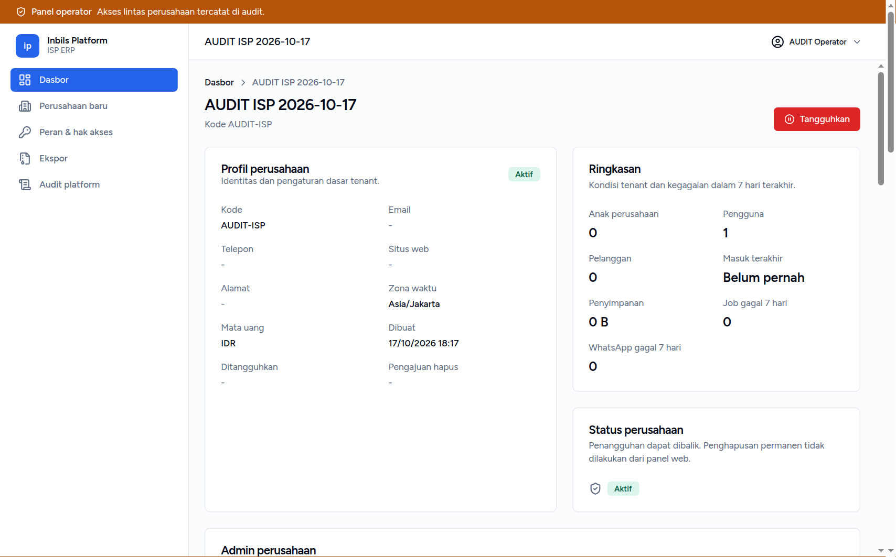

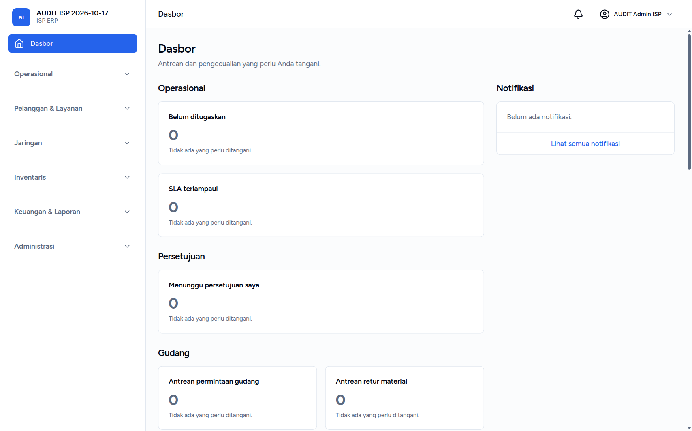

#### Rekaman yang tertinggal (prefiks AUDIT, tidak dihapus)

| Jenis | Kode / nama | Keterangan |
|---|---|---|
| company | AUDIT-ISP | AUDIT ISP 2026-10-17, id publik 01m54s9jfnt05chtnb5nfmqx1q, company_id 3 |
| platform_admin | audit-operator@inbils.test | operator uji; 2FA aktif |
| user | audit-admin@inbils.test | admin pertama AUDIT-ISP; 2FA diaktifkan |

#### Temuan cacat

| ID | Langkah | Yang terjadi | Yang diharapkan ISP | Keparahan | Saran perbaikan | Perlu keputusan owner | Bukti |
|---|---|---|---|---|---|---|---|
| F1-D01 | Profil perusahaan → unggah logo | Logo tersimpan ("Profil perusahaan diperbarui.") tetapi tidak pernah tampil: di sidebar dan pratinjau profil hanya ikon gambar rusak. URL /storage/companies/3/company-logo/47/logo.webp mengembalikan 403 (halaman debug 265 KB). Penyebab di mesin dev: public/storage adalah direktori asli (dibuat 13 Sep 2026, 1.340 berkas basi), bukan symlink storage:link, sehingga permintaan jatuh ke route "serve" disk lokal. Container deploy menjalankan storage:link di docker/app/entrypoint.sh:20, jadi ini khusus dev. | Logo tampil di sidebar, tagihan, dan aplikasi pelanggan segera setelah disimpan. | friction | Hapus direktori public/storage yang basi lalu jalankan php artisan storage:link; tambahkan cek di /ready bahwa public/storage adalah symlink ke storage/app/public. | tidak | [01-15-company-profile-after-reload.png](flow-audit/01-15-company-profile-after-reload.png) |
| F1-D02 | Semua formulir → kirim kosong | Pesan validasi bawaan browser berbahasa Inggris muncul ("Please fill out this field.") alih-alih galat Indonesia di bawah kolom. | Galat Indonesia di samping kolom, sama seperti galat server (contoh "Lokasi POP harus punya induk Area."). | polish | Tambahkan `noValidate` pada `<form>` bersama atau setCustomValidity Indonesia; biarkan galat server/Zod yang tampil. | tidak | [02-03-speed-create-blank-errors.png](flow-audit/02-03-speed-create-blank-errors.png) |
| F1-D03 | Dasbor admin → Aktivitas terbaru; platform → Audit terbaru | Daftar aktivitas memuat kunci mentah bahasa Inggris: "Perusahaan membership granted", "Perusahaan company created", "auth admin role assigned", dan di platform "admin_role_assigned", "company_created". | Kalimat Indonesia yang konsisten ("Admin diberi peran", "Perusahaan dibuat"). | polish | Petakan kunci audit ke label Indonesia (satu kamus event) dan jangan menampilkan kunci mentah. | tidak | - |
| F1-D04 | Email undangan admin | Email dikirim dari "Laravel hello@example.com" dan ditutup "Salam, Laravel" karena APP_NAME=Laravel dan MAIL_FROM_ADDRESS=hello@example.com. .env.example memakai Laravel, .env.docker.example memakai "INBILS" huruf besar dan hello@example.com. Surel tidak membawa logo atau nama ISP. | Pengirim dan tanda tangan bermerek Inbils (dan untuk surel pelanggan: nama ISP). | polish | Isi default merek yang benar di contoh env dan tambahkan cek /ready yang menolak MAIL_FROM berakhiran example.com di produksi. | ya | - |
| F1-D05 | Platform → Perusahaan baru → undangan | Undangan hanya antre (job TenantAdminInvitation di antrean default); tanpa worker queue email tidak pernah sampai dan halaman perusahaan tidak menunjukkan status apa pun ("Belum pernah" saja). | Status undangan terlihat: "Antre / Terkirim 18.17 / Gagal" dengan tombol kirim ulang di baris admin. | friction | Tampilkan status undangan (waktu kirim, gagal, tautan kedaluwarsa) di tabel Admin perusahaan. | tidak | - |

#### Temuan UX

| ID | Langkah | Sekarang | Seharusnya | Manfaat | Usaha | Catatan mockup | Lensa |
|---|---|---|---|---|---|---|---|
| F1-U01 | Dasbor admin pertama kali | Dasbor tenant baru hanya berisi kartu antrean bernilai 0 ("Tidak ada yang perlu ditangani") tanpa petunjuk langkah pertama. | Kartu "Mulai dari sini" dengan daftar periksa: profil perusahaan, wilayah peta, POP, paket, karyawan/pengguna, pelanggan pertama, tagihan otomatis; tiap baris tertaut dan berpersen selesai. | Tinggi: Admin baru tahu langkah berikutnya tanpa membuka panduan; mempercepat onboarding dari ± 1 jam menjadi beberapa menit. | M | Kartu di atas dasbor, hilang bila semua langkah selesai. | 3, 4, 8, 10 |
| F1-U02 | Platform → Perusahaan baru | Kode perusahaan diketik tangan (aturan huruf/angka/strip), padahal bisa diturunkan dari nama. | Saran kode otomatis dari nama ("AUDIT ISP" → AUDIT-ISP) dengan pemeriksaan unik langsung, tetap bisa diubah. | Rendah: Menghindari kode salah/duplikat yang tidak bisa diubah lagi. | S | - | 1, 4 |
| F1-U03 | Pengaturan Perusahaan | Satu halaman sangat panjang (tagihan, penangguhan, format tanggal, peta, WhatsApp); tombol Simpan hanya di paling bawah. | Bilah Simpan menempel di bawah layar, ditambah navigasi bagian di kiri; perubahan belum tersimpan ditandai. | Sedang: Mengurangi gulir ± 2.500 px dan risiko lupa menyimpan. | S | Sticky footer + anchor kecil di kanan atas. | 3, 9 |
| F1-U04 | Pengaturan Perusahaan → Peta | Wilayah default tenant baru adalah seluruh Indonesia (lintang -2,5489, zoom 5) padahal alamat sudah diisi di profil; nama wilayah tampil HURUF BESAR ("KOTA BANDUNG"). | Wilayah disarankan dari alamat/kota di profil (satu klik untuk menerima); nama wilayah berhuruf judul. | Sedang: Menghemat satu pencarian dan peta langsung benar untuk semua alamat pelanggan. | S | - | 4 |
| F1-U05 | Pengaturan Perusahaan → Tagihan | Dua saklar kunci alur uang bernilai mati secara awal ("Buat tagihan otomatis saat SPK selesai", "Tangguhkan langganan yang menunggak"). Panduan 9.1 mencatat "tagihan pemasangan tidak muncul" sebagai galat umum. | Pertanyaan sekali saat tenant dibuat atau di daftar periksa awal: "Terbitkan tagihan pemasangan otomatis?" dan "Isolir otomatis bila menunggak?", dengan default yang disarankan. | Tinggi: Menghindari pelanggan yang aktif tanpa tagihan pertama. | S | - | 4, 10 |
| F1-U06 | Profil pengguna admin | 2FA bersifat opsional untuk admin ISP (hanya operator platform yang dipaksa); tidak ada ajakan setelah login pertama. | Ajakan aktifkan 2FA saat login pertama admin (dapat dilewati 7 hari) dan opsi kebijakan "wajib 2FA untuk admin" per perusahaan. | Tinggi: Akun admin memegang data seluruh pelanggan dan tagihan; satu kebocoran kata sandi kini cukup untuk masuk. | M | - | 10 |
| F1-U07 | Penomoran | Penomoran jelas: format, token, pratinjau kode berikutnya, dan "Hanya kode baru yang berubah" (contoh baik, tanpa temuan). | Pertahankan; tambahkan ringkasan prefiks per entitas di checklist awal. | Rendah: Konsistensi kode sejak data pertama. | S | - | 5, 7 |

### Alur 2: Katalog (bandwidth, kecepatan, SLA, kategori, paket, lokasi/POP, NAS, ODN)

**Status:** selesai (rantai OLT→ODC→ODP dan IPAM tidak dijalankan; IPAM diaudit di alur 7)  
**Persona:** admin ISP

#### Catatan eksekusi

Ringkasan disusun penyusun laporan dari tabel rekaman, temuan, dan nama tangkapan layar di bawah; catatan terstruktur alur 2 tidak memuat baris log langkah.

- Profil Bandwidth, Profil Kecepatan, Tingkat SLA, Kategori Paket, dan Paket dibuat lewat UI. Kirim formulir kosong menampilkan pesan validasi bawaan browser (F1-D02).
- Lokasi: POP dibuat di bawah Default Area. Site baru bisa dibuat setelah Rak ada, sehingga Rak dibuat lebih dulu (F2-U05).
- Router dibuat sebagai Aset Jaringan (tipe Router, IP manajemen 10.20.0.1) lalu didaftarkan sebagai NAS; RADIUS dimatikan di dev (F2-D02).
- ODN: ODP didaftarkan lewat Aset Jaringan dan tampil di halaman ODN, lalu splitter 1:8 ditambahkan (F2-U07).
- Profil bandwidth yang dipakai paket dihapus sebagai uji; paket tetap Aktif dengan profil kosong (F2-D04).

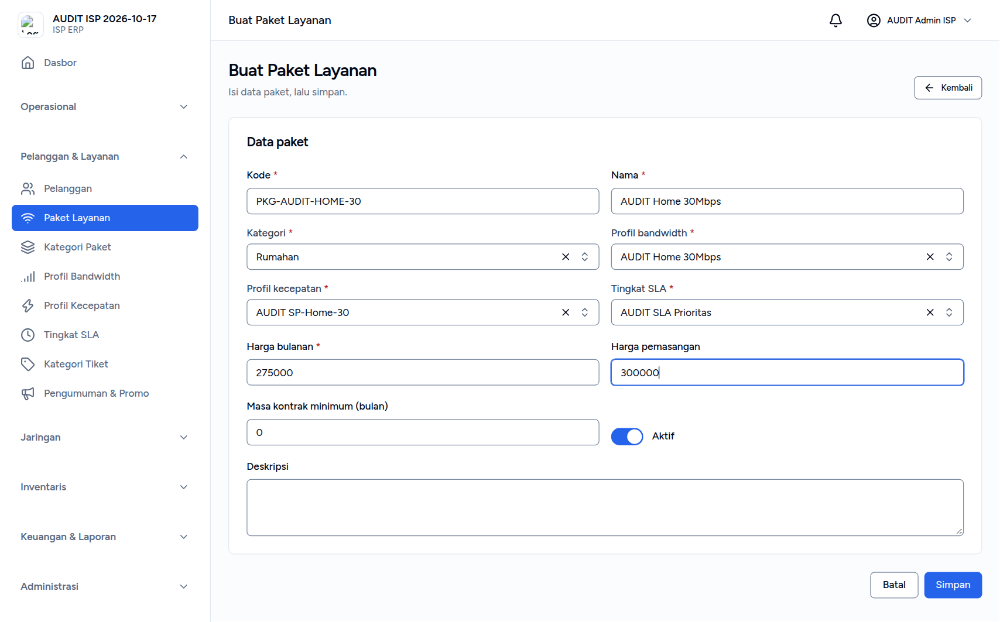

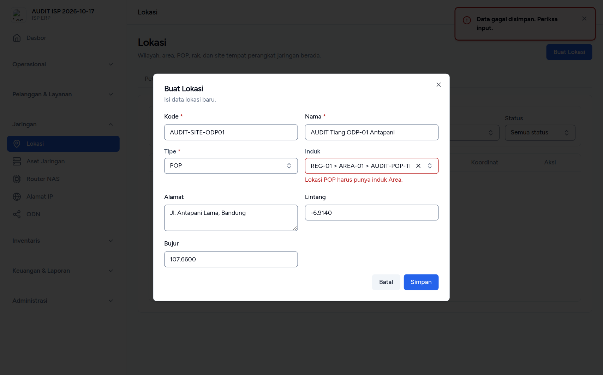

#### Rekaman yang tertinggal (prefiks AUDIT, tidak dihapus)

| Jenis | Kode / nama | Keterangan |
|---|---|---|
| bandwidth_profile | AUDIT Home 30Mbps | 30/6 Mbps, dipakai paket AUDIT Home 30Mbps |
| speed_profile | AUDIT SP-Home-30 | 30/6, burst 40/8, RADIUS audit-home-30 |
| sla_tier | AUDIT SLA Prioritas | respons 2 jam, penyelesaian 6 jam |
| service_package | PKG-AUDIT-HOME-30 | AUDIT Home 30Mbps, Rp 275.000/bln, pemasangan Rp 300.000, kategori Rumahan |
| service_package | PKG-AUDIT-UJI-HAPUS | paket uji hapus profil (profil bandwidth sengaja dihapus; biarkan) |
| location | AUDIT-POP-TMR | AUDIT POP Bandung Timur (POP) di bawah Default Area |
| location | AUDIT-RAK-01 | Rak di bawah POP (diperlukan agar Site bisa dibuat) |
| location | AUDIT-SITE-ODP01 | AUDIT Tiang ODP-01 Antapani (Site) |
| network_asset | NA-2026-00001 | AUDIT Router Edge Timur (router, IP manajemen 10.20.0.1) |
| nas_device | NA-2026-00001 | NAS AUDIT Router Edge Timur 10.20.0.1, realm audit-isp, secret tersimpan terenkripsi |
| network_asset | NA-2026-00002 | AUDIT ODP-01 Antapani (ODP) dengan splitter 1:8 "AUDIT 1:8 Antapani" |

#### Temuan cacat

| ID | Langkah | Yang terjadi | Yang diharapkan ISP | Keparahan | Saran perbaikan | Perlu keputusan owner | Bukti |
|---|---|---|---|---|---|---|---|
| F2-D01 | Lokasi → Buat Lokasi | Halaman memuat dua elemen dengan id="tipe" (filter tabel dan Tipe di dialog) sehingga label/for menunjuk elemen yang salah dan pembaca layar membaca filter yang berada di belakang dialog. | Id unik per halaman. | polish | Beri id unik pada kolom dialog (mis. location-type) atau gunakan useId. | tidak | - |
| F2-D02 | Router NAS → Daftarkan router | Toast dan kartu galat menampilkan string Inggris "RADIUS is switched off." di dalam kalimat Indonesia, dan status "Gagal ditulis" merah padahal RADIUS sengaja dimatikan. | Kalimat Indonesia penuh; status netral "RADIUS dimatikan" bukan galat. | polish | Terjemahkan pesan layanan RADIUS dan bedakan status "dimatikan" dari "gagal". | tidak | [02-18-nas-created.png](flow-audit/02-18-nas-created.png) |
| F2-D03 | Aset Jaringan (data awal) | Aset contoh yang dibuat otomatis berkode AST-2026-00001…10 sedangkan aset baru memakai NA-2026-00001 (pola Penomoran), sehingga satu daftar memuat dua skema kode. | Satu skema kode. | polish | Samakan prefiks seeder awal dengan urutan Penomoran, atau jangan membuat aset contoh. | ya | - |
| F2-D04 | Profil Bandwidth → Hapus profil yang dipakai paket | Dialog hanya menulis "akan dihapus permanen", penghapusan berhasil ("Profil bandwidth dihapus.") dan paket aktif "AUDIT Uji Hapus Profil" tetap Aktif dengan Profil bandwidth "-". Tanpa peringatan jumlah paket yang memakai (Profil Kecepatan dan Tingkat SLA tidak diuji). | Penghapusan ditolak atau diperingatkan: "Dipakai 1 paket aktif; nonaktifkan dulu". | friction | Periksa pemakaian paket sebelum hapus (atau soft-delete) di tiga katalog (bandwidth, kecepatan, SLA); tampilkan jumlah pemakai di dialog. | tidak | [02-26-package-with-deleted-profile.png](flow-audit/02-26-package-with-deleted-profile.png) |

#### Temuan UX

| ID | Langkah | Sekarang | Seharusnya | Manfaat | Usaha | Catatan mockup | Lensa |
|---|---|---|---|---|---|---|---|
| F2-U01 | Paket Layanan → Buat | Untuk menjual satu paket harus membuat 3 pendukung (Profil Bandwidth, Profil Kecepatan, Tingkat SLA) lalu paketnya: 4 formulir, ± 25 isian; unduh/unggah diketik dua kali (bandwidth dan kecepatan). | Picker pada formulir paket diberi "+ Baru" (buat di tempat), dan Profil Kecepatan mengisi unduh/unggah dari Profil Bandwidth yang dipilih; atau satukan menjadi satu "Profil layanan". | Tinggi: Menghemat ± 10 klik dan 6 ketikan angka per paket; mencegah selisih bandwidth vs kecepatan. | M | Tombol "+ Buat profil baru" di bawah daftar picker (dialog ringkas). | 1, 3, 4, 7 |
| F2-U02 | Paket Layanan → Kode | Kode paket (PKG-HOME-50) diketik tangan. | Kode disarankan dari kategori + kecepatan ("PKG-RUMAHAN-30"), bisa diubah. | Rendah: Kode seragam, tidak ada duplikat. | S | - | 1, 4 |
| F2-U03 | Paket Layanan → Harga | Harga bulanan/pemasangan diketik sebagai angka mentah (275000) tanpa pemisah ribuan atau awalan Rp. | Kolom uang dengan pemisah ribuan langsung dan awalan Rp. | Sedang: Menghindari salah nol pada harga. | S | - | 5, 6 |
| F2-U04 | Lokasi → Buat Lokasi | Lintang dan Bujur diketik sebagai teks; tidak ada pemilih peta padahal Pengaturan Perusahaan dan alamat pelanggan sudah memilikinya. | Pakai komponen pemilih peta yang sama (klik peta / "Gunakan lokasi saya"). | Sedang: Koordinat benar tanpa salin-tempel; konsisten. | S | Reuse LatLngMapPicker. | 1, 7 |
| F2-U05 | Lokasi → hierarki | Site wajib berinduk Rak dan Rak berinduk POP ("Lokasi Site harus punya induk Rak."): untuk menaruh ODP di tiang harus membuat Rak palsu lebih dulu (2 lokasi tambahan). | Izinkan Site langsung di bawah POP/Area (rak hanya untuk perangkat di dalam POP). | Sedang: Menghemat 1 formulir dan data palsu per lokasi lapangan. | S | - | 3 |
| F2-U06 | Lokasi → tab Peta | Tab Peta tampil lebih dulu dan menulis "0 lokasi" untuk tenant baru karena 3 lokasi awal belum berkoordinat; tampak seperti data hilang. | Buka tab Tabel bila tidak ada lokasi berkoordinat, atau tulis "3 lokasi belum punya koordinat". | Sedang: Menghilangkan kebingungan layar pertama. | S | - | 3, 8 |
| F2-U07 | ODN → kondisi kosong | Kondisi kosong hanya menulis "Daftarkan satu, lalu tambahkan splitter" tanpa tombol; jalur: Aset Jaringan → buat ODP → ODN → buka ODP → Tambah splitter (5 layar). | Tombol "Daftarkan ODP" di kondisi kosong yang membuka formulir aset bertipe ODP, dan langsung ke dialog splitter setelah tersimpan. | Sedang: Memangkas 5 layar menjadi 2. | S | - | 3 |
| F2-U08 | Router NAS → Daftarkan | Router harus dibuat dulu sebagai Aset Jaringan (tipe Router + IP manajemen) baru bisa didaftarkan sebagai NAS: dua formulir. Alamat NAS terisi otomatis dari IP manajemen (baik). | Buat aset router di tempat dari formulir NAS, atau sediakan satu formulir "Router" yang membuat keduanya. | Sedang: Menghemat satu layar dan satu pindah menu. | M | - | 3 |
| F2-U09 | Aset Jaringan → Tipe aset | Tipe aset (12 pilihan) memakai `<select>` bawaan tanpa pencarian; "Alamat IP" dan "IP manajemen" berdampingan tanpa penjelasan beda. | Picker yang bisa dicari atau ikon per tipe; satu label IP dengan keterangan. | Rendah: Memilih lebih cepat, tidak salah isi IP. | S | - | 2, 7 |
| F2-U10 | Daftar katalog | Kolom Aksi tidak seragam: Kategori Paket dan Lokasi memakai tombol teks Ubah/Hapus berjajar, Profil Bandwidth/SLA/Paket memakai Ubah + menu "…". | Satu pola aksi baris di semua daftar. | Sedang: Pengguna belajar sekali; mencegah salah klik Hapus. | S | - | 7 |
| F2-U11 | Tenant baru → data awal | Tenant baru langsung berisi 8 paket (termasuk "Trial 5Mbps", "Home 20Mbps Promo"), 10 barang, 10 aset berserial palsu (OLT Huawei MA5800 dll.), 5 profil bandwidth, 3 tingkat SLA, 5 kategori tiket; dasbor menghitungnya sebagai data sungguhan. | Pilihan jelas saat membuat tenant: "Katalog awal" (siap pakai, bisa diedit) atau kosong; aset berserial palsu jangan ikut. | Tinggi: Stok dan aset sungguhan tidak tercampur data contoh; laporan aset tidak menyesatkan. | S | - | 4, 10 |

### Alur 3: Tim (pengguna, organisasi, karyawan, kendaraan, dokumen, peran baca saja, login teknisi dan pelanggan)

**Status:** selesai (login aplikasi pelanggan diuji di alur 4/5)  
**Persona:** admin ISP; manajer, staf CS, dan teknisi untuk uji menu dan login web

#### Catatan eksekusi

- **Pengguna ×4 (manajer, staf CS, staf gudang, teknisi) → Organisasi ×3 → Kendaraan ×2 → Karyawan ×4 → Jenis dokumen → Peran (baca saja)** → Semua tersimpan dengan toast Indonesia; temuan: dialog menyimpan isian lama, tidak ada layar unggah dokumen
- **Login teknisi dan manajer/staf di web** → Teknisi → /app-only (benar); manajer 32 menu, staf 26 menu

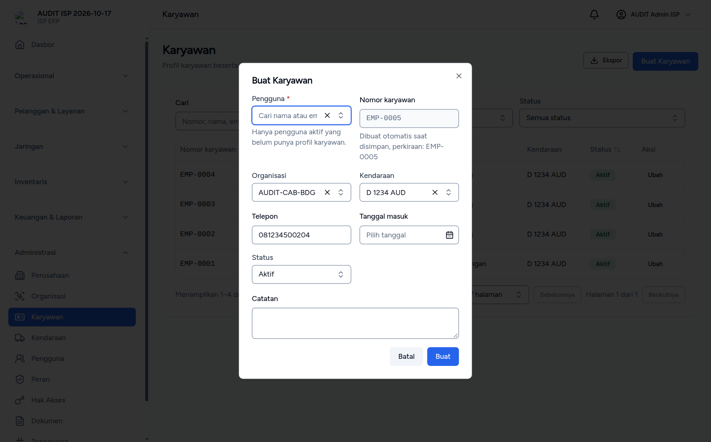

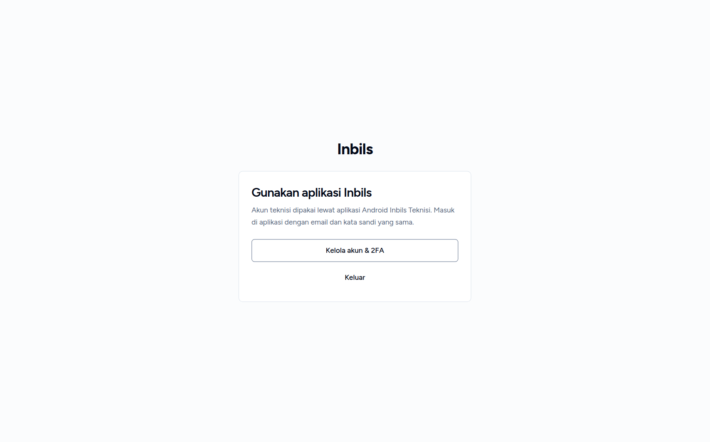

#### Rekaman yang tertinggal (prefiks AUDIT, tidak dihapus)

| Jenis | Kode / nama | Keterangan |
|---|---|---|
| user | audit-manager@inbils.test | AUDIT Manajer (peran manager), kata sandi persona di ~/.config/inbils/flow-audit/personas.json |
| user | audit-staff@inbils.test | AUDIT Staf CS (peran staff) |
| user | audit-warehouse@inbils.test | AUDIT Staf Gudang (peran staff; tidak ada peran gudang tersendiri) |
| user | audit-tech@inbils.test | AUDIT Teknisi Andi (peran technician), EMP-0001, kendaraan D 1234 AUD |
| employee | EMP-0001..0004 | profil karyawan keempat persona |
| organization_unit | AUDIT-CAB-BDG / AUDIT-TIM-TEKNISI / AUDIT-UNIT-GUDANG | cabang, tim teknisi, unit gudang |
| vehicle | D 1234 AUD / D 5678 AUD | motor Honda Vario 160 (teknisi); mobil Daihatsu Gran Max (uji sisa isian dialog) |
| document_type | AUDIT-KTP | AUDIT KTP Pelanggan, berlaku untuk pelanggan, 365 hari |

#### Temuan cacat

| ID | Langkah | Yang terjadi | Yang diharapkan ISP | Keparahan | Saran perbaikan | Perlu keputusan owner | Bukti |
|---|---|---|---|---|---|---|---|
| F3-D01 | Karyawan → Buat Karyawan (dibuka berulang) dan Kendaraan → Buat Kendaraan | Setelah simpan berhasil, dialog dibuka lagi dengan SEMUA isian lama masih terisi: Karyawan mempertahankan Organisasi, Kendaraan, dan Telepon (hanya Pengguna yang kosong); Kendaraan mempertahankan nomor polisi, jenis, merek, model, dan catatan. Akibatnya tiga karyawan baru (manajer, staf CS, staf gudang) tersimpan dengan kendaraan teknisi "D 1234 AUD" tanpa disadari; nomor telepon karyawan sebelumnya ikut terbawa. Dialog Organisasi mereset dengan benar, jadi pola tidak seragam. | Dialog buat selalu kosong setiap dibuka setelah berhasil menyimpan. | friction | Reset form saat dialog ditutup/berhasil (useForm.reset atau key unik per pembukaan) di semua dialog buat; satu hook bersama. | tidak | [03-10-employee-dialog-reopened.png](flow-audit/03-10-employee-dialog-reopened.png) |
| F3-D02 | Menu Dokumen | Menu "Dokumen" hanya mengelola JENIS dokumen (nama, kode, berlaku untuk, masa berlaku). Tidak ada layar untuk mengunggah, melihat, atau menghapus berkas pelanggan/karyawan; saklar "Wajib" hanya label dan tidak mengingatkan apa pun (panduan 8.8 mengakuinya). | ISP menyimpan KTP, surat berlangganan, dan berita acara per pelanggan serta mendapat pengingat masa berlaku. | friction | Tambah tab Dokumen di detail pelanggan (unggah/lihat/hapus, jenis dari daftar ini, pengingat kedaluwarsa); sebelum itu ubah label menu menjadi "Jenis Dokumen". | ya | [03-11-documents.png](flow-audit/03-11-documents.png) |
| F3-D03 | Pengguna / Peran | Nama peran tampil mentah berbahasa Inggris dan huruf kecil (admin, manager, staff, technician, customer) di tabel Pengguna, Peran, dan kotak centang; formulir Pengguna menawarkan peran "customer" untuk akun back-office padahal panduan melarangnya. | Label Indonesia (Admin, Manajer, Staf, Teknisi) dan peran pelanggan tidak ditawarkan di formulir pengguna back-office. | polish | Pemetaan label peran (RoleBadge) + sembunyikan peran customer dari formulir Pengguna. | tidak | [03-12-roles.png](flow-audit/03-12-roles.png) |

#### Temuan UX

| ID | Langkah | Sekarang | Seharusnya | Manfaat | Usaha | Catatan mockup | Lensa |
|---|---|---|---|---|---|---|---|
| F3-U01 | Pengguna → Karyawan (teknisi baru) | Satu teknisi memerlukan dua layar admin: Pengguna (akun + peran) lalu Karyawan (profil, organisasi, kendaraan, telepon). Setelah "Pengguna dibuat." tidak ada petunjuk bahwa teknisi tidak akan muncul di Penugasan/aplikasi sebelum profil Aktif dibuat (panduan 8.3 menyebutnya syarat). | Bila peran teknisi dicentang tampilkan bagian "Profil karyawan" di formulir yang sama, atau arahkan otomatis ke dialog Karyawan dengan pengguna terisi. | Tinggi: Menghemat ± 12 klik per teknisi dan menutup jebakan "teknisi tidak bisa dipilih". | M | Bagian ringkas yang muncul saat peran teknisi dipilih. | 3, 4, 10 |
| F3-U02 | Pengguna → Buat Pengguna | Admin mengetik kata sandi awal lalu harus menyampaikannya sendiri ("sistem tidak mengirim email"); admin pertama justru memakai tautan undangan. Dua cara berbeda untuk hal yang sama. | Undangan email (atau WhatsApp) berisi tautan atur kata sandi, seperti undangan admin pertama; kata sandi tidak pernah diketik admin. | Sedang: Kata sandi tidak beredar lewat chat; satu pola yang sama. | M | - | 5, 7, 10 |
| F3-U03 | Organisasi / Kendaraan | Kode unit organisasi diketik tangan; "Jenis" kendaraan teks bebas dengan petunjuk "Motor, mobil, atau pikap". | Kode unit disarankan dari nama; Jenis kendaraan berupa pilihan (Motor, Mobil, Pikap). | Rendah: Data seragam untuk laporan; salah ketik hilang. | S | - | 1, 2 |
| F3-U04 | Peran staf | Satu peran "staff" dipakai untuk CS, gudang, dan keuangan: staf melihat 26 menu termasuk Router NAS, Alamat IP, ODN, master Barang/Kategori/Satuan, Tagihan, Tunggakan, Laporan; tidak ada persona "gudang" sama sekali. | Peran tujuan (CS, Gudang, Keuangan) dibuat operator platform dan disediakan sebagai bawaan; menu mengikuti pekerjaan. | Tinggi: Menu staf CS turun dari 26 ke ± 12 butir; risiko salah klik dan akses data berlebih berkurang. | M | - | 10 |
| F3-U05 | Login teknisi di web | Halaman "Gunakan aplikasi Inbils" menyuruh masuk di aplikasi tetapi tidak menampilkan tautan unduh/QR (tombol Play Store disembunyikan sampai URL toko diisi). | Tampilkan tautan unduh APK/Play Store atau QR; bila belum ada tulis "Minta tautan aplikasi ke admin ISP Anda". | Sedang: Teknisi baru menyelesaikan pemasangan aplikasi < 1 menit tanpa bantuan. | S | - | 8, 10 |
| F3-U06 | Peran (read-only) | Tenant admin hanya melihat peran dan diberi tahu "dikelola oleh operator platform", tanpa jalur untuk meminta perubahan. | Tombol "Minta perubahan peran" (kirim ke operator dengan izin yang diminta). | Rendah: Menghindari tiket di luar sistem; jejak permintaan. | S | - | 3, 10 |

### Alur 4: Onboarding pelanggan sampai tagihan pertama

**Status:** selesai sampai tagihan pertama, dalam tiga bagian, dengan satu jalan pintas audit untuk F4-D06 (FlowAudit5 menerima 18 m kabel dan 2 pcs konektor di AUDIT-POP-TMR agar persetujuan SPK bisa lewat; keputusan perbaikannya tetap milik owner). **Belum dijalankan:** staf gudang menerima retur 2 m (kasus 22 masih `awaiting_receipt`).  
**Persona:** staf CS (uji peran), manajer (mendaftarkan dan menugaskan), teknisi dan pelanggan (aplikasi, AVD `inbils_pixel7`), staf gudang, admin (web, 2FA TOTP).  
**Kode:** web `main` a6348bb, mobile `main` fab0a56. Jam dinding WIB; DB dan log memakai UTC (WIB = UTC+7).

#### Catatan eksekusi

**Bagian 1 (FlowAudit1): pendaftaran pelanggan sampai teknisi ditugaskan**

- **Staf CS membuka Pelanggan** → Tidak ada tombol Buat Pelanggan (temuan F4-D01)
- **Manajer: Buat Pelanggan (4 tab: Data, Alamat dengan geocoder, Kontak, Langganan & SPK dengan port drop) → Buat pelanggan dan SPK** → OK 3,5 s; pelanggan AUD-00001, langganan SUB-2026-00001, SPK-2026-00001 (Menunggu penugasan); email link akses antre lalu terkirim setelah queue:work
- **Manajer: Penugasan → Tugaskan → pilih teknisi → Simpan; buka halaman SPK** → OK 2,5 s; status Ditugaskan, tahap kunjungan Ditugaskan, riwayat penugasan tercatat
- **Aplikasi: APK dev customer dan technician dibangun (26 s dan 14 s, cache Gradle), AVD inbils_pixel7 boot 22 s, adb reverse tcp:8010 tcp:80, kedua APK terpasang** → Siap; langkah aplikasi (berangkat, check-in, material, bukti, submit) BELUM dijalankan

Dari "Buat Pelanggan" sampai teknisi ditugaskan: 3 layar, 17+ isian/klik, 3,5 s simpan dan 2,5 s tugaskan.

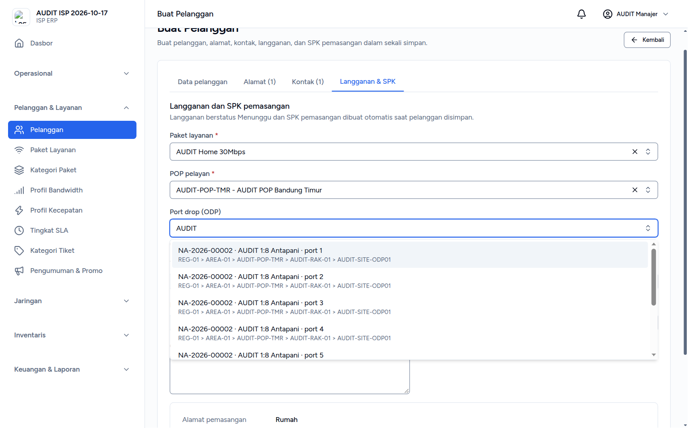

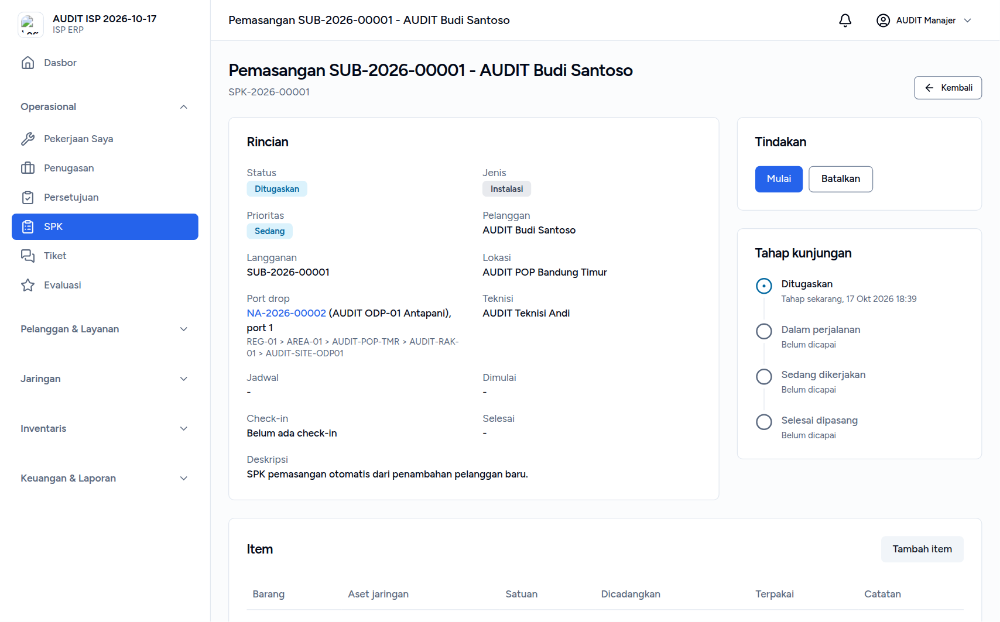

**Bagian 2 (FlowAudit3): aplikasi teknisi sampai percobaan persetujuan SPK**

**Status putaran 1 (FlowAudit3):** sebagian. Dijalankan: berangkat, check-in, permintaan material → gudang → serah terima, deklarasi material, catat pemakaian, bukti foto, ajukan untuk review, buka antrean persetujuan, coba setujui. Persetujuan SPK gagal dengan galat stok (F4-D06); jalan pintas stok sengaja tidak dipakai tanpa keputusan owner. **Dilanjutkan oleh FlowAudit5** dengan jalan pintas itu (tercatat di Bagian 3 di bawah), sampai persetujuan, aktivasi, akun jaringan, dan tagihan pertama.

- **Teknisi: buka aplikasi, login audit-tech, izin notifikasi, Beranda** → OK. Dialog izin notifikasi muncul ± 1 s setelah Masuk; Beranda memuat "Kunjungan berikutnya" SPK-2026-00001 dan kartu hitung (1 Ditugaskan). Lensa 8: login sampai tahu pekerjaan berikutnya < 15 s.
- **Berangkat: Buka SPK → "Saya berangkat" → dialog konfirmasi → izin lokasi (hanya pertama kali, "Saat aplikasi dipakai") → tahap 2 pukul 18.54** → OK. 2 ketukan + izin. Server mencatat aktivitas `en_route` dengan titik GPS.
- **Aplikasi pelanggan (login audit-customer1 setelah kata sandi diatur dari tautan Mailpit): Beranda menampilkan "Sedang berjalan · SPK-2026-00001 · Instalasi · Dalam perjalanan", layar "Kunjungan teknisi" dengan tahapan dan jam, lonceng 1 notifikasi "Teknisi dalam perjalanan: Teknisi AUDIT sedang menuju lokasi Anda."** → OK. Teknisi ditampilkan nama depan saja (desain: tanpa nomor telepon teknisi; di dev nama depan "AUDIT" karena nama uji "AUDIT Teknisi Andi"). Push untuk peristiwa ini tidak diuji: perangkat pelanggan belum terdaftar saat peristiwa terjadi.
- **Check-in: "Mulai" → dialog "Mulai SPK ini?" → tahap 3 pukul 18.59** → OK. Titik GPS emulator diset ke koordinat pelanggan (`adb emu geo fix 107.6588832 -6.9148016`), server mencatat `check_in` dengan jarak 0 m, akurasi 5 m; halaman SPK web menampilkan "Check-in 0 m dari lokasi (akurasi ±5 m)". Jarak jauh dari lokasi (peringatan/penolakan) belum diuji.
- **Permintaan barang: tab Material → Permintaan baru → Tambah barang (cari "fiber", pilih, jumlah 60) ×2 → alasan → Kirim** → REQ-20261017-0001 (Kabel Fiber Optic Single 60 m, Connector SC/APC 2 pcs). Pemeriksaan DB: `inventory_requests.source_type` dan `source_id` NULL, yaitu permintaan tidak terhubung ke SPK; satu-satunya rujukan adalah alasan yang diketik teknisi ("Pemasangan SPK-2026-00001 Budi"). ± 14 ketukan + 2 ketikan.
- **Manajer: Setujui & Reservasi Stok** → galat langsung di dialog "Stok tidak mencukupi untuk KBL-FO-SINGLE di POP-01. Tersedia: 25, Diminta: 60."; setelah jumlah disetujui diubah menjadi 20 m (Connector 2 pcs) dengan catatan → toast "Permintaan barang disetujui dan stok berhasil direservasi." (1,2 s).
- **Gudang (staf gudang): Mulai Penyiapan → Tandai Siap Diambil → Serah Terima & Kurangi Stok** → tiga toast Indonesia, masing-masing 1,0-1,2 s; stok Kabel Fiber Optic Single 25 → 5, Connector SC/APC 35 → 33; linimasa menampilkan pelaku tiap langkah.
- **Teknisi: tab Material → Pengembalian material "Perlu dideklarasi" → Deklarasi material (Terpakai 18 m / Kembali baik 2 m; Connector Terpakai 2) → Kirim deklarasi** → kasus retur 22 berstatus `awaiting_receipt`; `work_order_id` kasus NULL. Email "Deklarasi Pengembalian Material" ke gudang, staf, manajer, admin.
- **Teknisi: halaman SPK → Tambah material (Catat pemakaian) 18 m dan 2 pcs** → baris "Dialokasikan 0 m · Terpakai 18 m" dan "Dialokasikan 0 pcs · Terpakai 2 pcs".
- **Teknisi: Ambil foto → Kamera → rana → Selesai → keterangan → Simpan** → foto "ONT terpasang di dinding ruang tamu" tampil sebagai bukti; tombol kirim aktif. 6 ketukan + keterangan.
- **Teknisi: "Selesai dipasang · kirim untuk review"** → status Menunggu review pukul 19.15 (tahap 4). Tidak ada dialog konfirmasi. Tidak ada notifikasi (lonceng atau email) untuk peninjau pada pemeriksaan 1-2 menit setelah pengajuan.
- **Admin (TOTP): Dasbor kartu "Menunggu persetujuan saya 1" → Persetujuan → Tinjau (panel samping) → Lihat detail → Setujui → dialog "Setujui SPK" → Setujui** → GAGAL: toast "Data gagal disimpan. Periksa input." (2,5 s). Log: `InsufficientStockException: Stok tidak mencukupi. Diminta: 18, Tersedia: 0.` (admin, 19.17 WIB). Status SPK tetap Menunggu review (transaksi dibatalkan); langganan tetap `pending`, pelanggan `prospective`, tagihan 0, akun jaringan 0.

Akar masalah dari kode: `CompleteSpkAction::consumeStock` menganggap pemakaian "tertutup" hanya jika ada permintaan barang berstatus issued dengan `source_type = work_order` dan `source_id` = SPK ini. Permintaan dari aplikasi teknisi tidak membawa sumber itu, jadi 18 m dan 2 pcs dikeluarkan lagi dari stok di `work_orders.location_id`, yaitu POP pelayan (AUDIT-POP-TMR) yang stoknya 0, sedangkan stok ada di gudang POP-01.

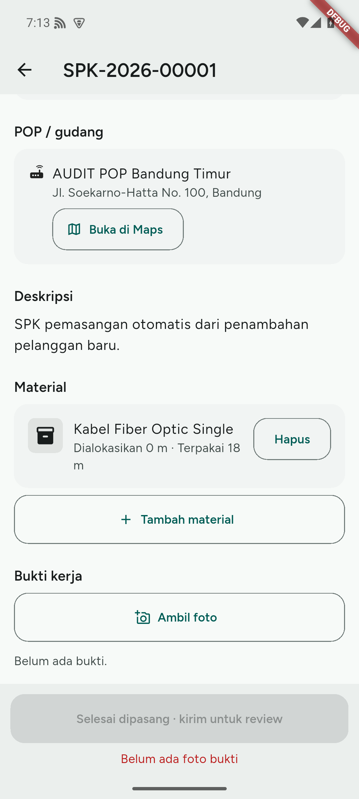

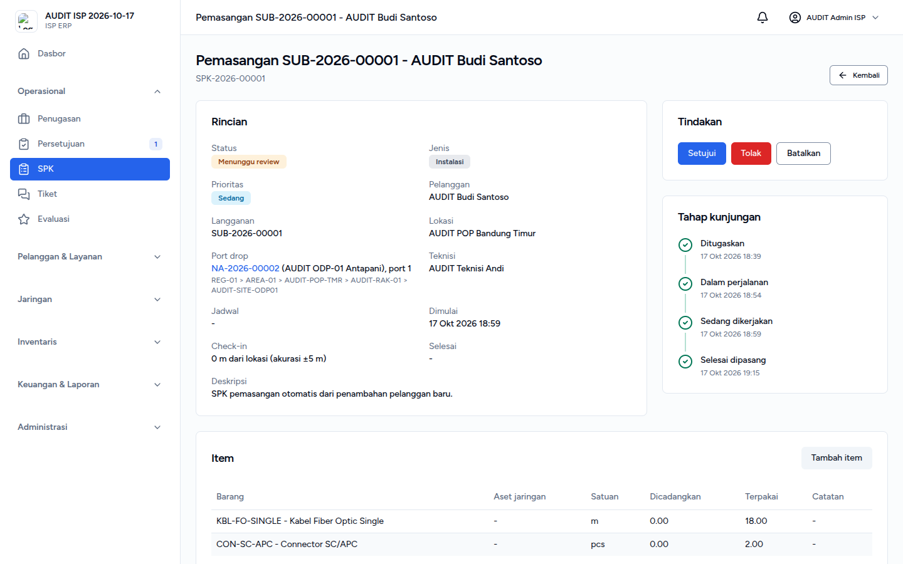

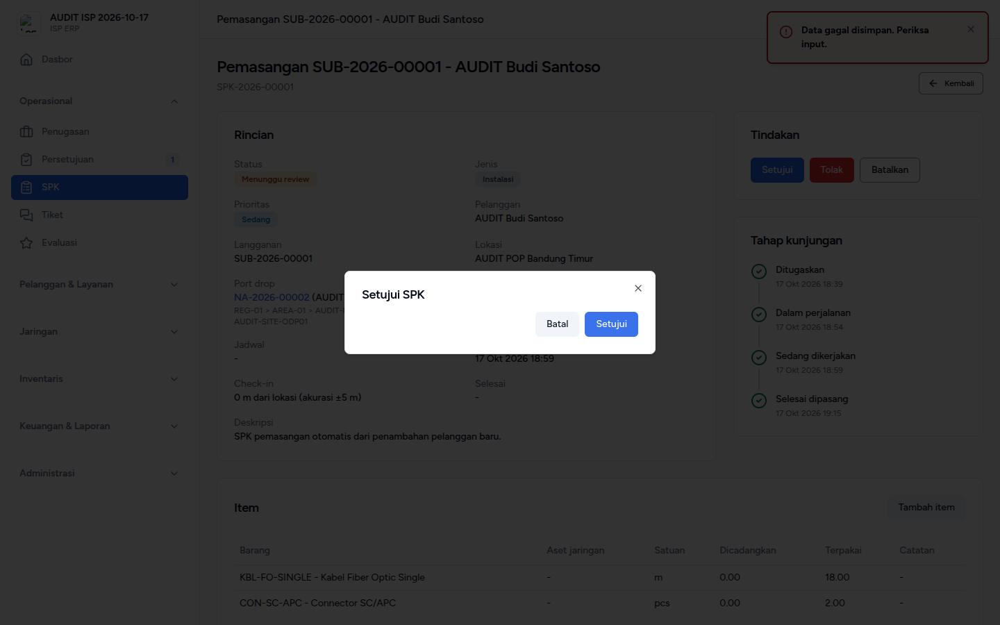

**Bagian 3 (FlowAudit5): persetujuan SPK sampai tagihan pertama**

- **Jalan pintas F4-D06 (bukan perbaikan; keputusannya tetap milik owner):** admin → Stok → Terima Barang, dua kali: Barang (cari "fiber" atau "SC/APC", minimal 2 huruf), Lokasi (cari "TMR"), Jumlah 18 m / 2 pcs, Catatan → toast "Barang berhasil diterima." Stok `AUDIT-POP-TMR` menjadi 18 m dan 2 pcs. ± 7 aksi per barang. Pencarian barang dan lokasi terasa baik; barang alat (Fiber Stripper) tercampur dengan bahan.
- **Persetujuan:** Persetujuan → SPK-2026-00001 → Setujui → dialog (hanya judul dan dua tombol) → Setujui → toast "SPK disetujui." 0,55 s. DB: SPK `completed` (approved_at = completed_at), pelanggan `active`, langganan `active` (aktivasi 17/10/2026, tagihan berikutnya 01/11/2026), tagihan INV-2026-00001 Draf. Notifikasi ke teknisi ("SPK disetujui") dan pelanggan ("Kunjungan teknisi selesai"); keduanya terkirim sebagai push dalam 1 detik (log `push.delivered`, tampil di bayangan AVD).
- **Pemotongan ganda terbukti dengan angka:** stok POP-01 kabel 25 → 5 m saat serah terima gudang; lalu stok `AUDIT-POP-TMR` 18 → 0 m saat persetujuan, untuk pekerjaan yang memakai 18 m. Tanpa jalan pintas, persetujuan gagal (F4-D06).
- **Akun jaringan:** tidak dibuat otomatis (F4-D17). Halaman langganan tidak terjangkau dari detail pelanggan (F4-D15), jadi FlowAudit5 membuka alamat `/admin/customers/{id}/subscriptions`. Akses jaringan → Buat akun jaringan (PPPoE, `aud00001@audit-isp`, kata sandi dibuat sistem, tampil sekali dengan tombol Salin) → toast "Akun jaringan dibuat." 1,5 s; sinkronisasi "Menunggu" karena RADIUS mati di dev.
- **Tagihan pertama:** INV-2026-00001, Draf, Sekali bayar, sumber SPK, Rp 643.800 = kabel 18 × Rp 15.000 + konektor 2 × Rp 5.000 + "Biaya Instalasi installation" Rp 300.000, PPN 11%, jatuh tempo 14 hari. Dikirim di Alur 5.

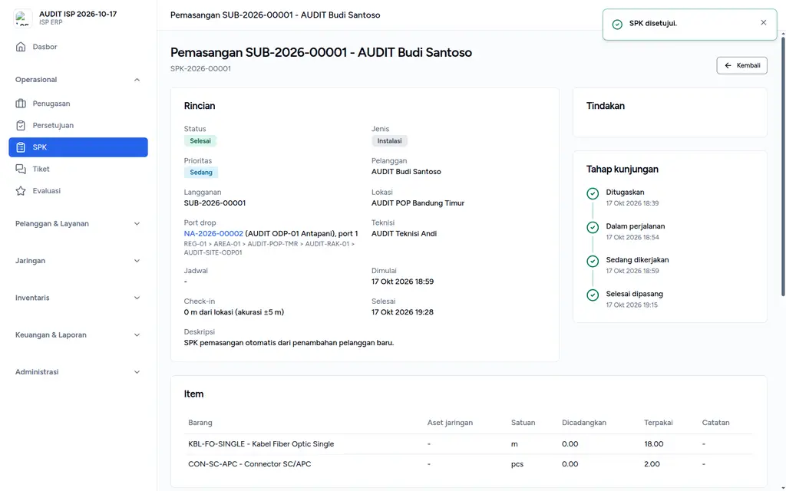

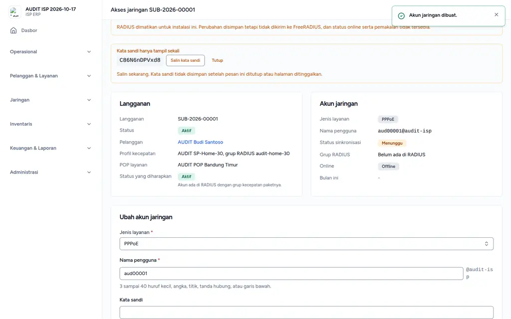

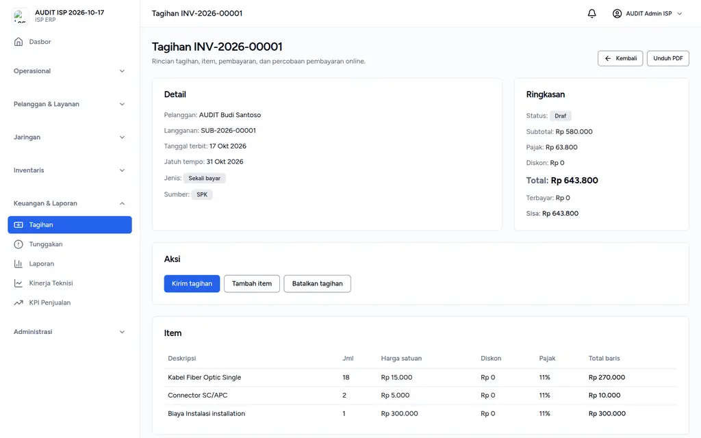

#### Rekaman yang tertinggal (prefiks AUDIT, tidak dihapus)

| Jenis | Kode / nama | Keterangan |
|---|---|---|
| customer | AUD-00001 | AUDIT Budi Santoso, audit-customer1@inbils.test, 081234500301, Jl. Antapani Lama No. 17 (-6.9148016, 107.6588832), paket AUDIT Home 30Mbps |
| subscription | SUB-2026-00001 | POP AUDIT-POP-TMR, port drop NA-2026-00002 port 1, status Menunggu |
| work_order | SPK-2026-00001 | Pemasangan SUB-2026-00001 - AUDIT Budi Santoso; ditugaskan ke AUDIT Teknisi Andi (status Ditugaskan, jadwal kosong) |
| inventory_request | REQ-20261017-0001 | Dikeluarkan: Kabel Fiber Optic Single 20 m (diminta 60), Connector SC/APC 2 pcs; disetujui AUDIT Manajer dengan catatan; tanpa rujukan SPK |
| material_return_case | id 22 (REQ-20261017-0001) | menunggu diterima gudang; deklarasi: kabel terpakai 18 m, kembali 2 m; konektor terpakai 2 |
| work_order | SPK-2026-00001 | Menunggu review; item KBL-FO-SINGLE 18 m, CON-SC-APC 2 pcs; satu foto bukti; check-in 0 m |
| stok | POP-01 | Kabel Fiber Optic Single 5 m, Connector SC/APC 33 pcs (stok di bawah minimum menyalakan kartu dasbor) |
| user | audit-customer1@inbils.test | kata sandi diatur dari tautan Mailpit (rahasia di `~/.config/inbils/flow-audit/personas.json`, kunci `customer`); login di aplikasi pelanggan |

#### Temuan cacat

| ID | Langkah | Yang terjadi | Yang diharapkan ISP | Keparahan | Saran perbaikan | Perlu keputusan owner | Bukti |
|---|---|---|---|---|---|---|---|
| F4-D01 | Pelanggan (persona Staf CS) | Staf CS melihat daftar Pelanggan tanpa tombol "Buat Pelanggan" dan tanpa penjelasan; kondisi kosong hanya menulis "Satu pelanggan dibuat bersama alamat, kontak, langganan, dan SPK pemasangan." Pendaftaran hanya bisa oleh manajer/admin (butuh izin langganan + SPK). | Petugas CS/penjualan, orang yang biasanya mendaftarkan pelanggan ISP, bisa mendaftar, atau layar menyebut siapa yang berwenang. | friction | Beri izin pendaftaran pada peran CS/penjualan (atau peran baru) dan tulis di kondisi kosong "Minta manajer/admin untuk mendaftarkan". | ya | [04-01-staff-customers.png](flow-audit/04-01-staff-customers.png) |
| F4-D02 | Penugasan → Tugaskan / halaman SPK | SPK pemasangan otomatis lahir tanpa Jadwal ("Jadwal: -"). Dialog Tugaskan hanya memilih teknisi, halaman SPK tidak punya tombol Ubah, dan /admin/spk/{id}/edit setelah ditugaskan menolak dengan 422 ("SPK hanya bisa diubah saat berstatus draf atau menunggu penugasan") berupa halaman galat mentah. Jadwal kunjungan tidak bisa diisi setelah penugasan, sehingga pelanggan tidak pernah menerima pesan jadwal (panduan 9.1 langkah 5). | Dispatcher menentukan teknisi sekaligus tanggal/jam kunjungan; pelanggan diberi tahu. | friction | Tambah isian Jadwal pada pendaftaran pelanggan dan pada dialog Tugaskan; ganti 422 mentah dengan pesan ramah. | ya | [04-13-spk-edit.png](flow-audit/04-13-spk-edit.png) |
| F4-D03 | Penugasan → Simpan penugasan | Toast sukses muncul dua kali ("SPK SPK-2026-00001 berhasil ditugaskan." ×2) dan kalimatnya berbunyi "SPK SPK-...". | Satu toast; kalimat "SPK-2026-00001 berhasil ditugaskan." | polish | Hapus salah satu sumber toast (flash server vs klien) dan rapikan kalimat. | tidak | - |
| F4-D04 | Buat Pelanggan → tab Langganan & SPK | Biaya bulanan dan pemasangan terisi mentah "275000.00" / "300000.00" (dua desimal, tanpa pemisah ribuan) padahal daftar paket menampilkan "Rp 275.000". | Format rupiah yang sama di seluruh layar. | polish | Pakai komponen uang bersama untuk dua kolom ini. | tidak | [04-09a-customer-before-submit.png](flow-audit/04-09a-customer-before-submit.png) |
| F4-D05 | Buat Pelanggan → toast | Toast menulis "Link akses dikirim ke audit-customer1@inbils.test." padahal email hanya antre; baru terkirim setelah worker queue berjalan (di stack dev tidak ada worker). | Kalimat jujur ("Link akses akan dikirim") atau status terkirim yang terlihat di halaman pelanggan. | polish | Ubah kalimat dan tampilkan status kirim undangan pelanggan di kartu pelanggan. | tidak | - |
| F4-D06 | Persetujuan SPK setelah teknisi meminta material lewat aplikasi | Persetujuan SPK gagal ("Data gagal disimpan. Periksa input."). Permintaan barang dari aplikasi teknisi tidak terhubung ke SPK (`source_type`/`source_id` NULL), jadi pemakaian yang dicatat di SPK (18 m, 2 pcs) dikeluarkan lagi dari stok di POP pelayan yang kosong (`InsufficientStockException: Diminta: 18, Tersedia: 0`). Kalau stok cukup, material terpotong dua kali (sekali saat serah terima, sekali saat SPK disetujui). Halaman SPK menunjukkan "Dialokasikan 0 m · Terpakai 18 m". | Material yang diserahkan gudang untuk pemasangan ini langsung dihitung sebagai pemakaian SPK; persetujuan tidak mengeluarkan stok dua kali dan tidak bergantung pada stok POP. | blocker | Aplikasi: permintaan dari SPK aktif membawa `source_type=work_order` (pilihan SPK terisi otomatis, lihat F4-U06). Server: konsumsi SPK memakai gudang asal permintaan, bukan `work_orders.location_id`; tolak persetujuan dengan pesan jelas. | ya | [04b-57](flow-audit/04b-57-admin-spk-approved.png), [04b-44](flow-audit/04b-44-tech-usage-saved.png), [04b-55](flow-audit/04b-55-admin-spk-show.png) |
| F4-D07 | Persetujuan SPK → galat | Alasan penolakan sistem tidak sampai ke layar: toast hanya "Data gagal disimpan. Periksa input." padahal log memuat "Stok tidak mencukupi. Diminta: 18, Tersedia: 0." Dialog persetujuan permintaan barang di halaman lain menampilkan alasan stok dengan jelas. | Penyetuju tahu sebab dan langkah berikutnya ("Stok Kabel Fiber Optic Single di AUDIT POP Bandung Timur 0 m, butuh 18 m"). | friction | Teruskan pesan `InsufficientStockException` (dan `abort` 422 lain) ke toast atau kartu galat di halaman SPK, dengan nama barang dan lokasi, bukan kode. | tidak | [04b-57](flow-audit/04b-57-admin-spk-approved.png) |
| F4-D08 | Persetujuan → antrean dan panel Tinjau | "Diajukan: 17 Okt 2026 (36 menit lalu)" dan "Tanggal pengajuan 18:39" memakai waktu pembuatan SPK, padahal teknisi mengajukan pukul 19:15. Kolom "Pemohon" menampilkan AUDIT Manajer (pembuat SPK), bukan teknisi yang mengajukan. | Waktu pengajuan = waktu teknisi mengajukan; pemohon/teknisi = pelaku kunjungan. | friction | Pakai `submitted_at` dan tampilkan teknisi di antrean dan panel. | tidak | [04b-53](flow-audit/04b-53-admin-approvals.png), [04b-54](flow-audit/04b-54-admin-spk-review.png) |
| F4-D09 | Persetujuan → "Dampak material" | "2 jenis, 20 unit" dan "Total kuantitas: 20 unit" menjumlahkan 18 m kabel dengan 2 pcs konektor. | Rincian per barang dengan satuannya ("Kabel 18 m, Konektor 2 pcs"). | polish | Tampilkan daftar barang + satuan, bukan satu total. | tidak | [04b-54](flow-audit/04b-54-admin-spk-review.png) |
| F4-D10 | Aplikasi teknisi → halaman SPK | Kepala kartu menulis "installation · Prioritas sedang" (jenis mentah berbahasa Inggris); aplikasi pelanggan menulis "Instalasi". | Label Indonesia yang sama di kedua aplikasi. | polish | Petakan jenis SPK ke label Indonesia di aplikasi teknisi. | tidak | [04b-03](flow-audit/04b-03-tech-spk-detail.png) |
| F4-D11 | Aplikasi teknisi → tab Material | Setelah gudang menyetujui, menyiapkan, dan menyerahkan (20 m), kartu permintaan masih bertuliskan "Kabel Fiber Optic Single 60 m" (jumlah diminta, bukan yang disetujui/diserahkan) dan tidak berubah sampai tarik-untuk-muat-ulang. Setelah "Kirim deklarasi" layar kembali ke tab dengan kartu "Perlu dideklarasi" lama sampai muat ulang. Push "Permintaan siap diambil" tidak diterima (lihat Lingkungan). | Kartu menampilkan jumlah disetujui/diserahkan; daftar segar setelah aksi sendiri dan setelah push/buka layar. | friction | Muat ulang daftar setelah kirim dan saat tab dibuka; tampilkan "Diserahkan 20 m dari 60 m diminta". | tidak | [04b-37](flow-audit/04b-37-tech-material-stale.png), [04b-38](flow-audit/04b-38-tech-material-refreshed.png), [04b-42](flow-audit/04b-42-tech-material-after-declare.png) |
| F4-D12 | Persetujuan permintaan barang → galat stok | Pesan memakai kode ("KBL-FO-SINGLE di POP-01"), bukan nama barang dan gudang. | "Kabel Fiber Optic Single di Default POP: tersedia 25 m, diminta 60 m." | polish | Pakai nama dan satuan pada pesan stok. | tidak | [04b-28a](flow-audit/04b-28a-mgr-approve-insufficient-stock.png) |
| F4-D13 | Teknisi mengajukan SPK untuk review | Tidak ada konfirmasi pada "Selesai dipasang · kirim untuk review" (aksi yang tidak bisa dibatalkan teknisi), sedangkan "Saya berangkat" dan "Mulai" memakai dialog. Tidak ada notifikasi ke peninjau (lonceng/email) saat SPK masuk antrean; peninjau baru tahu dari kartu dasbor. | Satu aturan konfirmasi; peninjau diberi tahu. | friction | Konfirmasi (atau Urungkan 10 detik) untuk ajukan; kirim notifikasi "SPK menunggu review" ke pemegang izin `spk.approve`. | tidak | [04b-50](flow-audit/04b-50-tech-after-submit.png) |
| F4-D14 | Dasbor admin → Aktivitas terbaru | Kunci mentah campuran Inggris: "Stok stock issued", "SPK item dicatat", "SPK bukti diunggah" (keluarga F1-D03). | Kalimat Indonesia dari satu kamus event. | polish | Tambahkan ke kamus event audit. | tidak | [04b-52](flow-audit/04b-52-admin-dashboard-after-submit.png) |
| F4-D15 | Detail pelanggan → tab Langganan → halaman langganan | Baris tab Langganan hanya teks; tidak ada tautan atau tombol ke halaman langganan dan menu samping tidak punya "Langganan". Halaman itu (Blokir internet, Tangguhkan, Akses jaringan, Alamat IP, Pindahkan port) menurut kode hanya terjangkau dari kartu port ODN, Aset jaringan, dan Akses jaringan; FlowAudit5 memakai alamat langsung. | Dari detail pelanggan satu klik ke langganannya. | friction | Jadikan kode langganan tautan dan tambah tombol "Kelola langganan". | tidak | [04c-14](flow-audit/04c-14-customer-subscriptions-tab.png), [04c-19](flow-audit/04c-19-subscription-show.png) |
| F4-D16 | SPK disetujui → tagihan pertama | Tagihan dibuat berstatus Draf tanpa memberi tahu siapa pun: dasbor admin tanpa kartu "Tagihan draf" (kartu Keuangan hanya "Tagihan jatuh tempo 0"), bel admin kosong. Pelanggan aktif tanpa tagihan sampai seseorang membuka Tagihan dan menekan Kirim. | Keuangan diberi tahu, atau tagihan pemasangan terkirim otomatis. | friction | Kartu dasbor "Tagihan draf menunggu dikirim" + notifikasi ke pemegang izin `billing.send`, atau saklar "kirim otomatis". | ya (kirim otomatis atau tinjau dulu) | [04c-23](flow-audit/04c-23-admin-dashboard-after-approval.png), [04c-24](flow-audit/04c-24-invoices-index.png) |
| F4-D17 | Aktivasi → akun jaringan | Pelanggan dan langganan "Aktif" tanpa akun jaringan; tidak ada pengingat atau tugas. Teknisi tidak pernah melihat kredensial PPPoE untuk ONT. Kata sandi hanya tampil sekali setelah staf membuatnya manual. | Akun PPPoE dibuat otomatis (nama pengguna dari kode pelanggan, kata sandi acak) saat SPK dibuat atau disetujui, dan sampai ke teknisi/pelanggan. | friction | Pembuatan otomatis + kredensial di SPK (tersembunyi, ungkap dengan audit), atau daftar periksa aktivasi. | ya | [04c-20](flow-audit/04c-20-network-account-empty.png), [04c-22](flow-audit/04c-22-network-account-created.png) |
| F4-D18 | Tagihan pertama → item | Baris "Biaya Instalasi installation" memuat jenis SPK mentah berbahasa Inggris; tampil di web, aplikasi pelanggan, dan PDF. | "Biaya instalasi". | polish | Petakan jenis SPK ke label Indonesia pada deskripsi item. | tidak | [05-01](flow-audit/05-01-invoice-draft-show.png), [05-08](flow-audit/05-08-customer-invoice-detail.png) |
| F4-D19 | Tagihan pertama → isi | Tagihan pemasangan menagih material terpakai (kabel 18 m Rp 270.000, konektor Rp 10.000) selain biaya pemasangan Rp 300.000; pelanggan baru melihatnya tanpa penjelasan sebelumnya (dari kode: `CreateInvoiceFromSpkAction` memakai harga jual produk). | Kebijakan ISP jelas: bahan standar masuk biaya pasang, atau ditagihkan dengan rincian yang disepakati. | polish | Pertanyaan owner; bila ditagihkan, beri catatan "Bahan terpakai" dan batas standar. | ya | [05-08](flow-audit/05-08-customer-invoice-detail.png) |

#### Temuan UX

| ID | Langkah | Sekarang | Seharusnya | Manfaat | Usaha | Catatan mockup | Lensa |
|---|---|---|---|---|---|---|---|
| F4-U01 | Buat Pelanggan → tab Kontak | Untuk pelanggan perorangan, tab Kontak meminta Nama, Telepon, dan Email lagi (wajib) padahal sudah diketik di tab Data pelanggan; ada pula isian "Narahubung" di tab pertama. | Kontak utama terisi otomatis dari data pelanggan ("Sama dengan data pelanggan"), dan satu konsep narahubung. | Sedang: Menghemat 3 isian dan satu tab untuk setiap pelanggan perorangan. | S | - | 1, 4, 7 |
| F4-U02 | Buat Pelanggan → tab Alamat | Peta-first sangat baik: cari alamat, pilih hasil, lalu lintang/bujur, provinsi, kota, kecamatan, kelurahan, dan kode pos terisi sendiri (± 4 detik untuk geocoder). Tetapi kolom "Alamat *" (jalan) tetap kosong dan wajib diketik ulang. | Alamat jalan terisi dari hasil geocoder dan dapat diedit. | Rendah: Menghemat satu ketikan panjang per alamat. | S | - | 1, 4 |
| F4-U03 | Buat Pelanggan → tab Langganan & SPK | POP pelayan harus dipilih manual meski hanya ada beberapa POP dan alamat pelanggan sudah berkoordinat; daftar Port drop menulis kode aset ("NA-2026-00002 · AUDIT 1:8 Antapani · port 1") bukan nama ODP, dan tidak diurutkan menurut jarak ke titik pelanggan. | POP terdekat disarankan dari koordinat (atau otomatis bila hanya satu); port drop menampilkan nama ODP, sisa port, dan jarak, terurut terdekat dahulu. | Sedang: Pemilihan POP/port 3 klik lebih sedikit dan salah-pilih ODP jauh berkurang. | M | - | 1, 3, 4 |
| F4-U04 | Pelanggan → SPK → Penugasan | Dari "Buat Pelanggan" sampai teknisi ditugaskan butuh tiga layar (form 4 tab, antrean Penugasan, dialog Tugaskan) dan 17+ isian/klik; teknisi dan jadwal tidak bisa ditentukan saat mendaftar. | Opsi "Tugaskan sekarang" di tab Langganan & SPK (teknisi + tanggal/jam); antrean Penugasan hanya untuk yang belum ditentukan. | Tinggi: Menghapus dua layar dan ± 6 klik untuk pemasangan yang sudah disepakati jadwalnya. | M | Dua isian opsional di bawah "Status SPK setelah dibuat". | 3, 4 |
| F4-U05 | Halaman SPK (manajer) | Manajer melihat tombol "Mulai" dan "Batalkan" pada SPK yang sudah ditugaskan ke teknisi, padahal pekerjaan dimulai teknisi lewat tahap kunjungan di aplikasi (Ditugaskan → Dalam perjalanan → Sedang dikerjakan → Selesai dipasang). | Tombol sesuai peran: manajer melihat "Ganti teknisi/Batalkan", teknisi memulai di aplikasi. | Sedang: Mencegah salah klik yang melompati tahap kunjungan dan check-in. | S | - | 10 |
| F4-U06 | Teknisi → Permintaan barang | Formulir meminta gudang, alasan (opsional), barang. Tidak ada pilihan SPK; teknisi mengetik "Pemasangan SPK-2026-00001 Budi" sebagai alasan. Gudang dan manajer melihat kolom Rujukan "-". | Tombol "Minta material" di halaman SPK aktif; SPK terisi otomatis; di tab Material pilihan SPK dari daftar SPK saya (default SPK yang sedang dikerjakan). | Tinggi: menghapus ketikan, menutup blocker F4-D06, gudang tahu untuk pelanggan mana. | M | Chip "Untuk SPK-2026-00001" di atas formulir; bisa diganti. | 1, 3, 4 |
| F4-U07 | Teknisi → Deklarasi material | Enam angka per dua barang (Terpakai, Kembali baik, Selisih) semuanya default 0; teknisi mengetik sendiri. | Terpakai = diserahkan, Kembali baik = 0, Selisih dihitung otomatis; satu ketukan "Semua terpakai". | Tinggi: 6 isian menjadi 0-2 pada kasus umum; salah hitung berkurang. | S | Tombol "Semua terpakai" dan ringkasan "Selisih 0". | 4, 8 |
| F4-U08 | Teknisi → halaman SPK (dikerjakan) | "Tambah material" dan "Ambil foto" ada tiga layar di bawah Pelanggan/POP/Deskripsi; tombol kirim nonaktif hanya berkata "Belum ada foto bukti" tanpa jalan pintas. | Bukti kerja dan Material di atas Pelanggan/POP (setelah tahap kunjungan), atau chip "Foto 0/1" yang menggulir ke bagian itu. | Sedang: 2 gulir dan beberapa detik per SPK; teknisi tidak mencari. | S | Chip kecil di bilah bawah. | 3, 8 |
| F4-U09 | Teknisi → Ambil foto | Ambil foto → Kamera → rana → Selesai → dialog keterangan → Simpan: 6 ketukan; satu foto per putaran. | Setelah Selesai langsung masuk antrean dengan keterangan opsional di kartu foto; dukung beberapa foto berturut-turut. | Sedang: 2-3 ketukan per foto, 3 foto per pemasangan umum. | S | Kartu foto dengan kolom keterangan satu baris. | 3, 8 |
| F4-U10 | Teknisi → Pilih material | Picker bisa dicari (bagus) tetapi mencampur alat (Crimping Tool, Fiber Stripper) dengan bahan, dan tidak menampilkan stok: teknisi meminta 60 m padahal stok 25 m dan baru tahu dari galat manajer. | Tampilkan "Stok 25 m", pisahkan Alat dan Bahan, beri peringatan bila jumlah melebihi stok. | Sedang: menghindari permintaan yang pasti ditolak sebagian. | S | Teks stok di baris picker. | 2, 5, 10 |
| F4-U11 | Admin → Setujui SPK | Dialog di halaman detail hanya judul dan dua tombol; panel Tinjau di antrean punya kalimat risiko tetapi tanpa foto, teknisi, atau jarak check-in. | Dialog menyebut dampak ("Pelanggan AUD-00001 aktif, tagihan pemasangan Rp 300.000 dibuat, material dikurangi"); panel Tinjau menampilkan miniatur bukti, teknisi, jarak check-in, daftar barang. | Tinggi: penyetuju memutuskan tanpa membuka tiga layar; salah setuju berkurang. | S | Miniatur 3 foto + baris "Check-in 0 m". | 3, 5, 10 |
| F4-U12 | Gudang → dasbor dan detail permintaan | Kartu "Antrean permintaan gudang 1" menghitung permintaan yang masih menunggu persetujuan manajer; di detail staf gudang tidak melihat tombol apa pun dan tidak ada tulisan menunggu siapa. | Hitung hanya yang bisa dikerjakan gudang; di detail tulis "Menunggu persetujuan Manajer/Admin". | Sedang: staf tidak mencari tombol yang memang belum ada. | S | Lencana "Menunggu Manajer". | 5, 10 |
| F4-U13 | Istilah permintaan barang | Aplikasi: "Dikeluarkan", "Pengembalian material", "Deklarasi material", "Perlu dideklarasi". Web: "Selesai Diserahkan", "Serah Terima & Kurangi Stok", "Antrean Pengembalian". | Satu glosarium (R6): satu kata untuk serah terima dan satu untuk retur di aplikasi dan web. | Rendah: kurang bingung lintas peran. | S | - | 7 |
| F4-U14 | Pelanggan baru → kata sandi pertama | Email (pengirim "Laravel hello@example.com") → tautan di peramban → ketik kata sandi dua kali → halaman login web "Kata sandi Anda telah diatur ulang." tanpa petunjuk membuka aplikasi → buka aplikasi → ketik email dan kata sandi lagi. | Setelah menyimpan kata sandi tampil tombol "Buka aplikasi Inbils" (tautan aplikasi) dengan email terisi; tautan email membuka aplikasi bila terpasang. | Tinggi: login pertama pelanggan dari ± 8 langkah menjadi ± 4. | M | Layar sukses dengan tombol aplikasi dan QR unduh. | 8 |
| F4-U15 | Teknisi → pemakaian material | Pemakaian dicatat dua kali di dua tempat: "Catat pemakaian" di SPK dan "Deklarasi material" di tab Material (angka sama, tidak saling mengisi; kasus retur tanpa SPK). | Satu catatan: deklarasi pada permintaan yang terhubung SPK mengisi item SPK, atau sebaliknya. | Sedang: separuh ketikan dan tidak ada angka yang berbeda antar layar. | M | - | 3, 7 |
| F4-U16 | Manajer → antrean persetujuan | Manajer yang membuat SPK tidak boleh menyetujui; dasbor menulis "Menunggu persetujuan saya 0" tanpa penjelasan, padahal ada SPK menunggu. | Tulis "1 SPK menunggu admin (Anda pembuatnya)" atau beri jalur "Minta admin". | Rendah: manajer tidak menyangka antrean kosong. | S | Baris abu-abu di kartu. | 5, 10 |
| F4-U17 | Teknisi → Berangkat dan Mulai | Dua ketukan dan dialog untuk setiap langkah tahap kunjungan. | Satu ketukan dengan Urungkan 10 detik (seperti peninjau lain di aplikasi). | Rendah: 2 ketukan per langkah. | S | Snackbar "Berangkat. Urungkan". | 3, 8 |
| F4-U18 | Setelah SPK disetujui | Layar tetap di detail SPK "Selesai" tanpa langkah berikut; staf harus ingat sendiri: kirim tagihan (menu Tagihan), buat akun jaringan (halaman tersembunyi, F4-D15), beri tahu pelanggan. | Kartu "Langkah berikut" pada SPK instalasi selesai: "Kirim tagihan INV-… (Draf)" dan "Buat akun jaringan", masing-masing satu klik. | Tinggi: tiga pencarian menjadi tiga klik; tidak ada pelanggan aktif tanpa tagihan atau akun. | S | Kartu di bawah "Tahap kunjungan". | 3, 5, 10 |

**Contoh baik yang dipertahankan:** linimasa permintaan barang dengan pelaku tiap langkah; dialog persetujuan terisi jumlah diminta dan bisa diubah dengan catatan; picker barang aplikasi bisa dicari; izin lokasi diminta saat Berangkat (bukan di awal); layar "Kunjungan teknisi" dan lonceng pelanggan; antrean Persetujuan terpadu (SPK + permintaan barang); kartu dasbor "Stok di bawah minimum"; Terima Barang memakai pencarian barang dan lokasi.

#### Lingkungan dan catatan teknis (dev)

- AVD: `adb root` dan `adb reverse tcp:80 tcp:80` (selain 8010) ditambahkan karena halaman web dari tautan email memuat aset dari `APP_URL=http://localhost`; tanpa itu halaman kosong di ponsel. GPS emulator diset dengan `adb emu geo fix`. Aplikasi teknisi dan pelanggan masih login; emulator dibiarkan hidup.
- Push: transport FCM berfungsi (`inbils:push:test audit-tech@inbils.test` → "technician: 1 accepted", notifikasi tampil di bayangan AVD). Push dari aksi web tidak terkirim sebelum 19.20 WIB karena `.env` tidak punya `FIREBASE_CREDENTIALS` (saluran FCM dipilih saat `notify()` di proses web, bukan di worker). FlowAudit3 menambahkan baris itu ke `.env` (baris 85) dan kunci disalin ke `storage/app/private/firebase-service-account.json`; FlowAudit4 yang menghapus keduanya setelah pesan "done with key" dari FlowAudit3. Push untuk SPK disetujui, kunjungan selesai, tagihan, dan pembayaran TIDAK diverifikasi.
- Stack Sail tidak punya worker antrean; proses `queue:work`/`schedule:work` berstatus root yang terlihat di `ps` milik tumpukan deploy (port 8080, DB sendiri). FlowAudit4 menjalankan worker di Sail (`fa4-queue-default`).
- `env/dev.local.json` kedua aplikasi tidak ada (sudah dihapus FlowAudit1); tidak dibuat ulang.

### Alur 5: Siklus penagihan

**Status:** dijalankan dari pengiriman tagihan pertama sampai isolir otomatis dan pemulihan otomatis. **Belum diuji:** pembayaran sebagian, `midtrans:reconcile`, WhatsApp (dimatikan di AUDIT-ISP), tombol "Unduh PDF" tagihan di web, dan `schedule:run` sungguhan (lihat bawah). Pengingat H-1 dan H+1 diuji kemudian di alur 12 (peristiwa 11 dan 12), dan pembayaran ganda (tunai lalu VA) di Alur 5b (skenario 9).
**Persona:** admin dan staf CS (web), pelanggan (aplikasi), Midtrans sandbox. **Rekaman:** INV-2026-00001 s.d. 00005, pembayaran 129 s.d. 131, percobaan bayar 3 dan 4.

#### Catatan eksekusi

- **Kirim tagihan pertama (admin):** "Kirim tagihan" langsung terkirim tanpa dialog; toast "Tagihan dikirim." 0,56 s; status Belum dibayar; pelanggan menerima "Tagihan baru" (bel + push dalam 1 detik, tampil di bayangan AVD saat aplikasi di latar).
- **Aplikasi pelanggan:** ketuk push → aplikasi terbuka di Beranda, bukan di tagihan. Beranda masih basi ("Layanan Anda belum aktif", SPK "Dalam perjalanan") sampai tarik-untuk-muat-ulang; setelah itu hero "Aktif · Sisa yang harus dibayar Rp 643.800 · jatuh tempo 31 Okt 2026 · Bayar · QRIS, VA bank, e-wallet, minimarket".
- **Bayar:** hero Bayar → detail tagihan → Bayar → Chrome Custom Tab ke Midtrans Snap (muat ± 8 s di emulator) → "BCA virtual account" → nomor VA. 3 ketukan sampai nomor VA.
- **Cara pembayaran diselesaikan (sesuai permintaan, didokumentasikan):** (1) VA dibayar di **simulator Midtrans sandbox** (simulator.sandbox.midtrans.com/bca/va → Inquire → Pay → "Simulated payment is successful."). (2) Midtrans tidak bisa menjangkau `localhost`, jadi FlowAudit5 **menembakkan notifikasinya sendiri dengan tanda tangan sah**: `POST /webhooks/midtrans` dari dalam kontainer dengan `signature_key = sha512(order_id + status_code + gross_amount + server_key)`, status `settlement`, HTTP 200 "OK". Server tetap mengambil ulang status dari Status API Midtrans sebelum membukukan. Hasil: percobaan bayar `paid` (bank_transfer), pembayaran 129 (midtrans), tagihan `paid`, notifikasi "Pembayaran diterima" + push. Di aplikasi: "Menunggu konfirmasi pembayaran" + "Periksa status" → "Pembayaran diterima · Lunas · Unduh bukti bayar".
- **Bukti bayar (PDF):** "Unduh bukti bayar" membuka lembar bagikan Android ("INV-2026-00001.pdf"); pratinjau cetak menunjukkan salinan tagihan berstempel LUNAS, Terbayar/Sisa, rekening bank, tanpa tanggal, metode, atau referensi pembayaran (F5-D09).
- **Tagihan bulanan (dialog web "Buat tagihan bulanan"):** bawaan September 2026 → "0 tagihan akan dibuat" tanpa sebab; Oktober 2026 → 1 tagihan, "Hari aktif 15/31", Rp 147.702 (tampil); "Buat 1 tagihan" → toast "Tagihan 2026-10: 1 dibuat, 0 dilewati." 0,54 s. INV-2026-00002 langsung `sent` + push. November 2026 (masa depan) juga lolos pratinjau dengan "Buat 1 tagihan" Rp 305.250 (tidak dibuat; F5-D02).
- **Pembayaran manual oleh staf CS (INV-2):** Catat pembayaran → Jumlah kosong → mengetik angka yang tampil (147702) → ditolak dengan galat 422 mentah (di dev layar galat Laravel "Jumlah pembayaran melebihi sisa tagihan."). Angka sebenarnya 147701.62 → "Pembayaran dicatat." 0,42 s; tagihan `paid`; pelanggan menerima "Pembayaran diterima" + push (F5-D01).
- **Tagihan manual (staf CS):** Buat tagihan → Pelanggan (pencarian), Langganan (harus mengetik kode, tidak ada daftar), tanggal → Simpan. Staf tidak boleh "Tambah item" (403 setelah Simpan) tetapi boleh "Kirim tagihan" Rp 0 (INV-3), dibatalkan admin dengan alasan (F5-D04). INV-2026-00004 (admin): jatuh tempo 20 Okt 2026 (tanggal diketik di formulir), Rp 111.000. INV-2026-00005: terbit 1 Okt, jatuh tempo 8 Okt 2026 (tanggal lampau diketik di formulir yang sama, tanpa ubah DB), Rp 222.000. Keduanya dikirim, pelanggan dapat "Tagihan baru" + push.
- **Pengingat:** `billing:whatsapp-reminders --company=3 --dry-run` → "H-3 1, H-1 0, H+1 0"; tanpa dry-run → `InvoiceDueReminderNotification` H-3 untuk INV-4: bel "Tagihan segera jatuh tempo" + push, 1 detik. **`schedule:run` tidak dijalankan:** ia hanya menjalankan tugas yang jatuh pada menit itu (pengingat, cek jatuh tempo, dan isolir terjadwal harian) dan tanpa `--company` menyentuh tenant DEMO; scheduler juga tidak ada di Sail dev. FlowAudit5 menjalankan perintah yang sama langsung dengan `--company=3`. **Catatan kejujuran:** jatuh tempo "H-3" tidak muncul alami (jatuh tempo bawaan 14 hari); FlowAudit5 membuatnya lewat tanggal yang diketik di formulir tagihan manual. Owner menentukan apakah itu dianggap wajar.
- **Tunggakan (halaman piutang):** kartu umur piutang (Belum jatuh tempo Rp 111.000, 1-30 hari Rp 222.000, Total Rp 333.000), satu baris "AUDIT Budi Santoso (2 tagihan)" dengan tombol "Isolir SUB-2026-00001" dan "Blokir SUB-2026-00001".
- **Lewat jatuh tempo → isolir:** `billing:check-overdue --company=3` → INV-5 `overdue`. `billing:suspend-overdue --company=3 --dry-run` → "Would suspend SUB-2026-00001"; tanpa dry-run → langganan `suspended` (sumber `overdue`), pelanggan `suspended`, akun jaringan tetap "Menunggu" (RADIUS mati). Tidak ada notifikasi ke pelanggan maupun staf (F5-D12). Aplikasi (setelah muat ulang): hero "Diisolir · Layanan dinonaktifkan karena tagihan INV-2026-00005 yang jatuh tempo 8 Okt 2026 belum dibayar." + "2 tagihan belum dibayar" + Bayar.
- **Halaman isolir publik `/isolir/AUDIT-ISP` (tanpa login):** judul "Layanan internet Anda sedang diisolir", "Cara mengaktifkan kembali: masuk ke akun pelanggan, buka tagihan yang belum dibayar, bayar online", tombol "Masuk untuk melihat dan membayar tagihan", telepon/email/situs ISP. Teks tagihan yang sama dipakai untuk blokir manual; tombol Masuk berujung `/app-only` bagi pelanggan yang hanya punya aplikasi; lihat F7-D01 (tidak diulang).
- **Bayar → pemulihan otomatis:** INV-5 dibayar lewat aplikasi (Bayar → Snap → BCA VA → simulator → webhook bertanda tangan) → pembayaran 131, tagihan `paid`, langganan `active` (`suspension_source` kosong) dan pelanggan `active` dalam < 10 detik setelah webhook; Snap menampilkan "Pembayaran berhasil"; aplikasi: "Lunas" dan Beranda "Aktif" dengan tagihan berikutnya (INV-4 Rp 111.000, "Jatuh tempo 3 hari lagi"). Satu-satunya pesan ke pelanggan hanya "Pembayaran diterima"; tidak ada "Layanan aktif kembali".

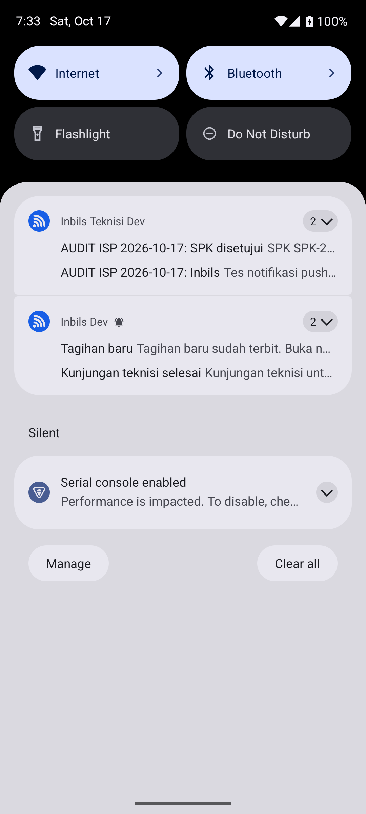

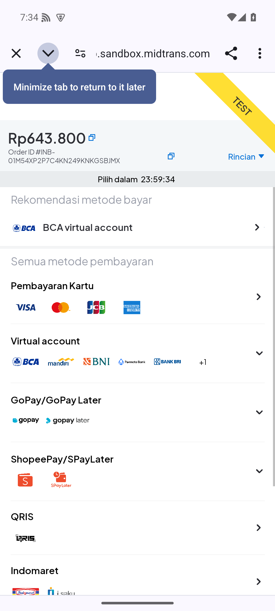

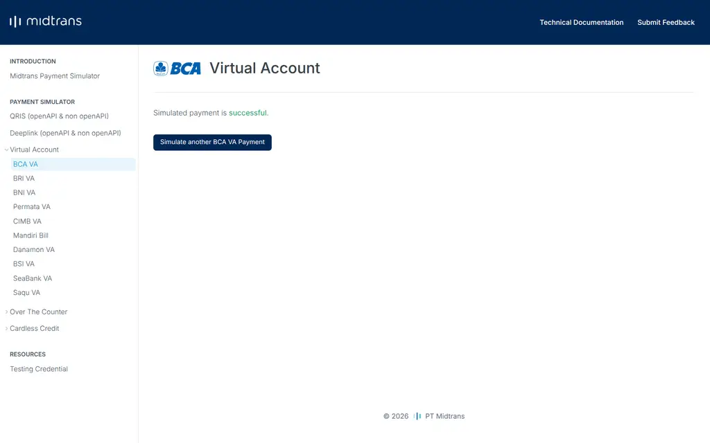

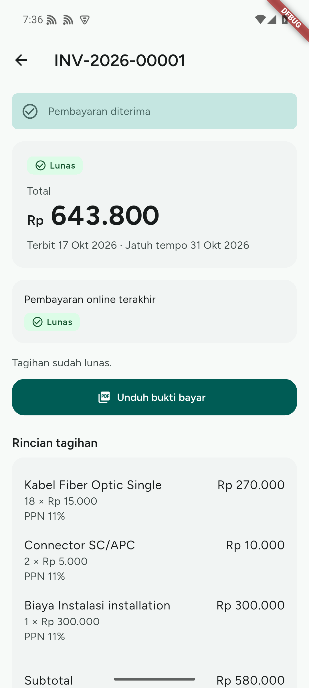

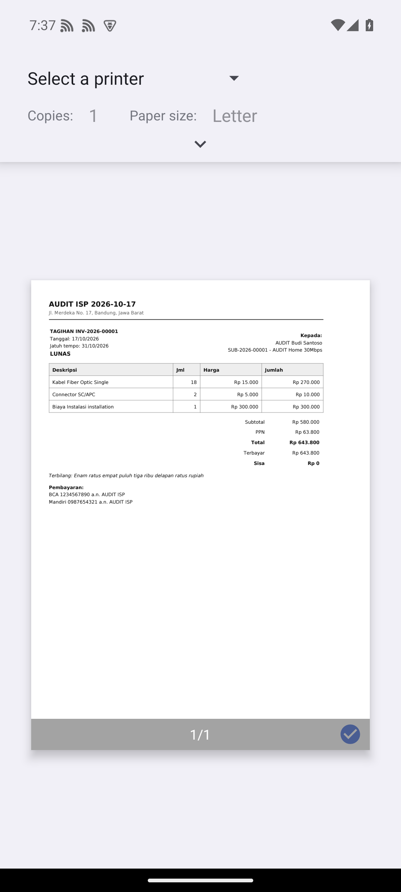

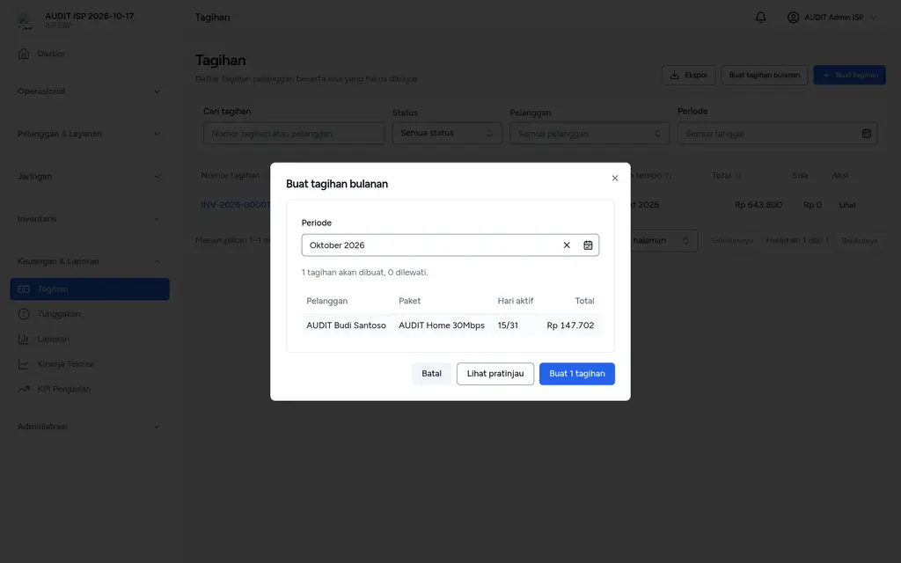

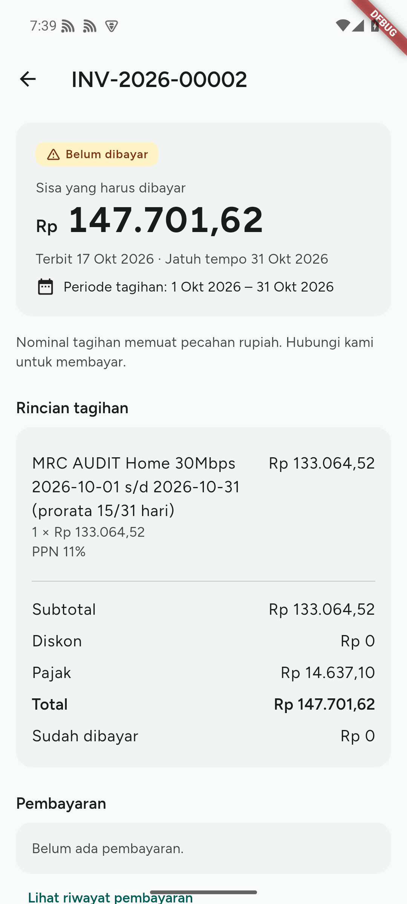

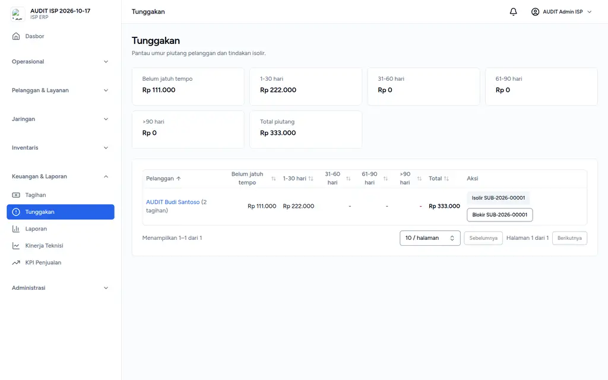

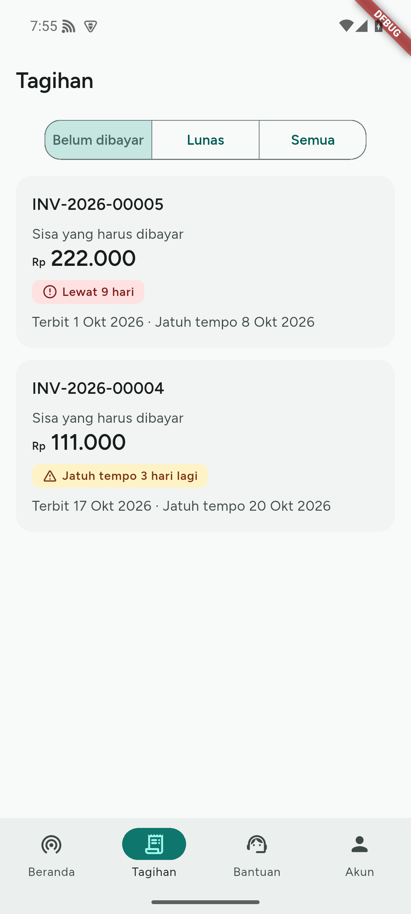

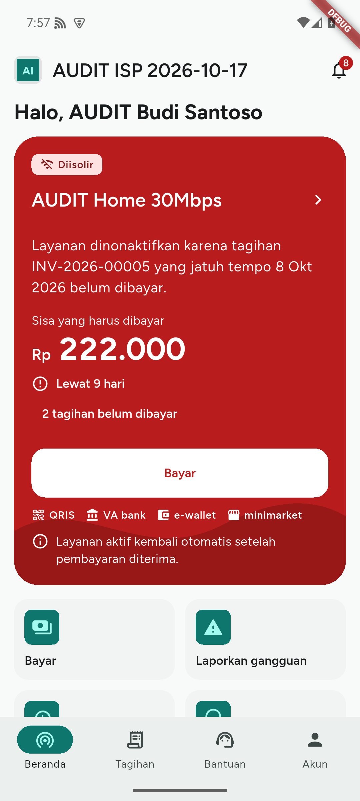

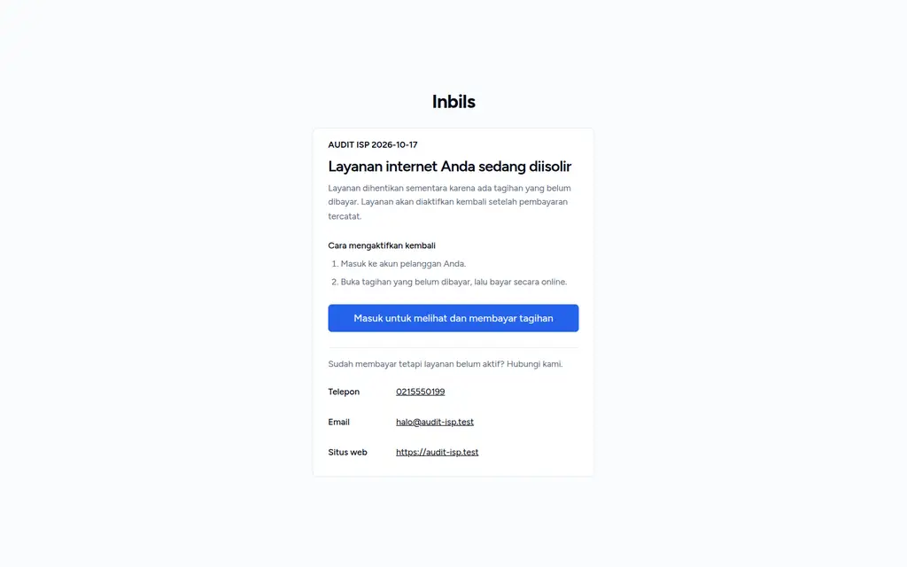

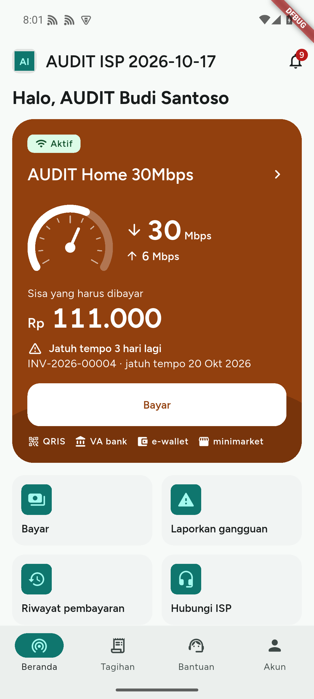

#### Rekaman yang tertinggal (prefiks AUDIT, tidak dihapus)

| Jenis | Kode | Keterangan |
|---|---|---|
| invoice | INV-2026-00001 | Sekali bayar (SPK), Rp 643.800, lunas lewat Midtrans VA BCA (pembayaran 129) |
| invoice | INV-2026-00002 | Berlangganan 2026-10 pro-rata 15/31, Rp 147.701,62, lunas manual oleh staf CS (transfer, pembayaran 130) |
| invoice | INV-2026-00003 | Kosong (Rp 0), dikirim staf CS, dibatalkan admin |
| invoice | INV-2026-00004 | Manual, Rp 111.000, jatuh tempo 20 Okt 2026, **masih terbuka** (bahan uji piutang) |
| invoice | INV-2026-00005 | Manual, terbit 1 Okt, jatuh tempo 8 Okt 2026, Rp 222.000; overdue → isolir → lunas Midtrans (pembayaran 131) → pulih |
| payment_attempt | 3 dan 4 | INB-01M54XP2P7C4KN249KNKGSBJMX dan INB-01M54Z3PWAYS2EH14D04J3V04Q, status `paid` |
| network_account | 17 | PPPoE `aud00001@audit-isp`, sinkronisasi "Menunggu" (RADIUS mati) |
| stok | AUDIT-POP-TMR | Kabel 18 → 0 m dan konektor 2 → 0 pcs (jalan pintas F4-D06 lalu dipakai persetujuan) |

#### Temuan cacat

| ID | Langkah | Yang terjadi | Yang diharapkan ISP | Keparahan | Saran perbaikan | Perlu keputusan owner | Bukti |
|---|---|---|---|---|---|---|---|
| F5-D01 | Tagihan bulanan pro-rata → bayar | Tagihan pro-rata berpecahan rupiah (133.064,52 + PPN 14.637,10 = 147.701,62). Pelanggan tidak bisa bayar online: "Nominal tagihan memuat pecahan rupiah. Hubungi kami untuk membayar." tanpa tombol hubungi. Angka beda antar layar: web "Rp 147.702", aplikasi "Rp 147.701,62". Staf yang mengetik angka tampil (147702) ditolak 422 "Jumlah pembayaran melebihi sisa tagihan." (layar galat mentah) dan harus mengetik 147701.62. Setiap aktivasi tengah bulan menghasilkan tagihan seperti ini. | Tagihan rupiah bulat yang bisa dibayar online; angka sama di semua layar. | blocker | Bulatkan harga baris dan pajak ke rupiah penuh saat membuat tagihan; isi otomatis "Jumlah" dengan sisa; galat di samping kolom. | ya (aturan pembulatan) | [05-30](flow-audit/05-30-customer-invoice2-unpayable.png), [05-29](flow-audit/05-29-customer-tagihan-tab.png), [05-35](flow-audit/05-35-staff-payment-result.png), [05-37](flow-audit/05-37-staff-payment-recorded.png) |
| F5-D02 | Buat tagihan bulanan | Dialog menerima bulan berjalan dan bulan depan: November 2026 menawarkan "Buat 1 tagihan" Rp 305.250, yang langsung `sent` ke pelanggan dan mengisi slot periode itu. Bawaan September menulis "0 tagihan akan dibuat" tanpa sebab (pelanggan belum aktif). | Periode ditagih setelah berakhir; masa depan ditolak; sebab dilewati ditulis. | friction | Batas maksimum bulan lalu (bulan berjalan dengan konfirmasi), daftar "dilewati" dengan alasan. | tidak | [05-24](flow-audit/05-24-generate-preview-september-empty.png), [05-27](flow-audit/05-27-generate-preview-november-future.png) |
| F5-D03 | Kirim tagihan | Tanpa konfirmasi atau pratinjau, padahal memicu push dan WhatsApp ke pelanggan dan tidak bisa ditarik. | Satu aturan konfirmasi untuk aksi yang menghubungi pelanggan. | friction | Konfirmasi ringkas "Kirim INV-… Rp … ke pelanggan?" atau Urungkan beberapa detik. | tidak | [05-03](flow-audit/05-03-invoice-sent-no-confirm.png) |
| F5-D04 | Staf CS → tagihan manual | Staf CS bisa membuat dan mengirim tagihan tetapi tidak bisa menambah item atau mengubah tanggal (403 setelah menekan Simpan; tombol terlihat). Tagihan Rp 0 tanpa item bisa dikirim ("Belum dibayar", Rp 0) dan pembuat tidak boleh membatalkannya sendiri. | Tombol hanya untuk yang berizin; tagihan tanpa item/Rp 0 tidak bisa dikirim. | friction | Sembunyikan tombol tanpa izin; tolak kirim saat total 0; beri item di formulir pertama. | tidak | [05-46](flow-audit/05-46-staff-invoice3-with-item.png), [05-44](flow-audit/05-44-staff-invoice3-edit-form.png), [05-47](flow-audit/05-47-staff-send-empty-invoice.png), [05-49](flow-audit/05-49-admin-invoice3-cancelled.png) |
| F5-D05 | Buat tagihan → tanggal | Mengetik "20/10/2026" menampilkan galat merah "Format tanggal tidak valid. Contoh: 17 Okt 2026." (bagus), tetapi Simpan tetap jalan dan jatuh tempo tersimpan 31 Okt (bawaan), bukan yang diketik. | Simpan ditahan sampai tanggal sah, atau format umum diterima. | friction | Blokir kirim saat kolom bergalat; terima dd/mm/yyyy. | tidak | [05-41](flow-audit/05-41-staff-invoice-form-due-typed.png), [05-42](flow-audit/05-42-staff-invoice3-draft-created.png) |
| F5-D06 | Aplikasi pelanggan → data basi | Beranda dan detail tagihan tidak memuat ulang saat dibuka atau tab berganti. Terlihat: Beranda "Layanan Anda belum aktif" 5 menit setelah aktif; hero memuat tagihan yang sudah lunas (INV-2 Rp 147.701,62, "Lihat tagihan") padahal INV-5 lewat 9 hari; detail INV-2 "Belum dibayar… Hubungi kami untuk membayar" setelah staf mencatat bayar; setelah push "Pembayaran diterima" layar tetap "Menunggu konfirmasi pembayaran". Hanya tarik-untuk-muat-ulang atau "Periksa status" memperbaiki. | Data segar saat layar muncul atau push masuk. | friction | Muat ulang saat resume, saat tab dipilih, dan saat push masuk. | tidak | [05-06](flow-audit/05-06-customer-after-push-tap.png), [05-57](flow-audit/05-57-customer-invoice2-after-refresh.png), [05-59](flow-audit/05-59-customer-home-with-overdue.png), [05-60](flow-audit/05-60-customer-home-after-refresh-overdue.png) |
| F5-D07 | Ketuk push → tujuan | Ketuk push "Tagihan baru" saat aplikasi di latar membuka Beranda, bukan tagihan; saat aplikasi di depan, ketuk "Tagihan segera jatuh tempo" (INV-4) membiarkan layar terakhir (INV-2). Ketuk baris di daftar notifikasi dalam aplikasi membuka tagihan yang benar. | Ketuk push membuka tagihan yang disebut. | friction | Tangani `onMessageOpenedApp`/`getInitialMessage` dan pesan saat di depan dengan rute subjek yang sama dengan daftar notifikasi. | tidak | [05-06](flow-audit/05-06-customer-after-push-tap.png), [05-56](flow-audit/05-56-customer-after-reminder-tap.png), [05-62](flow-audit/05-62-customer-reminder-notification-opened.png) |
| F5-D08 | Isi push dan bel | Judul push beda menurut keadaan aplikasi: di latar "Tagihan baru", di depan "AUDIT ISP 2026-10-17: Tagihan baru". Isi generik "Buka notifikasi ini untuk melihat rinciannya."; tanpa nomor, jumlah, jatuh tempo; daftar bel berisi baris identik. | Judul seragam; isi memuat nomor dan jumlah. | polish | Satu pembuat teks; "INV-… Rp … jatuh tempo …" (lock-screen privacy bisa memakai pengaturan). | tidak | [05-05](flow-audit/05-05-device-notification-shade-invoice.png), [05-21](flow-audit/05-21-device-shade-payment-push.png), [05-61](flow-audit/05-61-customer-notifications-list.png) |
| F5-D09 | Bukti bayar | PDF "bukti bayar" = tagihan berstempel LUNAS: judul "TAGIHAN", tanpa tanggal bayar, metode, nomor referensi/VA; masih menulis rekening bank untuk transfer. | Kuitansi: tanggal dan metode bayar, referensi, jumlah, nomor tagihan. | friction | Template kuitansi terpisah dari data pembayaran. | tidak | [05-20](flow-audit/05-20-customer-receipt-print-preview.png) |
| F5-D10 | Midtrans → merchant | Kunci Midtrans satu untuk seluruh tenant (`.env` platform); Snap menampilkan merchant "FHTS" bukan nama ISP; uang pelanggan ISP masuk ke rekening platform; tidak ada pengaturan kunci per perusahaan atau laporan settlement. | Setiap ISP menerima uang pelanggannya dan namanya tampil di halaman bayar. | blocker (bisnis) | Kunci per perusahaan, atau skema pencairan ke ISP + laporan settlement per tenant. | ya | [05-09](flow-audit/05-09-midtrans-snap-loaded.png) |
| F5-D11 | Halaman selesai Midtrans | "Pembayaran sedang diproses" dan "Silakan kembali ke aplikasi Inbils untuk melihat status tagihan." tanpa tombol buka aplikasi; pelanggan harus menutup tab sendiri; Chrome menawarkan terjemahan. | Tombol "Buka aplikasi Inbils". | polish | Tautan aplikasi + `lang="id"`. | tidak | [05-14](flow-audit/05-14-midtrans-after-cek-status.png) |
| F5-D12 | Isolir dan pemulihan | Tidak ada notifikasi saat langganan diisolir maupun aktif kembali (bel, push, staf); pelanggan hanya tahu bila membuka aplikasi dan internetnya mati. | Pelanggan dan staf diberi tahu sebab dan langkah. | friction | Push+bel "Layanan diisolir karena INV-…" dan "Layanan aktif kembali"; ringkasan harian untuk staf. | tidak | [05-64](flow-audit/05-64-customer-home-isolir.png) |
| F5-D13 | Status lewat jatuh tempo | Daftar tagihan web menulis "Belum dibayar" untuk INV-5 yang lewat 9 hari sampai tugas harian `check-overdue` jalan, sedangkan Tunggakan menaruhnya di 1-30 hari dan aplikasi menulis "Lewat 9 hari". | Satu status dari tanggal. | polish | Hitung "lewat jatuh tempo" dari tanggal saat tampil. | tidak | [05-63](flow-audit/05-63-admin-invoices-before-check-overdue.png), [05-54](flow-audit/05-54-receivables-before-overdue.png), [05-58](flow-audit/05-58-customer-tagihan-list-overdue-and-due-soon.png) |

#### Temuan UX

| ID | Langkah | Sekarang | Seharusnya | Manfaat | Usaha | Catatan mockup | Lensa |
|---|---|---|---|---|---|---|---|
| F5-U01 | Catat pembayaran | Jumlah kosong, Metode bawaan Tunai, tanpa tombol pelunasan; tanggal bayar selalu saat itu (dari kode) walau kasir mencatat setoran kemarin. | Jumlah terisi sisa tagihan (bisa diubah), tombol "Lunas penuh", isian tanggal bayar, metode terakhir dipakai. | Tinggi: satu ketikan hilang dan galat pembulatan berhenti. | S | Sisa "Rp …" di bawah kolom. | 1, 4, 5 |
| F5-U02 | Buat tagihan manual | Tiga layar: formulir (kode langganan diketik), draf, dialog "Tambah item" (pajak 0 padahal PPN perusahaan 11%), lalu Kirim. | Satu formulir dengan item; langganan dipilih dari daftar milik pelanggan (otomatis bila satu); pajak bawaan 11%; pilihan cepat jatuh tempo +3/+7/+14 hari. | Tinggi: 3 layar menjadi 1, salah pajak hilang. | M | Baris item di formulir. | 1, 3, 4 |
| F5-U03 | Tunggakan | Baris pelanggan tidak menyebut tagihan mana atau umur tertua; tanpa pencarian, saringan umur, ekspor; tombol Isolir dan Blokir berdekatan; tanpa "Kirim pengingat". | Tabel per tagihan dengan umur, kontak, tombol Pengingat; tombol Isolir terpisah dan berkonfirmasi. | Sedang: penagih tidak membuka dua layar per pelanggan. | M | Panel samping per pelanggan. | 3, 6, 10 |
| F5-U04 | Halaman isolir publik | Hanya "Masuk" (berujung `/app-only` bagi pelanggan app-only, F7-D01); teks sama untuk tagihan dan blokir manual. | Tombol "Bayar tagihan" (tautan bayar/VA tanpa login), WhatsApp ISP, tautan unduh aplikasi, dua varian teks. | Tinggi: pelanggan terisolir bisa bayar dalam 1 menit tanpa app. | M | Kartu "Tagihan Rp … · Bayar" di atas. | 8, 10 |
| F5-U05 | Gagal bayar online | "Hubungi kami untuk membayar" tanpa tombol; "Hubungi ISP" ada di Beranda tetapi tidak di layar ini. | Tombol "Hubungi ISP" (telepon/WhatsApp) di setiap keadaan tak bisa bayar. | Sedang: pelanggan tidak berhenti buntu. | S | Tombol di bawah pesan. | 5, 8 |
| F5-U06 | Push dan bel tagihan | Isi generik, tidak ada jumlah (F5-D08). | "INV-2026-00004 Rp 111.000 jatuh tempo 20 Okt" dan tindakan Bayar. | Sedang: pelanggan memutuskan dari bayangan notifikasi. | S | - | 7, 8 |
| F5-U07 | Dasbor keuangan | Kartu hanya "Tagihan jatuh tempo". | Kartu "Draf menunggu dikirim", "Jatuh tempo 3 hari", "Pembayaran online tertunda" dengan angka dan tautan. | Sedang: pekerjaan harian terlihat tanpa membuka Tagihan. | S | Tiga kartu di baris Keuangan. | 3, 10 |
| F5-U08 | Dialog tagihan bulanan | Pratinjau menulis hanya jumlah dan total; tidak ada pelanggan yang dilewati beserta alasan. | Daftar dilewati + alasan, default periode berdasarkan langganan yang belum ditagih. | Sedang: tidak ada pelanggan terlewat diam-diam. | S | - | 4, 5 |
| F5-U09 | Kirim tagihan | Satu klik tanpa pratinjau (F5-D03). | Pratinjau "Pelanggan melihat: nomor, jumlah, jatuh tempo" dan konfirmasi; setelah kirim, tautan "Lihat di aplikasi". | Sedang: salah kirim berkurang. | S | Dialog dengan ringkasan. | 5 |
| F5-U10 | Pembayaran Midtrans (aplikasi) | Tiga ketukan ke nomor VA (baik), muat Snap ± 8 s tanpa penanda kemajuan khusus; setelah bayar harus menutup tab sendiri. | Layar "Menyiapkan pembayaran" dengan jumlah dan jatuh tempo selama Snap dimuat; tombol kembali ke aplikasi; tampilkan VA di aplikasi. | Sedang: pelanggan tidak mengira macet. | S | Skeleton + tombol "Salin nomor VA". | 6, 8 |

**Contoh baik yang dipertahankan:** hero Beranda dengan sisa tagihan, label "Lewat 9 hari" / "Jatuh tempo 3 hari lagi" dan jalur Bayar (QRIS, VA, e-wallet, minimarket); webhook Midtrans yang mengambil ulang status dari Status API dan idempoten; halaman Tunggakan dengan kartu umur piutang; pencatatan pembayaran manual 0,42 s dengan notifikasi ke pelanggan dalam 1 detik; isolir otomatis dan pemulihan otomatis berjalan benar dengan dry-run; galat tanggal di samping kolom dalam bahasa Indonesia dengan contoh; formulir menyimpan isian setelah galat server; pembatalan tagihan wajib alasan dan tidak boleh oleh pembuat.

#### Lingkungan dan catatan teknis

- Kunci Firebase dan pekerja antrean (`php artisan queue:work --queue=default,whatsapp` milik FlowAudit4) tetap terpasang; **Alur 6 masih membutuhkannya**. AVD dilepas ke FlowAudit4 dengan aplikasi pelanggan di Beranda (langganan aktif), aplikasi teknisi masuk, `adb reverse tcp:80` dan `tcp:8010`.
- Beban CPU host tinggi selama sesi (load average 27): dua tab peramban sempat terbunuh dan diulang; tidak memengaruhi hasil.
- Staf CS dijalankan di profil Chrome terpisah; sesi admin dan staf tidak saling menimpa. Skrip bantu sementara (`/tmp/fa5-*`) dihapus.

### Alur 5b: Callback Midtrans nyata via tunnel (MidtransCallback)

**Status:** dijalankan. Midtrans sandbox (merchant FHTS) mengirim sendiri notifikasi ke `https://inbils-dev.tehpaid.my.id/webhooks/midtrans` (Cloudflare Tunnel → Sail :80) untuk 10 percobaan bayar baru (5 sampai 14) pada tenant AUDIT-ISP: delapan skenario yang diminta ditambah dua uji tambahan (S6e status dipalsukan, S9 pembayaran ganda). **Belum diuji:** 3-D Secure (tidak pernah muncul, F5-D14); kedaluwarsa alami (aplikasi memaksa 24 jam, dikedaluwarsakan lewat API); callback gagal terkirim lalu diulang Midtrans dan `midtrans:reconcile` untuk pembayaran yang callback-nya hilang (tunel tidak dimatikan); pesanan proyek lain yang masuk ke endpoint ini; WhatsApp.
**Persona:** pelanggan AUDIT Budi Santoso (API pelanggan lewat host tunel, seperti ponsel di internet), admin AUDIT ISP (web, TOTP), sesi dashboard Midtrans milik pemilik. **Rekaman:** INV-2026-00009 s.d. 00013, percobaan bayar 5 s.d. 14, pembayaran 133 s.d. 138. Tidak ada kode yang diubah dan tidak ada yang di-commit.

#### Cara bukti dikumpulkan

- **"Dikirim Midtrans, bukan curl":** tcpdump di namespace jaringan kontainer Sail (kontainer sementara alpine + tcpdump, difilter hanya `POST /webhooks/midtrans`, sisanya dibuang di tempat) membaca header Cloudflare: `User-Agent: Veritrans`, `CF-Connecting-IP` = IP Midtrans (8 alamat berbeda: 8.215.21.228, 8.215.23.167, 147.139.132.215, 147.139.173.83, 147.139.206.250, 147.139.209.91, 147.139.213.108, 149.129.227.68), `CF-Ray`. 17 pengiriman Midtrans tertangkap; permintaan curl MidtransCallback memakai UA `AUDIT-mt-*` dan IPv6 penguji. Kalibrasi: satu curl bertanda `MT-CALIBRATION-curl` muncul dengan IP penguji. Ringkasan (signature dipotong, beberapa curl dengan tubuh di segmen TCP terpisah tidak tercatat): [05b-callback-capture.txt](flow-audit/05b-callback-capture.txt).
- **`storage/logs/laravel.log`:** tidak berubah sejak 14:42 sampai 16:39 walau ada 17 pengiriman Midtrans dan ±15 uji curl (F5-D15). Bukti utama adalah baris `activity_log` (`payment_attempt` created/notified/settled/exception), `payment_attempts.last_notification`, `payments`, `invoices`, `notifications` dan `jobs`. Satu-satunya baris log baru: `WARNING midtrans.attempt_exception` pada S9 (16:39:37).
- **Dashboard Midtrans** (Settings → Payment → Notification URL → "View notification history"): setiap pengiriman ke URL kita berstatus "Completed"; transkrip yang dibuka MidtransCallback (pending dan settlement S1) berbunyi `> POST https://inbils-dev.tehpaid.my.id/webhooks/midtrans` `< 200 ok`; pengiriman S9 tampil Completed (transkrip tidak dibuka). Riwayat memuat 45 baris setelah uji; ada dua baris per notifikasi karena URL proyek lain pada merchant yang sama ikut dipanggil (F5-D18).

#### Catatan eksekusi (diharapkan vs terjadi)

| S | Skenario | Diharapkan | Terjadi | Bukti |
|---|---|---|---|---|
| 1 | VA BCA sukses (percobaan 5, INV-9 Rp 12.000, VA 22441626778364844523853, simulator Pay 23:18:32 WIB) | Midtrans mengirim notifikasi lewat tunel; percobaan `paid`, pembayaran `midtrans`, tagihan `paid`, bel pelanggan | `pending` 16:17:48Z (201, dari 8.215.23.167) dan `settlement` 16:18:33Z (200, dari 147.139.213.108), UA Veritrans, 731 B dan 774 B. Dalam 1 detik: percobaan `paid`, pembayaran 133 (`method` midtrans, `reference` = order_id, `received_by` kosong), tagihan `paid`. Riwayat Midtrans: kedua pengiriman Completed, `< 200 ok`. Bel "Pembayaran diterima" dibuat 16:19:16 setelah MidtransCallback menjalankan `queue:work --stop-when-empty` (tidak ada pekerja; push mati karena tidak ada `FIREBASE_CREDENTIALS`). | [05b-04](flow-audit/05b-04-midtrans-notification-history-after-s1.png), [05b-05](flow-audit/05b-05-midtrans-notification-log-detail-s1.png), [05b-callback-capture.txt](flow-audit/05b-callback-capture.txt), aktivitas 3846-3849 |
| 2 | Kartu 3DS 4811 1111 1111 1114 (percobaan 6, INV-10 Rp 13.000) | Halaman 3DS, OTP 112233, lalu sukses | Tidak ada halaman 3DS: Snap langsung "Pembayaran berhasil", lalu dialihkan ke `/pembayaran/selesai?...&transaction_status=capture`. Notifikasi `capture`/`accept`/200 16:24:59Z dari 8.215.21.228, `masked_card 48111111-1114`, **tanpa field `eci`**. Percobaan `paid`, pembayaran 134. **3DS tidak teruji** (F5-D14). | [05b-07](flow-audit/05b-07-snap-card-form-s2.png), [05b-09](flow-audit/05b-09-snap-card-after-payment-s2.png) |
| 3 | Kartu ditolak 4911 1111 1111 1113 (percobaan 7, INV-11 Rp 14.000) | Percobaan `failed`, tagihan tetap terbuka, pelanggan bisa mencoba lagi | Snap: "Pembayaran ini ditolak oleh bank … (Kode error: 05)". Notifikasi `deny`/202, `channel_response_message` "Do not honour", 16:27:24Z. Percobaan `failed`, alasan `deny`; tagihan tetap `sent`; API pelanggan `payment_attempt.status=failed`, `can_pay=true`; Bayar lagi langsung membuat percobaan 8 (URL Snap baru, 0,5 s). Tambahan kartu FDS 4611 1111 1111 1116 (percobaan 10): `deny` + `fraud_status deny`/202 → `failed`, alasan `fraud_status deny`. | [05b-12](flow-audit/05b-12-snap-card-denied-s3.png), [05b-18](flow-audit/05b-18-snap-card-fds-deny-s3b.png) |
| 4 | Kedaluwarsa atau batal | Percobaan `expired` atau dibatalkan | **Batal:** percobaan 8 (VA BCA pending 16:28:04Z) → dashboard Transaction → Cancel → Yes 16:28:53Z → notifikasi `cancel`/202 dari 147.139.132.215 dalam < 1 detik → percobaan `failed`, alasan `cancel` (tidak ada status "dibatalkan"), tagihan `sent`. Halaman Snap lama: "Transaksi Anda telah dibatalkan"; "Kembali ke halaman merchant" → `/pembayaran/selesai?...&transaction_status=cancel` yang menulis "Pembayaran sedang diproses" (F5-D17). **Kedaluwarsa:** tidak ada metode berkedaluwarsa pendek lewat aplikasi; payload memaksa `expiry` 24 jam sehingga bawaan dashboard (GoPay 15 menit, ShopeePay 5 menit) tertimpa (GoPay QRIS `expiry_time` +24 jam). Percobaan 9 (QRIS pending 16:30:30Z) dikedaluwarsakan lewat Core API `POST /v2/{order_id}/expire` 16:30:46Z → Midtrans mengirim `expire`/202 16:30:48Z → percobaan `expired`, tagihan `sent`, API `payment_attempt.status=expire`. | [05b-14](flow-audit/05b-14-midtrans-dashboard-pending-before-cancel-s4a.png), [05b-15](flow-audit/05b-15-midtrans-dashboard-cancelled-s4a.png), [05b-16](flow-audit/05b-16-snap-old-page-after-cancel-s4a.png), [05b-17](flow-audit/05b-17-snap-gopay-qris-pending-s4b.png), [05b-21](flow-audit/05b-21-admin-invoice11-online-payments-panel.png) |
| 5 | Pengiriman ganda: isi `settlement` asli S1 (774 B, signature utuh, disalin dari tangkapan), curl 16:23:16Z | 200 dan tidak ada pembayaran kedua | HTTP 200 "OK". Sebelum dan sesudah identik: pembayaran aktif 1, `paid_amount` 12000.00, `updated_at` percobaan, max id aktivitas 3849, jobs 15, notifications 261. | [05b-callback-capture.txt](flow-audit/05b-callback-capture.txt) |
| 6 | Dirusak: `gross_amount` 1200000.00 dan 1.00, `status_code` 201, `order_id` diganti (signature asli) | 403, tidak ada yang tertulis | 403 tubuh kosong ×4; keadaan identik. **S6e:** `pending` asli (percobaan 8) dengan hanya `transaction_status` diganti `settlement`: 200 "OK" (signature tidak mencakup status) tetapi pembayaran 0 dan percobaan tetap `pending`, karena status diambil ulang dari Status API. | [05b-callback-capture.txt](flow-audit/05b-callback-capture.txt) |
| 7 | `order_id` tak dikenal dengan signature sah (dihitung di kontainer) | Ditangani tanpa 500 | 404 tubuh kosong; percobaan (5) dan pembayaran (133) tidak bertambah. Tambahan: bukan JSON 403, tanpa `order_id` 422, `gross_amount` numerik 422, GET 405. Dokumentasi Midtrans: 404 diulang 2 kali, 403 diulang 5 kali; tidak ada pesanan asing yang tiba selama uji. | [05b-callback-capture.txt](flow-audit/05b-callback-capture.txt) |
| 8 | Callback saat pekerja antrean mati, pekerja dinyalakan kemudian | Tidak ada yang hilang | Tidak ada pekerja Sail yang hidup. INV-11 (percobaan 11, VA): callback 16:32:52.9Z, pembayaran 135 dibukukan 16:32:53, tiga pekerjaan (Reactivate, 2× PaymentReceived) menunggu di `jobs`, bel kosong; pekerja dinyalakan 16:33:58 → bel 16:33:59 (tertunda 66 detik). **Dampak nyata:** INV-12 (jatuh tempo 8 Okt) memicu isolir otomatis 16:34:12; dibayar 16:34:43 saat pekerja mati: tagihan `paid` seketika tetapi SUB-2026-00001 tetap `suspended` (API pelanggan juga). Setelah pekerja jalan 16:35:59 langganan **masih** terisolir karena INV-7 (jatuh tempo 16 Okt) sudah jatuh tempo saat isolir (aturan Q16 opsi b, F5-D20); INV-7 dibayar 16:36:47 (pekerja mati lagi), pekerja 16:37:44 → `reactivated` 16:37:45 + `ApplyNetworkAccountJob`. Tidak ada yang hilang, hanya tertunda selama pekerja mati. | [05b-19](flow-audit/05b-19-simulator-bca-va-paid-s8-worker-down.png), jobs 318-320, 324-326, 333-335, aktivitas 3873-3887 |
| 9 | Tambahan: pembayaran ganda (INV-13 Rp 16.000, VA BCA pending lalu staf mencatat tunai) | Staf diberi tahu; uang tidak hilang | Tagihan lunas tunai (pembayaran 138); VA tetap hidup. Pelanggan membayar VA 16:39:36 → settlement 16:39:37 dari 147.139.206.250 → percobaan 14 `exception` "Tagihan tidak menerima pembayaran pada statusnya saat ini.", tidak ada baris pembayaran, 0 notifikasi, dasbor tanpa tanda; riwayat Midtrans untuk pengiriman itu: Completed. API pelanggan: tagihan `paid` dan percobaan "failed" (bank sudah memotong Rp 16.000). Sebelum itu API menyerahkan `payment_attempt` pending + `redirect_url` untuk tagihan yang sudah lunas (F5-D16). | [05b-23](flow-audit/05b-23-admin-record-payment-dialog-s9.png), [05b-24](flow-audit/05b-24-admin-invoice13-paid-manually-vs-pending-va-s9.png), [05b-25](flow-audit/05b-25-admin-invoice13-exception-attempt-panel-s9.png) |

**Perilaku selesai/redirect Snap untuk pelanggan** (Finish Redirect URL di dashboard kosong; dashboard hanya menampilkan `http://example.com` sebagai bawaan, tidak terpakai karena aplikasi mengirim `callbacks.finish` dan `callbacks.error` = `/pembayaran/selesai`): (1) VA/QRIS pending: tetap di halaman nomor VA; saat tab Snap masih terbuka dan Midtrans menyelesaikan transaksi, Snap sendiri mengalihkan ke `https://inbils-dev.tehpaid.my.id/pembayaran/selesai?order_id=…&status_code=200&transaction_status=settlement` tanpa menekan apa pun. (2) Kartu sukses: "Pembayaran berhasil · Menutup dalam N detik · Oke", lalu alih ke finish dengan `transaction_status=capture`. (3) Kartu ditolak: tetap di formulir kartu dengan pesan galat dan bisa mencoba kartu lain (FDS menulis "ditolak oleh bank … (Kode error: )" dengan kode kosong). (4) Batal/kedaluwarsa: halaman "Transaksi Anda telah dibatalkan" dengan tombol ke finish (`transaction_status=cancel`). (5) Membuka ulang URL Snap lama yang pending langsung menampilkan nomor VA. Halaman finish selalu menulis "Pembayaran sedang diproses · Silakan kembali ke aplikasi Inbils" apa pun hasilnya (F5-D11, F5-D17). URL finish memakai host permintaan API (https tunel), sedangkan `logo_url` di respons login memakai `APP_URL` (`http://localhost`): dua dasar URL dalam satu respons, hanya soal konfigurasi dev.

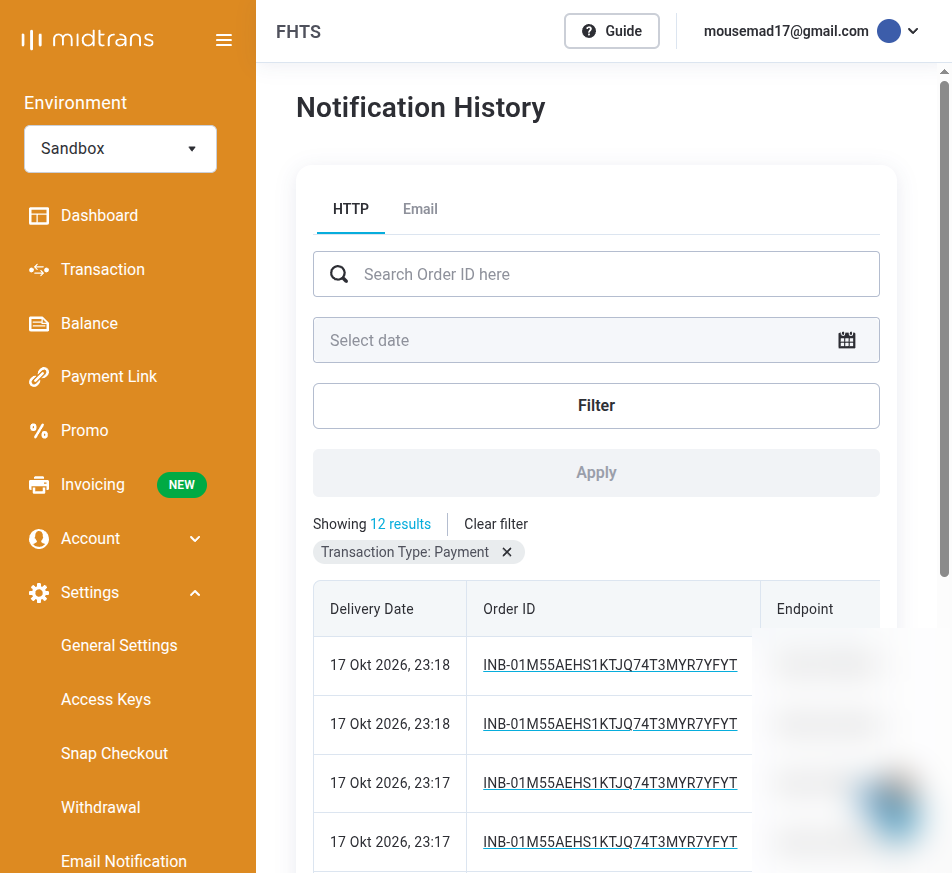

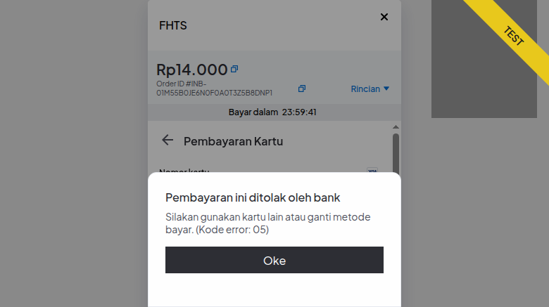

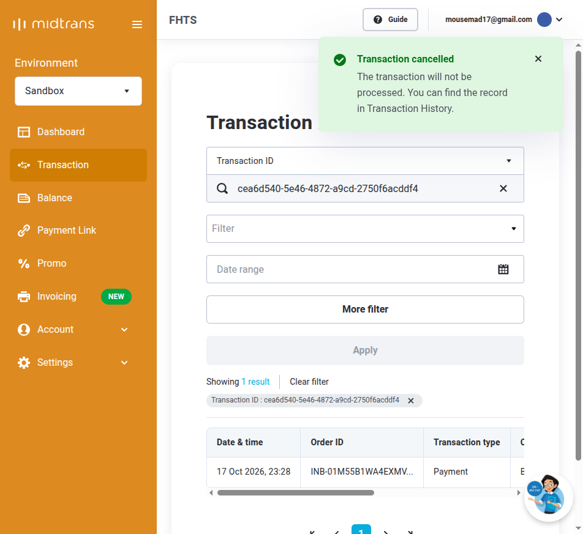

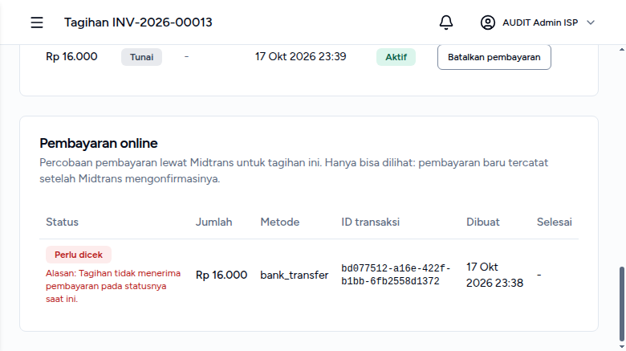

#### Rekaman yang tertinggal (prefiks AUDIT, tidak dihapus)

| Jenis | Kode | Keterangan |
|---|---|---|
| invoice | INV-2026-00009 s.d. 00013 | AUDIT-MT-1 s.d. 5: 00009 VA sukses Rp 12.000; 00010 kartu Rp 13.000; 00011 deny, batal, kedaluwarsa, FDS lalu VA sukses Rp 14.000; 00012 jatuh tempo 8 Okt (isolir) Rp 15.000; 00013 tunai lalu VA (ganda) Rp 16.000. Semua `paid`. INV-2026-00007 (Rp 99.000) kini juga `paid` (dibayar 16:36:47); INV-2026-00004 (Rp 111.000) tetap terbuka |
| payment_attempt | 5 s.d. 14 | 5, 6, 11, 12, 13 `paid`; 7 `failed` (deny); 8 `failed` (cancel); 9 `expired`; 10 `failed` (fraud_status deny); 14 `exception` |
| payment | 133 s.d. 138 | 133 s.d. 137 `midtrans`; 138 `cash` (pembayaran ganda) |
| langganan | SUB-2026-00001 | isolir otomatis 16:34:12, aktif lagi 16:37:45 |
| token API | AUDIT-mt-api | token pelanggan Sanctum masih ada |
| Midtrans | INB-01M55AEHS1KTJQ74T3MYR7YFYT dst. | transaksi sandbox; satu dibatalkan lewat dashboard, satu di-expire lewat API; tur produk dashboard di-Skip |

#### Temuan cacat

| ID | Langkah | Yang terjadi | Yang diharapkan ISP | Keparahan | Saran perbaikan | Perlu keputusan owner | Bukti |
|---|---|---|---|---|---|---|---|
| F5-D14 | Bayar kartu (S2) | Payload Snap tanpa `credit_card.secure`; kartu uji 3DS langsung berhasil tanpa OTP; notifikasi `capture` tidak memuat `eci` (contoh 3DS di dokumentasi memuat `eci` "05"). Dokumentasi Midtrans: "always enable 3DS whenever possible". | Kartu selalu lewat 3-D Secure. | friction (wajib sebelum produksi) | `credit_card.secure => true` di `MidtransGateway::createSnapTransaction` + tes payload. | ya (kebijakan kartu dan chargeback) | [05b-08](flow-audit/05b-08-snap-card-filled-s2.png), [05b-09](flow-audit/05b-09-snap-card-after-payment-s2.png), [05b-callback-capture.txt](flow-audit/05b-callback-capture.txt) |
| F5-D15 | Callback masuk (S1 s.d. S9) | Callback sukses dan yang ditolak (403/404/422) tidak meninggalkan baris log; `last_notification` menyimpan jawaban Status API, bukan notifikasi yang dikirim (cancel dikirim 202, tersimpan 200 "Success, transaction is found"); signature, IP, UA tidak disimpan; `updated_at` percobaan pending bergeser di tiap ulangan walau isi sama. Kunci server salah atau berputar membuat semua callback asli 403 tanpa jejak. | Satu baris log per callback dan peringatan untuk yang ditolak. | friction | Log di `MidtransWebhookController` (order_id, hasil, kode, request id, IP); simpan ringkasan pengiriman per percobaan. | tidak | `laravel.log` tidak berubah 14:42-16:39; aktivitas 3846-3849 |
| F5-D16 | Tunai saat VA pending, lalu VA dibayar (S9) | Pencatatan tunai tidak membatalkan transaksi Midtrans yang pending. Pembayaran VA berikutnya menjadi `exception`, uang Rp 16.000 masuk ke Midtrans tanpa baris pembayaran, 0 notifikasi untuk staf, dasbor tanpa tanda; API pelanggan menampilkan "failed" dan masih menyerahkan `redirect_url` pending untuk tagihan lunas; dialog Catat pembayaran tidak memperingatkan. | Pembayaran manual membatalkan transaksi pending; bila tetap terjadi staf keuangan diberi tahu dan ada langkah pengembalian dana. | friction (uang tak terbukukan) | `POST /v2/{order_id}/cancel` untuk percobaan pending saat tagihan lunas atau dibatalkan; bel + kartu dasbor untuk `exception`; teks pelanggan "Sedang diperiksa". | ya (alur pengembalian dana) | [05b-23](flow-audit/05b-23-admin-record-payment-dialog-s9.png), [05b-24](flow-audit/05b-24-admin-invoice13-paid-manually-vs-pending-va-s9.png), [05b-25](flow-audit/05b-25-admin-invoice13-exception-attempt-panel-s9.png), log WARNING 16:39:37 |
| F5-D17 | Halaman selesai (S1, S2, S4a) | `/pembayaran/selesai` menulis "Pembayaran sedang diproses" untuk settlement, capture, dan juga cancel; tanpa tombol buka aplikasi (F5-D11). | Teks sesuai hasil dan tombol "Buka aplikasi Inbils". | polish | Pilih teks dari `transaction_status` (hanya tampilan) dan tambah tautan aplikasi. | tidak | [05b-06](flow-audit/05b-06-snap-va-after-payment-before-cek-status-s1.png), [05b-16](flow-audit/05b-16-snap-old-page-after-cancel-s4a.png) |
| F5-D18 | Notifikasi Midtrans (S1) | Merchant FHTS dipakai bersama: tiap notifikasi pesanan Inbils (nama dan email pelanggan, nomor VA) juga di-POST ke URL proyek lain (`< 200 ok`); notifikasi proyek lain akan sampai ke endpoint ini dan dijawab 404 (diulang 2 kali) [inferensi: belum ada pesanan asing masuk saat uji]. Memperkuat F5-D10. | Satu merchant per proyek, atau 200 untuk order bukan milik sendiri. | friction | Pisahkan merchant atau URL; atau jawab 200 + log untuk `order_id` asing bertanda tangan sah. | ya | [05b-04](flow-audit/05b-04-midtrans-notification-history-after-s1.png), [05b-22](flow-audit/05b-22-midtrans-notification-history-all-scenarios.png) |
| F5-D19 | Antrean (S1, S8) | Tumpukan Sail tidak menjalankan pekerja antrean maupun scheduler; bel, reaktivasi langganan dan sinkron jaringan menunggu `queue:work` manual; tidak ada penanda antrean macet; `midtrans:reconcile` tidak jalan. Tidak ada yang hilang (tertunda 66 dan 58 detik). | Pelanggan yang sudah bayar langsung aktif; antrean macet memicu peringatan. | friction | Pekerja dan scheduler di compose Sail; peringatan bila `jobs` menumpuk. | tidak | [05b-19](flow-audit/05b-19-simulator-bca-va-paid-s8-worker-down.png), jobs 318-320, 324-326, 333-335 |
| F5-D20 | Reaktivasi setelah bayar (S8) | Membayar INV-12 (tagihan penyebab isolir) tidak mengaktifkan kembali: INV-7 (jatuh tempo 16 Okt, masih dalam masa tenggang) sudah jatuh tempo saat isolir (Q16 opsi b). API hanya memberi `suspension_reason` "overdue", tanpa daftar tagihan penahan. | Pelanggan diberi tahu tagihan mana lagi yang harus dilunasi. | friction | "Lunasi juga INV-…" di aplikasi, tombol bayar semua, notifikasi. | ya (aturan Q16) | aktivitas 3873-3887 |
| F5-D21 | Callback sah diulang (S5, S6e) | Tanda tangan hanya mencakup order_id+status_code+gross_amount+kunci, tanpa waktu; callback sah bisa diulang tanpa batas dan tidak kena pembatas (30/menit hanya untuk yang tidak sah), tiap ulangan memicu satu panggilan Status API [inferensi: beban tidak diuji]. Status di tubuh tidak dipercaya (S6e aman). | Pembatas juga untuk ulangan sah per order_id. | polish | Cache pendek per order_id dan status untuk ulangan. | tidak | S5 dan S6e di tabel |

#### Temuan UX

| ID | Langkah | Sekarang | Seharusnya | Manfaat | Usaha | Catatan mockup | Lensa |
|---|---|---|---|---|---|---|---|
| F5-U11 | Panel "Pembayaran online" (staf) | Alasan mentah Inggris ("deny", "cancel", "fraud_status deny"), metode mentah (`bank_transfer`, `credit_card`, `qris`), kolom Selesai kosong untuk gagal dan kedaluwarsa, tanpa bank, VA, kartu, dan pesan penerbit ("Do not honour", 05). | Alasan Indonesia ("Ditolak bank: Do not honour (05)", "Dibatalkan", "Kedaluwarsa"), metode manusiawi ("VA BCA", "Kartu •••• 1114"), waktu gagal, tombol "Batalkan di Midtrans". | Sedang: staf menjawab pelanggan tanpa membuka dashboard Midtrans. | S | Kolom Alasan dan Metode ([05b-21](flow-audit/05b-21-admin-invoice11-online-payments-panel.png)) | 5, 7 |
| F5-U12 | Aplikasi pelanggan setelah gagal bayar | API sudah memberi `payment_attempt.status` dan `can_pay`, tanpa alasan; `exception` tampil "failed". | Banner hasil percobaan terakhir + "Coba lagi" / "Pakai metode lain"; exception: "Sedang diperiksa, hubungi ISP". | Tinggi: pelanggan tahu langkah berikutnya. | S/M | Banner di detail tagihan | 5, 8 |
| F5-U13 | Dasbor keuangan | Percobaan `exception` dan transaksi pending tidak terlihat (hanya "Tagihan jatuh tempo"; "Pengecualian" milik gudang). | Kartu "Pembayaran online bermasalah" dan "Menunggu > 1 jam" + bel ke peran keuangan (memperluas F5-U07). | Tinggi: uang tak terbukukan terlihat hari itu juga. | S | Dua kartu baris Keuangan | 3, 10 |
| F5-U14 | Dialog "Catat pembayaran" | Tanpa peringatan walau ada VA/QR pending untuk tagihan itu ([05b-23](flow-audit/05b-23-admin-record-payment-dialog-s9.png)). | Banner "Ada pembayaran online tertunda (VA BCA …). Batalkan dulu?" dengan satu klik batal. | Tinggi: mencegah pembayaran ganda. | S/M | Banner di atas Jumlah | 1, 5 |
| F5-U15 | Halaman selesai Snap | Satu teks untuk semua hasil, tanpa tombol aplikasi (F5-D11, F5-D17). | Judul sesuai hasil + "Buka aplikasi Inbils" + tutup otomatis. | Sedang | S | Ikon hasil + tombol | 6, 8 |
| F5-U16 | Jejak callback per percobaan | Tidak ada tempat melihat kapan Midtrans memanggil, dari IP mana, dan kode jawaban kita. | Baris kecil per percobaan: "Diterima 23:18:33 · settlement · 200" (data dari log F5-D15). | Sedang: staf tidak perlu membuka dashboard Midtrans. | M | Riwayat di panel percobaan | 10 |
| F5-U17 | Pengujian lokal | Callback nyata hanya bisa diuji setelah tunel dan pekerja dipasang manual. | Satu perintah Sail "dev:payments" (tunel + `queue:work` + `schedule:work`). | Sedang: bukti callback nyata dapat diulang. | S | - | 10 |

**Contoh baik yang dipertahankan:** Midtrans benar-benar mengirim notifikasi lewat tunel dalam 1 sampai 2 detik setelah tiap perubahan status (pending, settlement, capture, deny, cancel, expire) dan setiap pengiriman dijawab 200; pembayaran dibukukan dalam < 1 detik; kirim ulang isi asli idempoten (S5); semua isi yang dirusak ditolak 403 tanpa tulisan; status palsu tidak berpengaruh karena status diambil ulang dari Status API (S6e); order tak dikenal dijawab 404 tanpa 500 (S7); tap Bayar kedua memakai percobaan yang sama (satu percobaan) dan setelah gagal bayar membuat percobaan baru dalam 0,5 detik; percobaan gagal, batal, kedaluwarsa dan ganda semuanya tercatat di panel staf dengan alasan.

#### Lingkungan dan catatan teknis

- Tunel: `cf-tunnel` (`cloudflared tunnel run inbils-dev`, host `inbils-dev.tehpaid.my.id` → `http://localhost:80`) dan layanan lama `midtrans-tunnel` (ssh ke localhost.run) masih berjalan; yang kedua tidak dipakai. URL notifikasi dashboard berisi dua alamat (proyek lain dan Inbils); tidak diubah.
- Pekerja antrean Sail tidak berjalan (pekerja FlowAudit4 sudah keluar); `.env` tidak lagi memuat `FIREBASE_CREDENTIALS`, jadi tidak ada push (hanya bel). Bagian lingkungan Alur 5 dan Alur 6 di atas yang menulis pekerja dan kunci "tetap terpasang" sudah usang. Setelah uji, `queue:work --queue=default,whatsapp --stop-when-empty` dijalankan; sisa 17 pekerjaan WhatsApp tertahan jam tenang sampai 18 Okt 00:00 UTC.
- Satu kali MidtransCallback salah membuka tab Chrome relay (tab Midtrans milik pemilik ikut diadopsi dan sempat diarahkan ke `localhost/login`); langsung dikembalikan ke `settings/payment/notification`. Setelahnya semua peramban uji memakai Chrome terpisah (`/tmp/mt/chrome-*`, profil sementara) yang sudah ditutup; satu-satunya perubahan di dashboard Midtrans: tombol "Skip" tur produk dan satu Cancel pada transaksi uji (percobaan 8).
- Skrip bantu dan tangkapan mentah di `/tmp/mt` (memuat token pelanggan dan isi notifikasi dengan signature) dihapus; yang disimpan hanya ringkasan [05b-callback-capture.txt](flow-audit/05b-callback-capture.txt) dan catatan terstruktur di `~/.config/inbils/flow-audit/notes-fa8.jsonl`. Tangkapan layar `05b-04` dan `05b-22` memperlihatkan URL notifikasi proyek lain pada merchant yang sama: kaburkan sebelum commit.
- Tangkapan layar `05b-*` (24 berkas) di folder ini.

### Alur 6: Dukungan

**Status:** dijalankan dari ujung ke ujung di layar dan perangkat: aplikasi pelanggan Bantuan → "Ada masalah?" → kategori → petunjuk → tiket terisi → web Tiket (tenggat respons/penyelesaian + sumber SLA) → Tugaskan (push teknisi) → aplikasi teknisi (balasan pertama, Mulai dengan check-in, lampiran, Selesaikan + catatan) → aplikasi pelanggan (balasan, lampiran, tanpa push) → pelanggan membalas + melampirkan → web Tutup → Evaluasi teknisi → Laporan Kepatuhan SLA; ditambah pembagian dua tenggat pada prioritas Mendesak (dua tiket pembanding), check-in 119 km dari lokasi, tiket buatan staf, komentar internal, dan jalur "Perlu perbaikan"/buka kembali (tidak ada di UI). Bagian lama berlabel [dari kode] (F6-D01 sampai D05) diganti hasil uji ini; ID baru F6-D01 sampai D24 tidak sama dengan ID lama (isi lama dipetakan ke F6-D01, D02, D03, D04, D05, D07).
**Belum diuji:** pelanggaran SLA sungguhan (tenggat respons Mendesak 1 jam dan penyelesaian 3 jam harus lewat; pekerjaan `tickets:sla` tidak berjalan di Sail dev, langkah di bagian Lingkungan), WhatsApp (mati di AUDIT-ISP), tombol "Buat SPK" dari tiket, tugaskan ulang, ekspor tiket, kamera pelanggan, dan angka Laporan SLA setelah TKT-2026-00002 diselesaikan (laporan dilihat saat hanya TKT-2026-00001 selesai). Pengingat respons dan pelanggaran SLA diuji kemudian di alur 12 (peristiwa 5 dan 6).
**Persona:** pelanggan AUDIT Budi Santoso dan teknisi AUDIT Teknisi Andi (aplikasi, AVD `inbils_pixel7`), admin AUDIT ISP (web, 2FA TOTP). **Kode:** web `main` a6348bb, mobile `main` fab0a56. Jam dinding WIB; DB dan log UTC. Tidak ada kode yang diubah dan tidak ada yang di-commit.

#### Catatan eksekusi

- **Pelanggan: Bantuan → "Ada masalah?" → daftar kategori → petunjuk → "Masih bermasalah? Buat tiket"** → 4 ketukan sampai formulir terisi: Kategori No Internet dan Layanan SUB-2026-00001 terisi otomatis (bagus), Judul kosong dan wajib. Petunjuk "Coba dulu" berisi tiga langkah generik karena `customer_hint` NULL di kelima kategori.
- **Isi Judul + Deskripsi + 1 lampiran (Galeri → keterangan → Lampirkan) → Kirim tiket** → TKT-2026-00001 dibuat 20:17:59; detail tiket tampil ±1 s setelah ketukan (termasuk unggah 41 KB). Total 6 ketukan + 1 Back (tutup keyboard) + judul diketik. Mendesak (bawaan kategori), "Dijawab sebelum 21:17" dan "Diselesaikan sebelum 23:17" dengan hitung mundur untuk pelanggan: tier AUDIT SLA Prioritas 2 jam/6 jam dibagi dua karena Mendesak.
- **Web admin: Tiket** → baris baru; detail memuat Target respons 21:17 dan Target penyelesaian 23:17 dengan label "(Target AUDIT SLA Prioritas)" = sumber SLA; tombol Tugaskan dan Tambah komentar.
- **Tugaskan → pilih AUDIT Teknisi Andi (daftar: nama + email, tanpa peran atau beban) → Tugaskan** → toast "Tiket berhasil ditugaskan." ±0,9 s. Push ke teknisi "Tiket ditugaskan · Tiket TKT-2026-00001 sudah ditugaskan kepada Anda." dalam 1 detik (`push.delivered` 13:19:37 UTC, tampil di bayangan AVD) dan surel. Pelanggan menerima bel "Tiket mulai ditangani" (saat ditugaskan) tanpa push.
- **Teknisi: ketuk push** → aplikasi terbuka di layar terakhir (SPK-2026-00001 usang), bukan tiket (F6-D12). Dari bel dalam aplikasi, ketuk baris membuka tiket yang benar.
- **Teknisi: Pekerjaan → tiket** → kartu daftar "Batas 17 Okt 2026 23:17" tanpa prioritas; detail memuat Lokasi = alamat POP (F6-D08). Balasan pertama: komentar publik 20:21:32 ("Laporan diterima…") → first_response_at tetap kosong (F6-D06). **Mulai** (dialog "Mulai tiket ini?") 20:22:09 dengan GPS di titik pelanggan → check-in 0 m (akurasi 5 m), first_response_at terisi. **Tambah lampiran** (Galeri → "Keterangan foto" → Simpan, snackbar "Lampiran ditambahkan.") 20:23:00. **Selesaikan** (lembar "Selesaikan tiket", catatan wajib) 20:24:07; selesai ±2 menit setelah Mulai.
- **Pelanggan setelah selesai:** tanpa push; layar tiket yang terbuka tetap "Terbuka · Belum ada balasan" sampai tarik-untuk-muat-ulang (F6-D13); setelah itu "Selesai", Dijawab 20:22, Diselesaikan 20:24, "Ditangani oleh AUDIT" (nama depan), catatan penyelesaian, 2 lampiran, komentar teknisi.
- **Pelanggan membalas + melampirkan:** balasan 20:25 dan foto 20:26 diterima (status tetap Diselesaikan, tanpa notifikasi ke siapa pun). Balasan baru tersembunyi di bawah kotak balasan (F6-D16).
- **Web admin: Tambah komentar (publik) → Tutup → dialog "Tutup tiket" → Tutup tiket** → toast "Komentar ditambahkan." dan "Tiket ditutup." ±1 s; ditutup 20:27:14 oleh admin (bukan penangan; aturan pembuat-penyetuju terpenuhi). Tidak ada notifikasi ke pelanggan. Setelah Ditutup, aplikasi pelanggan masih menerima balasan 20:30 (F6-D01).
- **Evaluasi:** Evaluasi → Buat evaluasi → Karyawan (ketik ≥ 2 huruf) → Tiket (ketik ≥ 2 huruf) → nilai 4.5 + penilaian pelanggan 5.0 (diketik penilai) + komentar → Simpan "Evaluasi berhasil dibuat." (evaluasi 32; respons pertama 4 menit dan penyelesaian 6 menit dihitung otomatis).
- **Laporan → Kepatuhan SLA** (1 tiket selesai): tiket selesai 1, kepatuhan 100%, tingkat respons 100% (1 tepat waktu), pelanggaran 0, rata-rata 6 menit; drill-down "Kecocokan dengan laporan: Cocok" tetapi jam UTC (F6-D11).
- **Pembagian dua pada Mendesak:** TKT-2026-00002 (Slow Connection, Tinggi, lewat "Laporkan gangguan" Beranda): respons 22:31 (2 jam) dan penyelesaian 02:31 (6 jam) = nilai tier penuh. TKT-2026-00001 (Mendesak): 1 jam dan 3 jam. TKT-2026-00003 dibuat staf (web, No Internet, isian bawaan): Sedang, "Target kategori No Internet", 2 jam dan 4 jam (F6-D09).
- **Check-in jauh:** GPS emulator 119 km dari pelanggan → Mulai TKT-2026-00002 diterima tanpa peringatan; web "119.307 m dari lokasi (akurasi ±5 m)" (F6-D07).
- **Batas hak:** admin menekan "Selesaikan" pada tiket milik teknisi → layar penuh 403 (F6-D10). Komentar "Internal saja" tampil dengan lencana di web dan aplikasi teknisi; tidak ada di API pelanggan (daftar dan detail diuji); batas privasi benar.
- **Lampiran dua arah:** PDF dan TXT dari staf di web (dua toast) → aplikasi pelanggan "Buka lewat portal web", aplikasi teknisi "Berkas, tidak dapat ditampilkan" (F6-D15). Hapus lampiran sendiri di aplikasi pelanggan: satu dialog konfirmasi, baris audit `attachment_removed` (bagus).
- **Jalur "Perlu perbaikan"/buka kembali:** tidak ditawarkan di UI mana pun (aplikasi pelanggan, web, aplikasi teknisi); kata itu hanya milik SPK (F6-D02).

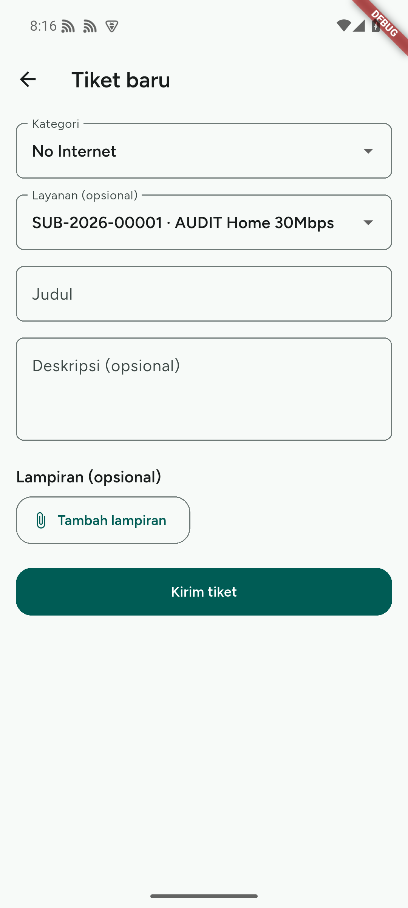

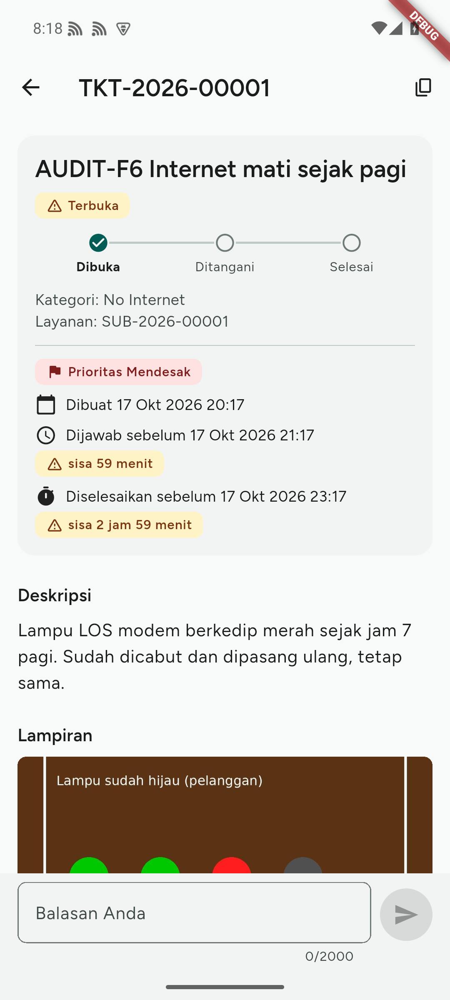

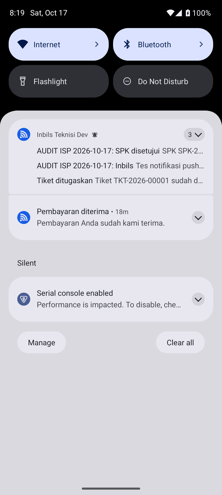

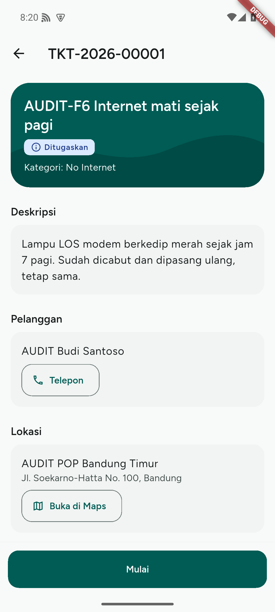

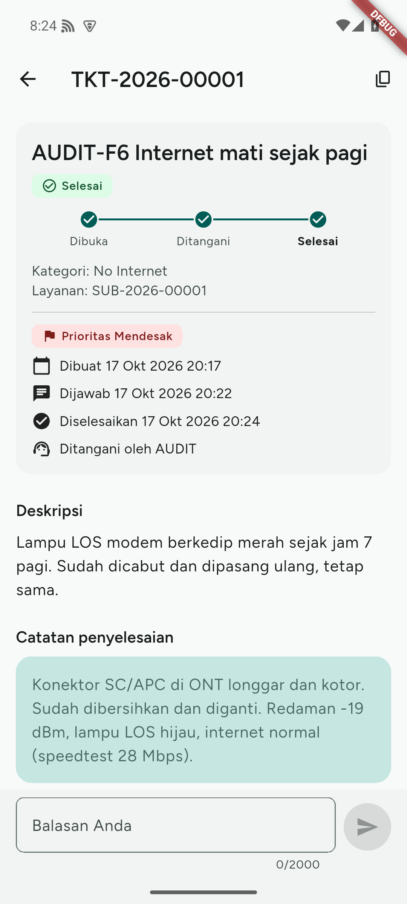

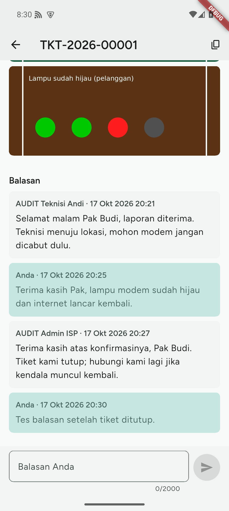

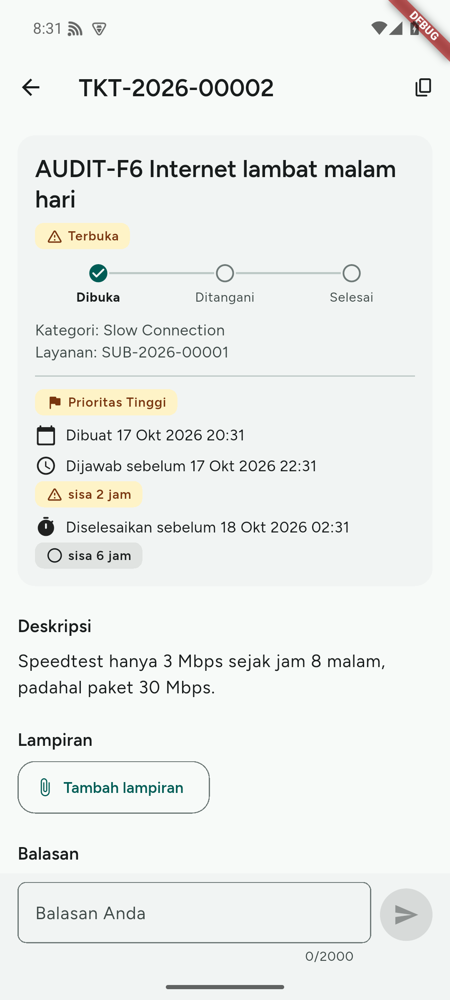

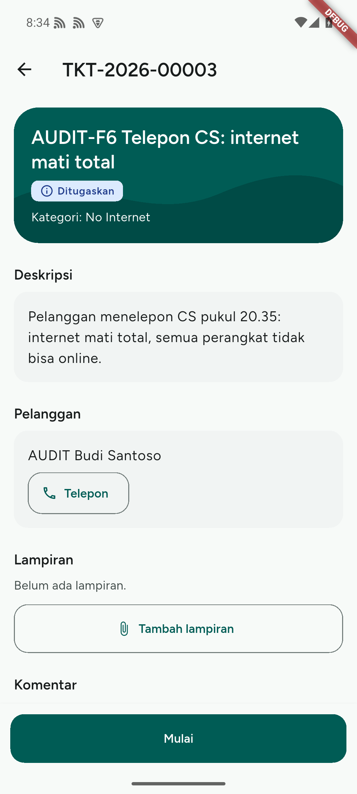

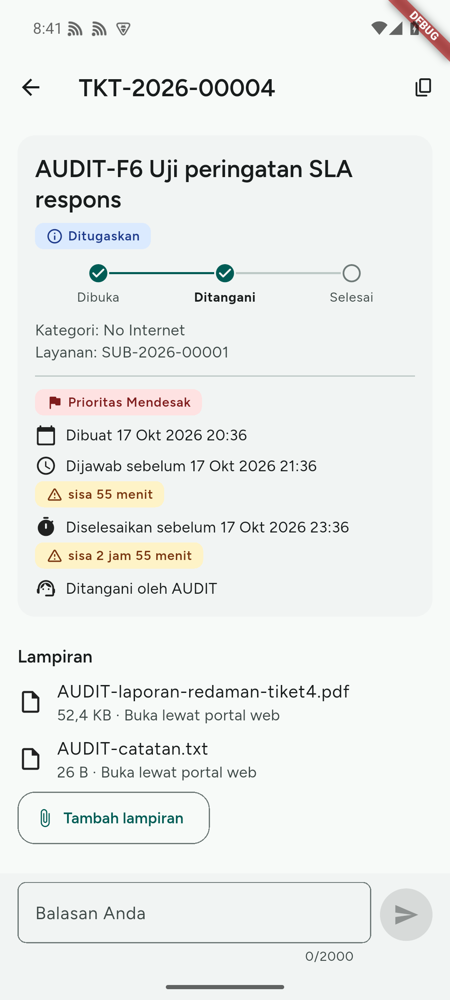

#### Rekaman yang tertinggal (tidak dihapus; judul berawalan AUDIT-F6)

| Jenis | Kode | Keterangan |
|---|---|---|
| ticket | TKT-2026-00001 | Mendesak, No Internet, pelanggan AUD-00001; alur lengkap sampai Ditutup 20:27 (komentar 98-101, lampiran 49-51); evaluasi 32 (4.5; penilaian pelanggan 5.0 diketik) |
| ticket | TKT-2026-00002 | Tinggi, Slow Connection (aplikasi); Mulai dari 119 km 20:34; Diselesaikan 20:37; belum ditutup (komentar 102) |
| ticket | TKT-2026-00003 | Sedang (seharusnya Mendesak), No Internet, dibuat staf lewat web tanpa langganan; ditugaskan, belum dimulai |
| ticket | TKT-2026-00004 | Mendesak, No Internet (aplikasi); ditugaskan, belum dimulai; komentar internal 103; PDF dan TXT dari staf (lampiran 52-53); bahan uji peringatan SLA respons |
| notifikasi | 13:18-13:36 UTC | Pelanggan: Tiket dibuat ×3 (termasuk TKT-2026-00003 dan -00004), "mulai ditangani", selesai; teknisi: 4 × Tiket ditugaskan (bel + push + surel); staf: nol |

#### Temuan cacat

| ID | Langkah | Yang terjadi | Yang diharapkan ISP | Keparahan | Saran perbaikan | Perlu keputusan owner | Bukti |
|---|---|---|---|---|---|---|---|
| F6-D01 | Pelanggan membalas setelah Diselesaikan dan setelah Ditutup | Kotak balasan tetap aktif pada tiket Diselesaikan dan Ditutup (hanya "Tambah lampiran" disembunyikan saat Ditutup). Balasan 20:25 dan lampiran 20:26 (tiket Diselesaikan) serta balasan 20:30 pada tiket yang sudah Ditutup 20:27 diterima server (komentar 99 dan 101, lampiran 51) tanpa mengubah status dan tanpa notifikasi ke teknisi atau staf. Pelanggan mengira ISP menerima pesannya; tak seorang pun melihatnya. | Tiket Ditutup tidak menerima balasan ("Tiket ditutup. Masih bermasalah? Buat tiket baru"); balasan pada tiket Diselesaikan membuka kembali tiket dan memberi tahu penangan serta antrean dispatch. | blocker (komunikasi hilang; bukan galat teknis) | Blokir balasan di aplikasi dan API saat status closed; balasan pelanggan pada resolved = peristiwa "dibuka kembali" dengan notifikasi. | ya (aturan buka kembali, lihat F6-D02) | [06-72](flow-audit/06-72-customer-reply-on-closed-ticket.png), [06-45](flow-audit/06-45-customer-reply-sent.png) |
| F6-D02 | Jalur "Perlu perbaikan"/buka kembali (menggantikan F6-D05 lama) | Tidak ada di layar mana pun: aplikasi pelanggan setelah Selesai hanya punya kotak balasan; web: saringan status Terbuka/Ditugaskan/Dikerjakan/Diselesaikan/Ditutup, tiket Ditutup hanya punya "Tambah komentar"; basis data tanpa status buka kembali; izin `ticket.reopen` ada di seeder tetapi tak dipakai; "Perlu perbaikan" hanya milik SPK. Pelanggan tak bisa "Sudah beres" ataupun "Masih bermasalah". | Pelanggan menutup atau membuka kembali dengan pemberitahuan; staf membuka kembali tiket Ditutup dengan alasan. | friction | Aksi reopen (web + aplikasi) memakai izin `ticket.reopen`; kartu konfirmasi pada tiket Diselesaikan. | ya | [06-41](flow-audit/06-41-customer-ticket-after-refresh.png), 06-55 (tidak tersimpan) |
| F6-D03 | Evaluasi setelah tiket ditutup (menggantikan F6-D01 lama) | Tidak ada penilaian oleh pelanggan. Menu Evaluasi = penilaian karyawan oleh staf: Karyawan (ketik ≥ 2 huruf) → Tiket (ketik ≥ 2 huruf) → Nilai (bawaan 5.0) → "Penilaian pelanggan" yang DIKETIK penilai (FlowAudit6 mengisi 5.0 tanpa sumber). Tidak dipicu penutupan, tak ada tombol Evaluasi di halaman tiket, dan nilai tak muncul di Laporan Kepatuhan SLA. | Pelanggan menilai 1-5 + komentar setelah selesai; nilai mengisi "Penilaian pelanggan" dan tampil di laporan; evaluasi staf terbuka dari tiket. | friction | Bintang di aplikasi pelanggan (kolom `customer_rating` sudah ada); tombol "Evaluasi teknisi" pada tiket Ditutup. | ya | 06-57 (tidak tersimpan), 06-65 (tidak tersimpan), 06-67 (tidak tersimpan) |
| F6-D04 | Pemberitahuan ke pelanggan (menggantikan F6-D02 lama) | Hanya 3 bel: "Tiket dibuat" 20:18, "Tiket mulai ditangani" 20:19 (terkirim saat DITUGASKAN, bukan saat Mulai 20:22), "Tiket selesai" 20:24; tanpa push (`push.delivered` hanya untuk teknisi); teks tanpa nomor tiket. Tidak ada pemberitahuan untuk komentar teknisi (20:21), komentar admin (20:27), Mulai, maupun penutupan. Tiket buatan staf (TKT-2026-00003) mengirim "Tiket Anda sudah tercatat" ke pelanggan. | Komentar publik, teknisi mulai, selesai, dan tutup sampai ke pelanggan sebagai push + bel dengan nomor tiket. | friction | `pushesToApp` aktif untuk `TicketCustomerUpdateNotification`; kirim pada komentar publik dan pada start; sertakan kode tiket. | tidak | [06-70](flow-audit/06-70-customer-notifications-list.png) |
| F6-D05 | Pemberitahuan ke staf (menggantikan F6-D03 lama) | Tak ada pemberitahuan ke staf saat tiket masuk (4 tiket: pengguna 65-68 nol baris `notifications`; bel admin "Belum ada notifikasi"), saat pelanggan membalas, atau saat tenggat respons mendekat untuk tiket yang belum ditugaskan (pekerjaan SLA hanya memperingatkan penangan tiket berstatus Ditugaskan). Menurut kode, `TicketSlaBreachedNotification` dikirim ke `created_by`; pada tiket pelanggan itu akun pelanggan sendiri (`created_by` = 70) [dari kode + data; pelanggaran 3 jam belum dijalankan]. | Dispatch dan manajer diberi tahu tiket baru, balasan pelanggan, dan respons yang hampir terlampaui (termasuk tiket belum ditugaskan); pelanggaran sampai ke staf, bukan ke pelanggan. | friction | Notifikasi "Tiket baru" ke pemegang `ticket.assign`; peringatan respons juga untuk status open; kirim pelanggaran ke penanggung jawab/manajer. | tidak | 06-102 (tidak tersimpan) |
| F6-D06 | Respons pertama | `first_response_at` hanya terisi saat teknisi menekan Mulai. Komentar teknisi 20:21 dan komentar admin 20:33 tidak dihitung (kolom kosong sampai Mulai 20:22 dan 20:34). Mulai dari 119 km tetap "tepat waktu". "Tingkat respons 100%" di laporan mengukur kapan tombol Mulai ditekan, bukan kapan pelanggan dijawab. | Balasan publik pertama dari petugas menghitung sebagai respons pertama; Mulai menghitung bila belum ada balasan. | friction | Isi `first_response_at` pada komentar publik pertama oleh petugas; tampilkan sumbernya. | ya | 06-51 (tidak tersimpan), 06-95 (tidak tersimpan) |
| F6-D07 | Check-in jauh dari lokasi (menggantikan F6-D04 lama) | Dengan GPS 119 km dari pelanggan, "Mulai tiket ini?" diterima tanpa peringatan; Dikerjakan, respons tepat waktu. Web menulis "119.307 m dari lokasi (akurasi ±5 m)" dengan huruf biasa. Selesaikan hanya mewajibkan catatan (tanpa foto atau check-in). | Peringatan di aplikasi ("Anda 119 km dari lokasi pelanggan, tetap mulai?") dan tanda merah di web; bukti kunjungan untuk tiket lapangan. | friction | Ambang jarak (mis. 500 m) dengan peringatan + alasan; jarak dalam km di web; opsional foto bukti. | ya (ambang) | 06-95 (tidak tersimpan), [06-93](flow-audit/06-93-tech-ticket2-start-dialog-far.png) |
| F6-D08 | Lokasi tiket di aplikasi teknisi | Kartu "Lokasi" memuat alamat POP ("AUDIT POP Bandung Timur, Jl. Soekarno-Hatta No. 100"; -6,938/107,690) dan "Buka di Maps" membuka POP, padahal check-in dihitung terhadap alamat pelanggan ("Rumah, Jl. Antapani Lama No. 17"; -6,9148/107,6589 → 0 m). Tiket buatan staf tanpa langganan tidak punya blok Lokasi sama sekali. Nomor telepon pelanggan tak tampil sebagai teks (hanya tombol Telepon), tanpa WhatsApp (SPK punya). | Teknisi melihat alamat pemasangan, Maps ke sana, nomor, dan Telepon/WhatsApp seperti pada SPK. | friction | Pakai alamat pemasangan langganan (atau alamat utama pelanggan) untuk Lokasi; POP sebagai keterangan terpisah. | tidak | [06-25](flow-audit/06-25-tech-ticket-detail.png), [06-91](flow-audit/06-91-tech-ticket3-no-location.png) |
| F6-D09 | Prioritas dan sumber SLA bergantung kanal | Kategori dan pelanggan sama: aplikasi → Mendesak, "Target AUDIT SLA Prioritas", respons 21:17 (1 jam), penyelesaian 23:17 (3 jam). Formulir web staf dengan isian bawaan → Sedang, "Target kategori No Internet", respons 22:32 (2 jam), penyelesaian 00:32 (4 jam). Formulir tidak memakai prioritas bawaan kategori dan tidak memilih Langganan walau hanya ada satu; kolom Langganan butuh ketik kode ≥ 2 huruf dan tidak disaring menurut pelanggan. | Hasil sama untuk kanal mana pun: prioritas bawaan kategori, langganan terpilih, target dari tier paket. | friction | Isi Prioritas dari kategori; setelah pelanggan dipilih, daftar Langganan disaring dan terisi otomatis bila satu. | tidak | 06-86 (tidak tersimpan), 06-16 (tidak tersimpan) |
| F6-D10 | Tombol tanpa izin di halaman tiket | Admin yang bukan penangan melihat "Selesaikan" (dan "Buat SPK") pada tiket teknisi; mengisi catatan lalu Selesaikan menggantikan halaman dengan layar penuh "Akses ditolak · Anda tidak punya izin untuk membuka halaman ini · Kode galat 403"; catatan hilang, kalimat menyebut halaman bukan aksi. | Tombol hanya untuk yang berhak, atau nonaktif dengan alasan; penolakan sebagai toast di halaman yang sama. | friction | Kirim kemampuan per tiket ke `Show.tsx` dan sembunyikan tombol; tangani 403 aksi dengan toast. | tidak | 06-97 (tidak tersimpan) |
| F6-D11 | Laporan Kepatuhan SLA → drill-down | Tabel "Tiket selesai" menampilkan Dibuat 13:17, Respons pertama 13:22, Target respons 14:17, Selesai 13:24, Batas SLA 16:17 = UTC; halaman tiket, aplikasi, dasbor, dan evaluasi memakai WIB (20:17, 20:22, 21:17, 20:24, 23:17) untuk tiket yang sama (perusahaan Asia/Jakarta). | Semua jam dalam zona waktu perusahaan. | friction | Format kolom tanggal drill-down dengan zona waktu perusahaan. | tidak | 06-68 (tidak tersimpan) |
| F6-D12 | Ketuk push teknisi | Push "Tiket ditugaskan" tiba ±1 s setelah Tugaskan dengan teks benar, tetapi mengetuknya membuka aplikasi di layar terakhir (SPK-2026-00001 "Menunggu review", usang), bukan tiket (keluarga F5-D07); setelah kembali ke layar tiket lama, layar tak diperbarui (tiket 1 "Selesai" padahal Ditutup, tanpa balasan pelanggan). Dari bel dalam aplikasi, tiket terbuka benar. | Ketuk push membuka tiket yang disebut dengan data segar. | friction | Tangani `onMessageOpenedApp`/`getInitialMessage` untuk subject ticket; muat ulang saat resume. | tidak | [06-21](flow-audit/06-21-device-shade-ticket-assigned.png), [06-22](flow-audit/06-22-tech-after-push-tap.png), [06-117](flow-audit/06-117-tech-notification-opens-ticket.png) |
| F6-D13 | Data basi di aplikasi pelanggan (keluarga F5-D06) | Layar tiket yang dibiarkan ±6 menit tetap "Terbuka · Tahap 1 dari 3 · Belum ada balasan" padahal Selesai dengan balasan teknisi; hanya tarik-untuk-muat-ulang yang memperbaikinya. Beranda tak punya kartu tiket. | Layar tiket memuat ulang saat resume dan saat push; Beranda menampilkan tiket aktif. | friction | Muat ulang pada resume dan push; kartu "Tiket aktif" di Beranda. | tidak | [06-40](flow-audit/06-40-customer-resume-stale-ticket.png), [06-41](flow-audit/06-41-customer-ticket-after-refresh.png) |
| F6-D14 | Lampiran: keterangan, pengunggah, tampilan | Keterangan yang diketik saat melampirkan tersimpan (`custom_properties.caption`) tetapi hanya tampil di aplikasi teknisi; aplikasi pelanggan dan web hanya menulis nama berkas. Nama berkas acak dan beda antar aplikasi (`ticket_attachment_<cap waktu>.jpg` vs UUID); web tak menulis pengunggah; aplikasi pelanggan memotong foto jadi spanduk lebar; unggahan web tak punya kolom keterangan. | Keterangan, pengunggah, dan jam tampil di web dan kedua aplikasi; foto utuh saat dibuka. | polish | Tampilkan caption dan `uploaded_by`; beri nama berkas dari keterangan; kolom keterangan di unggahan web. | tidak | 06-16 (tidak tersimpan), [06-43](flow-audit/06-43-customer-ticket-comments.png), [06-26](flow-audit/06-26-tech-ticket-detail-scrolled.png) |
| F6-D15 | Dokumen non-gambar dan tipe berkas | PDF/TXT dari staf: aplikasi pelanggan "Buka lewat portal web" tanpa tautan (pelanggan app-only tak punya portal, lihat F7-D01); aplikasi teknisi "Berkas, tidak dapat ditampilkan". Kolom unggah web menerima .txt/.doc/.docx (atribut `accept`; .txt berhasil diunggah) padahal API hanya jpg/png/pdf; tiap unggahan memicu dua toast "Lampiran berhasil diunggah." dan masih perlu menekan "Unggah". | Dokumen terbuka dari aplikasi; tipe yang diumumkan = diterima; satu toast; unggah otomatis. | polish | Tautan unduh bertanda tangan di aplikasi; samakan daftar tipe; hapus toast ganda. | tidak | 06-110 (tidak tersimpan), [06-111](flow-audit/06-111-customer-ticket4-pdf-txt-attachments.png) |
| F6-D16 | Kirim tertutup keyboard; balasan baru tak terlihat | Balasan baru pelanggan muncul di bawah kotak balasan tetap (daftar tak menggulir, tanpa toast), sekilas seperti tidak terkirim. Pada "Tiket baru" dan komentar teknisi, tombol Kirim berada di bawah keyboard (hanya tepi atas terlihat) sampai keyboard ditutup. | Daftar menggulir ke pesan baru; tombol kirim selalu terlihat. | polish | Gulir otomatis + bilah aksi di atas keyboard. | tidak | [06-45](flow-audit/06-45-customer-reply-sent.png), [06-05](flow-audit/06-05-customer-new-ticket-title-typed.png) |
| F6-D17 | Navigasi setelah membuat tiket | Dari detail tiket baru, Back ke petunjuk "No Internet", lalu kategori, lalu Bantuan (3 Back); "Masih bermasalah? Buat tiket" masih aktif sehingga mudah membuat tiket ganda. | Setelah dibuat, Back kembali ke daftar Tiket Anda. | polish | Ganti tumpukan help/new-ticket dengan detail tiket. | tidak | [06-47](flow-audit/06-47-customer-back-from-ticket-lands-on-hint.png), [06-48](flow-audit/06-48-customer-back-again-categories.png) |
| F6-D18 | Petunjuk "Coba dulu" generik | Kelima kategori bawaan tenant baru punya `customer_hint` NULL (`GET /customer/ticket-categories`); Packet Loss, Slow Connection, dan No Internet menampilkan tiga langkah sama (cek lampu modem, cabut listrik 30 detik, cek kabel). | Petunjuk spesifik per kategori. | polish | Isi bawaan `customer_hint` di seeder tenant; pratinjau di Kategori Tiket web. | ya (isi teks) | [06-98](flow-audit/06-98-customer-hint-packet-loss.png), [06-03](flow-audit/06-03-customer-hint-no-internet.png) |
| F6-D19 | Nama kategori berbahasa Inggris | "No Internet", "Slow Connection", "Packet Loss", "Device Issue", "Fiber Issue" tampil di aplikasi pelanggan, web, dan laporan SLA di antarmuka berbahasa Indonesia. | Nama Indonesia bawaan ("Internet mati", "Koneksi lambat", …). | polish | Ganti nama bawaan di seeder (kode tetap). | tidak | [06-02](flow-audit/06-02-customer-categories.png), 06-67 (tidak tersimpan) |
| F6-D20 | SLA memakai jam kalender 24/7 | Tiket 20:31 (setelah "Jam layanan Senin-Sabtu 08.00-20.00" di layar Bantuan yang sama) diberi "Dijawab sebelum 22:31" dan "Diselesaikan sebelum 02:31"; pelanggan melihat "sisa 2 jam" saat kantor tutup (kode: `addHours`, tanpa jam kerja). | Pilihan jam layanan: tenggat berjalan dalam jam kerja, atau pelanggan diberi tahu "Dijawab sebelum 08.30 besok". | polish | Opsi per tier: kalender atau jam layanan perusahaan. | ya | [06-77](flow-audit/06-77-customer-ticket2-created.png) |
| F6-D21 | Dialog Tutup tiket dan label | Dialog hanya judul + dua tombol, tanpa dampak (pelanggan tak bisa membuka kembali; masuk laporan); tombol "Tutup" tiket sama kata dengan "Tutup" (X) dialog. Setelah Ditutup area unggah lampiran tetap tampil; "Lampiran *" bertanda wajib padahal opsional. | Dialog menyebut dampak; label "Tutup tiket"; tanpa unggahan pada tiket Ditutup; tanda wajib hanya pada isian wajib. | polish | Teks dialog + sembunyikan dropzone saat closed. | tidak | 06-54 (tidak tersimpan), 06-55 (tidak tersimpan) |
| F6-D22 | Pesan validasi bawaan peramban | Nilai evaluasi 6 menampilkan gelembung bawaan "Value must be less than or equal to 5." (Inggris pada Chrome uji) pada formulir yang selebihnya Indonesia. | Galat di samping kolom dalam bahasa Indonesia. | polish | Validasi sisi aplikasi dengan pesan Indonesia. | tidak | 06-62 (tidak tersimpan) |
| F6-D23 | Istilah tidak seragam | Satu status, banyak kata: web "Diselesaikan"/"Ditutup"; aplikasi pelanggan chip "Terbuka" vs tahap "Dibuka", daftar "Selesai" untuk Diselesaikan, "Tiket mulai ditangani" untuk Ditugaskan; aplikasi teknisi "Selesai". Lima istilah untuk membuat tiket: Laporkan gangguan, Buat tiket, Ada masalah?, Tiket baru, Kirim tiket. | Satu glosarium (R6) di web dan kedua aplikasi. | polish | Satukan label di satu kamus status tiket. | tidak | [06-50](flow-audit/06-50-customer-tickets-selesai-list.png), [06-74](flow-audit/06-74-customer-laporkan-gangguan-destination.png) |
| F6-D24 | Surel penugasan ke teknisi | "Tiket ditugaskan: TKT-2026-00004" memakai templat bawaan Laravel: pengirim "Laravel hello@example.com", "Halo!", satu kalimat, "Salam, Laravel"; tanpa judul, pelanggan, prioritas, tenggat, atau tautan (keluarga F4-U14). | Surel bermerek perusahaan dengan data tiket dan tombol "Buka tiket". | polish | Template mail dengan data tiket dan tautan; nama pengirim dari profil perusahaan. | tidak | (Mailpit) |

#### Temuan UX

| ID | Langkah | Sekarang | Seharusnya | Manfaat | Usaha | Catatan mockup | Lensa |
|---|---|---|---|---|---|---|---|
| F6-U01 | Pelanggan → Tiket baru → Judul | Judul wajib diketik tanpa penanda wajib (isian lain bertanda "(opsional)") padahal Kategori sudah dipilih; Deskripsi kosong. | Judul terisi dari kategori ("Internet mati") dan bisa diubah; deskripsi dengan 3 pertanyaan cepat (sejak kapan, lampu modem, sudah restart). | Tinggi: nol ketikan wajib; tiket lebih lengkap. | S | Judul bawaan + chip jawaban cepat di atas keyboard. | 1, 4, 8 |
| F6-U02 | Pelanggan → tiga pintu masuk | "Laporkan gangguan" (Beranda) dan "Buat tiket" (Bantuan) membuka formulir kosong; hanya "Ada masalah?" memberi petunjuk + formulir terisi; lima istilah. | Satu pintu lewat kategori + petunjuk ("Langsung buat tiket"), satu istilah ("Lapor masalah"). | Sedang: kategori selalu terisi, SLA benar. | S | - | 3, 7 |
| F6-U03 | Pelanggan → tiket ganda | Pelanggan dengan tiket aktif sekategori bisa membuat tiket kedua tanpa peringatan. | "Anda sudah punya tiket aktif TKT-… (Ditugaskan). Lihat / Tetap buat baru." | Sedang: lebih sedikit tiket ganda. | S | Kartu di atas tombol Kirim. | 3, 5 |
| F6-U04 | Pelanggan → gangguan massal | Petunjuk dan kategori tak membaca pengumuman gangguan (kode fitur help dan tickets tak merujuk pengumuman; alur 7). | Kartu "Ada gangguan di area Anda sejak 19:40, perbaikan 22:00" sebelum kategori, dengan "Ikuti pembaruan". | Tinggi saat gangguan massal: tiket serupa tak terbuat. | M | Kartu kuning di atas kategori. | 3, 10 |
| F6-U05 | Pelanggan → detail tiket | Lampiran (tombol di atas) dan balasan (kotak bawah) dua rute; foto terpotong; keterangan tak tampil; balasan berfoto ±8 ketukan. | Satu kotak balasan dengan ikon klip dan pratinjau; foto utuh layar penuh; setiap pesan memuat pengirim dan lampirannya. | Sedang: ±8 menjadi ±4 ketukan. | M | Gelembung pesan dengan foto kecil. | 3, 7 |
| F6-U06 | Pelanggan → setelah Selesai | Hanya kotak balasan (F6-D01 sampai D03). | Kartu "Masalah sudah beres?": "Sudah beres" (menutup + bintang 1-5 + komentar) dan "Masih bermasalah" (membuka kembali, memberi tahu teknisi). | Tinggi: pelanggan menutup, CSAT terkumpul, tak ada balasan hilang. | M | Kartu di bawah catatan penyelesaian. | 3, 5, 10 |
| F6-U07 | Teknisi → Beranda dan Pekerjaan | Kartu daftar "Batas 23:17" tanpa chip Mendesak dan batas respons; Beranda "Kunjungan berikutnya" hanya SPK: "Tidak ada kunjungan SPK yang menunggu. Penugasan baru muncul di sini" saat tiket Mendesak ditugaskan. | Beranda: "Tiket mendesak · respons sebelum 21:17 (sisa 41 menit)"; daftar dengan chip prioritas + hitung mundur respons. | Tinggi: pekerjaan pertama terlihat dalam 1 layar. | S | Chip merah + hitung mundur. | 8, 10 |
| F6-U08 | Teknisi → detail tiket | Prioritas dan tenggat tak tampil; alamat POP; foto pelanggan dan komentar di bawah bilah "Mulai". | Kepala kartu: prioritas + tenggat + hitung mundur; alamat pelanggan + Maps + Telepon/WhatsApp; foto pelanggan di bawah deskripsi. | Sedang: tanpa gulir dan telepon untuk menanyakan alamat. | S | - | 3, 8, 10 |
| F6-U09 | Teknisi → balasan pertama | Komentar: gulir, ketik, tutup keyboard, Kirim; tidak dihitung respons (F6-D06). | Balasan cepat satu ketukan ("Laporan diterima, menuju lokasi ± 30 menit") yang dihitung respons pertama. | Tinggi: respons < 10 detik. | S | Tiga chip di atas kotak komentar. | 3, 8 |
| F6-U10 | Teknisi → Mulai dan check-in | Dialog dua ketukan yang tak menyebut lokasi direkam; hasil check-in tak terlihat. | Satu ketukan + snackbar "Check-in tercatat 0 m · Urungkan"; bila jauh: "Anda 119 km dari lokasi" dengan konfirmasi. | Sedang: -1 ketukan; salah lokasi terdeteksi saat itu. | S | Snackbar + peringatan jarak. | 5, 3 |
| F6-U11 | Dispatcher → Tugaskan | Daftar petugas: nama + email, alfabet, termasuk admin dan manajer; tanpa peran, beban, ketersediaan. | Peran, jumlah tiket/SPK aktif, jarak ke pelanggan; "Rekomendasi: Andi (1 tugas)"; "Tugaskan ke saya". | Tinggi pada ISP > 3 teknisi: beban merata, respons cepat. | M | Baris petugas dengan lencana beban. | 1, 10 |
| F6-U12 | Web → daftar Tiket | Enam kolom (Nomor, Judul, Prioritas, Status, Pelanggan, Dibuat); tanpa Petugas, tenggat, sisa waktu; saringan Cari/Prioritas/Status. | Kolom Petugas dan "Respons sebelum" dengan sisa waktu berwarna; saringan "Belum ditugaskan", "Hampir terlampaui", "Tiket saya"; urut tenggat. | Tinggi: antrean harian terbaca tanpa membuka tiket. | S | Chip saringan di atas tabel. | 3, 6, 10 |
| F6-U13 | Web → detail tiket | Tenggat statis tanpa sisa waktu; "(Target AUDIT SLA Prioritas)" tak menjelaskan bahwa Mendesak membagi dua (2 jam → 1 jam); pelanggan tanpa tautan/telepon/alamat; komentar dan lampiran tanpa peran/pengunggah. | Sisa waktu berwarna, "2 jam ÷ 2 karena Mendesak", pelanggan sebagai tautan + telepon + alamat, lencana peran/pengunggah. | Sedang-tinggi: keputusan tanpa membuka layar lain. | S | - | 5, 10 |
| F6-U14 | Web staf → Buat tiket | Pelanggan/Langganan/Aset/Lokasi tanpa daftar awal (ketik ≥ 2 huruf); memilih pelanggan tak mengisi yang lain; Prioritas tak mengikuti kategori; Judul diketik. | Pilih pelanggan → langganan, lokasi, prioritas terisi; baris "Target: AUDIT SLA Prioritas · respons 1 jam"; judul otomatis dari kategori. | Tinggi: 6 isian menjadi 2; kanal telepon tak menurunkan SLA. | M | - | 1, 4 |
| F6-U15 | Web → Evaluasi teknisi | Delapan aksi dari menu Evaluasi (karyawan ketik, jenis, tiket ketik, nilai bawaan 5.0, penilaian pelanggan diketik); tiket tak punya tombol. | "Evaluasi teknisi" pada tiket Ditutup membuka formulir terisi (karyawan = penangan, waktu otomatis), nilai kosong, penilaian pelanggan dari bintang aplikasi. | Tinggi: 8 aksi menjadi 3; tidak bias 5.0. | S | - | 1, 3, 4 |
| F6-U16 | Web → Laporan Kepatuhan SLA | Kartu total/kepatuhan/respons/pelanggaran/rata-rata + tabel per kategori; tanpa rincian prioritas, tier, atau teknisi, daftar pelanggar beserta sebab, rata-rata respons pertama, dan nilai kepuasan. | Per teknisi, per prioritas, per sumber target (tier/kategori), pelanggar teratas, rata-rata respons pertama, CSAT; periode bawaan 30 hari. | Sedang-tinggi: laporan menjawab "siapa dan mengapa". | M | - | 6, 10 |
| F6-U17 | Pelanggan dan teknisi → isi pemberitahuan | Teknisi: "Tiket TKT-… sudah ditugaskan kepada Anda." tanpa prioritas/judul; pelanggan: "Tiket Anda sudah diselesaikan." tanpa nomor. | "MENDESAK · TKT-… Internet mati sejak pagi · respons sebelum 21:17"; "TKT-… selesai: konektor diganti. Sudah beres?" | Sedang: keputusan dari bayangan notifikasi. | S | - | 7, 8 |
| F6-U18 | Web → dasbor dan peringatan SLA | Dasbor hanya "Belum ditugaskan" dan "SLA terlampaui"; bel admin kosong; peringatan 30 menit sebelum tenggat respons hanya untuk penangan tiket Ditugaskan. | Kartu "Hampir terlampaui (≤ 30 menit)" dan "Pelanggan membalas"; peringatan juga untuk tiket belum ditugaskan, ke dispatch dan manajer. | Tinggi: tiket belum ditugaskan ikut dijaga. | S | Dua kartu di baris Operasional. | 3, 10 |
| F6-U19 | Tenant baru → petunjuk kategori | Petunjuk kosong, isi generik. | Isi bawaan per kategori + pratinjau di web. | Sedang: sebagian tiket selesai swalayan. | S | - | 8 |
| F6-U20 | Web → papan ketik di halaman tiket | Urutan Tab logis, tetapi tanpa "Lewati ke konten": 15 Tab sebelum aksi pertama; dialog Tugaskan/Komentar memfokuskan isian pertama (bagus). | "Lewati ke konten"; aksi utama mendapat fokus awal. | Sedang: -14 Tab per tiket. | S | - | 9 |

**Contoh baik yang dipertahankan:** jalur petunjuk → tiket terisi (kategori + langganan otomatis, 4 ketukan); hitung mundur respons/penyelesaian dan prioritas terlihat oleh pelanggan; pembagian dua tenggat Mendesak bekerja persis seperti kode (1 jam/3 jam vs 2 jam/6 jam) dan sumber SLA ("Target AUDIT SLA Prioritas" vs "Target kategori") ditulis di web; Tugaskan 0,9 s dengan push bernomor tiket dalam 1 detik (bel + push + surel) dan bel dalam aplikasi membuka tiket yang benar; Selesaikan wajib catatan; aturan pembuat-penyetuju (penangan tak boleh menutup); komentar "Internal saja" tak bocor ke pelanggan (API diuji); satu dialog konfirmasi saat hapus lampiran dengan jejak audit; Evaluasi menghitung respons dan penyelesaian otomatis; drill-down Laporan SLA dengan "Kecocokan dengan laporan"; kegiatan terbaru berbahasa Indonesia ("Tiket check-in tercatat", "Tiket mulai dikerjakan").

#### Lingkungan dan catatan teknis

- AVD dilepas: GPS emulator dikembalikan ke alamat pelanggan (`adb emu geo fix 107.6588832 -6.9148016`) setelah uji 119 km; kedua aplikasi masuk (pelanggan di daftar Bantuan, teknisi di TKT-2026-00004); `adb reverse tcp:80` dan `tcp:8010` utuh; galeri hanya berisi `AUDIT-pelanggan-balasan.jpg`.
- Kunci Firebase, baris `.env` 85, dan pekerja antrean Sail tidak disentuh dan tetap terpasang; FlowAudit6 tidak mengirim "done with key".
- Peramban admin = profil Chrome sendiri (`/tmp/fa6-chrome-admin`, port 44160) dengan sesi TOTP; skrip bantu sementara dihapus. Login API pelanggan dan teknisi (`device_name` AUDIT-fa6-api) untuk uji petunjuk dan batas komentar internal meninggalkan 2 token dan baris "security api.token issued" di Aktivitas terbaru (keluarga F1-D03).
- **Peringatan SLA belum dijalankan oleh FlowAudit6** (FlowAudit7 menjalankannya kemudian; lihat alur 12, peristiwa 5 dan 6). Untuk TKT-2026-00004 (Mendesak, tenggat respons 21:36, status Ditugaskan, belum dimulai): setelah 21:06 WIB `./vendor/bin/sail artisan tickets:sla --company=3` (dibatasi satu tenant; pekerja Sail memprosesnya) seharusnya mengirim push/bel "respons hampir terlampaui" ke AUDIT Teknisi Andi; setelah 23:36 WIB perintah yang sama memicu `TicketSlaBreachedNotification` yang menurut kode (dan `created_by` = 70) jatuh ke akun pelanggan (F6-D05). Penjadwal (`tickets:sla` tiap 15 menit) tidak berjalan di Sail dev.
- Tangkapan layar `06-*` (75 berkas) di folder ini; catatan terstruktur di `~/.config/inbils/flow-audit/notes-fa6.jsonl`.

### Alur 7: Operasi jaringan (pengumuman gangguan dan pemeliharaan, NAS, isolir manual, IPAM)

**Status:** selesai di web; sisi perangkat (kartu Beranda, push ke ponsel) diuji di alur 12 (peristiwa 14, pengumuman gangguan dan pemeliharaan).  
**Persona:** admin, manajer, staf (tenant DEMO); pelanggan lewat API.

#### Catatan eksekusi

- **Pengumuman → Buat → jenis Gangguan, sasaran "Pelanggan tertentu" → Lokasi "POP Dago" → Simpan → Terbitkan (admin)** → OK. 8 klik, ± 165 ketikan; simpan 321 ms, terbit 333 ms. Pelanggan sasaran = **8 dari 8** langganan aktif di POP Dago (dicek dengan SQL; langganan menunggu/berhenti tidak ikut), baris bel dibuat setelah `queue:work`. Pratinjau ponsel terang/gelap di dialog berfungsi.
- **Pengumuman Pemeliharaan terjadwal (manajer): mulai +3 menit, selesai +2 jam → Terbitkan → status "Terjadwal"** → OK. Pada jam mulai `announcements:publish-scheduled` mengirim ke 8 pelanggan (`notified_at` terisi). Di Sail dev scheduler tidak berjalan; di produksi ada kontainer scheduler.
- **Blokir internet (SUB-2026-00006, manajer): dialog → alasan wajib → Blokir → halaman menampilkan "Diblokir oleh Demo Manager, 17/10/2026 18:41"; Buka blokir; Tangguhkan → Aktifkan kembali** → OK, tiap aksi 2 klik, ± 330 ms. Halaman Akses jaringan menampilkan "Diisolir karena diblokir".
- **Isolir dari Tunggakan (SUB-2026-00029) → alasan wajib → Isolir → lalu Aktifkan kembali** → OK; kolom sumber penangguhan `overdue` (dari subscription page = `manual`).
- **Halaman publik `/isolir/DEMO`** → tampil tanpa login; kode perusahaan asing → 404. Tombol "Masuk untuk melihat dan membayar tagihan" membawa ke `/login`; login pelanggan di web mendarat di `/app-only` (lihat F7-D01).
- **Sinkron ulang akun jaringan (staf)** → toast "Sinkron ulang dijadwalkan." bersama peringatan "RADIUS dimatikan..."; `php artisan network:sync --company=1` → "RADIUS is switched off ... nothing to sync". FreeRADIUS lab tidak dijalankan sehingga **sinkron nyata ke router belum diuji**.
- **IPAM: Langganan → Berikan IP statis (manajer)** → kolam terisi otomatis (10.20.8.0/22 dengan 1.020 alamat kosong), alamat kosong = terendah; **4 klik, 327 ms**, diberi `10.20.8.3`. Prefiks baru `10.99.0.0/28` (7 klik, 36 ketikan) dan cadangan alamat berhasil; prefiks tumpang tindih ditolak dengan galat di samping kolom ("10.20.4.0/22 sudah terdaftar.").
- **Aset jaringan → Masukkan ke perawatan → Selesaikan perawatan (AST-2026-00010)** → OK; status kembali Terpasang.

Catatan penilaian: halaman 1,1 s sampai tenang; semua aksi ≈ 0,3 s; toast Indonesia di semua aksi. Nilai tambah: audiens pengumuman tepat, IPAM paling mulus dari semua alur yang diaudit.

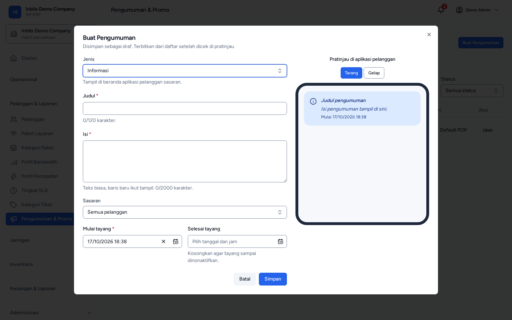

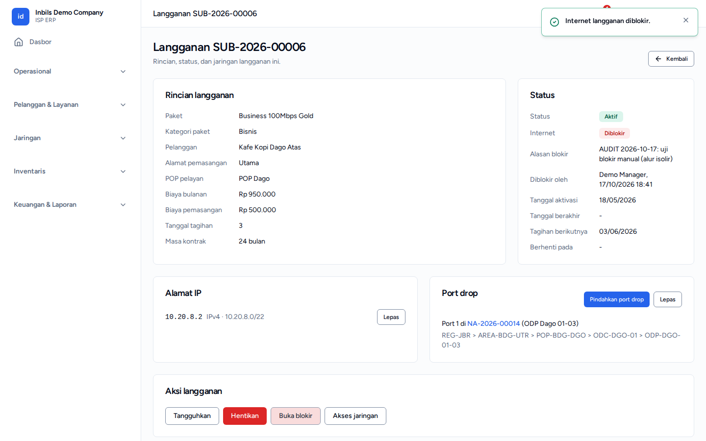

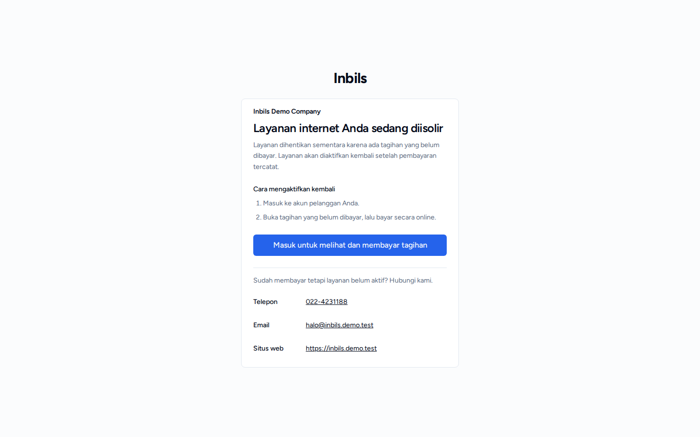

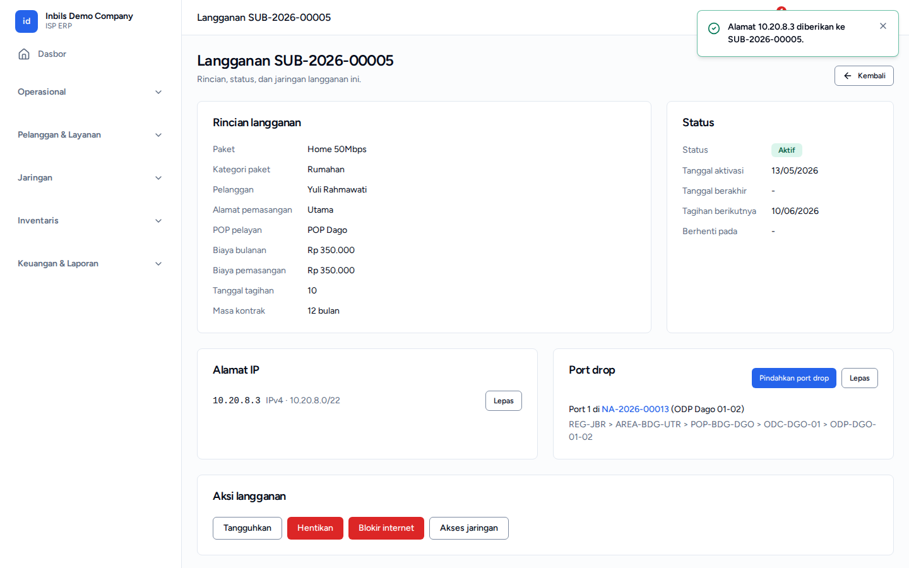

#### Rekaman yang tertinggal (prefiks AUDIT, tidak dihapus)

| Jenis | Kode / nama | Keterangan |
|---|---|---|
| pengumuman | id 2 "AUDIT-Gangguan jaringan POP Dago 2026-10-17" | gangguan, POP Dago, tayang, 8 bel |
| pengumuman | id 3 "AUDIT-Pemeliharaan POP Dago 2026-10-17" | pemeliharaan 18:43-20:45 WIB, 8 bel |
| langganan | SUB-2026-00006 | blokir/buka/tangguhkan/aktifkan; "Tagihan berikutnya" bergeser 03/06 → 03/11 |
| langganan | SUB-2026-00029 | isolir dari Tunggakan lalu diaktifkan; tagihan berikutnya 06/11 |
| langganan | SUB-2026-00005 | IP statis 10.20.8.3 (dibiarkan terpasang) |
| prefiks IP | 10.99.0.0/28 "AUDIT 2026-10-17 uji IPAM" | POP Antapani; cadangan 10.99.0.1 |
| aset | AST-2026-00010 | masuk lalu keluar perawatan |

#### Temuan cacat

| ID | Langkah | Yang terjadi | Yang diharapkan ISP | Keparahan | Saran perbaikan | Perlu keputusan owner | Bukti |
|---|---|---|---|---|---|---|---|
| F7-D01 | Halaman `/isolir/{kode}` → "Masuk untuk melihat dan membayar tagihan" | Tautan ke `/login`; pelanggan memang hanya punya aplikasi, jadi login web mendarat di `/app-only` ("Gunakan aplikasi Inbils", tanpa tautan unduh selama `Buka Play Store` tidak dikonfigurasi, tanpa bayar). Teks halaman selalu menyalahkan tagihan, juga untuk **blokir manual** yang dialognya sendiri menyatakan "pembayaran tidak mencabut blokir". | Pelanggan terisolir tahu penyebab dan langkah nyata: bayar lewat aplikasi/WhatsApp/telepon; blokir manual diminta menghubungi ISP. | friction | Teks dua varian (tagihan / dibatasi ISP) lewat parameter atau dua alamat dari router; tombol telepon/WhatsApp; tautan aplikasi; hapus tautan login web. | ya | [07-14-isolir-page.png](flow-audit/07-14-isolir-page.png), [07-15-customer-web-login.png](flow-audit/07-15-customer-web-login.png) |
| F7-D02 | Sinkron ulang / Blokir saat RADIUS dimatikan (dev dan pilot) | Toast "Sinkron ulang dijadwalkan." tampil bersama peringatan "RADIUS dimatikan..."; halaman akun memuat galat berbahasa Inggris "Router provisioning is switched off for this installation."; dialog blokir menjanjikan "sesinya diputus" padahal tidak ada yang dikirim ke router. | Satu pesan jujur: "Perubahan disimpan; belum dikirim ke router karena RADIUS dimatikan." Tidak ada janji pemutusan sesi. | friction | Satu penerjemah pesan status jaringan; sembunyikan "dijadwalkan" bila RADIUS mati; ubah teks dialog sesuai mode. | tidak | [07-20-network-account-resync.png](flow-audit/07-20-network-account-resync.png), [07-13-network-account-blocked.png](flow-audit/07-13-network-account-blocked.png) |
| F7-D03 | Router NAS → daftar | Kolom RADIUS "Menunggu ditulis" tanpa tombol untuk mengirim; hanya `network:sync` (15 menit) atau menyimpan ulang. | Tombol "Sinkronkan sekarang" pada NAS. | polish | Tombol di halaman NAS memanggil sinkron untuk klien itu. | tidak | [07-21-nas-index.png](flow-audit/07-21-nas-index.png) |
| F7-D04 | Langganan → Aktifkan kembali | "Tagihan berikutnya" bergeser sendiri (SUB-2026-00006: 03/06/2026 → 03/11/2026; SUB-2026-00029 → 06/11/2026) tanpa pemberitahuan; data demo basi (tanggal Juni), tetapi aturannya menggeser siklus tanpa memberi tahu operator. | Operator diberi tahu siklus berikutnya, atau tagihan yang terlewat diterbitkan. | polish | Tampilkan "Tagihan berikutnya akan menjadi 03/11/2026" di dialog; putuskan aturan tagihan terlewat. | ya | [07-12-reactivate-after.png](flow-audit/07-12-reactivate-after.png) |
| F7-D05 | Tangguhkan (halaman Langganan) vs Isolir (Tunggakan) | Halaman Langganan menyimpan sumber `manual`, Tunggakan menyimpan `overdue`; tampilan pelanggan di aplikasi berbeda ("Ditangguhkan" + Hubungi ISP vs "Diisolir" + bayar) [dari kode: `home_hero.dart`], operator tidak diberi tahu. | Dialog menyebut apa yang dilihat pelanggan. | polish | Teks bantu di dialog (lihat F7-U03). | tidak | [07-11-suspend-dialog.png](flow-audit/07-11-suspend-dialog.png), [07-17-receivables-isolir-dialog.png](flow-audit/07-17-receivables-isolir-dialog.png) |

#### Temuan UX

| ID | Langkah | Sekarang | Seharusnya | Manfaat | Usaha | Catatan mockup | Lensa |
|---|---|---|---|---|---|---|---|
| F7-U01 | Halaman isolir pelanggan | Satu teks untuk semua penyebab, CTA berujung `/app-only`. | Teks mengikuti penyebab, tombol telepon/WhatsApp, tautan aplikasi. | Tinggi: pelanggan terisolir tidak berputar; panggilan "sudah bayar tapi mati" turun. | M | Kartu pusat dengan dua tombol besar (44 px). | 3, 8, 10 |
| F7-U02 | Pengumuman → Terbitkan | Konfirmasi tidak menyebut jumlah penerima; Simpan lalu cari baris lalu Terbitkan (3 langkah). | "± 8 pelanggan di POP Dago akan menerima notifikasi" di dialog; tombol "Simpan & Terbitkan". | Sedang: hindari salah target; hemat 3 klik per gangguan. | S | Baris ringkas di bawah pemilih lokasi. | 3, 5 |
| F7-U03 | Blokir / Tangguhkan | Dialog tidak memberi tahu efek ke pelanggan dan tagihan. | Satu kalimat "Pelanggan akan melihat: …; tagihan tetap berjalan". | Sedang: mengurangi salah pilih Tangguhkan vs Blokir. | S | Teks bantu abu-abu di atas kolom alasan. | 5, 7 |
| F7-U04 | Router NAS | Tidak ada tombol sinkron. | "Sinkronkan sekarang" + status terakhir. | Sedang: operator tidak menunggu 15 menit setelah ganti rahasia NAS. | S | Tombol di kepala kartu. | 5, 6 |
| F7-U05 | Aset → perawatan | Dialog dan pemulihan jelas (contoh baik); tidak ada filter "Dalam perawatan". | Pertahankan; tambah filter. | Rendah: temukan aset perawatan cepat. | S | - | 2, 7 |

### Alur 8: Inventaris (permintaan, persetujuan, gudang, serah terima, pengembalian, stok, penyesuaian)

**Status:** selesai; jalur "Tolak fisik" diuji lewat spesifikasi E2E baru (lihat "Verifikasi perbaikan F8-D01") dan push "Siap diambil" ke ponsel teknisi diuji di alur 12 (peristiwa 7).  
**Persona:** teknisi (lewat API yang dipakai aplikasi, karena login web teknisi = `/app-only`), manajer, staf (gudang), admin.

#### Catatan eksekusi

- **Teknisi membuat permintaan (API `POST technician/inventory-requests`) → REQ-20261017-0001** (Connector SC/APC 10 pcs, Cable Tie 2 box, POP Dago) → status "Menunggu persetujuan", 177 ms.
- **Manajer → Setujui & Reservasi Stok** → ditolak: "Stok tidak mencukupi untuk CON-SC-APC di POP-BDG-DGO. Tersedia: 0, Diminta: 10." (stok kosong). **Manajer → Tolak Permintaan** dengan alasan → "Permintaan barang telah ditolak.", 334 ms; tombol Tolak nonaktif sebelum alasan diisi.
- **REQ-20261017-0002** (Fast Connector 10 pcs, Kabel Dropcore 100 m, Cable Tie 2 box): **manajer Setujui (2 klik, 350 ms) → staf Mulai Penyiapan (341 ms) → Tandai Siap Diambil (329 ms) → Serah Terima & Kurangi Stok (832 ms)**; maker-checker terpenuhi (pemohon ≠ penyetuju ≠ penyerah). Kasus pengembalian terbuka otomatis.
- **Teknisi mendeklarasikan** (terpakai 8/70/2, sisa 2/25/0, selisih 5 m "hilang") → **staf terima fisik** → kasus "selisih" → **manajer selesaikan selisih**. Karena F8-D01 dua langkah terakhir dijalankan lewat permintaan yang sama dengan yang dikirim UI setelah perbaikan (header XSRF). Stok dicek SQL: Fast Connector 337→329 (−10 +2), Dropcore 2031→1956 (−100 +25; 5 m hilang tidak kembali), Cable Tie 7→5.
- **REQ-20261017-0003 dibatalkan oleh manajer** → berhasil (manajer tidak memegang `inventory.request.cancel.own` tetapi boleh membatalkan permintaan orang lain).
- **Penyesuaian stok:** staf ajukan KBL-UTP-CAT6 @POP-01 20→18 (8 klik, 62 ketikan, 327 ms) → manajer setujui; staf ajukan SFP 45→44 → manajer tolak; **Terima Barang** CON-RJ45-CAT6 +50 (8 klik, 338 ms).
- **Mutasi stok dan Kartu Stok** memuat semua gerak (reserve, release, issue, receive, adjustment); log audit mencatat tiap aksi dengan pelaku.
- **Surel (Mailpit):** tiap permintaan baru mengirim 10 surel (semua admin dan manajer); tiap deklarasi 15 surel; selisih 10 surel; teknisi mendapat surel "Permintaan Barang Ditolak". Tidak ada baris bel atau push untuk teknisi pada persetujuan/penolakan.

Catatan penilaian: semua aksi ≈ 0,3 s kecuali serah terima 0,8 s; urutan peran benar (gudang tidak menyetujui, manajer tidak menyerahkan).

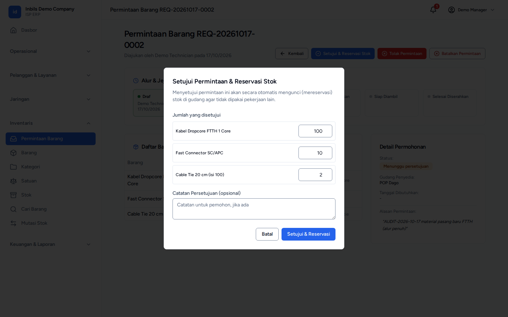

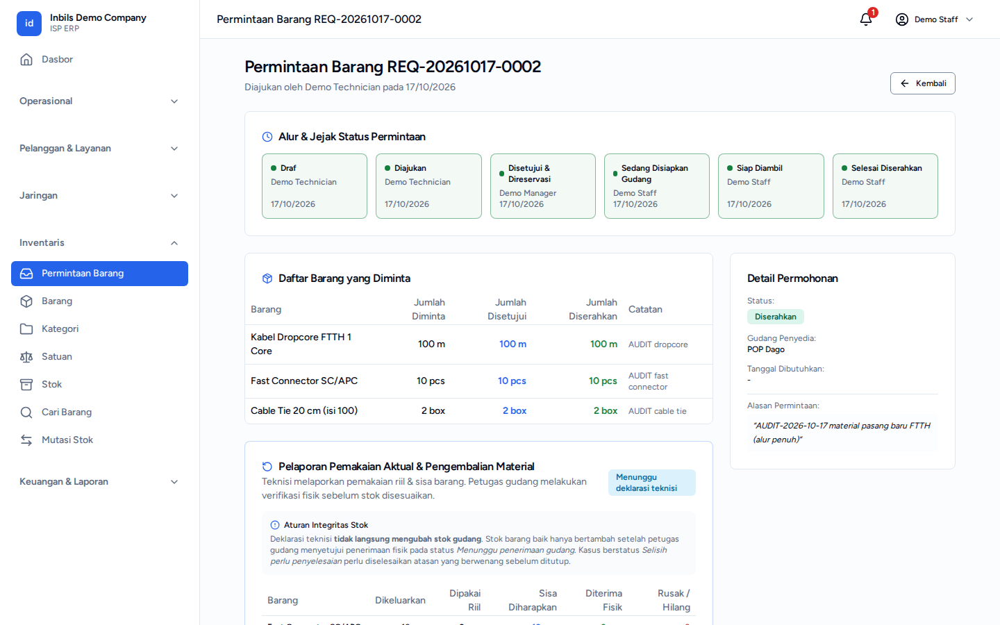

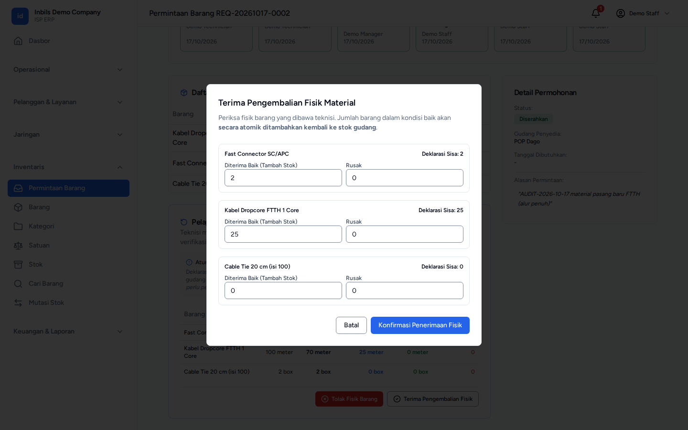

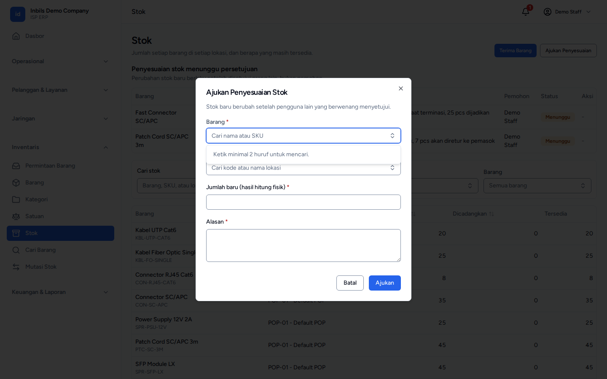

#### Rekaman yang tertinggal (prefiks AUDIT, tidak dihapus)

| Jenis | Kode / nama | Keterangan |
|---|---|---|
| permintaan barang | REQ-20261017-0001 | ditolak (stok kosong); id publik 01m54sfgqmm7140mqwcqxa008r |
| permintaan barang | REQ-20261017-0002 | siklus penuh; id 01m54smxp083nsrw9jf56f375e; kasus pengembalian 01m54snv9rpp7dekbnfch2c5qy (selesai) |
| permintaan barang | REQ-20261017-0003 | dibatalkan manajer |
| penyesuaian stok | KBL-UTP-CAT6 @POP-01 20→18 | disetujui |
| penyesuaian stok | SFP-LX @POP-01 45→44 | ditolak |
| penerimaan stok | CON-RJ45-CAT6 +50 @POP-01 | catatan "AUDIT 2026-10-17: penerimaan dari pemasok PT AUDIT, PO manual" |

#### Temuan cacat

| ID | Langkah | Yang terjadi | Yang diharapkan ISP | Keparahan | Saran perbaikan | Perlu keputusan owner | Bukti |
|---|---|---|---|---|---|---|---|
| F8-D01 | Permintaan → kasus pengembalian → Terima Pengembalian Fisik / Tolak Fisik Barang / Selesaikan Selisih | Setiap klik konfirmasi menjawab **"CSRF token mismatch." (419)** dan dialog tetap terbuka. Penyebab: `Show.tsx` memakai `fetch` dengan header dari `meta[name="csrf-token"]`, tag yang tidak pernah dirender `app.blade.php`; seluruh aplikasi lain memakai axios (cookie XSRF). Staf gudang tidak bisa membukukan barang kembali dan manajer tidak bisa menutup selisih dari browser. Tidak ada uji E2E yang menyentuh jalur ini. | Barang kembali masuk stok dan selisih ditutup dari halaman permintaan. | **blocker** (**diperbaiki**) | `handleReturnApiAction` memakai `axios.post` (header `X-XSRF-TOKEN` otomatis); uji `tests/e2e/inventory-returns.spec.ts` (3 skenario). | tidak | [08-12-accept-dialog.png](flow-audit/08-12-accept-dialog.png); bukti: tag meta tidak ada, `fetch` gaya UI → 419, `fetch` dengan `X-XSRF-TOKEN` → lolos |
| F8-D02 | Aplikasi teknisi → Permintaan barang | Layar permintaan tidak punya referensi SPK/tiket dan API menolak `source_type` (`work_order: null` pada respons). Form web punya sumber SPK tetapi teknisi hanya memakai aplikasi. | Permintaan terhubung ke SPK sehingga biaya material per pekerjaan dapat ditelusuri. | friction | Tambahkan `work_order_id` opsional di API dan tombol "Minta material" di layar SPK. | tidak | [08-01-request-submitted-manager.png](flow-audit/08-01-request-submitted-manager.png); kode `new_request_screen.dart`, `StoreTechnicianInventoryRequestRequest` |
| F8-D03 | Permintaan barang stok kosong → Setujui | Permintaan diterima dari aplikasi walau stok 0; baru ditolak saat disetujui dengan toast umum "Data gagal disimpan. Periksa input." dan pesan berisi kode ("CON-SC-APC di POP-BDG-DGO"). Modal setujui tidak menampilkan stok tersedia. | Teknisi melihat stok saat memilih; penyetuju melihat "Tersedia: N" dan pesan memakai nama. | friction | Tampilkan stok tersedia di pemilih, modal setujui, dan pesan galat. | tidak | [08-06-approve-dialog.png](flow-audit/08-06-approve-dialog.png) (pengganti 08-02, yang tidak tersimpan) |
| F8-D04 | Dialog Terima Pengembalian Fisik | Dialog hanya punya "Diterima Baik" dan "Rusak"; server mewajibkan terpakai + diterima + rusak + **hilang** + lainnya = diserahkan (`MaterialReturnService.php` baris ± 350) sedangkan UI selalu mengirim `lost_qty = 0`. Selisih "hilang" yang dideklarasikan teknisi (5 m) tidak bisa dicatat; staf harus memasukkannya sebagai "rusak" atau aksi ditolak 422. "Rusak" juga tidak terisi dari deklarasi. [dari kode + dialog yang teramati; klik penuh baru bisa setelah F8-D01] | Kolom Hilang dan Lainnya, terisi dari deklarasi teknisi. | friction | Tambah input `lost_qty` dan `other_discrepancy_qty`; prefill dari deklarasi. | tidak | [08-12-accept-dialog.png](flow-audit/08-12-accept-dialog.png) |
| F8-D05 | Setujui / tolak permintaan; deklarasi pengembalian | Teknisi hanya mendapat surel pada persetujuan/penolakan (tanpa bel dan push), padahal aturan N0 "setiap aksi memberi tahu pihak terkait". Tiap permintaan baru dikirim ke 10 penyetuju dan tiap deklarasi ke 15 staf lewat surel. | Teknisi: bel + push; penyetuju dan gudang: bel/dasbor, surel ringkas. | friction | Tambah kanal `database` + FCM untuk persetujuan/penolakan; batasi surel ke ringkasan harian atau pilihan per orang. | ya | surel di Mailpit 17/10 11:23 |
| F8-D06 | Daftar permintaan → kolom Rujukan | Menampilkan "SPK #01m53zkn9t99wwsrt2s6drzbaj" (ULID) bukan kode SPK-2026-xxxxx. | Kode SPK yang dapat diklik. | friction | Sertakan kode SPK di data daftar. | tidak | [08-25-movements.png](flow-audit/08-25-movements.png) (kolom serupa di Mutasi) |
| F8-D07 | Permintaan vs Kasus pengembalian | Satuan "m" di tabel permintaan, "meter" di tabel pengembalian (API "m"). | Satu penulisan satuan. | polish | Pakai satuan dari master barang di kedua tabel. | tidak | [08-10-issued-return-case.png](flow-audit/08-10-issued-return-case.png) |
| F8-D08 | Judul halaman permintaan | Kode terpotong menjadi dua baris ("REQ-20261017-" / "0001"); format kode beda antarmodul (REQ-tanggal-nomor vs SPK-tahun-nomor vs TKT-tahun-nomor). | Judul satu baris; format konsisten. | polish | `whitespace-nowrap` atau judul lebih kecil; seragamkan penomoran lewat `number_sequences`. | ya | [08-01-request-submitted-manager.png](flow-audit/08-01-request-submitted-manager.png) |
| F8-D09 | Dialog Terima Pengembalian Fisik | Kolom angka tidak punya nama aksesibel (pembaca layar hanya "2"); `Label` tanpa `htmlFor`. | Label terhubung dengan input. | polish | `htmlFor`/`aria-label` per baris. | tidak | [08-12-accept-dialog.png](flow-audit/08-12-accept-dialog.png) |
| F8-D10 | Mutasi Stok | Tanpa kolom pelaku dan saldo; baris penyesuaian menampilkan Dari = Ke lokasi sama; penerimaan retur berlabel "Masuk". | Pelaku, saldo sesudah, referensi bisa diklik, label "Pengembalian". | polish | Tambah kolom dari `created_by`/`balance_after`; petakan jenis `return`. | tidak | [08-25-movements.png](flow-audit/08-25-movements.png) |
| F8-D11 | Permintaan ditolak | Alur status tidak menandai "Ditolak" maupun siapa menolak (hanya spanduk alasan). | Langkah "Ditolak" dengan nama dan waktu di alur. | polish | Tambah langkah terminal pada `timelineSteps`. | tidak | [08-05-request-rejected.png](flow-audit/08-05-request-rejected.png) |
| F8-D12 | Stok → keluarkan / transfer antar gudang | Endpoint `stocks/issue`, `stocks/transfer`, `stocks/adjust/direct` ada, tidak ada tombol; pindah stok antar POP tidak bisa dari UI. | Aksi transfer antar gudang tersedia untuk staf. | polish | Modal "Transfer" di halaman Stok. | ya | [08-15-stocks-index.png](flow-audit/08-15-stocks-index.png) |
| F8-D13 | Pemilih barang/gudang (data demo) | Memuat DTC-P01…P11, E2E-*, dua barang hampir sama ("Connector SC/APC" vs "Fast Connector SC/APC"), gudang "Default POP" dan "DTC Warehouse". | Katalog bersih. | polish | Bersihkan data demo atau tandai barang uji. | tidak | - |

#### Temuan UX

| ID | Langkah | Sekarang | Seharusnya | Manfaat | Usaha | Catatan mockup | Lensa |
|---|---|---|---|---|---|---|---|
| F8-U01 | Teknisi → permintaan barang | Layar mandiri tanpa SPK, tanpa stok. | Dibuka dari SPK dengan gudang/barang yang disarankan (dari SPK sebelumnya) dan "Tersedia: N". | Tinggi: biaya per pekerjaan, tidak ada permintaan yang pasti ditolak. | M | Tombol "Minta material" di layar SPK. | 1, 4, 8 |
| F8-U02 | Setujui permintaan | Penyetuju tidak melihat stok sebelum klik. | Kolom "Tersedia" dan peringatan merah bila melebihi. | Tinggi: tanpa pesan galat tidak jelas; hemat satu putaran. | S | Kolom kecil di modal. | 5, 10 |
| F8-U03 | Terima pengembalian fisik | Dua kolom, nol prefilled dari deklarasi. | Tiga kolom (Baik, Rusak, Hilang) terisi dari deklarasi teknisi. | Tinggi: tanpa pemalsuan kategori; hemat ketikan. | S | Tabel dengan satu kolom lagi. | 4, 5 |
| F8-U04 | Mulai Penyiapan → Siap Diambil → Serah Terima | Tiga dialog konfirmasi (6 klik) untuk satu pekerjaan fisik. | Satu layar "Siapkan barang" dengan daftar ambil; konfirmasi hanya pada serah terima. | Sedang: 6 klik jadi 3; tidak ada status perantara yang tidak berguna. | M | Cetak daftar ambil. | 3 |
| F8-U05 | Penyesuaian dan Terima Barang | Penyesuaian tidak menampilkan stok sistem saat memilih barang+lokasi; Terima Barang tanpa pemasok, PO, harga; angka default 1 tanpa satuan. | Stok sistem tampil; pemasok/PO/harga satuan; satuan di sebelah angka. | Sedang: nilai stok dan penelusuran pembelian. | M | Dua baris info di modal. | 4, 5 |
| F8-U06 | Pemilih barang dan lokasi | "Ketik minimal 2 huruf untuk mencari" sebelum ada pilihan. | 10 pilihan terbaru muncul saat dibuka. | Sedang: ± 3 ketikan per pilihan, 8 klik jadi 6. | S | Daftar pendek bertanda "Terakhir dipakai". | 1, 2, 6 |

#### Verifikasi perbaikan F8-D01

**Perbaikan:** `resources/js/Pages/Admin/Inventory/Requests/Show.tsx`, fungsi `handleReturnApiAction`: `fetch` + `meta[name="csrf-token"]` diganti `axios.post` (cookie XSRF dikirim sebagai `X-XSRF-TOKEN`, pola yang sama dengan `GenerateDialog.tsx` dan `ImpersonationBanner.tsx`). Satu berkas produksi, tanpa perubahan PHP.

**Uji:** `tests/e2e/inventory-returns.spec.ts` (tag `@lifecycle`): stok diterima, teknisi meminta lewat API, manajer menyetujui, staf menyiapkan dan menyerahkan, teknisi mendeklarasikan, lalu tiga skenario lewat dialog sebenarnya: (1) staf menerima pengembalian bersih → kasus `reconciled`; (2) staf menolak serah terima dengan alasan → `correction_required`; (3) staf menerima dengan satu unit rusak → `exception_open`, lalu manajer lain menyelesaikan selisih → `resolved`. Status dibaca balik dari API teknisi.

| Perintah | Hasil |
|---|---|
| `flock /tmp/inbils-e2e.lock sh -c 'npm run test:e2e -- tests/e2e/inventory-returns.spec.ts --project=chromium --workers=1 --reporter=line'` pada bundel lama | **MERAH**: uji 1 gagal pada `POST /admin/inventory/returns/<id>/receive-accept` → 419 ("Failed to load resource … 419"); uji 2 dan 3 tidak jalan (mode serial) |
| `npx eslint …/Requests/Show.tsx` dan `npx prettier --check` (Show.tsx + spesifikasi) | keluar 0, gaya sesuai |
| `npm run build` (`tsc && vite build`) lalu spesifikasi yang sama | **HIJAU**: 3 passed (25,1 s) |
| `npm run test:e2e -- tests/e2e/inventory-lifecycle.spec.ts tests/e2e/stock-asset.spec.ts tests/e2e/inventory-returns.spec.ts --project=chromium --workers=1` | 11 passed (55,9 s) |

Catatan: percobaan pertama merah karena kesalahan penyiapan uji sendiri (gudang bernama E2E tidak ada), diperbaiki sebelum percobaan merah yang sah di atas. Suite E2E penuh dan PHPUnit tidak dijalankan ulang (tidak ada perubahan PHP; gerbang penuh FlowAudit1 sebelum perbaikan: 265 passed, 4 skipped). Belum ada commit.

### Alur 9: Laporan dan ekspor

**Status:** selesai.  
**Persona:** admin, manajer, staf.

#### Catatan eksekusi

- **Semua halaman laporan (hub, Metrik Bisnis, KPI Penjualan, Kinerja Teknisi, Aset, SLA, Kartu Stok, Log Audit, Konsolidasi, Kamus Data, Tunggakan)** → semuanya 200; DOM siap 194-240 ms, tenang 1,0-1,1 s; tidak ada galat konsol.
- **Angka dicocokkan dengan SQL:** MRR Rp 9.699.000 (kartu "Rp 9,7 jt"), piutang Rp 8.414.384,41, langganan aktif 24, ditangguhkan 4; konsolidasi DEMO + E2E-SUB = MRR 9.774.000 dan piutang 8.664.384 (benar). Telusur "Piutang" (32 tagihan) menunjukkan "Cocok" dan rekonsiliasi dengan halaman Tunggakan.
- **Ekspor lewat menu Ekspor:** CSV 158-197 ms (BOM UTF-8, siap Excel); PDF 407-1.150 ms; CSV log audit 5.000 baris 1,04 s (1,08 MB). **PDF log audit tanpa filter gagal: HTTP 500 setelah 30 s ("Maximum execution time of 30 seconds exceeded", dompdf).** Dengan filter satu hari 539 ms, 5 halaman.
- **Hak peran:** staf melihat 5 laporan (Bisnis, Aset, SLA, Kartu Stok, Kamus) tanpa tombol Ekspor, 403 di Penjualan/Audit/Konsolidasi/Teknisi; manajer ditambah Penjualan dan Kinerja Teknisi, ekspor hanya Bisnis/Teknisi/Aset/SLA; Audit dan Konsolidasi khusus admin; hub disaring menurut izin.
- **Kinerja Teknisi** kosong sampai satu teknisi dipilih (3 klik, 1,0 s); setelah itu kartu, grafik bulanan, Ekspor.

Catatan penilaian: laporan cepat, definisinya terdokumentasi di kartu ("Rumus dan sumber data") dan telusurnya merekonsiliasi; kelemahan ada di ekspor (isi mentah) dan satu kegagalan skala.

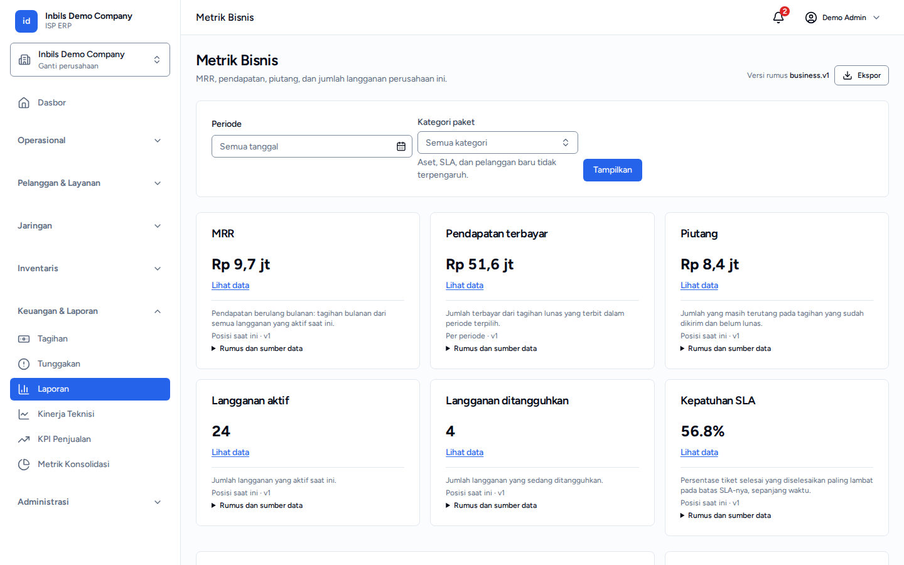

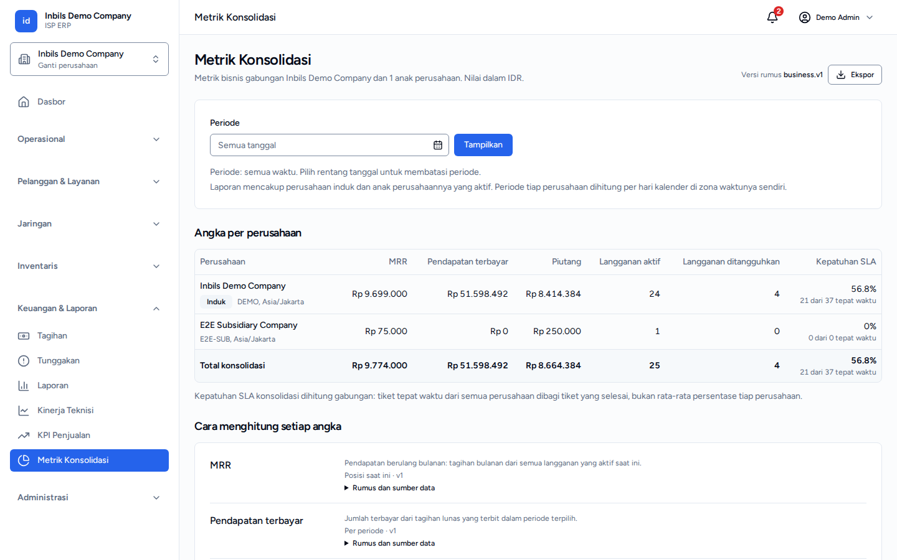

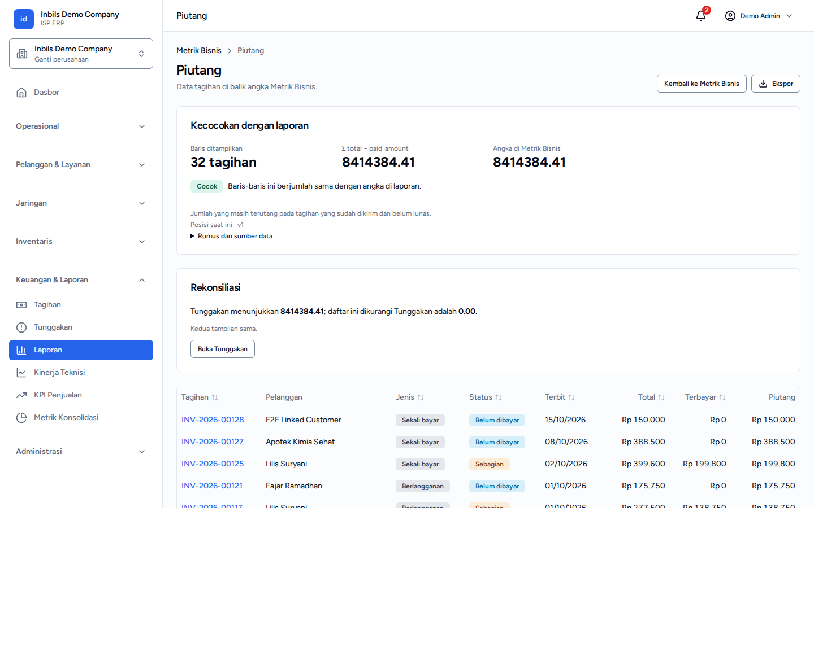

#### Rekaman yang tertinggal

Tidak ada rekaman tertulis oleh alur ini (hanya baca); berkas unduhan sementara di luar repo dihapus.

#### Temuan cacat

| ID | Langkah | Yang terjadi | Yang diharapkan ISP | Keparahan | Saran perbaikan | Perlu keputusan owner | Bukti |
|---|---|---|---|---|---|---|---|
| F9-D01 | Log Audit → Ekspor PDF tanpa filter | HTTP 500 setelah 30 s (`laravel.log` 2026-10-17 11:35:22, `dompdf AbstractFrameDecorator.php:278`); pengguna melihat halaman galat. 3,5 ribu baris, batas 5.000. | PDF terunduh atau pesan jelas "terlalu banyak baris, pilih periode". | friction | Batasi PDF (mis. 500 baris) dengan pesan, atau antrekan seperti ekspor tenant; CSV tetap sampai 5.000. | ya | [09-export-menu-audit-log-admin.png](flow-audit/09-export-menu-audit-log-admin.png) |
| F9-D02 | Ekspor CSV/PDF semua laporan | Isi memuat token mesin: Satuan `currency/count/percent/minutes/rating/breakdown`; Rincian `available/installed/maintenance`; status `sent/partial/one_time`; Kartu Stok Jenis `receive/issue/release/reserve` dan Referensi "MaterialReturnLine #ULID"; filter "technician_id=ULID"; durasi mentah ("2156 minutes"). | Label Indonesia seperti di layar, referensi berkode manusia (REQ-…), nama teknisi, durasi "1 hari 12 jam". | friction | Lewatkan ekspor melalui peta label yang sama dengan UI dan resolver referensi. | tidak | CSV Kartu Stok dan Teknisi 17/10 |
| F9-D03 | Ekspor PDF | PDF adalah tabel mentah: tanpa nama perusahaan, periode, waktu cetak; angka tanpa "Rp" ("9699000.00"); judul "Baris: 17"; ± 880 KB per berkas (font DejaVu tertanam penuh). | Laporan siap dikirim ke pemilik: kop, periode, angka berformat, ukuran kecil. | friction | Templat PDF dengan kop dan format id-ID; subset font. | ya | pdftotext PDF Bisnis dan SLA |
| F9-D04 | Kinerja Teknisi | Halaman kosong sampai satu teknisi dipilih; tombol Ekspor baru muncul sesudahnya; kartu "Rata-rata respons pertama 66" tanpa satuan. | Bawaan tabel semua teknisi dengan peringkat; satuan "menit". | polish | Lihat F9-U02. | tidak | [09-technician-admin.png](flow-audit/09-technician-admin.png), [09-technician-agus-manager.png](flow-audit/09-technician-agus-manager.png) |
| F9-D05 | Kartu laporan | Pemisah desimal tidak seragam: "63.6%", "86.25%", "4.8" vs "Rp 9,7 jt"; kartu menyingkat ("jt") sedangkan tabel konsolidasi penuh. | Format id-ID (koma) di semua angka. | polish | Satu util format persen/angka. | tidak | [09-technician-agus-manager.png](flow-audit/09-technician-agus-manager.png), [09-sales-admin.png](flow-audit/09-sales-admin.png) |
| F9-D06 | Kartu "Beban kerja aktif" | Dua tautan berurutan bernama sama: "Lihat dataLihat data". | Dua tautan berlabel berbeda ("Lihat SPK", "Lihat tiket"). | polish | Label tautan per metrik. | tidak | [09-technician-agus-manager.png](flow-audit/09-technician-agus-manager.png) |
| F9-D07 | Telusur "Piutang" → kartu Kecocokan | Memuat nama kolom mentah "Σ total − paid_amount". | "Σ total − terbayar". | polish | Terjemahkan rumus. | tidak | [09-drill-piutang.png](flow-audit/09-drill-piutang.png) |
| F9-D08 | Log Audit | Kolom Aksi menampilkan kunci mentah Inggris (`cancelled`, `created_and_submitted`, `stock_received`, `received_accepted`, `resolved`); Subjek "InventoryRequest #ULID"; penyesuaian disetujui dan stok diterima tanpa subjek ("-"); waktu ganda "18:29 11:29:40 UTC". | Kalimat Indonesia, subjek berkode manusia, satu zona waktu. | polish | Kamus event audit; resolver subjek. | tidak | [09-audit-log-top.png](flow-audit/09-audit-log-top.png) |
| F9-D09 | Penjualan, Kartu Stok, Tunggakan | KPI Penjualan tanpa ekspor (sengaja di kontrak); Kartu Stok kosong sampai barang dipilih; Tunggakan tanpa filter tanggal/ekspor. | Ekspor di Tunggakan (alat penagihan utama). | polish | Tambah ekspor Tunggakan. | ya | [09-receivables-admin.png](flow-audit/09-receivables-admin.png) |

#### Temuan UX

| ID | Langkah | Sekarang | Seharusnya | Manfaat | Usaha | Catatan mockup | Lensa |
|---|---|---|---|---|---|---|---|
| F9-U01 | Ekspor | Dump mentah (F9-D02, F9-D03). | Label, kop, format id-ID, batas aman PDF. | Tinggi: laporan bulanan bisa langsung dikirim; tidak ada kegagalan 30 s. | M | Kop dengan logo tenant. | 5, 7 |
| F9-U02 | Kinerja Teknisi | Wajib memilih satu teknisi. | Tabel semua teknisi dengan peringkat; baris membuka detail. | Sedang: pemilik membandingkan teknisi dalam satu layar (hemat 3 klik per teknisi). | S | Tabel dengan sparkline bulanan. | 3, 4, 10 |
| F9-U03 | Log Audit | Aksi mentah, subjek ULID. | "Demo Manager membatalkan permintaan REQ-… " + tautan. | Sedang: audit dapat dibaca owner non-teknis. | M | Baris satu kalimat dengan detail dilipat. | 7 |

### Alur 10: Anak perusahaan dan perusahaan induk

**Status:** sebagian. Pemindahan perusahaan, isolasi data, hak peran, laporan konsolidasi dan ekspornya diuji; **membuat anak perusahaan lewat panel platform belum dijalankan**.  
**Persona:** admin (anggota DEMO dan E2E-SUB), manajer (hanya DEMO).

#### Catatan eksekusi

- **Pemindah perusahaan di sidebar (admin): dibuka → daftar "Inbils Demo Company" (DEMO, bawaan) dan "E2E Subsidiary Company" (E2E-SUB) → pilih → 2 klik.** Daftar Pelanggan di konteks anak menampilkan hanya `E2E-SUB-CUST`; Metrik Bisnis anak: MRR Rp 75.000. Baris audit `company_switched` tercatat dua kali (pergi dan kembali).
- **Isolasi:** di konteks induk, membuka pelanggan anak langsung (`/admin/customers/<ULID>`) → 404; daftar induk tidak memuat pelanggan anak.
- **Hak peran:** manajer tidak melihat pemindah (satu keanggotaan) dan mendapat 403 di Metrik Konsolidasi; admin saja yang memegang `report.consolidated.view`. Di konteks **anak**, `/admin/reports/consolidated` → 403 "Akses ditolak" (laporan hanya untuk induk).
- **Konsolidasi (induk):** per perusahaan + "Total konsolidasi" (9.774.000 / 8.664.384, benar), SLA gabungan "21 dari 37 tepat waktu"; ekspor CSV 177 ms.
- **Belum dijalankan:** membuat anak perusahaan (`POST /platform/companies/{id}/subsidiaries` atau `inbils:company:create-subsidiary`) dan keanggotaan admin ke anak; operator `audit-operator@inbils.test` sudah ada (rahasia di `~/.config/inbils/flow-audit/operator.json`).

#### Rekaman yang tertinggal

Tidak ada rekaman baru (hanya dua baris audit `company_switched`).

#### Temuan cacat

| ID | Langkah | Yang terjadi | Yang diharapkan ISP | Keparahan | Saran perbaikan | Perlu keputusan owner | Bukti |
|---|---|---|---|---|---|---|---|
| F10-D01 | Membuat anak perusahaan | Admin tenant tidak punya tombol; hanya operator platform atau perintah konsol (`.scratch/head-company/spec.md`) [dari kode, rute tenant tidak ada]. | Pemilik grup ISP menambah cabang sendiri atau memintanya dari satu tombol. | friction | Tombol "Minta anak perusahaan" yang membuat tiket ke operator, atau form untuk admin induk. | ya | - |
| F10-D02 | Konteks anak → Metrik Konsolidasi | Halaman 403 generik "Akses ditolak"; menu tetap menawarkan laporan itu (izin per peran, bukan per konteks) [tautan sidebar di konteks anak tidak diperiksa]. | Pesan "Hanya di perusahaan induk. Ganti ke Inbils Demo Company." dengan tombol. | friction | Pesan khusus pada `ConsolidatedReportRequest` + sembunyikan menu di anak. | tidak | [10-04-subsidiary-admin-reports-consolidated.png](flow-audit/10-04-subsidiary-admin-reports-consolidated.png) |
| F10-D03 | Pindah perusahaan | Toast "Sekarang bekerja di …" tidak tertangkap oleh skrip pada pindah ke anak maupun kembali (pemindahan sendiri terbukti dari data dan audit); klik ganda cepat dapat mengirim dua POST [dari kode `CompanySwitcher.tsx`]. | Umpan balik terlihat dan tombol terkunci. | polish | Uji ulang toast secara manual; kunci tombol saat `switching`. | tidak | [10-02-switched-to-subsidiary.png](flow-audit/10-02-switched-to-subsidiary.png) |
| F10-D04 | Daftar perusahaan induk | Subsidiary memakai kode `E2E-SUB`/"E2E Subsidiary Company" (data uji) pada tenant demo; konsolidasi demo ikut menghitungnya. | Data demo bernama ISP nyata. | polish | Ganti nama atau lepas dari tenant demo. | tidak | [09-consolidated-admin.png](flow-audit/09-consolidated-admin.png) |

#### Temuan UX

| ID | Langkah | Sekarang | Seharusnya | Manfaat | Usaha | Catatan mockup | Lensa |
|---|---|---|---|---|---|---|---|
| F10-U01 | Anak perusahaan | Pembuatan di luar tenant; konteks aktif hanya terbaca dari nama kecil di sidebar. | Pembuatan mandiri atau permintaan satu klik; pita warna "Sedang di anak perusahaan X" di header. | Sedang: mencegah salah catat di perusahaan yang keliru. | M | Pita tipis di atas topbar dengan tombol "Kembali ke induk". | 3, 5, 10 |
| F10-U02 | Laporan konsolidasi di anak | 403. | Penjelasan + tombol ganti ke induk. | Rendah: tidak buntu. | S | Kartu kosong dengan tombol. | 5, 10 |

### Alur 11: Dukungan platform (impersonasi, reset 2FA, kirim ulang undangan, buka kunci, tangguhkan, ekspor, audit)

**Status:** selesai di web; langkah aplikasi (login aplikasi pada tenant yang ditangguhkan di layar) belum.  
**Persona:** operator `audit-operator@inbils.test` (2FA), admin dan teknisi tenant `AUDIT-SUP`.  
**Lingkungan:** dua kunci sesi dalam satu Chrome terisolasi (operator di `http://localhost`, tenant di `http://127.0.0.1`, jar cookie berbeda); pekerja antrean `default,whatsapp` dan `platform` berjalan (layanan `fa4-queue-default`, `fa4-queue-platform`); surel lewat Mailpit.

#### Catatan eksekusi

- **Perusahaan baru** `AUDIT SUP 2026-10-17` (kode `AUDIT-SUP`, id 4, id publik `01m54xb3t16kewxxf8f1e7trx4`) lewat panel platform: 4 isian, 1 klik, pindah ke halaman perusahaan 651 ms; zona waktu dan mata uang terisi bawaan. Picker zona waktu **bisa dicari** (ketik "Makas" → `Asia/Makassar`), 419 opsi, ada tombol hapus pilihan. ([11-04](flow-audit/11-04-platform-company-create-form.png), [11-05b](flow-audit/11-05b-timezone-search.png), [11-07](flow-audit/11-07-platform-company-created.png))
- **Kirim ulang undangan** (admin yang belum pernah masuk): menu "Aksi lain" → dialog (tanpa kata sandi) → toast "Undangan admin dikirim ulang." ± 1,5 s; surel kedua tiba < 3 s. Tautan lama ditolak dengan "Token pengaturan ulang kata sandi tidak valid." di bawah formulir; tautan baru mengatur kata sandi lalu halaman masuk menulis "Kata sandi Anda telah diatur ulang." Menu ini hilang sesudah admin pertama kali masuk. ([11-09](flow-audit/11-09-resend-invite-dialog.png), [11-11](flow-audit/11-11-old-invite-link-after-resend.png), [11-12](flow-audit/11-12-old-invite-token-rejected.png), [11-13](flow-audit/11-13-new-invite-password-set.png))
- **Impersonasi baca saja:** "Masuk sebagai" → dialog: alasan minimal 5 huruf (tombol mati pada 4 huruf, penghitung "0/200") dan kata sandi operator → panel tenant dengan banner "Anda masuk sebagai AUDIT SUP Admin (AUDIT SUP 2026-10-17) · superadmin AUDIT Operator · mode Baca · sisa 29:40 · Mode ubah · Keluar". ([11-19](flow-audit/11-19-impersonate-dialog.png), [11-20](flow-audit/11-20-impersonate-dialog-filled.png), [11-21](flow-audit/11-21-impersonation-banner-read.png))
- **Tulis di mode baca:** Simpan di Profil Perusahaan → toast "Mode baca saja: perubahan tidak diizinkan selama akses dukungan. Aktifkan mode ubah dari banner untuk melanjutkan." (1,5 s); muat ulang: data tidak berubah. ([11-23](flow-audit/11-23-write-blocked-read-mode.png))
- **Mode ubah:** dialog "Ketik AUDIT-SUP untuk melanjutkan"; huruf kecil `audit-sup` → "Kode perusahaan yang diketik tidak sesuai." di bawah kolom; kode benar → toast "Mode ubah diaktifkan." (2,5 s). Tulis lagi: "Profil perusahaan diperbarui."; telepon dan jam layanan tersimpan setelah muat ulang. ([11-24](flow-audit/11-24-write-mode-dialog.png), [11-25](flow-audit/11-25-write-mode-wrong-code.png), [11-26b](flow-audit/11-26b-banner-write-mode.png), [11-27](flow-audit/11-27-write-mode-saved.png)) **Langkah-naik kata sandi (respons 423 lalu halaman konfirmasi) tidak teruji:** semua percobaan mode ubah terjadi kurang dari 5 menit sesudah konfirmasi kata sandi di dialog mulai.
- **Halaman akun pribadi saat akses dukungan:** menu Profil membuka jendela iframe putih berisi teks mentah "Pengaturan akun pribadi tidak tersedia selama akses dukungan."; alamat langsung `/profile` menampilkan halaman putih berisi satu baris itu saja, tanpa tata letak, banner, atau tombol kembali. ([11-29](flow-audit/11-29-profile-denied-in-support.png), [11-30](flow-audit/11-30-profile-direct-403.png))
- **Tenant melihat akses dukungan:** admin tenant → Laporan → Log audit, filter Modul "Akses dukungan" (19 baris pada saat itu). Baris impersonasi berkalimat jelas ("masuk sebagai pengguna", "mengubah mode akses", "mengubah data", "keluar dari akun pengguna"; Detail memuat alasan, mode, kedaluwarsa 30 menit, rute `admin.company.profile.update`, durasi 310 detik). Baris lain (kirim ulang undangan, buka kunci, atur ulang 2FA, tangguhkan, aktifkan kembali, ekspor diminta/selesai/diunduh) hanya berbunyi "Akses dukungan oleh tim Inbils"; Detail 2FA/buka kunci: "Tidak ada perubahan properti yang dicatat". Pencarian teks "dukungan" mengembalikan 0 baris. ([11-33](flow-audit/11-33-tenant-audit-log.png), [11-34](flow-audit/11-34-tenant-audit-detail-start.png), [11-35](flow-audit/11-35-tenant-audit-detail-write.png), [11-76](flow-audit/11-76-tenant-audit-support-module.png), [11-77](flow-audit/11-77-tenant-audit-detail-2fa-reset.png), [11-78](flow-audit/11-78-tenant-audit-detail-suspended.png))
- **Keluar:** tombol banner → kembali ke halaman perusahaan di panel platform; `/admin/dashboard` lalu menuju `/login` (sesi tenant dihancurkan). ([11-37](flow-audit/11-37-after-keluar.png), [11-37b](flow-audit/11-37b-admin-dashboard-after-keluar.png))
- **Buka kunci, batas kata sandi (6 salah):** lima kali "Email atau kata sandi salah."; ke-6 "Terlalu banyak percobaan masuk. Coba lagi dalam 54 detik." Kata sandi benar saat terkunci juga ditolak. Operator memilih "Buka kunci masuk" (dialog: "Hitungan kode 2FA yang salah dihapus …"; toast "Kunci autentikasi dua langkah pengguna dibuka."), kata sandi benar **masih ditolak** ("coba lagi dalam 48 detik"): tombol hanya menghapus hitungan kode 2FA, bukan batas email+alamat. ([11-36-login-bad-password-5](flow-audit/11-36-login-bad-password-5.png), [11-36-login-bad-password-6](flow-audit/11-36-login-bad-password-6.png), [11-36-login-locked-after-6-bad-passwords](flow-audit/11-36-login-locked-after-6-bad-passwords.png), [11-38](flow-audit/11-38-unlock-dialog.png), [11-39](flow-audit/11-39-unlock-toast.png), [11-40](flow-audit/11-40-login-right-pw-after-unlock.png))
- **Buka kunci, batas kode 2FA:** 5 kode salah → ke-6 "coba lagi dalam 60 detik" (batas per alamat); setelah 62 detik dan 5 percobaan lagi, percobaan ke-12 → "Coba lagi dalam 760 detik" (batas per akun, 10 per 15 menit); kode benar saat terkunci ditolak ("663 detik"). Setelah "Buka kunci masuk" kode benar langsung masuk ke dasbor. ([11-44](flow-audit/11-44-2fa-locked-right-code-refused.png), [11-45](flow-audit/11-45-login-after-unlock-right-code.png))
- **Atur ulang 2FA:** dialog meminta kata sandi operator; basis data: `two_factor_confirmed_at` dan secret kosong, baris audit `two_factor.admin_reset` (keamanan, platform, dukungan). Masuk berikutnya tanpa tantangan 2FA. Sesi web admin yang sudah terbuka **tetap hidup** (dev memakai `SESSION_DRIVER=file`; kode hanya menghapus sesi untuk driver `database`). ([11-70](flow-audit/11-70-reset-2fa-dialog.png), [11-72](flow-audit/11-72-admin-session-after-2fa-reset.png))
- **Tangguhkan** (alasan, ketik kode, kata sandi operator; tombol mati sampai ketiganya valid): basis data `is_active=0`, `suspended_at` terisi, baris `api.tokens_revoked`. **Halaman menampilkan "Halaman tidak dapat ditampilkan" setelah tindakan berhasil (F11-D01);** muat ulang menampilkan keadaan benar: banner "Perusahaan ditangguhkan", tombol "Masuk sebagai" hilang, "Ajukan hapus" mati dengan syarat "baru boleh setelah 30 hari … (mulai 16 Nov 2026 12:55 UTC)" dan "Belum ada ekspor data yang selesai setelah penangguhan." ([11-49](flow-audit/11-49-suspend-dialog.png), [11-50](flow-audit/11-50-suspend-dialog-filled.png), [11-51](flow-audit/11-51-tenant-suspended.png), [11-52](flow-audit/11-52-tenant-suspended-page-after-reload.png), [11-55](flow-audit/11-55-suspended-tenant-deletion-blockers.png))
- **Ditangguhkan, login:** web (admin 2FA dan teknisi tanpa 2FA) kata sandi benar → "Akun perusahaan Anda sedang ditangguhkan. Hubungi dukungan."; kata sandi salah → "Email atau kata sandi salah." (tidak membocorkan status). API aplikasi `POST /api/v1/auth/login` kata sandi benar → 422 pesan yang sama; token lama → 401 `unauthenticated` (dicabut saat tangguhkan). Admin yang sedang membuka dasbor dilempar ke `/login` **tanpa pesan apa pun** (F11-D05). ([11-53](flow-audit/11-53-suspended-live-session-redirect.png), [11-54](flow-audit/11-54-suspended-web-login-refused.png))
- **Aktifkan kembali** (alasan saja): toast "Perusahaan diaktifkan kembali." (2,5 s), tanpa galat 2 dari 2; login web dan API pulih; token lama tetap tidak berlaku (masuk ulang). ([11-68](flow-audit/11-68-reactivate-dialog.png), [11-69](flow-audit/11-69-tenant-reactivated.png), [11-79](flow-audit/11-79-reactivated-again-no-crash.png))
- **Ekspor:** "Minta ekspor" (ketik kode + kata sandi) → baris antrean → siap dalam ± 1 detik (12:57:35→12:57:36), 26.608 byte, 123 baris, kedaluwarsa 24 jam; tombol unduh hanya di halaman Ekspor (tautan bertanda tangan). ZIP: 89 berkas = 59 CSV + `manifest.json` + 29 berkas media. **Isolasi baris: 0 baris perusahaan lain** di 17 tabel ber-`company_id` (123 baris = jumlah di manifest); kolom sensitif dihilangkan (`password`, rahasia 2FA, token, `radius_secret`, `snap_token`); baris log `platform` tidak ikut, baris `support` ikut. **Berkas:** 29 berkas `files/public/companies/4/work_orders/*` dan `files/local/companies/4/{work_orders,tickets}/*` **bukan milik AUDIT-SUP** (F11-D04). ([11-56](flow-audit/11-56-export-request-dialog.png), [11-57-export-queued](flow-audit/11-57-export-queued.png), [11-57-export-ready-on-company-page](flow-audit/11-57-export-ready-on-company-page.png), [11-58](flow-audit/11-58-platform-exports-page.png))
- **Audit platform:** awal 41 baris (10 per halaman, 1,65 s). Filter Perusahaan (picker bisa dicari, 3 opsi) → 35 baris; Kegiatan (34 opsi, bisa dicari; "dukungan" → 3) → gabungan 2 baris; kotak Cari berdebounce (alamat berubah ± 0,66 s setelah mengetik); `search=login_unlocked` 8 baris; tidak cocok → "Tidak ada kegiatan yang cocok"; tanggal hari ini 41, kemarin 0; dialog Rincian memuat alasan, mode, durasi. Parameter tidak sah lewat alamat → F11-D09. ([11-59](flow-audit/11-59-platform-audit-initial.png), [11-60](flow-audit/11-60-audit-filter-company-open.png), [11-61](flow-audit/11-61-audit-filter-company-applied.png), [11-62](flow-audit/11-62-audit-filter-action-open.png), [11-63](flow-audit/11-63-audit-filter-company-action.png), [11-64](flow-audit/11-64-audit-search.png), [11-65](flow-audit/11-65-audit-empty-state.png), [11-66](flow-audit/11-66-audit-detail-dialog.png), [11-67](flow-audit/11-67-audit-date-picker.png))

#### Rekaman yang tertinggal (prefiks AUDIT, tidak dihapus)

| Jenis | Kode / nama | Keterangan |
|---|---|---|
| perusahaan | `AUDIT-SUP` (id 4) | aktif kembali; 43 baris audit platform/dukungan |
| pengguna | `audit-sup-admin@inbils.test` | admin; 2FA diatur ulang operator (kini mati); rahasia di `~/.config/inbils/flow-audit/sup-admin.json` |
| pengguna | `audit-sup-tech@inbils.test` + karyawan `EMP-0001` | teknisi uji aplikasi tenant ditangguhkan (`sup-tech.json`) |
| ekspor | id 1 (AUDIT-SUP) | siap diunduh sampai 18/10/2026 19:57 WIB |
| perusahaan | profil AUDIT-SUP | telepon `022-5550001`, jam layanan "AUDIT FA4 mode ubah 08.00-17.00" (tulis dukungan) |

#### Temuan cacat

| ID | Langkah | Yang terjadi | Yang diharapkan ISP | Keparahan | Saran perbaikan | Perlu keputusan owner | Bukti |
|---|---|---|---|---|---|---|---|
| F11-D01 | Tangguhkan / Minta ekspor / Atur ulang 2FA setelah operator sempat membuka halaman tenant tanpa masuk | Tindakan **berhasil** (basis data berubah) tetapi layar menjadi "Halaman tidak dapat ditampilkan … Muat ulang halaman"; Tangguhkan: 2 dari 2 percobaan (galat konsol dari komponen `Login` tenant); ekspor dan atur ulang 2FA tidak menampilkan toast dan halaman kosong (konsisten, belum dipastikan satu per satu). Aktifkan kembali dan kirim ulang undangan (tanpa dialog kata sandi) tidak galat. **Penyebab sangat mungkin:** sesi operator menyimpan `url.intended=/admin/dashboard` (dibuat saat tamu membuka halaman tenant); konfirmasi kata sandi platform memakai `redirect()->intended($back)` (`ConfirmablePasswordController::store`), sehingga dialog melompat ke dasbor tenant, lalu `/login` tenant, dan SPA platform merender komponen `Login`. Setiap lompatan menyimpan intended lagi, jadi berulang. Respons Inertia server untuk halaman perusahaan benar (`Platform/Companies/Show`). | Dialog kembali ke halaman yang sama dengan toast sukses. | friction | Pakai `redirect()->to($back)` bila `$back` halaman platform (abaikan intended milik tenant) atau buang `url.intended` pada saat membuka halaman tenant sebagai tamu dari sesi platform; tambah uji E2E "Tangguhkan setelah buka /admin/dashboard saat keluar". | tidak | [11-51](flow-audit/11-51-tenant-suspended.png), [11-52](flow-audit/11-52-tenant-suspended-page-after-reload.png) |
| F11-D02 | Buka kunci masuk | Hanya menghapus hitungan kode 2FA (`two-factor-user\|id`). Pengguna yang terkunci karena 6 kata sandi salah (batas `email\|alamat`, 1 menit) tetap terkunci setelah toast "Kunci … dibuka". Menu hanya muncul bila pengguna punya 2FA, sehingga pelanggan/staf tanpa 2FA tidak punya alat buka kunci. | "Buka kunci masuk" membuka semua kunci masuk pengguna itu dan hadir untuk semua pengguna. | friction | Hapus juga limiter kata sandi (`email\|alamat`, perlu daftar alamat atau awalan kunci) dan tampilkan menu tanpa syarat 2FA; atau ganti nama menjadi "Buka kunci 2FA". | ya | [11-39](flow-audit/11-39-unlock-toast.png), [11-40](flow-audit/11-40-login-right-pw-after-unlock.png) |
| F11-D03 | Log audit tenant → Akses dukungan | Delapan dari sepuluh jenis tindakan hanya menulis "Akses dukungan oleh tim Inbils": tenant tidak bisa membedakan atur ulang 2FA, buka kunci, kirim ulang undangan, tangguhkan, aktifkan kembali, ekspor diminta/selesai/diunduh. Detail 2FA/buka kunci "Tidak ada perubahan properti". Pencarian teks "dukungan" → 0 baris (pencarian memakai kunci mentah). | Admin tenant membaca apa yang dilakukan tim dukungan (SA7 transparansi). | friction | Perluas `SUPPORT_ACTION` di `AuditLog.tsx` untuk semua kode `user.*` dan `tenant.*`; cari juga pada teks tampilan. | ya | [11-76](flow-audit/11-76-tenant-audit-support-module.png), [11-77](flow-audit/11-77-tenant-audit-detail-2fa-reset.png) |
| F11-D04 | Ekspor → ZIP | Berkas media dipilih menurut folder `companies/{id}/` di disk, bukan menurut baris `media`/tabel tenant: ZIP AUDIT-SUP memuat 29 berkas sisa uji (id perusahaan 4 dipakai ulang di basis data uji pada disk yang sama). Di produksi id tidak dipakai ulang, tetapi folder tersisa/pulih dari cadangan bisa membocorkan berkas tenant lain. ZIP juga tidak memuat penetapan peran (`model_has_roles`) dan tabel `media`, sehingga berkas tak bisa dihubungkan lagi ke catatannya. | ZIP hanya memuat berkas yang dimiliki tenant (menurut basis data) dan cukup untuk memulihkan tenant. | friction | Ambil berkas dari baris `media` milik tenant (`mediaOwnedBy` sudah ada) dan tulis `media.csv` serta peran pengguna; jangan memindai folder. | ya | [11-58](flow-audit/11-58-platform-exports-page.png) |
| F11-D05 | Admin tenant sedang bekerja saat perusahaan ditangguhkan | Permintaan berikutnya dialihkan ke `/login` dengan formulir kosong; tidak ada pesan "ditangguhkan" (kode `ResolveActiveCompany` mengirim `withErrors`, namun tidak tampil). | Pesan "Akun perusahaan Anda sedang ditangguhkan. Hubungi dukungan." di halaman masuk. | polish | Simpan pesan sebagai flash sesudah `invalidate()` atau lewat parameter. | tidak | [11-53](flow-audit/11-53-suspended-live-session-redirect.png) |
| F11-D06 | Atur ulang 2FA | Dialog menjanjikan "semua sesi masuknya berakhir"; sesi web yang terbuka tetap hidup pada `SESSION_DRIVER=file` (dev), karena kode hanya menghapus sesi bila driver `database` dan diam bila tidak. Rahasia ingat-saya dan token aplikasi diganti/dicabut [dari kode]. | Janji dan kenyataan sama. | polish | Catat peringatan di log atau tolak driver selain `database` pada produksi; samakan `.env` dev. | tidak | [11-72](flow-audit/11-72-admin-session-after-2fa-reset.png) |
| F11-D07 | Halaman akun pribadi saat akses dukungan | Penolakan 403 berupa teks mentah di iframe Inertia (klik) atau halaman putih tanpa tata letak (alamat langsung). | Pesan bertata letak dengan jalan kembali. | polish | Respons Inertia/halaman galat bergaya untuk pesan ini. | tidak | [11-29](flow-audit/11-29-profile-denied-in-support.png), [11-30](flow-audit/11-30-profile-direct-403.png) |
| F11-D08 | Banner akses dukungan | Toast "Mode baca/ubah diaktifkan." muncul di kanan atas dan menutupi tombol "Mode ubah/Mode baca/Keluar" selama beberapa detik (klik berikutnya ditolak). | Toast tidak menutupi kendali yang baru diubah. | polish | Posisikan toast di bawah atau naikkan z-index banner. | tidak | [11-32](flow-audit/11-32-toast-covers-banner-buttons.png) |
| F11-D09 | Audit platform → alamat | Tanggal terbalik, tanggal tidak sah, `per_page=7` → tabel kosong "Tidak ada kegiatan yang cocok" dan toast "Data gagal disimpan. Periksa input." (halaman hanya membaca). `page=999` → "Menampilkan 9981-41 dari 41". | Pesan galat di samping filter; halaman terakhir yang sah. | polish | Atur pesan validasi untuk GET; jepit nomor halaman. | tidak | [11-65](flow-audit/11-65-audit-empty-state.png) |
| F11-D10 | Karyawan → Buat (picker Pengguna) | Setelah menyimpan, alamat menjadi `/admin/employees?user_search=Teknisi`: kata cari picker bocor ke URL halaman. | URL daftar bersih. | polish | Jangan memakai parameter halaman untuk pencarian picker. | tidak | [11-48](flow-audit/11-48-sup-employee-created.png) |
| F11-D11 | Audit platform | Setiap tindakan menulis dua baris (log Platform dan Akses dukungan): daftar 41 baris untuk ± 20 tindakan. | Satu baris per tindakan, atau saringan sumber bawaan. | polish | Kelompokkan berdasarkan `batch_uuid`/waktu. | tidak | [11-59](flow-audit/11-59-platform-audit-initial.png) |
| F11-D12 | Mode ubah (langkah-naik) | Cabang respons 423 → halaman konfirmasi kata sandi tidak dijalankan (selalu < 5 menit). | Terbukti. | polish | Jalankan setelah > 5 menit; atau uji E2E dengan jam palsu. | tidak | - |

#### Temuan UX

| ID | Langkah | Sekarang | Seharusnya | Manfaat | Usaha | Catatan mockup | Lensa |
|---|---|---|---|---|---|---|---|
| F11-U01 | Audit tenant: akses dukungan | Delapan jenis tindakan sama bunyinya. | Kalimat per tindakan + pencarian teks terlihat. | Tinggi: admin tenant tahu 2FA siapa yang diatur ulang. | S | Tambah kamus `SUPPORT_ACTION`. | 7, 10 |
| F11-U02 | Buka kunci masuk | Hanya 2FA; tersembunyi tanpa 2FA; tanpa status. | Satu tombol, status kunci dan sisa waktu. | Tinggi: tiket "tidak bisa masuk" selesai dalam 1 klik. | S | Lencana "Terkunci 11 mnt" di baris pengguna. | 5, 10 |
| F11-U03 | Dialog tindakan platform | Kata sandi operator diketik tiap dialog (3 kali dalam 3 menit). | Lewati bila sudah dikonfirmasi < 5 menit. | Sedang: 3 ketikan dan 3 klik lebih sedikit. | S | Teks "Terkonfirmasi sampai 20:08". | 3, 4 |
| F11-U04 | Ekspor | Minta di halaman perusahaan; unduh hanya di halaman Ekspor (pindah halaman + tabel). | Tombol Unduh di baris ekspor perusahaan. | Sedang: 2 klik dan 1 layar. | S | Tautan di kolom Catatan. | 3 |
| F11-U05 | Pesan kunci | "Coba lagi dalam 663 detik". | "Coba lagi dalam 11 menit". | Sedang: terbaca sekali lihat. | S | - | 5 |
| F11-U06 | Dialog Tangguhkan | Teks umum. | Jumlah pengguna, yang sedang masuk, token aplikasi, tagihan. | Sedang: operator tahu dampaknya. | M | Baris ringkas di dialog. | 5, 10 |
| F11-U07 | Halaman akun pribadi (dukungan) | Teks putih mentah. | Kartu dengan tombol Kembali. | Sedang: tidak buntu. | S | - | 5 |
| F11-U08 | Audit platform | Dua baris per tindakan. | Satu baris atau sumber bawaan Platform. | Rendah: daftar separuh panjang. | S | - | 2, 7 |
| F11-U09 | Banner dukungan | Toast menutupi tombol. | Toast di bawah banner. | Rendah. | S | - | 5 |
| F11-U10 | Zona waktu | Daftar mulai dari Africa/Abidjan. | Mulai dari nilai terpilih; sudah bisa dicari. | Rendah. | S | - | 2, 4 |

#### Catatan dari pembacaan kode (tanpa ID, belum dicoba di layar)

- Tidak ada layar untuk mengelola operator platform; menonaktifkan operator hanya bisa lewat basis data.
- Dua catatan [dari kode] lain di rencana awal alur ini sudah dikoreksi atau dibuktikan oleh uji: daftar zona waktu ternyata bisa dicari (F11-U10), dan "buka kunci" memang tidak membersihkan batas per alamat (F11-D02).

### Alur 12: Aplikasi lintas fungsi (push, tautan dalam, mode gelap, kurangi gerak, antrean luring, konsistensi teks)

**Status:** dijalankan di AVD `inbils_pixel7` (Android 15, 1080x2400, dua aplikasi `*.dev` masuk sebagai `audit-customer1` dan `audit-tech`), basis data dev `inbils` (Sail), Firebase asli (kunci Admin SDK sementara). Ditulis oleh FlowAudit7. Tangkapan layar `docs/plans/flow-audit/12-*.png` (30), catatan `~/.config/inbils/flow-audit/notes-fa7.jsonl`. Tidak ada perubahan kode produksi dan tidak ada commit; tidak ada cacat berkeparahan blocker, jadi tidak ada perbaikan/uji baru.

**Cara:** setiap peristiwa dipicu lewat aksi nyata oleh persona yang tepat (sesi web `audit-manager`, `audit-staff`, `audit-warehouse`, `audit-admin` dengan 2FA; teknisi lewat aplikasi), antrean berjalan (`fa4-queue-default`). Waktu diukur dari log ponsel (`FirebaseMessaging` dan heads-up). Heads-up ditangkap lewat layar, lalu diketuk **langsung** (bila ada tulisan "heads-up") atau lewat baris bayangan notifikasi. Tiga keadaan aplikasi: latar depan (fg), latar belakang (bg), mati (`am kill`, cold start).

#### Peta peristiwa push [dari kode] dan bukti QA push sebelumnya

**Peta peristiwa push [dari kode]:** pelanggan: `invoice_issued`, `invoice_due_soon` (H-3/H-1), `invoice_overdue`, `payment_received`, `technician_en_route`, `visit_completed`, `announcement_published` (hanya gangguan/pemeliharaan; informasi dan promo tidak pernah push); teknisi: `ticket_assigned`, `ticket_sla_breached`, `ticket_first_response_due`, `spk_scheduled`, `spk_approved`, `spk_rejected`, `inventory_request_ready`. Hanya bel (tanpa push): tiket pelanggan dibuat/ditugaskan/selesai, `spk_scheduled` ke pelanggan, kegagalan jadwal tagihan. Pemicu terjadwal (`billing:whatsapp-reminders`, `tickets:sla`) membutuhkan scheduler; **jangan jalankan tanpa cakupan** karena menyentuh tenant demo.

**Terbukti di perangkat oleh QA push (bukan oleh audit ini):** izin notifikasi diminta setelah login; token terdaftar dan terhapus saat keluar; heads-up latar depan dengan awalan nama ISP; ketuk membuka layar yang tepat dan menandai baca (pengumuman, kunjungan teknisi, SPK); token usang dibersihkan.

#### (a) Peristiwa push: peristiwa → layar diharapkan → layar sebenarnya

| # | Peristiwa (aplikasi) | Persona dan aksi nyata | Keadaan | Heads-up (judul / isi) | Diharapkan | Sebenarnya |
|---|---|---|---|---|---|---|
| 1 | `spk_scheduled` (teknisi) | manajer: Tugaskan SPK (`POST /admin/spk/{id}/assign`) | bg, mati, fg | "SPK baru ditugaskan / SPK baru sudah ditugaskan kepada Anda." (fg: awalan nama ISP) | detail SPK | **benar** SPK-2026-00002 (bg), -00003 (mati), -00004 (fg) ([12-01](flow-audit/12-01-spk-assigned-shade-bg.png), [12-02](flow-audit/12-02-spk-assigned-landing-bg.png), [12-15](flow-audit/12-15-spk-assigned-landing-killed.png)) |
| 2 | `spk_rejected` (teknisi) | admin: Tolak dengan alasan. Manajer pembuat SPK ditolak 422 "Pembuat SPK tidak boleh menolak SPK sendiri." (benar) | bg | "SPK ditolak. Alasan: …" | detail SPK | layar benar tetapi **status lama "Menunggu review"** sampai tarik-segarkan, baru "Dikembalikan" + alasan (F12-D09) ([12-16](flow-audit/12-16-spk-rejected-landing-stale-status.png), [12-17](flow-audit/12-17-spk-rejected-after-pull-refresh.png)) |
| 3 | `spk_approved` (teknisi) | admin: Setujui | fg | "AUDIT ISP 2026-10-17: SPK disetujui / SPK SPK-2026-00002 sudah disetujui." | detail SPK | layar benar, **status lama "Menunggu review"** (F12-D09) ([12-18](flow-audit/12-18-approved-and-visit-completed-shade.png)) |
| 4 | `ticket_assigned` (teknisi) | manajer: Tugaskan tiket | fg | "AUDIT ISP 2026-10-17: Tiket ditu…" (judul terpotong) / "Tiket TKT-2026-00005 sudah ditugaskan kepada Anda." | detail tiket | **benar** TKT-2026-00005 (heads-up dan bayangan) ([12-03](flow-audit/12-03-ticket-assigned-headsup-fg.png)) |
| 5 | `ticket_first_response_due` (teknisi) | penjadwal: `tickets:sla --company=3` pada 14:35 UTC; tenggat respons TKT-2026-00004 14:36 UTC (jendela 30 menit) | mati | "Respons pertama segera jatuh te… / Tiket TKT-2026-00004 perlu direspons dal…" (terpotong) | detail tiket | **benar** TKT-2026-00004 ([12-19](flow-audit/12-19-first-response-headsup-killed.png)) |
| 6 | `ticket_sla_breached` (teknisi, menurut N3) | penjadwal: `tickets:sla`; **satu UPDATE** `sla_deadline` TKT-2026-00004 ke masa lalu pada rekaman AUDIT (SLA minimal 1 jam, tak bisa lewat formulir) | bg | **tidak ada push** di aplikasi mana pun | detail tiket | notifikasi hanya ke `created_by` (pengguna pelanggan 70): bel + surel "SLA terlampaui: TKT-2026-00004" ke `audit-customer1@inbils.test` (Mailpit, pengirim hello@example.com); penangani (teknisi) tidak diberi tahu (F12-D10) |
| 7 | `inventory_request_ready` (teknisi) | gudang: Siap diambil | mati | heads-up diketuk | tab Material | **benar** tab Material, REQ-20261017-0003 "Siap diambil" ([12-20](flow-audit/12-20-inventory-ready-landing-material-tab.png)) |
| 8 | `technician_en_route` (pelanggan) | teknisi (aplikasi): "Saya berangkat" + konfirmasi | bg | "Teknisi dalam perjalanan" (4,9 s sejak ketuk, termasuk API) | /visits/:id | **benar** Kunjungan teknisi SPK-2026-00002 "Dalam perjalanan" ([12-13](flow-audit/12-13-en-route-headsup-bg.png), [12-14](flow-audit/12-14-en-route-landing-visit.png)) |
| 9 | `visit_completed` (pelanggan) | admin: Setujui SPK perawatan | bg | "Kunjungan teknisi selesai / Kunjungan teknisi untuk layanan Anda sudah selesai." | /visits/:id | **benar**; chip "Selesai dipasang" untuk SPK perawatan (F12-D12) ([12-18](flow-audit/12-18-approved-and-visit-completed-shade.png)) |
| 10 | `invoice_issued` (pelanggan) | staf: Kirim tagihan | bg dan mati | "Tagihan baru / Tagihan baru sudah terbit. Buka notifikasi …" | /invoices/:id | **benar** INV-2026-00006 (bg) dan -00007 (mati) ([12-04](flow-audit/12-04-invoice-issued-headsup-bg.png), [12-05](flow-audit/12-05-invoice-issued-landing-bg.png), [12-12](flow-audit/12-12-invoice-issued-landing-killed.png)) |
| 11 | `invoice_due_soon` H-3 dan H-1 (pelanggan) | penjadwal: `billing:whatsapp-reminders --company=3` | fg dan bg | "Tagihan segera jatuh tempo / … dalam 3 hari. Buka notifikasi ini untuk melihat rinciannya." | /invoices/:id | **benar bila satu push atau grup dibuka**: H-3 → INV-2026-00004 ([12-10](flow-audit/12-10-group-expanded-child-lands-invoice.png)), H-1 → INV-2026-00006 (bel). Dua push sekaligus → grup otomatis; ketuk baris grup tertutup → **Beranda** (F12-D07) ([12-06](flow-audit/12-06-reminders-headsup-fg.png), [12-07](flow-audit/12-07-group-collapsed-shade.png), [12-08](flow-audit/12-08-group-collapsed-tap-lands-on-beranda.png), [12-09](flow-audit/12-09-group-expanded-shade.png)) |
| 12 | `invoice_overdue` H+1 (pelanggan) | penjadwal: perintah sama | bg | "Tagihan sudah jatuh tempo / … Segera lakukan pembayaran." | /invoices/:id | **benar** INV-2026-00007 (grup dibuka) |
| 13 | `payment_received` (pelanggan) | staf: catat pembayaran tunai Rp 150.000 | fg | "AUDIT ISP 2026-10-17: Pembayaran diterima / Pembayaran Anda sudah kami terima." | /invoices/:id | **benar** INV-2026-00006 "Lunas" (bayangan) ([12-11](flow-audit/12-11-payment-landing-invoice-lunas.png)); **Beranda tetap "Rp 150.000 belum dibayar"** (F12-D06, F12-D16) |
| 14 | `announcement_published` gangguan dan pemeliharaan (pelanggan) | manajer: buat + Terbitkan | fg dan bg | "AUDIT ISP 2026-10-17: Pengumu… / AUDIT-FA7 Gangguan jaringan Bandung Ti…" (fg, terpotong); pemeliharaan bg | /announcements/:id | **benar** Pengumuman Gangguan (fg) ([12-21](flow-audit/12-21-outage-headsup-fg.png)), Pemeliharaan (bg) ([12-22](flow-audit/12-22-maintenance-landing-bg.png)); Beranda menampilkan kedua kartu setelah aplikasi dibuka ulang |

Latensi aksi web → heads-up: 0,5-3 s (log ponsel), antrean `default` aktif. Ketukan pada heads-up **latar depan** hanya sah ≥ 0,9 s setelah muncul (animasi masuk); pada ketukan terlalu cepat tidak terjadi apa-apa (kesalahan uji, bukan cacat).

#### Penyebab F12-D07: ketuk push membuka Beranda (ditemukan)

FA5 benar: ketuk push membuka Beranda/layar terakhir, QA push 2026-10-17 juga benar. **Selisihnya jumlah push yang tertunda.** Satu push per aplikasi: rute ke layar tepat pada ketiga keadaan (fg, bg, mati; 9 dari 14 peristiwa diketuk langsung pada heads-up). Dua push atau lebih dari satu aplikasi: Android menggabungkannya jadi grup otomatis (`ranker_group`, bendera `GROUP_SUMMARY|AUTOGROUP_SUMMARY`); mengetuk **baris grup tertutup** menjalankan intent ringkasan sistem (membuka aplikasi tanpa data, Beranda/layar terakhir) dan **menghapus seluruh grup**; mengembangkan grup dahulu lalu mengetuk anak membuka layar tepat. Reproduksi: H-3 + H-1 sekaligus, ketuk baris tertutup → Beranda ([12-07](flow-audit/12-07-group-collapsed-shade.png), [12-08](flow-audit/12-08-group-collapsed-tap-lands-on-beranda.png)); ulang, kembangkan grup, ketuk anak → INV-2026-00004 ([12-09](flow-audit/12-09-group-expanded-shade.png), [12-10](flow-audit/12-10-group-expanded-child-lands-invoice.png)). Saran: kunci grup + ringkasan sendiri yang membuka kotak masuk (latar depan: S); push latar belakang digambar Android dari payload FCM sehingga perlu pesan data-saja dan notifikasi lokal (M).

#### (b) Tautan dalam dari bel

Semua benar. Pelanggan (11 baris dicoba): pengumuman pemeliharaan dan gangguan → Pengumuman; kunjungan selesai, jadwal ×2, dalam perjalanan ×2 → Kunjungan teknisi (SPK-2026-00002/-00003/-00004); tagihan baru, jatuh tempo H-1, sudah jatuh tempo, pembayaran diterima → INV-2026-00006/-00007. Teknisi (7 baris): barang siap → tab Material; respons pertama → TKT-2026-00004; SPK disetujui → SPK-2026-00002 ("Selesai"); SPK ditolak → SPK-2026-00003 ("Dikembalikan"); SPK baru ×2 → SPK-2026-00004/-00003; tiket ditugaskan → TKT-2026-00005. Dari bel, layar segar (status benar); setelah kembali, daftar bel melompat ke atas. Menekan baris yang membuka tab (Material) lalu "Kembali" sistem keluar dari aplikasi (tab bukan halaman tumpukan) ([12-23](flow-audit/12-23-bell-customer.png), [12-24](flow-audit/12-24-bell-technician.png)).

#### (c) Mode gelap

Dicoba `cmd uimode night yes` dengan pemilih Tampilan = Sistem (pemilih Sistem/Terang/Gelap ada di tab Akun kedua aplikasi). **Teruji 14 layar:** teknisi 6 (Beranda, Pekerjaan, Material, Permintaan barang, Pilih material dengan kolom "Cari material", Akun) ([12-28](flow-audit/12-28-dark-technician-sheet.png), [12-30](flow-audit/12-30-dark-technician-akun.png)); pelanggan 8 (Beranda dengan kartu pengumuman, Pengumuman ×2, Tagihan, Detail tagihan, Bantuan, Akun, Notifikasi) ([12-29](flow-audit/12-29-dark-customer-sheet.png)). Semua terbaca; tidak ada latar putih yang bocor; satu-satunya blok terang adalah kartu hero tagihan terlambat (salmon `#FCA5A5` dengan teks `#450A0A`, rasio 8,51) yang tampil terang di mode gelap dan merah-putih di mode terang. **Tiga pasangan berisiko** (sampel piksel layar, alat kontras): `#A3FAEF` pada `#0F766E` (kartu "Ada masalah?", tombol "Buat tiket", FAB "Permintaan baru") = **4,56** lulus AA teks normal tipis; `#9EBFBA` pada `#304E4B` (segmen terpilih, chip "Belum dibayar"/"Sistem") = **4,58** lulus tipis; `#FECACA` pada `#7F1D1D` (chip "Lewat 1 hari") = **6,93** lulus. Selisih ke ambang hanya 0,06-0,08: perubahan warna kecil menggagalkan. **Belum dilihat:** layar masuk/splash, detail SPK dan tiket, Notifikasi teknisi, Ubah profil, Ganti kata sandi, Perangkat, Tentang, pemirsa foto, dialog dan bottom sheet, alur buat tiket, kedua aplikasi pada pemilih "Gelap" saat sistem terang (perjalanan uji keluar dari aplikasi pada layar ke-7; emulator lalu mati).

#### (d) Kurangi gerak

**TIDAK teruji di perangkat.** Percobaan awal (selisih bingkai tangkapan layar pada skala animasi 1,0 dan 0) tidak dapat memisahkan animasi dari pemuatan jaringan, percobaan masuk-ulang tab Beranda gagal karena emulator mati (host kehabisan memori). Yang ada hanya peta kode F12-D02 (jarum, hitung naik, `FadeSlideIn`, titik karusel mematuhi `MediaQuery.disableAnimationsOf`); tetap **[dari kode]**. Ulangi: skala animasi 0, buka Beranda pelanggan, pindah tab Tagihan → Beranda, tangkap enam bingkai dalam 0,5 s.

#### (e) Teknisi luring

Catatan alat: `adb reverse tcp:8010` membuat aplikasi tetap daring saat mode pesawat; luring sungguhan = mode pesawat **dan** `adb reverse --remove tcp:8010`. (Percobaan pertama "luring" lolos karena itu: Berangkat dan Mulai SPK-2026-00003 berhasil, `en_route_at` 14:21:59, `started_at` 14:22:37.)

Luring sungguhan (SPK-2026-00004, SPK-2026-00003): tombol "Saya berangkat" dan "Mulai" masih aktif sampai percobaan pertama gagal (dialog konfirmasi terbuka dahulu), lalu snackbar "Butuh koneksi internet", kedua tombol mati, dan catatan merah "Butuh koneksi internet · Coba lagi" tampil **dua kali** (di atas "Bukti kerja" dan di dasar) ([12-25](flow-audit/12-25-offline-cta-disabled-notice.png)); "Tambah material" mati; **foto bukti masuk antrean** ("Foto dalam antrean · Menunggu"), "Selesai dipasang · kirim untuk review" mati dengan "Tunggu 1 foto terkirim" ([12-26](flow-audit/12-26-offline-photo-queued.png)). Daring kembali (hanya `reverse` dipasang): foto terkirim sendiri dalam ≈ 8 s tanpa menyentuh layar, baris `media` baru untuk SPK id 66 (0 → 1; foto daring pertama SPK-2026-00002 = `media` 55), tombol review aktif ([12-27](flow-audit/12-27-online-photo-synced.png)). Kirim review tidak meminta konfirmasi (Berangkat dan Mulai memintanya). SPK yang dikembalikan tidak punya tombol kerja ulang di aplikasi (kantor harus menugaskan ulang; F12-U07).

#### (f) Konsistensi salinan: kata yang berbeda untuk hal yang sama

Inventaris lengkap oleh CopyConsistencyScout (kode web, `lib/statuses/*.ts`, `app_id.arb`); diperkuat di perangkat untuk butir 1-3. Sepuluh yang paling terlihat:

1. Hero SPK teknisi menampilkan tipe mentah `maintenance · Prioritas sedang` (web "Perawatan"); status retur `exception_open` dan `reconciled` bocor mentah di chip teknisi.
2. SPK ditolak: web "Ditolak", push dan bel "SPK ditolak", aplikasi teknisi "Dikembalikan" ([12-17](flow-audit/12-17-spk-rejected-after-pull-refresh.png)), pelanggan melihat "Sedang dikerjakan".
3. SPK perawatan memakai kata pemasangan: langkah terakhir "Selesai dipasang" (teknisi dan pelanggan), tombol "Selesai dipasang · kirim untuk review", chip "Selesai dipasang" di kunjungan pelanggan ([12-14](flow-audit/12-14-en-route-landing-visit.png), [12-18](flow-audit/12-18-approved-and-visit-completed-shade.png)).
4. Tiket baru: teknisi "Baru", web dan pelanggan "Terbuka". Tiket diproses: web/teknisi "Dikerjakan", pelanggan "Diproses"/"Ditangani". Tiket selesai: web "Diselesaikan", aplikasi "Selesai".
5. Prioritas: web dan pelanggan "Rendah/Sedang/Tinggi/Mendesak", teknisi huruf kecil semua.
6. Permintaan barang: web "Menunggu persetujuan" dan "Diserahkan", teknisi "Diajukan" dan "Dikeluarkan" ([12-28](flow-audit/12-28-dark-technician-sheet.png)); warna "Siap diambil" biru (web) vs hijau (teknisi).
7. Tagihan: web "Sebagian", pelanggan "Dibayar sebagian"; metode web "Transfer"/"Midtrans", pelanggan "Transfer bank"/"Pembayaran online".
8. Langganan: web "Berhenti", pelanggan "Dihentikan"; "Menunggu" beda warna.
9. Judul push: latar depan `{Nama ISP}: {judul}`, latar belakang tanpa awalan (diukur: "AUDIT ISP 2026-10-17: Tiket ditu…" vs "Tagihan baru") ([12-03](flow-audit/12-03-ticket-assigned-headsup-fg.png), [12-04](flow-audit/12-04-invoice-issued-headsup-bg.png)).
10. Istilah objek: web "SPK", pelanggan "Kunjungan", teknisi "Pekerjaan" (tab) dan "SPK"; pelanggan memakai "Langganan", "Layanan" dan "Paket" bergantian.

#### Temuan cacat

Penomoran: bagian alur 7 sampai 12 yang ditulis FlowAudit2 memberi F12-D05 pada "Beranda pelanggan sesudah push" dan F12-D06 pada "Dev Sail". Laporan ini memakai penomoran FlowAudit4 dan FlowAudit7, yang juga dipakai catatan terstruktur dan teks uji perangkat: F12-D05 untuk login aplikasi pada tenant ditangguhkan, F12-D06 untuk Beranda lama, F12-D08 untuk push yang tidak diantre saat kunci Firebase kosong. Isi dua temuan FlowAudit2 itu dipindahkan ke F12-D06 dan F12-D08.

**Temuan lama (pembacaan kode dan QA push), status setelah uji perangkat**

| ID | Hal | Temuan | Keparahan | Saran | Status setelah uji perangkat |
|---|---|---|---|---|---|
| F12-D01 | Antrean luring teknisi | Hanya unggah foto bukti yang masuk antrean (Drift). "Saya berangkat", "Mulai", "Selesai", check-in, pengiriman SPK, deklarasi pengembalian, permintaan barang, komentar tiket gagal seketika saat luring. | friction | Antre aksi status bersama kunci idempotensi; beri tanda "menunggu kirim" di SPK. | Terbukti di perangkat (bagian (e)). |
| F12-D02 | Kurangi gerak | `InbilsMotion.reduced` hanya membaca `disableAnimations`, tidak `accessibleNavigation`; dengan TalkBack tanpa "Hapus animasi" semua animasi (FadeSlideIn, AmountText, SpeedMeter, PulseDot, skeleton, PressScale, rute) tetap jalan; hanya `PromoCarousel` yang memeriksanya. | polish | Satukan pengecekan di `InbilsMotion.reduced`. | Tidak teruji di perangkat (bagian (d)); tetap [dari kode]. |
| F12-D03 | Mode gelap | Token tema dipakai di semua layar; hanya galeri foto (`ticket_detail_screen.dart:821`, `evidence_thumbnail.dart:74,88`) memakai `Colors.black/white` tetap (wajar untuk pemirsa foto). | info | Tidak perlu tindakan. | Mode gelap diuji sebagian, 14 layar (bagian (c)). |
| F12-D04 | Konsistensi teks | SPK ditolak: web "Ditolak" vs aplikasi teknisi "Dikembalikan"; tiket baru: web/pelanggan "Terbuka"/"Dibuka" vs teknisi "Baru"; tiket dikerjakan: web/teknisi "Dikerjakan" vs pelanggan "Diproses"/"Ditangani"; selesai: web "Diselesaikan" vs aplikasi "Selesai"; tagihan sebagian: "Sebagian" vs "Dibayar sebagian"; pelanggan memakai "Kunjungan teknisi" untuk SPK (sengaja). | polish | Putuskan glosarium R6 lalu seragamkan label status (web `lib/statuses/*.ts`, `app_id.arb`). | Diperluas oleh uji perangkat (bagian (f)). |
| F12-D05 | Login aplikasi pada tenant yang ditangguhkan | Belum dijalankan. Alur 11 menguji login web dan API pada tenant ditangguhkan (pesan "Akun perusahaan Anda sedang ditangguhkan. Hubungi dukungan."); tampilan pesan itu di layar aplikasi belum diuji. | catatan (belum teruji) | Uji login aplikasi (teknisi dan pelanggan) pada tenant ditangguhkan, lalu catat hasilnya. | Tidak teruji. |
| F12-D06 | Beranda pelanggan sesudah push | Setelah push gangguan, Beranda lama sampai tarik-segarkan; judul heads-up latar depan berawalan nama ISP tetapi notifikasi tray latar belakang tidak (sistem menggambar payload FCM); hero SPK teknisi menampilkan tipe mentah "maintenance · Prioritas sedang" (pelanggan: "Perawatan"). | polish | Segarkan feed saat push/resume; terjemahkan tipe di hero teknisi. | Terbukti di perangkat; lihat juga F12-D16 (Beranda tertinggal setelah push pembayaran). |
| F12-D08 | Dev Sail | Aksi web di `:80` tidak menaruh push di antrean bila `FIREBASE_CREDENTIALS` kosong pada proses web (diperiksa saat `via()`); `docs/operations/push-notifications.md` hanya menunjukkan perintah artisan. | polish | Tambah satu baris di dokumen: setel variabel di `.env` Sail. | Terbukti (FlowAudit4 dan FlowAudit3 mencatat hal yang sama di lingkungan). |

**Temuan baru dan diperbarui (uji perangkat FlowAudit7)**

| ID | Langkah | Yang terjadi | Yang diharapkan ISP | Keparahan | Saran perbaikan | Perlu keputusan owner | Bukti |
|---|---|---|---|---|---|---|---|
| F12-D07 | Ketuk push | lihat bagian penyebab: grup otomatis Android; baris grup tertutup → Beranda dan grup terhapus | ketuk push selalu membuka subjeknya | friction | kunci grup + ringkasan ke kotak masuk (fg S); pesan data-saja untuk bg (M) | tidak | [12-06](flow-audit/12-06-reminders-headsup-fg.png), [12-07](flow-audit/12-07-group-collapsed-shade.png), [12-08](flow-audit/12-08-group-collapsed-tap-lands-on-beranda.png), [12-09](flow-audit/12-09-group-expanded-shade.png), [12-10](flow-audit/12-10-group-expanded-child-lands-invoice.png) |
| F12-D09 | Buka layar dari push saat aplikasi hidup | detail SPK dari push "ditolak"/"disetujui" menampilkan status lama "Menunggu review" (alasan penolakan tersembunyi) sampai tarik-segarkan; dari bel segar | layar dari push segar | friction | batalkan cache detail saat ketuk push dan saat kembali ke aplikasi (S) | tidak | [12-16](flow-audit/12-16-spk-rejected-landing-stale-status.png), [12-17](flow-audit/12-17-spk-rejected-after-pull-refresh.png) |
| F12-D10 | `ticket_sla_breached` | penerima `created_by`, bukan penangani; tiket dari aplikasi pelanggan → pengguna pelanggan mendapat surel "SLA terlampaui" (pelanggan diberi tahu SLA internal) dan bel yang tak terbaca; audiens `User` = aplikasi teknisi sehingga **tak ada push**; hanya jenis `resolution` dihitung, `response` tidak | teknisi/penangani dan manajer diberi tahu (aturan N0); pelanggan tidak | friction | kirim ke penangani + manajer; jangan surel pelanggan; tambahkan `response` | ya | log, Mailpit |
| F12-D11 | Salinan heads-up | awalan nama ISP memotong judul ("…: Tiket ditu…", "…: Pengumu…"); isi umum (tanpa nomor/jumlah/jatuh tempo/pelanggan); "Buka notifikasi ini untuk melihat rinciannya" bertele-tele; satu baris terpotong | judul peristiwa dahulu; isi memuat kode dan nilai | friction | awalan hanya di baris kecil aplikasi; isi: "INV-… Rp … jatuh tempo …" (S) | tidak | [12-03](flow-audit/12-03-ticket-assigned-headsup-fg.png), [12-19](flow-audit/12-19-first-response-headsup-killed.png), [12-21](flow-audit/12-21-outage-headsup-fg.png) |
| F12-D12 | Kata SPK perawatan | "Selesai dipasang" dan tipe mentah `maintenance` | kata menurut tipe SPK | polish | label menurut `type` (S) | tidak | [12-14](flow-audit/12-14-en-route-landing-visit.png), [12-18](flow-audit/12-18-approved-and-visit-completed-shade.png) |
| F12-D13 | Luring teknisi | tombol aktif sampai percobaan pertama gagal; catatan "Butuh koneksi internet" tampil dua kali; Kirim review tanpa konfirmasi | spanduk luring segera; satu catatan; konfirmasi seragam | friction | satu spanduk di atas saat gagal sambung; konfirmasi Kirim review (S) | tidak | [12-25](flow-audit/12-25-offline-cta-disabled-notice.png) |
| F12-D14 | Teknisi: material | picker tidak menunjukkan stok; permintaan 4 pcs dari gudang kosong ditolak saat disetujui: "Stok tidak mencukupi … Tersedia: 0, Diminta: 4." | stok terlihat di picker; gudang bawaan yang punya stok | polish | tampilkan stok per gudang (S) | tidak | log 422 |
| F12-D15 | SPK dikembalikan | tidak ada tombol kerja ulang; teknisi hanya menunggu penugasan ulang | pesan "Menunggu penugasan ulang dari kantor" atau tombol | polish | teks status + tombol hubungi (S) | ya | [12-17](flow-audit/12-17-spk-rejected-after-pull-refresh.png) |
| F12-D16 | Beranda tertinggal | setelah push pembayaran Beranda tetap "Rp 150.000 belum dibayar, 2 tagihan" | Beranda segar saat push/lanjut | polish | segarkan saat push atau resume (S) | tidak | [12-11](flow-audit/12-11-payment-landing-invoice-lunas.png) |
| F12-D17 | Formulir tagihan (alur 5) | tagihan dengan jatuh tempo (16 Okt) sebelum terbit (17 Okt) diterima | tolak jatuh tempo < terbit | friction | validasi `after_or_equal:issue_date` (S) | tidak | INV-2026-00007 |
| F12-D18 | Lingkungan dev | `adb reverse` menyembunyikan mode luring | - | polish | dokumentasikan di `docs/operations/push-notifications.md` | tidak | - |
| F12-D19 | Emulator | AVD mati 3 kali (memori host penuh, beban 132) | - | polish | jalankan satu AVD, tutup Chrome/LSP lain | tidak | layanan `fa7-avd*` |
| F12-D20 | Hapus semua notifikasi saat aplikasi terbuka | sekali terjadi: 3 notifikasi kosong (judul hanya nama ISP, tanpa isi) muncul tepat setelah "Clear all" atas 3 push latar belakang; tidak terulang pada hapus-semua berikutnya | tidak ada notifikasi baru | catatan | [belum dipastikan] ulangi dengan log Dart | tidak | log 20:58:29 |

Temuan lama yang terbukti: **F12-D01** (Berangkat/Mulai/material daring saja; hanya foto yang diantre), **F12-D06** (Beranda lama sampai tarik-segarkan), **F12-D08** (aksi web tidak memicu push bila `FIREBASE_CREDENTIALS` kosong). **Tidak teruji:** F12-D05 (login aplikasi pada tenant ditangguhkan), F12-D02 (kurangi gerak).

#### Temuan UX

| ID | Langkah | Sekarang | Seharusnya | Manfaat | Usaha | Catatan mockup | Lensa |
|---|---|---|---|---|---|---|---|
| F12-U01 | Banyak push tertunda | grup otomatis; ketukan pertama salah | ringkasan "N notifikasi" membuka kotak masuk, anak membuka subjek | Tinggi: ketuk pertama tepat | S/M | Notifikasi: "3 baru di Inbils" | 3, 5 |
| F12-U02 | Buka dari push | status lama sampai tarik-segarkan | segar + kerangka kecil | Tinggi: teknisi melihat alasan penolakan | S | - | 5, 6 |
| F12-U03 | SLA terlampaui | pelanggan dapat surel, teknisi tak tahu | penangani + manajer, push + bel | Tinggi: SLA dijaga | S | - | 10 |
| F12-U04 | Isi push | umum, awalan ISP memotong | "INV-…: Rp 99.000 jatuh tempo 18 Okt" | Sedang | S | - | 7, 8 |
| F12-U05 | Luring teknisi | tombol mati tanpa alasan awal | spanduk luring + "Coba lagi" tunggal | Sedang | S | pita atas | 5, 8 |
| F12-U06 | Permintaan barang | gudang bebas, tanpa stok | gudang bawaan dengan stok, stok di baris | Sedang | S | - | 4, 6 |
| F12-U07 | SPK dikembalikan | hanya teks | status "Menunggu penugasan ulang" | Rendah | S | - | 10 |
| F12-U08 | Kirim review | tanpa konfirmasi, kata pemasangan | konfirmasi + kata menurut tipe | Sedang | S | - | 5, 7 |
| F12-U09 | Bel | daftar melompat ke atas setelah kembali | pertahankan posisi gulir | Rendah | S | - | 6 |

#### Rekaman yang tertinggal (prefiks AUDIT, tidak dihapus)

| Jenis | Kode | Keterangan |
|---|---|---|
| SPK | SPK-2026-00002 (selesai: dijadwalkan, berangkat, mulai, foto, review, disetujui), SPK-2026-00003 (ditolak, foto antrean), SPK-2026-00004 (ditugaskan) | judul "AUDIT-FA7 …" |
| tiket | TKT-2026-00005 (ditugaskan, tenggat tidak diubah); TKT-2026-00004 `sla_deadline` digeser ke masa lalu (satu UPDATE, SLA terlampaui terkirim) |  |
| tagihan | INV-2026-00006 (lunas, tunai 150.000), INV-2026-00007 (terbuka, jatuh tempo 16 Okt, 99.000) |  |
| permintaan barang | REQ-20261017-0002 (ditolak, stok kosong), REQ-20261017-0003 (siap diambil) |  |
| pengumuman | "AUDIT-FA7 Gangguan jaringan Bandung Timur", "AUDIT-FA7 Pemeliharaan terjadwal ODC Antapani" | terbit |

#### Lingkungan dan pembersihan (dikerjakan)

- `.env`: `tail -3` sebelum: `PHP_CLI_SERVER_WORKERS=4`, baris kosong, `FIREBASE_CREDENTIALS=/var/www/html/storage/app/private/firebase-service-account.json`; sesudah: `VITE_PORT=5173`, `PHP_CLI_SERVER_WORKERS=4`, baris kosong. Hanya baris `FIREBASE_CREDENTIALS` yang dihapus (baris 85; 84 baris tersisa, `grep` 0).
- Dihapus: `storage/app/private/firebase-service-account.json`, `customer/android/app/google-services.json`, `technician/android/app/google-services.json` (repo mobil).
- Dihentikan: layanan `fa4-queue-default`, `fa4-queue-platform` (dan dua pekerja `--verbose` yang tertinggal di kontainer), layanan AVD `fa7-avd2` (AVD sudah mati; `fa7-avd` dan `avd-pixel7` sudah gagal). Pekerja antrean bawaan Sail (supervisor) tetap berjalan.
- Pengaturan perangkat dipulihkan sebelum emulator mati (`uimode night no`, skala animasi 1,0). GPS tetap di alamat pelanggan (107,6588832; -6,9148016).
- Alat sementara di `/tmp/fa7` dihapus; tidak ada berkas produksi yang diubah.

## Lingkungan dan pembersihan

Catatan lingkungan di tiap alur menggambarkan keadaan saat alur itu dijalankan. Keadaan akhir:

**Diperiksa penyusun laporan (hanya baca, 17 Okt 2026 pukul 23.51 WIB)**

- `.env` Sail tidak memuat `FIREBASE_CREDENTIALS` (0 baris). Berkas `storage/app/private/firebase-service-account.json`, kedua `google-services.json` di repo mobile, kedua `env/dev.local.json` aplikasi, dan kunci `tests/e2e/.runtime/canonical-e2e.lock` tidak ada.
- Tidak ada proses emulator dan `adb devices` kosong. Layanan sementara `fa4-*`, `fa7-*`, dan `avd-*` tidak terdaftar di `systemctl --user`.
- Di kontainer Sail (`inbils-sail-laravel.test-1`) hanya `supervisord` dan `artisan serve` yang berjalan; tidak ada pekerja antrean atau penjadwal.
- Proses `queue:work`, `queue:work platform`, dan `schedule:work` yang terlihat di host milik kontainer stack deploy (`inbils-queue`, `inbils-platform-queue`, `inbils-scheduler`, port 8080, basis data sendiri), bukan stack Sail.
- Perubahan kode dari audit belum di-commit: `resources/js/Pages/Admin/Inventory/Requests/Show.tsx` (diubah) dan `tests/e2e/inventory-returns.spec.ts` (baru, belum terlacak).
- Tunel Cloudflare `cloudflared tunnel run inbils-dev` (host `inbils-dev.tehpaid.my.id` ke `http://localhost:80`) masih berjalan. Selama aktif, instance dev berisi data AUDIT terjangkau dari internet; matikan setelah uji. Layanan lama `midtrans-tunnel` (ssh ke localhost.run) yang dilaporkan MidtransCallback tidak terlihat saat diperiksa.

**Masih ada di host, hapus bila tidak dipakai lagi**

- Profil Chrome sementara dengan sesi login persona: `/tmp/fa1-chrome-profile`, `/tmp/fa1-chrome-tenant`, `/tmp/fa1-chrome-persona` (sekitar 160 MB masing-masing), dan `/tmp/fa5-chrome-staff`.
- Berkas sementara: `/tmp/fa1-assets`, `/tmp/fa2`, `/tmp/fa3`, `/tmp/fa3-q.sh`, `/tmp/fa4-chrome-op.log`, `/tmp/fa4-chrome-tn.log`, `/tmp/fa4-inertia-version.txt`.
- Kredensial persona dan operator (mode 600), pembuat kode TOTP `totp.mjs`, dan catatan terstruktur `notes-fa*.jsonl` ada di `~/.config/inbils/flow-audit/` (di luar repo).
- `docs/plans/flow-audit/tmp.png` adalah tangkapan layar lepas tanpa rujukan di laporan.
- Sebelum folder `docs/plans/flow-audit/` di-commit: tangkapan layar `05b-04` dan `05b-22` memuat URL notifikasi proyek lain pada merchant Midtrans yang sama, dan `05b-callback-capture.txt` memuat alamat IPv6 penguji. Kaburkan atau hapus bagian itu lebih dulu.

**Catatan agen per sesi**

FlowAudit2 (alur 7 sampai 10):

- `.env` Sail diberi `FIREBASE_CREDENTIALS=/var/www/html/storage/app/private/firebase-service-account.json` dan kunci disalin ke `storage/app/private/` (digitignore, mode 600) agar aksi web dapat mengantre push. Keduanya dihapus di akhir sesi ini; untuk alur 12 pasang kembali dengan `install -m 600 ~/.config/inbils/firebase-service-account.json storage/app/private/firebase-service-account.json` dan tambahkan baris `.env` di atas.
- Pekerja antrean dijalankan manual (`sail exec -u sail laravel.test php artisan queue:work --stop-when-empty`); ini ikut menghabiskan antrean FlowAudit1 (tidak ada yang diminta tetap antre).
- Token API percobaan teknisi dicabut lewat `POST /api/v1/auth/logout`.

## Lampiran

### Lampiran A: rekonsiliasi dengan catatan terstruktur

Laporan ini dicocokkan dengan catatan terstruktur agen di `~/.config/inbils/flow-audit/notes-fa*.jsonl` (di luar repo).

| Pemeriksaan | Hasil |
|---|---|
| Baris catatan terstruktur (semua tipe) | 384 baris di 7 berkas (fa1: 86, fa3: 29, fa4: 45, fa5: 40, fa6: 66, fa7: 81, fa8: 37) |
| Baris bertipe defect | 111 baris, 110 ID unik (F12-D07 muncul dua kali: rintisan di fa4, isi lengkap di fa7) |
| Baris bertipe ux | 98 baris, 98 ID unik |
| Baris tipe lain | log 71, record 52, push-event 12, bell-customer 11, bell-technician 6, dark 21, motion 1, note 1 |
| ID defect: catatan + laporan | 110 (tipe defect) + 1 (F12-D20, bertipe note) + 31 (alur 7 sampai 10, hanya di markdown FlowAudit2) = 142; laporan memuat 142. Cocok. |
| ID UX: catatan + laporan | 98 + 16 (alur 7 sampai 10) = 114; laporan memuat 114. Cocok. |
| ID di catatan tetapi tidak di laporan | 0 defect, 0 UX |
| ID di laporan tetapi tidak di catatan | 31 defect dan 16 UX, semuanya alur 7 sampai 10 (FlowAudit2 menulis markdown tanpa berkas catatan) |
| Rintisan tanpa keparahan | 20 baris defect di fa4 (F11-D01 sampai D12 dan F12-D01 sampai D08) hanya menunjuk ke laporan; keparahan dan keputusan diambil dari tabel laporan |
| Keparahan dan keputusan | 91 baris punya keparahan; selisih dengan laporan: 0. Selisih keputusan: F12-D07 (catatan "ya? tidak", laporan "tidak"). Laporan memakai nilai tabelnya. |
| Usaha dan manfaat UX | Usaha: selisih 0. Peringkat manfaat dibandingkan pada 59 baris yang memuatnya: selisih 0. |
| Penomoran F12 | F12-D05, F12-D06, dan F12-D08 memakai dua penomoran di sumber (FlowAudit2 versus FlowAudit4 dan FlowAudit7). Laporan memakai yang kedua, lihat catatan di Alur 12, sehingga tidak ada ID yang hilang. |

### Lampiran B: referensi tangkapan layar yang tidak tersimpan

Referensi ke berkas ini ada di sumber tetapi berkasnya tidak ada di `docs/plans/flow-audit/`. Tautannya tidak dibawa ke laporan ini; teks temuan tidak berubah.

| Berkas | Penanganan |
|---|---|
| `06-102-web-dashboard-tickets.png` | Tautan dan gambar dihapus dari laporan. |
| `06-110-web-ticket4-txt-result.png` | Tautan dan gambar dihapus dari laporan. |
| `06-16-web-ticket-show-new.png` | Tautan dan gambar dihapus dari laporan. |
| `06-51-web-ticket-resolved.png` | Tautan dan gambar dihapus dari laporan. |
| `06-54-web-close-confirm.png` | Tautan dan gambar dihapus dari laporan. |
| `06-55-web-ticket-closed-full.png` | Tautan dan gambar dihapus dari laporan. |
| `06-57-web-evaluation-form.png` | Tautan dan gambar dihapus dari laporan. |
| `06-62-web-evaluation-score-6-error.png` | Tautan dan gambar dihapus dari laporan. |
| `06-65-web-evaluation-show.png` | Tautan dan gambar dihapus dari laporan. |
| `06-67-web-sla-report.png` | Tautan dan gambar dihapus dari laporan. |
| `06-68-web-sla-report-drilldown.png` | Tautan dan gambar dihapus dari laporan. |
| `06-86-web-ticket3-show.png` | Tautan dan gambar dihapus dari laporan. |
| `06-95-web-ticket2-far-checkin.png` | Tautan dan gambar dihapus dari laporan. |
| `06-97-web-admin-resolve-result.png` | Tautan dan gambar dihapus dari laporan. |
| `08-02-approve-modal.png` | Bukti F8-D03 diganti tautan ke 08-06-approve-dialog.png (dialog yang sama). |
| `11-73` | Rujukan pada catatan atur ulang 2FA (alur 11) dihapus dari daftar. |

