### Alur 7b: Provisioning nyata ke FreeRADIUS lab (RadiusStaticIp)

**Status:** dijalankan dari ujung ke ujung di layar terhadap FreeRADIUS 3.2.10 + nas-sim (`~/labs/freeradius`): router didaftarkan sebagai NAS → akun diprovisioning → CPE tersambung (`sim connect`) → Inbils menampilkan online dan pemakaian setelah Interim → blokir manual → CPE masuk grup isolir (`sim scenario block-unblock`) → buka blokir → `billing:suspend-overdue --company=3` → bayar → kembali ke grup kecepatan → IP statis dari IPAM menjadi `Framed-IP-Address` sesi dan pelepasan mengembalikan alamat pool NAS → hentikan langganan (baris RADIUS dan IP hilang) → NAS mati (`docker stop radlab-nas-sim`), blokir, nyalakan lagi, Sinkron ulang.
**Persona:** admin AUDIT ISP (web, 2FA TOTP), tenant AUDIT-ISP (id 3, realm `audit-isp`), pelanggan AUD-00001. CPE disimulasikan oleh nas-sim.
**Kode:** web `main` a6348bb dengan perubahan IP statis RADIUS yang belum di-commit (listener `QueueAccountOnIpAssignmentChange`, `Framed-IP-Address` di `NetworkAccountProvisioner`/`RadiusDirectory`). Jam dinding WIB; basis data dan log UTC.

#### Cara aplikasi diarahkan ke lab (tanpa mengubah `.env`, Sail, atau database)

Sail dev memiliki RADIUS mati dan kontainernya tidak menjangkau port lab yang hanya terikat ke loopback host. Dipakai jalur "aplikasi disajikan dari host" yang sama dengan `scripts/e2e-radius-lab.sh`, tetapi menuju database dev `inbils` (bukan `inbils_test`):

- `php artisan serve --host=127.0.0.1 --port=8011 --no-reload` di host (4 pekerja), dengan variabel lingkungan proses: `DB_HOST=127.0.0.1 DB_PORT=3306` (MySQL Sail yang dipublikasikan ke host), `CACHE_STORE=file SESSION_DRIVER=file QUEUE_CONNECTION=sync MAIL_MAILER=log`, dan `RADIUS_ENABLED=true RADIUS_DB_HOST=127.0.0.1 RADIUS_DB_PORT=13306 RADIUS_DB_DATABASE/USERNAME/PASSWORD` yang dibaca dari `.env` lab saat dijalankan (nilai tidak pernah dicetak). Pembungkus sementara `/tmp/fa9-serve.sh` (dihapus di akhir).
- `network:sync` dan `billing:suspend-overdue` dijalankan di host dengan lingkungan yang sama.
- Target Disconnect: aset router `management_ip` 127.0.0.1 : port CoA 13799 (port UDP nas-sim yang dipublikasikan), alamat NAS (sumber paket menurut FreeRADIUS) 172.30.77.20, secret = secret lab, diketik di formulir.
- Antrean `sync`: aksi UI menjalankan job apply di dalam permintaan. Backoff 30/120/300/900 detik milik antrean database **tidak teruji**; `release()` pada antrean sync tidak mengulang, sehingga jalur ulang yang teruji adalah `network:sync` dan tombol Sinkron ulang.
- Tidak ada `migrate:fresh`, `db:wipe`, `e2e-setup.mjs`, atau `RefreshDatabase` terhadap `inbils`; semua catatan tambahan berawalan AUDIT-F7b.

#### Catatan eksekusi

- **Daftarkan router.** Aset → Buat (Nama, Tipe aset Router, IP manajemen 127.0.0.1, Lokasi) lalu Router NAS → Daftarkan router: Aset router (ketik "F7b" → pilih), Alamat NAS terisi 127.0.0.1 dari IP manajemen (diubah menjadi 172.30.77.20), Port CoA terisi 1700 (diubah 13799), Secret diketik. Simpan 243 ms → "Tertulis ke RADIUS", Target CoA `127.0.0.1:13799`, Realm `audit-isp`, catatan "Mulai ulang FreeRADIUS setelah menambah NAS ini". Baris `nas` `172.30.77.20 audit-isp` ada di lab. FreeRADIUS dimulai ulang lewat Docker (sehat dalam ±7 detik). Sebelumnya baris `172.30.77.20 demo` sisa E2E dihapus dari lab (pernyataan yang sama dengan pereset runner E2E). 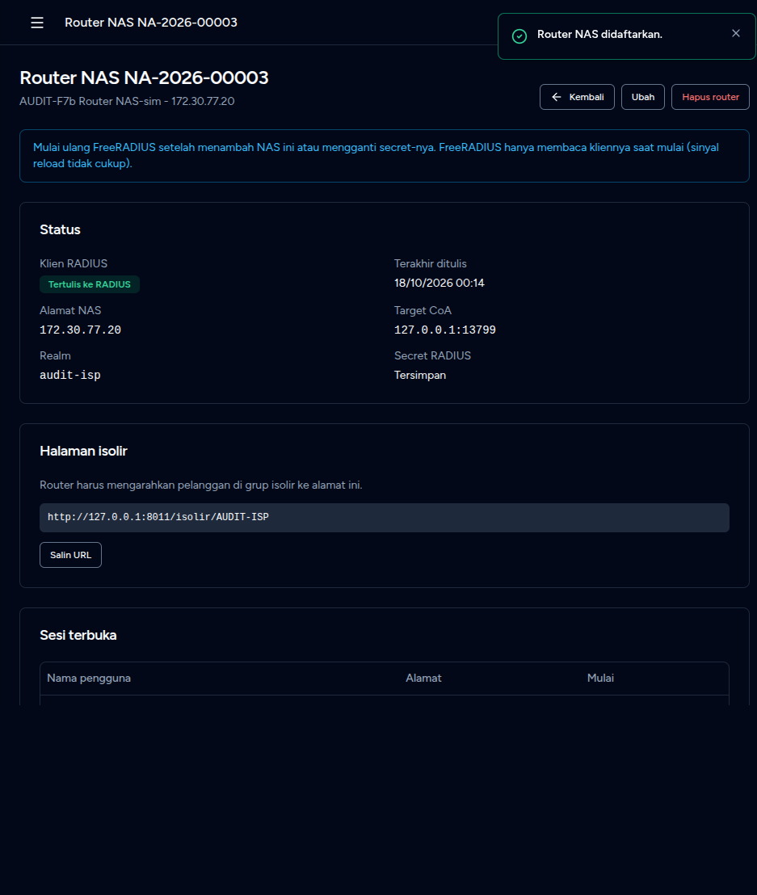
- **Akun diprovisioning.** Akun `aud00001@audit-isp` dibuat saat RADIUS mati (Menunggu, "RADIUS is switched off."). Setelah RADIUS menyala, Sinkron ulang → "Tersinkron", grup `audit-isp/audit-home-30`, tabel RADIUS: `radcheck` 1, `radusergroup` 1, balasan grup `Mikrotik-Group=audit-home-30`, `Mikrotik-Rate-Limit=6M/30M`, `Acct-Interim-Interval=300`. `network:sync --company=3` menulis 1 klien NAS lagi (NAS lama 10.20.0.1) dalam 0,27 detik.
- **Online dan pemakaian.** "Tampilkan kata sandi" (dialog konfirmasi, tercatat di audit) → `sim connect` berhasil: Mikrotik-Rate-Limit 6M/30M, Framed-IP dari pool NAS 10.99.1.10. Halaman akun: "Online", alamat, NAS "NA-2026-00003 - AUDIT-F7b Router NAS-sim", "Bulan ini Unggah 0 B" sebelum Interim; setelah 3 Interim: "Unggah 45.65 KB, unduh 592.89 KB" (nilai sama dengan nas-sim). 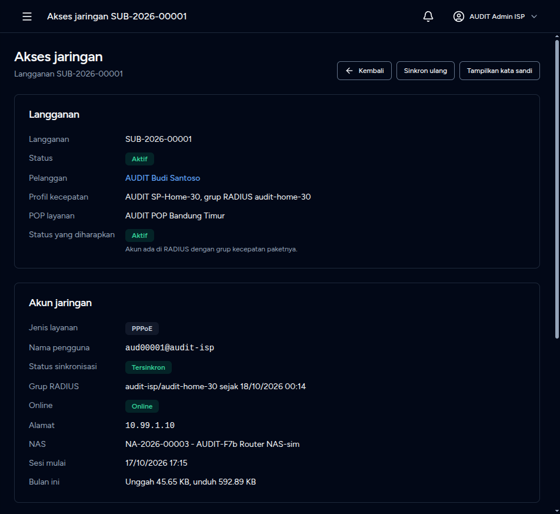
- **Blokir manual + CPE masuk isolir.** Subscription → Blokir internet → alasan → Blokir: toast "Internet langganan diblokir." 197 ms; nas-sim menerima Disconnect-Request ACK (dua sesi terbuka, kedua-duanya diputus), `sim scenario block-unblock --expect-group isolir` selesai kode 0 dalam 586 ms: CPE login ulang dengan `Mikrotik-Group=isolir` dan `Mikrotik-Address-List=isolir`. Halaman akun: "Diisolir karena diblokir", grup `audit-isp/isolir`. 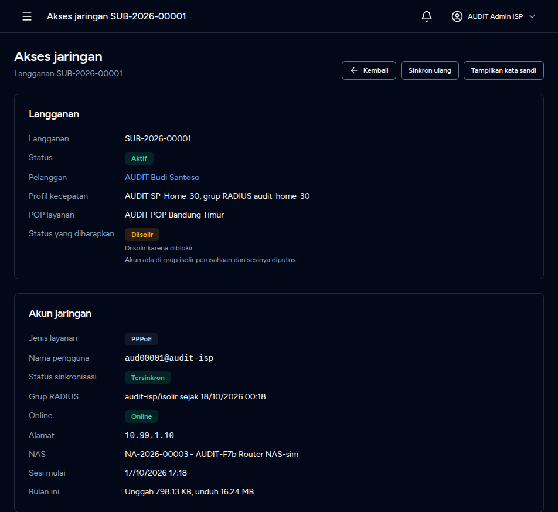
- **Buka blokir.** Dialog "Sesi pelanggan diputus dan layanan normal kembali saat router menyambung ulang." → toast 183 ms; scenario kode 0 dalam 303 ms: grup `audit-home-30`, `6M/30M`. 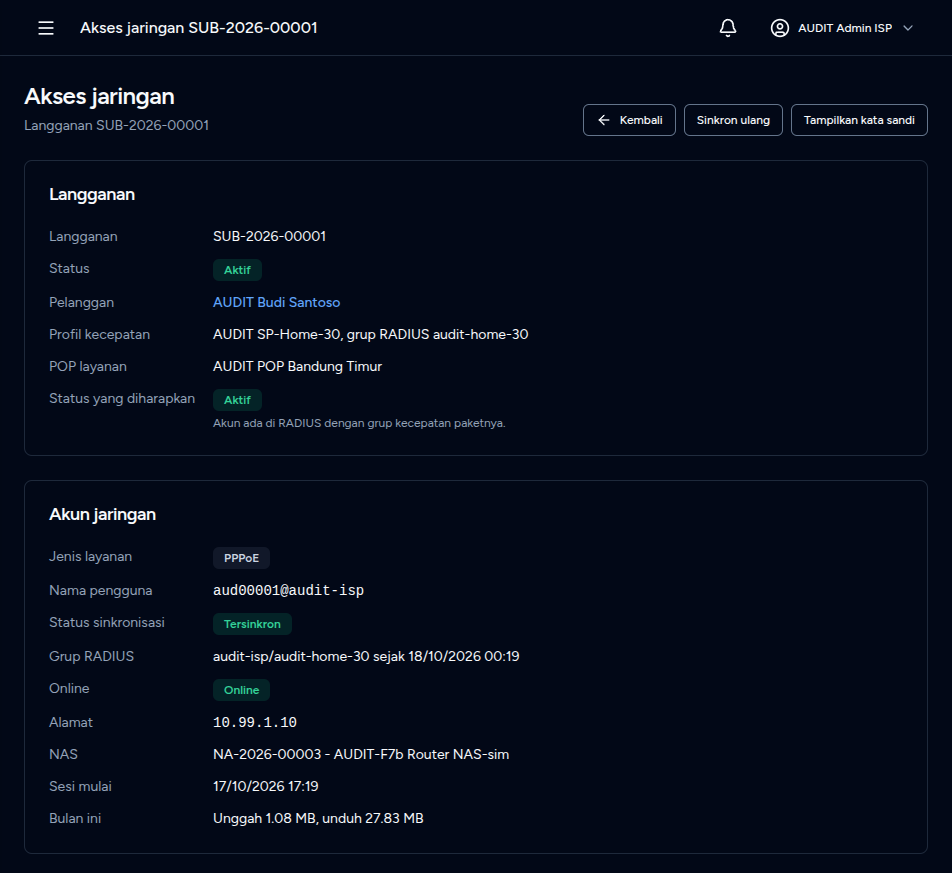
- **Isolir otomatis.** INV-2026-00015 (jatuh tempo 25 Sep, Rp 111.000, status Belum dibayar) dibuat lewat UI (tanggal harus diketik `25 Sep 2026`, lihat F7-D25). `billing:suspend-overdue --company=3 --dry-run` → "Would suspend SUB-2026-00001"; tanpa `--dry-run` 273 ms: Suspended; CPE masuk `isolir` (`Mikrotik-Address-List=isolir`). Halaman akun: "Diisolir karena ditangguhkan." 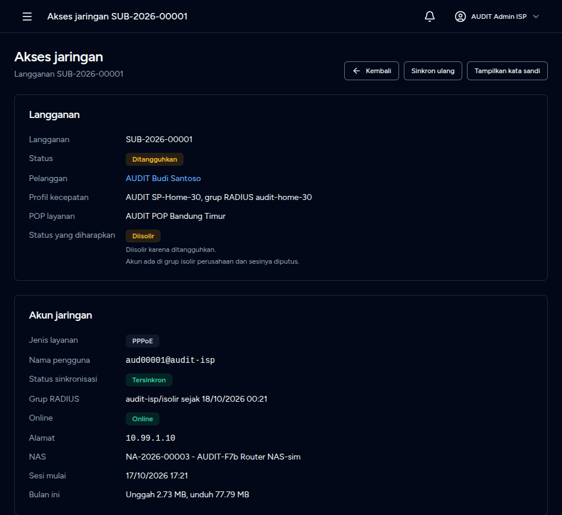
- **Bayar.** Catat pembayaran Rp 111.000 (dialog: Jumlah, Metode, Referensi, Catatan): status "Lunas" dalam 259 ms, langganan Aktif, 1 Disconnect ACK ke sesi isolir; akun "Offline" sampai CPE menyambung ulang, lalu `audit-home-30`/`6M/30M`. 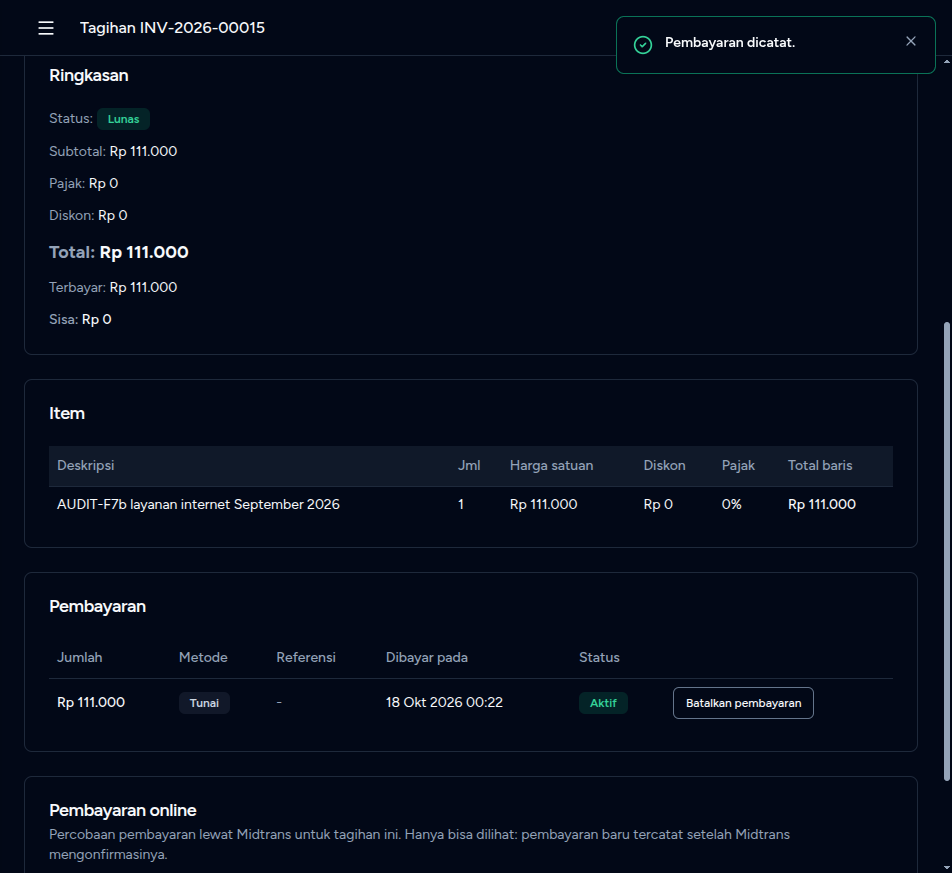
- **IP statis (fitur baru).** Pool `10.99.0.0/26` (IP statis pelanggan, tanpa POP) dibuat lewat UI. Pada SUB-2026-00002 (langganan baru dari tab pelanggan, akun `aud00002@audit-isp` dibuat dalam 353 ms): Berikan IP statis → pool terpilih otomatis, alamat kosong → `10.99.0.1`; baris RADIUS `radreply Framed-IP-Address := 10.99.0.1` langsung tertulis tanpa Sinkron ulang (listener `IpAssignmentChanged`). `sim connect` → `framed_ip 10.99.0.1`, atribut `Framed-IP-Address` ada, grup `audit-home-30` utuh; halaman akun "Alamat 10.99.0.1". Lepas 10.99.0.1 saat CPE online: 170 ms, 1 Disconnect ACK (Admin-Reset), `radreply` kosong; CPE login ulang `10.99.1.11` (pool NAS), tanpa `Framed-IP-Address`. Berikan lagi → CPE `10.99.0.1`. 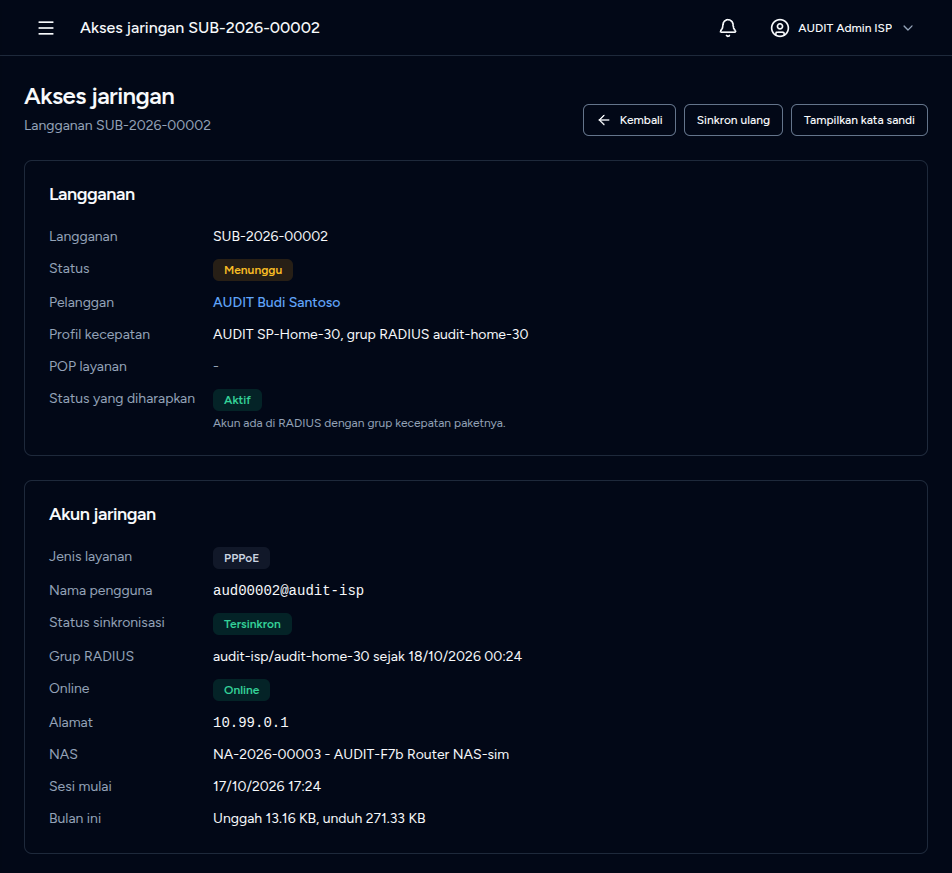 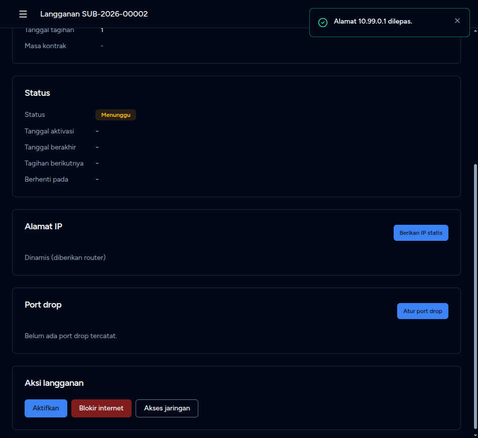
- **Hentikan langganan.** Aktifkan (tanpa dialog) → Hentikan (alasan wajib): status "Berhenti", Disconnect ACK ke sesi bertatik 10.99.0.1, IP dikembalikan ("Dinamis (diberikan router)"), `radcheck`/`radusergroup`/`radreply` untuk `aud00002@audit-isp` = 0 baris, baris `aud00001@audit-isp` tetap. 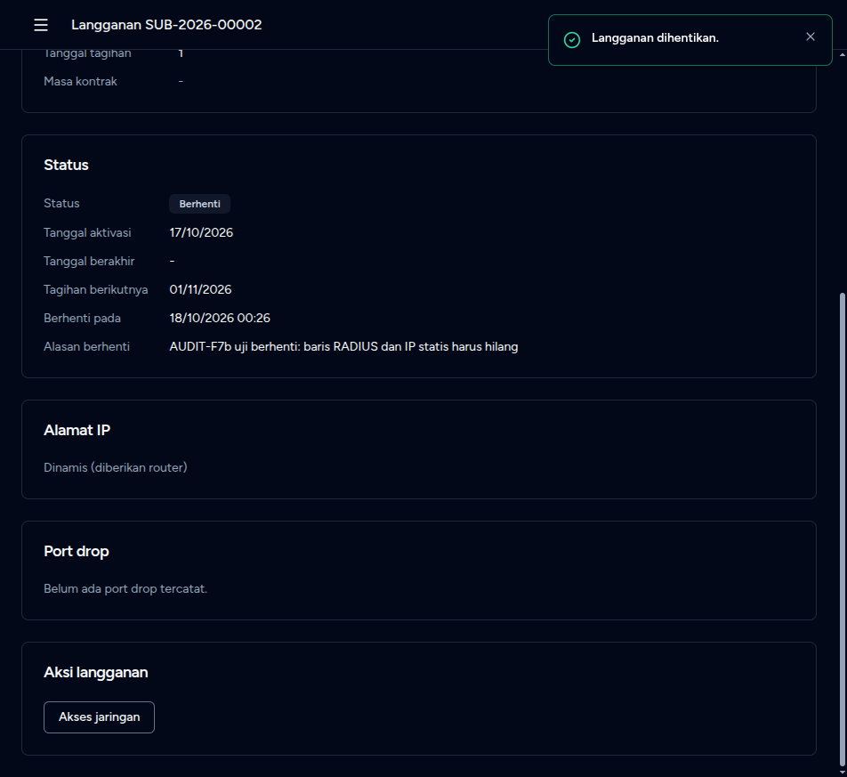
- **NAS mati.** `docker stop radlab-nas-sim`, lalu Blokir SUB-2026-00001: toast 195 ms (aksi bisnis tidak menunggu RADIUS). Halaman akun: "Menunggu", "1 Disconnect-Request(s) got no usable answer from the NAS; retrying.", "Pemutusan sesi yang terbuka masih tertunda.", tetapi "Status yang diharapkan: Diisolir ... sesinya diputus", "Grup RADIUS audit-isp/audit-home-30 sejak 00:22" (padahal tabel RADIUS sudah `audit-isp/isolir`, dicek SQL), dan "Online 10.99.1.10" (F7-D22). 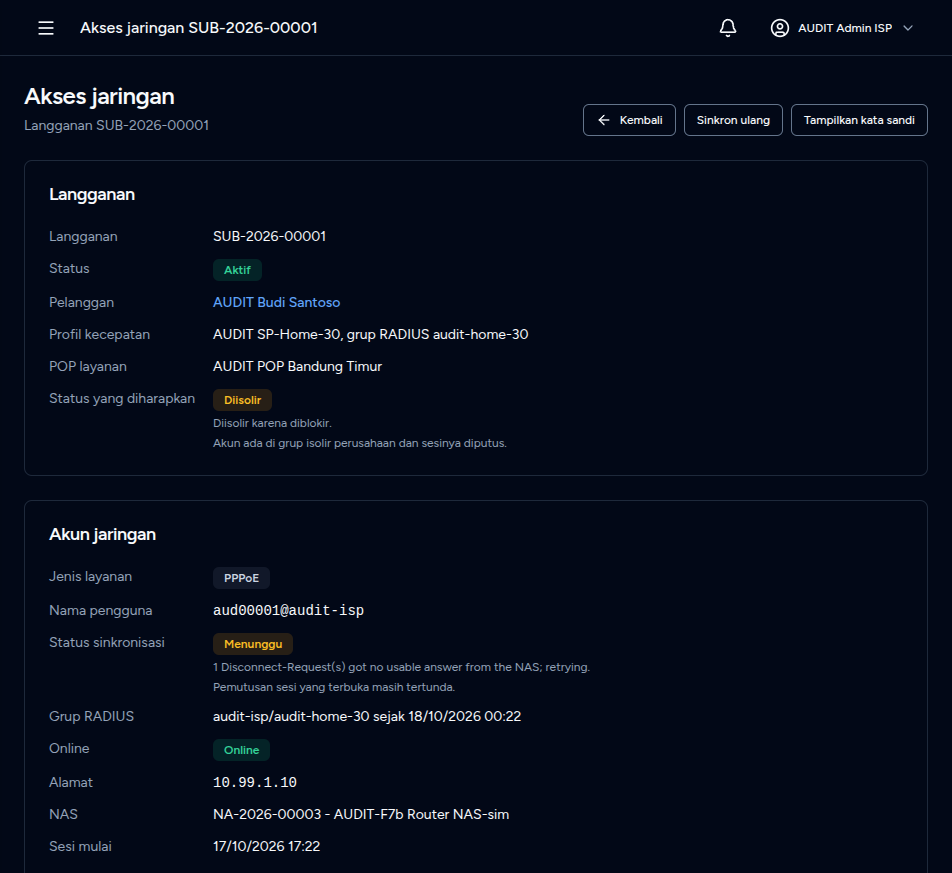
- **NAS hidup lagi + Sinkron ulang.** `docker start radlab-nas-sim` (sehat ±3 detik), Sinkron ulang → toast 188 ms, "Tersinkron", grup `audit-isp/isolir`; nas-sim menjawab NAK (sesi tidak ada karena sim dimulai ulang) dan Inbils menganggapnya selesai; halaman masih "Online ... sesi mulai 17:22" dari baris `radacct` yang tak pernah ditutup (F7-D23). CPE login ulang masuk `isolir`; Buka blokir mengembalikan SUB-2026-00001 ke Aktif dan `audit-home-30`. 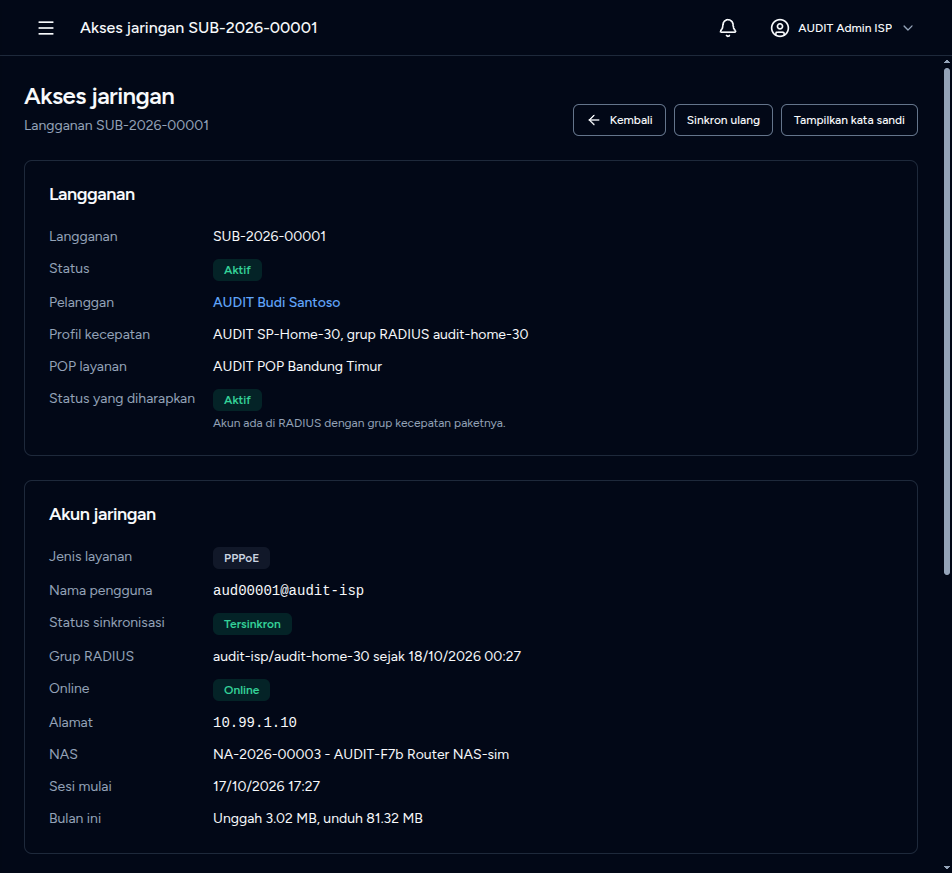

**Contoh baik yang dipertahankan:** semua aksi 0,2 sampai 0,6 detik walau RADIUS dipanggil; aksi bisnis tidak menunggu RADIUS saat NAS mati; Disconnect memutus semua sesi terbuka satu pengguna (dua sesi → dua ACK) dan NAK 503 dianggap selesai; dialog Blokir/Buka blokir menyebut dampak ke sesi dan tagihan; "Tampilkan kata sandi" meminta konfirmasi dan tercatat; username realm `aud00002` + `@audit-isp` terlihat saat mengetik; pool statis terpilih otomatis bila hanya satu dan alamat kosong = terendah; halaman NAS memuat URL isolir dan catatan restart FreeRADIUS; pembayaran Lunas mengaktifkan kembali dan memutus sesi isolir dalam satu langkah.

#### Rekaman yang tertinggal (database dev `inbils`, tidak dihapus; berawalan AUDIT-F7b)

| Jenis | Kode / nama | Keterangan |
|---|---|---|
| aset + NAS | NA-2026-00003 "AUDIT-F7b Router NAS-sim" | IP manajemen 127.0.0.1 (baris IPAM aset), NAS 172.30.77.20 : 13799, tersinkron |
| prefiks IP | 10.99.0.0/26 | pool IP statis pelanggan, tanpa POP; 10.99.0.1 sudah dilepas |
| langganan + akun | SUB-2026-00002, `aud00002@audit-isp` | dibuat, diaktifkan, diberi IP statis, dilepas, diberi lagi, lalu dihentikan; baris RADIUS dihapus |
| tagihan | INV-2026-00014 | draf Rp 0, tanggal bawaan karena tanggal ketikan diabaikan (F7-D25) |
| tagihan | INV-2026-00015 | jatuh tempo 25 Sep, Rp 111.000, lunas (pembayaran tunai), mengisolir lalu mengaktifkan SUB-2026-00001 |
| langganan | SUB-2026-00001 | keadaan akhir Aktif, tidak diblokir, grup `audit-home-30`; `last_error` kosong |

#### Temuan cacat

| ID | Langkah | Yang terjadi | Yang diharapkan ISP | Keparahan | Saran perbaikan | Perlu keputusan owner | Bukti |
|---|---|---|---|---|---|---|---|
| F7-D20 | Akses jaringan → Sesi mulai | "Sesi mulai 17/10/2026 17:18" (jam `radacct` apa adanya, UTC di lab) di kartu yang sama dengan "sejak 18/10/2026 00:18" (WIB): selisih 7 jam. Aturan sesi basi 15 menit membandingkan teks yang sama dengan `now()` zona aplikasi [dari kode]; bila zona server RADIUS berbeda dari zona aplikasi lebih dari 15 menit, semua sesi tampil Offline [inferensi]. | Satu zona perusahaan di seluruh halaman; zona database RADIUS dinyatakan di konfigurasi. | friction | `RADIUS_DB_TIMEZONE` dan konversi di `RadiusDirectory` untuk tampilan dan aturan basi. | tidak | [07b-15](07b-15-account-isolated.png), [07b-18](07b-18-account-back-to-speed.png) |
| F7-D21 | Akses jaringan → Status sinkronisasi | Galat berbahasa Inggris dan berjargon: "RADIUS is switched off." tetap tampil setelah RADIUS dinyalakan sampai apply berikutnya; "1 Disconnect-Request(s) got no usable answer from the NAS; retrying." (keluarga F7-D02). | Kalimat Indonesia tanpa jargon; pesan lama dibersihkan saat saklar menyala. | friction | Satu penerjemah pesan status jaringan di `NetworkAccountResource`; hapus `last_error` saat saklar menyala. | tidak | [07b-02](07b-02-account-before.png), [07b-45](07b-45-account-pending-nas-down.png) |
| F7-D22 | Blokir saat NAS mati | Toast "Internet langganan diblokir." tanpa peringatan; halaman menulis "sesinya diputus" padahal belum, "Grup RADIUS" memuat grup lama (catatan belum maju) sementara tabel RADIUS sudah `audit-isp/isolir`, dan "Online" tetap tampil. | Peringatan "Blokir tersimpan; sesi terputus setelah router menjawab" dan grup yang sebenarnya tertulis. | friction | Tampilkan `pending_disconnect_at` dan grup RADIUS yang tertulis; ubah teks "Status yang diharapkan" saat Disconnect tertunda. | tidak | [07b-44](07b-44-nas-down-block-result.png), [07b-45](07b-45-account-pending-nas-down.png) |
| F7-D23 | Router mati lalu hidup | Sesi tanpa Acct-Stop: baris `radacct` tetap terbuka, halaman terus "Online ... Sesi mulai 17:22" sampai 15 menit tanpa Interim, padahal tak ada sesi di NAS. | "Terakhir terlihat HH:MM" dan penanda basi bila Interim terlambat lebih dari 2 kali interval (300 detik). | polish | Tampilkan `updated_at` sesi dan tandai basi. | tidak | [07b-47](07b-47-account-after-resync-nas-up.png) |
| F7-D24 | Sinkron ulang [dari kode] | `NetworkAccountService::resync` menulis ulang user dan mewajibkan Disconnect (memutus sesi pelanggan) tanpa dialog konfirmasi; label dan toast "Sinkron ulang dijadwalkan." tidak menyebut pemutusan. Pada uji ini sesi sudah tidak ada, jadi pemutusan nyata oleh tombol ini belum teramati. | Dialog konfirmasi yang menyebut pemutusan, atau label "Sinkron ulang dan putuskan sesi". | friction | `ConfirmRequestDialog` dengan teks dampak. | tidak | [07b-46](07b-46-resync-toast.png) |
| F7-D25 | Buat tagihan → tanggal | Mengetik `20/09/2026` dan `25/09/2026` menampilkan galat merah "Format tanggal tidak valid. Contoh: 18 Okt 2026." tetapi Simpan tetap jalan: INV-2026-00014 tersimpan dengan tanggal bawaan (17 Okt dan 31 Okt) tanpa pemberitahuan. Isolir otomatis tidak akan memakai tanggal yang dimaksud operator. | Simpan ditahan sampai tanggal sah, atau format dd/mm/yyyy diterima. | friction | Blokir pengiriman bila ada galat lokal; terima dd/mm/yyyy. | tidak | [07b-20](07b-20-invoice-create-filled.png) |
| F7-D26 | `GET /admin/invoices/{id}/edit` | 500 `ViteException: Unable to locate file in Vite manifest: resources/js/Pages/Admin/Billing/Invoices/Edit.tsx`. Rute dan controller ada, halaman tidak; tagihan Draf tidak punya tombol Ubah, jadi tanggal draf tidak bisa diperbaiki dari UI. | Halaman Ubah untuk tagihan Draf, atau rute dihapus. | friction | Tambah `Edit.tsx` dan tombol Ubah pada Draf. | tidak | [07b-21](07b-21-invoice-edit-500.png) |
| F7-D27 | Router NAS → daftar sebelum RADIUS menyala | Lencana "Gagal ditulis" untuk router yang tidak pernah dicoba (`last_error` = "RADIUS is switched off."). | "Menunggu ditulis" dengan alasan saklar mati. | polish | Bedakan "dimatikan" dari galat tulis. | tidak | [07b-01](07b-01-nas-index-before.png) |

#### Temuan UX

| ID | Langkah | Sekarang | Seharusnya | Manfaat | Usaha | Catatan mockup | Lensa |
|---|---|---|---|---|---|---|---|
| F7-U20 | Daftarkan Router NAS → Secret | Secret 8 sampai 60 karakter diketik manual, dua kali (Inbils dan router); tanpa penghasil acak, tombol Salin, atau perintah RouterOS. | Tombol "Buat secret acak" dan Salin; setelah simpan panel `/radius add ...` dan `/radius incoming set accept=yes port=13799`. | Tinggi: salah secret membuat semua pelanggan gagal login. | S | Panel perintah di halaman router. | 1, 3, 5 |
| F7-U21 | Setelah router terdaftar | Lencana "Tertulis ke RADIUS" padahal FreeRADIUS baru melayani setelah dimulai ulang (catatan ada di halaman). | Status "Menunggu FreeRADIUS dimulai ulang" dan tombol "Uji koneksi" (Status-Server atau Access-Request uji). | Tinggi: operator tahu kapan router siap, tanpa menunggu telepon pelanggan. | M | Langkah 1-2-3 di kartu Status. | 5, 10 |
| F7-U22 | Akses jaringan → Alamat | "Alamat 10.99.0.1" tanpa tanda statis atau dinamis dan tanpa alamat yang diharapkan. | Baris "IP statis diharapkan: 10.99.0.1 (IPAM 10.99.0.0/26)"; peringatan bila sesi memakai alamat lain; tombol "Putuskan sesi". | Tinggi: keluhan "IP statis tidak aktif" terjawab dalam satu layar. | S/M | Lencana Statis/Dinamis di baris Alamat. | 5, 7 |
| F7-U23 | Berikan atau Lepas IP statis | Dialog tidak menyebut bahwa sesi online diputus (terukur: 1 Disconnect ACK, 170 ms). | "Pelanggan yang sedang online terputus sebentar dan tersambung ulang dengan alamat baru." | Sedang-tinggi: tidak ada pemutusan mengejutkan. | S | Teks bantu di dialog. | 5 |
| F7-U24 | Hentikan langganan | Dialog hanya Alasan dan dua tombol. | Daftar dampak: akun RADIUS dihapus, sesi diputus, IP statis dan port drop dilepas, tagihan berhenti. | Sedang | S | Daftar centang abu-abu di atas Alasan. | 5 |
| F7-U25 | Blokir, buka blokir, bayar | Setelah toast tidak ada umpan balik sesi; setelah bayar akun "Offline" tanpa penjelasan sampai router menyambung ulang. | Baris "Sesi diputus 00:22, menunggu router menyambung ulang" dengan segar-ulang otomatis. | Sedang | M | Lencana di baris Online. | 5, 6 |
| F7-U26 | NAS mati: jalur ulang | Operator tidak melihat kesehatan router atau antrean pemutusan; hanya "Menunggu" dan teks Inggris. | "Router tidak menjawab sejak 00:22, mencoba lagi otomatis" dengan tombol "Coba sekarang". | Sedang | M | Kartu peringatan kuning di halaman akun. | 5 |
| F7-U27 | Buat Langganan dari tab pelanggan | Satu-satunya alamat pemasangan tidak terpilih otomatis; langganan lahir tanpa POP, sehingga panel IP memakai kalimat "untuk POP langganan ini". | Alamat tunggal terpilih; pilih POP atau pesan "langganan belum punya POP". | Rendah | S | - | 4 |

#### Belum diuji

Aplikasi mobile dan layar sempit (lensa 8), papan ketik dan pembaca layar pada dialog baru (lensa 9), peran selain admin (manajer memegang `ipam.assign`; staf tidak), MikroTik sungguhan, NAS hidup tetapi port CoA terblokir (kasus F7-D22 yang paling berbahaya), backoff antrean database 30/120/300/900 detik, klien FreeRADIUS belum dimulai ulang (paket Access-Request dari klien tak dikenal), IPv6, WhatsApp, dan beban banyak sesi.

#### Lingkungan dan pembersihan

- Server `:8011`, peramban uji, dan pembungkus `/tmp/fa9-serve.sh` dihentikan atau dihapus. `.env`, Sail, dan basis data `inbils` hanya ditambah baris AUDIT-F7b; tidak ada reset.
- Lab: baris `nas` sisa E2E `172.30.77.20 demo` dihapus di awal; baris `nas` yang ditulis Inbils (`172.30.77.20 audit-isp`, `10.20.0.1 audit-isp`) dihapus di akhir dan FreeRADIUS dimulai ulang agar runner E2E berikutnya dapat mendaftarkan NAS-nya (penulis tidak menimpa baris yang bukan miliknya). Pengguna `aud00001@audit-isp`, grup `audit-isp/*`, dan riwayat `radacct` (satu baris terbuka sisa restart nas-sim) dibiarkan; semuanya dapat dibangun ulang oleh `network:sync`.
- Tangkapan layar `07b-*` (45 berkas) di folder ini; catatan terstruktur di `~/.config/inbils/flow-audit/notes-fa9.jsonl`. Layar tampil dalam mode gelap (profil peramban uji); tangkapan yang memuat kata sandi hasil ungkap tidak disimpan.
