# 1. Pendahuluan

Aplikasi Android **Inbils Pelanggan** dipakai untuk melihat tagihan dan membayarnya, memeriksa layanan internet Anda, dan menghubungi penyedia layanan (ISP) lewat tiket. Pelanggan tidak lagi memakai situs web untuk hal-hal itu. Login pelanggan di situs web hanya menampilkan halaman "Gunakan aplikasi Inbils".

## Memasang aplikasi

1. Buka halaman aplikasi **Inbils Pelanggan** di Google Play Store. Alamatnya diberikan ISP Anda; halaman "Gunakan aplikasi Inbils" di situs web juga memuat tombol **Buka Play Store** bila ISP sudah mengisinya.
2. Ketuk **Pasang**, lalu buka aplikasinya.

Aplikasi berjalan di ponsel Android dan butuh koneksi internet. Bila koneksi putus, aplikasi menampilkan pesan "Anda sedang offline. Data yang tampil mungkin belum terbaru."

## Akun dibuat oleh ISP

Anda tidak mendaftar sendiri. Petugas ISP membuat data pelanggan beserta akun login, lalu sistem mengirim email ke alamat email pelanggan berisi **tautan atur kata sandi**.

1. Buka email dari ISP Anda.
2. Ketuk tautan di dalamnya. Tautan membuka halaman web untuk mengatur kata sandi.
3. Isi kata sandi baru dan simpan.
4. Kembali ke aplikasi dan masuk dengan email dan kata sandi itu.

Tautan berlaku 60 menit. Bila sudah lewat atau email tidak ditemukan, pakai **Lupa kata sandi** (bagian "Lupa kata sandi" di bawah) atau minta ISP mengirim ulang tautan. Kata sandi tidak pernah dikirim lewat WhatsApp; WhatsApp paling banyak hanya memberi tahu bahwa tautan ada di email.

Akun lama yang kata sandinya masih nomor telepon sudah dimatikan. Pemilik akun itu harus mengatur kata sandi baru lewat tautan email dulu. Lihat "Kesalahan umum".

## Masuk

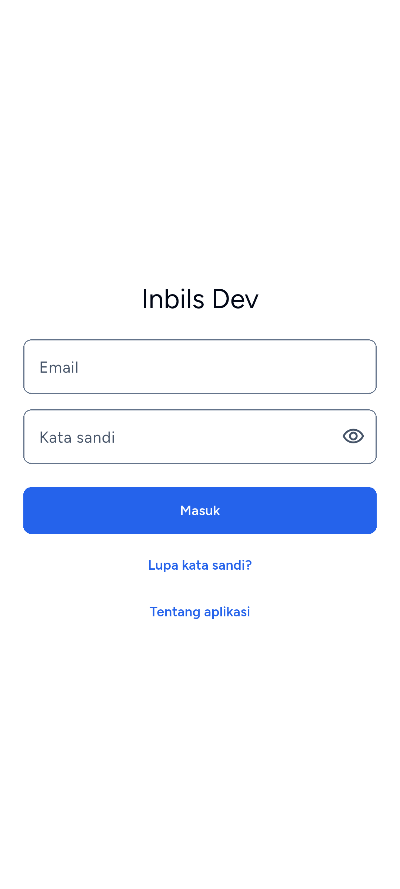

1. Buka aplikasi.
2. Isi **Email** dengan email yang dipakai ISP untuk akun Anda. Alamat ini terlihat di menu Akun sebagai "Email untuk masuk".
3. Isi **Kata sandi**. Ketuk ikon mata untuk menampilkan atau menyembunyikan kata sandi.
4. Ketuk **Masuk**.

Bila email atau kata sandi salah, muncul "Email atau kata sandi salah." Setelah beberapa kali salah, aplikasi menampilkan "Terlalu banyak percobaan"; tunggu sesuai waktu yang tertera.

Anda tetap masuk di ponsel ini sampai Anda keluar, mengganti kata sandi, atau masa berlaku sesi berakhir (sampai 90 hari; aplikasi memperbarui sesi sendiri selama dipakai). Lihat "Kesalahan umum".

Layar masuk juga punya tombol **Tentang aplikasi** (versi aplikasi dan server) yang bisa dibuka sebelum masuk.

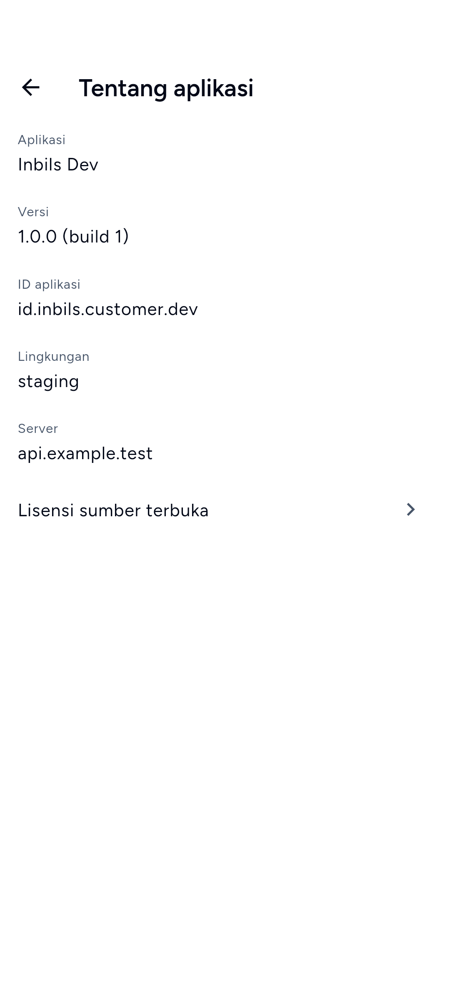

## Verifikasi dua langkah

Verifikasi dua langkah bersifat pilihan. Bila Anda mengaktifkannya, setelah kata sandi benar aplikasi menampilkan layar **Verifikasi dua langkah**.

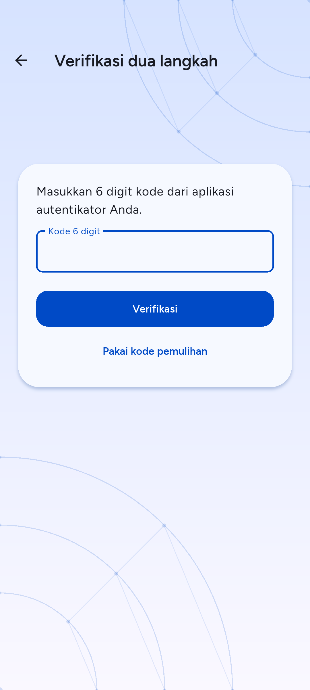

1. Buka aplikasi autentikator di ponsel Anda.
2. Masukkan **Kode 6 digit** yang tampil, lalu ketuk **Verifikasi**.
3. Bila ponsel autentikator hilang, ketuk **Pakai kode pemulihan** dan masukkan salah satu kode pemulihan. Setiap kode hanya berlaku sekali.
4. Untuk kembali ke kode autentikator, ketuk **Pakai kode autentikator**.

Mengaktifkan, mematikan, dan membuat ulang kode pemulihan **tidak** bisa dilakukan di aplikasi. Lakukan di situs web Inbils: masuk dengan akun Anda, lalu di halaman "Gunakan aplikasi Inbils" ketuk **Kelola akun & 2FA**. Alamat situs web ditanyakan ke ISP.

Kode yang salah menampilkan "Kode salah. Periksa lalu coba lagi." Bila terlalu lama di layar ini, muncul "Kode verifikasi kedaluwarsa. Silakan masuk lagi." Kembali ke layar masuk dan ulangi dari awal. Jika kode pemulihan habis dan ponsel hilang, minta administrator ISP mereset verifikasi dua langkah akun Anda.

## Lupa kata sandi

1. Di layar masuk, ketuk **Lupa kata sandi?**
2. Isi email akun Anda dan ketuk **Kirim link**.
3. Aplikasi menjawab "Jika email itu terdaftar, link atur ulang kata sandi sudah kami kirim. Periksa kotak masuk Anda." Jawaban ini sama untuk semua alamat, supaya orang lain tidak bisa menebak email mana yang terdaftar.
4. Buka email, ketuk tautannya, dan atur kata sandi baru di halaman web yang terbuka.
5. Kembali ke aplikasi dan masuk dengan kata sandi baru.

Pengaturan ulang selalu selesai di halaman web lewat tautan email, bukan di aplikasi. Format email yang salah ditolak dengan "Format email tidak valid." Tombol **Kembali ke halaman masuk** membatalkan.

# 2. Beranda

Beranda adalah tab pertama. Navigasi bawah punya empat tab: **Beranda**, **Tagihan**, **Bantuan**, dan **Akun**.

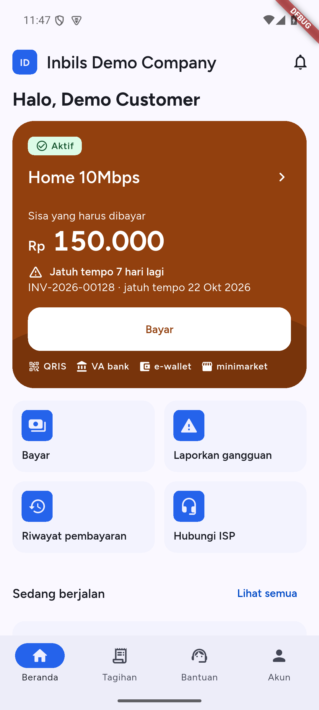

Warna aplikasi mengikuti warna merek ISP Anda, dan logo ISP tampil di kiri atas bila ISP sudah mengunggahnya (tanpa logo, tampil inisial nama ISP). Isi layar dari atas ke bawah:

1. **Kepala**: logo dan nama ISP di kiri, **ikon lonceng** di kanan. Angka merah di lonceng menunjukkan notifikasi yang belum dibaca. Lihat bab 7.
2. **Sapaan** "Halo, nama Anda".
3. **Kartu layanan**: satu kartu per langganan Anda. Bila Anda punya lebih dari satu langganan yang berjalan, geser kartu ke samping. Titik di bawahnya menunjukkan posisi kartu. Kartu memuat:
   - **Status** layanan: **Aktif**, **Diisolir**, **Ditangguhkan**, atau **Menunggu**. Ketuk nama paket untuk membuka rincian langganan (bab 5).
   - Satu baris koneksi, **Online sejak 08.12** atau **Offline, terakhir online 07.55**, pada layanan Aktif, Diisolir, dan Ditangguhkan. Baris ini hanya tampil bila server bisa membaca status koneksi layanan itu.
   - **Tagihan**: "Sisa yang harus dibayar" dengan jumlahnya, tanggal jatuh tempo, dan nomor tagihan. Bila tidak ada tagihan terbuka, kartu menulis "Semua tagihan lunas" dan "Tagihan berikutnya {tanggal}". Warna kartu mengikuti keadaan: warna merek ISP bila aman, warna peringatan bila jatuh tempo dalam 1 sampai 7 hari ("Jatuh tempo 7 hari lagi") atau hari ini ("Jatuh tempo hari ini"), dan merah bila terlambat ("Lewat 3 hari") atau layanan diisolir. Teks dan ikon di dalam kartu menyampaikan hal yang sama, jadi warna bukan satu-satunya petunjuk. Aplikasi menampilkan tagihan terbuka yang paling awal pada semua kartu layanan, lengkap dengan nomornya.
   - Tombol besar **Bayar** membuka tagihan itu (tombolnya **Lihat tagihan** bila tagihan tidak bisa dibayar online). Di bawahnya tertulis QRIS, VA bank, e-wallet, dan minimarket sebagai metode yang bisa muncul di halaman pembayaran. Metode yang benar-benar tersedia ditentukan oleh Midtrans dan ISP.
   - Layanan **Diisolir** karena tunggakan menampilkan semua tagihan yang masih menahan reaktivasi di bawah judul **Lunasi tagihan berikut agar layanan aktif kembali**. Setiap baris memuat nomor, jumlah, dan jatuh tempo, lalu **Total**. Satu tagihan memakai tombol **Bayar**. Dua tagihan atau lebih memakai **Bayar semua (Rp {total})**. Layanan **Ditangguhkan** karena alasan lain menulis "Layanan Anda sedang ditangguhkan. Hubungi {nama ISP} untuk informasi lebih lanjut." dengan tombol **Hubungi ISP**. Layanan **Menunggu** menulis "Layanan Anda belum aktif."
4. **Aksi cepat**: **Bayar**, **Laporkan gangguan**, **Riwayat pembayaran**, dan **Hubungi ISP**. **Bayar** membuka tagihan paling awal yang belum dibayar, atau tab **Tagihan** bila tidak ada. **Laporkan gangguan** membuka formulir tiket baru (bab 6). **Hubungi ISP** membuka lembar kontak dengan WhatsApp, telepon, email, situs web, dan jam layanan yang diisi ISP. Ketuk satu baris untuk membukanya. Bila ISP belum mengisi kontak, lembar itu mengarahkan Anda ke tab **Bantuan**.
5. **Sedang berjalan**: kunjungan teknisi yang berikutnya, lalu sampai tiga tiket aktif Anda. Kartu kunjungan memuat nomor SPK, jenis kunjungan (misalnya **Instalasi** atau **Perawatan**), tahap sekarang (**Ditugaskan**, **Dalam perjalanan**, atau **Sedang dikerjakan**), dan tanggal jadwal bila ada. Ketuk kartu itu untuk membuka detail kunjungan (bagian **Kunjungan teknisi** di bab 5). Kartu tiket menampilkan statusnya; ketuk satu tiket untuk membukanya, atau **Lihat semua** untuk ke tab **Bantuan**. Bila tidak ada kunjungan dan tidak ada tiket, tertulis "Tidak ada tiket aktif".

   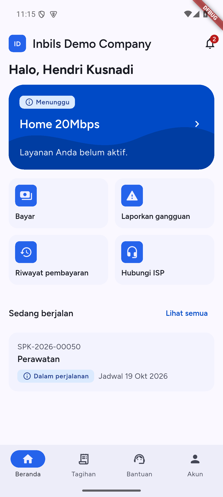

Tarik layar ke bawah untuk memuat ulang. Kartu kunjungan baru berubah setelah Anda memuat ulang, sedangkan angka di lonceng berubah sendiri saat Anda kembali ke aplikasi. Bila satu bagian gagal dimuat, bagian itu menampilkan "Data tidak dapat dimuat." dan tombol **Coba lagi**; bagian lain tetap tampil.

Beranda juga memuat informasi dari ISP:

- **Pengumuman gangguan atau pemeliharaan** tampil sebagai kartu bernada peringatan di atas kartu layanan, selama masa tayangnya. Ketuk kartu untuk membaca isi lengkapnya. Anda juga menerima notifikasi di lonceng (lihat bab 7).
- **Pengumuman informasi** dan **banner promo** tampil di bawah bagian Sedang berjalan. Banner bergeser otomatis setiap 5 detik, berhenti saat disentuh, dan punya titik penanda halaman. Ketuk banner untuk membuka tautannya; promo tidak pernah dikirim sebagai notifikasi.

# 3. Tagihan

## Daftar tagihan

Ketuk tab **Tagihan**.

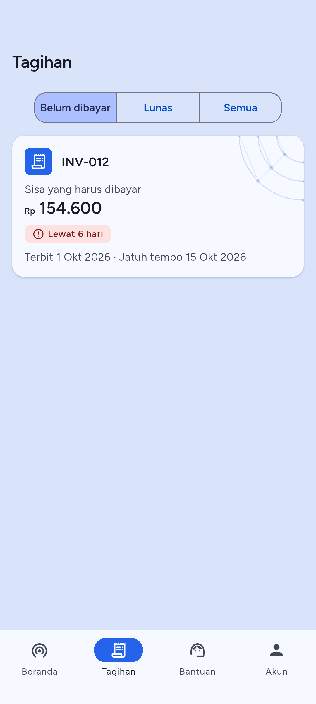

1. Pilih filter di atas daftar: **Belum dibayar**, **Lunas**, atau **Semua**.
2. Setiap baris memuat nomor tagihan, tanggal terbit, tanggal jatuh tempo, dan sisa yang harus dibayar.
3. Ketuk baris untuk membuka rinciannya.
4. Gulir ke bawah untuk memuat tagihan berikutnya. Bila gagal, muncul "Gagal memuat tagihan berikutnya." dengan tombol untuk mencoba lagi.

Daftar kosong menampilkan "Tidak ada tagihan yang belum dibayar.", "Belum ada tagihan lunas.", atau "Belum ada tagihan." sesuai filter.

## Status tagihan

| Status di aplikasi | Arti |
| --- | --- |
| Belum dibayar | Tagihan sudah terbit dan belum ada pembayaran. |
| Dibayar sebagian | Sudah ada pembayaran, tetapi masih ada sisa. |
| Lewat jatuh tempo | Tanggal jatuh tempo terlewat dan masih ada sisa. |
| Lunas | Seluruh tagihan sudah dibayar. |
| Dibatalkan | Tagihan dibatalkan oleh ISP; tidak perlu dibayar. |

Tagihan yang masih berupa konsep di ISP tidak tampil di aplikasi.

## Detail tagihan

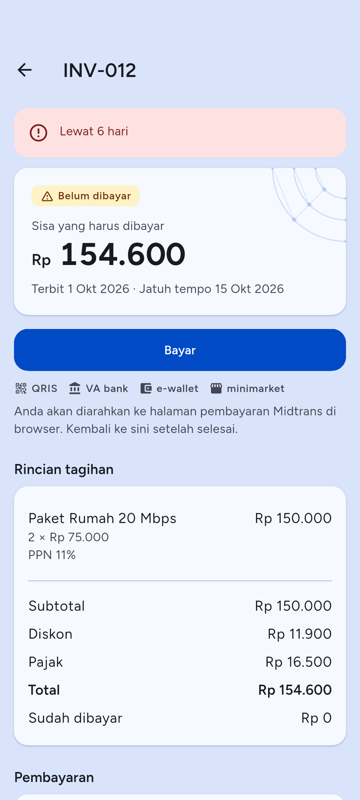

Layar detail memuat, dari atas ke bawah:

- Tanggal terbit dan jatuh tempo.
- **Sisa yang harus dibayar** dengan status tagihan.
- Subtotal, Diskon, Pajak, **Total**, dan **Sudah dibayar**.
- Tombol **Bayar** dengan catatan tentang halaman Midtrans (lihat di bawah).
- **Rincian tagihan**: tiap baris dengan jumlah × harga satuan.
- **Pembayaran**: pembayaran yang sudah tercatat pada tagihan ini, dan tautan **Lihat riwayat pembayaran**.

Tarik layar ke bawah untuk memuat ulang.

Tersedia pada versi berikutnya: periode tagihan, referensi dan metode pada tiap pembayaran, status percobaan pembayaran terakhir, dan **struk PDF** untuk tagihan yang sudah lunas. Datanya sudah dikirim server, tetapi aplikasi belum menampilkannya.

## Bayar lewat Midtrans

Pembayaran online dilakukan di halaman milik Midtrans, bukan di dalam aplikasi. Anda membayar **seluruh sisa** tagihan, bukan sebagian.

1. Buka tagihan yang belum dibayar, atau yang lewat jatuh tempo, atau yang dibayar sebagian.
2. Ketuk **Bayar**. Tombol menampilkan indikator sementara aplikasi meminta halaman pembayaran.
3. Halaman pembayaran Midtrans terbuka di browser dalam aplikasi (atau browser ponsel bila perlu).
4. Pilih metode pembayaran di halaman itu dan ikuti petunjuknya sampai selesai. Metode yang muncul ditentukan oleh Midtrans dan pengaturan akun merchant ISP; aplikasi tidak membatasi atau memilihkannya.
5. Setelah selesai, kembali ke aplikasi Inbils.

Halaman pembayaran yang sudah dibuat dipakai ulang selama belum kedaluwarsa (24 jam) dan jumlahnya masih sama dengan sisa tagihan. Jadi mengetuk **Bayar** dua kali tidak membuat dua tagihan pembayaran.

### Setelah bayar

Saat Anda kembali ke aplikasi, layar detail memuat ulang status tagihan sendiri dan sekali lagi sekitar 10 detik kemudian, karena sebagian metode dikonfirmasi agak lambat. Status selalu diambil dari server, bukan dari halaman Midtrans.

- Banner **Pembayaran diterima** berarti tagihan sudah tercatat. Statusnya menjadi **Lunas** dan pembayaran muncul di bagian **Pembayaran** serta di Riwayat pembayaran.
- Banner **Menunggu konfirmasi pembayaran** berarti pembayaran belum sampai ke sistem. Ketuk **Periksa status** beberapa saat kemudian. Sistem juga memeriksa ke Midtrans secara berkala, jadi pembayaran yang berhasil tetap tercatat walaupun aplikasi sempat tertutup.
- Pembayaran yang dikonfirmasi lebih lama (misalnya transfer bank) boleh dicek lagi nanti dari tab **Tagihan**.

Bila ISP sudah mengaktifkan WhatsApp dan Anda menyetujuinya, pesan "pembayaran diterima" juga dikirim ke WhatsApp. Lihat bab 7.

Bila pembayaran online tidak tersedia, detail tagihan menampilkan "Pembayaran online belum tersedia. Hubungi kami untuk membayar tagihan ini." Bayar lewat kantor atau rekening ISP; petugas mencatatnya dan tagihan berubah di aplikasi. Tagihan yang sudah lunas atau dibatalkan tidak punya tombol **Bayar**.

Jangan bayar dua kali. Bila Anda ragu apakah pembayaran sudah masuk, periksa status tagihan dan Riwayat pembayaran dulu.

# 4. Riwayat pembayaran

Buka dari tab **Akun** → **Riwayat pembayaran**, atau dari detail tagihan → **Lihat riwayat pembayaran**.

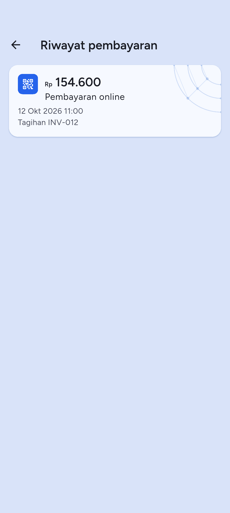

Setiap baris memuat:

- jumlah yang dibayar;
- metode;
- tanggal dan jam pembayaran;
- nomor tagihan yang dibayar ("Tagihan INV-...").

Metode yang mungkin: **Pembayaran online** (lewat Midtrans), **Tunai**, **Transfer bank**, **Cek**, dan **Lainnya**. Pembayaran tunai, transfer, cek, dan lainnya dicatat oleh petugas ISP. Gulir ke bawah untuk memuat lebih banyak; kosong berarti "Belum ada pembayaran."

Pembayaran yang dibatalkan petugas dikoreksi oleh ISP; bila ada selisih yang tidak Anda pahami, hubungi ISP dengan nomor tagihannya.

# 5. Langganan

Langganan adalah layanan internet yang Anda pakai. Buka dari tab **Akun** → **Langganan**, atau ketuk nama paket di kartu layanan pada Beranda.

## Daftar langganan

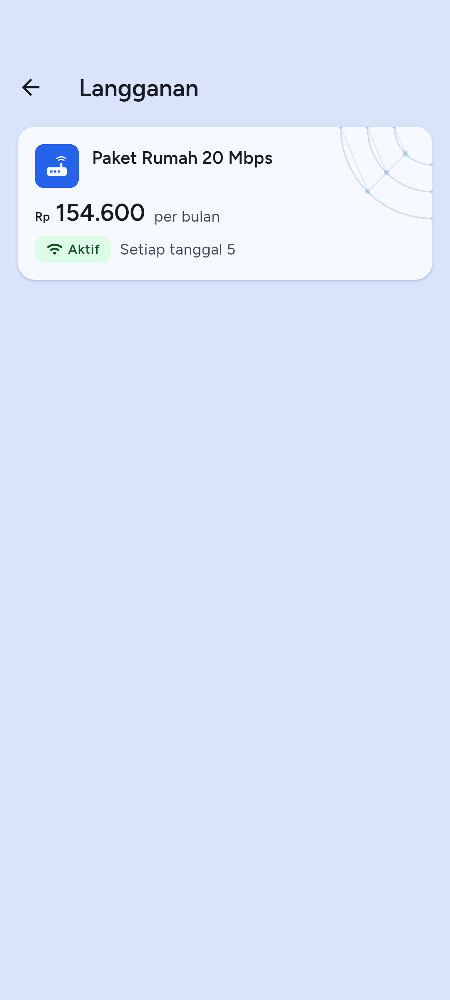

Setiap baris memuat nama paket, biaya bulanan, dan status. Ketuk satu baris untuk melihat rinciannya. Bila kosong: "Tidak ada layanan".

## Detail langganan

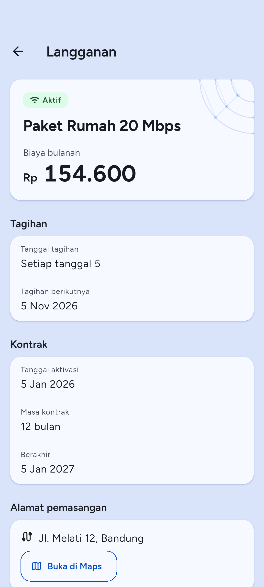

| Bagian | Isi |
| --- | --- |
| Status | Status langganan (tabel di bawah). |
| Paket | Nama paket. |
| Kategori | Kategori paket, misalnya Rumahan, Bisnis atau Korporat. Muncul bila ISP memberi paket itu kategori. |
| Biaya bulanan | Tarif per bulan. |
| Tanggal aktivasi | Tanggal layanan mulai aktif. |
| Tanggal tagihan | "Setiap tanggal N" tiap bulan. |
| Tagihan berikutnya | Tanggal tagihan berikutnya terbit. |
| Masa kontrak | Lama kontrak dalam bulan. |
| Berakhir | Tanggal kontrak berakhir. |
| Alamat pemasangan | Lokasi layanan. |

Data yang belum ada tertulis "Tidak tersedia". Data langganan hanya bisa dibaca; perubahan paket atau alamat dilakukan lewat ISP.

Tersedia pada versi berikutnya: kecepatan paket (misalnya **Hingga 50 Mbps**), tingkat SLA beserta target respons dan penyelesaiannya, nama pengguna PPPoE, peta alamat pemasangan, dan waktu penangguhan. Datanya sudah dikirim server, tetapi aplikasi belum menampilkannya.

## Status langganan

| Status | Arti |
| --- | --- |
| Menunggu | Pemasangan belum selesai; layanan belum aktif. |
| Aktif | Layanan berjalan dan ditagih tiap bulan. |
| Ditangguhkan | Layanan dihentikan sementara (diisolir). |
| Dihentikan | Langganan sudah berhenti. |
| Dibatalkan | Langganan dibatalkan sebelum aktif. |

## Isolir: arti dan cara pulih

**Isolir** berarti ISP membatasi layanan internet sementara. Isolir karena tunggakan dapat pulih otomatis setelah semua tagihan yang menahannya lunas. Penangguhan manual dan blokir petugas tidak dibuka oleh pembayaran.

Cara melunasi isolir karena tunggakan:

1. Hubungkan ponsel lewat **data seluler** atau jaringan lain.
2. Buka Inbils Pelanggan. Bila router membuka halaman **Layanan internet Anda sedang dibatasi**, gunakan tombol **Buka aplikasi {nama ISP}**. Halaman juga menyediakan **Telepon** dan **WhatsApp** bila ISP mengisinya.
3. Pada kartu layanan **Diisolir**, baca daftar **Lunasi tagihan berikut agar layanan aktif kembali**. Daftar ini hanya memuat tagihan yang masih menahan reaktivasi.
4. Untuk satu tagihan, ketuk **Bayar**. Untuk dua tagihan atau lebih, ketuk **Bayar semua (Rp {total})**. Aplikasi membayar tagihan satu per satu, dari jatuh tempo paling lama.
5. Selesaikan pembayaran tagihan pertama. Saat Anda kembali ke aplikasi, langkah **Tagihan 1 dari N** tetap terlihat. Bila tagihan berikutnya masih ada, lembar **Tagihan {nomor} lunas. Lanjut bayar {nomor berikut} (Rp {jumlah})** muncul. Ketuk **Lanjut bayar**.
6. Ulangi sampai aplikasi menulis **Semua tagihan lunas. Layanan aktif kembali dalam beberapa menit.** Jangan membayar tagihan yang sama lagi saat menunggu konfirmasi.

Pembayaran sebagian belum cukup. Bila salah satu pembayaran belum dikonfirmasi, periksa statusnya dari tab **Tagihan** sebelum melanjutkan. Setelah seluruh tagihan penahan tercatat lunas, sistem mengaktifkan layanan di latar belakang.

Pemulihan otomatis hanya berlaku untuk isolir karena tunggakan dan bila ISP mengaktifkannya. Untuk penangguhan manual atau blokir, gunakan **Hubungi ISP**. Bila semua tagihan penahan sudah lunas tetapi layanan belum aktif setelah beberapa menit, hubungi ISP dengan nomor tagihan.

## Kunjungan teknisi

Kunjungan teknisi adalah SPK instalasi atau perawatan yang dikerjakan di alamat Anda. Aplikasi menunjukkan sampai mana kunjungan itu. Buka dari tab **Akun** → **Kunjungan teknisi**, dari kartu kunjungan di **Beranda**, atau dari notifikasi "Teknisi dalam perjalanan". Hanya kunjungan untuk langganan Anda yang tampil.

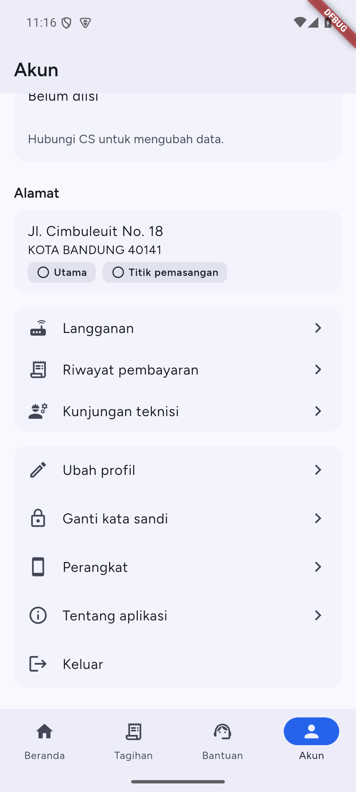

### Daftar kunjungan

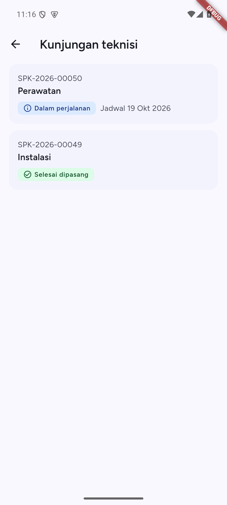

Daftar memuat kunjungan yang masih berjalan, dan kunjungan yang selesai atau dibatalkan dalam 30 hari terakhir, dengan yang terbaru di atas. Tiap kartu menulis nomor SPK, jenis kunjungan, tahap sekarang, dan tanggal jadwal bila ada. Tarik layar ke bawah untuk memuat ulang.

### Detail kunjungan

Ketuk satu kartu.

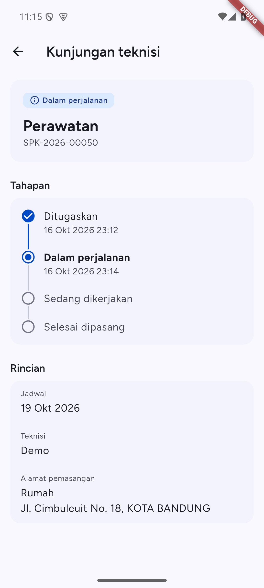

- Bagian atas memuat tahap sekarang, jenis kunjungan, dan nomor SPK.
- **Tahapan** menunjukkan empat langkah: **Ditugaskan**, **Dalam perjalanan**, **Sedang dikerjakan**, dan **Selesai dipasang**. Tanda centang berarti langkah sudah dilalui, dengan waktunya di bawah nama langkah. Lingkaran bertitik dengan nama tebal adalah langkah sekarang. Lingkaran kosong adalah langkah berikutnya.
- **Rincian** memuat **Jadwal** ("Belum ditentukan" bila ISP belum mengisi tanggal), **Teknisi** (nama depan saja), dan **Alamat pemasangan**.
- Tarik layar ke bawah untuk memuat tahap terbaru.

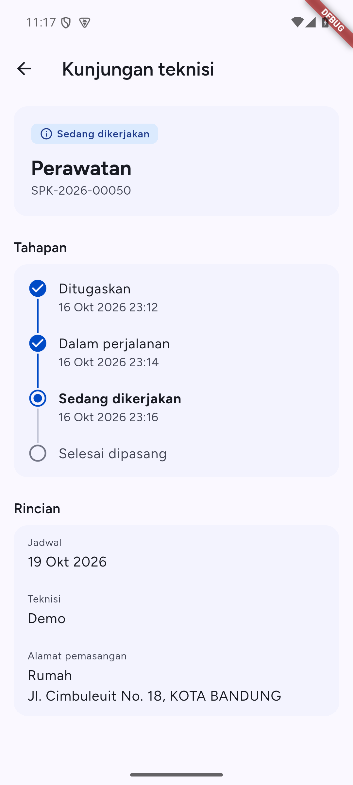

Tahap **Selesai dipasang** muncul begitu teknisi mengirim hasil kerjanya, walau kantor ISP belum memeriksanya.

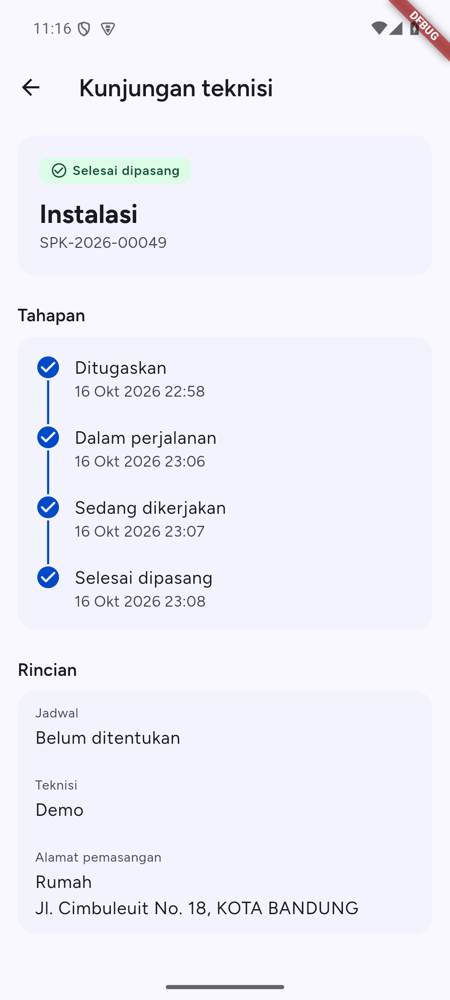

Kunjungan yang dibatalkan menulis **Dibatalkan** tanpa langkah. Aplikasi tidak menampilkan nomor telepon teknisi. Untuk bertanya, pakai **Hubungi ISP** di Beranda.

# 6. Bantuan dan tiket

Tab **Bantuan** dipakai untuk melaporkan gangguan atau meminta bantuan ISP. Isinya jalan pintas **Ada masalah?**, daftar tiket Anda, dan kontak ISP. Setiap tiket tercatat dengan nomor dan bisa dibalas petugas.

## Daftar tiket

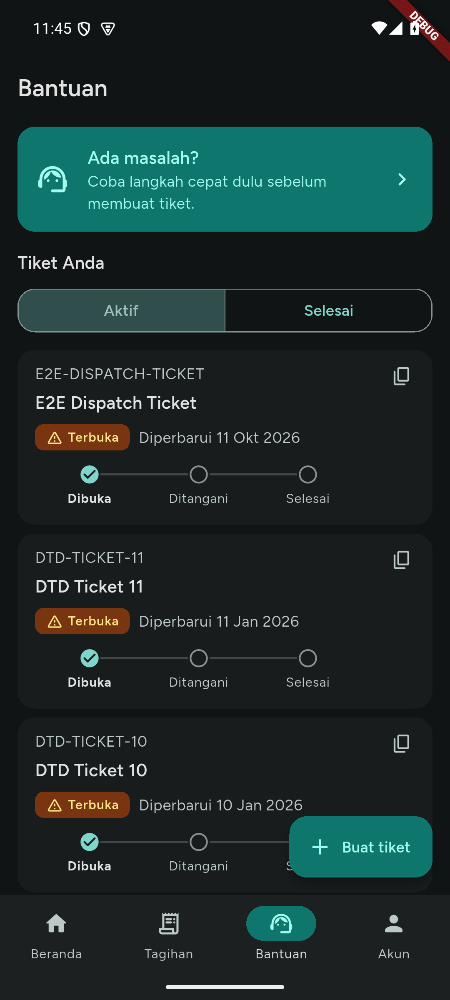

Layar menampilkan, dari atas ke bawah:

1. Kartu **Ada masalah?** ("Coba langkah cepat dulu sebelum membuat tiket."). Ketuk untuk membuka langkah cepat (bagian berikut).
2. **Tiket Anda** dengan filter **Aktif** (tiket Terbuka, Ditugaskan, dan Diproses) atau **Selesai** (tiket Selesai dan Ditutup).
3. Kartu tiket. Setiap kartu memuat kode tiket, judul, status, tanggal "Diperbarui", dan tiga tahap progres: **Dibuka**, **Ditangani**, dan **Selesai**. Tahap **Ditangani** menyala saat tiket Ditugaskan atau Diproses, dan tahap **Selesai** saat tiket Selesai atau Ditutup. Pembaca layar mendengar "Tahap 2 dari 3: Ditangani". Ikon salin di kanan atas kartu menyalin kode tiket ("Nomor tiket disalin."). Berikan kode itu bila menghubungi ISP lewat telepon atau WhatsApp. Ketuk kartu untuk membuka detail.
4. Gulir ke bawah untuk memuat tiket berikutnya, lalu kartu **Hubungi {nama ISP}** dengan WhatsApp, telepon, email, situs web, dan jam layanan yang diisi ISP (bagian ini sama dengan kartu di tab **Akun**, bab 8).

Tombol **Buat tiket** melayang di pojok kanan bawah.

Kosong: "Tidak ada tiket aktif." atau "Belum ada tiket selesai."

Status tiket:

| Status | Arti |
| --- | --- |
| Terbuka | Tiket diterima dan menunggu penanganan. |
| Ditugaskan | Tiket sudah diserahkan ke petugas. |
| Diproses | Petugas sedang menangani. |
| Selesai | Petugas menyatakan masalah sudah selesai. |
| Ditutup | Tiket ditutup dan tidak menerima balasan atau lampiran baru. Bila masalah masih ada, buat tiket baru. |

## Ada masalah? Coba langkah cepat dulu

Sebelum membuat tiket, aplikasi menawarkan langkah yang bisa Anda coba sendiri. Banyak gangguan koneksi selesai dengan langkah ini.

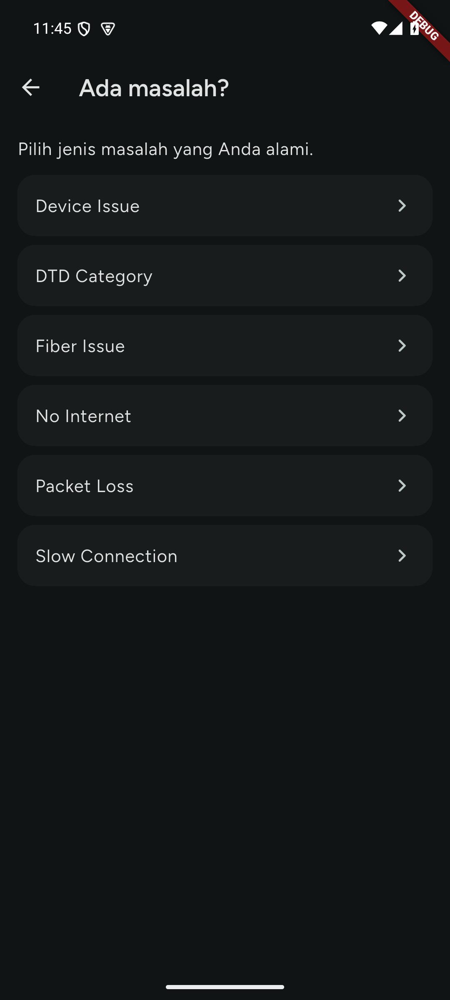

1. Di tab **Bantuan**, ketuk kartu **Ada masalah?**. Layar menulis "Pilih jenis masalah yang Anda alami."
2. Ketuk kategori, misalnya **No Internet** atau **Slow Connection**. Daftar kategori mengikuti yang diatur ISP.
3. Baca kartu **Coba dulu**. Bila ISP menulis **Saran untuk pelanggan** untuk kategori itu, kartu menampilkan teks ISP apa adanya, termasuk baris barunya. Bila ISP belum menulis, kartu menampilkan tiga langkah umum:
   - Cek lampu modem. Catat lampu yang mati atau berwarna merah.
   - Cabut kabel listrik modem, tunggu 30 detik, lalu pasang lagi.
   - Cek kabel di modem. Pastikan tidak longgar, tertekuk, atau putus.
4. Bila Anda punya lebih dari satu layanan yang bisa dilaporkan, pilih **Layanan yang bermasalah** (atau biarkan "Tidak terkait layanan"). Bila hanya satu, aplikasi memilihnya sendiri.
5. Bila masalah belum hilang, ketuk **Masih bermasalah? Buat tiket**. Formulir tiket terbuka dengan kategori dan layanan yang sudah terisi.

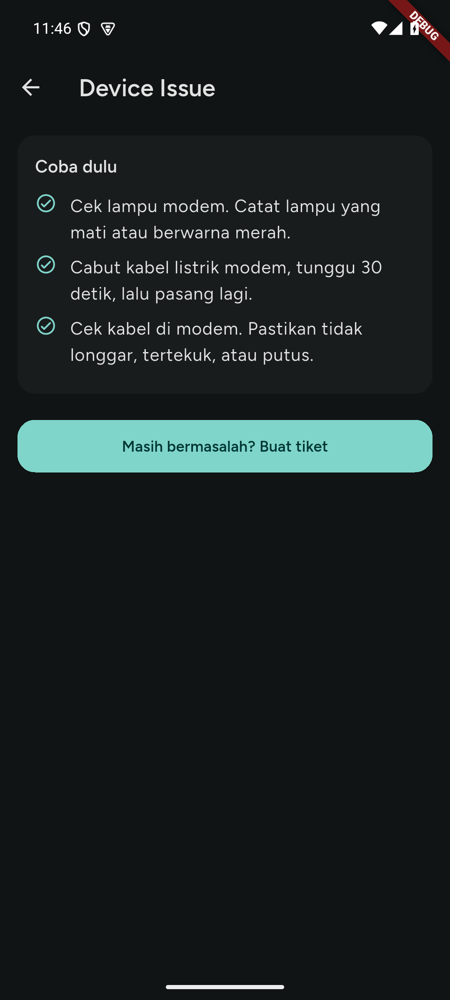

Layar ini hanya memberi saran. Tidak ada yang terkirim ke ISP sampai Anda mengetuk **Kirim tiket**. Bila daftar kategori kosong, layar menulis "Belum ada kategori masalah." dan Anda tetap bisa membuat tiket dari tombol **Buat tiket** di tab **Bantuan**.

## Buat tiket

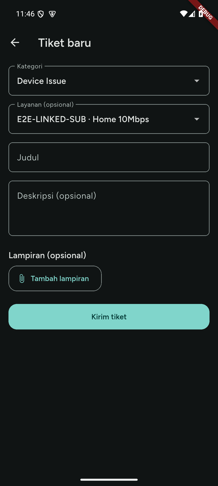

1. Ketuk **Masih bermasalah? Buat tiket** (dari **Ada masalah?**), **Buat tiket** (tombol di tab Bantuan), atau **Laporkan gangguan** (di Beranda). Dari **Laporkan gangguan** dan **Buat tiket**, formulir terbuka tanpa isian awal.
2. Pilih **Kategori**. Wajib. Dari **Ada masalah?** isian ini sudah terisi.
3. Pilih **Layanan (opsional)** bila masalahnya terkait satu langganan. Pilihan hanya memuat layanan yang aktif atau ditangguhkan. Biarkan "Tidak terkait layanan" bila tidak ada.
4. Isi **Judul**, wajib, paling banyak 255 karakter.
5. Isi **Deskripsi (opsional)**: apa yang terjadi, sejak kapan, lampu apa yang menyala di perangkat.
6. Untuk menambah foto, ketuk **Tambah lampiran** (lihat di bawah). Bisa lebih dari satu.
7. Ketuk **Kirim tiket**.

Tiket terkirim, lalu aplikasi membuka halaman detailnya. Prioritas ditentukan sistem menurut kategori. Foto diunggah setelah tiket terbuat; bila sebagian gagal, aplikasi menampilkan "Tiket terkirim, tetapi N lampiran gagal diunggah. Tambahkan lagi dari halaman tiket."

Bila Kategori atau Judul kosong, aplikasi menampilkan "Pilih kategori." atau "Isi judul tiket." dan tidak mengirim. Bila daftar kategori gagal dimuat, tertulis "Kategori tidak bisa dimuat."; coba lagi setelah koneksi pulih.

Bila ISP mengaktifkan WhatsApp untuk Anda, pesan "tiket dibuat" dikirim setelah tiket tercatat.

## Detail tiket

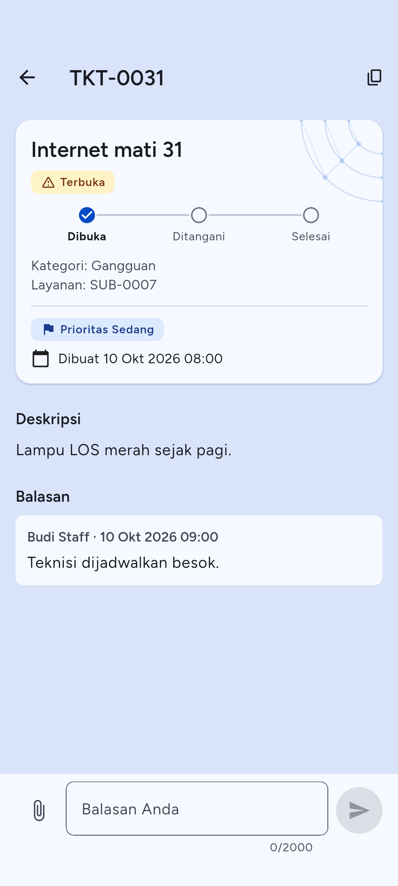

Layar memuat kartu judul dengan status, tahap progres (**Dibuka**, **Ditangani**, **Selesai**), kategori, dan layanan terkait, lalu **Deskripsi**, **Catatan penyelesaian** (bila petugas mengisi), **Lampiran**, dan **Balasan**. Ikon salin di bilah atas menyalin kode tiket. Tarik ke bawah untuk memuat ulang.

Tiket **Ditutup** mengganti kolom balasan dengan kartu **Tiket ditutup. Masih bermasalah? Buat tiket baru** dan tombol **Buat tiket baru**. Tombol membuka formulir tiket baru dengan kategori dan layanan dari tiket lama sudah terisi. Tiket tertutup tidak menerima komentar atau lampiran baru.

## Komentar (balasan)

1. Buka detail tiket yang belum **Ditutup**.
2. Tiket **Selesai** menampilkan petunjuk **Membalas akan membuka kembali tiket ini.** Balasan Anda mengubah tiket menjadi **Ditugaskan** bila petugasnya masih ada, atau **Terbuka** bila tidak.
3. Ketik di kolom **Balasan Anda**. Batas 2000 karakter; penghitung di bawah kolom menunjukkan jumlahnya.
4. Ketuk ikon kirim.

Balasan Anda tampil di sisi kanan dengan label "Anda"; balasan petugas berlabel nama petugas atau "Tim Inbils". Setelah tiket **Selesai** dibuka kembali, aplikasi memuat status baru dan petugas ISP menerima pemberitahuan. Bila tiket ditutup saat layar masih terbuka, server menolak balasan dengan kartu **Tiket ditutup. Masih bermasalah? Buat tiket baru**.

## Lampiran

Di tiket yang belum ditutup, bagian **Lampiran** punya tombol **Tambah lampiran**. Foto bisa ditambahkan saat membuat tiket maupun sesudahnya.

1. Ketuk **Tambah lampiran**.
2. Pilih sumber di lembar "Lampirkan foto dari": **Kamera** atau **Galeri**.
3. Ambil atau pilih foto.
4. Di jendela "Keterangan lampiran" isi **Keterangan (opsional)**, paling banyak 255 karakter, lalu ketuk **Lampirkan**. Ketuk **Batal** untuk membatalkan.
5. Tombol berubah menjadi "Mengunggah lampiran" sampai selesai. Foto lalu tampil di daftar lampiran.

Aplikasi mengecilkan foto lebih dulu (JPEG, sisi terpanjang 1920 piksel) dan membuang data lokasi (EXIF) dari foto yang dikirim. Server menerima berkas jpg, jpeg, png, atau pdf dengan ukuran paling besar 10 MB per berkas; dari aplikasi Anda hanya mengirim foto.

- Ketuk foto di daftar untuk membukanya layar penuh; ketuk **Tutup** untuk kembali. Bila gambar tidak termuat, tertulis "Gambar tidak bisa dimuat." dengan tombol coba lagi.
- Berkas non-gambar (misalnya PDF dari petugas) tampil dengan nama dan ukurannya, tetapi tidak bisa dibuka di aplikasi.
- Untuk menghapus lampiran yang Anda unggah sendiri, ketuk **Hapus lampiran**, lalu **Hapus** di konfirmasi. Penghapusan hanya bisa dilakukan oleh pengunggahnya dan selama tiket masih Terbuka, Ditugaskan, atau Diproses. Lampiran dari petugas tidak bisa Anda hapus.

# 7. Notifikasi

Ketuk ikon **lonceng** di pojok kanan atas Beranda. Angka merah di ikon adalah jumlah notifikasi yang belum dibaca.

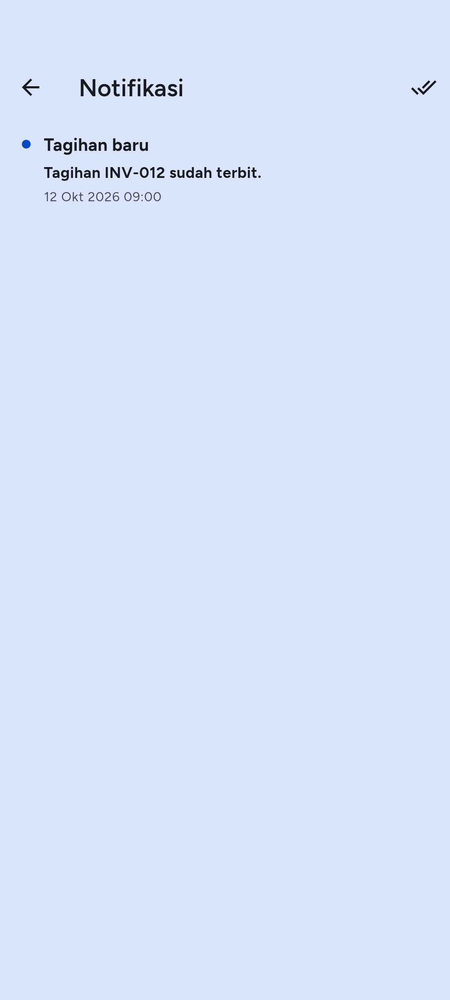

1. Notifikasi yang belum dibaca tampil dengan huruf tebal.
2. Ketuk satu notifikasi untuk menandainya sudah dibaca. Bila terkait tagihan, tiket, atau kunjungan teknisi, aplikasi langsung membuka tagihan, tiket, atau kunjungan itu.
3. Ketuk **Tandai semua dibaca** untuk menandai semuanya sekaligus.
4. Tarik layar ke bawah untuk memuat ulang; gulir untuk memuat yang lebih lama. Kosong: "Belum ada notifikasi".

   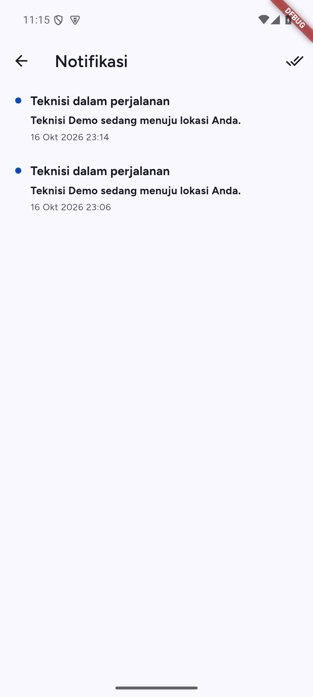

Jenis notifikasi untuk pelanggan:

| Judul | Muncul saat | Push |
| --- | --- | --- |
| Tagihan baru | Tagihan terbit. | Ya |
| Tagihan segera jatuh tempo | Tagihan jatuh tempo besok atau dalam 3 hari. | Ya |
| Tagihan sudah jatuh tempo | Tagihan lewat jatuh tempo. | Ya |
| Pengingat jatuh tempo | Hanya pada notifikasi lama, sebelum pengingat dipisah menjadi dua judul di atas. | Tidak |
| Pembayaran diterima | Pembayaran tercatat. | Ya |
| Tiket dibuat | Tiket Anda tercatat. | Tidak |
| Tiket mulai ditangani | Tiket diserahkan ke petugas. | Tidak |
| Tiket selesai | Petugas menyelesaikan tiket. | Tidak |
| Jadwal kunjungan teknisi | Kunjungan teknisi dijadwalkan. | Tidak |
| Teknisi dalam perjalanan | Teknisi menekan **Saya berangkat** di aplikasinya. Isinya "Teknisi {nama depan} sedang menuju lokasi Anda." Ketuk untuk membuka detail kunjungannya. Pesan ini hanya muncul di aplikasi, tidak di WhatsApp. | Ya |
| Kunjungan teknisi selesai | Teknisi selesai mengerjakan kunjungan di alamat Anda. Isinya "Kunjungan teknisi untuk layanan Anda sudah selesai." Ketuk untuk membuka detail kunjungannya. | Ya |
| Pengumuman baru | ISP menerbitkan pengumuman Gangguan atau Pemeliharaan untuk area atau paket Anda. Isi notifikasi adalah judul pengumuman. Ketuk untuk membuka pengumumannya. | Ya |
| Notifikasi uji | Anda mengetuk **Kirim notifikasi uji** di **Akun** → **Notifikasi uji** (bagian berikut). Isinya "Notifikasi uji dari {nama ISP}." Tidak membuka layar apa pun. | Ya, hanya ke ponsel yang mengirimnya |

Kolom **Push** menunjukkan notifikasi yang juga masuk ke layar ponsel (bagian berikut). Semua notifikasi, termasuk yang tidak dikirim sebagai push, tetap ada di daftar lonceng.

## Notifikasi di layar ponsel (push)

Aplikasi bisa memunculkan notifikasi di layar ponsel Android Anda, juga saat aplikasi tertutup. Isinya sama dengan yang ada di daftar lonceng.

1. Setelah Anda masuk, aplikasi dapat meminta izin notifikasi lewat kotak dialog sistem Android. Pertanyaan ini hanya muncul di Android 13 ke atas dan hanya sekali, selama Anda belum memutuskannya.
2. Pilih izinkan. Aplikasi lalu mendaftarkan ponsel ini ke Inbils, dan notifikasi di kolom **Push** pada tabel di atas masuk ke ponsel.
3. Ketuk notifikasi di layar ponsel. Aplikasi terbuka langsung di tagihan, kunjungan, atau pengumuman terkait. Untuk pesan yang tidak punya layar tujuan, aplikasi membuka daftar notifikasi. Notifikasi itu ditandai sudah dibaca.
4. Saat aplikasi sedang terbuka, notifikasi tampil sebagai banner singkat di atas layar.

Bila Anda menolak izinnya, aplikasi tetap berfungsi dan lonceng tetap menerima semua notifikasi. Untuk mengaktifkan push kemudian, nyalakan notifikasi aplikasi Inbils di pengaturan Android (**Pengaturan > Aplikasi**), lalu buka aplikasi lagi. Aplikasi memeriksa izinnya setiap kali dibuka dan mendaftarkan ponsel saat izin sudah menyala.

Saat **Keluar**, aplikasi menghapus pendaftaran ponsel ini, sehingga tidak ada push lagi sampai Anda masuk kembali. Ponsel yang dikeluarkan dari daftar **Perangkat** (bab 8), kata sandi yang diganti, atau akun yang dinonaktifkan juga berhenti menerima push. Push tidak bergantung pada WhatsApp dan tidak membutuhkan persetujuan WhatsApp.

Bila push tidak muncul, pastikan izin notifikasi menyala, ponsel punya internet dan Anda masih masuk di aplikasi ini. ISP juga harus sudah mengaktifkan push di servernya. Bila ISP belum mengaktifkannya, notifikasi tetap muncul di lonceng.

## Notifikasi uji

Layar **Notifikasi uji** memeriksa apakah ponsel ini bisa menerima push dari ISP Anda, dan bila tidak, apa yang harus diperbaiki. Pakai saat notifikasi tagihan atau kunjungan tidak muncul di layar ponsel, atau sesudah masuk di ponsel baru.

1. Buka tab **Akun**, lalu ketuk **Notifikasi uji**. Layar ini butuh internet.
2. Baca tiga pemeriksaan dari atas ke bawah. Tiap pemeriksaan punya ikon dan teks hasil, jadi tidak bergantung pada warna:
   - **Izin notifikasi**: **Diizinkan**, **Belum ditanyakan** (ketuk **Izinkan** untuk memunculkan pertanyaan Android), atau **Diblokir di pengaturan HP** (ketuk **Buka pengaturan**, lalu nyalakan notifikasi aplikasi Inbils). Bila pengaturan tidak terbuka, aplikasi menulis "Pengaturan tidak bisa dibuka. Buka Pengaturan HP, lalu Aplikasi, Inbils, Notifikasi." Aplikasi memeriksa izin lagi saat Anda kembali dari pengaturan.
   - **Token terdaftar di server**: awalnya **Belum diperiksa**. Hasilnya **Terdaftar** diikuti nama ponsel ini, atau **Belum terdaftar** (ketuk **Daftarkan ulang**, lalu kirim notifikasi uji lagi). Bila server belum memasang Firebase, hasilnya "Notifikasi push belum aktif di server" dengan saran **Perbaiki** "Hubungi admin ISP Anda: Firebase server belum dipasang."
   - **Pesan diterima**: **Belum dikirim**, lalu "Menunggu pesan… N dtk" dengan hitungan mundur 30 detik, lalu "Diterima dalam N dtk" atau "Pesan tidak datang dalam 30 detik".
3. Ketuk **Kirim notifikasi uji**. Tombol aktif bila izin sudah **Diizinkan**, token tidak **Belum terdaftar**, dan tidak ada pengiriman yang sedang berjalan. Aplikasi memeriksa izin dan token, lalu meminta server mengirim satu pesan ke ponsel ini saja, bukan ke ponsel lain di akun Anda.
4. Tetap di layar ini selama hitungan mundur. Pesan uji muncul sebagai banner di atas layar dan pemeriksaan **Pesan diterima** menjadi hijau dengan lama kedatangannya. Pesan yang sama tersimpan di daftar lonceng dengan judul "Notifikasi uji".

Bila **Pesan diterima** gagal, baca saran **Perbaiki** di bawahnya: "Periksa internet dan mode hemat baterai, lalu coba lagi. Bila tetap gagal, minta admin memeriksa status Firebase di Pengaturan → Integrasi." Hubungi ISP Anda untuk langkah terakhir itu: admin ISP melihat status Firebase di halaman web **Integrasi**. Mode hemat baterai di beberapa ponsel menahan push untuk aplikasi yang tertutup. Keluarkan Inbils dari pembatasan baterai di pengaturan Android bila itu terjadi.

Kesalahan umum:

- "Terlalu banyak percobaan. Coba lagi dalam N detik.": satu akun boleh mengirim 3 notifikasi uji per menit. Tombol aktif lagi setelah hitungan itu.
- Tombol **Kirim notifikasi uji** tidak bisa diketuk: lihat pemeriksaan **Izin notifikasi** dan **Token terdaftar di server**. Selesaikan saran di bawahnya.
- "Tidak ada koneksi internet. Periksa sinyal, lalu coba lagi.": ponsel tidak punya internet, jadi server tidak bisa menjawab. Nyalakan internet, lalu kirim lagi.

## Notifikasi WhatsApp

Selain di aplikasi, ISP dapat mengirim pesan WhatsApp untuk kejadian yang sama. Pesan WhatsApp hanya dikirim bila **semua** syarat ini terpenuhi:

- ISP mengaktifkan WhatsApp untuk perusahaannya.
- Anda sudah **menyetujui** WhatsApp. Persetujuan dicatat oleh petugas ISP; tanpa itu tidak ada pesan, dan notifikasi di aplikasi tetap muncul.
- Nomor telepon Anda adalah nomor seluler Indonesia yang valid. Nomor telepon rumah atau nomor asing dilewati.

Pesan yang dikirim: tagihan terbit, pengingat jatuh tempo (3 hari dan 1 hari sebelum, serta 1 hari sesudah jatuh tempo), pembayaran diterima, tiket dibuat, tiket mulai ditangani, tiket selesai, dan jadwal kunjungan teknisi. Pesan tagihan dan pengingat ditahan di jam tenang (bawaan 21.00-07.00); pesan kejadian lain dikirim segera. Isi pesan memakai templat tetap yang disetujui Meta.

Untuk berhenti, balas pesan dari ISP dengan **STOP** atau **BERHENTI**. Setelah itu tidak ada pesan lagi dari ISP yang Anda balas sampai petugasnya mencatat persetujuan baru. Balasan itu hanya berlaku untuk ISP pemilik nomor WhatsApp yang mengirim pesannya, bukan untuk ISP lain yang melayani Anda. Tautan atau kata sandi tidak pernah dikirim lewat WhatsApp.

Nomor yang dipakai adalah nomor telepon di profil Anda. Anda bisa mengubahnya di **Ubah profil** (bab 8); persetujuan WhatsApp tetap tercatat pada data pelanggan.

# 8. Akun

Tab **Akun** menampilkan siapa Anda, tampilan aplikasi, cara menghubungi ISP, profil pelanggan, lalu menu pengelolaan akun.

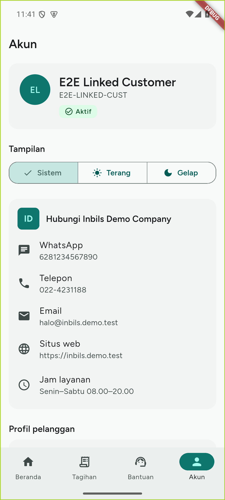

Isi layar dari atas ke bawah:

1. **Kepala profil**: inisial, nama, kode pelanggan, dan status pelanggan (Aktif, Ditangguhkan, dan seterusnya).
2. **Tampilan**: pilih **Sistem** (mengikuti pengaturan ponsel), **Terang**, atau **Gelap**. Pilihan tersimpan di ponsel ini dan berlaku seketika.
3. Kartu **Hubungi {nama ISP}**: kontak ISP yang diisi di profil perusahaan. Baris yang mungkin ada: **WhatsApp**, **Telepon**, **Email**, **Situs web**, dan **Jam layanan**. Ketuk **WhatsApp** untuk membuka percakapan di WhatsApp, **Telepon** untuk membuka pemanggil, **Email** untuk menulis email, dan **Situs web** untuk membuka peramban. **Jam layanan** hanya teks, misalnya "Senin sampai Sabtu 08.00 sampai 20.00". Bagian yang belum diisi ISP tidak tampil, dan kartunya hilang bila ISP belum mengisi satu pun. Bila ponsel tidak punya aplikasi untuk tautan itu, muncul "Tidak bisa membuka WhatsApp." (atau nama kanal lain).
4. **Profil pelanggan** (hanya dibaca): email untuk masuk, email, telepon, dan narahubung. Data yang kosong tertulis "Belum diisi". Tertulis "Hubungi CS untuk mengubah data."
5. **Alamat** dengan penanda "Utama" dan "Titik pemasangan". Nama tagihan, alamat, dan email hanya bisa diubah oleh ISP.
6. Baris menu: **Langganan**, **Riwayat pembayaran**, **Kunjungan teknisi**, lalu **Ubah profil**, **Ganti kata sandi**, **Perangkat**, **Notifikasi uji**, **Tentang aplikasi**, dan **Keluar**.

Warna aplikasi mengikuti warna merek ISP, jadi tiap ISP bisa tampak berbeda. Warna itu dikirim dari server saat aplikasi memuat data akun.

## Ubah profil

1. Ketuk **Ubah profil**.
2. Ubah **Nama** (wajib) atau **Telepon**.
3. Ketuk **Simpan**. Muncul "Profil diperbarui."

Email login tidak bisa diubah di aplikasi; hubungi ISP bila perlu mengubahnya. Perubahan ini mengubah nama akun login (yang tampil di sapaan Beranda) dan nomor telepon kontak. Nama dan alamat penagihan pada data pelanggan tidak berubah.

## Ganti kata sandi

1. Ketuk **Ganti kata sandi**.
2. Isi **Kata sandi saat ini**, **Kata sandi baru** (minimal 8 karakter), dan **Ulangi kata sandi baru**.
3. Ketuk **Ganti kata sandi**.
4. Semua perangkat yang sedang masuk, termasuk ponsel ini, keluar. Aplikasi kembali ke layar masuk dengan pesan "Kata sandi sudah diganti. Masuk lagi dengan kata sandi baru." Masuk lagi dengan kata sandi baru.

Kata sandi saat ini yang salah menampilkan "Kata sandi saat ini salah." Setelah 5 kali salah dalam semenit, aplikasi menolak percobaan berikutnya sampai jeda berlalu. Ulangan yang berbeda ditolak dengan "Ulangan kata sandi baru tidak sama."

## Perangkat

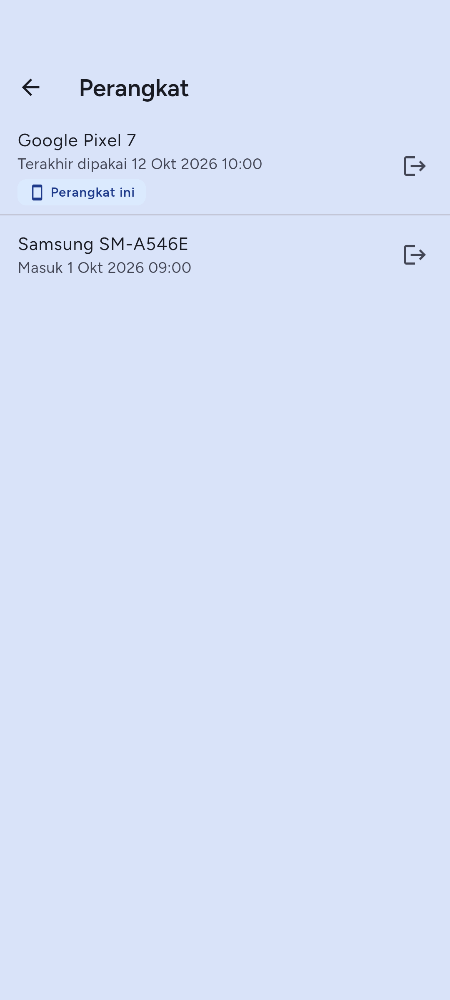

Daftar ponsel yang sedang masuk ke akun Anda: nama perangkat, kapan masuk, dan terakhir dipakai; ponsel yang sedang Anda pegang ditandai "Perangkat ini".

Untuk mengeluarkan perangkat (misalnya ponsel hilang):

1. Ketuk tombol **Keluarkan** pada perangkat itu.
2. Konfirmasi di "Keluarkan perangkat?".
3. Perangkat itu keluar dari akun dan harus masuk lagi dengan kata sandi.

Bila yang dikeluarkan ponsel ini sendiri, Anda keluar dari aplikasi. Bila ponsel hilang, ganti juga kata sandi supaya semua sesi berakhir.

## Tentang aplikasi

Menampilkan versi aplikasi, ID aplikasi, lingkungan, server, dan lisensi sumber terbuka. Sebutkan versi ini saat menghubungi ISP tentang masalah aplikasi.

## Keluar

1. Ketuk **Keluar**.
2. Konfirmasi di "Keluar dari akun?". Aplikasi langsung keluar, walaupun ponsel sedang offline.

Anda harus masuk lagi untuk memakai aplikasi.

# 9. Kesalahan umum & FAQ

## Kesalahan umum

| Pesan atau kejadian | Penyebab dan tindakan |
| --- | --- |
| "Tidak ada koneksi internet. Periksa sinyal, lalu coba lagi." / banner "Anda sedang offline. Data yang tampil mungkin belum terbaru." | Ponsel tidak punya internet. Aplikasi tidak menyimpan antrean tindakan: tagihan tidak bisa dibayar, tiket tidak terkirim, dan balasan tidak terkirim sampai koneksi pulih. Hubungkan ponsel, lalu ulangi. |
| "Sesi Anda berakhir. Silakan masuk lagi." | Sesi login habis (maksimal 90 hari), kata sandi diganti, atau perangkat dikeluarkan. Masuk lagi dengan email dan kata sandi. |
| "Email atau kata sandi salah." | Periksa ejaan email dan huruf besar-kecil kata sandi. Bila lupa, pakai **Lupa kata sandi?**. |
| "Demi keamanan, atur ulang kata sandi lewat link yang kami kirim ke email Anda." | Akun lama yang kata sandinya masih nomor telepon. Ketuk **Kirim link** di lembar yang muncul, buka email, dan atur kata sandi baru di halaman web. Lalu masuk lagi di aplikasi. |
| Tautan atur kata sandi tidak berfungsi | Tautan berlaku 60 menit dan hanya satu tautan aktif per akun; tautan terbaru menggantikan yang lama. Minta tautan baru lewat **Lupa kata sandi?**. |
| "Akun ini tidak terdaftar sebagai pelanggan." | Akun belum tertaut ke data pelanggan, belum aktif, atau emailnya belum terverifikasi. Hubungi ISP. |
| "Akun Anda dinonaktifkan. Hubungi kantor Inbils." | Akun dinonaktifkan oleh ISP. Hubungi ISP. |
| "Kode verifikasi kedaluwarsa. Silakan masuk lagi." / "Kode salah." | Kode dua langkah terlambat atau salah. Masuk lagi dari awal; pakai kode pemulihan bila perlu. |
| "Terlalu banyak percobaan. Coba lagi dalam N detik." | Terlalu banyak percobaan masuk, kode, ganti kata sandi, atau pembayaran dalam waktu singkat. Tunggu waktu yang tertera. |
| "Permintaan sebelumnya masih diproses. Coba lagi sebentar lagi." | Ketukan sebelumnya masih berjalan. Tunggu beberapa detik; jangan menekan berulang. |
| "Data sudah berubah. Kami memuat ulang." | Data berubah di server saat Anda melihatnya. Periksa layar yang dimuat ulang lalu ulangi. |
| "Server sedang bermasalah. Coba lagi beberapa saat lagi." | Gangguan sementara di server. Coba lagi nanti. |
| "Halaman pembayaran tidak bisa dibuka. Coba lagi." / "Halaman pembayaran belum tersedia. Muat ulang tagihan, lalu coba lagi." | Ulangi **Bayar** setelah memuat ulang tagihan. Bila tetap gagal, bayar lewat ISP. |
| "Pembayaran online belum tersedia. Silakan bayar lewat kantor Inbils." | Pembayaran online sedang tidak aktif. Hubungi ISP. |
| Sudah membayar tetapi tagihan masih Belum dibayar | Ketuk **Periksa status**. Sistem juga memeriksa ke Midtrans secara berkala. Bila tidak berubah, hubungi ISP dengan nomor tagihan dan bukti pembayaran. |
| Lampiran gagal diunggah | Batas berkas: jpg, jpeg, png, atau pdf, paling besar 10 MB. Coba ambil foto lagi atau pilih dari galeri. Tidak bisa menambah lampiran di tiket yang sudah Ditutup. |
| "Foto tidak dapat diambil. Coba lagi." | Aplikasi tidak bisa mengambil foto dari kamera atau galeri. Periksa izin kamera atau penyimpanan aplikasi di pengaturan Android. |
| "Data tidak ditemukan atau sudah dihapus." | Tiket atau tagihan sudah tidak ada. Kembali ke daftar. |

## FAQ

**Siapa yang membuat akun saya?** ISP Anda. Anda tidak mendaftar sendiri. Pertama kali masuk, atur kata sandi lewat tautan di email.

**Bisakah saya memakai situs web untuk bayar tagihan?** Tidak. Tagihan dan pembayaran lewat aplikasi. Situs web hanya dipakai untuk mengatur ulang kata sandi lewat tautan email dan mengelola verifikasi dua langkah.

**Bagaimana mengaktifkan verifikasi dua langkah?** Di situs web, bukan di aplikasi. Masuk di situs web, ketuk **Kelola akun & 2FA**, dan ikuti petunjuk. Setelah aktif, aplikasi akan meminta kode saat masuk.

**Saya lupa kata sandi.** Ketuk **Lupa kata sandi?** di layar masuk dan ikuti email yang dikirim.

**Bisakah saya mengubah email login?** Tidak di aplikasi. Hubungi ISP.

**Bagaimana mengubah alamat, nama tagihan, atau paket?** Hubungi ISP. Profil dan langganan di aplikasi hanya bisa dibaca; yang bisa Anda ubah sendiri hanya nama akun, telepon, dan kata sandi.

**Layanan saya diisolir. Apa yang harus dilakukan?** Bayar tagihan yang terbuka lewat aplikasi (gunakan data seluler). Setelah lunas, layanan aktif kembali otomatis. Lihat bab 5.

**Ponsel saya hilang.** Dari ponsel lain, masuk, buka **Akun** → **Perangkat** dan **Keluarkan** ponsel yang hilang, lalu ganti kata sandi. Bila Anda tidak bisa masuk, hubungi ISP.

**Berapa lama saya tetap masuk?** Sampai Anda keluar, mengganti kata sandi, atau mengeluarkan perangkat; paling lama 90 hari, dan aplikasi memperbarui sesi sendiri bila dipakai.

**Mengapa saya tidak menerima WhatsApp?** Mungkin ISP belum mengaktifkan WhatsApp, belum mencatat persetujuan Anda, nomor Anda bukan nomor seluler Indonesia yang valid, atau Anda pernah membalas STOP. Pemberitahuan di aplikasi tetap tersedia lewat ikon lonceng. Hubungi ISP untuk mengubahnya.

**Notifikasi aplikasi tidak muncul di layar ponsel.** Buka **Akun** → **Notifikasi uji**, ketuk **Kirim notifikasi uji**, dan ikuti saran **Perbaiki** pada pemeriksaan yang gagal (bab 7). Hubungi ISP bila izin dan token sudah benar tetapi pesan uji tetap tidak datang.

**Foto saya memuat lokasi?** Tidak. Aplikasi membuang data lokasi (EXIF) dan mengecilkan foto sebelum mengunggahnya.
