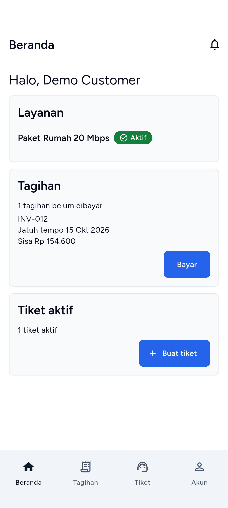
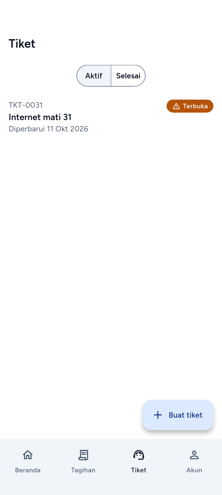
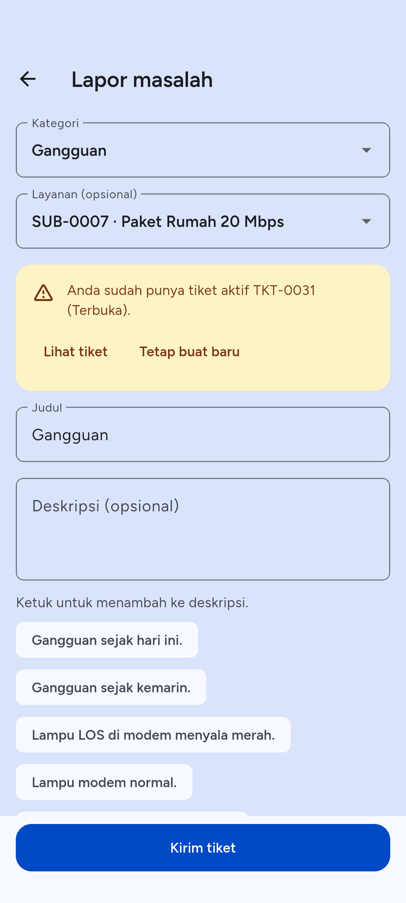
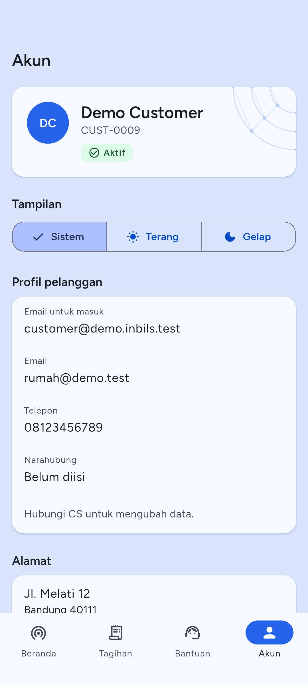

# 1. Pendahuluan

Aplikasi Android **Inbils Pelanggan** dipakai untuk melihat tagihan dan membayarnya, memeriksa layanan internet Anda, dan menghubungi penyedia layanan (ISP) lewat tiket. Pelanggan tidak lagi memakai situs web untuk hal-hal itu. Login pelanggan di situs web hanya menampilkan halaman "Gunakan aplikasi Inbils".

## Memasang aplikasi

1. Buka halaman aplikasi **Inbils Pelanggan** di Google Play Store. Alamatnya diberikan ISP Anda; halaman "Gunakan aplikasi Inbils" di situs web juga memuat tombol **Buka Play Store** bila ISP sudah mengisinya.
2. Ketuk **Pasang**, lalu buka aplikasinya.

Aplikasi berjalan di ponsel Android dan butuh koneksi internet. Bila koneksi putus, aplikasi menampilkan pesan "Anda sedang offline. Data yang tampil mungkin belum terbaru."

## Akun dibuat oleh ISP

Anda tidak mendaftar sendiri. Petugas ISP membuat data pelanggan beserta akun login, lalu sistem mengirim email ke alamat email pelanggan berisi **tautan atur kata sandi**.

1. Buka email dari ISP Anda.
2. Ketuk tautan di dalamnya. Tautan membuka halaman web untuk mengatur kata sandi.
3. Isi kata sandi baru dan simpan.
4. Kembali ke aplikasi dan masuk dengan email dan kata sandi itu.

Tautan berlaku 60 menit. Bila sudah lewat atau email tidak ditemukan, pakai **Lupa kata sandi** (bagian "Lupa kata sandi" di bawah) atau minta ISP mengirim ulang tautan. Kata sandi tidak pernah dikirim lewat WhatsApp; WhatsApp paling banyak hanya memberi tahu bahwa tautan ada di email.

Akun lama yang kata sandinya masih nomor telepon sudah dimatikan. Pemilik akun itu harus mengatur kata sandi baru lewat tautan email dulu. Lihat "Kesalahan umum".

## Masuk

1. Buka aplikasi.
2. Isi **Email** dengan email yang dipakai ISP untuk akun Anda. Alamat ini terlihat di menu Akun sebagai "Email untuk masuk".
3. Isi **Kata sandi**. Ketuk ikon mata untuk menampilkan atau menyembunyikan kata sandi.
4. Ketuk **Masuk**.

Bila email atau kata sandi salah, muncul "Email atau kata sandi salah." Setelah beberapa kali salah, aplikasi menampilkan "Terlalu banyak percobaan"; tunggu sesuai waktu yang tertera.

Anda tetap masuk di ponsel ini sampai Anda keluar, mengganti kata sandi, atau masa berlaku sesi berakhir (sampai 90 hari; aplikasi memperbarui sesi sendiri selama dipakai). Lihat "Kesalahan umum".

Layar masuk juga punya tombol **Tentang aplikasi** (versi aplikasi dan server) yang bisa dibuka sebelum masuk.

## Verifikasi dua langkah

Verifikasi dua langkah bersifat pilihan. Bila Anda mengaktifkannya, setelah kata sandi benar aplikasi menampilkan layar **Verifikasi dua langkah**.

1. Buka aplikasi autentikator di ponsel Anda.
2. Masukkan **Kode 6 digit** yang tampil, lalu ketuk **Verifikasi**.
3. Bila ponsel autentikator hilang, ketuk **Pakai kode pemulihan** dan masukkan salah satu kode pemulihan. Setiap kode hanya berlaku sekali.
4. Untuk kembali ke kode autentikator, ketuk **Pakai kode autentikator**.

Mengaktifkan, mematikan, dan membuat ulang kode pemulihan **tidak** bisa dilakukan di aplikasi. Lakukan di situs web Inbils: masuk dengan akun Anda, lalu di halaman "Gunakan aplikasi Inbils" ketuk **Kelola akun & 2FA**. Alamat situs web ditanyakan ke ISP.

Kode yang salah menampilkan "Kode salah. Periksa lalu coba lagi." Bila terlalu lama di layar ini, muncul "Kode verifikasi kedaluwarsa. Silakan masuk lagi." Kembali ke layar masuk dan ulangi dari awal. Jika kode pemulihan habis dan ponsel hilang, minta administrator ISP mereset verifikasi dua langkah akun Anda.

## Lupa kata sandi

1. Di layar masuk, ketuk **Lupa kata sandi?**
2. Isi email akun Anda dan ketuk **Kirim link**.
3. Aplikasi menjawab "Jika email itu terdaftar, link atur ulang kata sandi sudah kami kirim. Periksa kotak masuk Anda." Jawaban ini sama untuk semua alamat, supaya orang lain tidak bisa menebak email mana yang terdaftar.
4. Buka email, ketuk tautannya, dan atur kata sandi baru di halaman web yang terbuka.
5. Kembali ke aplikasi dan masuk dengan kata sandi baru.

Pengaturan ulang selalu selesai di halaman web lewat tautan email, bukan di aplikasi. Format email yang salah ditolak dengan "Format email tidak valid." Tombol **Kembali ke halaman masuk** membatalkan.

# 2. Beranda

Beranda adalah tab pertama. Navigasi bawah punya empat tab: **Beranda**, **Tagihan**, **Tiket**, dan **Akun**.

Isi layar dari atas ke bawah:

1. **Sapaan** "Halo, nama Anda".
2. **Ikon lonceng** di pojok kanan atas. Angka merah menunjukkan notifikasi yang belum dibaca. Lihat bab 7.
3. Kartu **Layanan**: setiap langganan Anda dengan nama paket dan statusnya. Ketuk satu baris untuk membuka rincian langganan (bab 5). Bila belum ada, tertulis "Tidak ada layanan".
4. Kartu **Tagihan**: jumlah tagihan yang belum dibayar, lalu tagihan yang paling awal dengan nomor, jatuh tempo, dan sisa yang harus dibayar. Tombol **Bayar** membuka tagihan itu; bila pembayaran online tidak tersedia, tombolnya **Buka**. Bila tidak ada, tertulis "Tidak ada tagihan".
5. Kartu **Tiket aktif**: jumlah tiket yang masih berjalan dan tombol **Buat tiket**.

Tarik layar ke bawah untuk memuat ulang. Bila satu kartu gagal dimuat, kartu itu menampilkan "Data tidak dapat dimuat." dan tombol **Coba lagi**; kartu lain tetap tampil.

# 3. Tagihan

## Daftar tagihan

Ketuk tab **Tagihan**.

1. Pilih filter di atas daftar: **Belum dibayar**, **Lunas**, atau **Semua**.
2. Setiap baris memuat nomor tagihan, tanggal terbit, tanggal jatuh tempo, dan sisa yang harus dibayar.
3. Ketuk baris untuk membuka rinciannya.
4. Gulir ke bawah untuk memuat tagihan berikutnya. Bila gagal, muncul "Gagal memuat tagihan berikutnya." dengan tombol untuk mencoba lagi.

Daftar kosong menampilkan "Tidak ada tagihan yang belum dibayar.", "Belum ada tagihan lunas.", atau "Belum ada tagihan." sesuai filter.

## Status tagihan

| Status di aplikasi | Arti |
| --- | --- |
| Belum dibayar | Tagihan sudah terbit dan belum ada pembayaran. |
| Dibayar sebagian | Sudah ada pembayaran, tetapi masih ada sisa. |
| Lewat jatuh tempo | Tanggal jatuh tempo terlewat dan masih ada sisa. |
| Lunas | Seluruh tagihan sudah dibayar. |
| Dibatalkan | Tagihan dibatalkan oleh ISP; tidak perlu dibayar. |

Tagihan yang masih berupa konsep di ISP tidak tampil di aplikasi.

## Detail tagihan

Layar detail memuat, dari atas ke bawah:

- Tanggal terbit dan jatuh tempo.
- **Sisa yang harus dibayar** dengan status tagihan.
- Subtotal, Diskon, Pajak, **Total**, dan **Sudah dibayar**.
- Tombol **Bayar** dengan catatan tentang halaman Midtrans (lihat di bawah).
- **Rincian tagihan**: tiap baris dengan jumlah × harga satuan.
- **Pembayaran**: pembayaran yang sudah tercatat pada tagihan ini, dan tautan **Lihat riwayat pembayaran**.

Tarik layar ke bawah untuk memuat ulang.

## Bayar lewat Midtrans

Pembayaran online dilakukan di halaman milik Midtrans, bukan di dalam aplikasi. Anda membayar **seluruh sisa** tagihan, bukan sebagian.

1. Buka tagihan yang belum dibayar, atau yang lewat jatuh tempo, atau yang dibayar sebagian.
2. Ketuk **Bayar**. Tombol menampilkan indikator sementara aplikasi meminta halaman pembayaran.
3. Halaman pembayaran Midtrans terbuka di browser dalam aplikasi (atau browser ponsel bila perlu).
4. Pilih metode pembayaran di halaman itu dan ikuti petunjuknya sampai selesai. Metode yang muncul ditentukan oleh Midtrans dan pengaturan akun merchant ISP; aplikasi tidak membatasi atau memilihkannya.
5. Setelah selesai, kembali ke aplikasi Inbils.

Halaman pembayaran yang sudah dibuat dipakai ulang selama belum kedaluwarsa (24 jam) dan jumlahnya masih sama dengan sisa tagihan. Jadi mengetuk **Bayar** dua kali tidak membuat dua tagihan pembayaran.

### Setelah bayar

Saat Anda kembali ke aplikasi, layar detail memuat ulang status tagihan sendiri dan sekali lagi sekitar 10 detik kemudian, karena sebagian metode dikonfirmasi agak lambat. Status selalu diambil dari server, bukan dari halaman Midtrans.

- Banner **Pembayaran diterima** berarti tagihan sudah tercatat. Statusnya menjadi **Lunas** dan pembayaran muncul di bagian **Pembayaran** serta di Riwayat pembayaran.
- Banner **Menunggu konfirmasi pembayaran** berarti pembayaran belum sampai ke sistem. Ketuk **Periksa status** beberapa saat kemudian. Sistem juga memeriksa ke Midtrans secara berkala, jadi pembayaran yang berhasil tetap tercatat walaupun aplikasi sempat tertutup.
- Pembayaran yang dikonfirmasi lebih lama (misalnya transfer bank) boleh dicek lagi nanti dari tab **Tagihan**.

Bila ISP sudah mengaktifkan WhatsApp dan Anda menyetujuinya, pesan "pembayaran diterima" juga dikirim ke WhatsApp. Lihat bab 7.

Bila pembayaran online tidak tersedia, detail tagihan menampilkan "Pembayaran online belum tersedia. Hubungi kami untuk membayar tagihan ini." Bayar lewat kantor atau rekening ISP; petugas mencatatnya dan tagihan berubah di aplikasi. Tagihan yang sudah lunas atau dibatalkan tidak punya tombol **Bayar**.

Jangan bayar dua kali. Bila Anda ragu apakah pembayaran sudah masuk, periksa status tagihan dan Riwayat pembayaran dulu.

# 4. Riwayat pembayaran

Buka dari tab **Akun** → **Riwayat pembayaran**, atau dari detail tagihan → **Lihat riwayat pembayaran**.

Setiap baris memuat:

- jumlah yang dibayar;
- metode;
- tanggal dan jam pembayaran;
- nomor tagihan yang dibayar ("Tagihan INV-...").

Metode yang mungkin: **Pembayaran online** (lewat Midtrans), **Tunai**, **Transfer bank**, **Cek**, dan **Lainnya**. Pembayaran tunai, transfer, cek, dan lainnya dicatat oleh petugas ISP. Gulir ke bawah untuk memuat lebih banyak; kosong berarti "Belum ada pembayaran."

Pembayaran yang dibatalkan petugas dikoreksi oleh ISP; bila ada selisih yang tidak Anda pahami, hubungi ISP dengan nomor tagihannya.

# 5. Langganan

Langganan adalah layanan internet yang Anda pakai. Buka dari tab **Akun** → **Langganan**, atau ketuk nama paket di kartu **Layanan** pada Beranda.

## Daftar langganan

Setiap baris memuat nama paket, biaya bulanan, dan status. Ketuk satu baris untuk melihat rinciannya. Bila kosong: "Tidak ada layanan".

## Detail langganan

| Bagian | Isi |
| --- | --- |
| Status | Status langganan (tabel di bawah). |
| Paket | Nama paket. |
| Kategori | Kategori paket, misalnya Rumahan, Bisnis atau Korporat. Muncul bila ISP memberi paket itu kategori. |
| Biaya bulanan | Tarif per bulan. |
| Tanggal aktivasi | Tanggal layanan mulai aktif. |
| Tanggal tagihan | "Setiap tanggal N" tiap bulan. |
| Tagihan berikutnya | Tanggal tagihan berikutnya terbit. |
| Masa kontrak | Lama kontrak dalam bulan. |
| Berakhir | Tanggal kontrak berakhir. |
| Alamat pemasangan | Lokasi layanan. |

Data yang belum ada tertulis "Tidak tersedia". Data langganan hanya bisa dibaca; perubahan paket atau alamat dilakukan lewat ISP.

## Status langganan

| Status | Arti |
| --- | --- |
| Menunggu | Pemasangan belum selesai; layanan belum aktif. |
| Aktif | Layanan berjalan dan ditagih tiap bulan. |
| Ditangguhkan | Layanan dihentikan sementara (diisolir). |
| Dihentikan | Langganan sudah berhenti. |
| Dibatalkan | Langganan dibatalkan sebelum aktif. |

## Isolir: arti dan cara pulih

**Isolir** berarti ISP menghentikan layanan internet Anda sementara karena ada tagihan yang belum dibayar. Di aplikasi, langganan itu berstatus **Ditangguhkan**. Langganan yang diisolir tidak ditagih lagi sampai aktif kembali.

Isolir otomatis hanya berjalan bila ISP mengaktifkannya. Biasanya terjadi bila tagihan sudah lewat jatuh tempo lebih dari jumlah hari yang ditetapkan ISP (bawaan sistem: 7 hari). ISP juga bisa mengisolir langganan secara manual.

Cara memulihkan layanan:

1. Karena layanan rumah terhenti, hubungkan ponsel lewat **data seluler** atau jaringan lain.
2. Buka aplikasi Inbils Pelanggan dan masuk. Bila router mengarahkan Anda ke halaman web "Layanan internet Anda sedang diisolir" yang meminta masuk, buka aplikasinya, bukan halaman webnya. Halaman itu juga menampilkan telepon dan email ISP.
3. Buka tab **Tagihan** dan pilih tagihan yang belum dibayar atau lewat jatuh tempo.
4. Bayar lewat **Bayar** (bagian "Bayar lewat Midtrans" di bab 3). Bayar **semua** tagihan yang masih terbuka untuk langganan itu sampai sisanya nol; pembayaran sebagian belum cukup.
5. Setelah pembayaran tercatat, sistem mengaktifkan kembali langganan secara otomatis dan status berubah menjadi **Aktif**. Proses ini berjalan di latar belakang, jadi bisa butuh beberapa menit.

Pemulihan otomatis hanya untuk isolir karena tagihan. Langganan yang diisolir **manual** oleh petugas tidak dibuka otomatis; hubungi ISP. Bila Anda sudah membayar tetapi layanan belum aktif setelah beberapa waktu, hubungi ISP dengan nomor tagihan. Jangan membayar lagi.

# 6. Tiket

Tiket dipakai untuk melaporkan gangguan atau meminta bantuan ISP. Buka tab **Tiket**.

## Daftar tiket

1. Pilih filter **Aktif** (tiket Terbuka, Ditugaskan, dan Diproses) atau **Selesai** (tiket Selesai dan Ditutup).
2. Setiap baris memuat kode tiket, judul, status, dan tanggal pembaruan terakhir.
3. Ketuk baris untuk membuka detail.

Kosong: "Tidak ada tiket aktif." atau "Belum ada tiket selesai."

Status tiket:

| Status | Arti |
| --- | --- |
| Terbuka | Tiket diterima dan menunggu penanganan. |
| Ditugaskan | Tiket sudah diserahkan ke petugas. |
| Diproses | Petugas sedang menangani. |
| Selesai | Petugas menyatakan masalah sudah selesai. |
| Ditutup | Tiket ditutup; tidak bisa diubah lagi. |

## Buat tiket

1. Ketuk **Buat tiket** (tombol di tab Tiket atau di kartu Tiket aktif pada Beranda).
2. Pilih **Kategori**. Wajib.
3. Pilih **Layanan (opsional)** bila masalahnya terkait satu langganan. Pilihan hanya memuat layanan yang aktif atau ditangguhkan. Biarkan "Tidak terkait layanan" bila tidak ada.
4. Isi **Judul**, wajib, paling banyak 255 karakter.
5. Isi **Deskripsi (opsional)**: apa yang terjadi, sejak kapan, lampu apa yang menyala di perangkat.
6. Untuk menambah foto, ketuk **Tambah lampiran** (lihat di bawah). Bisa lebih dari satu.
7. Ketuk **Kirim tiket**.

Tiket terkirim, lalu aplikasi membuka halaman detailnya. Prioritas ditentukan sistem menurut kategori. Foto diunggah setelah tiket terbuat; bila sebagian gagal, aplikasi menampilkan "Tiket terkirim, tetapi N lampiran gagal diunggah. Tambahkan lagi dari halaman tiket."

Bila Kategori atau Judul kosong, aplikasi menampilkan "Pilih kategori." atau "Isi judul tiket." dan tidak mengirim. Bila daftar kategori gagal dimuat, tertulis "Kategori tidak bisa dimuat."; coba lagi setelah koneksi pulih.

Bila ISP mengaktifkan WhatsApp untuk Anda, pesan "tiket dibuat" dikirim setelah tiket tercatat.

## Detail tiket

Layar memuat judul, status, kategori, layanan terkait, **Deskripsi**, **Catatan penyelesaian** (bila petugas mengisi), **Lampiran**, dan **Balasan**. Tarik ke bawah untuk memuat ulang.

## Komentar (balasan)

1. Buka detail tiket.
2. Ketik di kolom **Balasan Anda** di bagian bawah layar. Batas 2000 karakter; penghitung di bawah kolom menunjukkan jumlahnya.
3. Ketuk ikon kirim.

Balasan Anda tampil di sisi kanan dengan label "Anda"; balasan petugas berlabel nama petugas atau "Tim Inbils". Hanya balasan yang ditujukan kepada pelanggan yang tampil; catatan internal ISP tidak terlihat. Bila gagal terkirim, tulisan Anda tetap di kolom dan muncul pesan kesalahan; ketuk kirim lagi. Mengetuk dua kali tidak membuat dua balasan.

## Lampiran

Di tiket yang belum ditutup, bagian **Lampiran** punya tombol **Tambah lampiran**. Foto bisa ditambahkan saat membuat tiket maupun sesudahnya.

1. Ketuk **Tambah lampiran**.
2. Pilih sumber di lembar "Lampirkan foto dari": **Kamera** atau **Galeri**.
3. Ambil atau pilih foto.
4. Di jendela "Keterangan lampiran" isi **Keterangan (opsional)**, paling banyak 255 karakter, lalu ketuk **Lampirkan**. Ketuk **Batal** untuk membatalkan.
5. Tombol berubah menjadi "Mengunggah lampiran" sampai selesai. Foto lalu tampil di daftar lampiran.

Aplikasi mengecilkan foto lebih dulu (JPEG, sisi terpanjang 1920 piksel) dan membuang data lokasi (EXIF) dari foto yang dikirim. Server menerima berkas jpg, jpeg, png, atau pdf dengan ukuran paling besar 10 MB per berkas; dari aplikasi Anda hanya mengirim foto.

- Ketuk foto di daftar untuk membukanya layar penuh; ketuk **Tutup** untuk kembali. Bila gambar tidak termuat, tertulis "Gambar tidak bisa dimuat." dengan tombol coba lagi.
- Berkas non-gambar (misalnya PDF dari petugas) tampil dengan nama dan ukurannya, tetapi tidak bisa dibuka di aplikasi.
- Untuk menghapus lampiran yang Anda unggah sendiri, ketuk **Hapus lampiran**, lalu **Hapus** di konfirmasi. Penghapusan hanya bisa dilakukan oleh pengunggahnya dan selama tiket masih Terbuka, Ditugaskan, atau Diproses. Lampiran dari petugas tidak bisa Anda hapus.

# 7. Notifikasi

Ketuk ikon **lonceng** di pojok kanan atas Beranda. Angka merah di ikon adalah jumlah notifikasi yang belum dibaca.

1. Notifikasi yang belum dibaca tampil dengan huruf tebal.
2. Ketuk satu notifikasi untuk menandainya sudah dibaca. Bila terkait tagihan atau tiket, aplikasi langsung membuka tagihan atau tiket itu.
3. Ketuk **Tandai semua dibaca** untuk menandai semuanya sekaligus.
4. Tarik layar ke bawah untuk memuat ulang; gulir untuk memuat yang lebih lama. Kosong: "Belum ada notifikasi".

Jenis notifikasi untuk pelanggan:

| Judul | Muncul saat |
| --- | --- |
| Tagihan baru | Tagihan terbit. |
| Pengingat jatuh tempo | Tagihan akan atau baru jatuh tempo. |
| Pembayaran diterima | Pembayaran tercatat. |
| Tiket dibuat | Tiket Anda tercatat. |
| Tiket mulai ditangani | Tiket diserahkan ke petugas. |
| Tiket selesai | Petugas menyelesaikan tiket. |
| Jadwal kunjungan teknisi | Kunjungan teknisi dijadwalkan. |

## Notifikasi WhatsApp

Selain di aplikasi, ISP dapat mengirim pesan WhatsApp untuk kejadian yang sama. Pesan WhatsApp hanya dikirim bila **semua** syarat ini terpenuhi:

- ISP mengaktifkan WhatsApp untuk perusahaannya.
- Anda sudah **menyetujui** WhatsApp. Persetujuan dicatat oleh petugas ISP; tanpa itu tidak ada pesan, dan notifikasi di aplikasi tetap muncul.
- Nomor telepon Anda adalah nomor seluler Indonesia yang valid. Nomor telepon rumah atau nomor asing dilewati.

Pesan yang dikirim: tagihan terbit, pengingat jatuh tempo (3 hari dan 1 hari sebelum, serta 1 hari sesudah jatuh tempo), pembayaran diterima, tiket dibuat, tiket mulai ditangani, tiket selesai, dan jadwal kunjungan teknisi. Pesan tagihan dan pengingat ditahan di jam tenang (bawaan 21.00-07.00); pesan kejadian lain dikirim segera. Isi pesan memakai templat tetap yang disetujui Meta.

Untuk berhenti, balas pesan dari ISP dengan **STOP** atau **BERHENTI**. Setelah itu tidak ada pesan lagi sampai petugas mencatat persetujuan baru. Tautan atau kata sandi tidak pernah dikirim lewat WhatsApp.

Nomor yang dipakai adalah nomor telepon di profil Anda. Anda bisa mengubahnya di **Ubah profil** (bab 8); persetujuan WhatsApp tetap tercatat pada data pelanggan.

# 8. Akun

Tab **Akun** menampilkan profil pelanggan, lalu menu pengelolaan akun.

Profil pelanggan (hanya dibaca): email untuk masuk, kode pelanggan, nama, status pelanggan (Aktif, Ditangguhkan, dan seterusnya), email, telepon, narahubung, dan **Alamat** dengan penanda "Utama" dan "Titik pemasangan". Tertulis "Hubungi CS untuk mengubah data." Nama tagihan, alamat, dan email hanya bisa diubah oleh ISP.

Di bawah profil ada baris menu: **Langganan**, **Riwayat pembayaran**, **Ubah profil**, **Ganti kata sandi**, **Perangkat**, **Tentang aplikasi**, dan **Keluar**.

## Ubah profil

1. Ketuk **Ubah profil**.
2. Ubah **Nama** (wajib) atau **Telepon**.
3. Ketuk **Simpan**. Muncul "Profil diperbarui."

Email login tidak bisa diubah di aplikasi; hubungi ISP bila perlu mengubahnya. Perubahan ini mengubah nama akun login (yang tampil di sapaan Beranda) dan nomor telepon kontak. Nama dan alamat penagihan pada data pelanggan tidak berubah.

## Ganti kata sandi

1. Ketuk **Ganti kata sandi**.
2. Isi **Kata sandi saat ini**, **Kata sandi baru** (minimal 8 karakter), dan **Ulangi kata sandi baru**.
3. Ketuk **Ganti kata sandi**.
4. Semua perangkat yang sedang masuk, termasuk ponsel ini, keluar. Aplikasi kembali ke layar masuk dengan pesan "Kata sandi sudah diganti. Masuk lagi dengan kata sandi baru." Masuk lagi dengan kata sandi baru.

Kata sandi saat ini yang salah menampilkan "Kata sandi saat ini salah." Setelah 5 kali salah dalam semenit, aplikasi menolak percobaan berikutnya sampai jeda berlalu. Ulangan yang berbeda ditolak dengan "Ulangan kata sandi baru tidak sama."

## Perangkat

Daftar ponsel yang sedang masuk ke akun Anda: nama perangkat, kapan masuk, dan terakhir dipakai; ponsel yang sedang Anda pegang ditandai "Perangkat ini".

Untuk mengeluarkan perangkat (misalnya ponsel hilang):

1. Ketuk tombol **Keluarkan** pada perangkat itu.
2. Konfirmasi di "Keluarkan perangkat?".
3. Perangkat itu keluar dari akun dan harus masuk lagi dengan kata sandi.

Bila yang dikeluarkan ponsel ini sendiri, Anda keluar dari aplikasi. Bila ponsel hilang, ganti juga kata sandi supaya semua sesi berakhir.

## Tentang aplikasi

Menampilkan versi aplikasi, ID aplikasi, lingkungan, server, dan lisensi sumber terbuka. Sebutkan versi ini saat menghubungi ISP tentang masalah aplikasi.

## Keluar

1. Ketuk **Keluar**.
2. Konfirmasi di "Keluar dari akun?". Aplikasi langsung keluar, walaupun ponsel sedang offline.

Anda harus masuk lagi untuk memakai aplikasi.

# 9. Kesalahan umum & FAQ

## Kesalahan umum

| Pesan atau kejadian | Penyebab dan tindakan |
| --- | --- |
| "Tidak ada koneksi internet. Periksa sinyal, lalu coba lagi." / banner "Anda sedang offline. Data yang tampil mungkin belum terbaru." | Ponsel tidak punya internet. Aplikasi tidak menyimpan antrean tindakan: tagihan tidak bisa dibayar, tiket tidak terkirim, dan balasan tidak terkirim sampai koneksi pulih. Hubungkan ponsel, lalu ulangi. |
| "Sesi Anda berakhir. Silakan masuk lagi." | Sesi login habis (maksimal 90 hari), kata sandi diganti, atau perangkat dikeluarkan. Masuk lagi dengan email dan kata sandi. |
| "Email atau kata sandi salah." | Periksa ejaan email dan huruf besar-kecil kata sandi. Bila lupa, pakai **Lupa kata sandi?**. |
| "Demi keamanan, atur ulang kata sandi lewat link yang kami kirim ke email Anda." | Akun lama yang kata sandinya masih nomor telepon. Ketuk **Kirim link** di lembar yang muncul, buka email, dan atur kata sandi baru di halaman web. Lalu masuk lagi di aplikasi. |
| Tautan atur kata sandi tidak berfungsi | Tautan berlaku 60 menit dan hanya satu tautan aktif per akun; tautan terbaru menggantikan yang lama. Minta tautan baru lewat **Lupa kata sandi?**. |
| "Akun ini tidak terdaftar sebagai pelanggan." | Akun belum tertaut ke data pelanggan, belum aktif, atau emailnya belum terverifikasi. Hubungi ISP. |
| "Akun Anda dinonaktifkan. Hubungi kantor Inbils." | Akun dinonaktifkan oleh ISP. Hubungi ISP. |
| "Kode verifikasi kedaluwarsa. Silakan masuk lagi." / "Kode salah." | Kode dua langkah terlambat atau salah. Masuk lagi dari awal; pakai kode pemulihan bila perlu. |
| "Terlalu banyak percobaan. Coba lagi dalam N detik." | Terlalu banyak percobaan masuk, kode, ganti kata sandi, atau pembayaran dalam waktu singkat. Tunggu waktu yang tertera. |
| "Permintaan sebelumnya masih diproses. Coba lagi sebentar lagi." | Ketukan sebelumnya masih berjalan. Tunggu beberapa detik; jangan menekan berulang. |
| "Data sudah berubah. Kami memuat ulang." | Data berubah di server saat Anda melihatnya. Periksa layar yang dimuat ulang lalu ulangi. |
| "Server sedang bermasalah. Coba lagi beberapa saat lagi." | Gangguan sementara di server. Coba lagi nanti. |
| "Halaman pembayaran tidak bisa dibuka. Coba lagi." / "Halaman pembayaran belum tersedia. Muat ulang tagihan, lalu coba lagi." | Ulangi **Bayar** setelah memuat ulang tagihan. Bila tetap gagal, bayar lewat ISP. |
| "Pembayaran online belum tersedia. Silakan bayar lewat kantor Inbils." | Pembayaran online sedang tidak aktif. Hubungi ISP. |
| Sudah membayar tetapi tagihan masih Belum dibayar | Ketuk **Periksa status**. Sistem juga memeriksa ke Midtrans secara berkala. Bila tidak berubah, hubungi ISP dengan nomor tagihan dan bukti pembayaran. |
| Lampiran gagal diunggah | Batas berkas: jpg, jpeg, png, atau pdf, paling besar 10 MB. Coba ambil foto lagi atau pilih dari galeri. Tidak bisa menambah lampiran di tiket yang sudah Ditutup. |
| "Foto tidak dapat diambil. Coba lagi." | Aplikasi tidak bisa mengambil foto dari kamera atau galeri. Periksa izin kamera atau penyimpanan aplikasi di pengaturan Android. |
| "Data tidak ditemukan atau sudah dihapus." | Tiket atau tagihan sudah tidak ada. Kembali ke daftar. |

## FAQ

**Siapa yang membuat akun saya?** ISP Anda. Anda tidak mendaftar sendiri. Pertama kali masuk, atur kata sandi lewat tautan di email.

**Bisakah saya memakai situs web untuk bayar tagihan?** Tidak. Tagihan dan pembayaran lewat aplikasi. Situs web hanya dipakai untuk mengatur ulang kata sandi lewat tautan email dan mengelola verifikasi dua langkah.

**Bagaimana mengaktifkan verifikasi dua langkah?** Di situs web, bukan di aplikasi. Masuk di situs web, ketuk **Kelola akun & 2FA**, dan ikuti petunjuk. Setelah aktif, aplikasi akan meminta kode saat masuk.

**Saya lupa kata sandi.** Ketuk **Lupa kata sandi?** di layar masuk dan ikuti email yang dikirim.

**Bisakah saya mengubah email login?** Tidak di aplikasi. Hubungi ISP.

**Bagaimana mengubah alamat, nama tagihan, atau paket?** Hubungi ISP. Profil dan langganan di aplikasi hanya bisa dibaca; yang bisa Anda ubah sendiri hanya nama akun, telepon, dan kata sandi.

**Layanan saya diisolir. Apa yang harus dilakukan?** Bayar tagihan yang terbuka lewat aplikasi (gunakan data seluler). Setelah lunas, layanan aktif kembali otomatis. Lihat bab 5.

**Ponsel saya hilang.** Dari ponsel lain, masuk, buka **Akun** → **Perangkat** dan **Keluarkan** ponsel yang hilang, lalu ganti kata sandi. Bila Anda tidak bisa masuk, hubungi ISP.

**Berapa lama saya tetap masuk?** Sampai Anda keluar, mengganti kata sandi, atau mengeluarkan perangkat; paling lama 90 hari, dan aplikasi memperbarui sesi sendiri bila dipakai.

**Mengapa saya tidak menerima WhatsApp?** Mungkin ISP belum mengaktifkan WhatsApp, belum mencatat persetujuan Anda, nomor Anda bukan nomor seluler Indonesia yang valid, atau Anda pernah membalas STOP. Pemberitahuan di aplikasi tetap tersedia lewat ikon lonceng. Hubungi ISP untuk mengubahnya.

**Foto saya memuat lokasi?** Tidak. Aplikasi membuang data lokasi (EXIF) dan mengecilkan foto sebelum mengunggahnya.
