# 1. Pendahuluan

## 1.1 Siapa memakai panduan ini

Panduan ini untuk operator Inbils, yang juga disebut superadmin. Operator menjalankan satu instalasi Inbils untuk banyak perusahaan ISP. Operator memakai panel `/platform` untuk membuat perusahaan, memeriksa kondisi tenant, membantu pengguna, mengelola definisi peran, meminta ekspor data, dan membaca audit lintas perusahaan.

Peran yang dapat memakai: semua operator platform dengan akun aktif. Panel operator tidak membagi operator ke dalam peran atau izin yang berbeda. Aksesnya berlaku penuh setelah operator lolos autentikasi dua langkah (2FA) pada sesi itu.

Akun operator terpisah dari akun perusahaan. Akun ini tersimpan sebagai `PlatformAdmin` di tabel `platform_admins`, memakai guard `platform`, dan tidak mempunyai perusahaan asal, keanggotaan, peran perusahaan, token aplikasi, atau fitur **Ingat saya**. Akun operator juga tidak muncul di menu **Pengguna** milik perusahaan.

Admin perusahaan berbeda dari operator:

| Hal | Operator platform | Admin perusahaan |
| --- | --- | --- |
| Alamat masuk | `/platform` atau host khusus platform | halaman masuk web Inbils |
| Ruang lingkup | semua tenant pada satu instalasi | perusahaan yang boleh dimasuki akun itu |
| 2FA | wajib | diatur pengguna, atau diwajibkan kebijakan perusahaan |
| Batas sesi tanpa aktivitas | 30 menit | 120 menit secara standar |
| Definisi peran | dapat dibuat, diubah, dan dihapus | hanya dibaca dan diberikan ke pengguna |
| Data operasional tenant | dibuka melalui **Akses dukungan** sebagai pengguna tenant | dibuka langsung sesuai izin pengguna |
| Lupa kata sandi | tidak ada pemulihan mandiri | tautan atur ulang melalui email |

Admin, manajer, dan staf perusahaan mengikuti **Panduan Web Inbils**. Teknisi dan pelanggan mengikuti panduan aplikasi masing-masing.

## 1.2 Perusahaan, anak perusahaan, dan tenant

Satu baris di dasbor operator mewakili satu tenant. Tenant terdiri dari satu perusahaan paling atas dan semua anak perusahaannya. Panduan ini menyebut perusahaan paling atas sebagai perusahaan induk atau Head.

Operator membuka halaman tenant melalui perusahaan induknya. Anak perusahaan tidak mempunyai halaman tenant tersendiri di panel operator. Saat operator menangguhkan, mengaktifkan kembali, mengekspor, atau menghapus tenant, tindakan itu mencakup perusahaan induk dan anak perusahaan sesuai aturan pada bab 6 dan 9.

Data setiap perusahaan tetap terpisah. Pengguna, pelanggan, langganan, tagihan, inventaris, jaringan, dan audit tenant selalu dibaca menurut perusahaan pemiliknya. Angka pada baris perusahaan induk di dasbor menjumlahkan data induk dan anak perusahaannya.

## 1.3 Cara membaca panduan

- Nama menu, tombol, lencana, dan isian ditulis tebal persis seperti tulisan di layar.
- Pesan kesalahan ditulis dalam tanda kutip.
- Nama rute, perintah, kode peran, dan kode izin ditulis sebagai `kode`.
- **Peran yang dapat memakai** menjelaskan siapa yang menjalankan langkah. Sebagian besar layar dipakai semua operator. Perintah konsol hanya dijalankan tim server yang mempunyai akses terminal.
- Gambar diambil dari database E2E dengan akun operator dan perusahaan contoh. Nama, jumlah, status, dan waktu pada instalasi Anda akan berbeda.
- Bagian yang membahas layar perusahaan merujuk ke **Panduan Web Inbils** bila operator perlu memahami apa yang dilihat pengguna tenant.

Panel biasanya dibuka di `/platform` pada host aplikasi. Bila tim server mengatur `PLATFORM_DOMAIN`, rute platform hanya tersedia pada host itu. Host khusus tetap memakai path `/platform` dan harus memakai sesi yang sama dengan aplikasi agar **Akses dukungan** dapat berpindah ke layar tenant.

## 1.4 Mengenal layar

Panel operator memakai kerangka yang sama pada setiap halaman:

- Pita berwarna di atas menulis **Panel operator** dan "Akses lintas perusahaan tercatat di audit."
- Sidebar bernama **Inbils Platform** memuat **Dasbor**, **Perusahaan baru**, **Peran & hak akses**, **Ekspor**, dan **Audit platform**.
- Di layar sempit, klik tombol **Menu navigasi** untuk membuka sidebar.
- Bilah atas menampilkan judul halaman dan menu operator. Menu itu memuat nama, email, **Autentikasi dua langkah**, **Mode gelap** atau **Mode terang**, dan **Keluar**.
- Tautan **Lewati ke konten utama** muncul saat menerima fokus keyboard.
- Toast hijau menandai tindakan berhasil. Toast merah menampilkan penolakan atau kegagalan.
- Pilih jumlah baris di kotak "10 / halaman" (10, 25, atau 50). Tombol **Sebelumnya** dan **Berikutnya** memindahkan halaman.

Tindakan sensitif membuka dialog. Isian yang mungkin muncul:

- **Alasan**, 5 sampai 200 karakter. Keterangan di bawahnya menulis bahwa alasan tercatat di audit.
- **Ketik {kode} untuk melanjutkan**. Huruf besar dan kecil harus sama.
- **Kata sandi operator**. Gunakan kata sandi akun operator, bukan akun perusahaan.

Tombol tindakan tetap nonaktif sampai semua isian wajib memenuhi syarat.

# 2. Masuk dan keamanan akun operator

## 2.1 Membuat akun operator

Peran yang dapat memakai: tim server dengan akses terminal. Panel tidak menyediakan tombol membuat, mengubah, menonaktifkan, atau menghapus akun operator.

Jalankan perintah interaktif ini:

```bash
php artisan inbils:platform:admin-create
```

Dengan Sail:

```bash
./vendor/bin/sail artisan inbils:platform:admin-create
```

Perintah meminta **Name**, **Email**, **Password**, dan **Confirm password**. Aturannya:

- nama wajib, paling banyak 255 karakter;
- email wajib, valid, paling banyak 255 karakter, dan belum dipakai operator lain;
- kata sandi minimal 12 karakter serta memuat huruf dan angka;
- konfirmasi kata sandi harus sama.

Perintah menulis audit **Operator dibuat**. Bila berhasil, terminal menulis bahwa admin platform dibuat dan meminta orang itu masuk di `/platform/login` untuk segera mendaftarkan 2FA.

Buat akun hanya saat calon operator siap mendaftarkan aplikasi autentikator. Login pertama memakai pola trust on first use. Orang yang mengetahui kata sandi sebelum pendaftaran selesai dapat mendaftarkan autentikatornya lebih dulu.

Tidak ada perintah untuk mereset 2FA operator. Bila operator kehilangan aplikasi autentikator dan seluruh kode pemulihan, tim server harus membuat akun operator baru dengan email lain. Nonaktifkan akun lama melalui prosedur server yang dikendalikan pemilik instalasi. Panel tidak menyediakan tindakan tersebut.

## 2.2 Masuk pertama kali dan mendaftarkan 2FA

Peran yang dapat memakai: operator baru yang akunnya belum mempunyai 2FA.

1. Buka `/platform`. Isi **Email** dan **Kata sandi**, lalu klik **Masuk**.

   

2. Inbils membuka halaman **Autentikasi dua langkah**. Lencana awalnya **Nonaktif**. Klik **Mulai pengaturan**.

   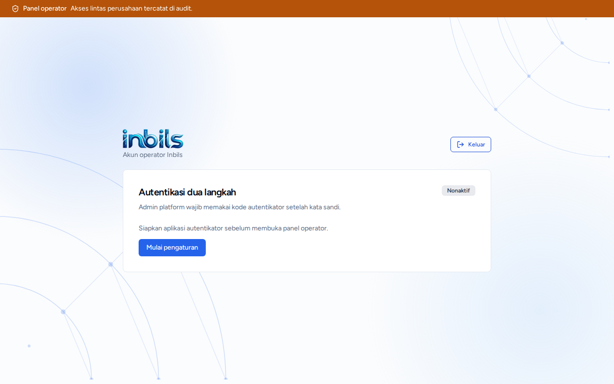

3. Pindai kode QR dengan aplikasi autentikator. Bila pemindaian gagal, masukkan kunci pengaturan yang tampil di bawah QR.
4. Isi **Kode autentikasi** dengan kode 6 digit dari aplikasi, lalu klik **Konfirmasi dan aktifkan**.
5. Bila kode benar, halaman menampilkan **Kode pemulihan Anda**. Ada 8 kode. Setiap kode hanya dapat dipakai sekali dan tidak ditampilkan lagi setelah halaman ditinggalkan.
6. Klik **Salin** atau **Unduh sebagai teks**. Unduhan bernama `kode-pemulihan-platform-inbils.txt`.
7. Simpan kode di pengelola kata sandi atau tempat aman lain. Klik **Saya sudah menyimpan kode ini** untuk membuka **Dasbor**.

Akun autentikator memakai nama aplikasi dengan akhiran `Platform` dan email operator sebagai nama akun. Kode berubah setiap 30 detik. Kode yang dipakai untuk menyelesaikan pendaftaran langsung dihitung sebagai sudah dipakai dan tidak dapat digunakan lagi pada login berikutnya.

Kode QR hanya tampil sekali. Bila halaman ditutup sebelum konfirmasi, lencana menjadi **Belum selesai**. Alert **Pengaturan belum selesai** menulis "Kode QR hanya tampil sekali. Mulai lagi untuk mendapat kode baru." Klik **Mulai lagi**.

Sebelum 2FA aktif, operator hanya dapat membuka halaman pengaturan 2FA dan keluar. Rute panel lain mengembalikan operator ke halaman ini.

### Kesalahan umum

- Pesan "Kode autentikasi dua langkah tidak valid." berarti kode salah, sudah dipakai, atau tidak lagi berada dalam jendela waktunya. Pakai kode terbaru dan periksa jam perangkat.
- Pendaftaran selesai, tetapi kode yang sama ditolak saat login berikutnya: tunggu aplikasi menampilkan kode berikutnya. Inbils menolak pemakaian ulang satu kode.
- Halaman menampilkan **Pengaturan belum selesai**: klik **Mulai lagi**. Kode QR lama tidak dapat ditampilkan ulang.
- QR tidak bisa dipindai: masukkan kunci pengaturan yang tampil di bawah QR secara manual.

## 2.3 Masuk berikutnya

Peran yang dapat memakai: operator dengan 2FA aktif.

1. Isi **Email** dan **Kata sandi** di halaman **Masuk ke panel operator**, lalu klik **Masuk**.
2. Di halaman **Autentikasi dua langkah**, isi **Kode autentikasi** dengan kode 6 digit, lalu klik **Masuk**.
3. Bila aplikasi autentikator tidak tersedia, klik **Pakai kode pemulihan**. Isi **Kode pemulihan**, lalu klik **Masuk**.
4. Klik **Pakai kode autentikasi** untuk kembali ke kode 6 digit. Klik **Kembali ke halaman masuk** untuk membatalkan login.

Login yang menunggu kode berlaku 10 menit sejak kata sandi diterima. Setelah itu Inbils mengembalikan operator ke halaman masuk. Setiap sesi browser harus melewati tantangannya sendiri. Login di browser kedua tidak memakai verifikasi dari browser pertama.

Inbils menerima kode TOTP pada langkah waktu sekarang, satu langkah sebelum, atau satu langkah sesudah untuk menoleransi perbedaan jam perangkat. Guard anti-replay tetap menolak langkah yang sudah dipakai.

### Batas percobaan

- Lima kegagalan dalam satu menit untuk satu email dan alamat IP menahan login dari pasangan itu.
- Dua puluh kegagalan dalam satu jam untuk satu email menahan akun itu dari semua alamat.
- Dua puluh kegagalan dalam satu menit dari satu alamat IP menahan alamat itu, meski email yang dicoba berubah.
- Tantangan 2FA menerima paling banyak 5 percobaan per menit untuk satu operator dan alamat, serta 10 percobaan per 15 menit untuk operator itu dari semua alamat.

Saat dibatasi, Inbils menulis "Terlalu banyak percobaan masuk. Coba lagi dalam N detik." Kode atau kata sandi yang benar tetap ditolak sampai waktu tunggu habis. Akun operator nonaktif memakai pesan kredensial salah yang sama agar orang lain tidak dapat menebak status akun.

## 2.4 Mengelola kode pemulihan

Peran yang dapat memakai: operator untuk akunnya sendiri.

1. Klik menu operator di kanan atas, lalu **Autentikasi dua langkah**.
2. Alert **Autentikasi dua langkah aktif** menampilkan **Sisa kode pemulihan**.

   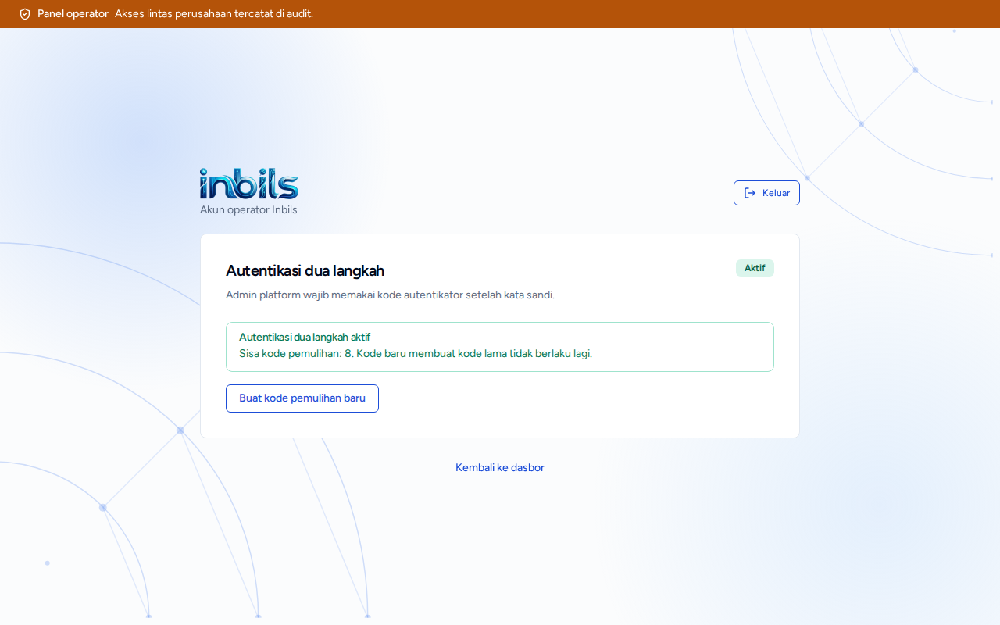

3. Klik **Buat kode pemulihan baru** bila kode tersisa sedikit atau salinannya tidak lagi aman.
4. Dialog **Buat kode pemulihan baru?** menulis bahwa kode lama langsung tidak berlaku. Isi **Kata sandi operator**, lalu klik **Buat kode baru**.
5. Simpan 8 kode baru sebelum meninggalkan halaman.

Kode pemulihan yang dipakai tercatat di **Audit platform** sebagai **Kode pemulihan dipakai**. Pembuatan ulang kode tercatat sebagai **Kode pemulihan dibuat ulang**.

Panel operator tidak mempunyai tombol mematikan 2FA. Reset 2FA pada halaman perusahaan hanya berlaku untuk pengguna tenant, bukan operator.

## 2.5 Konfirmasi kata sandi untuk tindakan sensitif

Konfirmasi kata sandi platform terpisah dari konfirmasi kata sandi pengguna tenant. Konfirmasi berlaku 5 menit pada sesi operator.

Sebagian dialog meminta **Kata sandi operator** langsung. Untuk tindakan tanpa isian itu, misalnya **Mode ubah** pada banner dukungan, server membuka halaman **Konfirmasi kata sandi** bila konfirmasi terakhir sudah lewat 5 menit. Isi **Kata sandi**, lalu klik **Konfirmasi**. Inbils kembali ke halaman tenant yang sama. Klik **Mode ubah** lagi.

Kata sandi salah menampilkan "Kata sandi tidak sesuai." Lima kegagalan per operator dan alamat dalam satu menit menahan percobaan berikutnya. Kata sandi hanya dikirim di body request. Inbils tidak menyimpannya di URL, audit, properti Inertia, atau riwayat browser.

Ringkasan tindakan ada di bagian 13.1.

## 2.6 Sesi dan keluar

Sesi operator berakhir setelah 30 menit tanpa aktivitas. Request yang diterima selama **Akses dukungan** memperbarui aktivitas platform, tetapi sesi dukungan tetap mempunyai batas mutlak 30 menit sejak dimulai.

Bila sesi operator berakhir karena tidak aktif, Inbils membuka halaman masuk dengan pesan "Sesi Anda telah berakhir. Silakan masuk kembali." dan mencatat **Sesi operator berakhir**. Akun operator yang dinonaktifkan juga dikeluarkan dengan pesan yang sama, tetapi tanpa baris audit.

Untuk keluar, klik menu operator, lalu **Keluar**. Bila **Akses dukungan** sedang aktif, logout operator juga mengakhiri akses itu.

# 3. Dasbor dan daftar perusahaan

## 3.1 Membaca ringkasan dasbor

Peran yang dapat memakai: semua operator platform.

Dasbor adalah halaman pertama setelah login. Empat kartu di atas merangkum tenant paling atas:

- **Perusahaan aktif**: tenant aktif tanpa pengajuan hapus;
- **Ditangguhkan**: tenant nonaktif tanpa pengajuan hapus;
- **Pengajuan hapus**: tenant yang sudah mengajukan penghapusan;
- **Job gagal tanpa perusahaan**: job gagal dalam 7 hari terakhir yang tidak membawa id perusahaan.

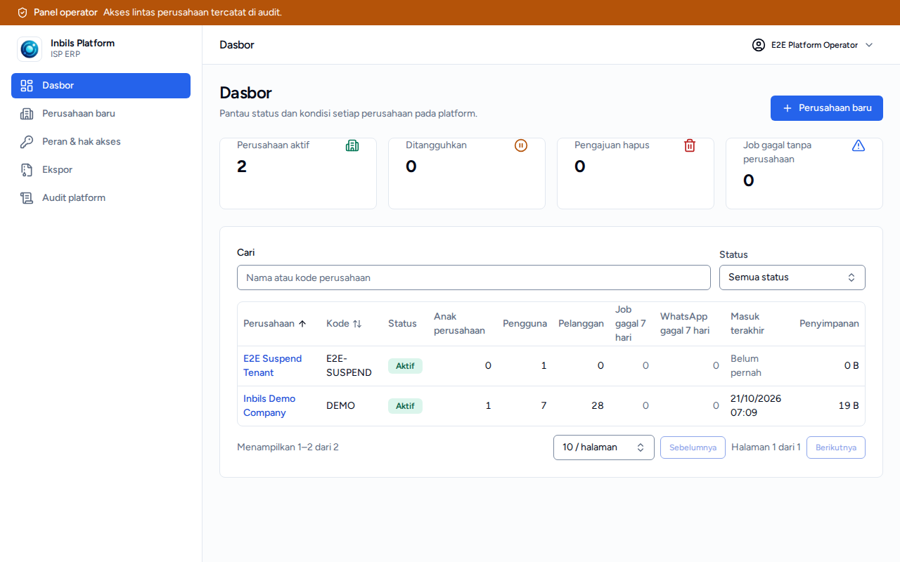

Bila ada job gagal tanpa perusahaan, alert kuning menjelaskan bahwa job itu tidak masuk ke baris perusahaan mana pun. Tim server perlu membaca `failed_jobs` dan log aplikasi untuk menemukan asalnya.

## 3.2 Mencari dan membaca perusahaan

Filter di atas tabel:

- **Cari** mencari nama atau kode perusahaan, paling banyak 100 karakter;
- **Status** memilih **Semua status**, **Aktif**, **Ditangguhkan**, atau **Pengajuan hapus**.

Klik judul **Perusahaan** atau **Kode** untuk mengurutkan. Tabel memuat:

| Kolom | Arti |
| --- | --- |
| **Perusahaan** | Nama perusahaan induk. Klik untuk membuka halaman tenant. |
| **Kode** | Kode tetap tenant. Dua kode yang hanya berbeda huruf besar-kecil tidak bisa dipakai bersama; saat konfirmasi, kode harus diketik persis. |
| **Status** | **Aktif**, **Ditangguhkan**, atau **Pengajuan hapus**. |
| **Anak perusahaan** | Jumlah anak perusahaan, aktif maupun nonaktif. |
| **Pengguna** | Jumlah pengguna pada induk dan anak perusahaan. |
| **Pelanggan** | Jumlah pelanggan yang tidak dihapus pada seluruh tenant. |
| **Job gagal 7 hari** | Job gagal yang membawa id salah satu perusahaan tenant. |
| **WhatsApp gagal 7 hari** | Pesan WhatsApp berstatus gagal selama 7 hari terakhir. |
| **Masuk terakhir** | Login pengguna tenant terbaru pada induk atau anak perusahaan. |
| **Penyimpanan** | Total ukuran media yang mempunyai metadata perusahaan. |

Angka **Penyimpanan** dapat lebih rendah daripada ukuran folder sebenarnya bila berkas lama tidak mempunyai metadata `company_id`. Gunakan angka ini sebagai ukuran data media yang tercatat, bukan pemeriksaan disk server.

Klik **Reset filter** pada keadaan kosong untuk menghapus pencarian dan status. Klik **Perusahaan baru** di kanan atas atau sidebar untuk membuat tenant.

### Kesalahan umum

- Perusahaan tidak ditemukan: hapus filter **Status**, periksa ejaan kode, lalu klik **Reset filter**.
- Anak perusahaan tidak tampil sebagai baris sendiri: halaman ini memang hanya menampilkan perusahaan induk. Angkanya digabung ke induk.
- Jumlah job gagal berbeda dari halaman server: panel hanya menghitung 7 hari terakhir dan hanya job yang membawa `companyId`.
- Angka penyimpanan tampak kecil: media lama mungkin belum mempunyai metadata perusahaan.

# 4. Membuat perusahaan

## 4.1 Mengisi data perusahaan dan admin pertama

Peran yang dapat memakai: semua operator platform.

1. Klik **Perusahaan baru**.
2. Pada kartu **Data perusahaan**, isi:
   - **Nama perusahaan**, wajib, paling banyak 255 karakter;
   - **Kode perusahaan**, wajib, unik, paling banyak 50 karakter. Gunakan huruf, angka, strip, atau garis bawah. Karakter pertama harus huruf atau angka. Kode yang hanya berbeda huruf besar-kecil dengan kode lain ditolak ("kode sudah digunakan.");
   - **Zona waktu**, wajib. Ketik untuk mencari, lalu pilih;
   - **Mata uang**, wajib: IDR, USD, SGD, atau EUR;
   - **Logo**, opsional, paling besar 10 MB. Gunakan JPG, PNG, atau WebP. Form juga menulis SVG, tetapi aturan server menolak SVG, jadi jangan memakainya.

   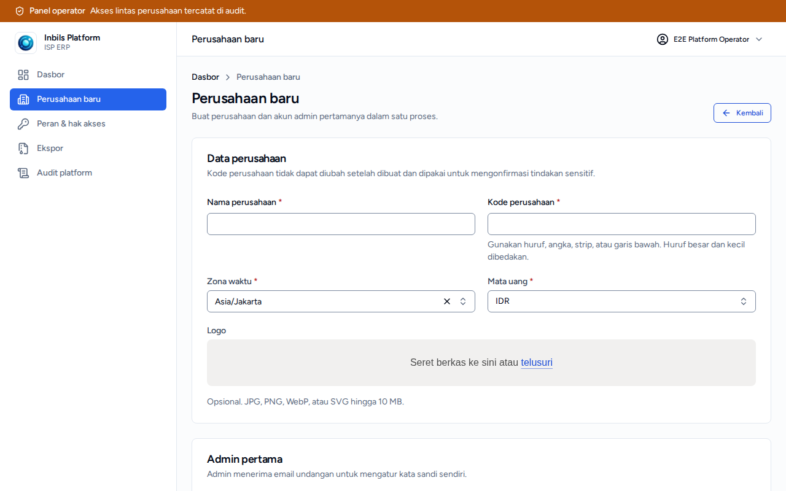

3. Kode perusahaan tidak dapat diubah setelah dibuat. Kode dipakai untuk mengonfirmasi penangguhan, ekspor, pengajuan hapus, dan mode ubah dukungan. Admin tenant juga hanya dapat membacanya di menu Perusahaan.
4. Logo diubah menjadi WebP dan diperkecil bila sisi terpanjang melebihi 512 piksel.
5. Pada kartu **Admin pertama**, isi **Nama admin** dan **Email admin**. Email harus valid, unik pada seluruh pengguna instalasi, dan paling banyak 255 karakter.

Inbils membuat akun admin dengan kata sandi acak 32 karakter yang tidak diketahui siapa pun. Email akun langsung dianggap terverifikasi. Admin masuk melalui tautan undangan untuk menetapkan kata sandinya sendiri.

## 4.2 Memilih isi awal

Pilih satu nilai pada **Isi awal**:

- **Katalog awal** adalah pilihan standar. Perusahaan mendapat satuan barang, kategori paket, kategori tiket, tiga tingkat SLA, struktur lokasi contoh, profil bandwidth dan kecepatan, delapan paket, serta kategori dan barang inventaris. Tidak ada stok dan tidak ada aset jaringan.
- **Kosong** hanya mengisi satuan barang, kategori paket, dan kategori tiket. Kategori tiket tetap dibuat karena pelanggan tidak dapat membuka tiket tanpa kategori.

Kartu **Data contoh** mempunyai kotak **Isi data contoh**. Gunakan hanya untuk uji coba atau pelatihan.

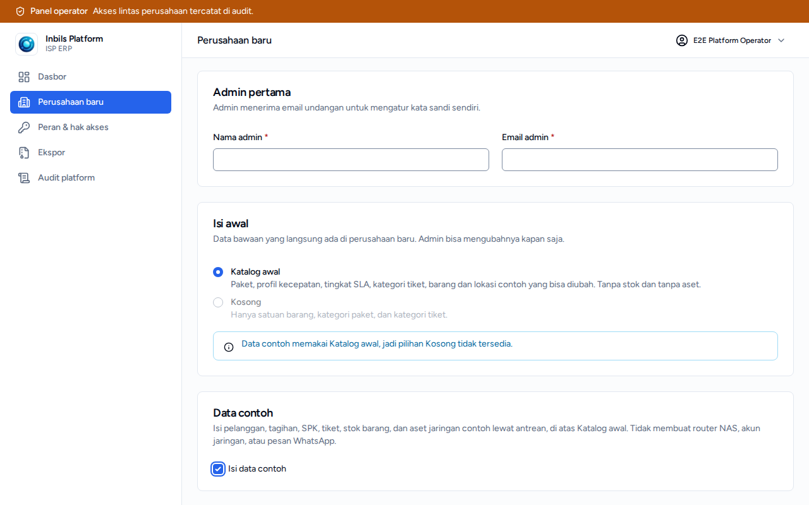

Bila **Isi data contoh** dicentang:

- Inbils memilih dan mengunci **Katalog awal**;
- alert menulis "Data contoh memakai Katalog awal, jadi pilihan Kosong tidak tersedia.";
- job antrean menambah pelanggan, tagihan, SPK, tiket, stok, aset jaringan, organisasi, karyawan, kendaraan, evaluasi, notifikasi, IPAM, dan ODN contoh;
- akun contoh memakai kata sandi acak yang tidak diberitahukan kepada siapa pun;
- data contoh tidak membuat router NAS, akun jaringan, atau pesan WhatsApp.

## 4.3 Membuat tenant dan mengirim undangan

1. Periksa kembali nama dan kode. Perubahan kode tidak tersedia setelah pembuatan.
2. Klik **Buat perusahaan**.
3. Bila berhasil, Inbils membuka halaman tenant dan menulis "Perusahaan dibuat. Undangan dikirim ke admin pertama."
4. Perusahaan langsung aktif. Inbils memberi admin pertama peran `admin`, keanggotaan bawaan, penomoran, dan pengaturan dasar.
5. Email undangan memakai subjek **Undangan admin {nama perusahaan} di Inbils** dan tombol **Atur kata sandi**. Tautan berlaku 60 menit.
6. Minta admin menetapkan kata sandi, lalu masuk melalui halaman web tenant.

Email yang membawa tautan kredensial selalu memakai mailer platform (`MAIL_*`), bukan SMTP milik perusahaan. Job data contoh memakai antrean `platform`. Tanpa worker `platform`, job tetap menunggu. Detail worker ada di bagian 11.2.

Kolom **Masuk terakhir** pada halaman tenant menunjukkan posisi undangan selama admin belum masuk:

- **Antre sejak {waktu}**: notifikasi menunggu antrean;
- **Terkirim {waktu}**: email terkirim dan tautan masih berlaku;
- **Tautan kedaluwarsa**: tautan melewati 60 menit;
- **Gagal terkirim {waktu}**: email gagal setelah seluruh percobaan;
- **Belum pernah**: pengguna belum pernah masuk dan tidak mempunyai status undangan.

### Kesalahan umum

- "Perusahaan belum dapat dibuat. Periksa isian yang ditandai.": baca pesan di bawah setiap isian.
- "kode sudah digunakan.": pilih kode lain. Kode unik pada seluruh perusahaan.
- "Format kode tidak valid.": pakai huruf, angka, strip, atau garis bawah, dan mulai dengan huruf atau angka.
- "email admin sudah digunakan.": akun dengan email itu sudah ada. Jangan membuat akun kedua untuk orang yang sama.
- "Data contoh butuh Katalog awal.": pilih **Katalog awal** atau matikan **Isi data contoh**.
- Logo SVG ditolak dengan "logo harus berupa gambar.": unggah JPG, PNG, atau WebP.
- Perusahaan dibuat tetapi data contoh tidak muncul: pastikan worker `platform` berjalan. Baca **Job gagal** dan **Audit terbaru** untuk kegagalan `tenant.demo_data_failed`.
- Email undangan tidak sampai: periksa status undangan, lalu pakai **Kirim ulang undangan** pada bagian 5.5.

# 5. Halaman perusahaan dan alat dukungan

## 5.1 Profil, ringkasan, dan status

Peran yang dapat memakai: semua operator platform.

Klik nama tenant pada Dasbor. Bagian atas halaman memuat:

- judul nama perusahaan dan subjudul **Kode {kode}**;
- lencana status dan tombol lifecycle;
- kartu **Profil perusahaan**;
- kartu **Ringkasan**;
- kartu **Status perusahaan**.

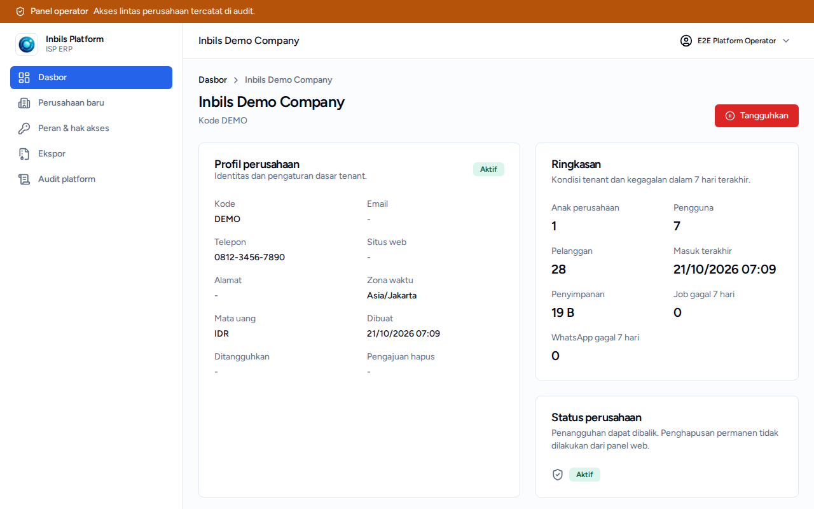

**Profil perusahaan** hanya dapat dibaca. Isinya: Kode, Email, Telepon, Situs web, Alamat, Zona waktu, Mata uang, Dibuat, Ditangguhkan, dan Pengajuan hapus. Admin tenant mengubah profil dan pengaturan operasional dari web perusahaan.

**Ringkasan** mengulang angka tenant dari dasbor: Anak perusahaan, Pengguna, Pelanggan, Masuk terakhir, Penyimpanan, Job gagal 7 hari, dan WhatsApp gagal 7 hari.

**Status perusahaan** menampilkan status sekarang dan, bila ada, daftar **Syarat pengajuan hapus**. Tindakan lifecycle dibahas pada bab 6.

## 5.2 Admin perusahaan dan integrasi

Kartu **Admin perusahaan** menampilkan paling banyak 25 pengguna berperan `admin`, diurutkan menurut nama. Kolomnya:

- **Admin**: nama dan email;
- **Perusahaan**: kode perusahaan asal;
- **Status**: aktif, nonaktif, dan lencana kunci masuk;
- **2FA**: **Aktif** atau **Nonaktif**;
- **Masuk terakhir**: waktu login atau status undangan.

Kartu **Integrasi** memuat Midtrans, WhatsApp, Email, dan RADIUS untuk induk serta setiap anak perusahaan. Kolomnya:

- **Perusahaan**;
- **Layanan**;
- **Status**: **Tidak diisi**, **Terisi**, **Terverifikasi**, atau **Galat**;
- **Aktif**: Ya atau Tidak;
- **Terakhir diuji**, atau **Belum pernah**.

Operator hanya melihat status dan waktu uji. Panel tidak mengirim isi kredensial atau rahasia ke browser operator. Admin setiap perusahaan mengisi dan menguji integrasinya sendiri di menu **Integrasi**. Lihat **Panduan Web Inbils bagian 8.9**.

## 5.3 Menambah anak perusahaan

Kartu **Anak perusahaan** menampilkan Nama dan Kode, Status, Mata uang, Zona waktu, serta jumlah Pengguna.

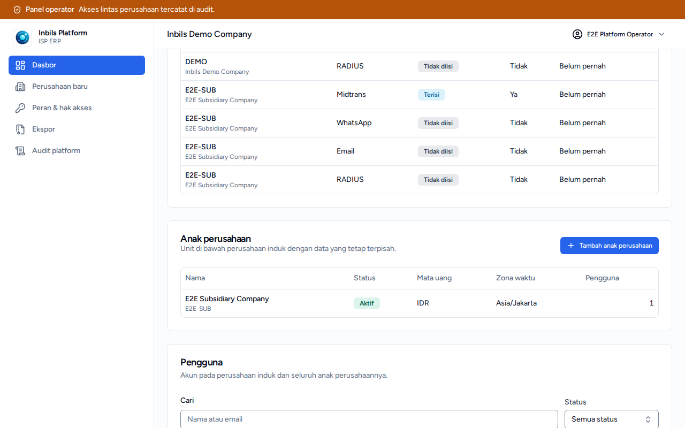

1. Pastikan perusahaan induk berstatus **Aktif**.
2. Klik **Tambah anak perusahaan**.
3. Isi **Nama** dan **Kode**. Aturan kode sama dengan perusahaan induk dan harus unik pada seluruh instalasi.
4. Di bagian **Akses admin**, centang admin yang boleh berpindah ke anak perusahaan baru. Daftar ini memakai admin yang tampil pada kartu **Admin perusahaan**.
5. Klik **Tambah anak perusahaan**.

Anak perusahaan mengikuti mata uang dan zona waktu induk. Inbils mengisi Katalog awal, bukan data contoh. Pengguna yang dicentang mendapat keanggotaan tanpa mengubah perusahaan asalnya.

Seeder membuat akun internal `system-seed-...@inbils.internal` bila anak perusahaan belum mempunyai pengguna asal saat katalog diisi. Akun itu memakai kata sandi acak dan dapat terlihat di tabel **Pengguna**. Akun tersebut bukan operator platform.

### Kesalahan umum

- Tombol nonaktif dan teks menulis "Aktifkan kembali perusahaan sebelum menambah anak perusahaan.": aktifkan kembali tenant lebih dulu.
- "Perusahaan sedang ditangguhkan: aktifkan kembali sebelum menambah anak perusahaan.": status berubah setelah halaman dibuka. Muat ulang, lalu aktifkan kembali.
- Admin yang dicari tidak ada: kartu **Admin perusahaan** hanya menampilkan 25 admin pertama. Gunakan perintah membership pada bagian 11.1 bila perlu penanganan server.

## 5.4 Membaca tabel pengguna

Kartu **Pengguna** menggabungkan akun pada perusahaan induk dan semua anak perusahaan. Gunakan **Cari** untuk nama atau email dan **Status** untuk **Aktif** atau **Nonaktif**.

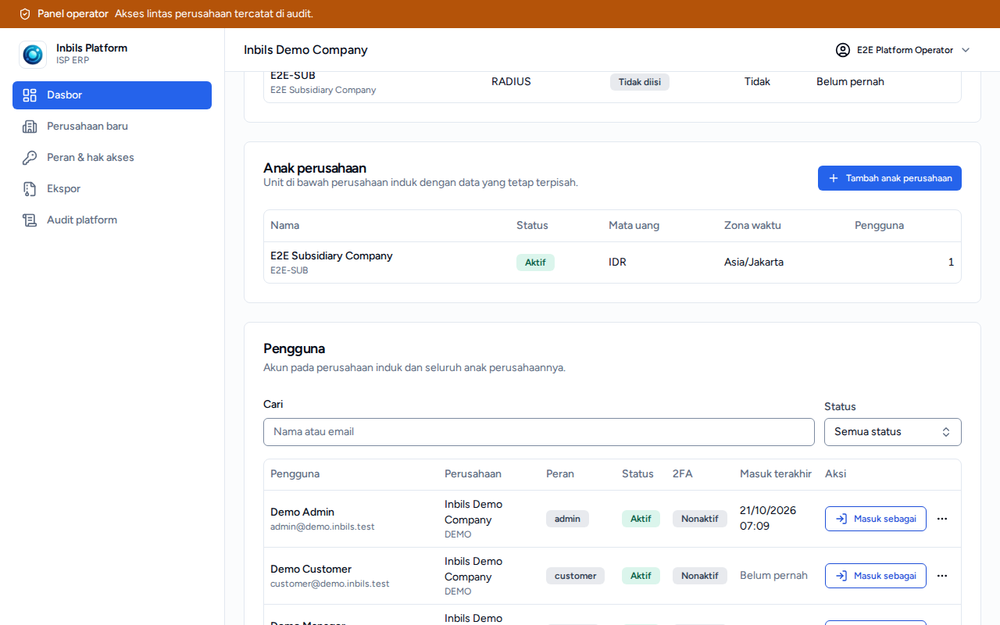

Kolom:

| Kolom | Arti |
| --- | --- |
| **Pengguna** | Nama dan email. |
| **Perusahaan** | Perusahaan asal pengguna. |
| **Peran** | Peran global yang dipegang akun itu. |
| **Status** | Aktif atau Nonaktif, ditambah kunci masuk bila ada. |
| **2FA** | Aktif atau Nonaktif. |
| **Masuk terakhir** | Waktu login terakhir atau status undangan. |
| **Aksi** | **Masuk sebagai** dan menu **Aksi lain**. |

Lencana kunci menulis **Terkunci N mnt** atau **Terkunci < 1 mnt**. Arahkan penunjuk ke lencana untuk membaca sebabnya: terlalu banyak kata sandi salah atau terlalu banyak kode 2FA salah. Menit dibulatkan ke atas.

**Masuk sebagai** hanya tampil untuk pengguna aktif yang dapat masuk ke perusahaan aktif dalam tenant itu. Izin pengguna tetap berlaku selama akses. Operator tidak mendapat izin tambahan.

## 5.5 Membuka kunci masuk

1. Pada baris pengguna, buka **Aksi lain**.
2. Klik **Buka kunci masuk**.
3. Dialog menjelaskan bahwa kunci karena kata sandi salah dan kode 2FA salah akan dihapus.
4. Klik **Buka kunci masuk**. Tindakan ini tidak meminta kata sandi operator.

Inbils membersihkan budget login untuk setiap alamat yang tercatat gagal pada pengguna itu selama 15 menit terakhir dan budget 2FA tingkat akun. Budget alamat yang tidak cocok dengan akun mana pun tetap ada. Pengguna lain pada alamat yang sama tidak ikut terbuka.

Toast berhasil menulis "Kunci masuk pengguna dibuka." Tindakan tercatat sebagai **Kunci masuk dibuka** pada audit platform dan sebagai tindakan tim dukungan pada Log Audit perusahaan.

## 5.6 Mengatur ulang 2FA pengguna

**Atur ulang 2FA** hanya tampil bila pengguna mempunyai 2FA.

1. Buka **Aksi lain**, lalu klik **Atur ulang 2FA**.
2. Dialog menulis bahwa 2FA akan dimatikan, semua sesi masuk berakhir, dan pengguna harus mengaktifkannya lagi.
3. Isi **Kata sandi operator**.
4. Klik **Atur ulang 2FA**.

Inbils menghapus secret dan kode pemulihan pengguna, memutar token **Ingat saya**, menghapus sesi web pengguna pada deployment dengan sesi database, serta mencabut token aplikasi. Pengguna masuk lagi dengan kata sandi dan mendaftarkan 2FA sendiri.

Tindakan hanya berlaku untuk pengguna yang berasal dari tenant itu, bukan orang dari tenant lain yang sekadar mempunyai keanggotaan tambahan. 2FA berlaku untuk seluruh akun pengguna.

## 5.7 Mengirim ulang undangan

**Kirim ulang undangan** hanya tampil untuk admin aktif yang belum pernah masuk.

1. Buka **Aksi lain**, lalu klik **Kirim ulang undangan**.
2. Dialog menyebut alamat email tujuan dan batas 6 kali per menit untuk pengguna itu.
3. Klik **Kirim ulang undangan**. Tindakan ini tidak meminta kata sandi operator.

Inbils membuat tautan atur kata sandi baru dan mengirim email melalui mailer platform. Tautan berlaku 60 menit. Status **Masuk terakhir** kembali mengikuti posisi undangan terbaru.

Bila terlalu banyak permintaan, toast menulis "Terlalu banyak percobaan. Coba lagi dalam N detik." atau "Terlalu banyak percobaan. Coba lagi nanti."

## 5.8 Job gagal, WhatsApp gagal, dan audit terbaru

Halaman tenant menampilkan dua kartu kegagalan:

- **Job gagal**: Waktu, Job, Antrean, dan Galat;
- **WhatsApp gagal**: Waktu, Peristiwa, Template, Kode galat, Penerima, dan Perusahaan.

Tampilan awal berisi paling banyak 10 kegagalan selama 7 hari. Klik **Lihat 30 hari terakhir** untuk membuka daftar paginasi 30 hari. Tombol berubah menjadi **Kembali ke ringkasan**. Bila daftar gagal dimuat, klik **Coba lagi**.

Kartu **Audit terbaru** menampilkan 10 kegiatan terbaru pada induk dan anak perusahaan. Kolomnya Waktu, Kegiatan, Sumber, Pelaku, dan Alasan. Klik **Lihat semua audit** untuk membuka **Audit platform** dengan filter perusahaan itu.

### Kesalahan umum

- **Masuk sebagai** tidak tampil: pengguna atau tenant nonaktif, atau pengguna tidak mempunyai perusahaan aktif yang dapat dimasuki dalam tenant itu.
- **Atur ulang 2FA** tidak tampil: 2FA pengguna belum aktif.
- **Kirim ulang undangan** tidak tampil: pengguna bukan admin aktif, atau sudah pernah masuk.
- "Undangan hanya dapat dikirim kepada admin aktif yang belum pernah masuk.": data berubah setelah halaman dibuka. Muat ulang.
- Daftar 30 hari menampilkan galat: periksa koneksi, lalu klik **Coba lagi**.

# 6. Menangguhkan, mengaktifkan, dan menghapus perusahaan

## 6.1 Menangguhkan tenant

Peran yang dapat memakai: semua operator platform.

1. Buka halaman tenant aktif.
2. Klik **Tangguhkan**.
3. Isi **Alasan**, 5 sampai 200 karakter.
4. Isi **Ketik {kode} untuk melanjutkan** dengan kode induk yang sama persis.
5. Isi **Kata sandi operator**.
6. Klik **Tangguhkan perusahaan**.

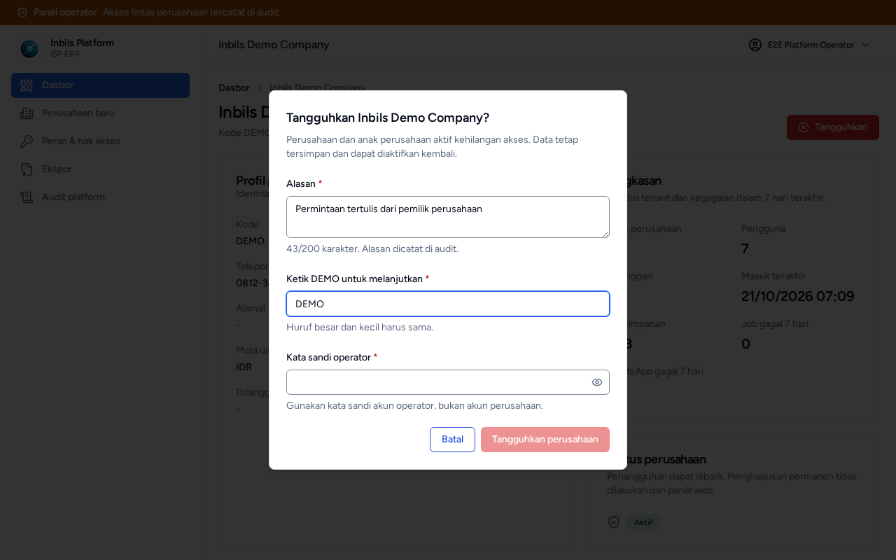

Penangguhan menonaktifkan perusahaan induk dan anak perusahaan yang saat itu aktif. Anak perusahaan yang sudah nonaktif tetap nonaktif. Data tidak dihapus.

Pengguna yang kehilangan seluruh perusahaan aktif dikeluarkan pada request berikutnya dan melihat "Akun perusahaan Anda sedang ditangguhkan. Hubungi dukungan." Token aplikasi pengguna yang tidak lagi mempunyai perusahaan aktif dicabut. Pengguna dengan keanggotaan di perusahaan aktif lain berpindah ke perusahaan itu.

Inbils mencatat alasan pada audit platform dan audit dukungan setiap perusahaan yang terkena.

## 6.2 Mengaktifkan kembali

1. Buka tenant berstatus **Ditangguhkan** atau **Pengajuan hapus**.
2. Klik **Aktifkan kembali**.
3. Isi **Alasan**, lalu klik **Aktifkan kembali**.

Reaktivasi tidak meminta kata sandi operator atau kode perusahaan. Inbils mengaktifkan induk dan anak perusahaan yang mempunyai waktu penangguhan. Anak perusahaan yang sudah nonaktif sebelum penangguhan tetap nonaktif. Pengajuan hapus yang masih ada dibatalkan.

Toast menulis "Perusahaan diaktifkan kembali."

## 6.3 Mengajukan penghapusan

Tombol **Ajukan hapus** muncul pada tenant nonaktif. Tombol tetap nonaktif sampai semua syarat terpenuhi:

1. tenant sudah ditangguhkan selama 30 hari;
2. ada ekspor berstatus **Siap diunduh** atau **Kedaluwarsa** yang selesai setelah penangguhan terakhir;
3. belum ada pengajuan hapus.

Daftar **Syarat pengajuan hapus** menampilkan semua syarat yang belum terpenuhi beserta waktu UTC saat masa 30 hari selesai.

Setelah syarat terpenuhi:

1. Klik **Ajukan hapus**.
2. Ketik kode perusahaan dengan besar-kecil huruf yang sama.
3. Isi **Kata sandi operator**.
4. Klik **Ajukan hapus**.

Panel hanya mencatat pengajuan. Toast menulis "Pengajuan hapus dicatat. Tidak ada data yang dihapus." Status berubah menjadi **Pengajuan hapus**. Aktifkan kembali tenant untuk membatalkan pengajuan.

## 6.4 Menghapus permanen dari konsol

Peran yang dapat memakai: tim server dengan akses terminal.

Panel web tidak mempunyai tombol hapus permanen. Jalankan:

```bash
php artisan inbils:platform:purge-company {kode}
```

Perintah menolak bila:

- kode bukan kode induk yang sama persis;
- tenant atau satu anak perusahaan masih aktif;
- penangguhan belum 30 hari;
- pengajuan hapus belum dibuat;
- tidak ada ekspor selesai setelah penangguhan;
- pengguna asal tenant masih menjadi anggota perusahaan di luar tenant;
- terminal tidak interaktif.

Perintah menampilkan id perusahaan, jumlah pengguna, jumlah media, dan jumlah baris per tabel. Baca rencana itu, lalu ketik ulang kode perusahaan. Tidak ada opsi melewati pertanyaan.

Database dihapus dalam satu transaksi. Kegagalan database membatalkan seluruh perubahan. Setelah commit, perintah menghapus folder media dan arsip ekspor. Bila berkas tidak dapat dihapus, terminal mencantumkan `disk:path` yang harus dibersihkan manual.

Audit platform tenant tetap tersimpan. Link perusahaan dilepas, lalu kode dan nama tenant disalin ke properti audit. Audit dukungan milik tenant ikut terhapus bersama data tenant. Tidak ada undo. Pemulihan hanya dari backup.

Lihat `docs/operations/tenant-purge.md` sebelum menjalankan perintah pada produksi.

### Kesalahan umum

- "Kode perusahaan yang diketik tidak sesuai.": samakan huruf besar dan kecil dengan kode pada profil.
- "Perusahaan ini sudah ditangguhkan." atau "Perusahaan ini sudah aktif.": status berubah setelah halaman dibuka. Muat ulang.
- "Perusahaan belum ditangguhkan.": tangguhkan tenant sebelum menunggu masa hapus.
- "Pengajuan hapus baru boleh setelah 30 hari ditangguhkan": tunggu tanggal UTC yang ditulis pada syarat.
- "Belum ada ekspor data yang selesai setelah penangguhan.": minta ekspor baru setelah waktu penangguhan.
- "Pengajuan hapus sudah dibuat": aktifkan kembali bila pengajuan harus dibatalkan.

# 7. Akses dukungan

## 7.1 Memulai akses sebagai pengguna

Peran yang dapat memakai: semua operator platform. Target harus pengguna aktif dalam tenant aktif.

Akses dukungan membuka web tenant persis seperti pengguna target. Kebijakan dan izin tetap milik pengguna itu.

1. Buka halaman tenant, lalu bagian **Pengguna**.
2. Klik **Masuk sebagai** pada pengguna yang akan dibantu.
3. Dialog **Masuk sebagai {nama}?** terbuka. Isi **Alasan**, 5 sampai 200 karakter.
4. Isi **Kata sandi operator**.
5. Klik **Mulai akses dukungan**.

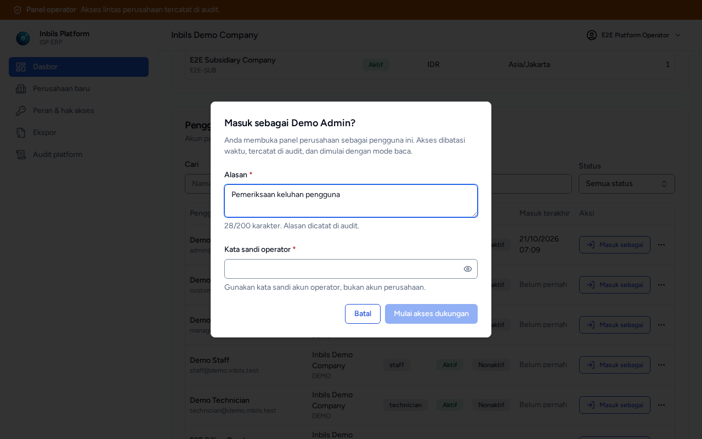

Inbils membuka dasbor tenant dan memulai sesi dalam mode baca. Login diam-diam ini tidak mengubah **Masuk terakhir** atau token **Ingat saya** milik target.

## 7.2 Membaca banner dan batas waktu

Banner **Akses dukungan** tampil di atas semua halaman tenant:

"Anda masuk sebagai {pengguna} ({perusahaan}) · superadmin {operator} · mode Baca · sisa mm:ss"

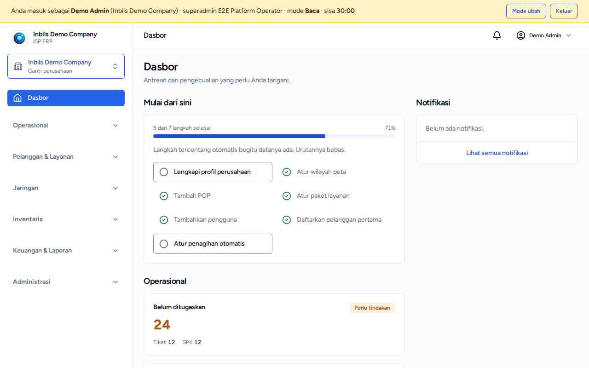

Sesi berlaku paling lama 30 menit sejak dimulai dan tidak dapat diperpanjang. Hitung mundur browser hanya indikator. Server memeriksa waktu pada setiap request. Sesi juga berakhir bila:

- operator klik **Keluar** pada banner;
- target logout dari web;
- sesi platform berakhir;
- akun operator atau target dinonaktifkan;
- tenant ditangguhkan;
- target tidak lagi mempunyai perusahaan aktif dalam tenant.

Bila batas 30 menit habis dan sesi platform masih aktif, Inbils kembali ke halaman tenant pada panel operator.

## 7.3 Mode baca dan mode ubah

Mode awal adalah **Baca**. GET dan HEAD tetap berjalan. Perpindahan perusahaan dalam induk dan anak perusahaan tenant yang sama tetap boleh. Setiap perubahan lain ditolak dengan:

"Mode baca saja: perubahan tidak diizinkan selama akses dukungan. Aktifkan mode ubah dari banner untuk melanjutkan."

Untuk mengubah data:

1. Klik **Mode ubah** pada banner.
2. Dialog **Aktifkan mode ubah** menjelaskan bahwa perubahan memengaruhi data nyata dan tercatat di audit.
3. Isi **Ketik {kode} untuk melanjutkan** dengan kode perusahaan induk.

   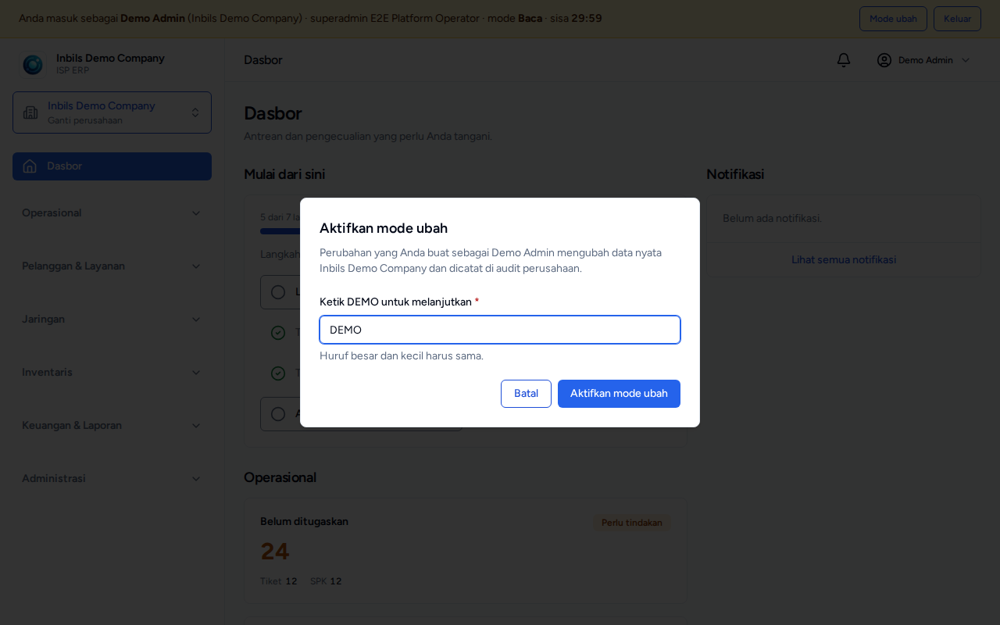

4. Klik **Aktifkan mode ubah**.
5. Bila konfirmasi kata sandi platform sudah lewat 5 menit, Inbils membuka **Konfirmasi kata sandi**. Setelah berhasil, Inbils kembali ke halaman tenant. Klik **Mode ubah** dan ketik kode lagi.
6. Banner berubah menjadi **mode Ubah**. Klik **Mode baca** untuk kembali ke mode aman.

Setiap request perubahan pada mode Ubah mencatat rute, metode HTTP, path, dan status respons sebagai **Perubahan saat akses dukungan**.

## 7.4 Tindakan yang tetap dilarang

Mode Ubah tidak melewati izin target. Bila target tidak berhak mengubah sesuatu, operator juga tidak berhak.

Tindakan berikut selalu ditolak dalam mode Baca maupun Ubah:

- profil, email, kata sandi, 2FA, dan verifikasi akun target;
- melihat rahasia akun jaringan pelanggan;
- mengubah, menghapus, atau mereset 2FA pengguna target dari menu **Pengguna**;
- membuat atau mengubah pengguna sambil menetapkan kata sandi login;
- berpindah ke perusahaan di luar tenant;

Penolakan pengaturan pribadi menulis "Pengaturan akun pribadi tidak tersedia selama akses dukungan." Perpindahan keluar tenant menulis "Perpindahan ke perusahaan di luar tenant tidak diizinkan selama akses dukungan."

## 7.5 Audit dan visibilitas perusahaan

Satu sesi memakai satu kode kelompok (`batch_uuid`). Audit platform mencatat:

- **Akses dukungan dimulai**;
- **Mode akses diubah**;
- **Perubahan saat akses dukungan** untuk setiap perubahan;
- **Akses dukungan berakhir**, alasan berakhir, dan durasi.

Tenant melihat baris modul **Akses dukungan** di **Log Audit**. Nama dan email operator tidak ditampilkan. Deskripsi memakai kalimat seperti:

- "Tim dukungan Inbils masuk sebagai Budi Santoso";
- "Tim dukungan Inbils mengubah mode akses saat masuk sebagai Budi Santoso";
- "Tim dukungan Inbils mengubah data saat masuk sebagai Budi Santoso";
- "Tim dukungan Inbils keluar dari akun Budi Santoso".

Lihat **Panduan Web Inbils bagian 7.12** untuk tampilan tenant.

### Kesalahan umum

- **Masuk sebagai** tidak tampil: target atau tenant nonaktif, atau target tidak mempunyai perusahaan aktif dalam tenant.
- "Akhiri sesi pengguna yang sedang aktif sebelum memulai akses dukungan.": browser mempunyai login web biasa atau sesi dukungan lain. Keluar dari sesi itu, lalu ulangi.
- "Perusahaan sedang ditangguhkan.": aktifkan kembali tenant bila dukungan masih diperlukan.
- "Pengguna tidak aktif.": aktifkan pengguna dari web tenant dengan akun yang berwenang, bukan melalui operator.
- "Kode perusahaan yang diketik tidak sesuai.": pakai kode induk yang tampil pada halaman tenant.
- Banner habis dan halaman kembali ke panel: batas 30 menit tercapai. Mulai sesi baru dengan alasan baru bila masih perlu.

# 8. Peran dan hak akses

## 8.1 Membaca daftar peran

Peran yang dapat memakai: semua operator platform.

Klik **Peran & hak akses**. Definisi peran saat ini bersifat global dan berlaku kepada pengguna di semua perusahaan.

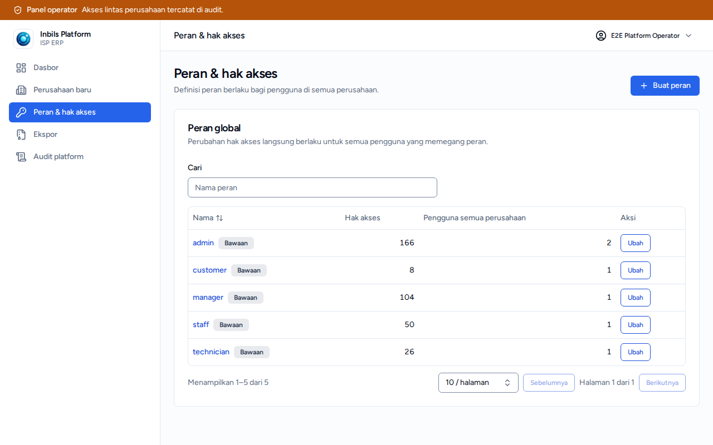

Kartu **Peran global** memuat:

- **Cari**, dengan petunjuk **Nama peran**;
- kolom **Nama**, **Hak akses**, **Pengguna semua perusahaan**, dan **Aksi**;
- lencana **Bawaan** pada `admin`, `manager`, `staff`, `technician`, dan `customer`;
- tombol **Ubah** pada semua peran;
- tombol **Hapus** hanya pada peran selain lima peran bawaan;
- tombol **Buat peran**.

Jumlah pengguna menghitung pemegang peran pada seluruh perusahaan, bukan tenant yang sedang dipilih. Panel platform tidak mempunyai pemilih perusahaan pada halaman ini.

## 8.2 Membuat peran

1. Klik **Buat peran**.
2. Isi **Nama**. Nama wajib, unik pada guard web, dan paling banyak 255 karakter.
3. Gunakan **Cari hak akses** untuk mencari kode atau label izin.
4. Klik nama kategori di kiri untuk membuka hak akses kategori itu.
5. Centang kotak kategori untuk memilih atau mengosongkan semua izin yang sedang tampil pada kategori itu. Lencana menunjukkan jumlah terpilih dibanding jumlah izin.
6. Klik **Buat peran**.
7. Dialog **Konfirmasi perubahan peran** terbuka. Isi **Kata sandi operator**, lalu klik **Buat peran**.

Toast menulis "Peran dibuat." Audit platform menyimpan nama dan daftar hak akses sesudah pembuatan.

## 8.3 Mengubah peran dan peran bawaan

Klik nama peran atau **Ubah**. Halaman menampilkan jumlah pengguna di semua perusahaan yang memegang peran itu.

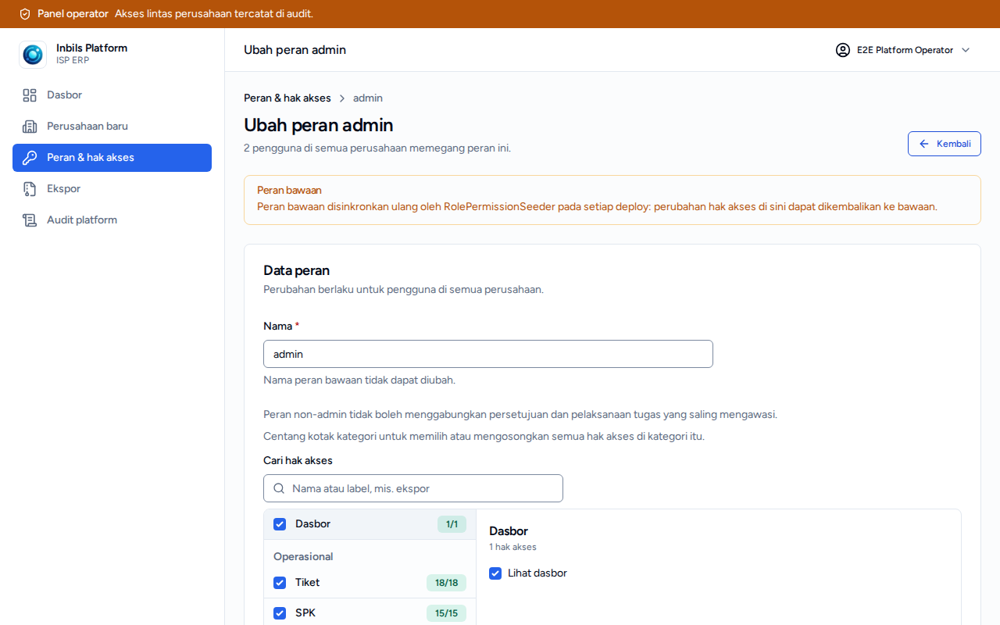

Pada peran biasa, operator dapat mengubah nama dan izin. Pada peran bawaan:

- isian **Nama** hanya dapat dibaca;
- alert **Peran bawaan** menulis bahwa `RolePermissionSeeder` menyinkronkan ulang izin pada setiap deploy;
- operator dapat mengubah izin, tetapi deploy berikutnya dapat mengembalikannya ke bawaan.

Gunakan peran baru untuk perubahan izin yang harus bertahan lintas deploy. Simpan melalui **Simpan peran**, lalu konfirmasi dengan kata sandi operator. Toast menulis "Peran diperbarui."

Perubahan izin langsung memengaruhi setiap pengguna yang memegang peran itu di semua perusahaan.

## 8.4 Pemisahan tugas

Peran selain `admin` tidak boleh menggabungkan hak persetujuan dengan hak pelaksanaan yang saling mengawasi. Form menolak kombinasi seperti:

- menyetujui atau menolak permintaan barang bersama menyiapkan, menyerahkan, menerima, mengeluarkan, atau memindahkan stok;
- menyetujui penyesuaian stok bersama mengajukan penyesuaian, menerima, mengeluarkan, atau memindahkan stok.

Pesan diawali "Pemisahan tugas (...)" dan menyebut izin yang berbenturan. Izin darurat `inventory.stock.adjust` hanya boleh diberikan ke peran administrator; peran lain ditolak dengan "Hanya administrator yang boleh memberikan hak akses darurat inventory.stock.adjust." Peran bawaan `admin` dikecualikan sebagai akses break-glass. Daftar lengkap ada di **Panduan Web Inbils bagian 10.1**.

## 8.5 Menghapus peran

1. Pada peran selain bawaan, klik **Hapus**.
2. Dialog **Hapus peran {nama}?** menampilkan jumlah pengguna yang memegangnya dan menjelaskan bahwa mereka kehilangan hak akses dari peran itu.
3. Isi **Kata sandi operator**.
4. Klik **Hapus peran**.

Toast menulis "Peran dihapus." Inbils mencabut hubungan peran dari seluruh pengguna. Peran bawaan tidak mempunyai tombol **Hapus** dan server menolaknya dengan "Peran bawaan tidak dapat dihapus."

### Kesalahan umum

- "Nama peran bawaan tidak dapat diubah.": kembalikan nama bawaan.
- "Peran bawaan tidak dapat dihapus.": buat peran baru bila perlu susunan izin lain.
- Alert **Peran belum dapat disimpan**: periksa nama unik dan kombinasi izin yang ditandai.
- Izin peran bawaan kembali setelah deploy: seeder memang menyinkronkannya ulang.
- Pengguna kehilangan akses setelah peran dihapus: berikan peran lain melalui menu **Pengguna** pada web tenant.

# 9. Ekspor data perusahaan

## 9.1 Meminta ekspor

Peran yang dapat memakai: semua operator platform.

1. Buka halaman tenant.
2. Gulir ke kartu **Ekspor data**.
3. Klik **Minta ekspor**.
4. Dialog menjelaskan bahwa arsip dibuat di latar belakang, tersedia selama 24 jam, dan hanya satu ekspor boleh berjalan untuk satu perusahaan.
5. Ketik kode induk dan isi **Kata sandi operator**.
6. Klik **Minta ekspor**.

Toast menulis "Ekspor data dijadwalkan." Job berjalan pada antrean `platform`, satu job per tenant, satu percobaan, dengan timeout satu jam.

## 9.2 Memantau dan mengunduh

Klik **Ekspor** pada sidebar atau **Semua ekspor** pada kartu tenant.

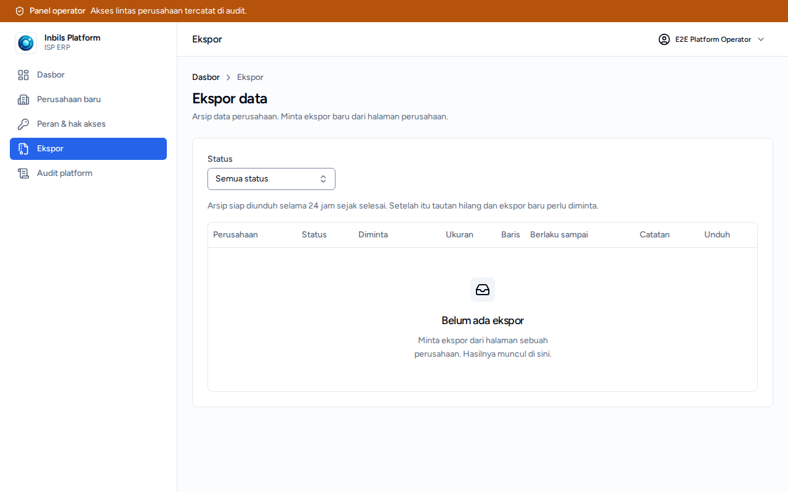

Status:

- **Antrean**: job belum diambil worker;
- **Berjalan**: builder sedang membuat CSV dan berkas;
- **Siap diunduh**: arsip selesai dan tombol **Unduh** tersedia;
- **Gagal**: kolom **Catatan** memuat kelas dan ringkasan galat;
- **Kedaluwarsa**: masa unduh lewat dan arsip sudah dihapus.

Tabel memuat **Perusahaan**, **Status**, **Diminta**, **Ukuran**, **Baris**, **Berlaku sampai**, **Catatan**, dan **Unduh**. **Diminta** menampilkan nama operator dan waktu. Gunakan filter **Status**. Bila halaman dibuka dari satu tenant, lencana filter perusahaan tampil bersama tombol **Tampilkan semua perusahaan**.

Halaman memuat ulang data setiap 5 detik selama baris yang terlihat masih **Antrean** atau **Berjalan**.

Klik **Unduh** pada ekspor **Siap diunduh**. URL bertanda tangan berlaku sampai **Berlaku sampai**, paling lama 24 jam sejak selesai, dan tetap memerlukan sesi operator aktif dengan 2FA. Nama berkas `{kode-lowercase}-tenant-export.zip`. Respons memakai `private, no-store`.

## 9.3 Isi arsip dan data yang dikecualikan

ZIP berisi:

- folder `data/` dengan satu CSV per tabel tenant;
- `companies.csv` untuk induk dan anak perusahaan;
- `media.csv` dan berkas media di `files/{disk}/companies/{id}/...`;
- `user_roles.csv`, karena definisi peran global tidak ikut ekspor;
- `manifest.json` dengan waktu pembuatan, perusahaan, jumlah baris, format CSV, jumlah media per disk, dan kolom yang dihilangkan.

CSV memakai UTF-8 BOM, koma sebagai delimiter, tanda kutip ganda, dan string kosong untuk nilai null.

Inbils tidak mengekspor:

- kata sandi dan hash kata sandi;
- secret TOTP, kode pemulihan, dan langkah TOTP terakhir;
- token, kunci API, kata sandi, dan kredensial integrasi lain (kolom `credentials`). Pengaturan integrasi yang bukan rahasia tetap ikut, misalnya host dan nama pengguna mail atau RADIUS;
- secret RADIUS, NAS, PPPoE, dan akun jaringan;
- token dan isi sensitif percobaan pembayaran;
- IP address dan user agent pada audit;
- baris audit internal `platform`.

Baris audit `support` tetap ikut karena perusahaan berhak menerima jejak dukungan. Berkas media tanpa file fisik tetap tercatat di `media.csv`, tetapi file yang hilang tidak dapat dimasukkan. Jalur media yang menunjuk ke luar folder tenant menggagalkan seluruh ekspor.

## 9.4 Masa berlaku dan pembersihan

Perintah `inbils:platform:exports:prune` berjalan setiap jam:

- ekspor **Siap diunduh** yang melewati masa berlaku menjadi **Kedaluwarsa** dan file ZIP dihapus;
- ekspor **Antrean** atau **Berjalan** yang lebih tua dari 2 jam menjadi **Gagal**.

Baris **Kedaluwarsa** tetap ada. Baris itu dapat menjadi bukti ekspor selesai setelah penangguhan untuk syarat pengajuan hapus.

### Kesalahan umum

- "Ekspor perusahaan ini masih diproses.": tunggu ekspor aktif selesai atau menjadi gagal. Hanya satu build berjalan per tenant.
- Status lama di **Antrean**: worker `platform` tidak berjalan. Periksa bagian 11.2.
- Status **Gagal**: baca **Catatan**, **Audit platform**, dan `failed_jobs`. Setelah penyebab diperbaiki, minta ekspor baru.
- Tombol **Unduh** hilang: ekspor belum siap atau sudah kedaluwarsa.
- Unduhan menjawab 403: URL kedaluwarsa atau tanda tangannya tidak valid. Unduhan menjawab 404: ekspor belum siap atau file fisiknya hilang. Minta ekspor baru.

# 10. Audit platform

## 10.1 Menyaring dan membaca audit

Peran yang dapat memakai: semua operator platform.

Klik **Audit platform**. Halaman memuat kegiatan operator dan akses dukungan pada seluruh tenant.

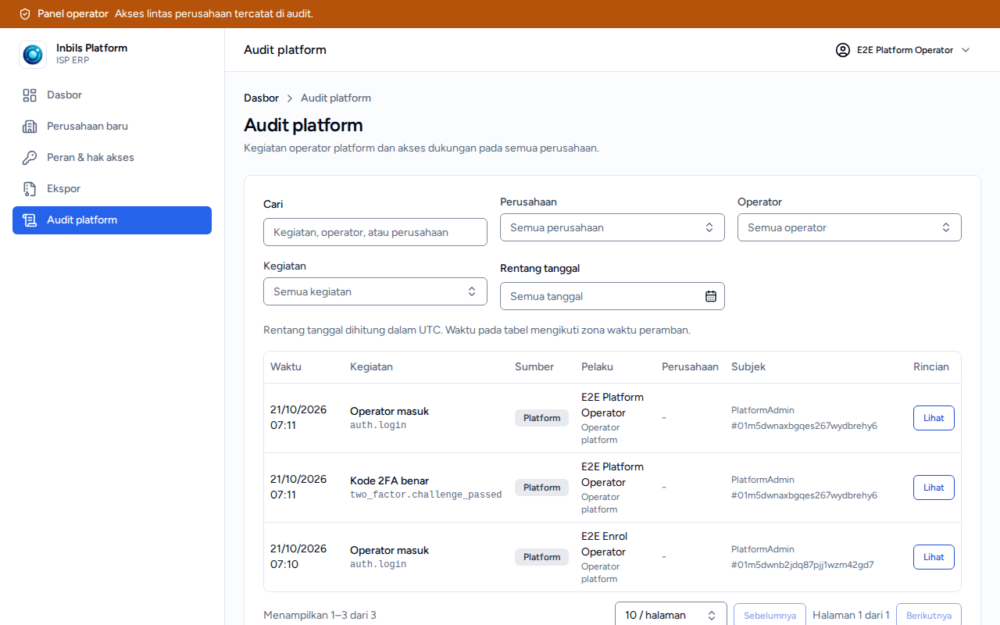

Filter:

- **Cari**: kode kegiatan, nama atau email operator, atau nama/kode perusahaan;
- **Perusahaan**: satu tenant, termasuk anak perusahaannya;
- **Operator**: satu admin platform;
- **Kegiatan**: satu kode audit dengan label Indonesia;
- **Rentang tanggal**: tanggal mulai dan akhir dalam UTC.

Tabel memuat:

| Kolom | Arti |
| --- | --- |
| **Waktu** | Waktu pada zona waktu browser. |
| **Kegiatan** | Label Indonesia dan kode kegiatan di bawahnya. |
| **Sumber** | **Platform** atau **Akses dukungan**. |
| **Pelaku** | Nama operator atau pengguna, atau **Sistem**. |
| **Perusahaan** | Nama/kode tenant. Klik nama bila tenant masih ada. |
| **Subjek** | Jenis model dan public id bila tersedia. |
| **Rincian** | Tombol **Lihat**. |

Rentang filter dihitung menurut hari UTC. Waktu di tabel mengikuti jam browser. Halaman menampilkan 10 baris per halaman secara standar.

## 10.2 Membaca rincian kegiatan

Klik **Lihat** pada kolom **Rincian**.

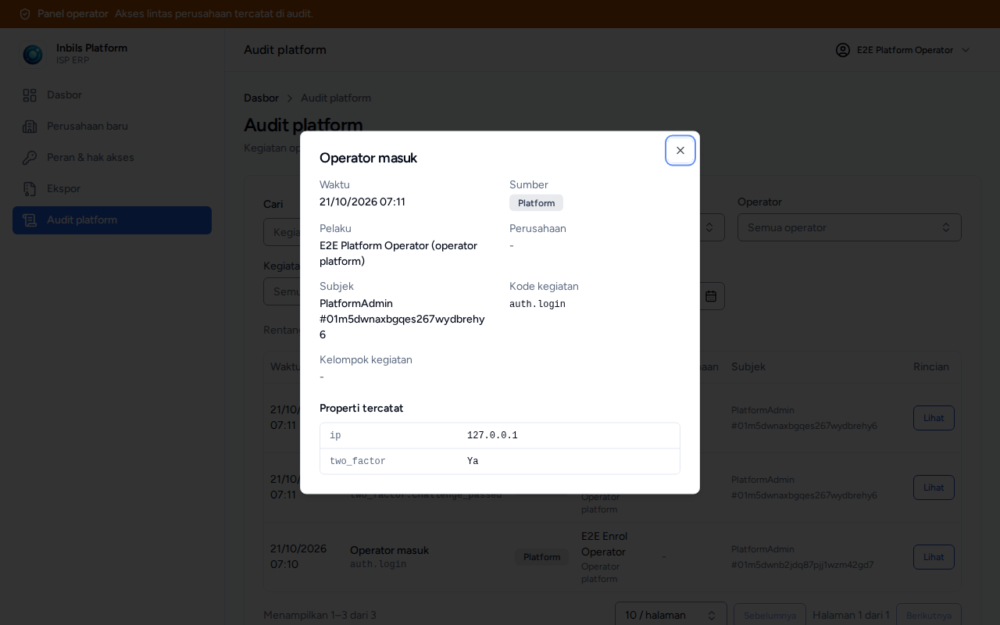

Dialog memuat:

- Waktu;
- Sumber;
- Pelaku;
- Perusahaan;
- Subjek;
- Kode kegiatan;
- Kelompok kegiatan;
- Properti tercatat.

**Kelompok kegiatan** adalah UUID yang menghubungkan seluruh baris satu sesi dukungan. Properti skalar tampil apa adanya, boolean sebagai Ya/Tidak, dan array sebagai JSON ringkas. Properti id internal bertipe integer disembunyikan dari tampilan. Nilai pribadi yang dimask tetap menulis `[disembunyikan]`.

Setelah purge permanen, audit platform tetap ada. Kolom perusahaan menampilkan nama dan kode yang disimpan pada properti, tetapi tidak lagi menjadi tautan.

## 10.3 Kegiatan yang tercatat

Label utama:

| Kelompok | Contoh label |
| --- | --- |
| Akun operator | **Operator dibuat**, **Operator masuk**, **Operator keluar**, **Sesi operator berakhir**, **Operator gagal masuk**, **Masuk operator diblokir** |
| 2FA operator | **Pendaftaran 2FA dimulai**, **2FA diaktifkan**, **Kode 2FA benar**, **Kode 2FA salah**, **Kode pemulihan dipakai**, **Kode pemulihan dibuat ulang** |
| Peran | **Peran dibuat**, **Peran diubah**, **Peran dihapus** |
| Tenant | **Perusahaan dibuat**, **Anak perusahaan dibuat**, **Perusahaan ditangguhkan**, **Perusahaan diaktifkan**, **Pengajuan hapus dicatat** |
| Data contoh | **Data contoh terisi**, **Data contoh gagal** |
| Ekspor | **Ekspor diminta**, **Ekspor selesai**, **Ekspor gagal**, **Ekspor kedaluwarsa**, **Ekspor diunduh** |
| Purge | **Penghapusan dimulai**, **Penghapusan gagal**, **Penghapusan selesai** |
| Dukungan pengguna | **2FA pengguna diatur ulang**, **Undangan dikirim ulang**, **Kunci masuk dibuka**, **Undangan gagal terkirim** |
| Akses dukungan | **Akses dukungan dimulai**, **Mode akses diubah**, **Perubahan saat akses dukungan**, **Akses dukungan berakhir** |

Kolom IP dan user agent disimpan untuk penelusuran server dan tidak tampil sebagai kolom di halaman ini. Baris masuk dan keluar operator mencatat IP di **Properti tercatat**. Kata sandi, token, QR secret, kode pemulihan, isi request, dan stack trace tidak masuk ke properti audit.

## 10.4 Apa yang terlihat oleh perusahaan

Audit internal bersumber **Platform** tidak tampil pada Log Audit tenant. Tindakan yang perlu transparan kepada perusahaan ditulis lagi sebagai sumber **Akses dukungan**, misalnya:

- penangguhan dan reaktivasi;
- pengajuan hapus;
- permintaan, penyelesaian, dan unduhan ekspor;
- buka kunci, reset 2FA, dan kirim ulang undangan;
- seluruh lifecycle sesi akses dukungan.

Tenant melihat pelaku sebagai **Tim dukungan Inbils**, tanpa email atau id internal operator. Log `platform`, `support`, dan `security` disimpan 730 hari. Scheduler menjalankan `inbils:activity-log:prune` setiap hari.

### Kesalahan umum

- Pencarian label Indonesia tidak menemukan baris: coba kode kegiatan, misalnya `tenant.export_requested`.
- Perusahaan terhapus tetap muncul tanpa tautan: ini perilaku audit yang disengaja.
- Tanggal yang dipilih tampak bergeser: filter memakai hari UTC, sementara tabel memakai jam browser.
- Audit tenant tidak menampilkan login operator biasa: hanya sumber **Akses dukungan** yang terlihat oleh tenant.

# 11. Tugas konsol dan antrean

## 11.1 Perintah untuk tim server

Peran yang dapat memakai: tim server dengan akses terminal dan prosedur operasi yang disetujui.

| Perintah | Kegunaan |
| --- | --- |
| `inbils:platform:admin-create` | Membuat akun operator baru secara interaktif. |
| `inbils:platform:purge-company {kode}` | Menghapus tenant permanen setelah semua syarat terpenuhi. |
| `inbils:platform:exports:prune` | Menghapus arsip kedaluwarsa dan menggagalkan build yang macet lebih dari 2 jam. Scheduler menjalankannya tiap jam. |
| `inbils:company:create-subsidiary {head} {name} {code}` | Membuat anak perusahaan dari konsol, dengan opsi mata uang, zona waktu, dan anggota. |
| `inbils:company:grant-membership {email} {company}` | Memberi pengguna akses ke perusahaan lain tanpa mengubah perusahaan asal. |
| `inbils:company:revoke-membership {email} {company}` | Mencabut keanggotaan tambahan. Perusahaan asal tidak dapat dicabut. |
| `inbils:integrations:import-env --company={kode}` | Menyalin konfigurasi Midtrans, WhatsApp, dan RADIUS lama dari environment ke satu perusahaan. Gunakan `--dry-run` lebih dulu. |
| `inbils:push:test {email}` | Menguji pengiriman push ke instalasi aplikasi pengguna. Gunakan `--dry-run` untuk validasi FCM tanpa mengirim. |
| `inbils:activity-log:prune` | Menjalankan pembersihan audit secara manual menurut masa simpan. |

Perintah membership menerima kode atau id internal perusahaan. Perintah dari panel memakai public id dan tidak menerima id dari browser sebagai kebenaran lintas tenant.

Tidak ada perintah reset 2FA operator. Reset 2FA di panel hanya menargetkan `User` tenant.

## 11.2 Worker antrean platform

Dua pekerjaan lambat berjalan pada koneksi dan antrean `platform`:

- `SeedTenantDemoDataJob` untuk **Isi data contoh**;
- `BuildTenantExportJob` untuk ekspor tenant.

Worker produksi:

```bash
php artisan queue:work platform --queue=platform --sleep=3 --tries=1 --timeout=3600
```

Dengan Sail:

```bash
./vendor/bin/sail artisan queue:work platform --queue=platform --tries=1 --timeout=3600
```

Worker default tidak membaca antrean ini. Worker platform juga tidak membaca antrean default atau WhatsApp. Produksi memerlukan keduanya.

Tanda worker platform tidak berjalan:

- data contoh tidak muncul setelah tenant dibuat;
- ekspor tetap **Antrean**;
- baris `jobs` dengan `queue = platform` bertambah.

Job memakai satu percobaan. Jangan menaikkan `--tries` tanpa memperbaiki akar masalah. Seed data menjalankan satu transaksi besar, dan ekspor mempunyai baris status sendiri. Pengulangan diam-diam dapat menutupi kegagalan.

Lihat `docs/operations/platform-queue.md` untuk systemd, Supervisor, Docker, stop timeout, dan diagnosis.

## 11.3 Scheduler dan retensi

Scheduler harus berjalan satu kali per menit. Tugas terkait panel:

- `inbils:platform:exports:prune` tiap jam;
- `inbils:activity-log:prune` setiap hari pukul 19:30 UTC;
- `queue:prune-failed --hours=720` setiap hari.

`failed_jobs` disimpan 30 hari. Audit biasa disimpan 365 hari. Audit `security`, `platform`, dan `support` disimpan 730 hari.

## 11.4 Host panel platform

Tanpa konfigurasi tambahan, panel berada pada host aplikasi dengan path `/platform`. `PLATFORM_DOMAIN` mengikat semua rute platform ke host tertentu dan menambah host itu ke daftar host tepercaya.

Host terpisah harus memakai rencana sesi dan cookie yang tetap dapat dibaca aplikasi tenant. **Akses dukungan** memakai satu sesi untuk guard `platform` dan `web`. Bila cookie tidak dibagikan, perpindahan ke layar tenant gagal.

# 12. Alur kerja operator

## 12.1 Perusahaan baru sampai admin pertama masuk

1. Operator membuka **Perusahaan baru** dan memilih **Katalog awal** atau **Kosong** (bagian 4.1 sampai 4.2).
2. Operator mengisi admin pertama, lalu klik **Buat perusahaan**.
3. Inbils membuat perusahaan, akun admin, peran, penomoran, pengaturan dasar, dan katalog.
4. Mailer platform mengirim undangan. Bila **Isi data contoh** dicentang, worker `platform` mengisi data demo.
5. Operator membuka halaman tenant dan memantau **Masuk terakhir**, **Audit terbaru**, serta **Job gagal**.
6. Admin membuka tombol **Atur kata sandi** dari email dalam 60 menit.
7. Bila tautan kedaluwarsa atau email gagal, operator memakai **Kirim ulang undangan**.
8. Setelah admin berhasil masuk, kolom **Masuk terakhir** menampilkan waktunya.
9. Admin mengisi profil, integrasi, pengguna, dan data operasional melalui web perusahaan.

## 12.2 Pengguna tidak dapat masuk

1. Operator mencari tenant di Dasbor dan membuka bagian **Pengguna**.
2. Periksa **Status**, lencana **Terkunci**, **2FA**, dan **Masuk terakhir**.
3. Bila terkunci karena percobaan salah, pakai **Buka kunci masuk**.
4. Bila pengguna kehilangan autentikator dan kode pemulihan, pakai **Atur ulang 2FA**.
5. Bila admin belum pernah masuk dan undangan tidak aktif, pakai **Kirim ulang undangan**.
6. Bila masalah hanya dapat direproduksi pada layar pengguna, mulai **Akses dukungan** dengan alasan yang jelas.
7. Periksa masalah dalam mode baca. Aktifkan **Mode ubah** hanya bila perubahan diperlukan dan sudah disetujui.
8. Klik **Keluar** segera setelah pemeriksaan selesai.
9. Baca **Audit platform** dan minta perusahaan memeriksa **Log Audit** bila perlu bukti tindakan.

## 12.3 Menutup layanan satu tenant

1. Pastikan pemilik tenant memahami dampak penangguhan dan penghapusan.
2. Operator klik **Tangguhkan**, isi alasan, kode, dan kata sandi.
3. Operator meminta ekspor baru setelah waktu penangguhan.
4. Tim server memastikan worker platform menyelesaikan ekspor. Serahkan arsip kepada pihak yang berhak sebelum masa unduh 24 jam habis.
5. Tunggu sampai 30 hari sejak penangguhan terakhir.
6. Operator klik **Ajukan hapus** setelah daftar syarat kosong.
7. Tim server memeriksa keanggotaan pengguna tenant di perusahaan di luar tenant dan mencabutnya dengan `inbils:company:revoke-membership` (bagian 11.1); penghapusan ditolak selama keanggotaan itu ada.
8. Tim server mengambil backup dan memeriksa tanggalnya.
9. Tim server jalankan `inbils:platform:purge-company {kode}`, baca rencana, lalu ketik ulang kode.
10. Bila ada sisa berkas, hapus `disk:path` yang dicantumkan terminal.
11. Periksa **Audit platform**. Baris lama harus tetap menampilkan nama dan kode tenant tanpa tautan.

# 13. Lampiran

## 13.1 Konfirmasi tindakan sensitif

| Tindakan | Alasan | Ketik kode perusahaan | Kata sandi operator |
| --- | --- | --- | --- |
| Tangguhkan tenant | Ya | Ya | Ya |
| Aktifkan kembali | Ya | Tidak | Tidak |
| Ajukan hapus | Tidak | Ya | Ya |
| Minta ekspor | Tidak | Ya | Ya |
| Masuk sebagai pengguna | Ya | Tidak | Ya |
| Aktifkan mode ubah | Tidak | Ya | Bila konfirmasi lebih dari 5 menit |
| Kembali ke mode baca | Tidak | Tidak | Tidak |
| Buka kunci masuk | Tidak | Tidak | Tidak |
| Atur ulang 2FA pengguna | Tidak | Tidak | Ya |
| Kirim ulang undangan | Tidak | Tidak | Tidak |
| Buat, ubah, atau hapus peran | Tidak | Tidak | Ya |
| Buat kode pemulihan operator baru | Tidak | Tidak | Ya |
| Tambah anak perusahaan | Tidak | Tidak | Tidak |
| Buat perusahaan | Tidak | Tidak | Tidak |

## 13.2 Batas penting

| Batas | Nilai |
| --- | --- |
| Sesi operator tanpa aktivitas | 30 menit |
| Sesi akses dukungan | paling lama 30 menit sejak dimulai |
| Konfirmasi kata sandi operator | 5 menit |
| Login yang menunggu kode 2FA | 10 menit |
| Kode TOTP | berubah setiap 30 detik, satu kali pakai |
| Kode pemulihan baru | 8 kode, masing-masing satu kali pakai |
| Alasan tindakan | 5 sampai 200 karakter |
| Tautan undangan admin | 60 menit |
| Pengiriman ulang undangan | 6 kali per menit per pengguna |
| Penangguhan sebelum pengajuan hapus | 30 hari |
| Arsip ekspor siap diunduh | 24 jam sejak selesai |
| Build ekspor dianggap macet | 2 jam |
| Job gagal pada halaman tenant | 7 hari ringkas, 30 hari lengkap |
| Audit platform dan dukungan | 730 hari |

## 13.3 Istilah

| Istilah | Arti |
| --- | --- |
| 2FA | Autentikasi dua langkah: kata sandi ditambah kode autentikator atau kode pemulihan. |
| Akses dukungan | Sesi saat operator masuk sebagai pengguna tenant untuk memeriksa layar dan izin pengguna itu. |
| Admin perusahaan | Pengguna tenant berperan `admin`. Bukan operator platform. |
| Anak perusahaan | Perusahaan satu tingkat di bawah perusahaan induk. Data tetap terpisah. |
| Audit platform | Log internal operator dan akses dukungan pada seluruh instalasi. |
| Head | Perusahaan induk paling atas pada satu tenant. |
| Isi awal | Pilihan Katalog awal atau Kosong saat perusahaan dibuat. |
| Katalog awal | Data master standar tanpa stok dan aset jaringan. |
| Kode perusahaan | Kode tetap yang mengonfirmasi tindakan sensitif. Saat konfirmasi harus diketik persis; dua perusahaan tidak bisa memakai kode yang hanya berbeda huruf besar-kecil. |
| Kode pemulihan | Kode satu kali pakai untuk login bila aplikasi autentikator tidak tersedia. |
| Mode baca | Mode awal akses dukungan yang menolak perubahan. |
| Mode ubah | Mode akses dukungan yang mengizinkan perubahan sesuai izin target. |
| Operator platform | Akun terpisah di `platform_admins` yang mengelola seluruh instalasi. |
| Pengajuan hapus | Penanda bahwa tenant siap dipurge setelah syarat terpenuhi. Tidak menghapus data dari web. |
| Peran global | Definisi peran yang saat ini berlaku bagi pengguna di semua perusahaan. |
| Platform queue | Antrean khusus untuk data contoh dan ekspor tenant. |
| Purge | Penghapusan permanen tenant melalui konsol server. |
| Step-up | Konfirmasi ulang kata sandi operator untuk tindakan sensitif. |
| Tenant | Satu perusahaan induk beserta anak perusahaannya. |
| Undangan admin | Email bertaut 60 menit agar admin pertama menetapkan kata sandi. |
