# 1. Pendahuluan

Aplikasi **Inbils Teknisi** adalah aplikasi Android untuk teknisi lapangan. Dengan aplikasi ini Anda menerima SPK dan tiket yang ditugaskan, memulai dan menyelesaikannya, mengirim foto bukti kerja, mencatat material, dan meminta barang ke gudang. Akun teknisi tidak lagi memakai situs web Inbils untuk pekerjaan harian.

Panduan ini mengikuti urutan layar di aplikasi. Lima tab di bagian bawah layar: **Beranda**, **Pekerjaan**, **Material**, **Notifikasi**, **Akun**.

## Memasang aplikasi

1. Minta tautan Play Store aplikasi Inbils Teknisi kepada kantor Inbils. Tautan yang sama muncul sebagai tombol **Buka Play Store** bila akun teknisi Anda membuka situs web Inbils.
2. Buka tautan di ponsel Android, lalu pasang aplikasi.
3. Buka aplikasi **Inbils Teknisi**.

Aplikasi hanya tersedia untuk Android.

## Akun

Akun dibuat oleh admin Inbils. Anda tidak bisa mendaftar sendiri di aplikasi. Admin memberi Anda email dan kata sandi awal, dan mengaktifkan akun Anda sebagai teknisi dengan profil karyawan aktif.

Aplikasi memakai **email dan kata sandi yang sama dengan situs web Inbils**. Mengganti kata sandi di aplikasi berarti mengganti kata sandi di web, dan sebaliknya.

## Membuka aplikasi

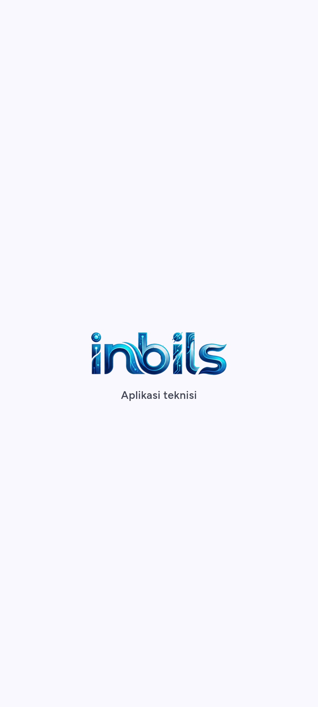

Saat aplikasi dibuka, layar menampilkan logo Inbils dengan kilau cahaya yang melintas, lalu tulisan "Aplikasi teknisi" muncul di bawahnya. Layar ini hilang sendiri begitu aplikasi siap, biasanya dalam sekitar satu detik. Bila sinyal lambat, indikator kecil muncul di bawah tulisan itu sampai aplikasi siap. Bila Anda membuka aplikasi dari notifikasi, layar pembuka hilang langsung ke pekerjaan yang dituju.

## Masuk

1. Ketik **Email** Anda.
2. Ketik **Kata sandi**. Ketuk ikon mata untuk menampilkan atau menyembunyikannya.
3. Ketuk **Masuk**.
4. Bila akun Anda memakai verifikasi dua langkah, aplikasi membuka layar kode (lihat bagian berikutnya). Bila tidak, Anda langsung masuk ke tab **Beranda**.

Setelah masuk, aplikasi mengingat sesi Anda di ponsel ini. Anda tidak perlu masuk lagi setiap kali membuka aplikasi.

### Kesalahan umum saat masuk

- **"Email atau kata sandi salah."** Periksa ejaan email dan huruf besar-kecil kata sandi.
- **"Akun ini tidak terdaftar sebagai teknisi."** Akun Anda belum diberi hak teknisi atau profil karyawan Anda tidak aktif. Hubungi kantor Inbils.
- **"Akun Anda dinonaktifkan. Hubungi kantor Inbils."** Admin menonaktifkan akun Anda.
- **"Terlalu banyak percobaan. Coba lagi dalam N detik."** Tunggu sesuai hitungan, lalu coba lagi.
- **"Tidak ada koneksi internet."** Masuk selalu butuh internet.

## Verifikasi dua langkah

Bila verifikasi dua langkah aktif di akun Anda, setelah email dan kata sandi benar aplikasi membuka layar **Verifikasi dua langkah**.

1. Buka aplikasi autentikator di ponsel Anda.
2. Ketik **Kode 6 digit** yang tampil untuk Inbils.
3. Ketuk **Verifikasi**.
4. Bila ponsel autentikator hilang, ketuk **Pakai kode pemulihan**, ketik salah satu kode pemulihan Anda, lalu ketuk **Verifikasi**. Setiap kode pemulihan hanya berlaku sekali. Ketuk **Pakai kode autentikator** untuk kembali ke kode 6 digit.

Verifikasi dua langkah diaktifkan, dimatikan, dan dikelola di **situs web** Inbils (halaman profil), bukan di aplikasi. Setiap kali pengaturan itu berubah, semua ponsel yang sedang masuk keluar otomatis dan Anda masuk lagi.

### Kesalahan umum pada verifikasi dua langkah

- **"Kode salah. Periksa lalu coba lagi."** Pastikan jam ponsel akurat dan Anda memakai kode terbaru dari aplikasi autentikator.
- **"Kode verifikasi kedaluwarsa. Silakan masuk lagi."** Anda terlalu lama di layar ini. Aplikasi kembali ke layar **Masuk**; ulangi dari awal.
- Jumlah percobaan dibatasi. Setelah beberapa kali salah, tunggu sebelum mencoba lagi.

## Lupa kata sandi

1. Di layar **Masuk**, ketuk **Lupa kata sandi?**. Bila Anda sudah mengetik email, aplikasi membawanya ke layar ini.
2. Ketik email akun Anda, lalu ketuk **Kirim link**.
3. Aplikasi menjawab "Jika email itu terdaftar, link atur ulang kata sandi sudah kami kirim." Jawaban ini sama untuk email apa pun, jadi tidak membocorkan email mana yang terdaftar.
4. Buka email Anda dan ketuk link di dalamnya. Link membuka **halaman web** Inbils tempat Anda mengetik kata sandi baru. Kata sandi tidak diatur ulang di dalam aplikasi.
5. Kembali ke aplikasi dan masuk dengan kata sandi baru.

Bila sebuah akun masih memakai kata sandi lama yang wajib diganti, aplikasi menampilkan lembar **Atur ulang kata sandi** dengan pesan "Demi keamanan, atur ulang kata sandi lewat link yang kami kirim ke email Anda." Ketuk **Kirim link** dan ikuti langkah 4 dan 5.

Kesalahan umum: email tidak masuk. Periksa folder spam, lalu tunggu satu menit sebelum meminta link lagi. Permintaan link dibatasi per menit.

## Perangkat dan keluar

Satu sesi aplikasi berlaku untuk satu ponsel. Anda bisa melihat dan mengeluarkan ponsel lain di **Akun > Perangkat** (lihat bab 7).

Untuk keluar dari aplikasi: **Akun > Keluar**, lalu konfirmasi. Bila masih ada foto bukti atau aksi yang belum terkirim, aplikasi memberi peringatan bahwa semuanya akan dihapus (lihat bab 3).

## Sesi berakhir

Sesi aplikasi teknisi berlaku 30 hari sejak masuk. Aplikasi memperpanjang sesi saat masa berlakunya tersisa kurang dari 7 hari. Bila sesi habis, atau kata sandi Anda diganti, atau akun dinonaktifkan, aplikasi membuka layar **Masuk** dengan pesan "Sesi Anda berakhir. Silakan masuk lagi." Masuk lagi dengan email dan kata sandi.

# 2. Beranda dan Pekerjaan

Lima tab di bagian bawah layar: **Beranda** menunjukkan pekerjaan hari ini, **Pekerjaan** memuat daftar lengkap SPK dan tiket yang ditugaskan kepada Anda.

## Beranda

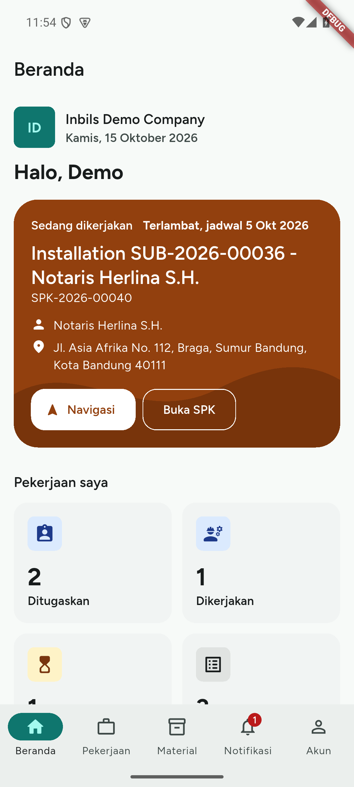

Beranda adalah tab pertama dan layar yang terbuka setelah masuk. Isinya dari atas ke bawah:

1. **Kepala ISP**: logo perusahaan (atau bulatan biru Inbils bila belum ada logo atau logonya gagal dimuat), nama perusahaan, dan tanggal hari ini. Di bawahnya sapaan "Halo, nama depan Anda". Warna aplikasi mengikuti warna merek ISP, jadi tampilannya bisa berbeda antar ISP.
2. **Kartu tiket mendesak**: tiket Anda yang paling dekat batas respons pertamanya, di atas kartu kunjungan. Teksnya "Tiket mendesak · respons sebelum 21:17 (sisa 41 menit)", dengan kode dan judul tiket di bawahnya. Ikonnya berubah kuning saat sisa 30 menit atau kurang dan merah setelah batas lewat ("lewat 12 menit"). Ketuk kartu untuk membuka tiketnya. Hitungannya bergerak tiap 30 detik. Kartu tidak tampil bila tidak ada tiket yang menunggu respons pertama. Respons pertama berarti Anda menekan **Mulai** pada tiket atau mengirim komentar yang bisa dibaca pelanggan.
3. **Kartu kunjungan**: SPK yang perlu Anda datangi sekarang. Aplikasi memilih SPK yang sedang **Dikerjakan** (judulnya **Sedang dikerjakan**), atau bila tidak ada, SPK **Ditugaskan** dengan jadwal paling awal (judulnya **Kunjungan berikutnya**). SPK tanpa jadwal ada di urutan terakhir. Tiket bukan kunjungan dan tidak muncul di kartu ini. Kartu memuat:
   - jadwal: **Hari ini**, **Besok**, atau tanggalnya. Jadwal yang sudah lewat tertulis "Terlambat, jadwal {tanggal}" dan kartu berubah menjadi warna peringatan;
   - judul dan kode SPK, nama pelanggan, dan alamat pemasangan;
   - jarak ("850 m dari lokasi Anda" atau "3,4 km dari lokasi Anda"), hanya bila SPK punya koordinat dan ponsel sudah mengizinkan lokasi. Beranda tidak meminta izin lokasi; izin diminta saat Anda memulai SPK;
   - tombol **Navigasi**, yang membuka aplikasi peta ponsel ke lokasi pelanggan bila lokasi SPK diketahui, dan tombol **Buka SPK** yang membuka detail SPK (bab 3).
4. Bila tidak ada SPK yang menunggu, kartu kunjungan diganti kartu "Tidak ada kunjungan SPK yang menunggu. Penugasan baru muncul di sini."
5. **Pekerjaan saya**: empat petak angka, **Ditugaskan**, **Dikerjakan**, **Menunggu tindakan**, dan **Total**. Ketuk satu petak untuk membuka tab **Pekerjaan** dengan filter status itu. Petak **Total** membuka daftar tanpa filter.

Tarik layar ke bawah untuk memperbarui. Tarikan yang sama mencoba mengirim foto bukti yang menunggu di antrean (lihat bab 3). Aplikasi juga memperbarui diri tanpa tarikan: saat Anda membuka kembali aplikasi dari latar belakang dan saat Anda berpindah tab (langsung), serta saat ada notifikasi baru masuk (sekitar 1 detik setelah notifikasi terakhir dalam satu rentetan). Selama data dimuat ulang, garis tipis berjalan di atas daftar dan isi lama tetap terbaca. Bila satu bagian gagal dimuat, bagian itu menampilkan pesan kesalahan dan tombol **Coba lagi**; bagian lain tetap tampil. Banner offline dan banner foto belum terkirim (lihat "Kesalahan umum" di bawah) juga tampil di Beranda.

Aplikasi memilih kunjungan dari 10 SPK terbaru yang dikirim server. Teknisi dengan lebih dari 10 SPK terbuka bisa melihat kunjungan yang lebih lambat dari yang paling awal. Kartu tiket mendesak memilih dari halaman pertama daftar tiket Anda. Buka tab **Pekerjaan** untuk daftar lengkap.

## Daftar pekerjaan

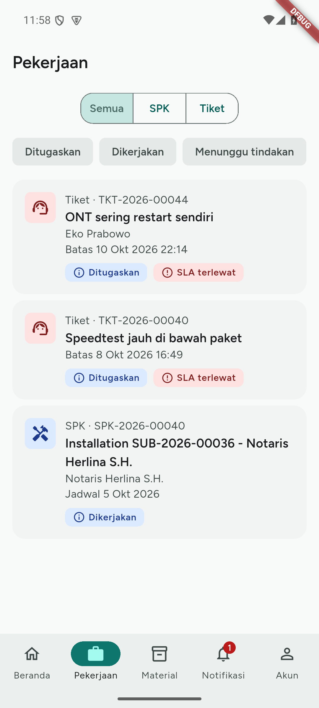

Tab **Pekerjaan** memuat SPK dan tiket yang ditugaskan kepada Anda. Layar menampilkan, dari atas ke bawah:

- Pilihan jenis: **Semua**, **SPK**, atau **Tiket**.
- Filter status: **Ditugaskan**, **Dikerjakan**, dan **Menunggu tindakan**. Ketuk satu untuk menyaring, ketuk lagi untuk melepas. Petak di Beranda memilih salah satunya.
- Kartu pekerjaan. Tiap kartu memuat ikon jenis, jenis dan kode, judul, nama pelanggan, status, dan tanggal: **Jadwal** untuk SPK, **Batas** untuk tiket. Untuk SPK, jenisnya memakai nama jenis SPK dari kantor, misalnya `Instalasi · SPK-0021`, bukan kata "SPK" saja. Tiket berprioritas **Mendesak** (merah) atau **Tinggi** (kuning) diberi label prioritas, dan tiket yang menunggu respons pertama menulis "Respons sebelum 21:17 · sisa 41 mnt" (atau "lewat 12 mnt" setelah batas). Tiket yang lewat batas waktu layanan diberi label **SLA terlewat**.

Cara memakai:

1. Pilih **Semua**, **SPK**, atau **Tiket**.
2. Bila perlu, ketuk filter **Ditugaskan**, **Dikerjakan**, atau **Menunggu tindakan**.
3. Ketuk baris untuk membuka detail SPK atau detail tiket.
4. Geser daftar ke bawah sampai habis. Aplikasi memuat halaman berikutnya sendiri.

Tarik layar ke bawah (pull-to-refresh) untuk memperbarui daftar. Tarikan yang sama juga mencoba mengirim foto bukti yang menunggu di antrean (lihat bab 3). Daftar juga memuat ulang sendiri saat aplikasi dibuka kembali dan saat Anda berpindah tab (langsung), dan sekitar 1 detik setelah notifikasi terakhir dalam satu rentetan.

Bila tidak ada pekerjaan, layar menulis "Tidak ada pekerjaan untuk filter ini."

## Kesalahan umum

- **Banner "Data offline · diperbarui HH:mm".** Ponsel tidak punya internet, dan aplikasi menampilkan salinan terakhir. Pekerjaan baru dan perubahan dari kantor tidak muncul sampai internet kembali. Tarik layar ke bawah setelah sinyal pulih.
- **Banner "Anda sedang luring. Aksi disimpan dan dikirim otomatis saat online."** Tampil di layar SPK, tiket, dan pengembalian material setelah sebuah permintaan gagal karena tidak ada sinyal. Aksi yang Anda ketuk tetap tersimpan dan terkirim sendiri saat sinyal kembali (lihat "Tanpa sinyal: aksi menunggu kirim" di bab 3). Ketuk **Coba lagi** di banner untuk memeriksa sinyal dan mengirim saat itu juga.
- **Banner "N foto belum terkirim".** Ada foto bukti di antrean unggah. Ketuk untuk membukanya.
- **Pemberitahuan merah "N aksi gagal dikirim".** Ada aksi tersimpan yang ditolak server atau belum pasti terkirim. Ketuk **Lihat aksi** untuk mencoba lagi atau membuangnya.
- **Pekerjaan tidak muncul.** Hanya pekerjaan berstatus Ditugaskan dan Dikerjakan yang ditugaskan kepada Anda yang tampil. Bila yakin ada yang kurang, minta kantor memeriksa penugasan.

# 3. SPK

SPK (surat perintah kerja) adalah pekerjaan instalasi atau perbaikan di lokasi pelanggan. Alurnya: **Ditugaskan** → Anda berangkat (**Saya berangkat**) → Anda mulai → **Dikerjakan** → Anda kirim untuk ditinjau → **Menunggu review** → kantor menyetujui (**Selesai**) atau mengembalikan (**Dikembalikan**). Di layar, alur ini tampil sebagai empat langkah **Progres kunjungan**: **Ditugaskan**, **Dalam perjalanan**, **Sedang dikerjakan**, dan **Selesai dipasang** (**Selesai dikerjakan** pada SPK yang bukan pemasangan).

## Detail SPK dan progres kunjungan

Ketuk baris SPK di tab **Pekerjaan**.

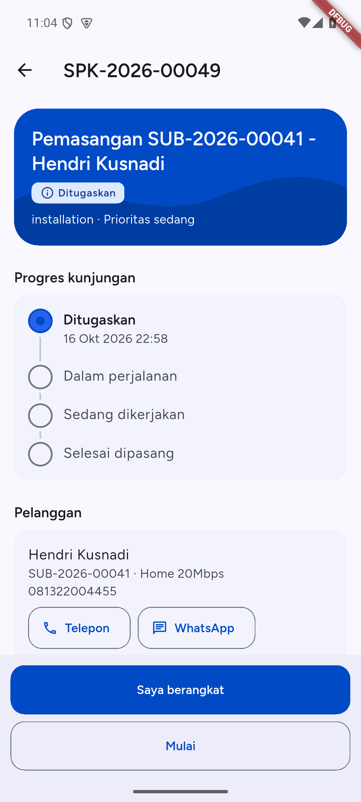

Detail SPK memuat judul, status, jenis dan prioritas, jadwal, kode tiket asal (bila ada), **Progres kunjungan**, **Pelanggan**, **POP / gudang**, **Deskripsi**, **Material**, dan **Bukti kerja**. Selama SPK berstatus **Dikerjakan**, **Bukti kerja** dan **Material** naik tepat di bawah **Progres kunjungan**, karena itulah yang Anda kerjakan di lokasi; **Pelanggan**, **POP / gudang**, dan **Deskripsi** pindah ke bawahnya. Pada status lain urutannya seperti di atas. Bila kantor mengembalikan SPK, kotak **Dikembalikan ke kantor** dan **Alasan dikembalikan** tampil di atas (lihat "SPK dikembalikan ke kantor" di bawah).

**Progres kunjungan** menunjukkan empat langkah yang sama dengan yang dilihat kantor dan pelanggan. Tanda centang berarti langkah sudah dilalui, dengan waktunya di bawah nama langkah. Lingkaran bertitik dengan nama tebal adalah langkah yang sedang berjalan. Lingkaran kosong adalah langkah yang belum tercapai. Tombol di bagian bawah layar mengikuti langkah itu: **Saya berangkat**, **Mulai**, lalu **Selesai dipasang · kirim untuk ditinjau**. Pada SPK yang bukan pemasangan (perawatan, peningkatan layanan, pindah lokasi), langkah terakhir bernama **Selesai dikerjakan** dan tombolnya **Pekerjaan selesai · kirim untuk ditinjau**. Jenis SPK di layar ditulis dengan nama dari kantor, misalnya Instalasi atau Perawatan.

**Dalam perjalanan** bukan status SPK. Status tetap **Ditugaskan** sampai Anda mulai bekerja. Langkah ini hanya memberi tahu kantor dan pelanggan bahwa Anda menuju lokasi.

### Pelanggan, alamat pemasangan, dan POP

Gulir ke bawah untuk membaca kartu **Pelanggan** dan **POP / gudang**.

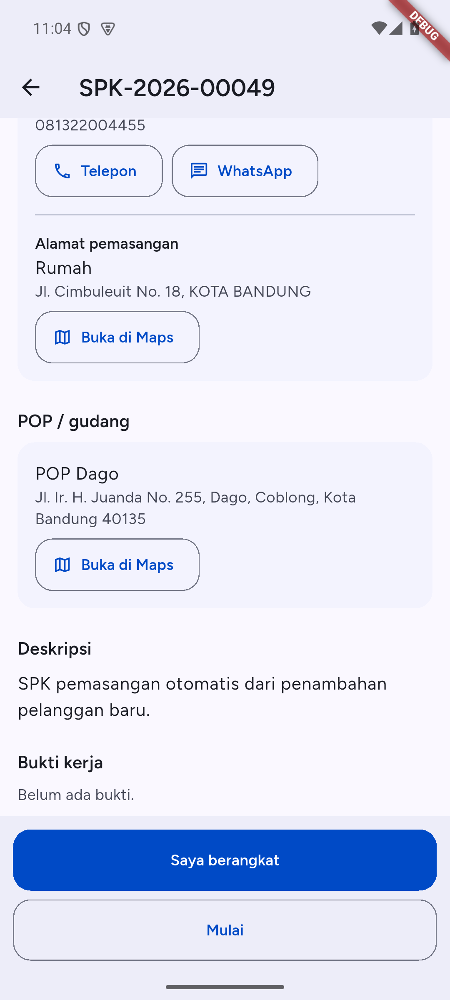

- Kartu **Pelanggan** memuat nama, kode langganan dan paket, serta nomor telepon pelanggan. Ketuk **Telepon** untuk membuka pemanggil. Ketuk **WhatsApp** untuk membuka percakapan dengan nomor itu. Tombol **WhatsApp** hanya ada bila nomornya nomor seluler Indonesia.
- Di bawahnya, **Alamat pemasangan** memuat nama alamat, jalan, dan kota rumah pelanggan. Ketuk **Buka di Maps** untuk membuka petunjuk arah ke titik koordinat alamat itu. Bila alamat belum punya koordinat, aplikasi peta mencari teks alamatnya.
- Kartu **POP / gudang** menunjukkan POP atau gudang yang tercatat di SPK, dengan tombol **Buka di Maps** sendiri. Pakai tombol ini untuk ke POP atau gudang, bukan untuk ke rumah pelanggan.
- SPK tanpa langganan memakai satu kartu **Lokasi kerja** dengan tombol **Buka di Maps**.

### Akun PPPoE untuk pemasangan

SPK **Instalasi** yang sudah ditugaskan menampilkan kartu **Akun PPPoE** bila kantor sudah membuat akun jaringan langganan.

- **Nama pengguna** selalu terlihat dan dapat disalin.
- **Kata sandi** tersamar. Ketuk **Tampilkan** untuk mengambilnya dari server. Kata sandi terlihat selama 60 detik atau sampai Anda menutup layar, lalu tersamar lagi. Ketuk **Salin** selama masih terlihat.
- Pengungkapan butuh internet, dibatasi 5 kali per menit, dan setiap percobaan yang berhasil dicatat di log audit. Aplikasi tidak menyimpan kata sandi di cache offline atau log.
- Status **Menunggu ditulis ke router**, **Siap dipakai**, atau **Belum tertulis, hubungi kantor** menunjukkan keadaan sinkronisasi.
- Tulisan **Akun PPPoE belum dibuat. Hubungi kantor.** berarti akun belum tersedia. Ini terjadi juga bila perusahaan belum mengaktifkan RADIUS: akun tidak dibuat otomatis tanpa RADIUS. Hubungi kantor melalui tombol yang disediakan.

Hanya teknisi yang sedang ditugaskan pada SPK **Instalasi** berstatus **Ditugaskan** atau **Dikerjakan** yang dapat menampilkan kata sandi. Bila SPK dipindahkan ke teknisi lain, kata sandi diganti: yang pernah Anda lihat tidak berlaku lagi dan Anda tidak dapat menampilkannya lagi. Tanpa internet, aplikasi menulis "Butuh koneksi internet untuk menampilkan kata sandi." Terlalu banyak permintaan menampilkan pesan pembatasan dari server.

### Saya berangkat

Pakai **Saya berangkat** saat Anda berangkat menuju lokasi pelanggan.

1. Buka SPK berstatus **Ditugaskan**.
2. Ketuk **Saya berangkat** di bagian bawah.
3. Aplikasi bertanya "Berangkat ke lokasi?" dan menjelaskan bahwa pelanggan akan diberi tahu di aplikasinya. Ketuk **Saya berangkat**.

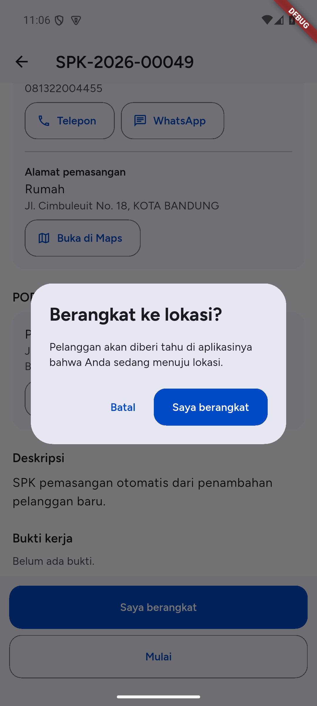

Langkah **Dalam perjalanan** tercentang dengan waktunya, dan tombol **Saya berangkat** hilang. **Mulai** menjadi tombol utama. Pelanggan menerima notifikasi "Teknisi dalam perjalanan" yang memuat nama depan Anda. Nomor telepon Anda tidak dikirim.

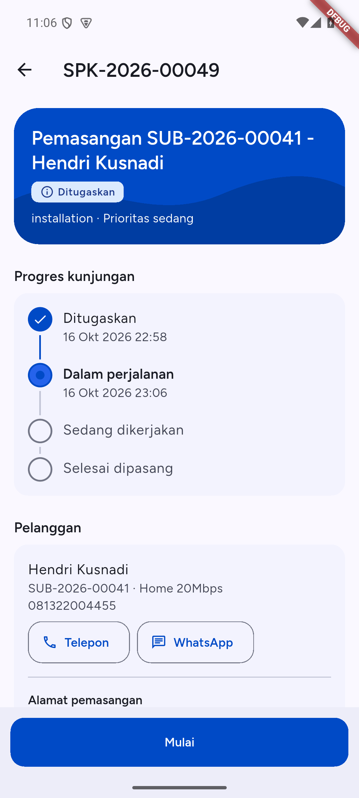

Seperti **Mulai**, aplikasi meminta izin lokasi dan mencatat posisi Anda. Jaraknya dihitung ke alamat pemasangan pelanggan. Bila Anda menolak izin, GPS mati, atau sinyal GPS tidak dapat dibaca dalam 15 detik, langkah tetap tercatat tanpa posisi. Tanpa internet, **Saya berangkat** disimpan di ponsel dan dikirim otomatis saat sinyal kembali (lihat "Tanpa sinyal: aksi menunggu kirim"). Pelanggan baru diberi tahu saat aksi itu terkirim.

Anda boleh melewati langkah ini. Bila sudah berada di lokasi, ketuk **Mulai** langsung: langkah **Dalam perjalanan** tetap dihitung sudah dilalui, tanpa waktu, dan pelanggan tidak menerima notifikasi.

### Mulai

Untuk memulai pekerjaan:

1. Buka SPK berstatus **Ditugaskan**.
2. Ketuk **Mulai** di bagian bawah. Tombol ini ada sebelum dan sesudah **Saya berangkat**.
3. Aplikasi bertanya "Mulai SPK ini?". Ketuk **Mulai**. Status berubah menjadi **Dikerjakan**, langkah **Sedang dikerjakan** tercentang dengan waktunya, dan kantor bisa melihatnya.

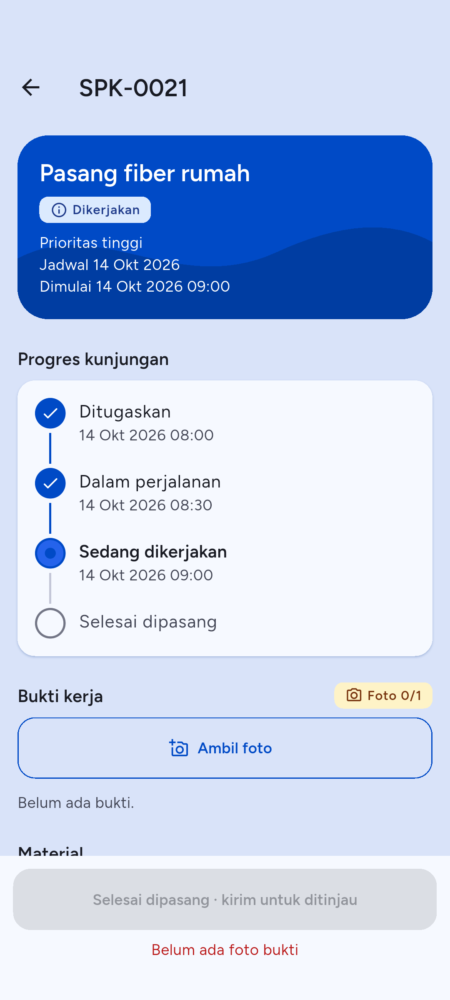

Saat memulai, aplikasi meminta izin lokasi dan mencatat posisi Anda sebagai tanda tiba di lokasi. Bila Anda menolak izin, GPS mati, atau sinyal GPS tidak dapat dibaca dalam 15 detik, SPK tetap dimulai tanpa posisi. Setelah SPK dimulai, aplikasi menulis hasil check-in di bagian bawah layar: "Check-in tercatat, 120 m dari lokasi" (jarak dihitung dari posisi Anda), atau "Mulai tercatat tanpa lokasi" bila posisi tidak tersedia.

Tanpa internet, **Mulai** tidak gagal: aplikasi menyimpannya di ponsel dengan tanda **Menunggu kirim** dan mengirimnya saat sinyal kembali (lihat "Tanpa sinyal: aksi menunggu kirim"). Tombol kirim untuk ditinjau sudah tersedia sambil **Mulai** menunggu.

### Jauh dari lokasi pelanggan

Kantor menetapkan jarak paling jauh antara posisi Anda dan lokasi pelanggan saat Anda menekan **Mulai** (bawaan 500 m). Bila Anda lebih jauh, aplikasi membuka jendela **Jauh dari lokasi pelanggan** dengan jaraknya, misalnya "Anda berjarak 3,2 km dari lokasi pelanggan. Tulis alasannya untuk melanjutkan."

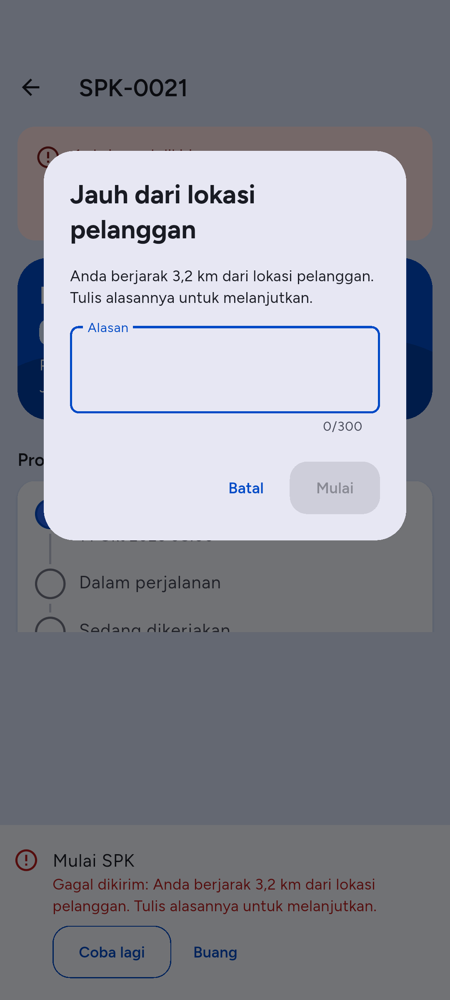

1. Ketik **Alasan** (wajib, maksimal 300 karakter).
2. Ketuk **Mulai**. Ketuk **Batal** bila Anda memutuskan tidak memulai.

Alasan itu tersimpan pada SPK dan tampil bagi kantor sebagai "Jauh dari lokasi: {alasan}". Jendela ini tidak muncul bila posisi Anda tidak terbaca, atau alamat pelanggan belum punya koordinat. Aturan yang sama berlaku untuk **Mulai** pada tiket. **Saya berangkat** tidak menanyakan alasan.

## Foto bukti dan antrean unggah

Foto bukti diwajibkan sebelum SPK dikirim untuk review. Foto diambil saat SPK berstatus **Dikerjakan**. Selama itu, **Bukti kerja** ada di dekat atas layar dan judulnya memuat chip jumlah foto, misalnya **Foto 0/1**: foto yang sudah terkirim atau masih di antrean, dari jumlah minimal yang dibutuhkan sebelum SPK bisa dikirim. Chip berwarna peringatan selama foto kurang dan berwarna hijau saat cukup; angkanya sendiri sudah menyampaikan keadaannya.

1. Di bagian **Bukti kerja**, ketuk **Ambil foto**.
2. Pilih sumber di lembar **Ambil foto dari**: **Kamera** atau **Galeri**.
3. Ambil foto, atau pilih satu atau beberapa foto dari galeri. Tidak ada jendela pertanyaan sesudahnya: setiap foto langsung masuk antrean.
4. Aplikasi menulis "Foto masuk antrean unggah." (atau "N foto masuk antrean unggah." untuk beberapa foto dari galeri) dan mencoba mengirim. Pada foto dari kamera, pesan itu punya tombol **Ambil lagi** yang membuka kamera untuk foto berikutnya.
5. Bila perlu keterangan, ketik di kolom **Keterangan (opsional)** pada kartu foto yang menunggu (maksimal 255 karakter). Setiap foto baru ditahan 6 detik sebelum dikirim supaya keterangan ikut terkirim, dan setiap ketikan memberi Anda 6 detik lagi. Ketuk **Kirim sekarang**, tarik layar ke bawah, atau buka kembali aplikasi untuk mengirim tanpa menunggu. Setelah foto mulai dikirim, keterangannya hanya bisa dibaca.

Aplikasi mengecilkan foto sebelum mengirim: format JPEG, sisi terpanjang paling besar 1920 piksel, dan data EXIF (termasuk lokasi GPS foto) dibuang. Ukuran file hasilnya jauh di bawah batas server 10 MB.

Foto tidak hilang saat sinyal buruk. Setiap foto masuk **antrean unggah** di ponsel lebih dulu dan dikirim satu per satu, yang lama lebih dulu. Foto yang belum terkirim muncul di bagian **Bukti kerja** dan di banner **N foto belum terkirim**.

Ketuk banner untuk membuka **Antrean unggah**. Tiap foto punya status:

- **Menunggu**: belum terkirim, aplikasi akan mencoba lagi sendiri.
- **Mengunggah**: sedang dikirim.
- **Gagal**: server menolak foto, atau berkas foto hilang dari ponsel.

Tombol di layar ini:

- **Kirim sekarang**: kirim semua foto yang menunggu tanpa menunggu jeda otomatis.
- **Coba lagi** (foto Gagal): masukkan foto kembali ke antrean dan kirim.
- **Hapus**: buang foto dari antrean. Foto ini belum terkirim dan hilang dari ponsel.

Untuk menghapus foto yang sudah terkirim: ketuk foto di **Bukti kerja**, lalu **Hapus** dan konfirmasi "Hapus foto ini?". Anda hanya bisa menghapus foto yang Anda unggah sendiri, selama SPK masih **Dikerjakan**. Tombol ini butuh internet.

### Kesalahan umum pada foto

- **"Foto tidak dapat diproses. Coba lagi."** File yang dipilih bukan gambar yang bisa dibaca. Ambil foto ulang.
- **"Server menolak foto ini."** Foto tidak memenuhi aturan server (JPG atau PNG, maksimal 10 MB) atau SPK sudah tidak menerima bukti. Hapus dari antrean dan ambil foto baru, atau hubungi kantor.
- **"Berkas foto hilang dari ponsel."** Berkas dihapus dari penyimpanan ponsel. Hapus barisnya dan ambil foto lagi.
- **Foto terputus karena aplikasi ditutup Android.** Saat aplikasi dibuka lagi, aplikasi memulihkan foto itu ke antrean dan menulis "Foto yang terputus dipulihkan dan masuk antrean unggah."
- **Keluar dari akun saat foto atau aksi masih di antrean.** Aplikasi memperingatkan "N bukti atau aksi belum terkirim akan dihapus. Keluar?". Kirim dulu agar tidak hilang.

## Material di SPK

Bagian **Material** di detail SPK menampilkan material SPK: **Dialokasikan** dan **Terpakai**. **Dialokasikan** hanya terisi pada SPK lama, karena kantor tidak lagi menulis jumlah rencana; pada SPK baru angkanya 0. Saat SPK **Dikerjakan**, Anda bisa mencatat pemakaian sendiri. Saat SPK **Ditugaskan** atau **Dikerjakan**, tombol **Minta material** membuka permintaan barang untuk SPK itu (bagian Permintaan barang baru).

### Tambah atau ubah pemakaian

1. Di bagian **Material**, ketuk **Tambah material**.
2. Di layar **Pilih material**, ketik nama atau kode di **Cari material**, lalu ketuk material yang dipakai. Material yang tidak muncul berarti tidak ada di daftar material aktif perusahaan, atau berupa perangkat bernomor seri yang diurus kantor.

   

3. Di jendela **Catat pemakaian**, isi **Jumlah** (lebih dari 0, maksimal dua angka desimal; koma atau titik sama saja), lalu ketuk **Simpan**.
4. Aplikasi menulis "Material dicatat."

Bila material itu sudah ada di SPK, jumlah **Terpakai** diganti dengan angka baru. Untuk mengubah jumlah, ulangi langkah di atas dan isi angka yang benar. Jumlah **Dialokasikan** dari kantor tidak berubah.

### Hapus pemakaian

1. Di baris material, ketuk **Hapus**.
2. Konfirmasi "Hapus pemakaian material ini?". Jumlah terpakai material itu di SPK menjadi 0.

Baris yang direncanakan kantor tetap tampil dengan **Terpakai** 0, hanya pemakaian Anda yang dihapus. Baris yang tidak punya pemakaian Anda tidak punya tombol **Hapus**. Bila server menolak, baris menulis "Baris ini tidak bisa diubah dari aplikasi" dan tombolnya hilang.

Tambah, ubah, dan hapus material butuh internet.

## Kirim untuk review

Setelah pekerjaan selesai, kirim SPK ke kantor untuk diperiksa.

Tombol **Selesai dipasang · kirim untuk ditinjau** (pada SPK pemasangan) atau **Pekerjaan selesai · kirim untuk ditinjau** (jenis lain) di bagian bawah detail SPK baru aktif bila semua syarat ini terpenuhi:

- Minimal **satu foto bukti** sudah terkirim. Tanpa foto, aplikasi menulis "Belum ada foto bukti". Chip **Foto n/1** di judul **Bukti kerja** menunjukkan hitungannya.
- Tidak ada foto yang masih di antrean. Aplikasi menulis "Tunggu N foto terkirim".
- Semua deklarasi material sudah dikirim (lihat bab 5). Aplikasi menulis "Deklarasikan material dulu" selama masih ada yang perlu dideklarasi.

Internet tidak lagi menjadi syarat. Tanpa sinyal, ketukan tombol kirim disimpan di ponsel sebagai "Kirim SPK untuk ditinjau", ditandai **Menunggu kirim**, dan terkirim sendiri setelah foto-fotonya sampai.

Langkah:

1. Pastikan syarat di atas terpenuhi dan teks merah di bawah tombol hilang.
2. Ketuk tombol kirim itu.
3. Status SPK berubah menjadi **Menunggu review**, dan langkah **Selesai dipasang** (atau **Selesai dikerjakan**) tercentang dengan waktunya.

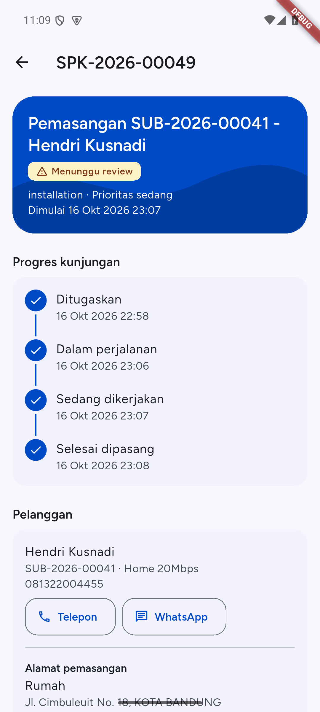

Kantor lalu menyetujui SPK (**Selesai**) atau mengembalikannya (**Dikembalikan**) dengan **Alasan dikembalikan**. Anda mendapat notifikasi untuk keduanya (bab 6). SPK yang dikembalikan tidak tampil di daftar pekerjaan sampai kantor menugaskannya lagi. Setelah itu SPK muncul kembali sebagai **Ditugaskan**, kotak **Alasan dikembalikan** tampil di atas, dan **Progres kunjungan** dimulai dari awal dengan waktu penugasan yang baru.

### SPK dikembalikan ke kantor

Bila kantor tidak menyetujui hasil kerja, status SPK menjadi **Dikembalikan**. Detail SPK menampilkan kotak **Dikembalikan ke kantor** dengan tulisan "Menunggu penugasan ulang." di bawah kartu judul, lalu kotak **Alasan dikembalikan** yang memuat alasan dari kantor. Selama menunggu, Anda tidak bisa mengerjakan SPK itu.

- **Telepon kantor** membuka pemanggil ke nomor telepon perusahaan.
- **WhatsApp kantor** membuka percakapan ke nomor WhatsApp perusahaan.

Tombol yang nomornya belum diisi ISP tidak tampil. Bila ISP mengisi keduanya, keduanya ada. SPK dikembalikan tidak muncul di tab **Pekerjaan**; buka dari notifikasi "SPK ditolak".

### Kesalahan umum pada SPK

- **Tombol kirim untuk ditinjau nonaktif.** Baca teks merah di bawahnya, itu syarat yang belum terpenuhi.
- **Pesan dari server saat Mulai atau Kirim.** Bila status SPK sudah berubah (misalnya dibatalkan atau dialihkan kantor), aplikasi menampilkan alasan dari server dan memuat ulang SPK.
- **"Data sudah berubah. Kami memuat ulang."** SPK diubah pihak lain saat Anda membukanya. Periksa isi layar yang baru, lalu ulangi tindakan.
- **"Anda tidak punya akses untuk tindakan ini."** SPK dialihkan ke teknisi lain atau status tidak mengizinkan tindakan itu.
- **Aksi tersimpan "Gagal dikirim: {alasan}".** Server menolak aksi yang menunggu sinyal, misalnya SPK sudah dialihkan. Ketuk **Coba lagi** atau **Buang** (lihat bagian berikut).

## Tanpa sinyal: aksi menunggu kirim

Aksi berikut tidak gagal saat sinyal hilang: **Saya berangkat**, **Mulai** (SPK dan tiket), kirim SPK untuk ditinjau, **Selesaikan** tiket, komentar tiket, deklarasi material, dan permintaan barang. Aplikasi menyimpannya di ponsel dan mengirimnya sendiri saat sinyal kembali, satu per satu menurut urutan ketukan, per SPK atau tiket. Kirim ulang karena sinyal putus memakai kunci yang sama, jadi server tidak mencatatnya dua kali.

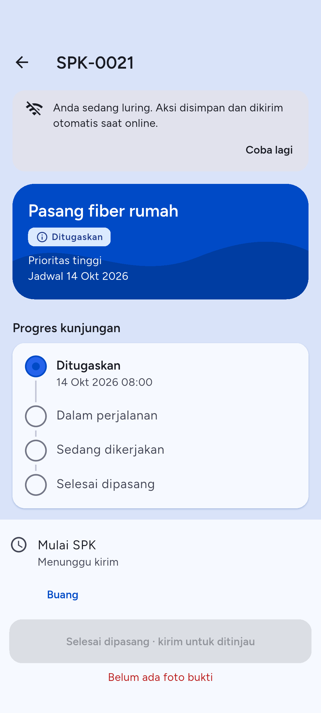

1. Ketuk aksinya dan konfirmasi seperti biasa.
2. Tanpa sinyal, layar menulis banner "Anda sedang luring. Aksi disimpan dan dikirim otomatis saat online." Aksi itu muncul di atas tombol, bertanda **Menunggu kirim**. Tombol untuk aksi yang sama tidak ditawarkan lagi.
3. Saat sinyal kembali, tanda berganti menjadi **Mengirim**, lalu hilang bila server menerima. Ketuk **Coba lagi** di banner untuk memeriksa sinyal dan mengirim saat itu juga.

Bila server menolak aksi itu, tandanya menjadi **Gagal dikirim: {alasan}** dengan dua tombol:

- **Coba lagi** mengirim ulang aksi itu. Untuk **Mulai** yang ditolak karena jauh dari lokasi, aplikasi menanyakan **Alasan** lebih dulu.
- **Buang** menghapus aksi dari ponsel setelah konfirmasi "Buang aksi ini?". Aksi yang dibuang tidak pernah terkirim.

Aksi yang ditolak menahan aksi di belakangnya untuk SPK atau tiket yang sama sampai Anda memutuskannya. Di layar mana pun, pemberitahuan merah "N aksi gagal dikirim" dengan tombol **Lihat aksi** membuka lembar **Aksi belum terkirim**, yang mendaftar semua aksi yang menunggu dari semua SPK dan tiket ("Semua aksi sudah terkirim." bila kosong).

### Belum pasti terkirim

Kadang aksi sudah sampai ke server, tetapi jawabannya tidak sampai ke ponsel, misalnya sinyal putus tepat saat server menjawab. Aplikasi mencobanya lagi beberapa kali, lalu berhenti setelah sekitar 30 menit tanpa jawaban yang jelas. Aksi itu tampil dengan tulisan "Belum pasti terkirim. Aksi ini mungkin sudah sampai, dan mengirim ulang tidak membuatnya ganda." Waktu tanpa sinyal sama sekali tidak dihitung.

- Periksa dulu status SPK atau tiketnya di layar. Aplikasi memuatnya ulang saat aksi berhenti.
- **Coba lagi** mengirim aksi yang sama sekali lagi. Server mengenali aksi yang sudah pernah diterima dan tidak mencatatnya dua kali, jadi komentar atau permintaan barang tidak menjadi ganda.
- **Buang** menghentikan pengiriman setelah konfirmasi "{aksi} belum pasti terkirim dan mungkin sudah sampai. Bila dibuang, aplikasi berhenti mengirimnya. Periksa statusnya di layar dulu." Aksi yang sudah sampai tetap tercatat di kantor.

Beberapa hal tetap butuh internet dan tombolnya nonaktif dengan tulisan "Butuh koneksi internet": menampilkan kata sandi PPPoE, tambah, ubah, dan hapus material di SPK, lampiran tiket, menghapus foto yang sudah terkirim, membatalkan permintaan barang, notifikasi uji, dan masuk.

# 4. Tiket

Tiket adalah laporan gangguan atau permintaan layanan dari pelanggan. Tiket yang ditugaskan kepada Anda tampil di tab **Pekerjaan** dengan label **Tiket**.

## Detail tiket dan Mulai

Ketuk baris tiket di tab **Pekerjaan**.

Detail tiket dibuka dengan kartu judul yang memuat kode, judul, status, **Prioritas** (misalnya "Prioritas mendesak"), **Kategori**, dan batas waktu: "Respons sebelum 21:17 · sisa 41 mnt" selama tiket menunggu respons pertama (merah bila lewat), serta "Batas {tanggal}" untuk batas penyelesaian. Di bawahnya, dalam urutan ini:

1. **Pelanggan**: nama, nomor telepon dengan tombol **Telepon** dan **WhatsApp** (WhatsApp hanya ada bila nomornya nomor seluler Indonesia), lalu alamat tempat Anda harus datang dengan tombol **Buka di Maps**. Untuk pelanggan, itu **Alamat pemasangan**; tiket tanpa pelanggan memakai **Lokasi** tiket. Bila alamat belum diisi, aplikasi menulis "Alamat pelanggan belum diisi. Hubungi kantor."
2. **POP**: POP atau gudang yang tercatat di tiket, dengan tombol **Buka di Maps** sendiri. Kartu ini hanya tampil bila alamat di atas adalah alamat pemasangan, supaya tidak tertukar.
3. **Deskripsi**, **Lampiran**, dan **Komentar**. Setelah tiket diselesaikan, **Catatan penyelesaian** juga tampil.

Untuk memulai:

1. Buka tiket berstatus **Ditugaskan**.
2. Ketuk **Mulai**.
3. Aplikasi bertanya "Mulai tiket ini?" dan menjelaskan bahwa status berubah menjadi **Dikerjakan** dan kantor bisa melihatnya. Ketuk **Mulai**.
4. Setelah tiket dimulai, aplikasi menulis hasil check-in di bagian bawah layar: "Check-in tercatat, 120 m dari lokasi" (jarak dihitung dari posisi Anda), atau "Mulai tercatat tanpa lokasi" bila posisi tidak tersedia.

Seperti pada SPK, aplikasi mencatat posisi Anda bila izin lokasi diberikan. Tanpa izin, tiket tetap dimulai. Bila Anda lebih jauh dari lokasi pelanggan daripada batas kantor, aplikasi menanyakan **Alasan** lebih dulu (lihat "Jauh dari lokasi pelanggan" di bab 3). Tanpa internet, **Mulai** disimpan dan dikirim saat sinyal kembali.

## Komentar dan komentar internal

Di bagian bawah daftar **Komentar** ada kotak komentar.

1. Ketik di kolom **Tulis komentar** (maksimal 2000 karakter).
2. Untuk catatan yang hanya boleh dibaca staf, nyalakan **Catatan internal**. Teksnya: "Hanya staf yang melihatnya, pelanggan tidak." Biarkan mati untuk komentar yang boleh dibaca pelanggan.
3. Ketuk **Kirim komentar**.

Komentar Anda diberi label **Anda**, komentar staf diberi label **Staf**, dan komentar internal diberi label **Internal**. Tombol kirim nonaktif saat kolom kosong dan saat teks lebih dari 2000 karakter. Tanpa internet, komentar tidak hilang: komentar itu muncul di atas kolom dengan tanda **Menunggu kirim** dan terkirim sendiri saat sinyal kembali, sementara kolom sudah bebas untuk komentar berikutnya.

### Balasan cepat

Pada tiket yang masih dikerjakan, selama kolom komentar kosong dan **Catatan internal** mati, bagian **Balasan cepat** tampil di atas kolom. Satu ketukan langsung mengirim komentar yang bisa dibaca pelanggan, tanpa konfirmasi:

- "Laporan diterima. Saya menuju lokasi."
- "Laporan diterima. Saya periksa dari jaringan dulu."
- "Mohon nyalakan ulang modem, lalu kabari hasilnya di sini."

Balasan cepat dihitung sebagai respons pertama, sama seperti komentar yang Anda ketik. Tombolnya nonaktif selama komentar sedang disimpan. Mulai mengetik, atau menyalakan **Catatan internal**, menyembunyikannya.

## Lampiran

Lampirkan foto yang membantu kantor, misalnya foto modem atau lampu indikator.

1. Di bagian **Lampiran**, ketuk **Tambah lampiran**.
2. Pilih **Kamera** atau **Galeri**, lalu ambil atau pilih foto.
3. Di jendela **Keterangan foto**, ketik keterangan (opsional, maksimal 255 karakter), lalu ketuk **Simpan**.
4. Aplikasi mengunggah dan menulis "Lampiran ditambahkan."

Foto lampiran diproses sama seperti foto bukti SPK: JPEG, sisi terpanjang paling besar 1920 piksel, tanpa EXIF. Server menerima berkas JPG, PNG, dan PDF sampai 10 MB; aplikasi hanya mengirim foto.

Lampiran tiket **tidak** memakai antrean unggah. Tombol **Tambah lampiran** nonaktif tanpa internet. Bila unggahan gagal di tengah jalan, foto tetap di bawah daftar dengan pilihan **Kirim ulang** dan **Buang**.

Lampiran PDF dari kantor atau pelanggan tampil dengan namanya ("Buka PDF {nama}"). Ketuk untuk mengunduhnya: aplikasi menulis "Membuka PDF", lalu membuka lembar bagikan Android tempat Anda memilih aplikasi pembaca PDF. Bila gagal, aplikasi menulis "PDF tidak bisa dibuka. Coba lagi."

Untuk menghapus lampiran: ketuk **Hapus** di barisnya, lalu konfirmasi "Hapus lampiran ini?". Tombol **Hapus** hanya ada pada lampiran yang Anda unggah, selama tiket belum selesai. Lampiran bisa ditambah sampai tiket ditutup.

## Selesaikan tiket

1. Buka tiket berstatus **Dikerjakan**.
2. Ketuk **Selesaikan**.
3. Di lembar **Selesaikan tiket**, isi **Catatan penyelesaian**: apa yang Anda temukan dan lakukan. Catatan wajib diisi, maksimal 1000 karakter.
4. Ketuk **Selesaikan tiket**.

Setelah berhasil, tombol aksi hilang dari layar tiket dan **Catatan penyelesaian** tampil di detail. Bila pengiriman gagal, catatan yang sudah Anda ketik tetap tersimpan di lembar itu selama Anda tidak meninggalkan layar tiket. Tanpa internet, **Selesaikan tiket** disimpan dengan tanda **Menunggu kirim** dan terkirim saat sinyal kembali; tiket langsung tampil sebagai **Diselesaikan**.

### Kesalahan umum pada tiket

- **"Isi catatan penyelesaian."** Catatan kosong. Tombol **Selesaikan tiket** nonaktif sampai catatan terisi.
- **"Maksimal 1000 karakter."** atau **"Maksimal 2000 karakter."** Persingkat teksnya.
- **"Data tidak ditemukan atau sudah dihapus."** Tiket dialihkan ke orang lain atau dihapus. Aplikasi menutup layar tiket.
- **"Butuh koneksi internet."** Lampiran dan hapus lampiran butuh internet. Mulai, Selesaikan, dan komentar tidak: ketiganya menunggu kirim. Layar tetap bisa dibaca dari salinan terakhir.

# 5. Material dan permintaan barang

Tab **Material** punya dua bagian: material yang **Perlu dideklarasi** dan **Permintaan barang saya**.

## Deklarasi material (pengembalian)

Setelah gudang menyerahkan barang untuk SPK Anda, Anda wajib melaporkan berapa yang terpakai dan berapa yang kembali dalam kondisi baik. Sisanya, yang tidak terpakai dan tidak kembali, dihitung aplikasi sebagai selisih (rusak atau hilang). Pengembalian yang menunggu laporan Anda muncul di bagian **Perlu dideklarasi**, berlabel **Perlu dideklarasi** atau **Perlu koreksi**. Selama ada yang belum dideklarasi, SPK tidak bisa dikirim untuk ditinjau.

1. Di tab **Material**, ketuk baris di **Perlu dideklarasi**. Atau ketuk notifikasi pengembalian, atau tombol **Deklarasi** di SPK.
2. Untuk tiap barang, aplikasi menulis **Diserahkan** (jumlah dari gudang), misalnya "Diserahkan 10 m". Bila SPK sudah mencatat pemakaian barang itu, **Terpakai** terisi dengan angka dari catatan SPK (paling banyak sebesar yang diserahkan), **Kembali baik** terisi sisanya, dan di bawah **Terpakai** tertulis "Dari catatan SPK" sampai Anda mengetik angka lain. Bila SPK tidak mencatat apa-apa dan Anda belum pernah melapor, **Terpakai** sama dengan **Diserahkan** dan **Kembali baik** 0. Ubah angkanya sesuai yang terjadi:
   - **Terpakai**: jumlah yang Anda pakai.
   - **Kembali baik**: jumlah sisa yang masih bagus.
   - **Selisih**: tidak diketik. Aplikasi menghitungnya (Diserahkan dikurangi Terpakai dikurangi Kembali baik) dan menulis misalnya "Selisih 2 m". Selisih nol berarti angkanya pas.
3. Bila **Selisih** lebih dari 0, wajib pilih **Penyebab selisih** (**Rusak**, **Hilang**, atau **Lainnya**) dan isi **Alasan selisih**. Kolom itu hanya tampil saat ada selisih.
4. Ketuk **Semua terpakai** bila semua barang terpakai: tombol itu mengisi **Terpakai** sama dengan **Diserahkan** dan **Kembali baik** 0 untuk setiap barang.
5. Bila perlu, isi **Alasan keseluruhan (opsional)**, maksimal 1000 karakter.
6. Ketuk **Kirim deklarasi**.

Angka harus 0 atau lebih; koma atau titik sama saja. Bila kantor meminta koreksi, **Alasan koreksi** tampil di atas formulir; perbaiki angka lalu kirim lagi. Deklarasi yang sudah dikirim dan tidak butuh koreksi hanya bisa dibaca: "Deklarasi ini tidak dapat diubah sekarang."

Kesalahan umum:

- **"Isi angka 0 atau lebih."** Ada kolom kosong atau berisi teks.
- **"Terpakai dan kembali melebihi yang diserahkan"** tampil di bawah Selisih: jumlah Terpakai ditambah Kembali baik lebih besar dari Diserahkan. Kurangi salah satunya, karena deklarasi tidak bisa dikirim selama angkanya melebihi.
- **"Pilih penyebab selisih."** atau **"Isi alasan selisih."** Selisih lebih dari 0 butuh penyebab dan alasan.
- **"Deklarasi sudah dikirim dengan nilai berbeda. Muat ulang."** Deklarasi sudah terkirim dari perangkat lain atau sebelumnya. Aplikasi memuat ulang datanya.
- Tanpa internet, **Kirim deklarasi** menyimpan deklarasi dan menulis "Deklarasi disimpan. Dikirim otomatis saat online."

## Permintaan barang baru

Gunakan ini bila Anda butuh barang dari gudang untuk pekerjaan.

Ada dua jalan masuk:

- Dari detail SPK: di bagian **Material**, ketuk **Minta material**. Tombol ini tampil saat SPK **Ditugaskan** atau **Dikerjakan**, dan formulir terbuka dengan SPK itu sudah terpilih.
- Dari tab **Material**: ketuk **Permintaan baru** (tombol melayang di kanan bawah).

Lalu isi formulir:

1. Pilih **Gudang asal**. Bila hanya ada satu gudang, gudang itu otomatis terpilih. Bila ada beberapa, yang terpilih adalah gudang yang Anda pakai pada permintaan terakhir selama masih punya stok, atau bila tidak, gudang dengan barang tersedia terbanyak. Tiap gudang di daftar memuat "{n} barang tersedia", atau "Stok kosong" dengan ikon peringatan bila tidak ada yang tersedia. Mengganti gudang memuat ulang ketersediaan setiap barang. Bila daftar kosong, aplikasi menulis "Belum ada gudang yang bisa dipilih. Hubungi kantor."
2. Cek kolom **SPK**. Pilihannya **Tanpa SPK** dan SPK Anda yang **Ditugaskan** atau **Dikerjakan**, masing-masing tertulis "kode · judul". Kolom ini terisi sendiri. Bila Anda datang dari **Minta material**, SPK itu yang terpilih. Bila Anda datang dari tab **Material**, yang terpilih adalah SPK yang sedang dikerjakan, atau bila tidak ada, SPK **Ditugaskan** dengan jadwal terdekat. Ganti pilihannya, atau pilih **Tanpa SPK** bila barang itu bukan untuk SPK.
3. Isi **Alasan (opsional)**, maksimal 2000 karakter. Bila dikosongkan dan SPK terpilih, alasannya tertulis "Permintaan material untuk SPK" disusul nomor SPK.
4. Ketuk **Tambah barang**. Layar **Pilih material** mengelompokkan barang menurut kategorinya (urut abjad, **Tanpa kategori** terakhir). Tiap barang menampilkan **Stok {jumlah} {satuan}** untuk gudang yang dipilih, atau **Stok kosong** dengan ikon peringatan bila jumlahnya 0. Cari dan ketuk barang, lalu isi **Jumlah diminta**. Jumlah di atas stok menampilkan peringatan **Melebihi stok tersedia ({jumlah} {satuan})**, tetapi tidak memblokir permintaan karena gudang masih dapat menerima stok. Ketuk **Tambah** dan ulangi untuk barang lain.
5. Untuk membuang baris barang, ketuk ikon tempat sampah di sebelahnya.
6. Ketuk **Kirim permintaan**.

Aplikasi menulis "Permintaan REQ-xxxx diajukan." Permintaan langsung masuk antrean gudang, tanpa tahap draf. Tanpa internet, aplikasi menyimpan permintaan, menutup formulir, dan menulis "Permintaan disimpan. Dikirim otomatis saat online."; permintaan baru muncul di **Permintaan barang saya** setelah terkirim.

Permintaan yang memuat SPK menjadi material SPK itu. Barang yang gudang serahkan untuk SPK itu dihitung terhadap pemakaian SPK, jadi saat kantor menyetujui SPK, barang tersebut tidak dikurangi dari stok untuk kedua kalinya. Gudang tidak bisa menyerahkan barang bila SPK-nya sudah selesai atau dibatalkan.

Kesalahan umum:

- **"Pilih gudang asal."** atau **"Tambahkan minimal satu barang."** muncul bila bagian itu belum diisi.
- **"SPK harus SPK aktif (ditugaskan atau dikerjakan) milik Anda."** tampil di bawah kolom **SPK**: SPK itu sudah selesai, dibatalkan, atau pindah ke teknisi lain sejak daftar dimuat. Pilih SPK lain atau **Tanpa SPK**.
- Pesan lain dari server tampil di bawah kolom yang dimaksud, dan permintaan yang ditolak itu tidak disimpan di ponsel.

## Pantau dan batalkan permintaan

Di **Permintaan barang saya**, tiap permintaan menampilkan kode, barang dan jumlah, SPK terkait (ketuk untuk membukanya), dan status. Baris barang menulis berapa yang sudah jalan, bukan hanya berapa yang Anda minta: setelah gudang menyetujui, "Kabel UTP: disetujui 50 dari 80", dan setelah barang diserahkan, "Kabel UTP: diserahkan 50 dari 80". Sebelum itu baris hanya menulis jumlah yang diminta.

| Status | Arti |
| --- | --- |
| Diajukan | Menunggu gudang |
| Disetujui | Gudang menyetujui dan mengalokasikan barang |
| Disiapkan | Gudang menyiapkan barang |
| Siap diambil | Barang siap, ambil di gudang |
| Diserahkan | Barang sudah diserahkan kepada Anda |
| Ditolak | Gudang menolak |
| Dibatalkan | Permintaan dibatalkan |

Untuk membatalkan permintaan yang masih menunggu gudang:

1. Ketuk **Batalkan** di baris permintaan. Tombol hanya ada selama permintaan masih bisa dibatalkan.
2. Di jendela "Batalkan permintaan REQ-xxxx?", isi alasan (opsional).
3. Ketuk **Batalkan permintaan**. Ketuk **Kembali** untuk mempertahankannya.

Permintaan yang dibatalkan tidak bisa dipulihkan. Bila permintaan sudah disetujui gudang saat Anda menekan tombol, aplikasi memuat ulang daftar dan permintaan tidak dibatalkan.

Tarik layar tab **Material** ke bawah untuk memperbarui kedua daftar. Daftar juga diperbarui sendiri saat aplikasi dibuka kembali, saat Anda membuka tab **Material**, dan setelah Anda mengirim deklarasi (langsung), serta sekitar 1 detik setelah notifikasi terakhir dalam satu rentetan.

# 6. Notifikasi

Tab **Notifikasi** adalah kotak masuk pemberitahuan dari Inbils, misalnya SPK baru ditugaskan, tiket ditugaskan, deklarasi material, dan permintaan barang yang siap diambil. Angka merah di ikon tab menunjukkan jumlah yang belum dibaca.

Cara memakai:

1. Buka tab **Notifikasi**. Notifikasi yang belum dibaca bertitik biru.
2. Ketuk notifikasi. Aplikasi menandainya sudah dibaca dan membuka layar terkait: SPK, tiket, pengembalian material, atau tab **Material** untuk permintaan barang.
3. Ketuk ikon centang ganda (**Tandai semua dibaca**) di kanan atas untuk membaca semuanya sekaligus.
4. Tarik layar ke bawah untuk memperbarui daftar. Daftar juga diperbarui saat aplikasi dibuka kembali dari latar belakang.

Daftar memuat halaman berikutnya saat Anda menggulir. Bila kosong, aplikasi menulis "Belum ada notifikasi". Notifikasi untuk hal yang tidak dikelola aplikasi ini tetap di daftar dan tidak membuka layar apa pun.

Kesalahan umum: daftar tidak bertambah saat sinyal buruk. Tarik layar ke bawah setelah internet kembali.

## Jenis notifikasi

| Judul | Muncul saat | Push |
| --- | --- | --- |
| SPK baru ditugaskan | Kantor menugaskan SPK kepada Anda. Ketuk untuk membuka SPK. | Ya |
| SPK disetujui | Kantor menyetujui SPK yang Anda kirim untuk review. Isinya menyebut kode SPK. | Ya |
| SPK ditolak | Kantor menolak SPK Anda. Isinya menyebut kode SPK dan alasannya. Perbaiki pekerjaan setelah SPK ditugaskan ulang kepada Anda. | Ya |
| Tiket ditugaskan | Sebuah tiket diserahkan kepada Anda. Judulnya memuat kode dan prioritas, misalnya "Tiket TKT-0031 · Tinggi", dan isinya judul tiket serta "Respons sebelum {jam}". | Ya |
| Respons pertama segera jatuh tempo | Tiket yang ditugaskan perlu direspons dalam 30 menit. Respons berarti Anda menekan **Mulai** pada tiket itu atau mengirim komentar yang bisa dibaca pelanggan. | Ya |
| Batas respons pertama terlewat | Waktu respons pertama tiket sudah lewat. | Ya |
| SLA tiket terlampaui | Tiket melewati batas SLA. | Ya |
| Permintaan barang siap diambil | Gudang menyiapkan barang yang Anda minta. Ketuk untuk membuka tab **Material**. | Ya |
| Notifikasi uji | Anda mengetuk **Kirim notifikasi uji** di **Akun** → **Notifikasi uji** (bagian berikut). Isinya "Notifikasi uji dari {nama ISP}." Tidak membuka layar apa pun. | Ya, hanya ke ponsel yang mengirimnya |

Kolom **Push** menunjukkan notifikasi yang juga masuk ke layar ponsel. Notifikasi lain, misalnya pengembalian material, hanya ada di daftar ini.

## Notifikasi di layar ponsel (push)

Aplikasi bisa memunculkan notifikasi di layar ponsel Android Anda, juga saat aplikasi tertutup, sehingga SPK baru atau tiket yang hampir lewat SLA tidak terlewat. Isinya sama dengan yang ada di tab **Notifikasi**. Aplikasi sendiri yang menggambar notifikasi itu, baik saat terbuka, di latar belakang, maupun tertutup, jadi tampilannya sama di semua keadaan.

1. Setelah Anda masuk, aplikasi dapat meminta izin notifikasi lewat kotak dialog sistem Android. Pertanyaan ini hanya muncul di Android 13 ke atas dan hanya sekali, selama Anda belum memutuskannya.
2. Pilih izinkan. Aplikasi lalu mendaftarkan ponsel ini ke Inbils.
3. Ketuk notifikasi di layar ponsel. Aplikasi membuka layar terkait (SPK, tiket, atau tab **Material**), atau tab **Notifikasi** bila pesan tidak punya layar tujuan, dan menandainya sudah dibaca.
4. Saat aplikasi sedang terbuka, notifikasi tampil sebagai banner singkat di atas layar.
5. Bila beberapa notifikasi menunggu, Android menumpuknya dalam satu kelompok dengan satu baris ringkasan, "{n} notifikasi baru", yang memuat sampai lima judul (judul saja, tanpa isi pesan). Ketuk ringkasan itu untuk membuka tab **Notifikasi**. Ketuk satu notifikasi untuk membuka layar tujuannya. Bila layar itu sudah terbuka, isinya langsung dimuat ulang supaya yang Anda lihat adalah data terbaru, dengan garis tipis di atasnya selama memuat.
6. Nama ISP tampil sebagai teks kecil di notifikasi, bukan di judulnya. Pesan yang tidak punya judul maupun isi tidak ditampilkan di layar ponsel, tetapi daftar di tab **Notifikasi** tetap diperbarui. Daftar di tab **Notifikasi** mempertahankan posisi gulir Anda saat isinya diperbarui.

Bila Anda menolak izinnya, aplikasi tetap berfungsi dan tab **Notifikasi** tetap menerima semuanya. Untuk mengaktifkan push kemudian, nyalakan notifikasi aplikasi Inbils di pengaturan Android (**Pengaturan > Aplikasi**), lalu buka aplikasi lagi. Aplikasi memeriksa izinnya setiap kali dibuka dan mendaftarkan ponsel saat izin sudah menyala.

Saat **Keluar**, aplikasi menghapus pendaftaran ponsel ini, sehingga tidak ada push lagi sampai Anda masuk kembali, dan semua notifikasi aplikasi ini dihapus dari bayangan notifikasi, juga bila ponsel sedang offline. Aplikasi yang tidak punya sesi masuk tidak memunculkan notifikasi apa pun. Ponsel yang dikeluarkan dari **Perangkat** (bab 7), kata sandi yang diganti, atau akun yang dinonaktifkan juga berhenti menerima push.

Bila push tidak muncul, pastikan izin notifikasi menyala, ponsel punya internet dan Anda masih masuk di aplikasi ini. ISP juga harus sudah mengaktifkan push di servernya; bila belum, notifikasi tetap muncul di tab **Notifikasi**. Beberapa merek ponsel (misalnya Xiaomi dan Oppo) menghemat baterai dengan menahan aplikasi yang tertutup. Bila notifikasi datang terlambat atau tidak datang saat aplikasi tertutup, buka pengaturan baterai untuk aplikasi Inbils dan pilih **Tanpa pembatasan** (atau matikan optimalisasi baterai, dan izinkan mulai otomatis bila ponsel memintanya).

## Notifikasi uji

Layar **Notifikasi uji** memeriksa apakah ponsel ini bisa menerima push dari ISP Anda, dan bila tidak, apa yang harus diperbaiki. Pakai saat push tidak muncul, sesudah ganti ponsel atau mengubah pengaturan baterai, atau sesudah masuk di ponsel baru.

1. Buka tab **Akun**, lalu ketuk **Notifikasi uji**. Layar ini butuh internet.
2. Baca tiga pemeriksaan dari atas ke bawah. Tiap pemeriksaan punya ikon dan teks hasil, jadi tidak bergantung pada warna:
   - **Izin notifikasi**: **Diizinkan**, **Belum ditanyakan** (ketuk **Izinkan** untuk memunculkan pertanyaan Android), atau **Diblokir di pengaturan HP** (ketuk **Buka pengaturan**, lalu nyalakan notifikasi aplikasi Inbils). Bila pengaturan tidak terbuka, aplikasi menulis "Pengaturan tidak bisa dibuka. Buka Pengaturan HP, lalu Aplikasi, Inbils, Notifikasi." Aplikasi memeriksa izin lagi saat Anda kembali dari pengaturan.
   - **Token terdaftar di server**: awalnya **Belum diperiksa**. Hasilnya **Terdaftar** diikuti nama ponsel ini, atau **Belum terdaftar** (ketuk **Daftarkan ulang**, lalu kirim notifikasi uji lagi). Bila server belum memasang Firebase, hasilnya "Notifikasi push belum aktif di server" dengan saran **Perbaiki** "Hubungi admin ISP Anda: Firebase server belum dipasang."
   - **Pesan diterima**: **Belum dikirim**, lalu "Menunggu pesan… N dtk" dengan hitungan mundur 30 detik, lalu "Diterima dalam N dtk" atau "Pesan tidak datang dalam 30 detik".
3. Ketuk **Kirim notifikasi uji**. Tombol aktif bila izin sudah **Diizinkan**, token tidak **Belum terdaftar**, dan tidak ada pengiriman yang sedang berjalan. Aplikasi memeriksa izin dan token, lalu meminta server mengirim satu pesan ke ponsel ini saja, bukan ke ponsel lain di akun Anda.
4. Tetap di layar ini selama hitungan mundur. Pesan uji muncul sebagai banner di atas layar dan pemeriksaan **Pesan diterima** menjadi hijau dengan lama kedatangannya. Pesan yang sama tersimpan di tab **Notifikasi** dengan judul "Notifikasi uji".

Bila **Pesan diterima** gagal, baca saran **Perbaiki** di bawahnya: "Periksa internet dan mode hemat baterai, lalu coba lagi. Bila tetap gagal, minta admin memeriksa status Firebase di Pengaturan → Integrasi." Admin ISP melihat status Firebase di halaman web **Integrasi** (kartu **Notifikasi aplikasi (Firebase)**: **Kredensial server** dan **Pengiriman terakhir berhasil**). Mode hemat baterai di beberapa ponsel menahan push untuk aplikasi yang tertutup. Keluarkan Inbils dari pembatasan baterai di pengaturan Android bila itu terjadi.

Kesalahan umum:

- "Terlalu banyak percobaan. Coba lagi dalam N detik.": satu akun boleh mengirim 3 notifikasi uji per menit. Tombol aktif lagi setelah hitungan itu.
- Tombol **Kirim notifikasi uji** tidak bisa diketuk: lihat pemeriksaan **Izin notifikasi** dan **Token terdaftar di server**. Selesaikan saran di bawahnya.
- "Tidak ada koneksi internet. Periksa sinyal, lalu coba lagi.": ponsel tidak punya internet, jadi server tidak bisa menjawab. Nyalakan internet, lalu kirim lagi.

# 7. Akun

Tab **Akun** menampilkan **Nama**, **Email**, dan **Telepon** Anda ("Belum diisi" bila kosong), pilihan **Tampilan**, dan menu di bawahnya.

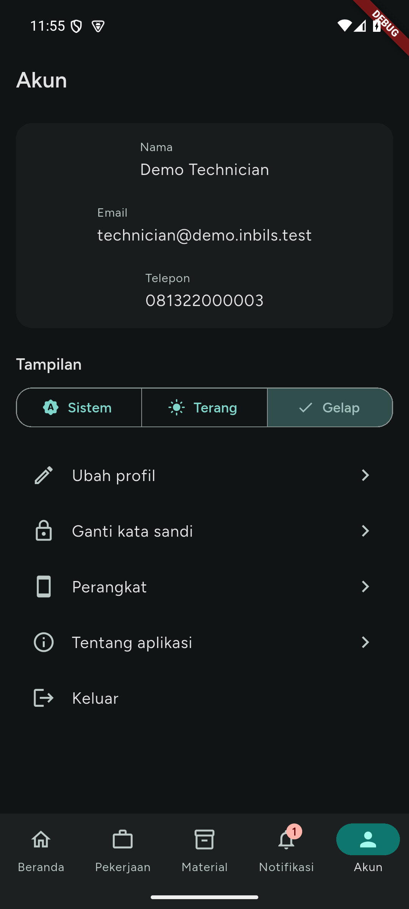

**Tampilan** memilih mode warna aplikasi: **Sistem** (mengikuti pengaturan ponsel), **Terang**, atau **Gelap**. Pilihan berlaku seketika dan tersimpan di ponsel ini. Warna utamanya mengikuti warna merek ISP, terang maupun gelap.

Menu: **Ubah profil**, **Ganti kata sandi**, **Perangkat**, **Notifikasi uji**, **Tentang aplikasi**, **Keluar**. Menu ini tetap bisa dibuka tanpa internet, jadi Anda tetap bisa keluar dari akun. **Notifikasi uji** sendiri butuh internet untuk mengirim pesan.

## Ubah profil

1. Ketuk **Ubah profil**.
2. Ubah **Nama** (wajib diisi) dan **Telepon**.
3. Ketuk **Simpan**. Aplikasi menulis "Profil diperbarui."

**Email login** tampil tetapi tidak bisa diubah di aplikasi. Hubungi kantor Inbils bila perlu mengubahnya. Kesalahan umum: **"Isi nama Anda."** bila nama kosong.

## Ganti kata sandi

1. Ketuk **Ganti kata sandi**.
2. Isi **Kata sandi saat ini**, **Kata sandi baru**, dan **Ulangi kata sandi baru**.
3. Ketuk **Ganti kata sandi**.

Setelah berhasil, **semua perangkat yang sedang masuk keluar, termasuk ponsel ini**. Aplikasi membuka layar **Masuk** dengan pesan "Kata sandi sudah diganti. Masuk lagi dengan kata sandi baru." Masuk lagi dengan kata sandi baru. Kata sandi yang sama berlaku di situs web.

Kesalahan umum:

- **"Kata sandi saat ini salah."** Periksa kata sandi lama.
- **"Kata sandi baru minimal 8 karakter."**
- **"Ulangan kata sandi baru tidak sama."**
- **"Terlalu banyak percobaan."** Terlalu sering salah memasukkan kata sandi lama. Tunggu sesuai hitungan.

## Perangkat

Layar **Perangkat** mendaftar ponsel yang sedang masuk ke akun Anda, dengan nama ponsel dan waktu terakhir dipakai. Ponsel yang sedang Anda pakai diberi label **Perangkat ini**.

Untuk mengeluarkan ponsel (misalnya ponsel hilang):

1. Ketuk ikon keluar di baris ponsel itu.
2. Konfirmasi "Keluarkan perangkat?".
3. Ponsel itu keluar dari akun Anda dan harus masuk lagi. Aplikasi menulis "Perangkat dikeluarkan."

Bila Anda mengeluarkan ponsel yang sedang Anda pakai, Anda ikut keluar dari aplikasi. Tarik layar ke bawah untuk memperbarui daftar.

## Tentang aplikasi

Menampilkan **Aplikasi**, **Versi** dan nomor build, **ID aplikasi**, **Lingkungan**, **Server**, dan **Lisensi sumber terbuka**. Sebutkan versi dan build ini saat melapor masalah ke kantor. Layar ini juga bisa dibuka dari layar **Masuk** sebelum Anda masuk:

## Keluar

1. Ketuk **Keluar**.
2. Konfirmasi "Keluar dari akun?". Anda perlu masuk lagi untuk memakai aplikasi.
3. Bila masih ada foto di antrean unggah atau aksi yang belum terkirim, dialog menulis "N bukti atau aksi belum terkirim akan dihapus. Keluar?". Semuanya dihapus dari ponsel bila Anda lanjut. Batalkan dan kirim lebih dulu bila perlu.

# 8. Kesalahan umum dan FAQ

## Pesan yang sering muncul

| Pesan | Penyebab dan tindakan |
| --- | --- |
| Tidak ada koneksi internet. Periksa sinyal, lalu coba lagi. | Ponsel offline. Pindah ke tempat bersinyal lalu ketuk **Coba lagi**. |
| Anda sedang offline. Data yang tampil mungkin belum terbaru. | Aplikasi menampilkan salinan terakhir. Tarik layar ke bawah setelah sinyal pulih. |
| Butuh koneksi internet | Tindakan itu tidak bisa disimpan untuk nanti: menampilkan kata sandi PPPoE, tambah atau hapus material, lampiran, menghapus foto yang sudah terkirim, membatalkan permintaan barang, notifikasi uji. Mulai, Saya berangkat, kirim untuk review, komentar, selesaikan tiket, deklarasi, dan permintaan barang menunggu kirim dan tidak memunculkan pesan ini. |
| Anda sedang luring. Aksi disimpan dan dikirim otomatis saat online. | Banner di layar SPK, tiket, dan pengembalian material saat sinyal hilang. Aksi Anda tersimpan dan terkirim sendiri. Ketuk **Coba lagi** di banner setelah sinyal pulih. |
| N aksi gagal dikirim | Server menolak aksi yang tersimpan, atau aksi belum pasti terkirim. Ketuk **Lihat aksi**, lalu **Coba lagi** atau **Buang**. |
| Belum pasti terkirim. Aksi ini mungkin sudah sampai, dan mengirim ulang tidak membuatnya ganda. | Jawaban server tidak sampai ke ponsel selama sekitar 30 menit. Periksa status di layar, lalu ketuk **Coba lagi** (tidak membuat ganda) atau **Buang**. |
| Jauh dari lokasi pelanggan | Anda menekan **Mulai** lebih jauh dari batas kantor. Tulis **Alasan**, lalu ketuk **Mulai**. |
| Sesi Anda berakhir. Silakan masuk lagi. | Sesi habis (30 hari), kata sandi atau pengaturan verifikasi dua langkah berubah, atau perangkat dikeluarkan. Masuk lagi. |
| Akun Anda dinonaktifkan. Hubungi kantor Inbils. | Admin menonaktifkan akun. |
| Akun ini tidak terdaftar sebagai teknisi. | Akun belum berhak memakai aplikasi teknisi. Hubungi kantor. |
| Terlalu banyak percobaan. Coba lagi dalam N detik. | Batas percobaan tercapai. Tunggu sesuai hitungan. |
| Data sudah berubah. Kami memuat ulang. | Data diubah pihak lain. Periksa layar yang baru lalu ulangi. |
| Permintaan sebelumnya masih diproses. Coba lagi sebentar lagi. | Tindakan yang sama masih berjalan. Tunggu beberapa detik. |
| Server sedang bermasalah. Coba lagi beberapa saat lagi. | Gangguan di sisi server. Coba lagi nanti. |

## FAQ

**Apa yang terjadi bila sinyal hilang di lokasi?**
Daftar pekerjaan, detail SPK dan tiket, notifikasi, dan permintaan barang tetap bisa dibaca dari salinan terakhir. Foto bukti SPK tetap bisa diambil dan masuk antrean unggah; foto terkirim otomatis saat sinyal kembali, atau ketuk **Kirim sekarang**. Saya berangkat, Mulai, kirim untuk ditinjau, selesaikan tiket, komentar, deklarasi material, dan permintaan barang disimpan di ponsel dengan tanda **Menunggu kirim** lalu terkirim sendiri. Menampilkan kata sandi PPPoE, tambah material, lampiran tiket, dan menghapus foto yang sudah terkirim butuh internet.

**Foto bukti saya belum terkirim. Apa yang harus dilakukan?**
Buka banner **N foto belum terkirim** untuk melihat antrean. Ketuk **Kirim sekarang**. Untuk foto **Gagal**, ketuk **Coba lagi** atau hapus dan ambil ulang. Jangan keluar dari akun sebelum antrean kosong, karena keluar menghapus foto dan aksi yang belum terkirim.

**Kenapa tombol kirim untuk ditinjau nonaktif?**
Baca teks merah di bawahnya. Penyebabnya: belum ada foto bukti, masih ada foto di antrean, atau ada deklarasi material yang belum dikirim. Tanpa internet tombol tetap bisa diketuk; aksinya menunggu kirim.

**Aksi saya "Gagal dikirim". Apa yang harus dilakukan?**
Baca alasannya di bawah nama aksi. Ketuk **Coba lagi** bila masalahnya sudah selesai (misalnya sinyal atau jarak), atau **Buang** bila aksi itu tidak perlu lagi. Aksi yang ditolak menahan aksi lain pada SPK atau tiket yang sama. Bila tulisannya "Belum pasti terkirim", aksi itu mungkin sudah sampai: periksa statusnya di layar, lalu **Coba lagi** aman karena server tidak mencatatnya dua kali.

**Kenapa aplikasi menanyakan alasan saat Mulai?**
Anda lebih jauh dari lokasi pelanggan daripada batas yang diatur kantor (bawaan 500 m). Tulis alasannya, misalnya "Jalan ditutup, saya parkir di ujung gang", lalu ketuk **Mulai**. Kantor membacanya di SPK atau tiket.

**Saya lupa kata sandi.**
Ketuk **Lupa kata sandi?** di layar **Masuk**, isi email, dan buka link yang dikirim ke email Anda. Kata sandi baru diketik di halaman web yang dibuka link itu.

**Saya kehilangan ponsel dengan aplikasi ini.**
Masuk dari ponsel lain, buka **Akun > Perangkat**, dan keluarkan ponsel yang hilang. Atau ganti kata sandi: semua perangkat langsung keluar.

**Ponsel autentikator saya hilang.**
Pakai kode pemulihan di layar **Verifikasi dua langkah**. Bila kode pemulihan juga hilang, minta admin Inbils mereset verifikasi dua langkah akun Anda.

**Bisa pakai aplikasi di dua ponsel?**
Bisa. Tiap ponsel punya sesi sendiri dan tampil di **Akun > Perangkat**.

**Berapa ukuran dan jenis foto yang diterima?**
Server menerima JPG dan PNG sampai 10 MB. Aplikasi sudah mengecilkan foto ke JPEG dengan sisi terpanjang 1920 piksel sebelum mengirim, jadi ukuran jarang jadi masalah. Lampiran tiket menerima juga PDF di sisi server, tetapi aplikasi mengirim foto.

**Di mana saya mengatur verifikasi dua langkah?**
Di situs web Inbils, halaman profil. Aplikasi hanya memintanya saat masuk.

**Yang tidak bisa dilakukan di aplikasi.**
Mengganti email, membuat akun, mengatur verifikasi dua langkah, dan mengatur ulang kata sandi lewat link email dilakukan di web atau oleh kantor Inbils.
