# 1. Pendahuluan

Aplikasi **Inbils Teknisi** adalah aplikasi Android untuk teknisi lapangan. Dengan aplikasi ini Anda menerima SPK dan tiket yang ditugaskan, memulai dan menyelesaikannya, mengirim foto bukti kerja, mencatat material, dan meminta barang ke gudang. Akun teknisi tidak lagi memakai situs web Inbils untuk pekerjaan harian.

Panduan ini mengikuti urutan layar di aplikasi. Empat tab di bagian bawah layar: **Pekerjaan**, **Material**, **Notifikasi**, **Akun**.

## Memasang aplikasi

1. Minta tautan Play Store aplikasi Inbils Teknisi kepada kantor Inbils. Tautan yang sama muncul sebagai tombol **Buka Play Store** bila akun teknisi Anda membuka situs web Inbils.
2. Buka tautan di ponsel Android, lalu pasang aplikasi.
3. Buka aplikasi **Inbils Teknisi**.

Aplikasi hanya tersedia untuk Android.

## Akun

Akun dibuat oleh admin Inbils. Anda tidak bisa mendaftar sendiri di aplikasi. Admin memberi Anda email dan kata sandi awal, dan mengaktifkan akun Anda sebagai teknisi dengan profil karyawan aktif.

Aplikasi memakai **email dan kata sandi yang sama dengan situs web Inbils**. Mengganti kata sandi di aplikasi berarti mengganti kata sandi di web, dan sebaliknya.

## Masuk

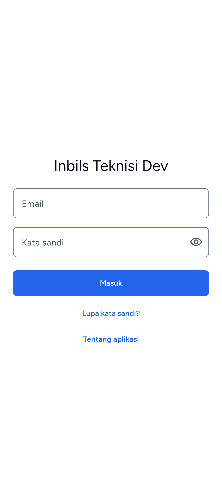

1. Ketik **Email** Anda.
2. Ketik **Kata sandi**. Ketuk ikon mata untuk menampilkan atau menyembunyikannya.
3. Ketuk **Masuk**.
4. Bila akun Anda memakai verifikasi dua langkah, aplikasi membuka layar kode (lihat bagian berikutnya). Bila tidak, Anda langsung masuk ke tab **Pekerjaan**.

Setelah masuk, aplikasi mengingat sesi Anda di ponsel ini. Anda tidak perlu masuk lagi setiap kali membuka aplikasi.

### Kesalahan umum saat masuk

- **"Email atau kata sandi salah."** Periksa ejaan email dan huruf besar-kecil kata sandi.
- **"Akun ini tidak terdaftar sebagai teknisi."** Akun Anda belum diberi hak teknisi atau profil karyawan Anda tidak aktif. Hubungi kantor Inbils.
- **"Akun Anda dinonaktifkan. Hubungi kantor Inbils."** Admin menonaktifkan akun Anda.
- **"Terlalu banyak percobaan. Coba lagi dalam N detik."** Tunggu sesuai hitungan, lalu coba lagi.
- **"Tidak ada koneksi internet."** Masuk selalu butuh internet.

## Verifikasi dua langkah

Bila verifikasi dua langkah aktif di akun Anda, setelah email dan kata sandi benar aplikasi membuka layar **Verifikasi dua langkah**.

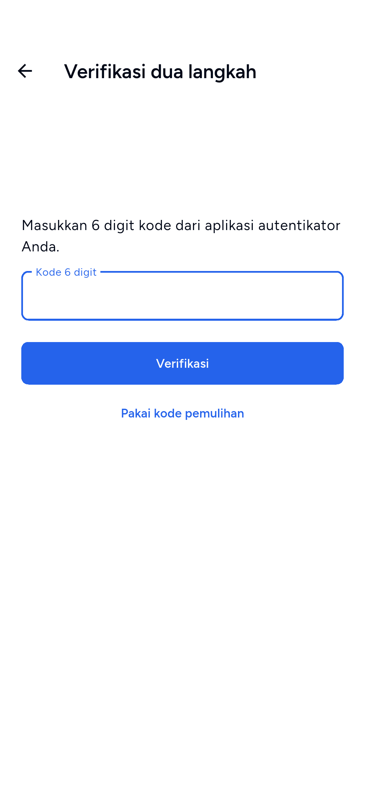

1. Buka aplikasi autentikator di ponsel Anda.
2. Ketik **Kode 6 digit** yang tampil untuk Inbils.
3. Ketuk **Verifikasi**.
4. Bila ponsel autentikator hilang, ketuk **Pakai kode pemulihan**, ketik salah satu kode pemulihan Anda, lalu ketuk **Verifikasi**. Setiap kode pemulihan hanya berlaku sekali. Ketuk **Pakai kode autentikator** untuk kembali ke kode 6 digit.

Verifikasi dua langkah diaktifkan, dimatikan, dan dikelola di **situs web** Inbils (halaman profil), bukan di aplikasi. Setiap kali pengaturan itu berubah, semua ponsel yang sedang masuk keluar otomatis dan Anda masuk lagi.

### Kesalahan umum pada verifikasi dua langkah

- **"Kode salah. Periksa lalu coba lagi."** Pastikan jam ponsel akurat dan Anda memakai kode terbaru dari aplikasi autentikator.
- **"Kode verifikasi kedaluwarsa. Silakan masuk lagi."** Anda terlalu lama di layar ini. Aplikasi kembali ke layar **Masuk**; ulangi dari awal.
- Jumlah percobaan dibatasi. Setelah beberapa kali salah, tunggu sebelum mencoba lagi.

## Lupa kata sandi

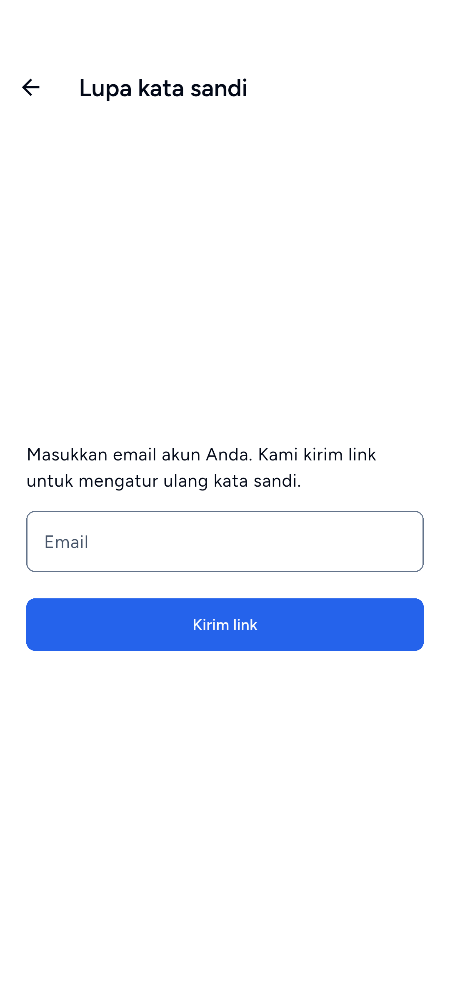

1. Di layar **Masuk**, ketuk **Lupa kata sandi?**. Bila Anda sudah mengetik email, aplikasi membawanya ke layar ini.
2. Ketik email akun Anda, lalu ketuk **Kirim link**.
3. Aplikasi menjawab "Jika email itu terdaftar, link atur ulang kata sandi sudah kami kirim." Jawaban ini sama untuk email apa pun, jadi tidak membocorkan email mana yang terdaftar.
4. Buka email Anda dan ketuk link di dalamnya. Link membuka **halaman web** Inbils tempat Anda mengetik kata sandi baru. Kata sandi tidak diatur ulang di dalam aplikasi.
5. Kembali ke aplikasi dan masuk dengan kata sandi baru.

Bila sebuah akun masih memakai kata sandi lama yang wajib diganti, aplikasi menampilkan lembar **Atur ulang kata sandi** dengan pesan "Demi keamanan, atur ulang kata sandi lewat link yang kami kirim ke email Anda." Ketuk **Kirim link** dan ikuti langkah 4 dan 5.

Kesalahan umum: email tidak masuk. Periksa folder spam, lalu tunggu satu menit sebelum meminta link lagi. Permintaan link dibatasi per menit.

## Perangkat dan keluar

Satu sesi aplikasi berlaku untuk satu ponsel. Anda bisa melihat dan mengeluarkan ponsel lain di **Akun > Perangkat** (lihat bab 7).

Untuk keluar dari aplikasi: **Akun > Keluar**, lalu konfirmasi. Bila masih ada foto bukti yang belum terkirim, aplikasi memberi peringatan bahwa foto itu akan dihapus (lihat bab 3).

## Sesi berakhir

Sesi aplikasi teknisi berlaku 30 hari sejak masuk. Aplikasi memperpanjang sesi saat masa berlakunya tersisa kurang dari 7 hari. Bila sesi habis, atau kata sandi Anda diganti, atau akun dinonaktifkan, aplikasi membuka layar **Masuk** dengan pesan "Sesi Anda berakhir. Silakan masuk lagi." Masuk lagi dengan email dan kata sandi.

# 2. Pekerjaan

Tab **Pekerjaan** adalah layar utama. Isinya SPK dan tiket yang ditugaskan kepada Anda.

## Daftar pekerjaan

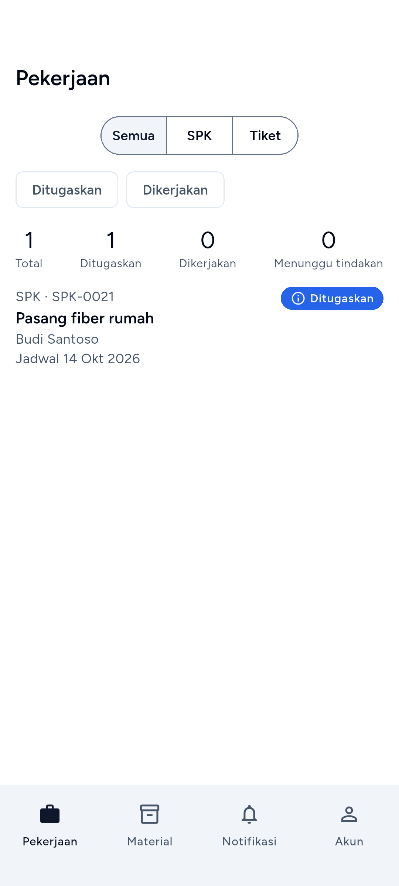

Layar menampilkan, dari atas ke bawah:

- **Ringkasan angka**: **Total**, **Ditugaskan**, **Dikerjakan**, dan **Menunggu tindakan**.
- Pilihan jenis: **Semua**, **SPK**, atau **Tiket**.
- Filter status: **Ditugaskan** dan **Dikerjakan**. Ketuk satu untuk menyaring, ketuk lagi untuk melepas.
- Baris pekerjaan. Tiap baris memuat jenis dan kode (misalnya `SPK · SPK-0021`), judul, nama pelanggan, status, dan tanggal: **Jadwal** untuk SPK, **Batas** untuk tiket. Tiket yang lewat batas waktu layanan diberi label **SLA terlewat**.

Cara memakai:

1. Pilih **Semua**, **SPK**, atau **Tiket**.
2. Bila perlu, ketuk filter **Ditugaskan** atau **Dikerjakan**.
3. Ketuk baris untuk membuka detail SPK atau detail tiket.
4. Geser daftar ke bawah sampai habis. Aplikasi memuat halaman berikutnya sendiri.

Tarik layar ke bawah (pull-to-refresh) untuk memperbarui daftar. Tarikan yang sama juga mencoba mengirim foto bukti yang menunggu di antrean (lihat bab 3).

Bila tidak ada pekerjaan, layar menulis "Tidak ada pekerjaan untuk filter ini."

## Kesalahan umum

- **Banner "Data offline · diperbarui HH:mm".** Ponsel tidak punya internet, dan aplikasi menampilkan salinan terakhir. Pekerjaan baru dan perubahan status tidak muncul sampai internet kembali. Tarik layar ke bawah setelah sinyal pulih.
- **Banner "N foto belum terkirim".** Ada foto bukti di antrean unggah. Ketuk untuk membukanya.
- **Pekerjaan tidak muncul.** Hanya pekerjaan berstatus Ditugaskan dan Dikerjakan yang ditugaskan kepada Anda yang tampil. Bila yakin ada yang kurang, minta kantor memeriksa penugasan.

# 3. SPK

SPK (surat perintah kerja) adalah pekerjaan instalasi atau perbaikan di lokasi pelanggan. Alurnya: **Ditugaskan** → Anda mulai → **Dikerjakan** → Anda kirim untuk review → **Menunggu review** → kantor menyetujui (**Selesai**) atau mengembalikan (**Dikembalikan**).

## Detail SPK dan Mulai

Ketuk baris SPK di tab **Pekerjaan**.

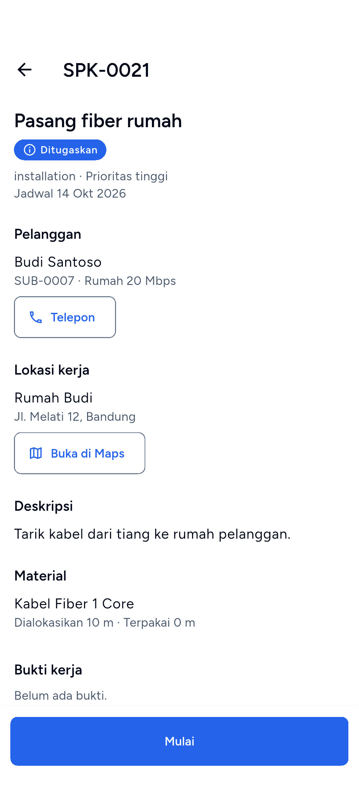

Detail SPK memuat judul, status, jenis dan prioritas, jadwal, kode tiket asal (bila ada), **Pelanggan**, **Lokasi kerja**, **Deskripsi**, **Material**, dan **Bukti kerja**. Bila kantor mengembalikan SPK, kotak **Alasan dikembalikan** tampil di atas.

- Ketuk **Telepon** untuk menelepon pelanggan.
- Ketuk **Buka di Maps** untuk membuka lokasi kerja di aplikasi peta.

Untuk memulai pekerjaan:

1. Buka SPK berstatus **Ditugaskan**.
2. Ketuk **Mulai** di bagian bawah.
3. Aplikasi bertanya "Mulai SPK ini?". Ketuk **Mulai**. Status berubah menjadi **Dikerjakan** dan kantor bisa melihatnya.

Saat memulai, aplikasi meminta izin lokasi dan mencatat posisi Anda sebagai tanda tiba di lokasi. Bila Anda menolak izin, GPS mati, atau sinyal GPS tidak dapat dibaca dalam 15 detik, SPK tetap dimulai tanpa posisi.

Mulai butuh internet. Tanpa internet tombol nonaktif dan aplikasi menulis "Butuh koneksi internet".

## Foto bukti dan antrean unggah

Foto bukti diwajibkan sebelum SPK dikirim untuk review. Foto diambil saat SPK berstatus **Dikerjakan**.

1. Di bagian **Bukti kerja**, ketuk **Ambil foto**.
2. Pilih sumber di lembar **Ambil foto dari**: **Kamera** atau **Galeri**.
3. Ambil atau pilih foto.
4. Di jendela **Keterangan foto**, ketik keterangan (opsional, maksimal 255 karakter), lalu ketuk **Simpan**.
5. Aplikasi menulis "Foto masuk antrean unggah." dan langsung mencoba mengirim.

Aplikasi mengecilkan foto sebelum mengirim: format JPEG, sisi terpanjang paling besar 1920 piksel, dan data EXIF (termasuk lokasi GPS foto) dibuang. Ukuran file hasilnya jauh di bawah batas server 10 MB.

Foto tidak hilang saat sinyal buruk. Setiap foto masuk **antrean unggah** di ponsel lebih dulu dan dikirim satu per satu, yang lama lebih dulu. Foto yang belum terkirim muncul di bagian **Bukti kerja** dan di banner **N foto belum terkirim**.

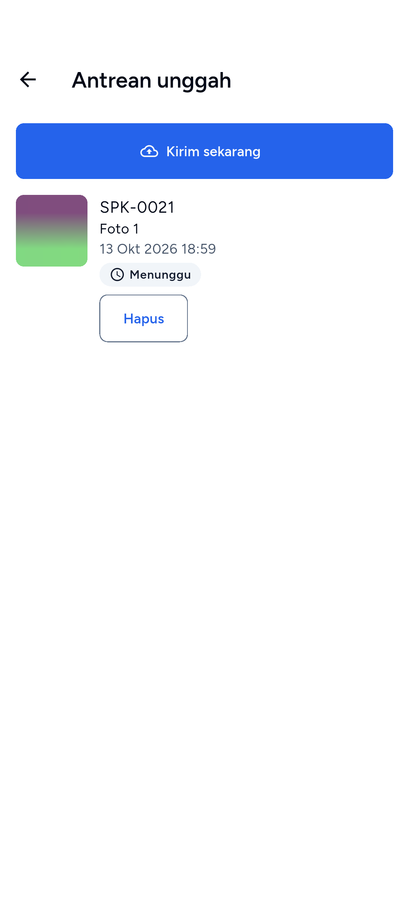

Ketuk banner untuk membuka **Antrean unggah**. Tiap foto punya status:

- **Menunggu**: belum terkirim, aplikasi akan mencoba lagi sendiri.
- **Mengunggah**: sedang dikirim.
- **Gagal**: server menolak foto, atau berkas foto hilang dari ponsel.

Tombol di layar ini:

- **Kirim sekarang**: kirim semua foto yang menunggu tanpa menunggu jeda otomatis.
- **Coba lagi** (foto Gagal): masukkan foto kembali ke antrean dan kirim.
- **Hapus**: buang foto dari antrean. Foto ini belum terkirim dan hilang dari ponsel.

Untuk menghapus foto yang sudah terkirim: ketuk foto di **Bukti kerja**, lalu **Hapus** dan konfirmasi "Hapus foto ini?". Anda hanya bisa menghapus foto yang Anda unggah sendiri, selama SPK masih **Dikerjakan**.

### Kesalahan umum pada foto

- **"Foto tidak dapat diproses. Coba lagi."** File yang dipilih bukan gambar yang bisa dibaca. Ambil foto ulang.
- **"Server menolak foto ini."** Foto tidak memenuhi aturan server (JPG atau PNG, maksimal 10 MB) atau SPK sudah tidak menerima bukti. Hapus dari antrean dan ambil foto baru, atau hubungi kantor.
- **"Berkas foto hilang dari ponsel."** Berkas dihapus dari penyimpanan ponsel. Hapus barisnya dan ambil foto lagi.
- **Foto terputus karena aplikasi ditutup Android.** Saat aplikasi dibuka lagi, aplikasi memulihkan foto itu ke antrean dan menulis "Foto yang terputus dipulihkan dan masuk antrean unggah."
- **Keluar dari akun saat foto masih di antrean.** Aplikasi memperingatkan "N bukti belum terkirim akan dihapus. Keluar?". Kirim foto lebih dulu agar tidak hilang.

## Material di SPK

Bagian **Material** di detail SPK menampilkan material yang kantor alokasikan dan yang sudah Anda pakai: **Dialokasikan** dan **Terpakai**. Saat SPK **Dikerjakan**, Anda bisa mencatat pemakaian sendiri.

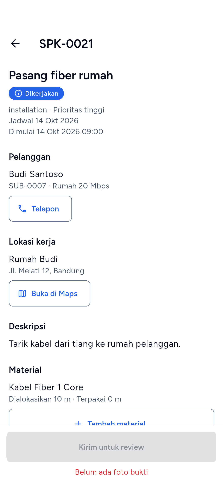

### Tambah atau ubah pemakaian

1. Di bagian **Material**, ketuk **Tambah material**.
2. Di layar **Pilih material**, ketik nama atau kode di **Cari material**, lalu ketuk material yang dipakai. Material yang tidak muncul berarti tidak ada di daftar material aktif perusahaan, atau berupa perangkat bernomor seri yang diurus kantor.

   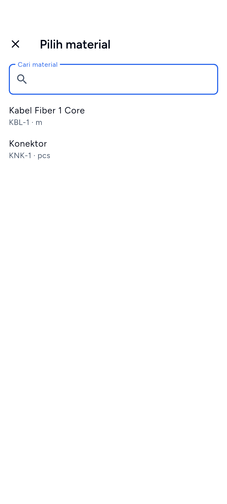

3. Di jendela **Catat pemakaian**, isi **Jumlah** (lebih dari 0, maksimal dua angka desimal; koma atau titik sama saja), lalu ketuk **Simpan**.
4. Aplikasi menulis "Material dicatat."

Bila material itu sudah ada di SPK, jumlah **Terpakai** diganti dengan angka baru. Untuk mengubah jumlah, ulangi langkah di atas dan isi angka yang benar. Jumlah **Dialokasikan** dari kantor tidak berubah.

### Hapus pemakaian

1. Di baris material, ketuk **Hapus**.
2. Konfirmasi "Hapus pemakaian material ini?". Jumlah terpakai material itu di SPK menjadi 0.

Baris yang direncanakan kantor tetap tampil dengan **Terpakai** 0, hanya pemakaian Anda yang dihapus. Baris yang tidak punya pemakaian Anda tidak punya tombol **Hapus**. Bila server menolak, baris menulis "Baris ini tidak bisa diubah dari aplikasi" dan tombolnya hilang.

Tambah, ubah, dan hapus material butuh internet.

## Kirim untuk review

Setelah pekerjaan selesai, kirim SPK ke kantor untuk diperiksa.

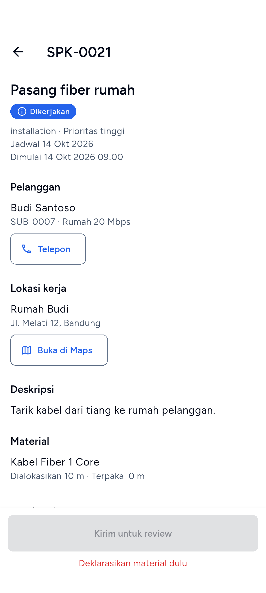

Tombol **Kirim untuk review** di bagian bawah detail SPK baru aktif bila semua syarat ini terpenuhi:

- Minimal **satu foto bukti** sudah terkirim. Tanpa foto, aplikasi menulis "Belum ada foto bukti".
- Tidak ada foto yang masih di antrean. Aplikasi menulis "Tunggu N foto terkirim".
- Semua deklarasi material sudah dikirim (lihat bab 5). Aplikasi menulis "Deklarasikan material dulu" selama masih ada yang perlu dideklarasi.
- Ada koneksi internet.

Langkah:

1. Pastikan syarat di atas terpenuhi dan teks merah di bawah tombol hilang.
2. Ketuk **Kirim untuk review**.
3. Status SPK berubah menjadi **Menunggu review**.

Kantor lalu menyetujui SPK (**Selesai**) atau mengembalikannya (**Dikembalikan**) dengan **Alasan dikembalikan**. Anda mendapat notifikasi untuk keduanya (bab 6).

### Kesalahan umum pada SPK

- **Tombol Kirim untuk review nonaktif.** Baca teks merah di bawahnya, itu syarat yang belum terpenuhi.
- **Pesan dari server saat Mulai atau Kirim.** Bila status SPK sudah berubah (misalnya dibatalkan atau dialihkan kantor), aplikasi menampilkan alasan dari server dan memuat ulang SPK.
- **"Data sudah berubah. Kami memuat ulang."** SPK diubah pihak lain saat Anda membukanya. Periksa isi layar yang baru, lalu ulangi tindakan.
- **"Anda tidak punya akses untuk tindakan ini."** SPK dialihkan ke teknisi lain atau status tidak mengizinkan tindakan itu.

# 4. Tiket

Tiket adalah laporan gangguan atau permintaan layanan dari pelanggan. Tiket yang ditugaskan kepada Anda tampil di tab **Pekerjaan** dengan label **Tiket**.

## Detail tiket dan Mulai

Ketuk baris tiket di tab **Pekerjaan**.

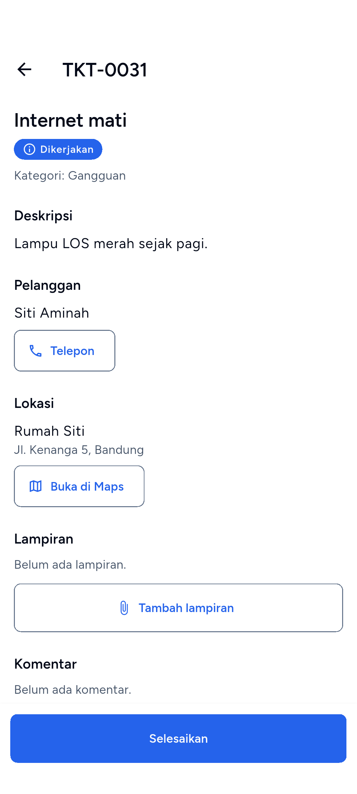

Detail tiket memuat kode, judul, status, **Kategori**, **Deskripsi**, **Pelanggan** (dengan tombol **Telepon**), **Lokasi** (dengan tombol **Buka di Maps**), **Lampiran**, dan **Komentar**. Setelah tiket diselesaikan, **Catatan penyelesaian** juga tampil.

Untuk memulai:

1. Buka tiket berstatus **Ditugaskan**.
2. Ketuk **Mulai**.
3. Aplikasi bertanya "Mulai tiket ini?" dan menjelaskan bahwa status berubah menjadi **Dikerjakan** dan kantor bisa melihatnya. Ketuk **Mulai**.

Seperti pada SPK, aplikasi mencatat posisi Anda bila izin lokasi diberikan. Tanpa izin, tiket tetap dimulai. Mulai butuh internet.

## Komentar dan komentar internal

Di bagian bawah daftar **Komentar** ada kotak komentar.

1. Ketik di kolom **Tulis komentar** (maksimal 2000 karakter).
2. Untuk catatan yang hanya boleh dibaca staf, nyalakan **Catatan internal**. Teksnya: "Hanya staf yang melihatnya, pelanggan tidak." Biarkan mati untuk komentar yang boleh dibaca pelanggan.
3. Ketuk **Kirim komentar**.

Komentar Anda diberi label **Anda**, komentar staf diberi label **Staf**, dan komentar internal diberi label **Internal**. Tombol kirim nonaktif saat kolom kosong, saat teks lebih dari 2000 karakter, dan saat tidak ada internet.

## Lampiran

Lampirkan foto yang membantu kantor, misalnya foto modem atau lampu indikator.

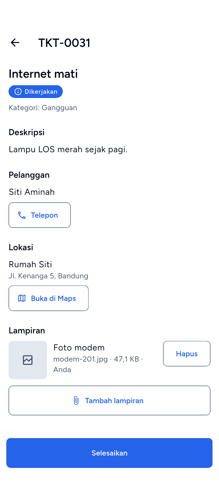

1. Di bagian **Lampiran**, ketuk **Tambah lampiran**.
2. Pilih **Kamera** atau **Galeri**, lalu ambil atau pilih foto.
3. Di jendela **Keterangan foto**, ketik keterangan (opsional, maksimal 255 karakter), lalu ketuk **Simpan**.
4. Aplikasi mengunggah dan menulis "Lampiran ditambahkan."

Foto lampiran diproses sama seperti foto bukti SPK: JPEG, sisi terpanjang paling besar 1920 piksel, tanpa EXIF. Server menerima berkas JPG, PNG, dan PDF sampai 10 MB; aplikasi hanya mengirim foto.

Lampiran tiket **tidak** memakai antrean unggah. Tombol **Tambah lampiran** nonaktif tanpa internet. Bila unggahan gagal di tengah jalan, foto tetap di bawah daftar dengan pilihan **Kirim ulang** dan **Buang**.

Untuk menghapus lampiran: ketuk **Hapus** di barisnya, lalu konfirmasi "Hapus lampiran ini?". Tombol **Hapus** hanya ada pada lampiran yang Anda unggah, selama tiket belum selesai. Lampiran bisa ditambah sampai tiket ditutup.

## Selesaikan tiket

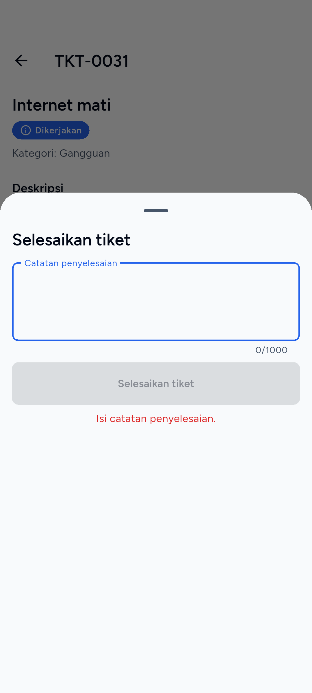

1. Buka tiket berstatus **Dikerjakan**.
2. Ketuk **Selesaikan**.
3. Di lembar **Selesaikan tiket**, isi **Catatan penyelesaian**: apa yang Anda temukan dan lakukan. Catatan wajib diisi, maksimal 1000 karakter.
4. Ketuk **Selesaikan tiket**.

Setelah berhasil, tombol aksi hilang dari layar tiket dan **Catatan penyelesaian** tampil di detail. Bila pengiriman gagal, catatan yang sudah Anda ketik tetap tersimpan di lembar itu selama Anda tidak meninggalkan layar tiket.

### Kesalahan umum pada tiket

- **"Isi catatan penyelesaian."** Catatan kosong. Tombol **Selesaikan tiket** nonaktif sampai catatan terisi.
- **"Maksimal 1000 karakter."** atau **"Maksimal 2000 karakter."** Persingkat teksnya.
- **"Data tidak ditemukan atau sudah dihapus."** Tiket dialihkan ke orang lain atau dihapus. Aplikasi menutup layar tiket.
- **"Butuh koneksi internet."** Mulai, Selesaikan, komentar, dan lampiran butuh internet. Layar tetap bisa dibaca dari salinan terakhir.

# 5. Material dan permintaan barang

Tab **Material** punya dua bagian: material yang **Perlu dideklarasi** dan **Permintaan barang saya**.

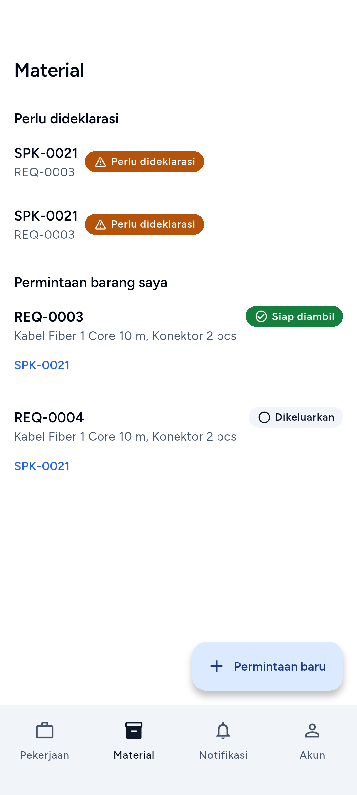

## Deklarasi material (pengembalian)

Setelah gudang mengeluarkan barang untuk SPK Anda, Anda wajib melaporkan berapa yang terpakai, berapa yang kembali dalam kondisi baik, dan berapa yang selisih (rusak atau hilang). Pengembalian yang menunggu laporan Anda muncul di bagian **Perlu dideklarasi**, berlabel **Perlu dideklarasi** atau **Perlu koreksi**. Selama ada yang belum dideklarasi, SPK tidak bisa dikirim untuk review.

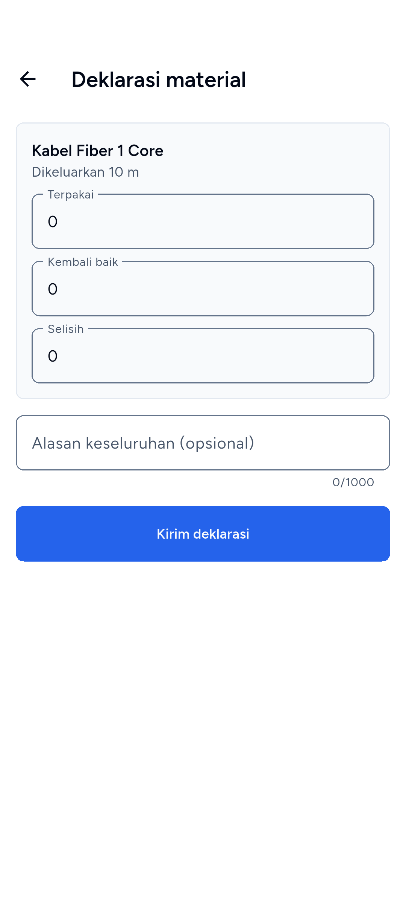

1. Di tab **Material**, ketuk baris di **Perlu dideklarasi**. Atau ketuk notifikasi pengembalian, atau tombol **Deklarasi** di SPK.
2. Untuk tiap barang, aplikasi menulis **Dikeluarkan** (jumlah dari gudang). Isi:
   - **Terpakai**: jumlah yang Anda pakai.
   - **Kembali baik**: jumlah sisa yang masih bagus.
   - **Selisih**: jumlah yang tidak kembali. Isi 0 bila tidak ada.
3. Bila **Selisih** lebih dari 0, wajib pilih **Penyebab selisih** (**Rusak**, **Hilang**, atau **Lainnya**) dan isi **Alasan selisih**.
4. Bila perlu, isi **Alasan keseluruhan (opsional)**, maksimal 1000 karakter.
5. Ketuk **Kirim deklarasi**.

Angka harus 0 atau lebih; koma atau titik sama saja. Bila kantor meminta koreksi, **Alasan koreksi** tampil di atas formulir; perbaiki angka lalu kirim lagi. Deklarasi yang sudah dikirim dan tidak butuh koreksi hanya bisa dibaca: "Deklarasi ini tidak dapat diubah sekarang."

Kesalahan umum:

- **"Isi angka 0 atau lebih."** Ada kolom kosong atau berisi teks.
- **"Pilih penyebab selisih."** atau **"Isi alasan selisih."** Selisih lebih dari 0 butuh penyebab dan alasan.
- **"Deklarasi sudah dikirim dengan nilai berbeda. Muat ulang."** Deklarasi sudah terkirim dari perangkat lain atau sebelumnya. Aplikasi memuat ulang datanya.
- Kirim deklarasi butuh internet.

## Permintaan barang baru

Gunakan ini bila Anda butuh barang dari gudang untuk pekerjaan.

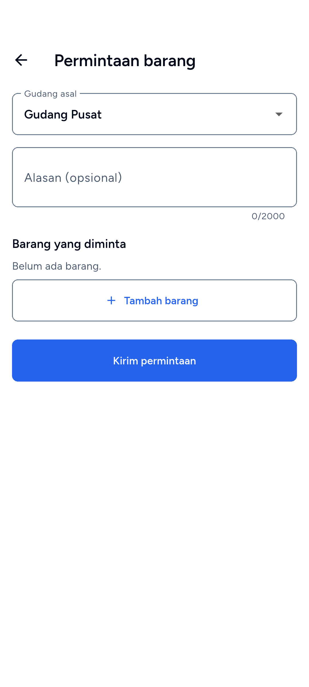

1. Di tab **Material**, ketuk **Permintaan baru** (tombol melayang di kanan bawah).
2. Pilih **Gudang asal**. Bila hanya ada satu gudang, otomatis terpilih. Bila daftar kosong, aplikasi menulis "Belum ada gudang yang bisa dipilih. Hubungi kantor."
3. Isi **Alasan (opsional)**, maksimal 2000 karakter.
4. Ketuk **Tambah barang**. Di layar **Pilih material**, cari dan ketuk barang, lalu isi **Jumlah diminta** dan ketuk **Tambah**. Barang yang sudah ada di daftar tidak bisa dipilih lagi ("Sudah ada di daftar"). Ulangi untuk tiap barang.
5. Untuk membuang baris barang, ketuk ikon tempat sampah di sebelahnya.
6. Ketuk **Kirim permintaan**.

Aplikasi menulis "Permintaan REQ-xxxx diajukan." Permintaan langsung masuk antrean gudang, tanpa tahap draf.

Kesalahan umum: **"Pilih gudang asal."** atau **"Tambahkan minimal satu barang."** muncul bila bagian itu belum diisi. Pesan dari server tampil di bawah kolom yang dimaksud. Kirim permintaan butuh internet.

## Pantau dan batalkan permintaan

Di **Permintaan barang saya**, tiap permintaan menampilkan kode, barang dan jumlah, SPK terkait (ketuk untuk membukanya), dan status:

| Status | Arti |
| --- | --- |
| Diajukan | Menunggu gudang |
| Disetujui | Gudang menyetujui dan mengalokasikan barang |
| Disiapkan | Gudang menyiapkan barang |
| Siap diambil | Barang siap, ambil di gudang |
| Dikeluarkan | Barang sudah diserahkan kepada Anda |
| Ditolak | Gudang menolak |
| Dibatalkan | Permintaan dibatalkan |

Untuk membatalkan permintaan yang masih menunggu gudang:

1. Ketuk **Batalkan** di baris permintaan. Tombol hanya ada selama permintaan masih bisa dibatalkan.
2. Di jendela "Batalkan permintaan REQ-xxxx?", isi alasan (opsional).
3. Ketuk **Batalkan permintaan**. Ketuk **Kembali** untuk mempertahankannya.

Permintaan yang dibatalkan tidak bisa dipulihkan. Bila permintaan sudah disetujui gudang saat Anda menekan tombol, aplikasi memuat ulang daftar dan permintaan tidak dibatalkan.

Tarik layar tab **Material** ke bawah untuk memperbarui kedua daftar.

# 6. Notifikasi

Tab **Notifikasi** adalah kotak masuk pemberitahuan dari Inbils, misalnya SPK baru ditugaskan, tiket ditugaskan, deklarasi material, dan permintaan barang yang siap diambil. Angka merah di ikon tab menunjukkan jumlah yang belum dibaca.

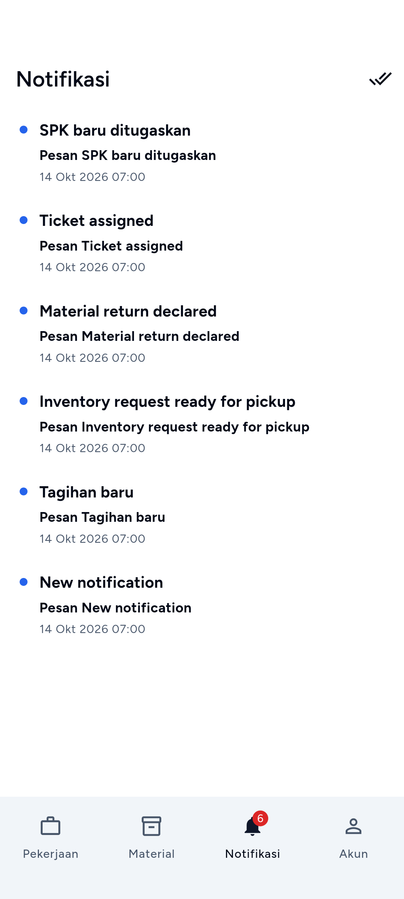

Cara memakai:

1. Buka tab **Notifikasi**. Notifikasi yang belum dibaca bertitik biru.
2. Ketuk notifikasi. Aplikasi menandainya sudah dibaca dan membuka layar terkait: SPK, tiket, pengembalian material, atau tab **Material** untuk permintaan barang.
3. Ketuk ikon centang ganda (**Tandai semua dibaca**) di kanan atas untuk membaca semuanya sekaligus.
4. Tarik layar ke bawah untuk memperbarui daftar. Daftar juga diperbarui saat aplikasi dibuka kembali dari latar belakang.

Daftar memuat halaman berikutnya saat Anda menggulir. Bila kosong, aplikasi menulis "Belum ada notifikasi". Notifikasi untuk hal yang tidak dikelola aplikasi ini tetap di daftar dan tidak membuka layar apa pun.

Kesalahan umum: daftar tidak bertambah saat sinyal buruk. Tarik layar ke bawah setelah internet kembali.

# 7. Akun

Tab **Akun** menampilkan **Nama**, **Email**, dan **Telepon** Anda ("Belum diisi" bila kosong), dan menu di bawahnya.

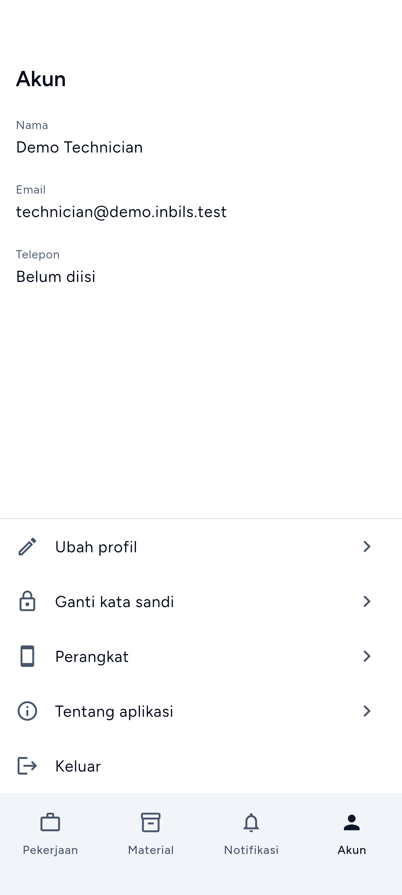

Menu: **Ubah profil**, **Ganti kata sandi**, **Perangkat**, **Tentang aplikasi**, **Keluar**. Menu ini tetap bisa dibuka tanpa internet, jadi Anda tetap bisa keluar dari akun.

## Ubah profil

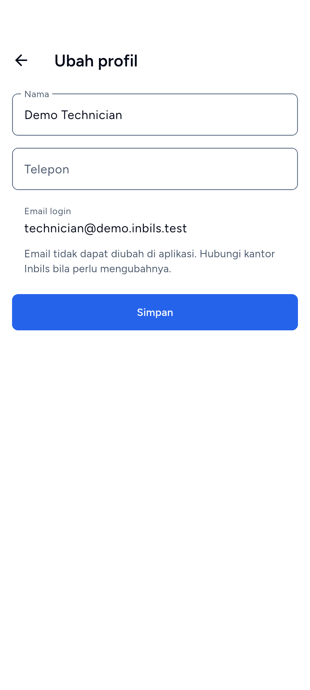

1. Ketuk **Ubah profil**.
2. Ubah **Nama** (wajib diisi) dan **Telepon**.
3. Ketuk **Simpan**. Aplikasi menulis "Profil diperbarui."

**Email login** tampil tetapi tidak bisa diubah di aplikasi. Hubungi kantor Inbils bila perlu mengubahnya. Kesalahan umum: **"Isi nama Anda."** bila nama kosong.

## Ganti kata sandi

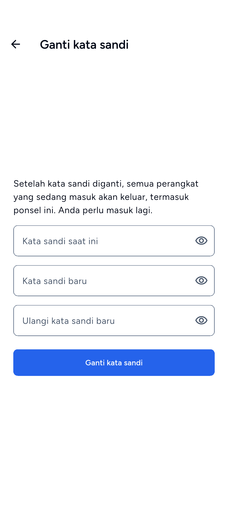

1. Ketuk **Ganti kata sandi**.
2. Isi **Kata sandi saat ini**, **Kata sandi baru**, dan **Ulangi kata sandi baru**.
3. Ketuk **Ganti kata sandi**.

Setelah berhasil, **semua perangkat yang sedang masuk keluar, termasuk ponsel ini**. Aplikasi membuka layar **Masuk** dengan pesan "Kata sandi sudah diganti. Masuk lagi dengan kata sandi baru." Masuk lagi dengan kata sandi baru. Kata sandi yang sama berlaku di situs web.

Kesalahan umum:

- **"Kata sandi saat ini salah."** Periksa kata sandi lama.
- **"Kata sandi baru minimal 8 karakter."**
- **"Ulangan kata sandi baru tidak sama."**
- **"Terlalu banyak percobaan."** Terlalu sering salah memasukkan kata sandi lama. Tunggu sesuai hitungan.

## Perangkat

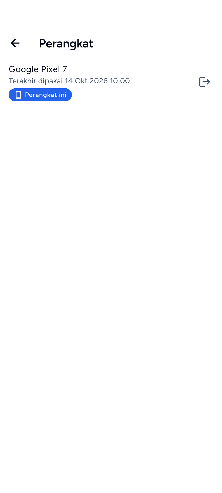

Layar **Perangkat** mendaftar ponsel yang sedang masuk ke akun Anda, dengan nama ponsel dan waktu terakhir dipakai. Ponsel yang sedang Anda pakai diberi label **Perangkat ini**.

Untuk mengeluarkan ponsel (misalnya ponsel hilang):

1. Ketuk ikon keluar di baris ponsel itu.
2. Konfirmasi "Keluarkan perangkat?".
3. Ponsel itu keluar dari akun Anda dan harus masuk lagi. Aplikasi menulis "Perangkat dikeluarkan."

Bila Anda mengeluarkan ponsel yang sedang Anda pakai, Anda ikut keluar dari aplikasi. Tarik layar ke bawah untuk memperbarui daftar.

## Tentang aplikasi

Menampilkan **Aplikasi**, **Versi** dan nomor build, **ID aplikasi**, **Lingkungan**, **Server**, dan **Lisensi sumber terbuka**. Sebutkan versi dan build ini saat melapor masalah ke kantor. Layar ini juga bisa dibuka dari layar **Masuk** sebelum Anda masuk:

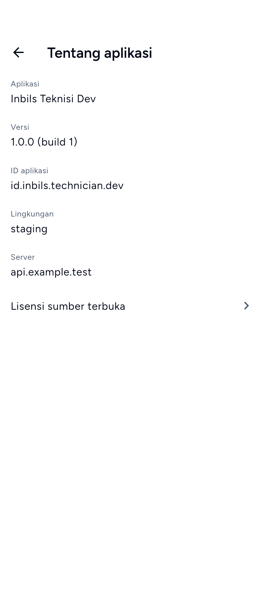

## Keluar

1. Ketuk **Keluar**.
2. Konfirmasi "Keluar dari akun?". Anda perlu masuk lagi untuk memakai aplikasi.
3. Bila masih ada foto di antrean unggah, dialog menulis "N bukti belum terkirim akan dihapus. Keluar?". Foto itu dihapus dari ponsel bila Anda lanjut. Batalkan dan kirim foto lebih dulu bila perlu.

# 8. Kesalahan umum dan FAQ

## Pesan yang sering muncul

| Pesan | Penyebab dan tindakan |
| --- | --- |
| Tidak ada koneksi internet. Periksa sinyal, lalu coba lagi. | Ponsel offline. Pindah ke tempat bersinyal lalu ketuk **Coba lagi**. |
| Anda sedang offline. Data yang tampil mungkin belum terbaru. | Aplikasi menampilkan salinan terakhir. Tarik layar ke bawah setelah sinyal pulih. |
| Butuh koneksi internet | Tindakan itu tidak bisa dilakukan offline (Mulai, Kirim untuk review, material, komentar, lampiran, deklarasi, permintaan barang). |
| Sesi Anda berakhir. Silakan masuk lagi. | Sesi habis (30 hari), kata sandi atau pengaturan verifikasi dua langkah berubah, atau perangkat dikeluarkan. Masuk lagi. |
| Akun Anda dinonaktifkan. Hubungi kantor Inbils. | Admin menonaktifkan akun. |
| Akun ini tidak terdaftar sebagai teknisi. | Akun belum berhak memakai aplikasi teknisi. Hubungi kantor. |
| Terlalu banyak percobaan. Coba lagi dalam N detik. | Batas percobaan tercapai. Tunggu sesuai hitungan. |
| Data sudah berubah. Kami memuat ulang. | Data diubah pihak lain. Periksa layar yang baru lalu ulangi. |
| Permintaan sebelumnya masih diproses. Coba lagi sebentar lagi. | Tindakan yang sama masih berjalan. Tunggu beberapa detik. |
| Server sedang bermasalah. Coba lagi beberapa saat lagi. | Gangguan di sisi server. Coba lagi nanti. |

## FAQ

**Apa yang terjadi bila sinyal hilang di lokasi?**
Daftar pekerjaan, detail SPK dan tiket, notifikasi, dan permintaan barang tetap bisa dibaca dari salinan terakhir. Foto bukti SPK tetap bisa diambil dan masuk antrean unggah; foto terkirim otomatis saat sinyal kembali, atau ketuk **Kirim sekarang**. Mulai, Kirim untuk review, material, komentar, lampiran tiket, deklarasi, dan permintaan barang butuh internet.

**Foto bukti saya belum terkirim. Apa yang harus dilakukan?**
Buka banner **N foto belum terkirim** untuk melihat antrean. Ketuk **Kirim sekarang**. Untuk foto **Gagal**, ketuk **Coba lagi** atau hapus dan ambil ulang. Jangan keluar dari akun sebelum antrean kosong, karena keluar menghapus foto yang belum terkirim.

**Kenapa tombol Kirim untuk review nonaktif?**
Baca teks merah di bawahnya. Penyebabnya: belum ada foto bukti, masih ada foto di antrean, ada deklarasi material yang belum dikirim, atau tidak ada internet.

**Saya lupa kata sandi.**
Ketuk **Lupa kata sandi?** di layar **Masuk**, isi email, dan buka link yang dikirim ke email Anda. Kata sandi baru diketik di halaman web yang dibuka link itu.

**Saya kehilangan ponsel dengan aplikasi ini.**
Masuk dari ponsel lain, buka **Akun > Perangkat**, dan keluarkan ponsel yang hilang. Atau ganti kata sandi: semua perangkat langsung keluar.

**Ponsel autentikator saya hilang.**
Pakai kode pemulihan di layar **Verifikasi dua langkah**. Bila kode pemulihan juga hilang, minta admin Inbils mereset verifikasi dua langkah akun Anda.

**Bisa pakai aplikasi di dua ponsel?**
Bisa. Tiap ponsel punya sesi sendiri dan tampil di **Akun > Perangkat**.

**Berapa ukuran dan jenis foto yang diterima?**
Server menerima JPG dan PNG sampai 10 MB. Aplikasi sudah mengecilkan foto ke JPEG dengan sisi terpanjang 1920 piksel sebelum mengirim, jadi ukuran jarang jadi masalah. Lampiran tiket menerima juga PDF di sisi server, tetapi aplikasi mengirim foto.

**Di mana saya mengatur verifikasi dua langkah?**
Di situs web Inbils, halaman profil. Aplikasi hanya memintanya saat masuk.

**Yang tidak bisa dilakukan di aplikasi.**
Mengganti email, membuat akun, mengatur verifikasi dua langkah, dan mengatur ulang kata sandi lewat link email dilakukan di web atau oleh kantor Inbils.
