# 1. Pendahuluan

## 1.1 Siapa memakai panduan ini

Panduan ini untuk pengguna web Inbils di kantor: admin, manajer, dan staf. Ketiganya membuka alamat web yang sama. Yang berbeda adalah menu dan tombol yang muncul, karena Inbils hanya menampilkan apa yang diizinkan untuk peran Anda.

- Admin memegang semua izin kecuali izin portal pelanggan. Admin mengelola pengguna, peran, perusahaan, dan pengaturan sistem.
- Manajer menyetujui SPK dan permintaan barang, memantau laporan, mengelola pelanggan, layanan, jaringan, dan tagihan, serta boleh membatalkan tagihan dan pembayaran.
- Staf menjalankan pekerjaan harian: mengubah data pelanggan, membuat SPK, tiket, dan tagihan, mencatat pembayaran, serta memproses stok masuk dan keluar di gudang.

Pembagian izin yang rinci ada di bagian 10.1. Operator platform dapat membuat peran lain (bagian 8.6), jadi daftar menu per orang di perusahaan Anda bisa berbeda dari uraian di atas.

Teknisi dan pelanggan tidak memakai web. Akun yang hanya berperan teknisi atau pelanggan dialihkan ke halaman **Gunakan aplikasi Inbils**, yang menyebut aplikasi Android yang harus dipakai: Inbils Teknisi atau Inbils Pelanggan. Halaman itu punya tombol **Buka Play Store** (tampil bila tautan Play Store sudah diatur), **Kelola akun & 2FA**, dan **Keluar**. Pekerjaan teknisi (memulai dan menyerahkan SPK, mengerjakan tiket, mengembalikan material) dan pekerjaan pelanggan (melihat dan membayar tagihan, membuat tiket) dilakukan di aplikasi masing-masing, dengan panduan terpisah: Panduan Aplikasi Teknisi dan Panduan Aplikasi Pelanggan. Di web, mereka hanya membuka halaman masuk, lupa kata sandi, profil (termasuk 2FA), dan halaman hasil pembayaran. Di halaman profil, tautan **Kembali ke halaman aplikasi** membawa mereka kembali. Akun yang juga memegang peran lain, misalnya admin, manajer, atau staf, tidak dialihkan.

### Cara membaca panduan

- Nama menu, tombol, tab, dan isian ditulis tebal persis seperti tulisan di layar. Semua layar Inbils berbahasa Indonesia. Singkatan dan nama produk berikut tidak diterjemahkan: SPK, ODN, ODP, OLT, PON, NAS, IP, CIDR, MAC, VLAN, SLA, MRR, KPI, SKU, RADIUS, Midtrans, WhatsApp, 2FA, dan Email.
- Gambar diambil dari data contoh "Inbils Demo Company" dengan login admin. Data dan tombol di layar Anda bisa berbeda, terutama bila peran Anda bukan admin.
- Setiap menu dimulai dengan tujuan dan peran yang dapat memakainya, disusul langkah bernomor dan daftar kesalahan umum.
- Bab 9 menyusun alur kerja yang melewati beberapa menu. Bab 10 memuat tabel peran dan istilah. Bab 11 untuk operator platform Inbils dan tidak muncul di web perusahaan.

Bila menu yang disebut panduan tidak ada di sidebar Anda, peran Anda belum memiliki izinnya. Minta operator platform menambahkannya ke peran Anda, atau berikan peran lain di menu Pengguna (bagian 8.5 dan 8.6). Bila Anda membuka halaman yang tidak diizinkan, Inbils menampilkan halaman **Akses ditolak** dengan pesan "Anda tidak punya izin untuk membuka halaman ini. Hubungi administrator jika Anda memerlukan aksesnya." Klik **Ke dasbor** untuk kembali.

## 1.2 Masuk

Akun dibuat oleh admin lewat menu Pengguna (bagian 8.5). Web tidak menyediakan pendaftaran sendiri.

Peran yang dapat memakai: semua pengguna dengan akun aktif. Akun nonaktif ditolak dengan pesan yang sama seperti kata sandi salah.

1. Buka alamat Inbils di browser. Admin atau tim IT Anda memberi alamatnya.
2. Isi **Email** dan **Kata sandi**.

   

3. Centang **Ingat saya** bila Anda memakai perangkat pribadi. Tanpa centang ini, sesi berakhir setelah 120 menit tanpa aktivitas (pengaturan standar yang dapat diubah admin server).
4. Klik **Masuk**.

Setelah Anda klik **Masuk**, ada beberapa kemungkinan:

- Berhasil: Inbils membuka halaman yang Anda tuju sebelumnya, atau **Dasbor** (bab 2).
- Akun memakai 2FA: Inbils membuka halaman **Autentikasi dua langkah** (bagian 1.4).
- Akun hanya berperan teknisi atau pelanggan: Inbils membuka halaman **Gunakan aplikasi Inbils** (bagian 1.1).
- Instalasi baru tanpa perusahaan: Inbils membuka halaman **Pengaturan awal** (uraiannya di bawah). Wizard tidak muncul lagi setelah perusahaan ada.

Untuk keluar, klik nama Anda di kanan atas, lalu **Keluar**.

### Pengaturan awal pada instalasi baru

Kartu **Buat perusahaan Anda** memuat empat langkah: **Data perusahaan**, **Pengaturan sistem**, **Admin pertama**, dan **Konfirmasi**. Tombol Enter di langkah 1 sampai 3 memindahkan Anda ke langkah berikutnya, sama seperti **Lanjut**. Isian wajib yang kosong ditolak dengan pesan merah di atas formulir sebelum Anda pindah langkah.

1. Di **Data perusahaan**, isi **Nama perusahaan** dan **Kode perusahaan** (wajib). **Email**, **Telepon**, **Website**, **Logo**, dan **Alamat** boleh dikosongkan. Klik **Lanjut**.
2. Di **Pengaturan sistem**, pilih **Mata uang** (IDR, USD, SGD, atau EUR) dan **Zona waktu** (ketik untuk mencari, lalu pilih). Isi **Format tanggal** (misalnya d M Y atau d/m/Y) dan **Format tanggal dan jam** (misalnya d M Y H:i). Keempatnya sudah terisi nilai standar dan semuanya wajib. Klik **Lanjut**.
3. Di **Admin pertama**, isi **Nama admin**. **Email admin** terisi otomatis dengan email akun Anda dan tidak bisa diubah. Klik **Lanjut**.
4. Di **Konfirmasi**, periksa ringkasan, lalu klik **Selesaikan**. Klik **Kembali** untuk memperbaiki langkah sebelumnya.

Inbils menampilkan toast hijau "Pengaturan awal selesai." dan membuka **Dasbor**. Akun yang menyelesaikan wizard menjadi admin perusahaan baru. Nama, kode, kontak, logo, dan alamat bisa diubah lagi di menu **Perusahaan**, dan format tanggal di **Pengaturan Perusahaan** (bagian 8.1). Layar web tidak menyediakan pengubah **Mata uang** dan **Zona waktu**, jadi periksa keduanya sebelum klik **Selesaikan**.

### Kesalahan umum

- Pesan "Email atau kata sandi salah." berarti email atau kata sandi salah, atau akun Anda nonaktif. Periksa tulisan email, lalu minta admin memeriksa status akun bila kata sandi sudah benar.
- Pesan "Terlalu banyak percobaan masuk. Coba lagi dalam N detik." muncul setelah lima percobaan gagal dari alamat dan email yang sama. Tunggu sampai hitungan detik habis, lalu coba lagi.
- Pesan "Akun perusahaan Anda sedang ditangguhkan. Hubungi dukungan." muncul bila email dan kata sandi benar, tetapi semua perusahaan yang boleh Anda masuki ditangguhkan. Hubungi admin server.
- Halaman **Sesi berakhir** muncul bila halaman masuk terbuka terlalu lama. Klik **Muat ulang halaman**, lalu masuk lagi.
- Di **Pengaturan awal**, langkah yang belum lengkap ditolak dengan pesan merah, misalnya "Nama dan kode perusahaan wajib diisi." Di langkah **Konfirmasi**, bila server menolak data (misalnya kode perusahaan sudah dipakai), pesan "Data belum bisa disimpan:" disusul alasannya. Klik **Kembali** ke langkah yang bersangkutan untuk memperbaikinya.

## 1.3 Lupa kata sandi

Peran yang dapat memakai: semua pengguna. Inbils mengirim tautan ke email akun, jadi email di akun Anda harus masih aktif.

1. Di halaman masuk, klik **Lupa kata sandi?**.
2. Isi **Email** akun Anda, lalu klik **Kirim tautan**.

   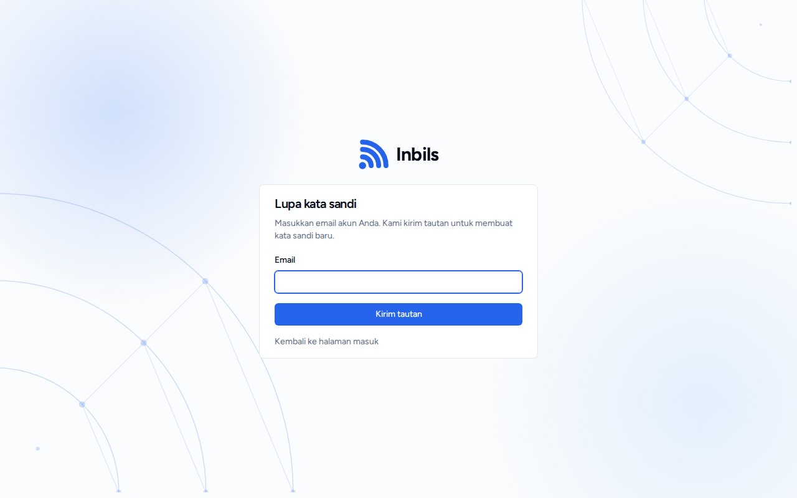

3. Baca pesan hijau yang muncul: "Jika ada akun dengan alamat email tersebut, kami telah mengirim tautan pengaturan ulang kata sandi." Pesan ini sama untuk email yang terdaftar maupun tidak, supaya orang lain tidak bisa menebak akun yang ada.
4. Buka email dengan subjek **Pengaturan Ulang Kata Sandi** dan klik tombol **Atur Ulang Kata Sandi**. Tautan berlaku 60 menit.
5. Di halaman **Atur ulang kata sandi**, isian **Email** sudah terisi. Isi **Kata sandi baru** dan **Ulangi kata sandi baru** dengan kata sandi yang sama (minimal 8 karakter), lalu klik **Simpan kata sandi**.
6. Inbils membawa Anda ke halaman masuk dengan pesan hijau "Kata sandi Anda telah diatur ulang." Masuk dengan kata sandi baru.

### Kesalahan umum

- Pesan "Token pengaturan ulang kata sandi tidak valid." di bawah **Email** berarti tautan sudah lewat 60 menit atau sudah dipakai. Ulangi dari langkah 1 dan pakai tautan dari email terbaru.
- Pesan "Kami tidak menemukan pengguna dengan alamat email tersebut." berarti isian **Email** di halaman atur ulang berbeda dari alamat yang menerima tautan. Kembalikan ke alamat itu.
- Pesan "kata sandi minimal 8 karakter." atau "Konfirmasi kata sandi tidak cocok." muncul di bawah **Kata sandi baru**. Perpanjang kata sandinya, atau samakan kedua isian.
- Email tidak datang: tunggu beberapa menit, periksa folder spam, lalu minta ulang. Permintaan kedua dalam 60 detik tidak mengirim email baru, tetapi layar tetap menampilkan pesan yang sama. Satu alamat IP dibatasi enam permintaan per menit.
- Setelah kata sandi berganti, login aplikasi Android milik akun yang sama berakhir. Masuk lagi di aplikasi dengan kata sandi baru.

## 1.4 Autentikasi dua langkah (2FA)

2FA meminta kode 6 digit dari aplikasi autentikator di ponsel setelah kata sandi, sehingga kata sandi yang bocor saja tidak cukup untuk masuk. Fitur ini opsional dan diatur sendiri oleh setiap pengguna. Kode berganti setiap 30 detik.

Peran yang dapat memakai: semua pengguna, untuk akunnya sendiri. Teknisi dan pelanggan menyalakannya di web lewat tombol **Kelola akun & 2FA** pada halaman **Gunakan aplikasi Inbils**.

### Menyalakan 2FA

1. Klik nama Anda di kanan atas, lalu **Profil** (bagian 1.7).
2. Di bagian **Autentikasi dua langkah** (lencana **Nonaktif**), klik **Aktifkan autentikasi dua langkah**.
3. Bila Inbils membuka halaman **Konfirmasi kata sandi**, isi **Kata sandi** lalu klik **Konfirmasi**. Kata sandi yang salah ditolak dengan pesan "Kata sandi yang Anda masukkan salah." Konfirmasi ini berlaku 3 jam, jadi Anda tidak ditanya lagi saat mengelola 2FA dalam rentang itu. Setelah konfirmasi, Anda kembali ke Profil. Klik **Aktifkan autentikasi dua langkah** sekali lagi.
4. Pindai kode QR dengan aplikasi autentikator di ponsel. Bila tidak bisa memindai, ketik kunci pengaturan yang tampil di bawah kode QR ke dalam aplikasi.
5. Ketik kode 6 digit dari aplikasi ke isian **Kode autentikasi**, lalu klik **Konfirmasi dan aktifkan**. Lencana berubah menjadi **Aktif**, dan toast hijau menulis "Autentikasi dua langkah aktif. Simpan kode pemulihan Anda dengan aman."
6. Inbils menampilkan **Kode pemulihan Anda**: delapan kode, masing-masing hanya berlaku sekali. Klik **Salin** (tampil bila browser mendukung) atau **Unduh sebagai teks**, simpan di tempat aman seperti pengelola kata sandi, lalu klik **Saya sudah menyimpan kode ini**. Kode tidak ditampilkan lagi.

Kode QR hanya tampil sekali. Bila Anda menutup halaman sebelum langkah 5, lencana menjadi **Belum selesai** dan Inbils menampilkan **Pengaturan belum selesai**. Klik **Mulai lagi** untuk mendapat kode QR baru, atau **Batalkan pengaturan** untuk membatalkan. **Batalkan pengaturan** juga ada di samping **Konfirmasi dan aktifkan** selama kode QR tampil.

### Masuk dengan 2FA

1. Isi email dan kata sandi di halaman masuk, lalu klik **Masuk**.
2. Di halaman **Autentikasi dua langkah**, isi **Kode autentikasi** dengan kode 6 digit dari aplikasi, lalu klik **Masuk**.
3. Bila ponsel hilang atau rusak, klik **Pakai kode pemulihan**, isi **Kode pemulihan**, lalu klik **Masuk**. Klik **Pakai kode autentikasi** untuk kembali ke kode biasa.

Halaman kode berlaku 10 menit setelah kata sandi diterima. Setelah itu Inbils mengembalikan Anda ke halaman masuk. Tautan **Kembali ke halaman masuk** membawa Anda ke sana kapan saja.

Profil menulis "Sisa kode pemulihan:" disusul jumlahnya. Klik **Buat kode pemulihan baru** untuk membuat set baru. Set lama berhenti berlaku saat itu juga.

### Mematikan 2FA

1. Buka **Profil**, bagian **Autentikasi dua langkah**.
2. Klik **Nonaktifkan autentikasi dua langkah**.
3. Di dialog **Nonaktifkan autentikasi dua langkah?**, klik **Nonaktifkan**. Klik **Tetap aktif** untuk membatalkan. Akun kembali hanya dilindungi kata sandi, dan kode pemulihan tidak berlaku lagi.

### Kesalahan umum

- Pesan "Kode autentikasi dua langkah tidak valid." berarti kode salah, sudah berganti, atau sudah dipakai. Ketik kode terbaru dari aplikasi dan pastikan jam ponsel akurat.
- Satu kode hanya diterima sekali. Setelah kode dipakai untuk masuk, tunggu kode berikutnya untuk masuk lagi.
- Lima percobaan salah dalam semenit dari satu alamat menghentikan percobaan berikutnya sementara, bahkan bila kode yang diketik benar. Sepuluh percobaan salah dalam 15 menit menghentikannya untuk akun itu dari alamat mana pun. Tunggu sampai hitungan detik pada pesan "Terlalu banyak percobaan masuk. Coba lagi dalam N detik." habis.
- Ponsel hilang dan kode pemulihan habis: minta admin mereset 2FA akun Anda lewat tombol **Atur ulang 2FA** di halaman detail pengguna (bagian 8.5). Setelah reset, Anda masuk dengan kata sandi saja dan bisa mendaftar ulang.
- Menyalakan, mematikan, atau membuat ulang kode pemulihan mengakhiri login Anda di browser dan perangkat lain, termasuk login "Ingat saya" dan login aplikasi Android. Sesi yang sedang Anda pakai tetap berjalan. Masuk lagi di aplikasi setelahnya.

## 1.5 Mengenal layar

Hampir semua menu memakai kerangka yang sama. Bagian ini menjelaskan kerangka itu sekali. Bab berikutnya hanya menyebut hal yang khusus untuk menu tersebut.

### Sidebar dan bilah atas

- Sidebar di kiri memuat logo atau inisial perusahaan, nama perusahaan, tombol **Ganti perusahaan** bila ada (bagian 1.6), **Dasbor**, dan enam grup menu: **Operasional**, **Pelanggan & Layanan**, **Jaringan**, **Inventaris**, **Keuangan & Laporan**, **Administrasi**. Klik judul grup untuk membuka atau menutupnya. Grup yang berisi halaman aktif terbuka sendiri.
- Hanya menu yang diizinkan untuk peran Anda yang tampil. Grup tanpa menu tidak tampil.
- Angka kecil di samping **Pekerjaan Saya**, **Penugasan**, dan **Persetujuan** menunjukkan jumlah antrean yang menunggu.
- Di layar sempit, sidebar tersembunyi. Klik tombol tiga garis di kiri atas (**Menu navigasi**) untuk membukanya. Tombol Esc menutupnya.
- Di bilah atas, nama halaman tampil di kiri. Lonceng di kanan membuka halaman **Notifikasi** (bagian 2.2). Angka merah pada lonceng adalah jumlah yang belum dibaca, ditulis 99+ bila lebih dari 99.
- Klik nama Anda di kanan atas untuk membuka menu dengan nama dan email Anda, disusul **Profil**, **Mode gelap** (atau **Mode terang**), dan **Keluar**. Pilihan tema disimpan di browser.

### Daftar dan tabel

- Judul halaman dan satu kalimat penjelasnya ada di kiri atas. Tombol di kanan atas biasanya **Ekspor** dan tombol pembuatan data yang namanya diawali **Buat**, misalnya **Buat Pelanggan**.
- Kotak **Cari** mencari pada kolom yang disebut di teks petunjuknya, misalnya "Nama, kode, atau telepon". Beberapa halaman memberi nama lain, misalnya **Cari stok**, **Cari permintaan**, atau **Pencarian** (Penugasan, Persetujuan, dan Pekerjaan Saya). Daftar diperbarui sendiri sebentar setelah Anda berhenti mengetik. Di Penugasan dan Pekerjaan Saya, tombol **Cari** menerapkannya seketika.
- Kotak pilihan di samping pencarian menyaring daftar, misalnya status atau jenis. Pilihan pertamanya menghapus saringan, misalnya "Semua status". Mengubah filter selalu kembali ke halaman pertama. Tombol **Reset filter** (di samping filter, atau di tabel yang hasilnya kosong) mengosongkan pencarian dan semua filter.
- Klik judul kolom yang berpanah untuk mengurutkan. Klik lagi untuk membalik urutan.
- Di bawah tabel, Inbils menulis rentang baris yang tampil dan totalnya (diawali "Menampilkan"), pemilih **Baris per halaman** (10, 25, atau 50), tombol **Sebelumnya** dan **Berikutnya**, dan nomor halaman (misalnya Halaman 1 dari 3). Bagian ini tidak tampil bila tabel kosong, atau bila semua baris muat dalam satu halaman dan halaman itu tidak punya pemilih jumlah baris.
- Kolom **Aksi** memuat nama baris sebagai tautan ke halaman detail, satu tombol utama (**Ubah**, atau **Lihat** bila baris tidak bisa Anda ubah), dan menu tiga titik **Aksi lainnya** berisi **Lihat detail** dan **Hapus**. Tombol hanya tampil bila Anda punya izinnya.
- **Hapus** selalu membuka dialog konfirmasi. Judulnya menyebut data yang dihapus. Bila halaman tidak menyebut nama, judulnya "Hapus data ini?". Tombolnya **Batal** dan **Hapus**, dan keduanya nonaktif selama permintaan berjalan. Dialog menutup sendiri bila penghapusan berhasil.
- Data yang masih dipakai tidak bisa dihapus. Pada banyak halaman, kalimat di bawah judul dialog menyebut aturannya, misalnya "Pelanggan yang masih punya langganan belum berhenti tidak bisa dihapus." Bila server menolak, dialog tetap terbuka dan toast merah "Data gagal disimpan. Periksa input." muncul. Di Pengguna dan Organisasi, alasan penolakan juga tampil dalam kotak merah di atas daftar.
- Bila filter atau pencarian tidak menemukan apa pun, tabel menulis "Tidak ada &lt;item&gt; yang cocok" dengan tombol **Reset filter**. Bila belum ada data, tabel menulis "Belum ada &lt;item&gt; yang tercatat." atau penjelasan khusus halaman itu, dengan tombol pembuatan data bila Anda boleh membuatnya.
- Tombol **Ekspor** membuka menu **Ekspor CSV** dan, di daftar yang menyediakannya, **Ekspor PDF**. Hasilnya mengikuti filter yang sedang aktif. Satu ekspor dibatasi 5.000 baris. Bila terpotong, baris terakhir CSV berisi "# Ekspor dipotong pada 5000 baris. Persempit filter untuk mengekspor sisa barisnya." dan PDF menulis "dibatasi sampai" disusul batasnya di bawah judul. Persempit filter lalu ekspor lagi.

### Formulir dan pesan

- Isian wajib ditandai bintang merah di belakang namanya dan harus terisi sebelum menyimpan. Pesan merah di bawah isian menjelaskan apa yang salah. Di kanan atas layar, toast merah "Data gagal disimpan. Periksa input." menandai bahwa penyimpanan gagal.
- Toast hijau menandai penyimpanan berhasil. Teksnya berbahasa Indonesia dan datang dari server, misalnya "Pelanggan dihapus." Toast hilang sendiri setelah sekitar 4 detik. Klik tombol x di toast untuk menutupnya lebih cepat.
- Tombol yang sedang memproses menampilkan indikator putar dan tidak bisa diklik dua kali.
- Rupiah tampil tanpa desimal. Format tanggal mengikuti pengaturan perusahaan (bagian 8.1), dan jam memakai format 24 jam.

### Isian pilihan, tanggal, dan jam

- Isian yang memilih data lain (pelanggan, lokasi, barang, pengguna, dan sebagainya) adalah kotak pencarian: ketik untuk mencari, lalu pilih. Klik isian, ketik sebagian nama atau kode, lalu klik hasilnya, atau tekan tombol panah dan Enter. Tidak ada isian yang meminta Anda mengetik ID.
- Pada tabel besar (misalnya pelanggan, langganan, dan barang), pencarian berjalan di server setelah Anda mengetik minimal 2 huruf, dan daftar menampilkan paling banyak 20 hasil. Di bawah 2 huruf daftar menulis "Ketik minimal 2 huruf untuk mencari.", selama mencari menulis "Mencari...", dan bila tidak ada yang cocok menulis "Tidak ada hasil." atau kalimat khusus isian itu.
- Pilihan yang sudah dipilih tetap ada selama Anda mengetik. Pilihan berubah hanya bila Anda memilih hasil lain atau mengklik tombol x (**Hapus pilihan**).
- Isian tanggal menerima tanggal yang diketik dalam format perusahaan (misalnya 15 Okt 2026 untuk format d M Y). Tekan Enter atau pindah ke isian lain untuk menetapkannya. Atau klik ikon kalender (**Buka kalender**), pilih hari, atau klik **Hari ini**. Tombol x (**Hapus tanggal**) mengosongkan isian. Isian kosong menampilkan petunjuk seperti "Pilih tanggal". Tulisan yang bukan tanggal ditolak dengan pesan "Format tanggal tidak valid." disusul contoh.
- Isian tanggal dan jam ("Pilih tanggal dan jam"), bulan ("Pilih bulan"), dan jam ("Pilih jam") bekerja dengan cara yang sama: ketik, atau buka pemilihnya. Jam dipilih dari daftar per 30 menit atau diketik dalam format 24 jam. Pada tanggal dan jam, hari yang dipilih tanpa jam dimulai pukul 00:00, dan jam tanpa hari memakai hari ini.

### Halaman galat

Bila Anda membuka halaman yang tidak diizinkan atau tidak ada, atau bila terjadi gangguan, Inbils menampilkan halaman dengan judul, penjelasan, dan tulisan "Kode galat" disusul nomornya:

- **Akses ditolak** (403): peran Anda tidak punya izin untuk halaman itu.
- **Halaman tidak ditemukan** (404): alamat tidak ada atau sudah dipindahkan.
- **Sesi berakhir** (419): halaman terbuka terlalu lama dan kedaluwarsa. Muat ulang halaman, lalu ulangi langkah Anda.
- **Terjadi kesalahan di server** (500): permintaan tidak dapat diproses. Coba lagi sebentar lagi. Bila masalah berlanjut, hubungi administrator.
- **Layanan sedang tidak tersedia** (503): aplikasi sedang dalam pemeliharaan. Coba lagi beberapa saat lagi.

Tombol **Ke dasbor** (bila Anda sudah masuk) atau **Masuk** membawa Anda keluar dari halaman galat. Halaman 419, 500, dan 503 juga punya tombol **Muat ulang halaman**. Bila satu halaman gagal tampil karena kesalahan di browser, Inbils menampilkan **Halaman tidak dapat ditampilkan** dengan tombol **Muat ulang halaman**.

## 1.6 Ganti perusahaan

Satu instalasi Inbils dapat memuat lebih dari satu perusahaan, misalnya perusahaan induk (Head) dan anak perusahaannya. Data setiap perusahaan terpisah: pelanggan, tagihan, stok, dan laporan hanya milik perusahaan yang sedang aktif.

Peran yang dapat memakai: admin dan manajer (izin `company.switch`, **Ganti perusahaan**), dan hanya bila akun itu punya akses ke lebih dari satu perusahaan. Tombol ganti perusahaan tidak tampil untuk akun lain.

1. Lihat bagian atas sidebar. Tombol di bawah nama perusahaan menampilkan nama perusahaan aktif dan tulisan **Ganti perusahaan**.
2. Klik tombol itu. Menu **Ganti perusahaan** terbuka dengan nama dan kode setiap perusahaan. Perusahaan asal akun Anda diberi tulisan "bawaan" setelah kodenya.
3. Pilih perusahaan tujuan. Inbils membuka **Dasbor** perusahaan itu dan menampilkan toast hijau "Sekarang bekerja di" disusul nama perusahaan.
4. Untuk kembali, ulangi langkah 1 sampai 3 dan pilih perusahaan asal.

Perpindahan berlaku selama sesi login. Setiap login baru dimulai lagi di perusahaan asal. Peran dan izin Anda tidak berubah saat pindah. Di layar sempit, sidebar menutup sendiri setelah perpindahan.

Akses ke perusahaan lain dan anak perusahaan dibuat oleh administrator server dengan perintah `inbils:company:grant-membership` dan `inbils:company:create-subsidiary`, bukan lewat layar web.

Perusahaan induk (Head) adalah perusahaan tanpa induk yang punya minimal satu anak perusahaan aktif. Hanya saat Anda bekerja di Head dan akun Anda punya izin `report.consolidated.view` (**Lihat laporan konsolidasi**, admin), menu **Metrik Konsolidasi** muncul di grup **Keuangan & Laporan** (bagian 7.11).

### Kesalahan umum

- Angka di layar mendadak berbeda: periksa nama perusahaan aktif di tombol sidebar. Anda mungkin masih berada di perusahaan lain.
- Tombol ganti perusahaan tidak ada: akun Anda hanya punya satu perusahaan, atau perannya tidak memiliki izin `company.switch`. Minta administrator server menambah akses.
- Menu **Metrik Konsolidasi** tidak ada di anak perusahaan. Pindah ke Head dulu.

## 1.7 Profil dan kata sandi

Profil memuat data akun Anda sendiri. Halaman ini sama untuk semua peran.

1. Klik nama Anda di kanan atas, lalu **Profil**.

   

2. Untuk mengubah nama atau email, ubah isian **Nama** atau **Email** di bagian **Data akun**, lalu klik **Simpan**. Tulisan "Tersimpan." muncul di samping tombol.
3. Untuk mengganti kata sandi, isi **Kata sandi saat ini**, **Kata sandi baru**, dan **Ulangi kata sandi baru** di bagian **Ganti kata sandi**, lalu klik **Simpan**. Kata sandi baru minimal 8 karakter. Ketiga isian kosong lagi setelah tersimpan.
4. Bagian **Autentikasi dua langkah** dijelaskan di bagian 1.4.
5. Bagian **Hapus akun** menghapus akun Anda, dan akun yang dihapus tidak bisa Anda pulihkan sendiri. Klik **Hapus akun**, isi **Kata sandi** di dialog **Hapus akun Anda?**, lalu klik **Hapus akun** sekali lagi. Klik **Batal** untuk membatalkan. Jangan lakukan ini kecuali admin memintanya. Untuk menutup akses, lebih aman minta admin menonaktifkan akun (bagian 8.5).

### Kesalahan umum

- Pesan "Kata sandi saat ini salah." berarti kata sandi lama yang Anda ketik salah. Pesan yang sama muncul di dialog **Hapus akun Anda?** bila kata sandinya salah.
- Pesan "Konfirmasi kata sandi tidak cocok." di bawah **Kata sandi baru** berarti **Kata sandi baru** dan **Ulangi kata sandi baru** berbeda. Pesan "kata sandi minimal 8 karakter." berarti kata sandi baru terlalu pendek.
- Pesan "email sudah digunakan." atau "email harus berupa huruf kecil." di bawah **Email** berarti alamat itu sudah dipakai akun lain, atau ditulis dengan huruf besar.
- Mengganti kata sandi mengakhiri login aplikasi Android milik akun Anda. Masuk lagi di aplikasi.
- **Hapus akun** ditolak bila akun pernah mengajukan atau memeriksa penyesuaian stok ("Pengguna yang pernah mengajukan atau memeriksa penyesuaian stok tidak bisa dihapus. Nonaktifkan akunnya."), atau tercatat memperoleh pelanggan ("Pengguna yang dicatat memperoleh pelanggan tidak bisa dihapus. Nonaktifkan akunnya."). Layar Profil tidak menampilkan alasan ini: dialog tetap terbuka dan hanya toast merah "Data gagal disimpan. Periksa input." muncul. Minta admin menonaktifkan akun itu.
- Mengubah email tidak mengubah kata sandi, tetapi email baru dipakai untuk masuk dan menerima tautan lupa kata sandi. Pastikan alamat baru benar.

# 2. Dasbor

## 2.1 Kartu antrean

Dasbor adalah halaman pertama setelah masuk. Isinya antrean dan pengecualian yang perlu Anda tangani hari ini. Setiap kartu menampilkan angka langsung untuk perusahaan yang sedang aktif. Klik pada kartu membuka menu tujuannya dengan filter yang sudah terpasang. Di Tiket dan Stok, filter itu tidak tampil di layar (lihat Kesalahan umum di bawah).

Peran yang dapat memakai: semua akun web dengan izin `dashboard.view` (**Lihat dasbor**; admin, manajer, staf). Kartu muncul hanya bila peran Anda boleh mengerjakan antrean itu. Kartu yang tidak tampil berarti antrean itu bukan tugas Anda, bukan berarti angkanya nol.

### Membaca kartu

1. Klik **Dasbor** di sidebar. Dasbor juga terbuka otomatis setelah masuk.

   

2. Baca kartu per grup: **Operasional**, **Persetujuan**, **Gudang**, **Keuangan**. Grup yang tidak relevan untuk peran Anda tidak tampil.
3. Perhatikan penanda di kanan atas kartu. **Perlu tindakan** (kuning) dan **Segera tangani** (merah) muncul hanya bila angkanya lebih dari nol, dan hanya pada kartu yang menandai pengecualian. Kartu **Pekerjaan saya** dan **Antrean permintaan gudang** tidak punya penanda. Angka nol tampil abu-abu dengan tulisan "Tidak ada yang perlu ditangani."
4. Klik kartu untuk membuka menu tujuannya.
5. Pada kartu **SLA terlampaui**, lihat daftar sampai lima tiket di bawah angka. Setiap baris memuat kode tiket, lencana prioritas (**Mendesak**, **Tinggi**, **Sedang**, **Rendah**), judul, dan "Batas SLA" dengan tanggal dan jam. Tiket dengan batas SLA tertua tampil paling atas. Bila tiket lebih dari lima, Inbils menulis "Menampilkan 5 dari N tiket, batas SLA terlama lebih dulu." Klik satu baris untuk membuka tiketnya.

### Daftar kartu

| Kartu | Yang dihitung | Dibuka ke | Muncul untuk |
| --- | --- | --- | --- |
| Pekerjaan saya | SPK dan tiket yang ditugaskan kepada Anda. Rincian: **Belum dimulai**, **Dikerjakan**, **Menunggu tindakan** | **Pekerjaan Saya** (3.6) | Pemegang izin kerja lapangan (**Mulai SPK**, **Kirim SPK untuk ditinjau**, **Mulai menangani tiket**, **Selesaikan tiket**, atau **Tutup tiket**) yang punya profil karyawan aktif |
| Belum ditugaskan | Tiket dan SPK tanpa penerima. Rincian: **Tiket**, **SPK** | **Penugasan** (3.1), dengan **Status penugasan** di **Belum ditugaskan** | Pengguna aktif dengan izin **Tugaskan tiket**, **Tugaskan ulang tiket**, **Tugaskan SPK**, atau **Tugaskan ulang SPK** |
| SLA terlampaui | Tiket yang belum selesai dan sudah lewat batas SLA | **Tiket** (3.4), daftar hanya berisi tiket yang lewat batas SLA. Layar Tiket tidak punya kontrol filter untuk ini | Pemegang `ticket.view` yang juga menugaskan, mengerjakan, atau melaporkan SLA tiket |
| Menunggu persetujuan saya | SPK dan permintaan barang yang menunggu keputusan Anda | **Persetujuan** (3.2) | Pemegang izin **Setujui SPK**, **Tolak SPK**, **Setujui permintaan barang**, atau **Tolak permintaan barang** |
| Antrean permintaan gudang | Permintaan barang di antrean gudang | **Permintaan Barang** (6.1), tab **Persiapan & Antrean Gudang** | Pemegang `inventory.request.view.all` yang juga boleh menyetujui, menyiapkan, atau mengeluarkan permintaan barang |
| Antrean retur material | Pengembalian material yang menunggu diproses. Rincian: **Pengecualian** | **Permintaan Barang**, tab **Antrean Pengembalian** (6.8) | Pemegang `inventory.return.view.all` yang juga boleh menerima atau menyelesaikan pengembalian, dan boleh membuka Permintaan Barang |
| Stok di bawah minimum | Baris stok (satu barang di satu lokasi) yang jumlahnya sama dengan atau di bawah stok minimum | **Stok** (6.5), daftar hanya berisi baris stok rendah. Layar Stok tidak punya kontrol filter untuk ini | Pemegang `inventory.view` |
| Tagihan jatuh tempo | Tagihan terbuka yang lewat jatuh tempo dan masih bersisa. Rincian: **Terutang** | **Tagihan** (7.1), dengan **Status** di **Lewat jatuh tempo** | Pemegang `billing.view` |

### Kesalahan umum

- Angka kartu berbeda dengan daftar di menu tujuan: periksa perusahaan yang sedang aktif (bagian 1.6). Kartu dan daftar memakai aturan hitung yang sama untuk perusahaan aktif, kecuali kartu **Tagihan jatuh tempo** (bullet di bawah).
- Daftar Tiket atau Stok yang dibuka dari kartu hanya berisi sebagian baris, dan layarnya tidak menampilkan filter yang aktif. Buka menu itu lewat sidebar untuk melihat semua baris.
- Kartu **Tagihan jatuh tempo** dihitung dari tanggal jatuh tempo dan sisa tagihan. Filter **Lewat jatuh tempo** di Tagihan memakai status tagihan, yang diperbarui otomatis setiap hari pukul 03:00 UTC (10:00 WIB). Sampai pembaruan itu jalan, daftar bisa memuat lebih sedikit tagihan daripada kartu.
- Kartu **Menunggu persetujuan saya** tidak menghitung SPK yang Anda buat atau tugaskan ke diri sendiri, dan permintaan barang yang Anda ajukan sendiri. Aturan pemisahan tugas melarang Anda menyetujuinya (bagian 3.2).
- Angka **SLA terlampaui** lebih kecil dari yang Anda duga: pemegang izin mengerjakan tiket yang tidak boleh menugaskan hanya menghitung tiket yang ditugaskan kepadanya.
- Kartu **Pekerjaan saya** tidak ada padahal Anda punya izin: akun Anda perlu profil karyawan yang aktif di perusahaan ini (bagian 8.3).
- Dasbor kosong dengan judul "Belum ada antrean untuk akun Anda": peran Anda belum punya izin ke antrean mana pun. Hubungi admin untuk menambah izin.
- Halaman **Akses ditolak** saat membuka dasbor: peran Anda tidak memegang izin `dashboard.view`.

## 2.2 Notifikasi

Notifikasi adalah pemberitahuan yang ditujukan ke akun Anda, misalnya tiket yang ditugaskan kepada Anda ("Tiket ditugaskan"), tiket yang melewati batas SLA ("SLA tiket terlampaui"), permintaan barang yang siap diambil, atau kegagalan penjadwalan tagihan ("Jadwal penagihan gagal"). Notifikasi tampil di tiga tempat: panel di dasbor, angka di lonceng bilah atas, dan halaman **Notifikasi**.

Peran yang dapat memakai: semua pengguna web, untuk notifikasi miliknya sendiri.

1. Lihat panel **Notifikasi** di kanan dasbor (di layar sempit, di bawah kartu). Panel menampilkan lima notifikasi terbaru, dengan lencana jumlah yang belum dibaca bila ada. Bila belum ada notifikasi, panel menulis "Belum ada notifikasi." Klik **Lihat semua notifikasi** di dasar panel.
2. Atau klik ikon lonceng di bilah atas. Lonceng langsung membuka halaman **Notifikasi**. Angka merah pada lonceng adalah jumlah yang belum dibaca.

   

3. Baca daftar. Setiap notifikasi memuat judul, pesan, dan waktu. Notifikasi yang belum dibaca berjudul tebal dan berlatar tipis. Daftar menampilkan 20 notifikasi per halaman.
4. Klik **Lihat detail** untuk membuka tiketnya. Notifikasi yang belum dibaca otomatis ditandai sudah dibaca.
5. Klik **Tandai dibaca** pada satu notifikasi untuk menandainya tanpa membuka halamannya.
6. Klik **Tandai semua dibaca** di kanan atas untuk menandai semuanya. Tombol ini nonaktif bila tidak ada yang belum dibaca.
7. Bila daftar panjang, pakai **Sebelumnya** dan **Berikutnya** di bawah daftar.

### Kesalahan umum

- Lonceng tanpa angka hanya berarti tidak ada yang belum dibaca. Notifikasi lama tetap ada di halaman **Notifikasi**. Layar ini tidak menyediakan tombol hapus.
- Tombol **Lihat detail** hanya ada pada notifikasi tiket ("Tiket ditugaskan" dan "SLA tiket terlampaui") yang boleh Anda buka di perusahaan aktif. Notifikasi lain, atau notifikasi tiket dari perusahaan lain (bagian 1.6), tidak punya tombol itu.
- Notifikasi hanya untuk akun Anda. Admin tidak melihat notifikasi pengguna lain.

## 2.3 Ringkasan administrasi

Di bagian bawah dasbor, region **Administrasi** merangkum kondisi perusahaan untuk orang yang mengelola pengguna, peran, atau perusahaan.

Peran yang dapat memakai: pengguna dengan izin `users.manage` (**Kelola pengguna**), `roles.manage` (**Kelola peran dan hak akses**), atau `company.manage` (**Kelola perusahaan**); admin pada pengaturan standar. Region ini tidak tampil untuk akun lain.

1. Buka **Dasbor** lalu gulir ke bawah sampai judul **Administrasi**.
2. Baca empat kartu angka: **Pengguna** (pengguna perusahaan aktif), **Pengguna aktif**, **Peran**, dan **Izin akses**. Angka **Peran** dan **Izin akses** mencakup seluruh sistem, bukan satu perusahaan.
3. Lihat kartu **Perusahaan**: **Nama**, **Kode**, **Mata uang**, dan **Zona waktu** perusahaan aktif.
4. Lihat **Aktivitas terbaru**: sepuluh catatan audit terakhir di perusahaan aktif. Setiap baris memuat satu kalimat pendek yang menyebut objek dan kejadiannya, misalnya "Tiket ditugaskan", disusul waktunya. Bila Inbils belum punya padanan Indonesia untuk objek atau kejadian itu, nama aslinya tampil dengan tanda garis bawah diganti spasi. Bila belum ada catatan, kartu menulis "Belum ada aktivitas." Untuk telusur lengkap, buka halaman **Log audit** (bagian 7.12).
5. Di kartu **Modul**, klik satu modul (Pelanggan, Layanan, Inventaris, Aset jaringan, SPK, Tagihan, Tiket) untuk membuka menunya. Setiap kotak modul bertuliskan "Buka modul". Angka di lencana adalah jumlah data modul itu di perusahaan aktif. Modul yang menunya tidak boleh Anda buka tidak tampil.

### Kesalahan umum

- Region **Administrasi** tidak ada: akun Anda tidak punya izin `users.manage`, `roles.manage`, atau `company.manage`.
- Angka **Pengguna** lebih kecil dari yang Anda harapkan: angka itu menghitung pengguna yang perusahaan asalnya adalah perusahaan aktif. Pindah perusahaan (bagian 1.6) untuk melihat perusahaan lain.

# 3. Operasional

## 3.1 Penugasan

Penugasan adalah antrean tiket dan SPK yang menunggu petugas. Buka menu ini untuk memilih petugas bagi item baru atau untuk mengganti petugas yang sudah dipilih.

Peran yang dapat memakai: admin dan manajer pada peran bawaan, staf tidak. Izin: `ticket.assign` dan `spk.assign` untuk menugaskan item yang belum punya petugas, `ticket.reassign` dan `spk.reassign` untuk mengganti petugas. Menu tampil bila akun Anda aktif dan memegang salah satu dari keempat izin itu. Izin tiket menampilkan tiket di daftar, izin SPK menampilkan SPK.

### Membuka dan membaca daftar

1. Di sidebar, buka grup **Operasional**, lalu klik **Penugasan**. Angka di samping menu adalah jumlah tiket dan SPK yang belum ditugaskan dan boleh Anda tugaskan. Angka tidak tampil bila hasilnya 0.

   

2. Baca deretan chip di atas daftar. Setiap chip memuat nama dan jumlah. Jumlahnya menghitung seluruh antrean perusahaan dan tidak berubah saat Anda memakai filter.
   - Chip **Belum ditugaskan** menghitung tiket dan SPK yang menunggu petugas. Angkanya sama dengan angka di sidebar.
   - Chip **Tiket belum ditugaskan** dan **SPK belum ditugaskan** memecah angka itu per jenis. Chip suatu jenis hanya tampil bila Anda memegang izin untuk jenis itu.
   - Chip **Sudah ditugaskan** menghitung item yang sudah punya petugas dan masih berada di antrean penugasan.
3. Klik sebuah chip untuk mengisi filter. Chip yang aktif berwarna penuh. Chip **Belum ditugaskan**, **Tiket belum ditugaskan**, dan **SPK belum ditugaskan** memilih **Belum ditugaskan** di **Status penugasan**, dan dua chip yang terakhir itu sekaligus mengisi **Jenis**. Chip **Sudah ditugaskan** memilih **Sudah ditugaskan**.
4. Persempit daftar dengan filter di atas tabel:
   - Kotak **Pencarian** ("Cari kode, judul, atau nama pelanggan...") mencari kode, judul, serta nama dan kode pelanggan. Pencarian berjalan sendiri sesaat setelah Anda berhenti mengetik. Tombol **Cari** menjalankan pencarian yang sama.
   - Pilihan **Jenis** berisi **Semua jenis**, **Tiket**, dan **SPK**. Pilihan ini hanya tampil bila Anda memegang izin tiket dan izin SPK.
   - Pilihan **Status penugasan** berisi **Belum ditugaskan**, **Sudah ditugaskan**, dan **Semua status**.
   - Pilihan **Prioritas** berisi **Semua prioritas**, **Rendah**, **Sedang**, **Tinggi**, dan **Mendesak**.
   - Isian **Periode** menyaring tanggal tiket atau SPK dibuat. Isian kosong tertulis "Semua tanggal". Ketik rentang tanggal, atau klik tombol **Buka kalender** lalu pilih tanggal mulai dan tanggal akhir. Popover kalender punya pilihan cepat: **Hari ini**, **7 hari terakhir**, **30 hari terakhir**, **Bulan ini**, **Bulan lalu**, dan **Tahun ini**. Tombol **Hapus rentang tanggal** mengosongkan isian. Tanggal akhir tidak boleh sebelum tanggal awal: pesannya "Tanggal akhir tidak boleh sebelum tanggal awal."
   - Tombol **Reset filter** muncul saat ada filter aktif. Tombol ini mengosongkan filter dan memilih **Belum ditugaskan**.
5. Saat menu baru dibuka, pilihan **Status penugasan** tampak **Belum ditugaskan** (begitu pula chipnya) tetapi belum menyaring apa pun bagi pemegang izin assign dan reassign (admin dan manajer). Daftar memuat item yang belum dan sudah ditugaskan sekaligus. Pilih statusnya sendiri bila ingin menyaring.
6. Baca tabel antrean.
   - Antrean memuat tiket berstatus **Terbuka** dan **Ditugaskan**, serta SPK berstatus **Draf**, **Menunggu penugasan**, **Ditolak**, dan **Ditugaskan**. Tiket dan SPK yang sudah dikerjakan tidak ada di sini.
   - Kolom: **Kode** (kode sebagai tautan ke detail bila Anda boleh membukanya, dengan lencana **Tiket** atau **SPK** di bawahnya), **Judul dan kebutuhan** (judul, lalu "Kategori: ..." untuk tiket atau "Jenis: ..." untuk SPK, dan tanda "SLA terlampaui" bila batas SLA lewat), **Pemohon atau pelanggan** (nama dan kode pelanggan; SPK tanpa pelanggan menampilkan pembuatnya), **Prioritas dan umur** (lencana prioritas dan umur item, misalnya "5 jam lalu"), **Batas atau jadwal** ("SLA: ..." untuk tiket, "Jadwal: ..." untuk SPK), **Petugas saat ini** (nama petugas, atau tulisan "Belum ditugaskan"; SPK berstatus **Ditugaskan** yang teknisinya sudah menekan **Saya berangkat** di aplikasi menampilkan lencana **Dalam perjalanan** di bawah nama teknisi), dan **Tindakan** (tombol **Tugaskan** atau **Ganti petugas**).
   - Lencana **Dalam perjalanan** bukan status dan bukan filter. SPK tetap berstatus **Ditugaskan** dan tetap ada di antrean sampai teknisi menekan **Mulai**. Lencana hilang bila SPK dipindah ke teknisi lain, atau dikembalikan lalu ditugaskan lagi.
   - Judul kolom **Kode**, **Judul dan kebutuhan**, dan **Prioritas dan umur** bisa diurutkan. Urutan awal: terbaru di atas.
   - Tanpa data, tabel menampilkan "Tidak ada antrean penugasan" dan "Semua tiket dan SPK sudah punya petugas.". Bila filter aktif, tabel menampilkan "Tidak ada antrean yang cocok" dengan tombol **Reset filter**.
7. Bila akun Anda juga memenuhi syarat **Pekerjaan Saya** (bagian 3.6), dua tab muncul di atas chip: **Antrean Penugasan** dan **Pekerjaan Saya**. Tab **Pekerjaan Saya** membuka daftar tugas Anda di halaman yang sama.

### Menugaskan atau mengganti petugas

1. Di baris yang dituju, klik **Tugaskan** (item belum punya petugas) atau **Ganti petugas** (item sudah punya petugas). **Tugaskan** butuh `ticket.assign` atau `spk.assign`. **Ganti petugas** butuh `ticket.reassign` atau `spk.reassign`.

   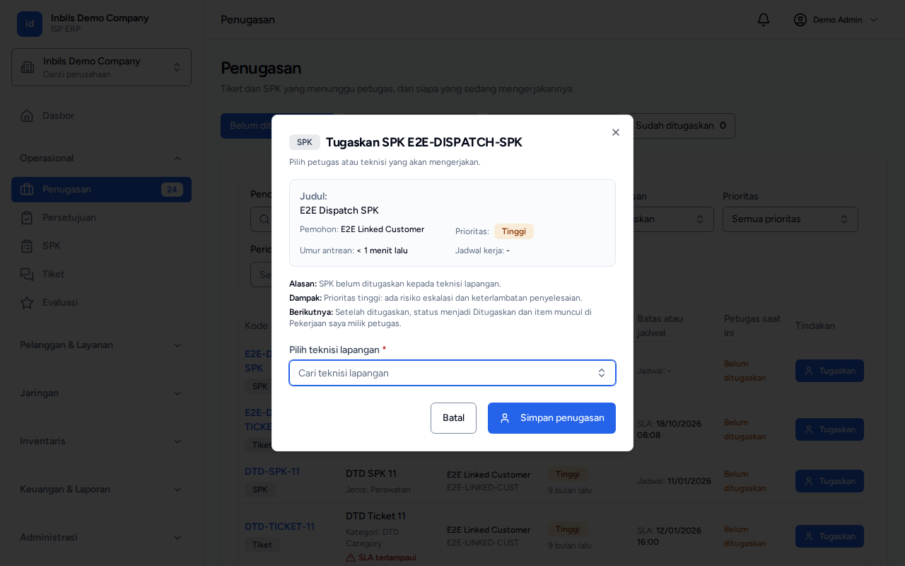

2. Baca dialog **Tugaskan Tiket** atau **Tugaskan SPK**, yang diikuti kode item. Bagian atas memuat **Judul**, **Pemohon**, **Prioritas**, **Umur antrean**, dan **Batas SLA** (tiket) atau **Jadwal kerja** (SPK). Bila SLA sudah lewat, tampil "SLA sudah terlampaui." Baris **Alasan**, **Dampak**, dan **Berikutnya** menjelaskan akibat penugasan.
3. Pilih petugas di isian **Pilih petugas tiket** (tiket) atau **Pilih teknisi lapangan** (SPK). Isian ini wajib. Ketik untuk mencari, lalu pilih: pencarian memeriksa nama dan email, dan tiap pilihan menampilkan nama dengan email di bawahnya. Tombol **Hapus pilihan** di isian mengosongkannya. Saat mengganti petugas, isian sudah berisi petugas lama.
   - Pilihan untuk tiket: pengguna aktif di perusahaan Anda yang memegang `ticket.start`, `ticket.resolve`, atau `ticket.close`.
   - Pilihan untuk SPK: pengguna aktif di perusahaan Anda yang memegang `spk.start` atau `spk.submit` dan punya profil karyawan berstatus Aktif di perusahaan itu.
4. Klik **Simpan penugasan**. Dialog tertutup, daftar dimuat ulang, dan toast hijau muncul, misalnya "Tiket E2E-DISPATCH-TICKET berhasil ditugaskan." atau "SPK E2E-DISPATCH-SPK berhasil ditugaskan." Klik **Batal** untuk menutup dialog tanpa menyimpan.

Setelah penugasan tersimpan:

- Tiket berstatus **Ditugaskan**. Petugas menerima email dan notifikasi Inbils. Sistem mengantrekan pesan WhatsApp ke pelanggan hanya pada penugasan pertama, bukan pada pergantian petugas.
- SPK berstatus **Ditugaskan**. Riwayat penugasan mencatat petugas baru. Saat mengganti petugas, riwayat juga menutup penugasan lama. Sistem mengantrekan pesan WhatsApp ke teknisi yang baru ditunjuk (kode, judul, tanggal kunjungan, tautan SPK), dan satu pesan ke pelanggan pada penugasan pertama bila SPK punya pelanggan dan tanggal kunjungan.
- Item pindah dari **Belum ditugaskan** ke **Sudah ditugaskan**. Teknisi mengerjakannya di aplikasi teknisi. Pengguna web yang ditunjuk membukanya di **Pekerjaan Saya** (bagian 3.6).

### Menugaskan ulang SPK yang ditolak

SPK yang ditolak reviewer di **Persetujuan** (bagian 3.2) berstatus **Ditolak** dan kembali ke antrean ini.

1. Pilih **Sudah ditugaskan** di **Status penugasan**, lalu cari kode SPK itu di kotak **Pencarian**.
2. Klik **Ganti petugas** (butuh `spk.reassign`), pilih teknisi (boleh teknisi yang sama), lalu klik **Simpan penugasan**.
3. SPK kembali berstatus **Ditugaskan**, dan teknisi dapat mengerjakannya lagi.

### Kesalahan umum

- Baris tidak punya tombol **Tugaskan** atau **Ganti petugas**: izin Anda tidak cocok dengan keadaan item. Item tanpa petugas butuh `ticket.assign` atau `spk.assign`, item yang sudah punya petugas butuh `ticket.reassign` atau `spk.reassign`.
- Isian petugas kosong dan **Simpan penugasan** tidak bisa diklik, dengan pesan "Tidak ada petugas tiket aktif yang punya izin menangani jenis ini." (untuk SPK: "teknisi lapangan"): tidak ada pengguna yang memenuhi syarat pada langkah 3. Aktifkan akun di Pengguna (bagian 8.5), tambahkan izin lewat Peran (bagian 8.6), dan untuk SPK pastikan profil karyawan aktif di Karyawan (bagian 8.3).
- Pesan merah "Pilih petugas tiket penerima penugasan." (SPK: "Pilih teknisi lapangan penerima penugasan."): isian belum dipilih. Pilih satu nama, lalu simpan lagi.
- Alert **Data berubah** dengan pesan "Konflik penugasan: tiket ini sudah ditugaskan oleh pengguna lain." (SPK: "Konflik penugasan: SPK ini sudah ditugaskan oleh pengguna lain."): pengguna lain mengubah item saat dialog terbuka. Klik **Muat ulang antrean**. Dialog memuat data terbaru, atau menutup bila item tidak bisa ditugaskan lagi. Bila pemuatan ulang gagal, alert **Muat ulang belum berhasil** menjelaskan sebabnya.
- Alert **Terjadi kesalahan** memuat pesan dari server, misalnya bila pengguna yang dipilih bukan petugas perusahaan Anda.
- Penolakan server "Tiket harus berstatus terbuka atau ditugaskan untuk bisa ditugaskan." atau "SPK harus berstatus draf, menunggu penugasan, ditolak, atau ditugaskan untuk bisa ditugaskan.": status item sudah berubah, misalnya petugas sudah memulainya. Muat ulang halaman.
- Penolakan server "Kebijakan perusahaan melarang menugaskan diri sendiri.": perusahaan Anda melarang menugaskan item ke akun sendiri. Pilih orang lain. Pengaturan larangan ini tidak ada di layar **Pengaturan Perusahaan**.

## 3.2 Persetujuan

Persetujuan adalah satu kotak masuk untuk SPK yang menunggu review dan permintaan barang yang menunggu persetujuan. Buka menu ini saat angka di samping **Persetujuan** di sidebar bertambah.

Peran yang dapat memakai: admin dan manajer pada peran bawaan. Izin: `spk.approve` dan `spk.reject` untuk SPK, `inventory.request.approve` dan `inventory.request.reject` untuk permintaan barang. Menu tampil bila Anda memegang salah satu dari keempatnya. Tombol **Setujui** butuh izin approve dan tombol **Tolak** butuh izin reject.

### Membuka dan membaca antrean

1. Di sidebar, buka grup **Operasional**, lalu klik **Persetujuan**. Angka di samping menu adalah jumlah item yang menunggu Anda.

   

2. Ketahui apa yang tidak tampil. Antrean hanya memuat item yang boleh Anda putuskan (aturan maker-checker). SPK yang Anda buat atau yang ditugaskan kepada Anda dan permintaan barang yang Anda ajukan tidak tampil dan tidak ikut dihitung. Aturan ini berlaku juga bagi admin.
3. Baca dua chip di atas daftar. Chip ini hanya menampilkan angka dan tidak bisa diklik.
   - Chip **Menunggu saya** menghitung SPK berstatus **Menunggu review** dan permintaan barang berstatus **Menunggu persetujuan** yang boleh Anda putuskan. Angkanya sama dengan angka di sidebar.
   - Chip **Sudah diproses** menghitung SPK **Selesai** atau **Ditolak** dan permintaan barang yang sudah **Disetujui**, **Disiapkan**, **Siap diambil**, **Diserahkan**, atau **Ditolak**. Hitungannya mencakup keputusan siapa pun, kecuali item milik Anda sendiri.
4. Bila Anda memegang izin SPK dan izin permintaan barang, tab **Semua antrean**, **SPK**, dan **Permintaan barang** muncul di atas filter. Memilih tab membatasi daftar dan angka chip pada jenis itu. Dengan satu jenis izin saja, tab tidak muncul.
5. Persempit daftar dengan filter:
   - Kotak **Pencarian** ("Cari kode, judul, atau alasan...") mencari kode, judul, atau alasan. Pencarian berjalan setelah Anda berhenti mengetik. Antrean ini tidak punya tombol **Cari**.
   - Pilihan **Jenis** berisi **Semua jenis** dan jenis yang ada di antrean Anda: **Instalasi**, **Perawatan**, **Peningkatan layanan**, **Pindah lokasi** (jenis SPK), serta **Untuk SPK**, **Untuk tiket**, **Tanpa rujukan** (asal permintaan barang).
   - Isian **Pemohon** berisi pembuat item yang ada di antrean Anda ("Semua pemohon" bila kosong). Ketik untuk mencari, lalu pilih.
   - Pilihan **Prioritas** berisi **Semua prioritas**, **Rendah**, **Sedang**, **Tinggi**, dan **Mendesak**.
   - Tombol **Reset filter** muncul saat ada filter aktif. Antrean ini tidak punya filter tanggal.
6. Baca kolom tabel: **Kode** (kode sebagai tautan ke detail bila Anda boleh membukanya, dengan lencana **SPK** atau **Permintaan barang**), **Judul dan dampak** (judul, lalu jenis dan dua nama barang pertama dengan jumlah jenis dan total unit), **Status dan prioritas** (dua lencana: **Menunggu review** untuk SPK, **Menunggu persetujuan** untuk permintaan barang; prioritas permintaan barang selalu **Sedang**), **Pemohon** (pembuat SPK atau pengaju permintaan), **Waktu dan jadwal** ("Diajukan" dengan tanggal dan umur item, lalu "Jadwal" untuk SPK atau "Dibutuhkan" untuk permintaan barang), dan **Tindakan**. Untuk SPK, tanggal "Diajukan" adalah tanggal SPK dibuat. Kolom **Kode**, **Judul dan dampak**, **Status dan prioritas**, dan **Waktu dan jadwal** bisa diurutkan.
7. Tanpa data, tabel menampilkan "Tidak ada persetujuan yang menunggu" dan "Semua antrean sudah diproses. Item baru muncul di sini setelah diajukan.". Bila filter aktif, tabel menampilkan "Tidak ada persetujuan yang cocok" dengan tombol **Reset filter**.

### Meninjau, menyetujui, atau menolak

1. Di kolom **Tindakan**, klik **Tinjau**. Panel **Tinjau SPK** atau **Tinjau permintaan barang**, diikuti kode item, terbuka di sisi kanan.
2. Baca panel. Bagian atas memuat lencana **SPK** atau **Permintaan barang**, lalu status, prioritas, dan jenis. Kartu **Informasi SPK** atau **Informasi permintaan barang** memuat judul, **Pemohon**, **Status**, **Pengajuan** (umur), **Tanggal pengajuan**, dan **Jadwal pelaksanaan** (SPK) atau **Tanggal dibutuhkan** (permintaan barang). Kartu **Dampak material dan penggunaan barang** memuat **Jenis item** dan **Total kuantitas**. Klik **Lihat detail** untuk membuka halaman SPK (bagian 3.3) atau permintaan barang (bagian 6.1) di tab yang sama. Tombol **Tutup** menutup panel.
3. Untuk menyetujui, klik **Setujui**. Proses langsung berjalan tanpa dialog konfirmasi. Pada permintaan barang Anda dapat mengisi **Catatan persetujuan (opsional)** lebih dulu, maksimal 1000 karakter. Kotak masuk ini menyetujui jumlah sesuai permintaan. Untuk menyetujui sebagian, buka **Lihat detail** dan setujui di sana.
4. Untuk menolak, klik **Tolak**. Blok **Konfirmasi penolakan SPK** (atau **Konfirmasi penolakan permintaan barang**) muncul. Isi **Alasan penolakan** (wajib, maksimal 500 karakter, penghitung "n/500 karakter" tampil di blok itu). Permintaan barang butuh minimal 3 karakter. Klik **Konfirmasi tolak**, atau **Batal** untuk kembali ke tinjauan. Alasan tersimpan di riwayat audit dan diteruskan kepada pemohon.
5. Setelah berhasil, panel menutup, item keluar dari antrean, dan toast muncul: "SPK disetujui." atau "SPK ditolak." untuk SPK, "Permintaan barang disetujui dan stok berhasil direservasi." atau "Permintaan barang telah ditolak." untuk permintaan barang.
6. Bila server menolak, alert merah **Gagal memproses tindakan** memuat pesannya, tombol **Setujui** dan **Tolak** terkunci, dan tombol **Muat ulang antrean** muncul. Klik tombol itu. Panel menutup bila item sudah diproses orang lain, atau tetap terbuka dengan data terbaru.

Hasil setiap keputusan:

- SPK disetujui: status **Selesai**. Sistem memakai stok material yang tercatat di SPK, memasang aset berseri pada SPK pemasangan, dan mengaktifkan langganan pelanggan yang masih **Menunggu**.
- SPK ditolak: status **Ditolak** dan stok yang direservasi dilepas. Alasan tersimpan di SPK dan riwayat audit. SPK muncul lagi di **Penugasan** (bagian 3.1) untuk ditugaskan ulang.
- Permintaan barang disetujui: status **Disetujui**, stok direservasi di gudang sumber, dan pemohon menerima email. Gudang lalu menyiapkan dan menyerahkan barang (bagian 6.1).
- Permintaan barang ditolak: status **Ditolak**, dan pemohon menerima email berisi alasan.

### Kesalahan umum

- Antrean kosong padahal ada SPK atau permintaan barang yang menunggu: item yang Anda buat, ajukan, atau yang ditugaskan kepada Anda tidak tampil bagi Anda, bahkan untuk admin. Minta pengguna lain yang berhak untuk memutuskannya.
- Menyetujui atau menolak item sendiri lewat halaman detail tetap ditolak server, dengan pesan "Pembuat SPK tidak boleh menyetujui SPK sendiri.", "Teknisi yang ditugaskan tidak boleh menyetujui SPK sendiri.", atau "Maker-checker: pemohon tidak boleh menyetujui permintaan sendiri." Untuk menolak, kalimatnya memakai kata "menolak" ("Pembuat SPK tidak boleh menolak SPK sendiri.", "Teknisi yang ditugaskan tidak boleh menolak SPK sendiri.", "Maker-checker: pemohon tidak boleh menolak permintaan sendiri."). Halaman SPK hanya menampilkan toast "Data gagal disimpan. Periksa input." untuk penolakan ini (bagian 3.3).
- Pesan "Alasan penolakan wajib diisi.", "Alasan penolakan minimal 3 karakter." (permintaan barang), atau "Alasan penolakan maksimal 500 karakter.": sesuaikan isian **Alasan penolakan**, lalu klik **Konfirmasi tolak**.
- Alert **Gagal memproses tindakan** dengan pesan "SPK harus berstatus menunggu review untuk bisa disetujui." (untuk menolak: "... untuk bisa ditolak."), "Permintaan barang bukan berstatus menunggu persetujuan." atau "Hanya permintaan berstatus menunggu persetujuan yang dapat ditolak.": pengguna lain sudah memproses item itu. Klik **Muat ulang antrean**.
- Setujui SPK gagal dengan pesan "SPK belum bisa disetujui sampai seluruh retur material berstatus direkonsiliasi atau diselesaikan.": selesaikan retur material SPK itu di Pengembalian Barang (bagian 6.8) sampai berstatus **Diterima** atau **Selisih diselesaikan**, klik **Muat ulang antrean**, lalu setujui lagi.
- Setujui SPK gagal dengan pesan "Stok tidak mencukupi. Diminta: ..., Tersedia: ...": stok produk di **Lokasi** SPK kurang dari jumlah **Terpakai**. Tambah stok (bagian 6.5), lalu setujui lagi.
- Tolak SPK gagal dengan pesan "Stok tersedia tidak mencukupi untuk reservasi. Diminta: ..., Tersedia: ...": lihat penjelasan pada bagian 3.3, bagian Kesalahan umum, tentang jumlah **Dicadangkan**.
- Setujui permintaan barang gagal dengan pesan "Stok tidak mencukupi untuk produk ID ...": stok di gudang sumber kurang. Tambah stok (bagian 6.5), atau setujui sebagian jumlah dari **Lihat detail**.
- Setujui permintaan barang gagal dengan pesan "Lokasi gudang sumber wajib ditentukan untuk reservasi.": permintaan itu tersimpan tanpa gudang, dan kotak masuk ini tidak punya pilihan gudang. Buka permintaannya lewat **Lihat detail** (bagian 6.1). Dialog setujui di halaman itu juga belum punya pilihan gudang, jadi permintaan seperti ini belum bisa disetujui dari web.

## 3.3 SPK

SPK (Surat Perintah Kerja) adalah perintah kerja lapangan untuk teknisi. Jenisnya **Instalasi** (pemasangan baru), **Perawatan** (perbaikan), **Peningkatan layanan** (naik paket), dan **Pindah lokasi**. Buka menu ini untuk membuat SPK, menugaskan teknisi, memeriksa material dan bukti kerja, lalu menyetujui hasilnya.

Teknisi mengerjakan SPK di aplikasi teknisi: berangkat (**Saya berangkat**), memulai, mencatat material, mengunggah foto, dan mengajukan hasil. Halaman SPK di web punya tombol **Mulai** dan **Ajukan review**, tetapi server hanya menerimanya dari teknisi yang ditugaskan pada SPK itu. **Saya berangkat** hanya ada di aplikasi. Web menampilkannya sebagai langkah **Dalam perjalanan** di kartu **Tahap kunjungan** (bagian di bawah) dan sebagai lencana di Penugasan (bagian 3.1).

Peran yang dapat memakai: admin, manajer, staf. Izin `spk.view` membuka menu dan daftar, `spk.create` membuat SPK, `spk.export` mengekspor daftar. Dengan peran bawaan:

- Admin memegang semua izin SPK.
- Manajer memegang `spk.view`, `spk.create`, `spk.update`, `spk.assign`, `spk.reassign`, `spk.approve`, `spk.reject`, `spk.cancel`, `spk.export`, dan `spk.manage`.
- Staf memegang `spk.view`, `spk.create`, `spk.start`, dan `spk.submit`.

Pengguna yang memegang `spk.start` atau `spk.submit` tetapi tidak `spk.assign` (staf bawaan) hanya melihat SPK yang ditugaskan kepadanya.

### Membuka dan membaca daftar

1. Di sidebar, buka grup **Operasional**, lalu klik **SPK**.
2. Baca daftar SPK.

   - Kotak **Cari** mencari pada nomor dan judul SPK (isian bertuliskan "Nomor atau judul...").
   - Pilihan **Jenis** berisi **Semua jenis**, **Instalasi**, **Perawatan**, **Peningkatan layanan**, dan **Pindah lokasi**. Pilihan **Status** berisi **Semua status** dan delapan status SPK: **Draf**, **Menunggu penugasan**, **Ditugaskan**, **Dikerjakan**, **Menunggu review**, **Selesai**, **Ditolak**, dan **Dibatalkan**.
   - Kolom: **Nomor** (tautan ke detail), **Judul**, **Jenis**, **Status** (lencana), **Pelanggan**, **Jadwal**, **Dibuat**. Semua kolom kecuali **Pelanggan** bisa diurutkan, dan urutan awal menaruh SPK terbaru di atas.
   - Tombol **Ekspor** (pemegang `spk.export`) membuka menu **Ekspor CSV** dan **Ekspor PDF**. Berkas memuat kolom Kode, Judul, Tipe, Status, Prioritas, Pelanggan, dan Teknisi sesuai pencarian dan filter aktif. Kolom Tipe, Status, dan Prioritas berisi nilai tersimpan (misalnya `maintenance`), bukan label lencana.
   - Tombol **Buat SPK** (pemegang `spk.create`) membuka form buat.
   - Tanpa data, tabel menampilkan "Belum ada SPK". Bila filter aktif, tabel menampilkan "Tidak ada SPK yang cocok" dengan tombol **Reset filter**.

   

3. Klik nomor SPK untuk membuka detail. Baris tidak punya tombol **Ubah**, **Lihat detail**, atau **Hapus**.

### Status SPK

SPK dari **Buat SPK** berstatus **Draf** dan bersumber manual. SPK dari pendaftaran pelanggan baru (bagian 4.1) dan dari tiket (bagian 3.4) langsung berstatus **Menunggu penugasan**.

| Status | Arti | Langkah berikut | Siapa |
|---|---|---|---|
| **Draf** | SPK baru, belum siap | **Terbitkan**, atau langsung **Tugaskan** | **Terbitkan**: `spk.update`. **Tugaskan**: `spk.assign` |
| **Menunggu penugasan** | Siap ditugaskan | **Tugaskan** | `spk.assign` |
| **Ditugaskan** | Teknisi sudah ditunjuk. Setelah teknisi menekan **Saya berangkat** di aplikasi, status tetap **Ditugaskan** dan kartu **Tahap kunjungan** menunjukkan **Dalam perjalanan** | **Mulai** | Teknisi yang ditugaskan |
| **Dikerjakan** | Teknisi bekerja di lokasi | **Ajukan review** | Teknisi yang ditugaskan |
| **Menunggu review** | Hasil menunggu tinjauan | **Setujui** atau **Tolak** | `spk.approve` atau `spk.reject`, bukan pembuat dan bukan teknisi SPK |
| **Ditolak** | Ditolak, alasan tampil di **Alasan penolakan** | **Tugaskan** ulang untuk kerja ulang | `spk.reassign` |
| **Selesai** | Disetujui, final | Tidak ada | Tidak ada |
| **Dibatalkan** | Dibatalkan, final | Tidak ada | Tidak ada |

**Terbitkan** hanya menandai SPK siap, jadi boleh dilewati. **Batalkan** (izin `spk.cancel`) tersedia pada semua status selain **Selesai** dan **Dibatalkan**. Teknisi yang ditugaskan berarti pengguna yang ditunjuk pada SPK itu, berstatus karyawan aktif, dan memegang `spk.start` atau `spk.submit`.

SPK dari pendaftaran pelanggan baru berjenis **Instalasi** dan berjudul "Pemasangan &lt;kode langganan&gt; - &lt;nama pelanggan&gt;". SPK dari tiket berjenis **Perawatan** dan berjudul "SPK dari tiket TKT-..." (kode tiket).

### Membuat SPK

1. Di daftar SPK, klik **Buat SPK**.

   

2. Isi kartu **Data pekerjaan**:
   - **Jenis**: wajib. Pilih **Instalasi** (isian awal), **Perawatan**, **Peningkatan layanan**, atau **Pindah lokasi**.
   - **Judul**: wajib, maksimal 255 karakter. Contoh: `E2E Dispatch SPK`.
   - **Pelanggan**: wajib untuk **Instalasi**, **Peningkatan layanan**, dan **Pindah lokasi**, opsional untuk **Perawatan**. Ketik nama atau kode pelanggan (minimal 2 huruf), lalu pilih dari hasil pencarian. Sebelum Anda mengetik, daftar menampilkan "Ketik minimal 2 huruf untuk mencari." Daftar memuat pelanggan aktif, paling banyak 20 hasil.
   - **Langganan**: aturan wajibnya sama dengan **Pelanggan**. Ketik kode langganan (minimal 2 huruf), lalu pilih. Daftar memuat langganan **Menunggu** dan **Aktif**, tiap pilihan bertuliskan kode langganan dengan nama pelanggan di bawahnya. Setelah Anda memilih pelanggan, daftar hanya memuat langganan milik pelanggan itu, dan pilihan langganan sebelumnya dikosongkan. Pilih pelanggan lebih dulu.
   - **Lokasi**: opsional, berisi lokasi aktif (kode dan nama). Ketik kode atau nama (minimal 2 huruf), lalu pilih. Isi bila SPK memakai barang dari stok atau memasang aset, karena stok dan aset mengikuti lokasi ini.
   - **Prioritas**: **Rendah**, **Sedang** (isian awal), **Tinggi**, atau **Mendesak**.
   - **Tanggal jadwal**: opsional, tanggal kunjungan. Isian kosong tertulis "Pilih tanggal". Ketik tanggal dalam format tanggal perusahaan, atau klik tombol **Buka kalender** lalu pilih tanggal (tombol **Hari ini** memilih hari ini, **Hapus tanggal** mengosongkan isian).
   - **Deskripsi**: opsional.
   - Pada ketiga isian pencarian, teks yang diketik belum memilih apa pun. Pilihan berubah hanya saat Anda memilih hasil lain atau klik tombol **Hapus pilihan**.
3. Klik **Simpan**. Daftar SPK terbuka dengan toast "SPK berhasil dibuat." SPK baru berstatus **Draf** dan bernomor otomatis (aturan nomor di bagian 7.13). **Batal** kembali ke daftar tanpa menyimpan.

### Membuka detail SPK

1. Di daftar, klik nomor SPK di kolom **Nomor**.

   

2. Baca halaman dari atas ke bawah:
   - Judul halaman memuat judul SPK, dengan nomor SPK di bawahnya. Tombol **Kembali** kembali ke daftar.
   - Kartu **Rincian** memuat **Status** dan **Jenis** (lencana), **Prioritas** (lencana), **Pelanggan**, **Langganan**, **Lokasi**, **Teknisi**, **Jadwal**, **Dimulai**, **Check-in**, dan **Selesai**. **Deskripsi**, **Hasil**, dan **Alasan penolakan** tampil bila terisi.
   - Baris **Lokasi** menunjukkan POP atau gudang SPK, bukan alamat pelanggan. Baris **Check-in** menunjukkan jarak ke alamat pemasangan pelanggan (ke **Lokasi** bila SPK tanpa langganan) bila aplikasi teknisi mencatat lokasi saat memulai, atau alasan lokasi tidak tersedia. Tanpa catatan, tertulis "Belum ada check-in". Baris **Port drop** (ODP dan nomor port yang dicadangkan untuk pelanggan, bagian 5.5) tampil pada SPK **Instalasi** yang punya langganan, bagi pemegang `odn.view`.
   - Kartu **Tindakan** memuat tombol langkah berikut sesuai status. Pada gambar, SPK berstatus **Menunggu penugasan**, jadi hanya **Tugaskan** dan **Batalkan** yang tampil.
   - Kartu **Tahap kunjungan** di bawah **Tindakan** menunjukkan empat langkah kunjungan dengan waktunya (bagian **Tahap kunjungan** di bawah).
   - Kartu **Item** (kolom **Barang**, **Aset jaringan**, **Satuan**, **Dicadangkan**, **Terpakai**, **Catatan**), **Bukti**, dan **Riwayat penugasan** (kolom **Teknisi**, **Ditugaskan**, **Dicabut**).

Tombol **Setujui** dan **Tolak** hanya tampil bagi pemegang `spk.approve` dan `spk.reject`. Tombol lain tampil menurut status saja, dan server memeriksa izinnya saat tombol ditekan.

### Tahap kunjungan

Kartu **Tahap kunjungan** di kolom kanan halaman SPK menunjukkan jalannya kunjungan dalam empat langkah, dari atas ke bawah: **Ditugaskan**, **Dalam perjalanan**, **Sedang dikerjakan**, dan **Selesai dipasang**. Teknisi yang menekan **Saya berangkat** di aplikasi mengisi langkah kedua. Kartu ini hanya dibaca, dan tidak punya tombol.

- Langkah yang sudah dilalui memakai ikon centang dan menulis waktunya dalam format tanggal perusahaan. Langkah yang sedang berjalan memakai ikon bertitik dan menulis "Tahap sekarang," diikuti waktunya. Langkah yang belum tercapai memakai lingkaran kosong dan menulis "Belum dicapai". Ikon dan tulisan membawa artinya, bukan warna saja.
- Langkah yang sudah dilalui tanpa waktu menulis "waktu tidak tercatat". Ini wajar untuk SPK lama, atau bila teknisi langsung menekan **Mulai** tanpa **Saya berangkat**.
- **Selesai dipasang** tercapai saat teknisi mengirim hasil kerja (status **Menunggu review**) dan tetap tercentang setelah status **Selesai**. Waktunya adalah waktu pengiriman pertama pada kunjungan itu.
- SPK **Ditolak** menaruh lencana **Perlu perbaikan** di langkah **Sedang dikerjakan**, dan **Selesai dipasang** kembali "Belum dicapai".
- Bila SPK ditugaskan ulang (kepada teknisi lain, atau setelah ditolak), kartu mulai lagi dari **Ditugaskan** dengan waktu penugasan yang baru. Waktu berangkat dan waktu selesai dipasang dari kunjungan sebelumnya tidak tampil lagi.
- SPK **Dibatalkan** mengganti keempat langkah dengan tulisan **Dibatalkan**. SPK **Draf** dan **Menunggu penugasan** menampilkan keempat langkah "Belum dicapai".

Pelanggan melihat langkah yang sama di aplikasinya (bagian **Kunjungan teknisi** di panduan aplikasi pelanggan) dan menerima notifikasi "Teknisi dalam perjalanan" saat langkah kedua terisi.

### Menugaskan teknisi

Izin: `spk.assign`, atau `spk.reassign` bila SPK sudah punya teknisi (misalnya setelah ditolak).

1. Buka SPK berstatus **Draf**, **Menunggu penugasan**, atau **Ditolak**.
2. Klik **Tugaskan**. Dialog **Tugaskan SPK** terbuka.
3. Di **Teknisi** (wajib), ketik nama, nomor karyawan, organisasi, atau telepon ("Cari karyawan teknisi"), lalu klik teknisi dari hasil pencarian. Teks yang diketik belum memilih teknisi.
4. Klik **Tugaskan**. Muncul toast "SPK berhasil ditugaskan.", status menjadi **Ditugaskan**, dan **Riwayat penugasan** menambah satu baris. **Batal** menutup dialog tanpa menyimpan.

Daftar **Teknisi** memuat karyawan aktif (bagian 8.3) yang akun penggunanya aktif dan memegang `spk.start` atau `spk.submit`, lewat perannya atau sebagai izin langsung. Tiap pilihan menampilkan nama, dengan nomor karyawan, organisasi, dan telepon di bawahnya. Bila tidak ada yang cocok, tertulis "Tidak ada karyawan teknisi yang cocok."

Bila WhatsApp perusahaan aktif, teknisi menerima pesan berisi nomor, judul, tanggal kunjungan, dan tautan SPK. Pelanggan menerima satu pesan jadwal pada penugasan pertama, bila SPK punya **Pelanggan** dan **Jadwal**.

Untuk mengganti teknisi SPK berstatus **Ditugaskan**, pakai Penugasan (bagian 3.1), karena halaman ini tidak menampilkan **Tugaskan** pada status itu. Bila dialog menampilkan alert **SPK sudah berubah** dengan pesan "Konflik penugasan: SPK ini sudah ditugaskan oleh pengguna lain.", pengguna lain mengubah SPK lebih dulu: klik **Muat ulang SPK**, lalu ulangi dari langkah 2.

### Memulai dan mengajukan SPK

Teknisi melakukan kedua langkah ini di aplikasi teknisi, sesudah **Saya berangkat** yang hanya ada di aplikasi. Di web, **Mulai** dan **Ajukan review** ada di halaman SPK dan di Pekerjaan Saya (bagian 3.6).

1. Buka SPK berstatus **Ditugaskan**.
2. Klik **Mulai**. Dialog **Mulai SPK** terbuka.
3. Klik **Mulai** di dialog. Status menjadi **Dikerjakan** dan **Dimulai** terisi, dengan toast "SPK mulai dikerjakan." Izin `spk.start`.
4. Setelah SPK punya bukti, klik **Ajukan review**. Dialog **Ajukan SPK untuk review** terbuka.
5. Klik **Ajukan** di dialog. Status menjadi **Menunggu review**, dengan toast "SPK diajukan untuk review." Izin `spk.submit`.

Server hanya menerima kedua tindakan dari teknisi yang ditugaskan pada SPK itu. Admin yang tidak ditunjuk ditolak, walau tombolnya tampil.

Pengajuan juga ditolak dengan pesan "Bukti pekerjaan wajib diunggah sebelum SPK diajukan." bila SPK belum punya bukti. Ia ditolak pula dengan pesan "Seluruh sisa material dari permintaan barang harus dideklarasikan terlebih dahulu sebelum SPK diajukan." bila permintaan barang berstatus **Diserahkan** yang ditautkan ke SPK (bagian 6.1) masih punya sisa material yang belum dideklarasikan (bagian 6.8).

### Mengelola item material

Izin: `spk.update` (admin, manajer). Kartu **Item** mencatat barang dan perangkat SPK. **Dicadangkan** adalah jumlah rencana yang Anda tulis, **Terpakai** adalah jumlah yang dipakai, dan stok baru berkurang saat SPK disetujui, sebesar **Terpakai**.

1. Di kartu **Item**, klik **Tambah item**. Dialog **Tambah item** terbuka. Tombol ini hilang pada SPK **Selesai** dan **Dibatalkan**. Bila SPK belum punya baris, kartu menampilkan "Belum ada barang di SPK ini." dengan petunjuk memakai **Tambah item**.

   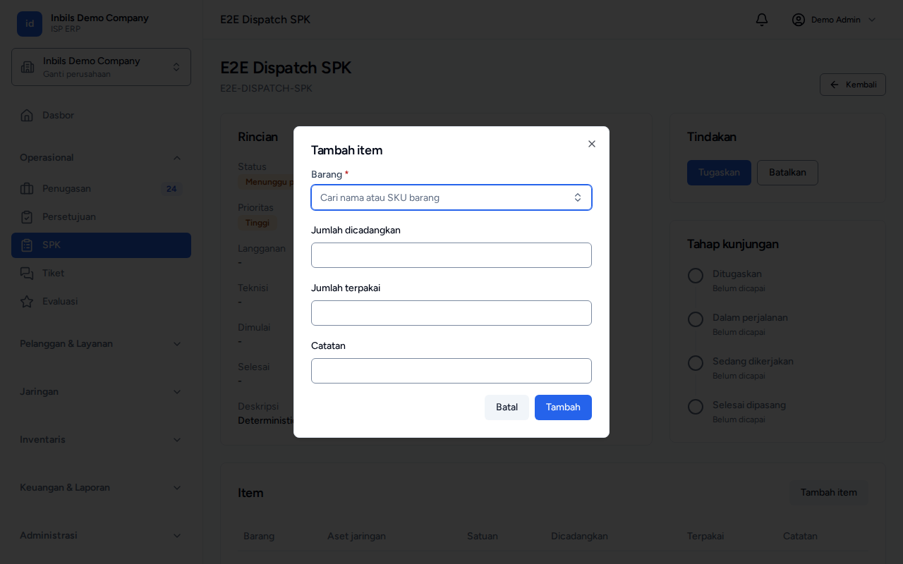

2. Isi dialog:
   - **Barang**: wajib. Ketik nama atau SKU (minimal 2 huruf), lalu pilih produk aktif. Tiap pilihan tertulis "SKU - Nama", dengan kategori di bawahnya.
   - **Aset jaringan**: tampil dan wajib hanya bila barang bertipe **Aset**. Ketik kode atau nama aset (minimal 2 huruf), lalu pilih. Daftar memuat aset **Tersedia** milik barang itu, tertulis "kode - nama".
   - **Jumlah dicadangkan** dan **Jumlah terpakai**: angka 0 atau lebih dengan dua desimal. Setelah barang dipilih, labelnya memuat satuan barang, misalnya "Jumlah dicadangkan - Meter (m)". Isi 0 bila tidak ada jumlah.
   - **Catatan**: opsional, maksimal 500 karakter.
3. Klik **Tambah**. Muncul toast "Item berhasil ditambahkan." dan baris tampil di tabel. **Batal** menutup dialog tanpa menyimpan. Bila server menolak satu isian dialog, dialog tetap terbuka dan pesan merah tampil di bawah isian itu, misalnya "Aset jaringan yang dipilih sedang terpasang." di bawah **Aset jaringan**. Perbaiki isian, lalu klik **Tambah** lagi.

Mengisi **Dicadangkan** tidak mencadangkan stok. Satu produk hanya punya satu baris, jadi menambah produk yang sama menimpa jumlah, catatan, dan aset pada baris lama dengan isian terbaru. Web tidak punya tombol hapus baris, walau rute hapus server memerlukan `spk.update`.

Teknisi mengisi **Terpakai** produk biasa di aplikasi saat SPK **Dikerjakan**. Teknisi dapat menarik kembali pemakaian itu selama status masih **Dikerjakan**; baris rencana tetap ada dengan **Terpakai** 0, sedangkan baris tanpa rencana atau catatan dihapus. Teknisi tidak dapat menambah atau menghapus baris produk **Aset**; baris itu hanya dikelola kantor di web.

### Mengunggah bukti kerja

Izin di web: `spk.update` (admin, manajer), selama SPK belum **Selesai** atau **Dibatalkan**. Pengguna lain tidak melihat formulir unggah. Teknisi yang ditugaskan mengunggah foto dari aplikasi saat SPK **Dikerjakan**.

1. Di kartu **Bukti**, klik **telusuri** pada area "Seret berkas ke sini atau telusuri" (isian **Berkas bukti**, wajib), atau seret satu berkas ke area itu.
2. Isi **Keterangan** bila perlu (opsional, maksimal 255 karakter).
3. Klik **Unggah**. Tombol ini baru aktif setelah ada berkas. Bilah "Mengunggah bukti" menunjukkan kemajuan, lalu muncul toast "Bukti berhasil diunggah."

Berkas boleh `jpg`, `jpeg`, `png`, `pdf`, `doc`, atau `docx`, maksimal 10 MB, satu berkas per unggahan. Berkas dengan jenis yang tidak diizinkan ditolak di area unggah dengan "Jenis berkas tidak diizinkan". Penolakan oleh server menampilkan toast "Bukti gagal diunggah." dengan keterangan "Periksa jenis berkas yang diizinkan dan ukuran maksimal 10 MB."

Daftar bukti menampilkan **Foto** atau **Dokumen**, keterangan (atau nama berkas), dan waktu unggah. Gambar punya tombol **Buka** (tab baru) dan **Unduh**, sedangkan PDF dan dokumen Word hanya punya **Unduh**.

Web tidak punya tombol hapus bukti. Rute hapus server hanya menerima pemegang `spk.update` selama SPK belum **Selesai** atau **Dibatalkan**, atau pengunggah sendiri yang memegang `spk.evidence.upload` selama SPK **Dikerjakan**.

### Menyetujui, menolak, dan membatalkan SPK

Izin: `spk.approve` untuk **Setujui**, `spk.reject` untuk **Tolak**, `spk.cancel` untuk **Batalkan**. Antrean **Persetujuan** (bagian 3.2) menampilkan SPK **Menunggu review** dan memakai aturan yang sama.

1. Buka SPK berstatus **Menunggu review**, lalu periksa jumlah **Terpakai** di kartu **Item** dan berkas di kartu **Bukti**.
2. Untuk menyetujui, klik **Setujui**. Dialog **Setujui SPK** terbuka.
3. Klik **Setujui** di dialog. Muncul toast "SPK disetujui.", status menjadi **Selesai**, dan **Selesai** di kartu **Rincian** terisi.
4. Untuk menolak, klik **Tolak**. Dialog **Tolak SPK** terbuka.
5. Isi **Alasan** (wajib, maksimal 500 karakter), lalu klik **Tolak** di dialog. Muncul toast "SPK ditolak.", status menjadi **Ditolak**, dan alasan tampil di baris **Alasan penolakan**.
6. Untuk membatalkan, klik **Batalkan** di kartu **Tindakan**. Dialog **Batalkan SPK** terbuka.
7. Isi **Alasan** (wajib, maksimal 500 karakter), lalu klik **Batalkan** di dialog. Muncul toast "SPK dibatalkan." dan status menjadi **Dibatalkan**.

Pembuat SPK dan teknisi yang ditugaskan tidak boleh menyetujui atau menolak SPK itu, termasuk admin. SPK dari pendaftaran pelanggan atau dari tombol **Buat SPK** di halaman tiket tercatat dibuat oleh orang yang melakukannya, jadi orang itu butuh rekan lain untuk menyetujuinya.

Persetujuan butuh minimal satu bukti. Bila SPK punya permintaan barang **Diserahkan**, semua retur materialnya harus berstatus **Diterima** atau **Selisih diselesaikan** (bagian 6.8).

Pembatalan tidak bisa dibalik, dan alasannya hanya tercatat di Log Audit (bagian 7.12). Pembatalan dan penolakan melepas cadangan stok sebanyak **Dicadangkan** pada setiap baris dan mengosongkan **Dicadangkan**, bila SPK punya **Lokasi**. Bila stok lokasi itu tidak punya cadangan sebanyak itu, tindakan gagal dan SPK tidak berubah.

### Yang terjadi saat SPK disetujui

**Setujui** menjalankan langkah berikut dalam satu transaksi. Bila satu langkah gagal, SPK tetap **Menunggu review** dan tidak ada yang berubah. Persetujuan tidak bisa dibatalkan dari web.

- Setiap baris dengan **Terpakai** lebih dari 0 mengurangi stok produk di **Lokasi** SPK sebesar **Terpakai**, dengan mutasi **Keluar** bercatatan "SPK &lt;nomor SPK&gt;" (bagian 6.7). Jumlah yang sudah dikeluarkan lewat permintaan barang untuk SPK ini tidak dikurangi dua kali.
- Tanpa **Lokasi**, stok tidak berubah dan aset tidak dipasang. Stok yang kurang membuat persetujuan gagal.
- Pada SPK **Instalasi**, setiap baris produk **Aset** memasang **Aset jaringan** yang dipilih: aset berstatus **Terpasang** pada lokasi, pelanggan, dan langganan SPK (bagian 5.2). Aset pertama dicatat sebagai ONT langganan bila langganan belum punya.
- Langganan SPK yang berstatus **Menunggu** menjadi **Aktif**, dengan tanggal aktivasi hari itu dan tanggal tagihan berikutnya dari hari tagih langganan (bagian 4.1). Jenis **Peningkatan layanan** dan **Pindah lokasi** tidak mengubah paket, alamat, atau aset langganan.
- Bila saklar "Buat tagihan otomatis saat SPK selesai" aktif di **Pengaturan Perusahaan** (bagian 8.1), sistem membuat satu tagihan **Sekali bayar** berstatus **Draf** dengan jatuh tempo 14 hari (bagian 7.1). Isinya setiap item **Terpakai** dikali harga jual produk, ditambah baris "Biaya Instalasi &lt;jenis SPK&gt;" bila langganan punya biaya pemasangan, dengan pajak perusahaan.

Satu SPK paling banyak punya satu tagihan, dan web tidak punya tombol untuk membuatnya manual.

### Kesalahan umum

- Pesan "Pelanggan dan langganan wajib diisi untuk jenis SPK ini." muncul di **Pelanggan**: jenis **Instalasi**, **Peningkatan layanan**, dan **Pindah lokasi** butuh pelanggan dan langganan. Isi keduanya (pilih pelanggan dulu, lalu langganannya), atau pilih **Perawatan** bila pekerjaan tidak terkait langganan.
- Pesan "Langganan bukan milik pelanggan yang dipilih." muncul di **Langganan**: langganan yang dipilih milik pelanggan lain. Pilih pelanggan lebih dulu, lalu pilih langganan dari daftar yang sudah menyempit.
- Staf membuat SPK tetapi tidak melihatnya di daftar: daftar staf hanya memuat SPK yang ditugaskan kepadanya. SPK tetap ada dan terlihat oleh manajer dan admin.
- Isian SPK salah setelah **Simpan**: web tidak punya layar ubah atau hapus untuk SPK. Batalkan dengan **Batalkan**, lalu buat SPK baru. Server hanya menghapus SPK **Draf** atau **Dibatalkan**, untuk pemegang `spk.delete` (admin), tetapi tidak ada layar yang memanggilnya.
- Tombol **Mulai**, **Ajukan review**, atau **Tugaskan** tampil tetapi ditolak: tombol mengikuti status, sedangkan izin dan penunjukan teknisi diperiksa server. Hanya teknisi yang ditugaskan boleh memulai dan mengajukan, termasuk bila Anda admin.
- **Setujui** gagal dan hanya muncul toast "Data gagal disimpan. Periksa input.": dialog di halaman SPK tidak menulis penyebabnya. Penyebab yang mungkin: Anda pembuat atau teknisi SPK itu, bukti belum ada, retur material belum **Diterima** atau **Selisih diselesaikan**, atau stok di **Lokasi** kurang. Buka SPK dari **Persetujuan** (bagian 3.2) supaya penyebabnya tampil di panel tinjauan, atau minta orang lain menyetujui.
- **Batalkan** atau **Tolak** gagal dan hanya muncul toast "Data gagal disimpan. Periksa input.": SPK punya baris dengan **Dicadangkan** lebih dari 0 dan **Lokasi**, sedangkan stok lokasi itu tidak punya cadangan sebanyak itu, karena isian **Jumlah dicadangkan** di web tidak mencadangkan stok. Di **Persetujuan**, penolakan seperti ini menampilkan pesan "Stok tersedia tidak mencukupi untuk reservasi. Diminta: ..., Tersedia: ...". Tambahkan lagi produk yang sama lewat **Tambah item** dengan **Jumlah dicadangkan** 0 dan **Jumlah terpakai** yang benar, lalu ulangi.
- Stok tidak berkurang dan aset tidak terpasang setelah **Setujui**: SPK tidak punya **Lokasi**. Isi **Lokasi** saat membuat SPK, karena tidak bisa diubah sesudahnya.
- Tagihan tidak muncul setelah **Setujui**: saklar "Buat tagihan otomatis saat SPK selesai" mati, dan itu nilai awalnya.
- Jumlah salah pada **Tambah item**: tambahkan lagi produk yang sama dengan jumlah yang benar, dan baris lama diganti.
- Unggahan bukti ditolak: berkas bukan `jpg`, `jpeg`, `png`, `pdf`, `doc`, atau `docx`, atau lebih dari 10 MB. Formulir unggah tidak tampil bagi pengguna tanpa `spk.update`, atau bila SPK sudah **Selesai** atau **Dibatalkan**.
- Tombol **Batal** di dalam dialog hanya menutup dialog. Untuk membatalkan SPK, klik **Batalkan** di kartu **Tindakan**.

## 3.4 Tiket

Tiket mencatat keluhan atau gangguan layanan, dari pelanggan, dari NOC (pemantau jaringan), atau dari laporan internal. Buka menu ini untuk mencatat laporan, menugaskan petugas, memantau tenggat SLA, dan menerbitkan SPK perbaikan bila perlu. Petugas lapangan mengerjakan tiket di aplikasi teknisi.

Peran yang dapat memakai: admin, manajer, staf. Izin `ticket.view` membuka menu, `ticket.create` membuat tiket, `ticket.export` mengekspor daftar. Dengan peran bawaan:

- Admin memegang semua izin tiket.
- Manajer memegang `ticket.view`, `ticket.create`, `ticket.update`, `ticket.assign`, `ticket.reassign`, `ticket.close`, `ticket.spawn_spk`, `ticket.export`, `ticket.manage`, dan `ticket.category.manage`.
- Staf memegang `ticket.view`, `ticket.create`, `ticket.comment.create`, dan `ticket.attachment.upload`.

Pengguna yang memegang `ticket.start`, `ticket.resolve`, atau `ticket.close` tetapi tidak `ticket.assign` hanya melihat tiket yang ditugaskan kepadanya.

### Membuka dan membaca daftar

1. Di sidebar, buka grup **Operasional**, lalu klik **Tiket**.
2. Baca daftar tiket.

   - Kotak **Cari** mencari pada nomor dan judul tiket (isian bertuliskan "Nomor atau judul..."). Filter dan pencarian jalan sendiri sesaat setelah Anda mengetik atau memilih. Daftar tidak punya tombol cari.
   - Filter **Prioritas** berisi **Semua prioritas**, **Rendah**, **Sedang**, **Tinggi**, dan **Mendesak**. Filter **Status** berisi **Semua status**, **Terbuka**, **Ditugaskan**, **Dikerjakan**, **Diselesaikan**, dan **Ditutup**.
   - Kolom: **Nomor** (tautan ke detail), **Judul**, **Prioritas** (lencana berwarna), **Status** (lencana berwarna), **Pelanggan**, **Dibuat** (tanggal dan jam, dalam format tanggal perusahaan). Semua kolom kecuali **Pelanggan** bisa diurutkan, dan urutan awal menaruh tiket terbaru di atas.
   - Tombol **Ekspor** (pemegang `ticket.export`) membuka menu **Ekspor CSV** dan **Ekspor PDF**. Berkas memuat kolom Kode, Judul, Prioritas, Status, Pelanggan, dan Dibuat sesuai pencarian dan filter aktif. Kolom Prioritas dan Status di berkas itu berisi kode (misalnya `medium` dan `on_progress`), bukan label di layar.
   - Tombol **Buat tiket** (pemegang `ticket.create`) membuka form buat.
   - Di bawah tabel ada pilihan **Baris per halaman** serta tombol **Sebelumnya** dan **Berikutnya**.

   

3. Klik nomor tiket untuk membuka detail. Baris tidak punya tombol **Lihat**, **Ubah**, atau **Hapus**, dan tidak punya menu **Aksi lainnya**.

Daftar yang kosong menulis **Belum ada tiket** dengan tombol **Buat tiket**. Bila pencarian atau filter tidak menemukan apa pun, daftar menulis **Tidak ada tiket yang cocok** dengan tombol **Reset filter**.

Kartu **SLA terlampaui** di Dasbor (bagian 2.1) membuka daftar ini dengan filter tersembunyi `sla_breached`. Daftar hanya memuat tiket yang lewat **Target penyelesaian** dan belum **Diselesaikan** atau **Ditutup**. Layar tidak menampilkan filter itu, dan filter lain yang Anda ubah tetap membawanya. **Reset filter** juga tidak mencabutnya. Klik **Tiket** di sidebar untuk melihat semua tiket lagi.

### Status tiket

| Status | Arti | Langkah berikut | Siapa |
|---|---|---|---|
| **Terbuka** | Tiket baru, belum ada petugas | **Tugaskan** | `ticket.assign` |
| **Ditugaskan** | Petugas sudah ditunjuk | **Mulai** | Petugas tiket itu, izin `ticket.start` |
| **Dikerjakan** | Petugas bekerja, **Respons pertama** terisi | **Selesaikan** dengan catatan | Petugas tiket itu, izin `ticket.resolve` |
| **Diselesaikan** | Selesai, menunggu pemeriksaan | **Tutup** | Pemegang `ticket.close` yang bukan petugas tiket itu |
| **Ditutup** | Selesai dan ditutup, final | Tidak ada | Tidak ada |

Mengganti petugas tiket **Ditugaskan** memakai `ticket.reassign` lewat Penugasan (bagian 3.1), karena tombol **Tugaskan** di halaman tiket hanya tampil pada tiket **Terbuka**. Web tidak punya status atau tombol untuk membuka kembali tiket **Diselesaikan** atau **Ditutup**, jadi catat masalah yang muncul lagi sebagai tiket baru.

### Membuat tiket

1. Di daftar tiket, klik **Buat tiket**.

   

2. Isi kartu **Data tiket**:
   - **Judul**: wajib, maksimal 255 karakter.
   - **Sumber**: wajib. Pilih **Pelanggan** (isian awal), **NOC**, atau **Internal**.
   - **Kategori**: wajib. Ketik untuk mencari, lalu pilih. Daftar memuat kategori aktif perusahaan. Kategori menjadi sumber target bila tiket tidak punya **Langganan** atau paket langganannya tidak punya tingkat SLA aktif. Bila ada tingkat SLA aktif, targetnya dipakai dan kategori tidak menentukan jam.
   - **Prioritas**: **Rendah**, **Sedang** (isian awal), **Tinggi**, atau **Mendesak**. Isian ini dipakai apa adanya, prioritas bawaan kategori tidak diterapkan form ini.
   - **Pelanggan**: opsional di form. Ketik nama atau kode pelanggan (minimal 2 huruf), lalu pilih. Daftar memuat pelanggan aktif, paling banyak 20 hasil. Isi untuk tiket dari pelanggan, karena pelanggan hanya menerima WhatsApp bila tiket punya **Pelanggan**.
   - **Langganan**: opsional. Ketik kode langganan, lalu pilih. Daftar memuat langganan berstatus `active` dan `suspended`. Setelah Anda memilih pelanggan, daftar hanya memuat langganan milik pelanggan itu.
   - **Aset jaringan**: opsional. Ketik kode atau nama aset, lalu pilih. Daftar tidak memuat aset `retired` atau `decommissioned`. Aset yang sudah terkait pelanggan atau langganan hanya muncul bila cocok dengan pilihan Anda, sedangkan aset tanpa keterkaitan muncul untuk siapa pun.
   - **Lokasi**: opsional. Ketik kode atau nama lokasi, lalu pilih. Daftar memuat lokasi aktif, ditulis sebagai kode, tanda hubung, dan nama.
   - **Deskripsi**: opsional.

   Mengganti **Pelanggan** mengosongkan pilihan **Langganan** dan **Aset jaringan**, dan mengganti **Langganan** mengosongkan **Aset jaringan**, supaya pilihan tidak saling bertentangan. Untuk mengosongkan sebuah isian, klik tombol **Hapus pilihan** di sebelahnya.
3. Klik **Simpan**. Daftar tiket terbuka dengan toast "Tiket berhasil dibuat." Tiket baru berstatus **Terbuka**, bernomor otomatis, dan **Target respons** serta **Target penyelesaian** sudah terisi (bagian "SLA dan tenggat" di bawah). Bila tiket punya **Pelanggan**, pelanggan menerima WhatsApp bahwa tiketnya dibuat, bila WhatsApp perusahaan aktif. Klik **Batal** atau **Kembali** untuk keluar tanpa menyimpan.

### Membuka detail tiket

1. Di daftar, klik nomor tiket.

   

2. Baca halaman dari atas ke bawah. Judul halaman adalah judul tiket, dengan nomor tiket di bawahnya.
   - Kartu **Rincian** memuat **Kategori**, **Sumber** (lencana **Pelanggan**, **NOC**, atau **Internal**), **Pelanggan**, **Langganan**, **Aset jaringan**, **Lokasi**, **Petugas**, dan **Deskripsi**. **Catatan penyelesaian** muncul setelah tiket diselesaikan. Isian kosong tampil sebagai `-`.
   - Kartu **Status** memuat **Kode**, **Status**, **Prioritas**, **Target respons**, **Respons pertama**, **Target penyelesaian**, **Check-in**, **Diselesaikan**, dan **Ditutup**. **Target respons** dan **Target penyelesaian** memuat waktu tenggat dan sumbernya dalam tanda kurung, misalnya `(Target Gold)` bila berasal dari tingkat SLA atau `(Target kategori No Internet)` bila berasal dari kategori. Tiket lama tanpa target respons menulis "Tanpa target respons". Lencana **Respons terlambat** dan **Penyelesaian terlambat** tampil di samping tenggatnya bila terlewat. **Respons pertama** berisi waktu **Mulai**, atau `-` bila belum ada. Semua waktu tampil dalam format tanggal perusahaan diikuti jam.
   - **Check-in** memuat catatan lokasi dari aplikasi teknisi saat tiket dimulai: jarak dari lokasi dan akurasinya, atau alasan lokasi tidak tersedia (misalnya izin lokasi ditolak). Tanpa catatan, tertulis "Belum ada check-in".
   - Kartu **Tindakan** memuat tombol langkah berikut. **Tugaskan** tampil pada tiket **Terbuka**, **Mulai** bagi petugas yang boleh memulai, **Selesaikan** pada tiket **Ditugaskan** dan **Dikerjakan**, **Tutup** bagi yang boleh menutup, dan **Buat SPK** pada tiket **Ditugaskan** dan **Dikerjakan** selama belum ada catatan penyelesaian. **Selesaikan** dan **Buat SPK** tampil tanpa memeriksa izin Anda. Server menolak klik tanpa izin dengan halaman **Akses ditolak**. **Tambah komentar** selalu tampil.
   - Kartu **Komentar** dan **Lampiran**.

### Menugaskan petugas

Izin: `ticket.assign` untuk tiket **Terbuka**.

1. Buka tiket berstatus **Terbuka**.
2. Klik **Tugaskan**. Dialog **Tugaskan tiket** terbuka.
3. Isi **Petugas** (wajib). Ketik untuk mencari, lalu pilih. Setiap baris menampilkan nama petugas dan emailnya. Daftar memuat pengguna aktif perusahaan yang memegang `ticket.start`, `ticket.resolve`, atau `ticket.close`. Bila tidak ada yang cocok, daftar menulis "Tidak ada petugas yang cocok."
4. Klik **Tugaskan**. Muncul toast "Tiket berhasil ditugaskan.", status menjadi **Ditugaskan**, dan **Petugas** terisi. Klik **Batal** untuk menutup dialog tanpa menugaskan.

Petugas harus pengguna aktif perusahaan ini yang berperan `admin`, `manager`, `noc`, `staff`, atau `technician` (peran buatan sendiri tidak diterima) dan memegang `ticket.start`, `ticket.resolve`, atau `ticket.close`. Petugas menerima email dan notifikasi di lonceng (bagian 2.2). Pada penugasan pertama, pelanggan tiket menerima WhatsApp bahwa tiketnya ditangani, bila WhatsApp perusahaan aktif.

Bila dialog menampilkan **Tiket sudah berubah**, pengguna lain mengubah tiket lebih dulu: klik **Muat ulang tiket**, lalu ulangi dari langkah 2.

### Mengerjakan dan menutup tiket

Petugas memulai dan menyelesaikan tiket di aplikasi teknisi. Di web, langkah yang sama ada di halaman tiket dan di Pekerjaan Saya (bagian 3.6).

1. Buka tiket berstatus **Ditugaskan**, lalu klik **Mulai**. Tidak ada dialog. Muncul toast "Tiket mulai dikerjakan.", status menjadi **Dikerjakan**, dan **Respons pertama** terisi saat tiket pertama kali dimulai. Izin `ticket.start`.
2. Pada tiket **Dikerjakan**, klik **Selesaikan**. Dialog **Selesaikan tiket** terbuka.
3. Isi **Catatan penyelesaian** (wajib, maksimal 1000 karakter).
4. Klik **Selesaikan**. Muncul toast "Tiket diselesaikan.", status menjadi **Diselesaikan**, dan catatan tampil di **Catatan penyelesaian**. Izin `ticket.resolve`.
5. Pada tiket **Diselesaikan**, klik **Tutup**. Dialog **Tutup tiket** terbuka.
6. Klik **Tutup tiket**. Muncul toast "Tiket ditutup.", status menjadi **Ditutup**, dan **Ditutup** terisi. Izin `ticket.close`.

Hanya petugas yang ditunjuk pada tiket yang boleh memulai dan menyelesaikan, termasuk bila Anda admin. Saat tiket diselesaikan, pelanggan tiket menerima WhatsApp bahwa tiketnya selesai.

**Selesaikan** juga tampil pada tiket **Ditugaskan**, tetapi server menolaknya dengan halaman **Akses ditolak** sampai petugas menekan **Mulai**. Petugas tiket tidak boleh menutup tiketnya sendiri, jadi pemegang `ticket.close` lain yang menutupnya.

### Komentar dan lampiran

1. Di kartu **Tindakan**, klik **Tambah komentar**. Dialog **Tambah komentar** terbuka.
2. Isi **Komentar** (wajib, maksimal 2000 karakter), lalu pilih **Terlihat oleh**: **Semua, termasuk pelanggan** (isian awal) atau **Internal saja**.
3. Klik **Kirim komentar**. Muncul toast "Komentar ditambahkan." Komentar tampil di kartu **Komentar** dengan nama penulis dan waktu, dan komentar internal diberi lencana **Internal**. Kartu yang masih kosong menulis "Belum ada komentar. Pakai tombol Tambah komentar untuk mencatat penanganan."

Izin `ticket.comment.create`. Komentar untuk semua terlihat oleh pelanggan di aplikasinya, sedangkan komentar **Internal saja** hanya terlihat oleh pengguna web dan teknisi. Komentar tidak bisa diubah atau dihapus.

4. Untuk melampirkan berkas, klik **telusuri** pada area "Seret berkas ke sini atau telusuri" di kartu **Lampiran**, atau seret satu berkas ke area itu.
5. Klik **Unggah**. Bilah **Mengunggah lampiran** menunjukkan kemajuan, lalu muncul toast "Lampiran berhasil diunggah."

Izin `ticket.attachment.upload`. Berkas boleh `jpg`, `jpeg`, `png`, `pdf`, `doc`, `docx`, atau `txt`, maksimal 10 MB, satu berkas per unggahan. Formulir tampil bagi semua pengguna, tetapi server menolak unggahan tanpa izin dengan halaman **Akses ditolak**. Berkas yang tidak memenuhi syarat menampilkan toast "Lampiran gagal diunggah." dengan keterangan "Periksa jenis berkas yang diizinkan dan ukuran maksimal 10 MB."

Berkas tampil dengan nama, waktu, dan tombol **Unduh**, serta **Buka** untuk gambar. Aturan server: hanya pengunggah yang boleh menghapus lampiran, dan hanya selama tiket **Terbuka**, **Ditugaskan**, atau **Dikerjakan**. Web tidak punya tombol hapus lampiran.

### Membuat SPK dari tiket

Izin: `ticket.spawn_spk` (admin, manajer). Pakai bila gangguan butuh kunjungan teknisi.

1. Buka tiket berstatus **Ditugaskan** atau **Dikerjakan** yang belum punya catatan penyelesaian.
2. Klik **Buat SPK**. Dialog **Buat SPK dari tiket** terbuka.
3. Klik **Buat SPK**. Inbils membuka detail SPK baru dengan toast "SPK berhasil dibuat dari tiket."

SPK baru berjenis **Perawatan**, berstatus **Menunggu penugasan**, dan berjudul "SPK dari tiket &lt;kode tiket&gt;". **Pelanggan**, **Langganan**, **Lokasi**, **Prioritas**, dan deskripsi disalin dari tiket. Aset jaringan tiket tidak disalin.

Pembuat SPK itu adalah Anda, jadi Anda tidak bisa menyetujuinya (bagian 3.3). Tugaskan teknisi dari halaman SPK itu atau dari Penugasan (bagian 3.1).

Satu tiket hanya boleh melahirkan satu SPK. Halaman tiket tidak menampilkan tautan ke SPK itu, dan tiket tidak ikut selesai saat SPK selesai: selesaikan dan tutup tiket sendiri. Cari SPK-nya di daftar SPK dengan kode tiket di kotak **Cari**.

### SLA dan tenggat

Setiap tiket baru mendapat dua tenggat saat dibuat. Keduanya dihitung dalam jam kalender dari waktu pembuatan:

- **Target respons**: batas waktu sampai petugas menekan **Mulai**. Klik itu mengisi **Respons pertama**.
- **Target penyelesaian**: batas waktu sampai tiket diselesaikan lewat **Selesaikan**.

Sumber kedua target:

1. Tiket yang punya **Langganan** mengambil target dari tingkat SLA aktif pada paket langganan itu (bagian 4.5). Halaman tiket menulis `(Target <nama tingkat>)` di samping tenggat.
2. Tiket tanpa **Langganan**, atau yang paket langganannya memakai tingkat nonaktif, mengambil target dari **Kategori Tiket** yang dipilih (lihat di bawah). Halaman tiket menulis `(Target kategori <nama kategori>)`.

Prioritas **Mendesak** memotong kedua target menjadi separuh, dibulatkan ke atas, apa pun sumbernya. Contoh: 5 jam menjadi 3 jam. Kategori bawaan perusahaan baru: **No Internet** 4 jam penyelesaian dan 2 jam respons, **Slow Connection** 8 dan 4, **Packet Loss** 8 dan 4, **Device Issue** 12 dan 6, **Fiber Issue** 12 dan 6. Target respons bawaan adalah separuh target penyelesaian, dibulatkan ke atas.

Tenggat tersimpan di tiket saat tiket dibuat. Mengubah tingkat, kategori, atau prioritas sesudahnya tidak menghitung ulang tiket yang sudah ada. Tiket yang dibuat sebelum target respons ada tetap memakai tenggat penyelesaiannya dan tidak punya target respons: halaman menulis "Tanpa target respons".

Halaman tiket menandai pelanggaran dengan dua lencana:

- **Respons terlambat**: respons pertama datang setelah **Target respons**, atau belum ada respons dan targetnya sudah lewat. Tiket tanpa target respons tidak pernah mendapat lencana ini.
- **Penyelesaian terlambat**: tiket lewat **Target penyelesaian** dan belum **Diselesaikan** atau **Ditutup**.

Setiap 15 menit sistem memeriksa tiket yang lewat **Target penyelesaian** dan mengirim notifikasi **SLA tiket terlampaui** (isinya "Tiket &lt;kode tiket&gt; melewati batas SLA.") kepada pembuat tiket, satu kali per tiket. Pembuat tiket juga menerima email dengan subjek "SLA terlampaui: &lt;kode tiket&gt;". Pemeriksaan ini tidak memakai target respons, jadi respons terlambat tidak memicu notifikasi.

### Kategori Tiket

Kategori Tiket menyimpan target cadangan untuk tiket yang tidak bisa memakai tingkat SLA, yaitu tiket tanpa **Langganan** atau dengan paket yang tingkatnya nonaktif. Kategori juga menyimpan **Saran untuk pelanggan**, teks yang dibaca pelanggan di aplikasi sebelum ia membuat tiket. Buka layar ini saat Anda ingin mengubah jam target kategori, mengganti namanya, menonaktifkannya, atau menulis saran untuknya.

Peran yang dapat memakai: admin dan manajer pada peran bawaan, staf tidak. Izin: `ticket.category.manage`. Tanpa izin ini menu tidak tampil dan alamat `/admin/ticket-categories` ditolak dengan halaman **Akses ditolak**.

1. Di sidebar, buka grup **Pelanggan & Layanan**, lalu klik **Kategori Tiket** (di bawah **Tingkat SLA**).
2. Baca daftar. Subjudulnya menyebut bahwa target ini cadangan untuk tiket tanpa langganan atau tanpa tingkat SLA aktif, dan bahwa tiket urgent memakai setengah dari target (dibulatkan ke atas). Kolomnya **Kode**, **Nama**, **Target respons (jam)**, **Target penyelesaian (jam)**, **Status** (lencana **Aktif** atau **Nonaktif**), dan **Aksi** (hanya bagi pemegang izin). Daftar kosong menulis "Belum ada kategori tiket untuk perusahaan ini."

   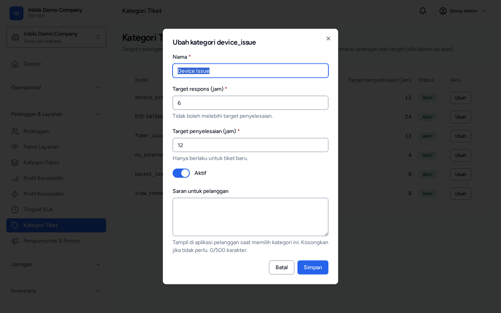

3. Klik **Ubah** pada sebuah baris. Dialog **Ubah kategori** diikuti kode kategori terbuka dengan isian berikut:
   - **Nama**: wajib.
   - **Target respons (jam)**: wajib, bilangan bulat 1 sampai 720, tidak boleh melebihi target penyelesaian.
   - **Target penyelesaian (jam)**: wajib, bilangan bulat 1 sampai 720. Keterangan di bawah isian menulis "Hanya berlaku untuk tiket baru."
   - **Aktif**: saklar. Kategori nonaktif tidak muncul di pilihan **Kategori** pada form tiket.
   - **Saran untuk pelanggan**: opsional, teks bebas maksimal 500 karakter dengan penghitung di keterangan ("Tampil di aplikasi pelanggan saat memilih kategori ini. Kosongkan jika tidak perlu."). Tulis langkah singkat yang bisa dicoba pelanggan sebelum membuat tiket, misalnya cara memeriksa lampu modem. Baris baru ikut tampil. Mengosongkan isian menghapus saran, dan aplikasi lalu menampilkan tiga langkah umum: cek lampu modem, cabut listrik modem 30 detik, cek kabel di modem.
4. Klik **Simpan**. Muncul toast "Kategori tiket diperbarui." Klik **Batal** untuk menutup dialog tanpa menyimpan.

Layar ini tidak punya tombol untuk menambah atau menghapus kategori, dan kode kategori tidak bisa diubah. Pesan "Target respons tidak boleh lebih lama dari target penyelesaian." muncul bila target respons lebih besar dari target penyelesaian. Pesan "saran untuk pelanggan tidak boleh lebih dari 500 karakter." di bawah **Saran untuk pelanggan** berarti isinya kepanjangan. Kolom daftar tidak menampilkan saran: buka **Ubah** untuk membacanya.

### Kesalahan umum

- **Tugaskan** menampilkan "penangani wajib diisi.": pilih petugas dari daftar, lalu klik **Tugaskan**. Pesan "penangani yang dipilih harus berupa pengguna aktif dengan peran yang sesuai." muncul bila petugas yang dipilih tidak aktif atau tidak berperan `admin`, `manager`, `noc`, `staff`, atau `technician`.
- Alert **Tiket sudah berubah** dengan keterangan "Konflik penugasan: tiket ini sudah ditugaskan oleh pengguna lain." (atau "Konflik: status tiket sudah diubah oleh pengguna lain." pada **Selesaikan** dan **Tutup**): klik **Muat ulang tiket**. Pada **Mulai**, perubahan status serupa menampilkan toast "Tiket gagal dimulai." dengan keterangan yang sama.
- **Selesaikan** ditolak pada tiket **Ditugaskan**: tombolnya tampil, tetapi hanya tiket **Dikerjakan** yang bisa diselesaikan. Petugas klik **Mulai** dulu.
- **Mulai** atau **Selesaikan** ditolak untuk Anda dengan halaman **Akses ditolak**: hanya petugas yang ditunjuk pada tiket yang boleh, dan peran manajer atau staf bawaan tidak memegang `ticket.start` maupun `ticket.resolve`. Tugaskan tiket ke pengguna yang berhak, atau biarkan teknisi mengerjakannya di aplikasi.
- **Tutup** tidak tampil: tiket belum **Diselesaikan**, Anda tidak memegang `ticket.close`, atau Anda petugas tiket itu. Server juga menolak penutupan oleh petugas tiket itu dengan halaman **Akses ditolak**. Minta pemegang `ticket.close` lain menutupnya.
- "catatan penyelesaian wajib diisi." atau "catatan penyelesaian tidak boleh lebih dari 1000 karakter." di dialog **Selesaikan tiket**: isi atau ringkas catatannya.
- **Buat SPK** tidak tampil atau ditolak: tiket harus **Ditugaskan** atau **Dikerjakan**, belum punya catatan penyelesaian, dan belum pernah melahirkan SPK. Server menolak dengan "SPK sudah dibuat dari tiket ini." bila SPK sudah ada. Anda juga butuh `ticket.spawn_spk`.
- **Tambah komentar** atau unggah lampiran ditolak untuk manajer bawaan (halaman **Akses ditolak**): peran itu tidak memegang `ticket.comment.create` dan `ticket.attachment.upload`. Minta operator platform menambahkannya ke peran (bagian 8.6), atau minta admin memberi Anda peran yang sudah memegangnya.
- Komentar kosong atau lebih dari 2000 karakter menampilkan "isi pesan wajib diisi." atau "isi pesan tidak boleh lebih dari 2000 karakter." di bawah **Komentar**.
- "judul wajib diisi." di **Judul** atau "kategori wajib diisi." di **Kategori** pada form buat: isi keduanya.
- Pesan "Langganan bukan milik pelanggan yang dipilih." di **Langganan**, atau "Aset jaringan bukan milik pelanggan yang dipilih." dan "Aset jaringan bukan milik langganan yang dipilih." di **Aset jaringan**: pilihan tidak cocok satu sama lain. Daftar pilihan sudah dipersempit menurut pelanggan dan langganan yang Anda pilih, jadi pesan ini jarang muncul. Pilih langganan dan aset milik pelanggan yang sama.
- Toast "Data gagal disimpan. Periksa input." muncul bersama pesan di bawah isian: baca pesan di bawah setiap isian yang bermasalah.
- Daftar tiket tampak terpotong setelah dibuka dari Dasbor: filter `sla_breached` masih aktif. Klik **Tiket** di sidebar.
- Judul atau prioritas tiket salah: web tidak punya layar ubah, **Ubah**, maupun **Hapus** untuk tiket. Server hanya mengubah tiket **Terbuka** (izin `ticket.update`) dan menghapus tiket **Ditutup** (izin `ticket.delete`), tetapi tidak ada layar yang memanggilnya. Tulis koreksi sebagai komentar.

## 3.5 Evaluasi

Evaluasi mencatat nilai kinerja seorang karyawan untuk satu tiket atau satu SPK. Rata-rata skor dan rating pelanggan dari evaluasi dibaca laporan Kinerja Teknisi (bagian 7.9). Buat evaluasi setelah tiket diselesaikan atau SPK disetujui, supaya angka waktunya terisi.

Peran yang dapat memakai: admin, manajer, dan staf pada peran bawaan. Izin: `evaluation.view` melihat semua evaluasi perusahaan, `evaluation.create` membuat, `evaluation.update` mengubah. Peran teknisi memegang `evaluation.view.own` dan hanya melihat evaluasi atas dirinya, tetapi teknisi bekerja di aplikasi. Menu tampil bagi pemegang `evaluation.view` atau `evaluation.view.own`. Izin `evaluation.delete` dan `evaluation.export` ada, tetapi layar Evaluasi tidak punya tombol **Hapus** maupun **Ekspor**.

### Membuka dan membaca daftar

1. Di sidebar, buka grup **Operasional**, lalu klik **Evaluasi**.

   

2. Tombol **Buat evaluasi** di kanan atas tampil bagi pemegang `evaluation.create`.
3. Isi filter. Daftar langsung menyesuaikan diri sesaat setelah Anda mengetik atau memilih, tanpa tombol filter:
   - Isian **Cari** mencari nama karyawan (isian bertuliskan "Nama karyawan").
   - Isian **Karyawan** memilih satu karyawan: ketik nama atau email (minimal 2 huruf), lalu pilih. Daftar memuat pengguna aktif perusahaan yang berperan `technician`, `staff`, atau `noc`, paling banyak 20 hasil. Pengguna berperan `technician` hanya mendapat dirinya sendiri di daftar ini. Klik **Hapus pilihan** untuk mencabut filter ini.
   - Pilihan **Jenis referensi** berisi **Semua jenis**, **SPK**, dan **Tiket**.
4. Baca tabel. Kolom: **Karyawan**, **Referensi**, **Nilai**, **Penilaian pelanggan**, **Penilai**, **Tanggal**, dan **Aksi**. Kolom **Referensi** memuat lencana jenis (**SPK** atau **Tiket**) dan kode tiket atau SPK-nya. Bila tiket atau SPK itu sudah tidak ada, kolom menulis `#` dan nomor id internalnya. Kolom **Tanggal** memuat tanggal dan jam dalam format tanggal perusahaan. Kolom **Referensi**, **Nilai**, dan **Tanggal** bisa diurutkan. Setiap baris hanya punya tombol **Lihat**.
5. Daftar memuat 10 evaluasi per halaman, terbaru di atas. Bila ada lebih dari satu halaman, di bawah tabel tampil "Menampilkan" rentang baris dan jumlah total, tombol **Sebelumnya** dan **Berikutnya**, serta "Halaman" nomor dan jumlah halaman.

Daftar yang kosong menulis **Belum ada evaluasi** dengan tombol **Buat evaluasi**. Bila filter tidak menemukan apa pun, daftar menulis **Tidak ada evaluasi yang cocok** dengan tombol **Reset filter**.

### Membuat evaluasi

1. Klik **Buat evaluasi**. Halaman **Buat Evaluasi** terbuka.

   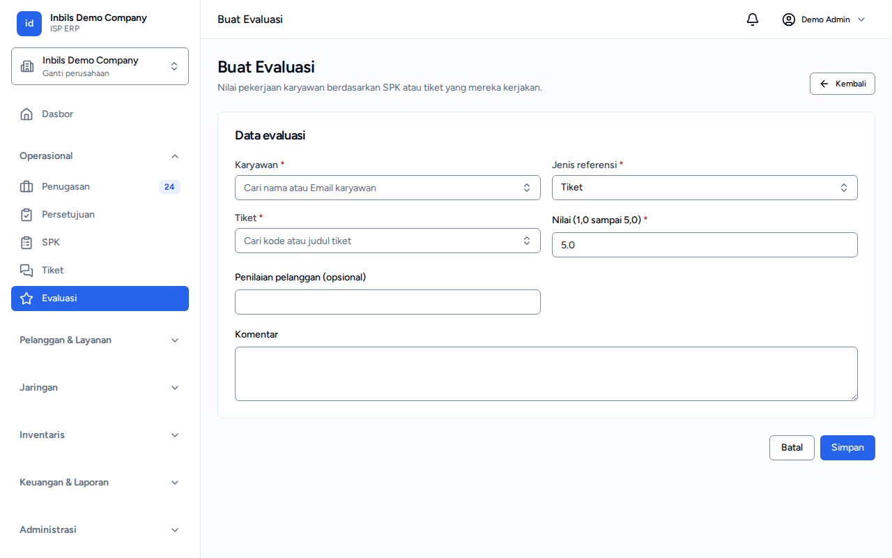

2. Isi kartu **Data evaluasi**:
   - **Karyawan**: wajib. Ketik nama atau email karyawan (minimal 2 huruf), lalu pilih. Daftar memuat pengguna aktif dari perusahaan yang sedang aktif dan berperan `technician`, `staff`, atau `noc`, paling banyak 20 hasil. Bila tidak ada yang cocok, daftar menulis "Tidak ada karyawan yang cocok."
   - **Jenis referensi**: wajib. Pilih **Tiket** (nilai awal) atau **SPK**. Mengganti jenis mengosongkan pilihan referensi.
   - **Tiket** atau **SPK** (nama isian mengikuti jenis referensi): wajib. Ketik kode atau judul (minimal 2 huruf), lalu pilih. Isian tiket memuat tiket berstatus **Diselesaikan** atau **Ditutup** yang sudah punya petugas. Isian SPK memuat SPK berstatus **Selesai** yang sudah punya teknisi. Keduanya terbatas pada perusahaan yang sedang aktif, paling banyak 20 hasil. Tidak ada lagi isian ID yang diketik.
   - **Nilai (1,0 sampai 5,0)**: wajib. Angka 1,0 sampai 5,0 dengan langkah 0,1, nilai awal 5.0.
   - **Penilaian pelanggan (opsional)**: opsional. Angka 1,0 sampai 5,0 dengan langkah 0,1. Isi bila Anda mencatat rating dari pelanggan.
   - **Komentar**: opsional, maksimal 1000 karakter.
3. Klik **Simpan**. Daftar terbuka dan toast "Evaluasi berhasil dibuat." muncul. Klik **Batal** atau **Kembali** untuk kembali tanpa menyimpan.

Inbils mengisi sendiri **Penilai** (akun Anda) dan waktu evaluasi. Inbils juga menyalin waktu dari tiket atau SPK saat Anda menyimpan, dan tidak memperbaruinya lagi:

- Untuk tiket, **Respons pertama** adalah menit dari tiket dibuat sampai petugas memulai tiket, dan **Penyelesaian** adalah menit dari tiket dibuat sampai diselesaikan. Keduanya kosong bila kejadiannya belum ada.
- Untuk SPK, **Penyelesaian** adalah menit dari SPK mulai dikerjakan sampai disetujui. **Respons pertama** tidak diisi.

### Melihat dan mengubah evaluasi

1. Di daftar, klik **Lihat**. Halaman detail berjudul "Evaluasi" diikuti nama karyawan, dengan jenis, kode referensi, dan tanggal di bawahnya. Halaman memuat kartu **Hasil penilaian** (**Karyawan**, **Penilai**, **Nilai**, **Penilaian pelanggan**, **Respons pertama**, **Penyelesaian**, dan **Komentar**) dan kartu **Referensi** (**Jenis**, **Kode**, **Judul**, dan **Tanggal evaluasi**). Waktu tampil dalam menit, misalnya "90 menit". Nilai kosong tampil sebagai tanda hubung (-).
2. Klik **Ubah** untuk mengubah. Halaman **Ubah Evaluasi** menampilkan nama karyawan dan hanya menawarkan **Nilai (1,0 sampai 5,0)**, **Penilaian pelanggan (opsional)**, dan **Komentar**, dengan aturan yang sama seperti saat membuat. Karyawan dan referensi tidak bisa diubah.
3. Klik **Simpan**. Daftar terbuka dan toast "Evaluasi berhasil diubah." muncul. Klik **Batal** atau **Kembali** untuk kembali ke halaman detail.

Tombol **Ubah** tampil bagi semua orang yang bisa membuka halaman detail. Halaman **Ubah Evaluasi** terbuka bagi pemegang `evaluation.update` atau penilai evaluasi itu, tetapi menyimpan perubahan butuh `evaluation.update`. Tanpa izin itu, server menolak dengan halaman **Akses ditolak**.

### Kesalahan umum

- Pesan "referensi yang dipilih tidak valid untuk perusahaan ini." di bawah isian tiket atau SPK: tiket atau SPK itu milik perusahaan lain. Pastikan perusahaan aktif Anda benar (bagian 1.6), lalu pilih ulang dari daftar.
- Pesan "karyawan yang dipilih tidak valid." di bawah **Karyawan**: karyawan itu bukan anggota aktif dari perusahaan yang sedang aktif. Pindah ke perusahaan yang tepat atau pilih karyawan lain. Pesan "karyawan yang dipilih harus berupa pengguna aktif dengan peran yang sesuai." berarti karyawan itu tidak berperan `technician`, `staff`, atau `noc`.
- "karyawan wajib diisi.", "referensi wajib diisi.", atau "nilai wajib diisi.": pilih karyawan dan referensi, lalu isi nilai.
- Pesan "nilai harus bernilai antara 1.0 dan 5.0." (untuk **Penilaian pelanggan**: "penilaian pelanggan harus bernilai antara 1.0 dan 5.0."): isi angka 1,0 sampai 5,0.
- Pesan "komentar tidak boleh lebih dari 1000 karakter.": persingkat komentar.
- Evaluasi kedua oleh penilai yang sama untuk tiket atau SPK yang sama ditolak basis data, karena satu penilai hanya boleh punya satu evaluasi per referensi. Layar tidak menangkap penolakan ini sebagai pesan isian, jadi yang tampil adalah halaman **Terjadi kesalahan di server**. Perbaiki evaluasi yang ada lewat **Ubah**.
- **Respons pertama** atau **Penyelesaian** kosong: tiket belum dimulai atau diselesaikan, atau SPK belum disetujui, saat evaluasi dibuat. **Ubah** tidak mengisinya ulang, jadi buat evaluasi setelah pekerjaan selesai.
- Evaluasi lama tidak terlihat di halaman pertama: daftar memuat 10 baris per halaman. Pakai **Sebelumnya** dan **Berikutnya**, atau persempit dengan **Cari**, **Karyawan**, dan **Jenis referensi**.

## 3.6 Pekerjaan Saya

Pekerjaan Saya memuat tiket dan SPK yang ditugaskan kepada akun Anda sendiri, lengkap dengan tombol untuk mengerjakannya. Teknisi mengerjakan tugas yang sama di aplikasi teknisi, jadi halaman ini untuk pengguna web (admin, manajer, staf) yang menerima penugasan.

Peran yang dapat memakai: pengguna yang memenuhi dua syarat. Pertama, akun aktif dan memegang minimal satu izin kerja: `ticket.start`, `ticket.resolve`, `ticket.close`, `spk.start`, atau `spk.submit`. Kedua, akun tertaut ke profil karyawan berstatus `active` di perusahaan yang sedang aktif (bagian 8.3). Peran bawaan yang bisa memenuhinya: admin (semua izin), staf (`spk.start`, `spk.submit`), dan manajer (`ticket.close`). Izin tiket menampilkan tiket, izin SPK menampilkan SPK.

### Membuka dan membaca daftar

1. Di sidebar, buka grup **Operasional**, lalu klik **Pekerjaan Saya**. Angka di samping menu adalah jumlah tugas Anda.
2. Bila syaratnya belum terpenuhi, menu tidak tampil. Membuka alamatnya langsung menampilkan halaman **Akses ditolak**, dengan keterangan "Anda tidak punya izin untuk membuka halaman ini. Hubungi administrator jika Anda memerlukan aksesnya." dan "Kode galat 403". Server menolak dengan alasan "Anda tidak memiliki izin operasional untuk domain apa pun.", tetapi layar tidak menampilkan kalimat itu. Minta admin membuat profil karyawan aktif untuk akun Anda di menu Karyawan (bagian 8.3). Akun admin demo tidak punya profil karyawan, jadi halaman ini menolaknya.

   

3. Baca deretan tombol hitungan di atas daftar. Klik sebuah tombol untuk memfilter daftar, dan klik **Semua tugas** untuk menampilkan semuanya lagi.
   - **Semua tugas** menghitung semua tiket dan SPK yang ditugaskan kepada Anda dalam status yang terkait dengan izin Anda.
   - **Belum dimulai** menghitung tugas berstatus **Ditugaskan**.
   - **Sedang dikerjakan** menghitung tiket **Dikerjakan** dan SPK **Dikerjakan**.
   - **Menunggu tindakan** menghitung tiket **Diselesaikan** dan SPK **Dikerjakan**. SPK yang sedang dikerjakan dihitung di dua tombol terakhir, jadi jumlah ketiga tombol terakhir bisa melebihi **Semua tugas**. Hitungan tidak berubah saat Anda memakai filter lain.
4. Persempit daftar dengan filter. Filter jalan sendiri sesaat setelah Anda mengetik atau memilih:
   - Kotak **Pencarian** mencari kode, judul, serta nama dan kode pelanggan (isian bertuliskan "Cari kode, judul, atau nama pelanggan...").
   - Pilihan **Jenis** (**Semua jenis**, **Tiket**, **SPK**) tampil bila Anda memegang izin tiket dan izin SPK.
   - Pilihan **Status** berisi **Semua status**, **Belum dimulai**, **Sedang dikerjakan**, dan **Menunggu tindakan**. **Menunggu tindakan** menampilkan tiket **Diselesaikan** dan SPK **Dikerjakan**.
   - Pilihan **Prioritas** (**Semua prioritas**, **Rendah**, **Sedang**, **Tinggi**, **Mendesak**) dan isian **Periode** (isian bertuliskan "Semua tanggal", dengan kalender dan pilihan cepat) bekerja seperti di Penugasan (bagian 3.1). Tombol **Cari** menjalankan pencarian yang sama. Tombol **Reset filter** muncul bila ada filter aktif dan mengosongkan semuanya.
5. Baca kolom tabel: **Kode** (tautan ke detail dan lencana **Tiket** atau **SPK**), **Judul dan pelanggan** (tiket yang lewat SLA diberi tulisan merah "SLA terlampaui"), **Prioritas dan umur** (lencana prioritas dan sudah berapa lama tugas ada), **Status** (lencana status dan satu baris "Berikutnya:" yang menyebut status berikutnya), **Batas atau jadwal** ("SLA:" dengan tenggat untuk tiket, "Jadwal:" dengan tanggal untuk SPK), dan **Tindakan**. Judul kolom **Kode**, **Judul dan pelanggan**, **Prioritas dan umur**, dan **Status** bisa diurutkan. Tautan **Kode** hanya aktif pada baris yang boleh Anda buka.
6. Bila akun Anda juga memegang izin penugasan, dua tab muncul di atas hitungan: **Pekerjaan Saya** dan **Antrean Penugasan**. Tab **Antrean Penugasan** membuka halaman Penugasan (bagian 3.1).

Daftar yang kosong menulis **Belum ada tugas untuk Anda**. Bila filter tidak menemukan apa pun, daftar menulis **Tidak ada tugas yang cocok** dengan tombol **Reset filter**.

Tombol di kolom **Tindakan** mengikuti status tugas:

| Status | Jenis | Tombol | Syarat |
|---|---|---|---|
| **Ditugaskan** | Tiket dan SPK | **Mulai** | `ticket.start` atau `spk.start` |
| **Dikerjakan** | Tiket | **Selesaikan** | `ticket.resolve` |
| **Dikerjakan** | SPK | **Ajukan review** | `spk.submit` |
| **Diselesaikan** | Tiket | Tidak ada tombol | Tiket ini sudah Anda selesaikan sendiri, jadi Anda tidak boleh menutupnya |

### Memulai pekerjaan

1. Pada tugas berstatus **Ditugaskan**, klik **Mulai**.
2. Dialog meminta konfirmasi dengan judul "Mulai pengerjaan Tiket" atau "Mulai pengerjaan SPK" diikuti kode tugas dan tanda tanya. Isinya "Status akan menjadi Dikerjakan. Waktu mulai pengerjaan tercatat di jejak audit." Klik **Mulai kerja**. Klik **Batal** untuk menutup tanpa memulai.
3. Status berubah menjadi **Dikerjakan** dan waktu mulai tercatat di audit. Toast "Tiket mulai dikerjakan." atau "SPK mulai dikerjakan." muncul. Pada tiket, langkah ini juga mencatat waktu respons pertama bila belum ada. Angka itu disalin ke Evaluasi (bagian 3.5).

### Menyelesaikan tiket

1. Pada tiket berstatus **Dikerjakan**, klik **Selesaikan**.
2. Di dialog "Selesaikan tiket" diikuti kode tiket, isi **Catatan penyelesaian**. Isian ini wajib dan maksimal 1000 karakter. Dialog juga menampilkan judul tiket dan nama pelanggan. Catatan tersimpan di riwayat audit tiket dan dibaca saat penutupan.
3. Klik **Selesaikan tiket**. Status menjadi **Diselesaikan** dan toast "Tiket diselesaikan." muncul. Sistem mengantrekan pesan WhatsApp ke pelanggan tiket. Klik **Batal** untuk menutup dialog tanpa menyimpan.

### Mengajukan SPK untuk review

Syarat: SPK sudah punya minimal satu bukti (evidence), dan sisa material dari permintaan barang yang sudah diserahkan sudah dideklarasikan teknisi (bagian 6.1 dan 6.8).

1. Pada SPK berstatus **Dikerjakan**, klik **Ajukan review**.
2. Dialog berjudul "Ajukan SPK" diikuti kode SPK dan "untuk review?". Baca keterangannya bahwa pekerjaan lapangan dan deklarasi material masuk ke antrean persetujuan dan item pekerjaan tidak bisa diubah sampai review selesai, lalu klik **Ajukan review**.
3. SPK berstatus **Menunggu review** dan toast "SPK diajukan untuk review." muncul. SPK keluar dari daftar ini dan masuk ke antrean **Persetujuan** pengguna lain (bagian 3.2). Anda sendiri tidak melihatnya di sana karena Anda teknisi yang ditugaskan.

### Kesalahan umum

- Alert **Item sudah berubah** di dialog, dengan tombol **Muat ulang pekerjaan**: status tugas diubah di tempat lain, misalnya teknisi memulainya di aplikasi. Klik **Muat ulang pekerjaan**. Dialog memuat data terbaru, atau menutup bila tombolnya sudah tidak berlaku. Pemuatan yang gagal menulis "Gagal memuat ulang pekerjaan." dengan penyebabnya.
- Pesan "Catatan resolusi/penanganan wajib diisi." di dialog **Selesaikan tiket**: isi **Catatan penyelesaian** dengan teks selain spasi. Catatan lebih dari 1000 karakter ditolak dengan "catatan penyelesaian tidak boleh lebih dari 1000 karakter." di alert **Gagal menyimpan**.
- Server menolak pengajuan SPK dengan "Bukti pekerjaan wajib diunggah sebelum SPK diajukan." bila SPK belum punya bukti. Unggah bukti di halaman detail SPK (bagian 3.3), lalu ajukan lagi.
- Server menolak pengajuan SPK dengan "Seluruh sisa material dari permintaan barang harus dideklarasikan terlebih dahulu sebelum SPK diajukan." bila deklarasi sisa material belum lengkap. Lengkapi deklarasinya (bagian 6.1 dan 6.8), lalu ajukan lagi.
- Tombol **Tutup** tidak pernah muncul di halaman ini: daftar hanya memuat tiket yang ditugaskan kepada Anda, dan penanggung jawab tiket tidak boleh menutup tiket yang ia selesaikan. Pengguna lain pemegang `ticket.close` menutupnya dari halaman detail tiket (bagian 3.4).
- Tugas yang baru ditugaskan tidak tampil: daftar hanya memuat tugas yang ditugaskan ke akun Anda, dan hanya pada status yang cocok dengan izin Anda. Contohnya, tiket **Ditugaskan** baru tampil bila Anda memegang `ticket.start`.

# 4. Pelanggan & Layanan

## 4.1 Pelanggan

Menu **Pelanggan** menyimpan identitas pelanggan, alamat, kontak, pemeroleh pelanggan (**Diperoleh oleh**), langganan, dan riwayat layanan. Gunakan menu ini untuk onboarding pelanggan baru dan meninjau seluruh hubungan pelanggan.

Peran yang dapat membuka daftar: admin, manajer, dan staf. Izin dasar: Lihat pelanggan (`customer.view`). Peran bawaan memiliki batas berikut:

| Tindakan | Izin | Peran bawaan |
|---|---|---|
| Melihat pelanggan | Lihat pelanggan (`customer.view`) | Admin, manajer, staf |
| Onboarding lengkap | Buat pelanggan (`customer.create`), Kelola alamat pelanggan (`customer.address.manage`), Kelola langganan (`customer.subscription.manage`), Buat SPK (`spk.create`) | Admin, manajer |
| Mengubah pelanggan dan mengirim link akses | Ubah pelanggan (`customer.update`) | Admin, manajer, staf |
| Mengelola alamat dan kontak | Kelola alamat pelanggan (`customer.address.manage`) | Admin, manajer, staf |
| Menghapus pelanggan | Hapus pelanggan (`customer.delete`) | Admin |
| Mengekspor pelanggan | Ekspor pelanggan (`customer.export`) | Admin, manajer |
| Menetapkan **Diperoleh oleh** | Tetapkan pemeroleh pelanggan (`customer.sales.assign`) | Admin, manajer, staf |
| Mengoreksi **Diperoleh oleh** | Koreksi pemeroleh pelanggan (`customer.sales.correct`) | Admin, manajer |
| Melihat langganan | Lihat langganan (`customer.subscription.view`) | Admin, manajer, staf |
| Membuat dan menjalankan siklus langganan | Kelola langganan (`customer.subscription.manage`) dan izin aksi terkait | Admin, manajer |
| Melihat, mengelola, dan membuka kata sandi akun jaringan | Lihat akun jaringan (`network_asset.account.view`), Kelola akun jaringan (`network_asset.account.manage`), Tampilkan kata sandi akun jaringan (`network_asset.account.reveal`) | Admin, manajer, staf |

Admin dapat mengubah susunan izin melalui **Peran** dan **Hak Akses**. Tombol yang terlihat pada peran khusus dapat berbeda dari tabel ini.

### Membuka dan membaca daftar

1. Di sidebar, buka grup **Pelanggan & Layanan**, lalu klik **Pelanggan**.
2. Ketik nama, kode, atau nomor telepon di kotak **Cari**. Daftar menyesuaikan beberapa saat setelah Anda berhenti mengetik. Filter berlaku begitu Anda memilihnya, tanpa tombol **Filter** di layar lebar:
   - **Tipe**: **Semua tipe**, **Perorangan**, atau **Perusahaan**.
   - **Status**: **Semua status**, **Prospek**, **Aktif**, **Nonaktif**, **Ditangguhkan**, atau **Berhenti**.
   - **Akun**: **Semua akun**, **Aktif**, atau **Nonaktif**. Filter ini menyaring saklar manual **Akun aktif** pada data pelanggan. Nilainya berbeda dari status layanan.
   - **Diperoleh oleh**: kotak cari, ketik untuk mencari, lalu pilih. Pilihannya **Belum ditentukan** atau nama pegawai. Pegawai yang sudah nonaktif tertulis dengan "(nonaktif)". Klik **Hapus pilihan** untuk mengosongkan filter. Filter ini hanya terlihat dengan Tetapkan pemeroleh pelanggan atau Koreksi pemeroleh pelanggan.
   - **Reset filter** muncul bila ada pencarian atau filter aktif. Klik untuk mengosongkan semuanya.
3. Di layar sempit (ponsel), daftar tampil sebagai kartu dan nama pelanggan tetap menjadi link ke detail. Filter pindah ke tombol **Filter**, yang menambahkan jumlah pilihan aktif dalam tanda kurung bila ada. Tombol itu membuka lembar **Filter pelanggan** dengan tombol **Reset filter** dan **Lihat hasil**.
4. Baca kolom **Kode**, **Nama**, **Tipe**, **Telepon**, **Status**, **Diperoleh oleh**, **Alamat**, **Langganan**, dan **Aksi**. Kolom **Alamat** dan **Langganan** berisi jumlah. Kolom kode, nama, tipe, telepon, dan status dapat diurutkan. Urutan awal memakai kode dari kecil ke besar.

   

5. Nama pelanggan adalah link ke detail. Kolom **Aksi** berisi tombol **Ubah** (dengan Ubah pelanggan; tanpa izin itu tombolnya **Lihat**) dan menu **Aksi lainnya** dengan **Lihat detail** serta **Hapus** (dengan Hapus pelanggan).
6. Gunakan **Ekspor** untuk mengunduh **Ekspor CSV** atau **Ekspor PDF** dengan filter aktif. Menu ini muncul dengan Ekspor pelanggan. Ekspor memuat maksimal 5.000 baris secara bawaan. Persempit filter bila hasil dipotong.
7. Di bawah tabel, baca ringkasan jumlah baris dan pilih **Baris per halaman** (10, 25, atau 50). Pindah halaman dengan **Sebelumnya** dan **Berikutnya**. Bila tidak ada hasil, daftar menulis **Belum ada pelanggan** (tanpa filter) atau **Tidak ada pelanggan yang cocok** (dengan filter) beserta tombol **Reset filter**.
8. Bedakan dua indikator berikut:

   | Indikator | Nilai | Arti |
   |---|---|---|
   | Filter **Akun** dan lencana **Akun nonaktif** di kolom **Status** | **Aktif**, **Nonaktif** | Saklar manual **Akun aktif** pada data pelanggan. Lencana **Akun nonaktif** hanya tampil bila saklar mati. |
   | **Status** | **Prospek** | Belum ada langganan atau semua masih **Menunggu** |
   | **Status** | **Aktif** | Ada langganan **Aktif** |
   | **Status** | **Ditangguhkan** | Tidak ada yang **Aktif**, tetapi ada yang **Ditangguhkan** |
   | **Status** | **Berhenti** | Semua langganan **Berhenti** |
   | **Status** | **Nonaktif** | Kombinasi lain, misalnya **Menunggu** dan **Berhenti** |

   Status layanan dihitung otomatis dari langganan. Anda tidak mengisinya dengan tangan.

### Menambah pelanggan baru

1. Klik **Buat Pelanggan**. Tombol hanya muncul bila semua izin onboarding lengkap tersedia. Isian wajib bertanda bintang (*).

   

2. Pada tab **Data pelanggan**, isi data identitas:
   - **Kode**: sistem membuat kode saat disimpan. Pada penomoran otomatis, kotak terkunci dan menulis perkiraan kode. Jika penomoran manual diaktifkan pada Penomoran (bagian 7.13), isian boleh dikosongkan untuk kode otomatis atau diisi maksimal 50 karakter. Kode harus unik dalam perusahaan.
   - **Nama**: wajib, maksimal 255 karakter.
   - **Tipe**: pilih **Perorangan** atau **Perusahaan**. Nilai awalnya **Perorangan**.
   - **Email**: wajib, format e-mail, maksimal 255 karakter, dan harus unik di seluruh akun pengguna. E-mail ini menjadi e-mail masuk pelanggan.
   - **Telepon**: wajib, maksimal 50 karakter. Kolom hanya menerima angka serta karakter `(`, `)`, `+`, dan `-`. Karakter lain hilang saat diketik. Kolom ini menampilkan petunjuk bahwa link untuk mengatur kata sandi dikirim ke e-mail pelanggan.
   - **NPWP**: wajib untuk **Perusahaan**, opsional untuk **Perorangan**, maksimal 100 karakter.
   - **Narahubung**: wajib untuk **Perusahaan**, opsional untuk **Perorangan**, maksimal 255 karakter. Nilai ini menjadi nama akun masuk. Jika kosong, sistem memakai **Nama**.
   - **Akun aktif**: menyala secara bawaan. Jika dimatikan, sistem tetap membuat akun masuk dalam keadaan nonaktif dan tidak mengirim link akses.
   - **Catatan**: opsional.
3. Tentukan persetujuan dan pemeroleh pada tab yang sama:
   - **Pelanggan setuju menerima notifikasi WhatsApp**: tidak dicentang secara bawaan. Centang hanya setelah pelanggan menyetujui tagihan terbit, pengingat jatuh tempo, pembayaran diterima, status tiket, dan jadwal kunjungan teknisi. Pengiriman tetap memerlukan fitur WhatsApp perusahaan yang aktif dan nomor seluler Indonesia yang valid.
   - **Diperoleh oleh**: muncul dengan Tetapkan pemeroleh pelanggan. Ketik untuk mencari karyawan, lalu pilih, atau biarkan kosong (**Belum ditentukan**). Klik **Hapus pilihan** untuk mengosongkannya lagi. Pilihan hanya memuat akun aktif dalam perusahaan yang memiliki profil karyawan aktif dan memegang Buat pelanggan. Bila pembuat memenuhi syarat, namanya terisi sebagai nilai awal. Bila tidak ada karyawan yang cocok, kotak menulis **Tidak ada karyawan yang memenuhi syarat.**
4. Buka tab **Alamat**. Sediakan sedikitnya satu alamat dan pilih tepat satu alamat utama serta satu alamat pemasangan. Alamat pertama sudah menjadi keduanya. Setiap alamat adalah kartu bernomor (judul **Alamat** diikuti nomor urut):
   - **Label**: wajib, maksimal 100 karakter, dan tidak boleh sama dengan label alamat lain milik pelanggan ini. Contoh pada kolom: Rumah / Kantor / Pemasangan.
   - Peta: klik peta, geser pin merah, atau pakai kotak pencarian di atas peta. Tombol **Alamat** mencari lokasi lewat teks dan membutuhkan sedikitnya 3 karakter. Klik **Cari**, lalu pilih salah satu hasil. Tombol **Lintang / Bujur** membuka dua kotak untuk mengetik koordinat. Klik **Cari** untuk menaruh pin. Tombol **Lokasi saat ini** memakai lokasi perangkat Anda. Bila hasil pencarian kosong, peta menulis **Lokasi tidak ditemukan. Coba alamat yang lebih spesifik.**
   - **Lintang** dan **Bujur**: wajib dan terisi oleh peta, tidak dapat diketik langsung pada kotaknya. Lintang harus antara -90 sampai 90. Bujur harus antara -180 sampai 180.
   - **Provinsi**, **Kota / Kabupaten**, **Kecamatan**, dan **Kelurahan / Desa**: wajib. Tiap kotak adalah kotak cari (ketik untuk mencari, lalu pilih). Pilih berurutan. Kotak berikutnya baru aktif setelah kotak di atasnya dipilih. Kombinasinya harus membentuk hierarki wilayah yang valid. Memilih hasil pencarian peta ikut mengisi wilayah dan kode pos.
   - **Alamat**: wajib. **Kode pos** dan **Catatan** opsional.
   - **Alamat utama** dan **Alamat pemasangan**: pilih satu kartu untuk masing-masing penanda. Menyalakan penanda pada satu kartu memindahkannya dari kartu lama.
   - Klik **Tambah alamat** untuk menambah kartu. Tombol **Hapus** pada kartu tidak aktif bila hanya ada satu alamat. Menghapus kartu yang membawa penanda memindahkan penanda ke alamat pertama yang tersisa.
5. Buka tab **Kontak**. Sediakan sedikitnya satu kontak dan pilih tepat satu kontak utama.
   - **Nama**: wajib, maksimal 255 karakter.
   - **Jabatan**: opsional, maksimal 255 karakter.
   - **Telepon**: wajib pada onboarding, maksimal 50 karakter, dengan format angka serta `(`, `)`, `+`, atau `-`.
   - **Email**: wajib pada onboarding, format e-mail, maksimal 255 karakter.
   - **Catatan**: opsional.
   - **Kontak utama**: pilih satu kartu. Klik **Tambah kontak** untuk menambah kontak. Tombol **Hapus** tidak aktif bila hanya ada satu kontak.
6. Buka tab **Langganan & SPK**:
   - **Paket layanan**: wajib. Kotak cari (ketik untuk mencari, lalu pilih). Pilihan hanya memuat paket aktif dari kategori aktif, dikelompokkan dengan judul nama kategori. Tiap pilihan menulis nama paket dan keterangan kode paket serta harga per bulan. Mengganti **Tipe** menata ulang kelompok: **Perorangan** menampilkan **Rumahan** paling atas, **Perusahaan** menampilkan **Bisnis** lalu **Korporat**. Semua paket tetap bisa dipilih untuk tipe apa pun. Memilih paket mengisi **Biaya bulanan**, **Biaya pemasangan**, dan **Masa kontrak (bulan)** dengan nilai paket. Anda boleh mengubahnya.
   - **POP pelayan**: wajib. Kotak cari. Pilihan hanya memuat lokasi aktif dalam perusahaan, ditulis dengan kode dan nama lokasi.
   - **Port drop (ODP)**: opsional dan hanya muncul dengan Tetapkan port ODN (`odn.assign`). Kotak ini baru aktif setelah **POP pelayan** dipilih (sebelum itu tertulis **Pilih POP layanan untuk melihat port kosongnya.**). Ketik minimal 2 huruf kode ODP atau label splitter, lalu pilih port bebas di bawah POP tersebut. Bila tidak ada, kotak menulis **Tidak ada port kosong yang cocok di bawah POP ini.** Mengganti POP mengosongkan pilihan port.
   - **Tanggal tagihan (1-28)**: wajib, bilangan bulat 1 sampai 28. Nilai awal 1.
   - **Masa kontrak (bulan)**: opsional, bilangan bulat minimal 1. Kosongkan untuk memakai masa minimum paket.
   - **Biaya bulanan** dan **Biaya pemasangan**: opsional, angka minimal 0. Kosongkan untuk memakai harga paket.
   - **Catatan langganan**: opsional.
   - Periksa ringkasan di bagian bawah: **Alamat pemasangan** (label alamat yang bertanda pemasangan) dan **Status SPK setelah dibuat**, yaitu **Menunggu penugasan**.
7. Klik **Buat pelanggan dan SPK**. Bila validasi gagal, layar berpindah ke tab yang berisi masalah dan toast **Data gagal disimpan. Periksa input.** muncul. Pesan tiap isian tampil di bawah isiannya. Klik **Batal** untuk kembali ke daftar tanpa menyimpan.
8. Sistem menyimpan seluruh onboarding dalam satu transaksi:
   - pelanggan, alamat, kontak, persetujuan WhatsApp, dan pemeroleh;
   - akun pengguna berperan `customer`, tergabung pada perusahaan, e-mail sudah ditandai terverifikasi, dan terhubung ke pelanggan;
   - langganan baru berstatus **Menunggu**, port ODP bila dipilih, serta SPK pemasangan berstatus **Menunggu penugasan** dengan prioritas **Sedang**. Judul SPK berbentuk **Pemasangan** diikuti kode langganan dan nama pelanggan;
   - catatan audit onboarding.
9. Tidak ada isian kata sandi pada form. Sistem membuat kata sandi acak 32 karakter yang tidak pernah ditampilkan. Nomor telepon bukan kata sandi.
10. Jika **Akun aktif** menyala, sistem mengantrekan e-mail berjudul **Akun pelanggan Anda sudah dibuat** setelah transaksi selesai. Tombol **Atur kata sandi** berlaku 60 menit. Pelanggan mengatur kata sandi melalui link itu, lalu masuk ke aplikasi Inbils Pelanggan memakai e-mail tersebut.
11. Setelah berhasil, layar membuka detail pelanggan baru. Toast menulis **Pelanggan, langganan, dan SPK pemasangan dibuat.** diikuti kalimat bahwa link akses dikirim ke e-mail pelanggan. Kode pelanggan dan langganan mengikuti pengaturan Penomoran (bagian 7.13).
12. SPK pemasangan tercatat dibuat oleh Anda. Sistem melarang pembuat SPK menyetujuinya sendiri (pesan **Pembuat SPK tidak boleh menyetujui SPK sendiri.**). Minta orang lain yang berwenang menyetujui SPK ini pada SPK (bagian 3.3).

### Membuka detail pelanggan

1. Pada daftar, klik nama pelanggan atau pilih **Aksi lainnya**, lalu **Lihat detail**. Tombol **Kembali** di pojok atas membawa Anda ke daftar.

   

2. Baca kartu **Data pelanggan** untuk e-mail, telepon, NPWP, narahubung, **Diperoleh oleh**, dan catatan. Catatan hanya tampil bila terisi. Kartu **Status** menampilkan tipe, status layanan, dan status **Akun** (**Aktif** atau **Nonaktif**).
3. Baca kartu **WhatsApp**. Lencana menampilkan **Setuju sejak** (dengan tanggal), **Berhenti sejak** (dengan tanggal), atau **Belum setuju**. Bila nomor telepon bukan nomor seluler Indonesia yang valid, kartu menampilkan peringatan **Nomor telepon pelanggan bukan nomor seluler Indonesia yang valid.** Tabel memuat 20 pesan terbaru dengan kolom **Pesan**, **Subjek**, **Status**, **Keterangan**, **Nomor**, dan **Waktu**. Nomor hanya menampilkan empat digit terakhir. Status pesan berupa lencana **Antrean**, **Terkirim**, **Diterima**, **Dibaca**, **Gagal**, atau **Dilewati**. Pesan yang dilewati menulis alasannya di **Keterangan**, misalnya **Pelanggan belum setuju**.
4. Buka tab **Alamat**, **Kontak**, dan **Langganan** (masing-masing diikuti jumlah) untuk ringkasan data terkait. Tab **Tagihan**, **SPK**, dan **Tiket** muncul bila pengguna memiliki izin modul terkait. Riwayat tagihan, SPK, dan tiket masing-masing menampilkan maksimal 50 data terbaru.
5. Tab **Langganan** pada detail hanya berupa ringkasan (**Kode**, **Paket**, **Status**, **Biaya bulanan**, **Tanggal tagih**). Halaman ini tidak menyediakan tombol untuk membuat atau membuka langganan. Tab **Alamat** dan **Kontak** juga hanya baca. Tambahkan atau ubah datanya lewat **Ubah**.
6. Tombol **Ubah** selalu tampil di detail. Tanpa Ubah pelanggan, klik tombol itu membuka halaman **Akses ditolak**.

### Mengirim ulang link akses

1. Buka detail pelanggan, lalu klik **Kirim ulang link akses**. Tombol membutuhkan Ubah pelanggan (`customer.update`).
2. Pastikan pelanggan memiliki akun masuk dengan e-mail. Pastikan status pelanggan dan akun pengguna sama-sama aktif. Bila tidak, toast merah muncul dengan salah satu pesan: **Customer belum punya akun portal beremail, tautan akses tidak dikirim.** atau **Customer atau akun portalnya nonaktif, tautan akses tidak dikirim.**
3. Sistem mengirim link ke e-mail akun masuk dan menampilkan toast **Link akses dikirim ke &lt;email&gt;.** Batasnya 3 permintaan per menit. Permintaan keempat ditolak dengan HTTP 429.
4. Link baru membatalkan link lama. Link berlaku 60 menit. Setelah mengatur kata sandi, pelanggan memakai aplikasi Inbils Pelanggan.
5. Jika pelanggan sudah menyetujui WhatsApp, sistem juga mengantrekan pemberitahuan bahwa link ada di e-mail. Pesan WhatsApp tidak membawa link atau token. Pemberitahuan ini dibatasi satu kali per akun setiap jam. Pesan itu tampil di tabel WhatsApp pada detail sebagai **Info link akses portal**.

### Mengubah pelanggan, alamat, dan kontak

1. Dari detail, klik **Ubah**. Anda juga dapat mengklik **Ubah** pada baris daftar. Halaman **Ubah Pelanggan** punya tiga tab: **Data pelanggan**, **Alamat**, dan **Kontak**. Dua tab terakhir diikuti jumlah datanya. Tab **Data pelanggan** memakai isian yang sama dengan form tambah. **Kode** terkunci ("Dibuat otomatis dan tidak dapat diubah.") kecuali penomoran manual aktif. Pada penomoran manual, kode wajib dan harus unik.

   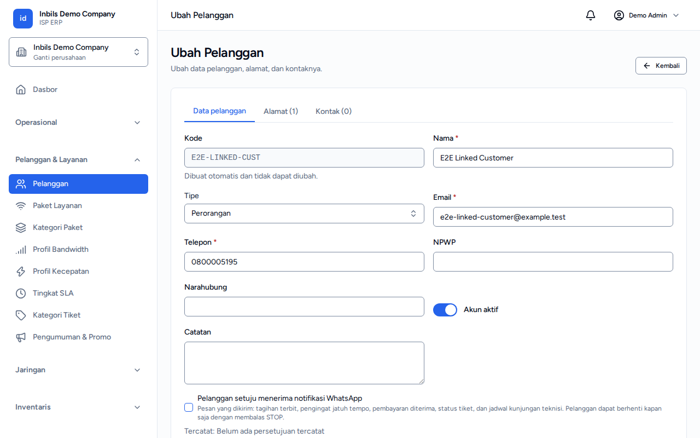

2. Ubah tab **Data pelanggan**, lalu klik **Simpan pelanggan**. Toast **Pelanggan diperbarui.** muncul dan layar kembali ke daftar pelanggan. Klik **Batal** untuk membuang perubahan dan kembali ke detail. Tombol **Kembali** di pojok atas juga kembali ke detail. Tab **Alamat** dan **Kontak** menyimpan datanya sendiri, jadi perubahan yang belum disimpan pada tab **Data pelanggan** tidak ikut tersimpan atau hilang saat Anda mengelola alamat dan kontak.
3. Pengguna dengan Ubah pelanggan dapat mengubah kotak centang **Pelanggan setuju menerima notifikasi WhatsApp**. Di bawahnya tertulis **Tercatat:** diikuti **Setuju sejak** (dengan tanggal), **Berhenti sejak** (dengan tanggal), atau **Belum ada persetujuan tercatat**. Mencentang mencatat waktu, sumber `staff`, dan pengguna pencatat. Melepas centang mencatat waktu berhenti. Sistem hanya mengirim persetujuan bila Anda mengubahnya.
4. Jika nomor tidak dapat dinormalisasi sebagai nomor seluler Indonesia, layar menampilkan peringatan **Nomor pelanggan ini bukan nomor seluler Indonesia yang valid**. Pesan WhatsApp dilewati sampai nomor diperbaiki.
5. Pelanggan dapat membalas `STOP` atau `BERHENTI`, tanpa membedakan huruf besar atau kecil. Sistem mencabut persetujuan untuk semua pelanggan dengan nomor cocok. Staf dapat mencentang kembali setelah memperoleh persetujuan baru.
6. Pada tab **Alamat**, setiap alamat tampil sebagai baris dengan tanda **(utama)** atau **(pemasangan)**, tombol **Ubah**, dan tombol **Hapus**. Tombol **Tambah alamat** mengosongkan formulir di bawah daftar. Formulir itu berjudul **Tambah Alamat** (tombol **Tambah**) atau **Ubah Alamat** (tombol **Simpan**), dengan isian yang sama seperti pada tab **Alamat** di form tambah: peta, wilayah berjenjang, **Alamat**, **Kode pos**, **Catatan**, dan dua penanda. Klik **Batal** untuk mengosongkan formulir. Toast: **Alamat ditambahkan.**, **Alamat diperbarui.**, atau **Alamat dihapus.** Alamat pertama selalu menjadi utama dan pemasangan. Sistem mempertahankan tepat satu alamat utama dan satu alamat pemasangan. Menghapus alamat yang membawa penanda memindahkan penanda ke alamat tertua yang tersisa.
7. Alamat yang dipakai oleh langganan tidak dapat dihapus. Pesan **Alamat yang dipakai langganan tidak bisa dihapus.** tampil di bawah isian **Alamat** pada formulir, dan toast **Data gagal disimpan. Periksa input.** muncul. Mengubah penanda pemasangan tidak mengubah alamat pemasangan pada langganan lama.
8. Pada tab **Kontak**, formulir bekerja sama: **Tambah kontak**, **Ubah**, atau **Hapus**, formulir **Tambah Kontak** atau **Ubah Kontak**, dan toast **Kontak ditambahkan.**, **Kontak diperbarui.**, atau **Kontak dihapus.** **Nama** dan **Telepon** bertanda wajib. **Jabatan**, **Email**, dan **Catatan** opsional. Kartu kontak yang utama bertanda **(utama)**. Jika kontak utama dihapus, sistem memilih kontak tertua yang tersisa sebagai kontak utama.
9. Pengguna tanpa Kelola alamat pelanggan hanya melihat daftar alamat dan kontak, tanpa tombol dan formulir.
10. E-mail dan status pelanggan pada halaman ini tidak disinkronkan ke akun masuk yang dibuat saat onboarding. Admin mengubah e-mail atau status akun pengguna pada Pengguna (bagian 8.5). **Kirim ulang link akses** selalu memakai e-mail akun pengguna.

### Mengelola atribusi penjualan

1. **Diperoleh oleh** terlihat pada daftar, filter, detail, halaman ubah, dan ekspor hanya dengan Tetapkan pemeroleh pelanggan atau Koreksi pemeroleh pelanggan.
2. Untuk pelanggan yang **Belum ditentukan**, pengguna dengan Tetapkan pemeroleh pelanggan dapat memilih pegawai yang memenuhi syarat pada halaman **Ubah Pelanggan**. Ketik untuk mencari, lalu pilih.
3. Untuk pelanggan yang sudah memiliki pemeroleh, perubahan atau pengosongan membutuhkan Koreksi pemeroleh pelanggan. Pengguna tanpa izin itu hanya melihat nama pemeroleh sebagai teks.
4. Isi **Alasan koreksi** saat mengoreksi. Kotak ini muncul begitu pilihan berubah. Alasannya wajib, maksimal 500 karakter, dan masuk Log Audit (bagian 7.12) bersama nilai lama dan baru.
5. Pemeroleh lama yang menjadi nonaktif tetap tampil dengan lencana **Nonaktif**. Ia tidak tersedia sebagai pilihan baru. Halaman ubah menulis **Saat ini diperoleh oleh:** diikuti namanya dan menjelaskan bahwa Anda perlu memilih karyawan yang memenuhi syarat atau mengosongkan isian untuk mengoreksi.
6. Server menolak pemeroleh yang tidak memenuhi syarat dengan pesan **Pilih karyawan aktif yang berhak membuat pelanggan.**

### Mengelola langganan pelanggan

1. Halaman khusus langganan berada di `/admin/customers/<id>/subscriptions`. Dalam checkout ini, detail pelanggan tidak memiliki link menuju halaman tersebut.
2. Halaman **Langganan** menulis kode dan nama pelanggan di bawah judul. Halaman menyediakan kotak **Cari** (kode atau nama paket), filter **Paket** (kotak cari, pilihan awal **Semua paket**) dan **Status** (**Semua status**, **Menunggu**, **Aktif**, **Ditangguhkan**, **Berhenti**), **Reset filter**, serta kolom **Kode**, **Paket**, **Status**, **Biaya bulanan**, **Tanggal tagihan**, dan **Aksi** (tombol **Lihat**). Kode langganan adalah link ke detail. Kolom kode dan status dapat diurutkan. Menu **Ekspor** muncul dengan Ekspor langganan (`customer.subscription.export`). Tombol **Kembali** membuka detail pelanggan.
3. Klik **Buat Langganan**. Tombol tampil untuk semua pengguna halaman ini, tetapi server hanya menerima simpanan dengan Kelola langganan (`customer.subscription.manage`). Dialog **Buat Langganan** meminta:
   - **Paket layanan** dan **Alamat pemasangan**: wajib. Keduanya kotak cari (ketik untuk mencari, lalu pilih).
   - **Paket layanan** berisi paket aktif dari kategori aktif, dikelompokkan dengan judul nama kategori. Kategori yang cocok dengan tipe pelanggan tampil paling atas: pelanggan **Perorangan** melihat **Rumahan** dulu, pelanggan **Perusahaan** melihat **Bisnis**, lalu **Korporat**. Kategori lain mengikuti urutannya di **Kategori Paket**. Tiap pilihan menulis nama paket dan keterangan kode paket serta harga per bulan.
   - **Alamat pemasangan** memuat alamat milik pelanggan ini. Bila belum ada, kotak menulis **Pelanggan ini belum punya alamat.** Pilihan di luar alamat pelanggan ditolak dengan pesan **Pilih salah satu alamat milik pelanggan ini.**
   - **Tanggal tagihan (1-28)**: wajib. Nilai awal 1.
   - **Biaya bulanan**, **Biaya pemasangan**, dan **Masa kontrak (bulan)**: opsional. **Biaya bulanan** kosong memakai harga paket (tertulis **Otomatis dari paket**). **Biaya pemasangan** bernilai awal 0. **Masa kontrak (bulan)** kosong memakai masa minimum paket bila paket memilikinya.
4. Klik **Buat**. Sistem membuat kode langganan dan status **Menunggu**, lalu toast **Langganan dibuat.** muncul. Jalur ini tidak membuat SPK pemasangan dan tidak meminta POP pelayan. Buat SPK pemasangan pada SPK (bagian 3.3) bila pekerjaan lapangan diperlukan. Klik **Batal** untuk menutup dialog.
5. Buka langganan melalui kode langganan atau tombol **Lihat** pada halaman tersebut, melalui link kode langganan di ODN, atau dari Aset Jaringan yang terpasang.

   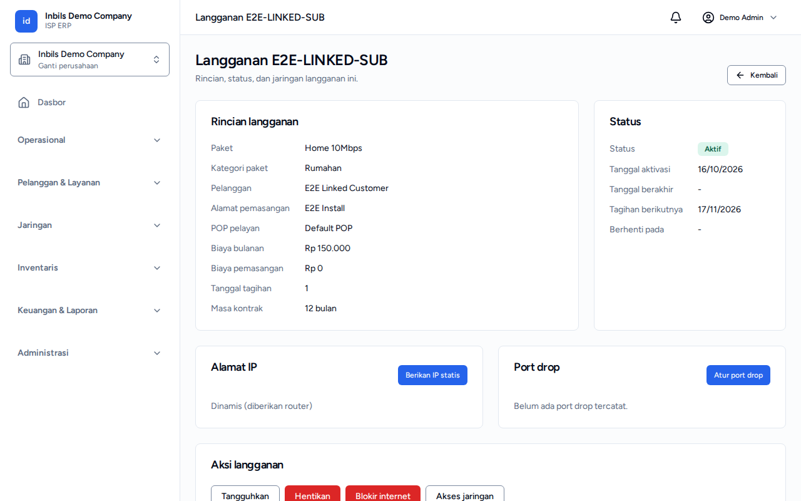

6. Detail langganan memuat kartu **Rincian langganan** (**Paket**, **Kategori paket**, **Pelanggan**, **Alamat pemasangan**, **POP pelayan**, **Biaya bulanan**, **Biaya pemasangan**, **Tanggal tagihan**, **Masa kontrak**, dan **Catatan** bila terisi) dan kartu **Status** (**Status**, **Tanggal aktivasi**, **Tanggal berakhir**, **Tagihan berikutnya**, **Berhenti pada**, dan **Alasan berhenti** bila ada). Untuk langganan yang diblokir, kartu **Status** menambah **Internet**, **Alasan blokir**, dan **Diblokir oleh**. Panel **Alamat IP** dan **Port drop** muncul bagi pengguna dengan izin lihat IPAM dan ODN. Pengisiannya dijelaskan di Alamat IP (bagian 5.4) dan ODN (bagian 5.5).
7. Gunakan kartu **Aksi langganan** sesuai status dan izin:

   | Tombol | Syarat | Izin | Efek |
   |---|---|---|---|
   | **Aktifkan** | **Menunggu** | Aktifkan langganan (`customer.subscription.activate`) | Menjadi **Aktif**, mengisi tanggal aktivasi dan tanggal tagihan berikutnya |
   | **Tangguhkan** | **Aktif** | Tangguhkan langganan (`customer.subscription.suspend`) | Dialog **Tangguhkan Langganan** meminta **Alasan** (wajib, maksimal 500 karakter). Menjadi **Ditangguhkan** dan akses jaringan terisolir |
   | **Aktifkan kembali** | **Ditangguhkan** | Aktifkan kembali langganan (`customer.subscription.reactivate`) | Menjadi **Aktif** dan menghitung ulang tanggal tagihan berikutnya |
   | **Blokir internet** | Belum **Berhenti** dan belum diblokir | Blokir langganan (`customer.subscription.block`) | Dialog berjudul "Blokir internet" diikuti kode langganan meminta **Alasan** (wajib, maksimal 500 karakter). Status tetap, penagihan lanjut, jaringan terisolir |
   | **Buka blokir** | Sedang diblokir | Blokir langganan (`customer.subscription.block`) | Dialog berjudul "Buka blokir" diikuti kata internet dan kode langganan, dengan **Catatan (opsional)**. Jika masih **Ditangguhkan**, jaringan tetap terisolir |
   | **Hentikan** | **Aktif** atau **Ditangguhkan** | Hentikan langganan (`customer.subscription.terminate`) | Dialog **Hentikan Langganan** meminta **Alasan** (wajib, maksimal 500 karakter). Menjadi **Berhenti**, melepas IP statis dan port drop, menghapus blok |

   Toast hasilnya: **Langganan diaktifkan.**, **Langganan ditangguhkan.**, **Langganan diaktifkan kembali.**, **Internet langganan diblokir.**, **Blokir internet langganan dibuka.**, dan **Langganan dihentikan.**
8. Persetujuan SPK pemasangan yang berstatus **Menunggu review** juga mengaktifkan langganan **Menunggu**. Jika pengaturan **Buat tagihan otomatis saat SPK selesai** aktif, persetujuan itu membuat tagihan biaya pemasangan satu kali. Lihat SPK (bagian 3.3) dan Tagihan (bagian 7.1).
9. Aktivasi tidak langsung membuat tagihan bulanan. Proses Tagihan membuat invoice pascabayar per periode dan menghitung prorata sejak tanggal aktivasi. Langganan **Ditangguhkan** tidak masuk tagihan berkala. Langganan **Berhenti** dapat ditagih prorata sampai tanggal terminasi.
10. Penangguhan manual tidak dibuka otomatis setelah pembayaran. Penangguhan dengan sumber tunggakan dapat kembali aktif setelah seluruh syarat pembayaran terpenuhi dan pengaturan reaktivasi otomatis menyala.
11. **Blokir internet** berbeda dari penangguhan. Pembayaran tidak menghapus blokir. Gunakan **Buka blokir** secara terpisah.
12. **Hentikan** tidak dapat dibatalkan. Layar saat ini tidak menyediakan pilihan melepas ONT pada saat penghentian.
13. Tombol siklus muncul menurut status, bukan menurut izin Anda. Server memeriksa izin saat tombol ditekan. Server juga menolak aksi pada status yang tidak cocok, misalnya **Langganan harus berstatus Menunggu untuk diaktifkan.**, **Langganan harus berstatus Aktif untuk ditangguhkan.**, atau **Langganan harus berstatus Ditangguhkan untuk diaktifkan kembali.** Muat ulang halaman bila status sudah berubah.

### Mengelola akun jaringan

Bagian ini merangkum akun jaringan dari sisi langganan. Rincian lengkap ada di Router NAS (bagian 5.3).

1. Pada detail langganan, klik **Akses jaringan**. Tombol membutuhkan Lihat akun jaringan.
2. Halaman **Akses jaringan** menampilkan kartu **Langganan** (langganan, status, pelanggan, profil kecepatan, POP layanan, dan **Status yang diharapkan**: **Aktif**, **Diisolir**, atau **Dihapus**) dan, setelah akun ada, kartu **Akun jaringan** (jenis layanan, nama pengguna, status sinkronisasi, grup RADIUS, **Online**, alamat, NAS, sesi mulai, dan pemakaian **Bulan ini**).
3. Bila belum ada akun dan pengguna memiliki Kelola akun jaringan, isi kartu **Buat akun jaringan**:
   - **Jenis layanan**: wajib, **PPPoE** atau **Hotspot**.
   - **Nama pengguna**: wajib. Isi bagian sebelum realm dengan 3 sampai 40 huruf kecil, angka, titik, tanda hubung, atau garis bawah. Nama lengkap harus unik lintas perusahaan. Bila bentrok, muncul **Nama pengguna ini tidak tersedia.**
   - **Kata sandi**: opsional, 6 sampai 64 karakter tanpa spasi. Kosongkan agar sistem membuat 12 karakter.
4. Klik **Buat akun jaringan**. Toast **Akun jaringan dibuat.** muncul. Kata sandi buatan sistem hanya tampil sekali di kotak **Kata sandi hanya tampil sekali**. Klik **Salin kata sandi** sebelum menekan **Tutup** atau meninggalkan halaman.
5. Gunakan kartu **Ubah akun jaringan** untuk mengganti jenis layanan, nama pengguna, atau kata sandi, lalu klik **Simpan perubahan**. Kata sandi kosong mempertahankan nilai lama. Langganan **Berhenti** tidak dapat memiliki akun jaringan.
6. Klik **Tampilkan kata sandi** dengan Tampilkan kata sandi akun jaringan. Dialog **Tampilkan kata sandi?** menjelaskan bahwa kata sandi tampil sekali dan pengungkapannya dicatat di log audit. Rute dibatasi 10 permintaan per menit.
7. Klik **Sinkron ulang** dengan Kelola akun jaringan untuk mengantrekan penulisan ulang ke RADIUS dan pemutusan sesi. Toast **Sinkron ulang dijadwalkan.** muncul. Rute dibatasi 6 permintaan per menit.
8. Bila RADIUS nonaktif atau tidak terjangkau, perubahan tetap tersimpan. Halaman menulis **RADIUS dimatikan untuk instalasi ini.** bila RADIUS dimatikan. Status online dan pemakaian tidak tersedia sampai RADIUS kembali tersedia.

### Menghapus pelanggan

1. Pada daftar, klik menu **Aksi lainnya** pada baris pelanggan, lalu **Hapus**. Pilihan **Hapus** hanya ada dengan Hapus pelanggan (`customer.delete`).
2. Dialog menanyakan **Hapus** diikuti nama pelanggan dan menjelaskan bahwa pelanggan yang masih punya langganan belum berhenti tidak bisa dihapus. Klik **Hapus** untuk melanjutkan atau **Batal** untuk membatalkan. Sistem melakukan soft delete. Toast **Pelanggan dihapus.** muncul dan dialog menutup setelah berhasil.
3. Penghapusan ditolak selama ada langganan selain **Berhenti**. Dialog tetap terbuka dan toast **Data gagal disimpan. Periksa input.** muncul. Hentikan semua langganan terlebih dahulu.

### Kesalahan umum

- Tombol **Buat Pelanggan** tidak muncul pada staf bawaan karena onboarding juga memerlukan Kelola langganan. Gunakan admin atau manajer, atau ubah izin peran.
- Pesan **email sudah digunakan.** berarti e-mail sudah dipakai akun pengguna mana pun. Periksa Pengguna (bagian 8.5) atau gunakan e-mail lain.
- Kesalahan alamat muncul bila koordinat belum dipilih (misalnya **lintang alamat wajib diisi.**), hierarki wilayah tidak cocok (**Provinsi, kota/kabupaten, kecamatan, dan kelurahan/desa tidak saling cocok.**), atau jumlah penanda salah (**Pilih tepat satu alamat utama.** atau **Pilih tepat satu alamat pemasangan.**). Lengkapi peta dan pilih satu kartu untuk tiap penanda. Kontak punya pesan serupa, **Pilih tepat satu kontak utama.**
- Label alamat harus unik untuk pelanggan, termasuk label alamat yang sudah dihapus. Form tidak memeriksanya lebih dulu. Gunakan label berbeda untuk rumah, kantor, atau titik pemasangan.
- Pembuatan **Perusahaan** gagal tanpa **NPWP** dan **Narahubung** (pesan **NPWP wajib diisi.** dan **narahubung wajib diisi.**). Isi keduanya sebelum menyimpan.
- Port ODP yang sudah dipakai atau berada di luar POP pelayan menolak seluruh onboarding dengan pesan seperti **Port ini sudah dipakai.** atau **ODP ini tidak berada di bawah POP layanan langganan**. Pilih port bebas di bawah POP yang benar.
- Toast onboarding tetap menyebut link akses terkirim ketika **Akun aktif** dimatikan, tetapi kode tidak mengirim e-mail pada kondisi itu. Aktifkan akun lalu gunakan **Kirim ulang link akses**.
- Mengubah e-mail atau **Akun aktif** pada pelanggan tidak mengubah akun pengguna. Perbarui akun pada Pengguna (bagian 8.5).
- Permintaan **Kirim ulang link akses** keempat dalam satu menit menghasilkan HTTP 429. Tunggu sampai jendela satu menit berlalu.
- Tombol siklus langganan mengikuti status, tetapi server tetap memeriksa izin. Halaman **Akses ditolak** (kode 403) berarti peran tidak memegang izin aksi itu.
- Alamat yang terhubung ke langganan tidak dapat dihapus (**Alamat yang dipakai langganan tidak bisa dihapus.**). Pilih alamat lain pada langganan yang sesuai sebelum mencoba lagi.
- Pelanggan tidak dapat dihapus selama masih memiliki langganan **Menunggu**, **Aktif**, atau **Ditangguhkan** (**Pelanggan yang masih punya langganan belum berhenti tidak bisa dihapus.**). Hentikan seluruh langganan lebih dahulu.

## 4.2 Paket Layanan

Paket Layanan adalah katalog paket internet yang dijual ke pelanggan. Satu paket menggabungkan satu profil bandwidth, satu profil kecepatan dan satu tingkat SLA, ditambah harga bulanan dan harga pemasangan. Buka menu ini saat Anda menambah paket baru, mengubah harga, atau menonaktifkan paket yang tidak dijual lagi.

Peran yang dapat memakai: admin, manajer, staf. Izin: `service.view` atau `service.manage` membuka menu dan daftar, `service.create` membuat paket, `service.update` mengubah paket, `service.delete` menghapus paket, `service.export` mengekspor daftar. Izin `service.manage` sudah mencakup lihat, buat, ubah dan hapus, tetapi tidak mencakup ekspor. Dengan peran bawaan: admin memegang semua izin, manajer memegang `service.view`, `service.create`, `service.update` dan `service.manage` (tanpa ekspor), staf hanya `service.view`. Teknisi dan pelanggan tidak punya izin layanan.

### Membuka dan membaca daftar

1. Di sidebar, buka grup **Pelanggan & Layanan**, lalu klik **Paket Layanan**.
2. Baca daftar paket.

   - Kotak **Cari** (isian "Nama atau kode") mencari kode dan nama paket.
   - Filter **Status** berisi **Semua status**, **Aktif** dan **Nonaktif**.
   - Filter **Tingkat SLA** adalah kotak cari: ketik untuk mencari, lalu pilih. Isinya semua tingkat SLA perusahaan. Selama belum ada pilihan, kotak menampilkan **Semua tingkat**. Ikon X di kotak itu mengosongkan filter.
   - Filter **Kategori** bekerja sama dan menampilkan **Semua kategori** selama belum ada pilihan. Isinya semua kategori perusahaan. Kategori nonaktif tampil dengan tulisan `(nonaktif)`.
   - Tombol **Reset filter** muncul bila ada filter atau pencarian yang aktif. Bila tidak ada paket yang cocok, daftar menampilkan "Tidak ada paket yang cocok" dengan tombol **Reset filter** yang sama.
   - Kolom: **Nama**, **Kode**, **Kategori**, **Harga bulanan**, **Harga pemasangan**, **Status** (lencana **Aktif** atau **Nonaktif**), **Dibuat** dan **Aksi**. Kolom **Kategori** dan **Aksi** tidak bisa diurutkan, kolom lain bisa.
   - Nama paket adalah tautan ke halaman rincian.
   - Tombol **Ekspor** muncul hanya bagi pemegang `service.export`. Menunya berisi **Ekspor CSV** dan **Ekspor PDF**. Ekspor memakai pencarian dan filter yang sedang aktif, dengan kolom Kode, Nama, Bandwidth, Kecepatan, SLA, Kategori, Biaya bulanan, Biaya pemasangan dan Status.
   - Tombol **Buat Paket Layanan** muncul bagi pemegang `service.create` atau `service.manage`.

   

3. Klik nama paket untuk membuka halaman rincian. Kartu **Rincian paket** memuat kategori, profil bandwidth, profil kecepatan, tingkat SLA, masa kontrak minimum dan deskripsi (baris deskripsi hanya tampil bila diisi). Kartu **Harga dan status** memuat harga bulanan, harga pemasangan dan status. Masa kontrak `0` tampil sebagai tanda hubung. Dari sini tombol **Ubah** membuka form ubah dan **Kembali** membawa Anda ke daftar.

Di setiap baris, tombol **Ubah** membuka form ubah. Menu **Aksi lainnya** berisi **Lihat detail** dan **Hapus**. Tombol dan menu ini tampil untuk semua orang yang bisa melihat daftar. Server menolak aksi dari pengguna tanpa izin yang sesuai dengan halaman **Akses ditolak**. Cara kerja tombol dan dialog hapus ada di bagian 1.5.

### Menyiapkan bahan paket

Form paket hanya menawarkan profil bandwidth, profil kecepatan dan tingkat SLA yang berstatus aktif. Buat dulu ketiganya, lihat bagian 4.3, 4.4 dan 4.5, baru buat paketnya.

### Membuat paket

1. Klik **Buat Paket Layanan**. Halaman **Buat Paket Layanan** terbuka dengan kartu **Data paket**.
2. Isi form:
   - **Kode**: wajib, maksimal 255 karakter, tidak boleh sama dengan kode paket lain di perusahaan yang sama. Contoh: `PKG-HOME-50`.
   - **Nama**: wajib, maksimal 255 karakter. Contoh: `Home 50Mbps`.
   - **Kategori**: wajib. Ketik untuk mencari, lalu pilih salah satu kategori aktif (lihat Kategori Paket di bawah). Pada form ubah, kategori nonaktif yang sedang dipakai paket tetap tampil.
   - **Profil bandwidth**: wajib. Ketik untuk mencari, lalu pilih dari profil bandwidth aktif.
   - **Profil kecepatan**: wajib. Ketik untuk mencari, lalu pilih dari profil kecepatan aktif.
   - **Tingkat SLA**: wajib. Ketik untuk mencari, lalu pilih dari tingkat SLA aktif.
   - **Harga bulanan**: wajib, angka 0 atau lebih. Ini harga langganan per bulan (MRC, Monthly Recurring Charge).
   - **Harga pemasangan**: angka 0 atau lebih, isian awal `0`. Ini biaya sekali bayar untuk pemasangan (OTC, One-Time Charge). Isi `0` bila paket tidak memungut biaya pemasangan. Jangan dikosongkan.
   - **Masa kontrak minimum (bulan)**: bilangan bulat 0 atau lebih, isian awal `0`. Isi `0` bila paket tanpa kontrak. Jangan dikosongkan.
   - **Aktif**: saklar, aktif secara awal. Paket nonaktif tidak muncul di pilihan paket pada form pelanggan dan langganan.
   - **Deskripsi**: opsional, teks bebas.

   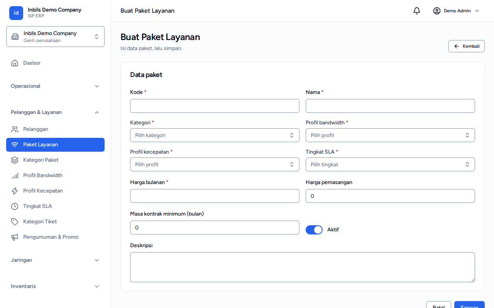

3. Klik **Simpan**. Anda kembali ke daftar dan muncul toast `Paket layanan dibuat.` Tombol **Batal** membatalkan form.

Form tidak punya isian pajak. Harga yang Anda isi adalah angka yang akan disalin ke langganan.

### Mengubah paket

1. Di daftar, klik **Ubah** di baris paket. Dari halaman rincian, klik **Ubah**.
2. Ubah isian. Aturannya sama dengan form buat. Halaman ini berjudul **Ubah Paket Layanan** dan memuat isi paket yang sekarang, termasuk kategori dan masa kontrak.
3. Klik **Simpan**. Muncul toast `Paket layanan diperbarui.`

Bila profil bandwidth, profil kecepatan atau tingkat SLA paket itu sudah dinonaktifkan, kolomnya tampak kosong karena daftar hanya memuat yang aktif, tetapi pilihan lama tetap tersimpan sampai Anda memilih yang lain.

Harga disalin ke langganan saat langganan dibuat: **MRC** pelanggan diisi dari **Harga bulanan** dan biaya pemasangan dari **Harga pemasangan**. Karena itu mengubah harga atau isian lain pada paket tidak mengubah langganan yang sudah ada. Hanya langganan baru yang memakai harga baru. Harga di langganan lama dapat diubah sendiri pada langganan itu (lihat bagian Pelanggan, bab 4).

### Menonaktifkan dan menghapus paket

1. Untuk berhenti menjual paket, buka **Ubah**, matikan saklar **Aktif**, lalu klik **Simpan**. Paket tetap ada di daftar dengan lencana **Nonaktif**, langganan yang sudah berjalan tidak terganggu, dan paket tidak ditawarkan pada pelanggan baru. Untuk menyembunyikan satu kelompok paket sekaligus, nonaktifkan kategorinya (bagian Kategori Paket di bawah).
2. Untuk menghapus, buka **Aksi lainnya** di baris paket, klik **Hapus**, lalu konfirmasi di dialog **Hapus {nama paket}?** dengan tombol **Hapus**. Dialog itu berbunyi `Paket "{nama paket}" akan dihapus permanen. Paket yang masih dipakai langganan menunggu atau aktif tidak bisa dihapus.` Muncul toast `Paket layanan dihapus.`

Server menolak penghapusan dengan pesan `Paket masih dipakai langganan menunggu atau aktif. Nonaktifkan saja.` bila masih ada langganan berstatus **Menunggu** atau **Aktif** pada paket itu. Langganan yang sudah berhenti tidak menghalangi. Pesan ini belum tampil di layar. Dialog tetap terbuka dan yang muncul hanya toast `Data gagal disimpan. Periksa input.` Tutup dialog dengan **Batal**, lalu periksa langganan paket itu. Bila ragu, nonaktifkan paketnya, jangan hapus.

### Kesalahan umum

- Pesan `kode sudah digunakan.` di bawah isian **Kode**: kode harus unik per perusahaan. Ganti kodenya.
- Pesan `harga pemasangan harus berupa angka.` atau `masa kontrak minimum harus berupa bilangan bulat.`: isian itu dikosongkan. Isi `0`.
- Paket baru tidak muncul pada form pelanggan baru: saklar **Aktif** paket masih mati, atau kategorinya nonaktif. Nyalakan di **Ubah**.
- Pilihan profil atau tingkat SLA kosong atau tidak lengkap: hanya data aktif yang tampil. Buat atau aktifkan dulu di menu yang bersangkutan.
- Harga paket sudah diubah tetapi tagihan pelanggan lama tetap memakai harga lama: harga tersimpan di langganan, bukan di paket. Ubah harga di langganan itu bila memang perlu.
- Tombol **Hapus** hanya memunculkan toast `Data gagal disimpan. Periksa input.`: masih ada langganan **Menunggu** atau **Aktif** pada paket itu. Akhiri atau pindahkan langganannya dulu, atau nonaktifkan paket.
- Staf menekan **Ubah** atau **Hapus** dan ditolak: staf hanya punya `service.view`. Minta admin menambah izin atau mengubah perannya (bagian 8.6 dan 8.7).
- Paket baru tidak bisa disimpan karena **Kategori** kosong (`kategori wajib diisi.`): pilih kategori. Kategori yang nonaktif tidak ada di daftar. Aktifkan lagi di **Kategori Paket** atau pilih kategori lain.

### Kategori Paket

Kategori Paket mengelompokkan paket menurut segmen pelanggan, misalnya rumahan atau bisnis. Setiap paket wajib punya tepat satu kategori. Kategori dipakai untuk filter di daftar paket, pengelompokan di pilihan paket pada form pelanggan dan langganan, dan filter **Kategori paket** pada laporan Metrik Bisnis dan KPI Penjualan (bagian 7.4 dan 7.10).

Peran dan izin sama dengan Paket Layanan: `service.view` atau `service.manage` membuka halaman, `service.create` membuat kategori, `service.update` mengubah, `service.delete` menghapus. Staf bawaan hanya melihat: kolom **Aksi** tidak tampil bagi mereka.

Setiap perusahaan punya tiga kategori bawaan: **Rumahan** (urutan 1), **Bisnis** (urutan 2) dan **Korporat** (urutan 3), dengan kode `RUMAHAN`, `BISNIS` dan `KORPORAT`. Perusahaan baru, termasuk anak perusahaan, mendapat ketiganya otomatis. Paket yang sudah ada sebelum fitur ini dimasukkan ke kategori menurut kata di kode atau namanya: `ENT`, `Enterprise`, `Dedicated`, `Korporat` atau `Corporate` masuk **Korporat**, lalu `BIZ`, `Business`, `Bisnis`, `SOHO` atau `UMKM` masuk **Bisnis**, sisanya (termasuk `Home`, `Rumah`, `Kos`, `Asrama`, `Gamer`, `Trial`, `Promo`) masuk **Rumahan**. Korporat didahulukan, jadi "Business 100Mbps Dedicated" masuk **Korporat**. Periksa hasilnya di daftar paket dan pindahkan paket yang salah tempat lewat **Ubah**.

1. Di sidebar, buka grup **Pelanggan & Layanan**, lalu klik **Kategori Paket** (di bawah **Paket Layanan**).
2. Baca daftar. Kotak **Cari** (isian "Kode atau nama") mencari kode atau nama, filter **Status** berisi **Semua status**, **Aktif** dan **Nonaktif**. Kolom: **Kode**, **Nama**, **Urutan**, **Paket**, **Status** dan **Aksi**. Kolom **Paket** menghitung paket di kategori itu, termasuk paket yang sudah dihapus. Angkanya adalah tautan ke daftar paket yang sudah difilter menurut kategori itu. Kolom **Kode**, **Nama**, **Urutan** dan **Status** bisa diurutkan.

   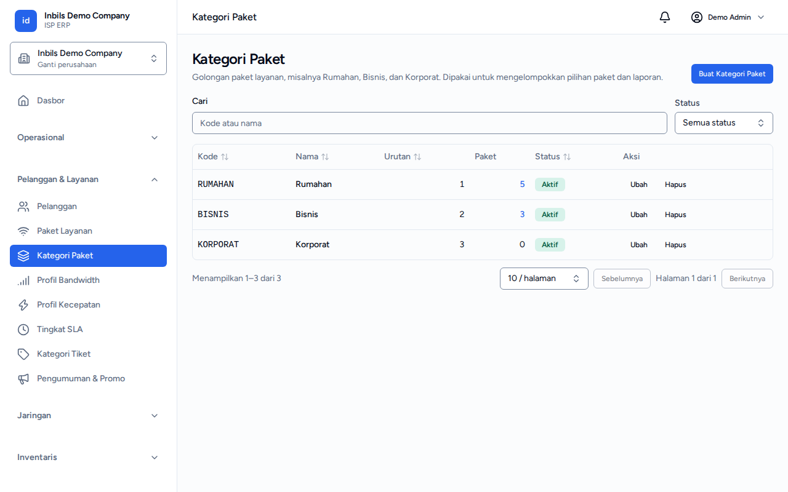

3. Klik **Buat Kategori Paket** (pemegang `service.create` atau `service.manage`). Dialog **Buat Kategori Paket** terbuka. Isi:
   - **Kode**: wajib, huruf besar, angka, `_` dan `-`, maksimal 30 karakter, unik per perusahaan. Sistem mengubah huruf kecil menjadi besar. Kode tidak bisa diubah setelah kategori dibuat, karena pilihan paket mengenali Rumahan, Bisnis dan Korporat lewat kode.
   - **Nama**: wajib, maksimal 100 karakter.
   - **Urutan**: angka 0 sampai 65535, isian awal `0`. Kategori dengan angka kecil tampil lebih dulu di daftar dan di pilihan paket.
   - **Aktif**: saklar, aktif secara awal.
4. Klik **Simpan**. Muncul toast `Kategori paket dibuat.` Untuk mengubah, klik **Ubah** di baris. Dialog **Ubah Kategori Paket** terbuka dengan **Kode** terkunci. Ubah **Nama**, **Urutan** atau **Aktif**, lalu klik **Simpan** (`Kategori paket diperbarui.`). Tombol **Batal** menutup dialog tanpa menyimpan.
5. Untuk berhenti memakai kategori, matikan saklar **Aktif**. Kategori nonaktif tidak muncul di pilihan **Kategori** saat membuat paket baru dan tidak muncul di pilihan paket pada form pelanggan dan langganan. Paket yang sudah memakainya tetap utuh, dan kategorinya tetap tampil di form ubah paket itu.
6. Untuk menghapus, klik **Hapus** di baris (pemegang `service.delete` atau `service.manage`). Dialog **Hapus kategori {nama}?** terbuka. Isinya `Kategori hanya bisa dihapus selama tidak ada paket di dalamnya. Nonaktifkan kategori jika sudah dipakai.` Klik **Hapus kategori** untuk menghapus. Muncul toast `Kategori paket dihapus.` Kategori yang masih dipakai paket (paket yang sudah dihapus ikut dihitung) tidak bisa dihapus. Dialog tetap terbuka dan menampilkan kotak merah `Kategori masih dipakai {n} paket. Nonaktifkan saja.` Klik **Batal**, lalu nonaktifkan kategorinya sebagai gantinya.

Pesan galat lain di dialog kategori: kode yang sudah ada menampilkan `Kode kategori sudah dipakai.` dan kode dengan karakter lain menampilkan `Kode hanya boleh berisi huruf, angka, tanda hubung, dan garis bawah.`

## 4.3 Profil Bandwidth

Profil Bandwidth adalah templat kapasitas yang dipilih pada paket: kecepatan unduh dan unggah, jenis (berbagi atau dedikasi) dan rasio kontensi. Buka menu ini sebelum membuat paket baru yang membutuhkan kapasitas berbeda.

Peran yang dapat memakai: sama dengan bagian 4.2. Izin: `service.view` atau `service.manage` membuka menu, `service.create`, `service.update`, `service.delete` dan `service.export` untuk aksi masing-masing.

### Membuka dan membaca daftar

1. Di sidebar, buka grup **Pelanggan & Layanan**, lalu klik **Profil Bandwidth**.
2. Baca daftar. Kolomnya **Nama**, **Unduh (Mbps)**, **Unggah (Mbps)**, **Dibuat** dan **Aksi**. Kotak **Cari** (isian "Nama atau tipe") mencari nama dan jenis. Untuk jenis, ketik `shared` atau `dedicated` (kata asli di basis data, bukan **Berbagi** atau **Dedikasi**). Tidak ada halaman rincian: nama profil dan tombol **Ubah** sama-sama membuka form ubah, dan menu **Aksi lainnya** hanya berisi **Hapus**. Jenis, rasio dan status aktif hanya terlihat di form ubah. Tombol **Ekspor** (pemegang `service.export`) menghasilkan CSV atau PDF (judul PDF **Profil Bandwidth**) dengan kolom Nama, Unduh (Mbps), Unggah (Mbps), Tipe (**Berbagi** atau **Dedikasi**), Rasio berbagi dan Status (**Aktif** atau **Nonaktif**).

   

### Membuat profil

1. Klik **Buat Profil Bandwidth**. Halaman dengan kartu **Data profil** terbuka.
2. Isi form:
   - **Nama**: wajib, maksimal 255 karakter, unik per perusahaan. Contoh: `Home 50Mbps`.
   - **Tipe**: pilih **Berbagi** (isian awal) atau **Dedikasi**.
   - **Unduh (Mbps)**: wajib, bilangan bulat minimal 1.
   - **Unggah (Mbps)**: wajib, bilangan bulat minimal 1.
   - **Rasio kontensi**: bilangan bulat minimal 1, isian awal `1`. Wajib bila **Tipe** adalah **Berbagi**. Bila Anda memilih **Dedikasi**, isian ini terkunci dengan keterangan `Tidak dipakai untuk profil dedikasi.`
   - **Aktif**: saklar, aktif secara awal.
3. Klik **Simpan**. Muncul toast `Profil bandwidth dibuat.`

Untuk mengubah, klik **Ubah**, ubah isian, lalu klik **Simpan** (toast `Profil bandwidth diperbarui.`). Untuk menghapus, buka **Aksi lainnya**, klik **Hapus**, lalu konfirmasi di dialog **Hapus {nama profil}?** (toast `Profil bandwidth dihapus.`).

### Kesalahan umum

- Profil tidak muncul di form paket: saklar **Aktif** mati. Nyalakan di **Ubah**.
- Penyimpanan ditolak dengan pesan `nama sudah digunakan.`: **Nama** sudah dipakai profil lain di perusahaan ini.
- Penyimpanan ditolak dengan pesan `rasio kontensi wajib diisi.`: profil berjenis **Berbagi** butuh rasio. Isi angka minimal 1.
- Profil yang masih dipakai paket bisa dihapus tanpa peringatan, karena penghapusan tidak memeriksa paket. Untuk berhenti memakai profil, matikan **Aktif** saja.

## 4.4 Profil Kecepatan

Profil Kecepatan adalah label kecepatan yang dipilih pada paket. Isinya batas unduh dan unggah, kecepatan burst (opsional) dan nama grup kecepatan RADIUS. Buka menu ini saat Anda menambah label kecepatan baru atau mengubah batas kecepatan paket.

Peran yang dapat memakai: sama dengan bagian 4.2. Izin: `service.view` atau `service.manage` membuka menu, `service.create`, `service.update`, `service.delete` dan `service.export` untuk aksi masing-masing.

### Membuka dan membaca daftar

1. Di sidebar, buka grup **Pelanggan & Layanan**, lalu klik **Profil Kecepatan**.
2. Baca daftar. Kolomnya **Nama**, **Unduh maksimum (Mbps)**, **Unggah maksimum (Mbps)**, **Dibuat** dan **Aksi**. Kotak **Cari** (isian "Nama atau profil RADIUS") mencari nama profil dan nama profil RADIUS. Nama profil dan tombol **Ubah** membuka form ubah, dan menu **Aksi lainnya** hanya berisi **Hapus**, seperti Profil Bandwidth. Tombol **Ekspor** (pemegang `service.export`) menghasilkan CSV atau PDF (judul PDF **Profil Kecepatan**) dengan kolom Nama, Unduh maks (Mbps), Unggah maks (Mbps), Burst unduh (Mbps), Burst unggah (Mbps), Profil RADIUS dan Status (**Aktif** atau **Nonaktif**). Burst atau profil RADIUS yang kosong diisi `-`.

   

### Membuat profil

1. Klik **Buat Profil Kecepatan**. Halaman dengan kartu **Data profil** terbuka.
2. Isi form:
   - **Nama**: wajib, maksimal 255 karakter, unik per perusahaan. Contoh: `SP-Home-50`.
   - **Unduh maksimum (Mbps)**: wajib, bilangan bulat minimal 1.
   - **Unggah maksimum (Mbps)**: wajib, bilangan bulat minimal 1.
   - **Burst unduh (Mbps)**: opsional, bilangan bulat minimal 1.
   - **Burst unggah (Mbps)**: opsional, bilangan bulat minimal 1.
   - **Nama profil RADIUS**: opsional, maksimal 255 karakter. Ini nama grup kecepatan di RADIUS. Isi bila paket ini akan dipasang pada akun jaringan pelanggan.
   - **Aktif**: saklar, aktif secara awal.
3. Klik **Simpan**. Muncul toast `Profil kecepatan dibuat.`

Untuk mengubah, klik **Ubah**, ubah isian, lalu klik **Simpan** (toast `Profil kecepatan diperbarui.`). Untuk menghapus, buka **Aksi lainnya**, klik **Hapus**, lalu konfirmasi di dialog **Hapus {nama profil}?** (toast `Profil kecepatan dihapus.`).

### Hubungan dengan RADIUS

Bila integrasi RADIUS aktif, Inbils menulis satu grup kecepatan per perusahaan dan profil, dengan nama `<realm>/<Nama profil RADIUS>` (realm adalah kode perusahaan huruf kecil). Batas kecepatannya diambil dari **Unggah maksimum** dan **Unduh maksimum** dalam format unggah/unduh. Nilai burst tidak dikirim ke RADIUS.

Saat Anda mengubah **Nama profil RADIUS**, **Unduh maksimum** atau **Unggah maksimum**, Inbils menulis ulang grup itu. Login baru langsung memakai kecepatan baru. Sesi yang sedang online memakai kecepatan lama sampai pelanggan tersambung ulang atau staf menekan **Sinkron ulang** di halaman **Akses jaringan** langganan pelanggan.

Paket yang profil kecepatannya tidak punya **Nama profil RADIUS** tidak dapat diberi akun jaringan. Inbils menolaknya dengan pesan `Profil kecepatan paket ini belum punya nama profil RADIUS.`

### Kesalahan umum

- Akun jaringan pelanggan ditolak dengan pesan di atas: isi **Nama profil RADIUS** pada profil kecepatan paket itu.
- Penyimpanan ditolak dengan pesan `nama sudah digunakan.`: **Nama** sudah dipakai profil lain di perusahaan ini.
- Profil yang masih dipakai paket bisa dihapus tanpa peringatan. Untuk berhenti memakai profil, matikan **Aktif** saja.

## 4.5 Tingkat SLA

Tingkat SLA mencatat target layanan sebuah paket: batas waktu respons dan batas waktu penyelesaian tiket. Target ini dipakai saat tiket dari langganan paket itu dibuat. Hasilnya tidak diisi manual: sistem mengukurnya dari tiket. Buka menu ini saat Anda menambah tingkat layanan baru, misalnya untuk paket bisnis.

Peran yang dapat memakai: sama dengan bagian 4.2. Izin: `service.view` atau `service.manage` membuka menu, `service.create`, `service.update`, `service.delete` dan `service.export` untuk aksi masing-masing.

### Membuka dan membaca daftar

1. Di sidebar, buka grup **Pelanggan & Layanan**, lalu klik **Tingkat SLA**.
2. Baca daftar. Kolomnya **Nama**, **Target respons (jam)**, **Target penyelesaian (jam)**, **Respons tepat waktu (30 hari)**, **Penyelesaian tepat waktu (30 hari)**, **Tiket (30 hari)**, **Dibuat** dan **Aksi**. Kotak **Cari** (isian "Nama tingkat") mencari nama tingkat. Tiga kolom 30 hari tidak bisa diurutkan dan dihitung dari tiket yang dibuat dalam 30 hari terakhir pada langganan paket bertingkat itu. Kolom persen bernilai `-` bila belum ada tiket yang bisa dinilai. Nama tingkat dan tombol **Ubah** membuka form ubah, dan menu **Aksi lainnya** hanya berisi **Hapus**. Tombol **Ekspor** (pemegang `service.export`) menghasilkan CSV atau PDF (judul PDF **Tingkat SLA**) dengan kolom Nama, Target respons (jam), Target penyelesaian (jam) dan Status (**Aktif** atau **Nonaktif**).

   

### Membuat tingkat SLA

1. Klik **Buat Tingkat SLA**. Halaman terbuka dengan judul **Buat Tingkat SLA** dan kartu **Target layanan**.
2. Isi form:
   - **Nama**: wajib, maksimal 255 karakter, unik per perusahaan. Contoh: `Silver`.
   - **Target respons (jam)**: wajib, bilangan bulat 1 sampai 720. Batas waktu sampai teknisi menekan **Mulai** pada tiket. Nilainya tidak boleh melebihi target penyelesaian.
   - **Target penyelesaian (jam)**: wajib, bilangan bulat 1 sampai 720. Batas waktu sampai tiket diselesaikan.
   - **Aktif**: saklar, aktif secara awal.
3. Klik **Simpan**. Muncul toast `Tingkat SLA dibuat.`

Untuk mengubah, klik **Ubah** (halaman **Ubah Tingkat SLA**), ubah isian, lalu klik **Simpan** (toast `Tingkat SLA diperbarui.`). Untuk menghapus, buka **Aksi lainnya**, klik **Hapus**, lalu konfirmasi di dialog **Hapus {nama tingkat}?** (toast `Tingkat SLA dihapus.`). Perubahan jam hanya berlaku untuk tiket yang dibuat sesudahnya. Tiket yang sudah ada tidak dihitung ulang.

Sebuah tingkat memengaruhi tiket seperti ini:

- Tiket yang punya **Langganan** pada paket dengan tingkat ini mengambil kedua targetnya dari tingkat itu, selama tingkatnya **Aktif**. Tingkat nonaktif dilewati dan tiket memakai **Kategori Tiket** (bagian 3.4).
- Tiket berprioritas **Mendesak** memakai separuh dari kedua target, dibulatkan ke atas.
- Jam dihitung kalender, bukan jam kerja.
- Hasilnya muncul di kolom 30 hari pada daftar ini dan di laporan Kepatuhan SLA (bagian 7.6). Sistem tidak memakai tingkat ini untuk menghitung uptime atau kredit tagihan. Kedua isian itu sudah dihapus dari tingkat SLA.

### Kesalahan umum

- Tingkat tidak muncul di form paket: saklar **Aktif** mati. Nyalakan di **Ubah**.
- Target respons atau penyelesaian ditolak: isi bilangan bulat jam antara 1 dan 720. Angka desimal tidak diterima.
- Target respons ditolak dengan pesan `Target respons tidak boleh lebih lama dari target penyelesaian.`: turunkan target respons atau naikkan target penyelesaian.
- Penyimpanan ditolak dengan pesan `nama sudah digunakan.`: **Nama** sudah dipakai tingkat lain di perusahaan ini.
- Tingkat yang masih dipakai paket bisa dihapus tanpa peringatan. Untuk berhenti memakainya, matikan **Aktif** saja.

## 4.6 Pengumuman & Promo

Menu ini mengelola dua jenis isi untuk pelanggan: **pengumuman** (informasi, gangguan, pemeliharaan) dan **banner promo** (gambar dengan tautan). Buka menu ini saat ada gangguan atau jadwal pemeliharaan yang perlu diumumkan, atau saat ISP punya promo untuk pelanggan. Isinya bisa ditujukan ke semua pelanggan atau dipersempit menurut lokasi dan kategori paket.

Peran yang dapat memakai: admin dan manajer pada peran bawaan, staf tidak. Izin: `announcement.manage` (**Kelola pengumuman dan banner promo**). Tanpa izin ini menu **Pengumuman & Promo** tidak tampil di sidebar, dan alamat `/admin/announcements` ditolak dengan halaman **Akses ditolak**. Menunya ada di paling bawah grup **Pelanggan & Layanan**, di bawah **Kategori Tiket**. Semua isi berlaku untuk perusahaan yang sedang aktif (bagian 1.6).

Aplikasi pelanggan menggambar kartu pengumuman di atas kartu layanan (Gangguan dan Pemeliharaan) atau di bawah bagian Sedang berjalan (Info), dan carousel banner di bawahnya. Pratinjau di layar ini meniru tampilan itu.

### Membuka dan membaca daftar

1. Di sidebar, buka grup **Pelanggan & Layanan**, lalu klik **Pengumuman & Promo**.
2. Pilih tab **Pengumuman** atau **Banner promo**. Angka di dalam kurung adalah jumlah semua isinya di perusahaan ini, apa pun statusnya.
3. Baca daftar. Kotak **Cari** (isian "Judul") mencari judul, dan filter **Status** berisi **Semua status**, **Draf**, **Terjadwal**, **Tayang**, **Selesai** dan **Nonaktif**. Pindah tab mengosongkan pencarian dan filter. Daftar menampilkan 10 baris per halaman.
   - Tab **Pengumuman**: kolom **Pengumuman** (judul dan dua baris pertama isi), **Jenis**, **Status**, **Periode**, **Sasaran** dan **Aksi**.
   - Tab **Banner promo**: kolom **Banner** (gambar kecil, judul, dan tujuan tautan), **Status**, **Periode**, **Sasaran**, **Urutan**, **Ketukan** dan **Aksi**. Daftar diurutkan menurut **Urutan**, lalu yang terbaru.
   - Kolom **Aksi** hanya tampil bagi pemegang `announcement.manage`.

   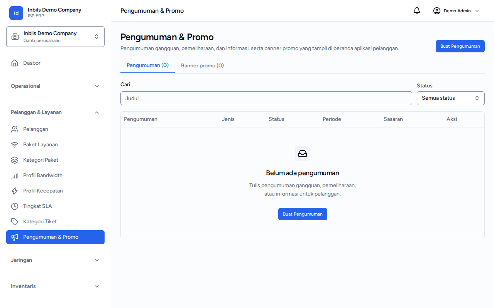

Status dihitung server dari waktu terbit, saklar aktif, dan periode tayang:

| Status | Arti | Tampil ke pelanggan |
| --- | --- | --- |
| Draf | Disimpan, belum diterbitkan. | Tidak |
| Terjadwal | Sudah diterbitkan, tetapi **Mulai tayang** belum tiba. | Tidak, sampai jadwal tiba |
| Tayang | Sudah diterbitkan dan berada di dalam periode. | Ya |
| Selesai | Sudah diterbitkan dan **Selesai tayang** sudah lewat. Tetap ada sebagai riwayat. | Tidak |
| Nonaktif | Diterbitkan lalu dinonaktifkan. Tetap ada sebagai riwayat. | Tidak |

Kolom **Sasaran** menulis **Semua pelanggan**, atau **Pelanggan tertentu** diikuti daftar lokasi dan kategori ("Lokasi: A, B dan 2 lainnya"). Sasaran tertentu yang daftarnya sudah kosong menulis "Sasaran kosong, tidak tampil ke siapa pun."

### Membuat pengumuman

1. Di tab **Pengumuman**, klik **Buat Pengumuman**. Dialog **Buat Pengumuman** terbuka dengan formulir di kiri dan **Pratinjau di aplikasi pelanggan** di kanan (di bawahnya pada layar sempit).
2. Isi formulir:
   - **Jenis**: **Informasi**, **Gangguan** atau **Pemeliharaan**. Keterangan di bawah isian menjelaskan efeknya. **Gangguan** dan **Pemeliharaan** dirancang tampil paling atas dengan nada peringatan dan mengirim notifikasi ke pelanggan sasaran. **Informasi** hanya tampil.
   - **Judul**: wajib, maksimal 120 karakter.
   - **Isi**: wajib, maksimal 2000 karakter. Teks biasa, baris baru ikut tampil.
   - **Sasaran**, **Mulai tayang** dan **Selesai tayang**: lihat "Sasaran dan jadwal" di bawah.
3. Klik **Simpan**. Pengumuman tersimpan sebagai **Draf** (toast "Pengumuman disimpan sebagai draf.") dan belum terlihat oleh pelanggan. Periksa pratinjaunya, lalu terbitkan (lihat "Menerbitkan, mengubah, dan menonaktifkan").

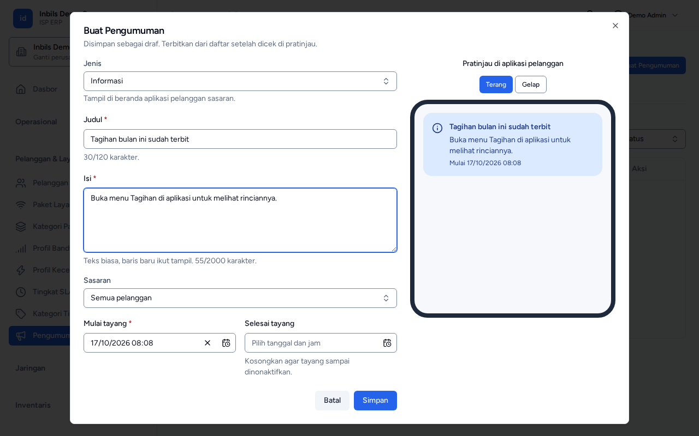

### Membuat banner promo

1. Di tab **Banner promo**, klik **Buat Banner Promo**. Dialog **Buat Banner Promo** terbuka.
2. Isi formulir:
   - **Gambar**: wajib untuk banner baru. Seret berkas ke kotak atau klik untuk memilih. Pakai JPG, PNG atau WebP, paling besar 2 MB, dengan rasio lebar banding tinggi 2:1 (disarankan 1200 x 600 piksel). Rasio boleh meleset paling banyak 5%. Layar memeriksa ukuran begitu berkas dipilih dan menolak yang tidak cocok, misalnya "Gambar ini 1000 x 600 piksel. Rasio harus 2:1 dengan selisih paling banyak 5%, misalnya 1200 x 600." Server mengulang pemeriksaan yang sama. Pada banner yang sudah ada, kosongkan **Gambar** untuk mempertahankan gambar lama.
   - **Judul**: wajib, maksimal 80 karakter. Tampil sebagai keterangan di bawah gambar.
   - **Teks alternatif**: wajib, maksimal 200 karakter. Dibacakan pembaca layar. Tulis isi gambar, misalnya "Diskon 20% pemasangan baru sampai 31 Oktober".
   - **Saat banner diketuk**: **Tanpa tautan**, **Halaman di aplikasi** atau **Tautan web**. Untuk **Halaman di aplikasi**, pilih salah satu dari **Tagihan**, **Langganan**, **Buat tiket** atau **Kunjungan**. Untuk **Tautan web**, isi **Alamat tautan** yang diawali `https://` (maksimal 500 karakter). Alamat web dibuka di peramban ponsel.
   - **Urutan**: angka 0 sampai 65535, isian awal 0. Banner dengan angka kecil tampil lebih dulu. Angka yang sama diurutkan dari yang terbaru.
   - **Sasaran**, **Mulai tayang** dan **Selesai tayang**: lihat bagian berikut.
3. Klik **Simpan**. Banner tersimpan sebagai **Draf** (toast "Banner promo disimpan sebagai draf."). Selama gambar diunggah, bilah **Mengunggah gambar** menunjukkan kemajuan. Gambar banner bersifat privat: hanya pelanggan perusahaan yang sama dan yang cocok dengan sasaran yang bisa memuatnya lewat aplikasi.

Aplikasi pelanggan menerima paling banyak 5 banner yang sedang tayang, diurutkan menurut **Urutan** lalu yang terbaru. Carousel dirancang berganti slide tiap 5 detik. Server tidak menolak banner keenam: banner di luar 5 teratas hanya tidak ikut tampil, dan dialog banner menulis peringatan "Dengan urutan ini banner tidak masuk 5 banner pertama, jadi belum tampil di aplikasi." Nonaktifkan banner lama atau beri **Urutan** lebih kecil bila ingin banner baru ikut tampil.

### Sasaran dan jadwal

**Sasaran** menentukan pelanggan yang menerima isi itu:

- **Semua pelanggan**: seluruh pelanggan perusahaan aktif.
- **Pelanggan tertentu**: muncul pilihan **Lokasi** dan **Kategori paket**. Ketik nama lokasi di **Lokasi** lalu pilih untuk menambahkannya. Lokasi yang dipilih ikut menyertakan semua lokasi di bawahnya, jadi memilih sebuah area mencakup semua POP di dalamnya. Pilih kategori di **Kategori paket**, misalnya **Rumahan** atau **Bisnis** (bagian 4.2). Tombol silang di samping tiap pilihan menghapusnya. Sasaran tertentu wajib punya minimal satu lokasi atau satu kategori. Kalau tidak, server menolak dengan "Pilih minimal satu lokasi atau kategori paket."

Pelanggan cocok bila salah satu langganannya berstatus **Aktif** atau **Ditangguhkan** dan memenuhi semua daftar yang diisi. Dalam satu daftar cukup satu pilihan yang cocok. Contoh: **Lokasi** berisi dua area dan **Kategori paket** berisi **Bisnis**, maka yang cocok adalah pelanggan dengan langganan paket Bisnis yang dilayani POP di salah satu area itu. Bila lokasi atau kategori sasaran kemudian dihapus dari data hingga daftarnya kosong, item itu tidak menjadi tampil ke semua orang. Ia tidak cocok dengan siapa pun.

**Mulai tayang** wajib dan **Selesai tayang** boleh kosong. Keduanya dipilih dengan pemilih tanggal dan jam, menurut zona waktu perusahaan. **Mulai tayang** bernilai awal saat dialog dibuka. Waktu mulai di masa depan membuat item berstatus **Terjadwal** setelah diterbitkan. **Selesai tayang** kosong berarti tayang sampai dinonaktifkan ("Kosongkan agar tayang sampai dinonaktifkan."). Bila diisi, harus sesudah **Mulai tayang**.

### Pratinjau ponsel

Panel **Pratinjau di aplikasi pelanggan** berupa bingkai ponsel yang mengikuti isian formulir saat Anda mengetik, tanpa menyimpan apa pun. Panel punya saklar **Terang** dan **Gelap** sendiri yang awalnya mengikuti tema halaman web.

- Pengumuman: satu kartu dengan ikon, judul, isi, dan periode. **Gangguan** dan **Pemeliharaan** memakai nada peringatan, **Informasi** memakai nada info.
- Banner: carousel gambar 2:1 dengan keterangan, titik halaman, dan tombol sebelumnya atau berikutnya. Banner yang sedang Anda buat tampil di antara banner yang sudah tayang, dengan urutan yang dipakai aplikasi.

Pratinjau memakai warna dan susunan yang dirancang untuk aplikasi, bukan tangkapan layar aplikasi yang terpasang.

### Menerbitkan, mengubah, dan menonaktifkan

Kolom **Aksi** memuat tombol menurut status baris:

| Status | Tombol |
| --- | --- |
| Draf | **Ubah**, **Terbitkan**, **Hapus** |
| Terjadwal, Tayang | **Ubah**, **Nonaktifkan** |
| Selesai, Nonaktif | **Ubah** |

1. **Terbitkan**: dialog **Terbitkan pengumuman {judul}?** (atau **Terbitkan banner {judul}?**) menjelaskan efeknya. Klik **Terbitkan**. Toast "Pengumuman diterbitkan." atau "Banner promo diterbitkan." Setelah terbit, item tidak bisa dihapus, hanya dinonaktifkan. Banner tanpa gambar tidak bisa diterbitkan ("Gambar banner wajib tersedia."). Pengumuman yang **Selesai tayang**-nya sudah lewat juga ditolak ("Periode pengumuman sudah berakhir."). Ubah tanggalnya dulu.
2. **Ubah**: dialog **Ubah Pengumuman** atau **Ubah Banner Promo**. Keterangan di bawah judul dialog menyebut efek simpan menurut status. Draf disimpan sebagai draf. Item yang sudah terbit, baik **Terjadwal** maupun **Tayang**, langsung berlaku begitu disimpan. Item **Selesai** tayang lagi bila **Selesai tayang** diubah ke waktu yang akan datang. Item **Nonaktif** bisa disimpan, tetapi tidak tampil lagi.
3. **Nonaktifkan**: dialog **Nonaktifkan pengumuman {judul}?** berbunyi "Tidak tampil lagi di aplikasi pelanggan. Riwayatnya tetap tersimpan, tetapi pengumuman ini tidak bisa diaktifkan lagi. Buat pengumuman baru bila perlu." Klik **Nonaktifkan** untuk melanjutkan. Tidak ada tombol untuk mengaktifkan kembali, jadi buat item baru bila perlu.
4. **Hapus** (hanya draf): dialog **Hapus draf pengumuman {judul}?** berbunyi "Draf dihapus permanen." Klik **Hapus draf**. Item yang pernah diterbitkan tidak bisa dihapus, supaya riwayat dan tautan notifikasi tetap valid. Server menolak dengan "Pengumuman terbit hanya dapat dinonaktifkan." atau "Banner terbit hanya dapat dinonaktifkan."

Pembuatan, perubahan, penerbitan, penonaktifan, dan penghapusan tercatat di Log audit (bagian 7.12) dengan modul `announcement`, hanya berisi nomor item. Gambar banner yang sudah selesai tayang lebih dari 180 hari dihapus otomatis setiap hari. Baris banner dan jumlah ketukannya tetap ada.

### Notifikasi Gangguan dan Pemeliharaan

Pengumuman berjenis **Gangguan** dan **Pemeliharaan** mengirim satu notifikasi ke aplikasi tiap pelanggan sasaran yang punya akun masuk aktif. Notifikasi tampil di lonceng aplikasi dengan judul "Pengumuman baru" dan judul pengumuman sebagai isinya.

- Bila Anda menerbitkan setelah **Mulai tayang** tiba, notifikasi dikirim saat itu juga.
- Bila **Mulai tayang** masih di depan (status **Terjadwal**), notifikasi dikirim saat jadwal tiba. Penjadwal memeriksanya tiap menit, jadi notifikasi bisa terlambat sekitar satu menit.
- Tiap pelanggan menerima satu notifikasi per pengumuman. Mengubah pengumuman sesudahnya tidak mengirim notifikasi lagi.
- **Informasi** dan banner promo tidak pernah mengirim notifikasi. Tidak ada WhatsApp untuk pengumuman.
- Pengiriman memakai antrean. Antrean dan penjadwal harus berjalan di server. Hubungi pengelola server bila notifikasi tidak muncul.

### Jumlah ketukan banner

Kolom **Ketukan** di tab **Banner promo** menghitung berapa kali pelanggan mengetuk banner. Satu pelanggan dihitung satu kali per banner per hari, berapa pun ketukannya. Aplikasi tidak mencatat berapa kali banner terlihat, jadi angka ini bukan jumlah tayangan.

### Kesalahan umum

- Pesan "Pilih minimal satu lokasi atau kategori paket." di bawah **Sasaran**: Anda memilih **Pelanggan tertentu** tanpa menambahkan lokasi atau kategori. Tambahkan minimal satu, atau ganti ke **Semua pelanggan**.
- Pesan "Rasio gambar banner harus 2:1 dengan toleransi 5%." atau teks "Gambar ini ... piksel" di bawah **Gambar**: ukuran gambar tidak mendekati 2:1. Potong gambar menjadi 1200 x 600 piksel. Berkas lebih dari 2 MB, atau selain JPG, PNG dan WebP, juga ditolak di kotak yang sama.
- Pesan "Tujuan tautan wajib diisi." atau "Tautan harus memakai HTTPS.": pilih halaman di aplikasi atau isi alamat yang diawali `https://`. Pesan "Tujuan tautan harus kosong tanpa tautan." berarti **Saat banner diketuk** masih **Tanpa tautan** padahal alamat terisi.
- Pesan "selesai harus berupa tanggal setelah mulai." di bawah **Selesai tayang**: pilih waktu sesudah **Mulai tayang**, atau kosongkan.
- Pelanggan tidak melihat isi yang berstatus **Tayang**: periksa **Sasaran** (pelanggan harus punya langganan **Aktif** atau **Ditangguhkan** di lokasi atau kategori itu). Untuk banner, periksa juga urutannya: hanya 5 teratas yang dikirim ke aplikasi.
- Banner atau pengumuman tidak bisa diaktifkan lagi setelah **Nonaktifkan**. Aturan ini disengaja. Buat item baru.
- Notifikasi **Gangguan** tidak sampai: pelanggan harus punya akun masuk yang aktif dan cocok dengan sasaran, dan antrean serta penjadwal harus berjalan.

# 5. Jaringan

## 5.1 Lokasi

Lokasi adalah daftar tempat fisik jaringan dalam satu pohon: wilayah, area, POP, rak, dan site. Aset jaringan, stok, VLAN, dan prefiks IP memilih lokasinya dari daftar ini, jadi isi pohon ini lebih dulu. Buka menu ini untuk menambah, memperbaiki, memindahkan, atau menghapus lokasi.

Peran yang dapat memakai: admin (semua tindakan), manajer (tambah, ubah, dan pindah, tanpa hapus), staf (hanya melihat). Izin: `location.view` untuk membuka menu, `location.create` untuk **Buat Lokasi**, `location.update` untuk **Ubah**, `location.move` untuk **Pindahkan**, `location.delete` untuk **Hapus**. Daftar dan kode lokasi berlaku per perusahaan aktif (bagian 1.6).

### Membuka dan membaca daftar

1. Di sidebar, buka grup **Jaringan**, lalu klik **Lokasi**.
2. Halaman terbuka di tab **Peta**. Setiap lokasi yang punya koordinat tampil sebagai penanda. Kotak di kiri atas peta menyaring penanda: ketik sebagian kode atau nama di kotak pencarian, lalu pilih tipe (**Semua tipe**, Wilayah, Area, POP, Rak, atau Site) dan status (**Semua status**, Aktif, atau Nonaktif) dari dua pilihan di bawahnya. Lokasi **Nonaktif** memakai warna penanda yang berbeda.

   Di kotak yang sama ada jumlah lokasi yang tampil, misalnya `3 lokasi`, dan tombol **Tampilkan semua**, yang memusatkan peta ke semua penanda yang lolos saringan. **Legenda** di kiri bawah menjelaskan bentuk penanda tiap tipe dan penanda **Nonaktif**. Klik tombolnya untuk menyembunyikan atau menampilkan daftar itu. Tombol zoom ada di kanan bawah.

   

3. Klik sebuah penanda untuk membuka kartunya. Kartu memuat kode, nama, tipe, lencana **Nonaktif** (bila lokasinya nonaktif), dan koordinat, serta tombol **Ubah** dan **Hapus** sesuai izin Anda.
4. Klik tab **Tabel** untuk melihat semua lokasi, termasuk yang tanpa koordinat. Kolomnya **Kode**, **Nama**, **Tipe**, **Jalur**, **Status**, **Koordinat**, dan **Aksi**. Tipe dan status tampil sebagai lencana.

   Kotak **Cari** (petunjuk `Kode, nama, jalur, atau alamat`) mencari di kode, nama, jalur, dan alamat, sedangkan **Tipe** dan **Status** menyaring daftar. Urutan bawaan mengikuti **Jalur**, jadi lokasi anak berada di dekat induknya. Pencarian, urutan, dan halaman bekerja seperti di layar lain (bagian 1.5). Daftar yang kosong menampilkan `Belum ada lokasi`, dan saringan yang tidak menemukan apa pun menampilkan `Tidak ada lokasi yang cocok` dengan tombol **Reset filter**.

   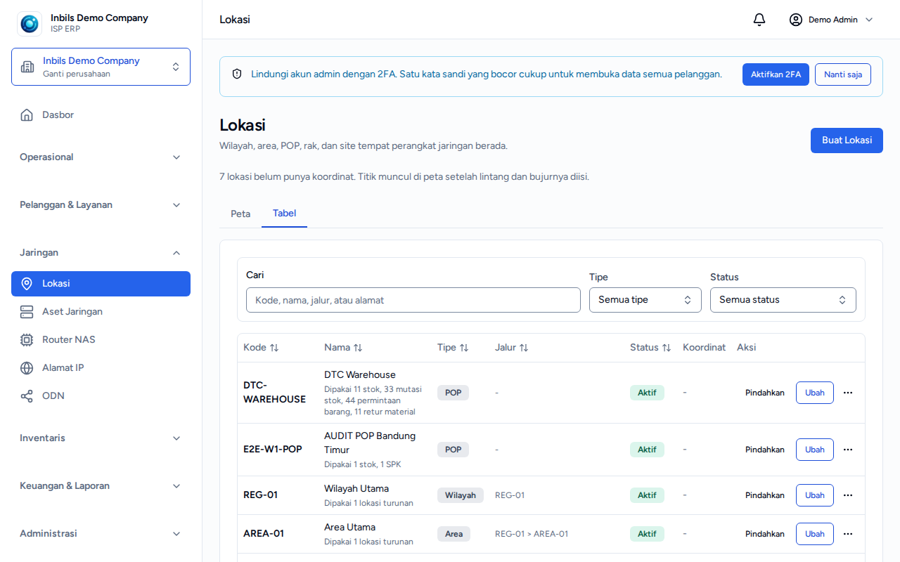

### Menambah lokasi

1. Klik **Buat Lokasi** di kanan atas halaman.
   - Cara lain: di tab **Peta**, klik titik kosong. Pin sementara muncul dan bisa digeser. Kartu pin berjudul `Buat lokasi baru di sini`. Pilih **Tambah POP** atau **Tambah Site** di kartu itu, dan dialog terbuka dengan **Tipe**, **Lintang**, dan **Bujur** sudah terisi. **Batal** di kartu pin membuang pin.
2. Isi form di dialog **Buat Lokasi**:
   - **Kode**: wajib, maksimal 50 karakter, unik di perusahaan, dan tanpa tanda `>` (tanda ini memisahkan tingkat di Jalur).
   - **Nama**: wajib, maksimal 255 karakter.
   - **Tipe**: wajib. Pilihannya Wilayah, Area, POP, Rak, dan Site. Isian awalnya POP.
   - **Induk**: induk lokasi. Ketik untuk mencari kode atau jalur, lalu pilih lokasi bertipe satu tingkat di atasnya (aturan di bawah). Pilihan memuat semua lokasi perusahaan. Untuk Wilayah biarkan kosong, sesuai petunjuk `Kosongkan untuk lokasi bertipe Wilayah.`
   - **Alamat**: opsional.
   - **Lintang** dan **Bujur**: opsional, tetapi isi keduanya atau kosongkan keduanya. Lintang -90 sampai 90, bujur -180 sampai 180.
3. Klik **Simpan**. Toast "Lokasi dibuat." muncul dan lokasi tampil di daftar. Lokasi yang punya koordinat juga tampil di peta. Klik **Batal** untuk menutup dialog tanpa menyimpan.

Setiap tipe punya induk tertentu:

- Wilayah: tanpa induk.
- Area: induknya Wilayah.
- POP: induknya Area.
- Rak: induknya POP.
- Site: induknya Rak.

**Jalur** terbentuk dari jalur induk, tanda ` > `, dan kode lokasi, misalnya `REG-01 > AREA-01 > POP-01`.

### Mengubah lokasi

1. Di tab **Tabel**, klik **Ubah** pada baris lokasi. Dari tab **Peta**, klik penanda, lalu klik **Ubah** di kartunya.
2. Ubah isian di dialog **Ubah** yang memuat kode lokasi di judulnya. Isiannya sama dengan dialog tambah. Dialog tidak punya isian untuk mengubah status **Aktif** atau **Nonaktif**.
   - Mengubah **Kode** atau **Induk** memperbarui **Jalur** lokasi itu dan semua lokasi di bawahnya.
   - Mengubah **Tipe** hanya diterima bila semua sub-lokasi masih cocok dengan tipe baru.
   - Bila **Lintang** atau **Bujur** berubah, kotak **Koordinat berubah** menampilkan nilai **Lama** dan **Baru**, dan tombol simpan menjadi **Simpan dan konfirmasi koordinat**.
3. Klik **Simpan**. Toast "Lokasi diperbarui." muncul.

### Memindahkan lokasi

1. Di tab **Tabel**, klik **Pindahkan** pada baris lokasi. Tombol ini tidak ada di kartu penanda.
2. Di dialog **Pindahkan** yang memuat kode lokasi di judulnya, pilih **Induk baru**. Isian ini wajib: ketik untuk mencari kode atau jalur, lalu pilih. Tombol **Pindahkan** baru aktif setelah Anda memilih.
3. Klik **Pindahkan**. Toast "Lokasi dipindahkan." muncul, dan **Jalur** lokasi serta semua lokasi di bawahnya ikut berubah.

Induk baru harus bertipe satu tingkat di atas lokasi yang dipindah, sama seperti saat menambah. Lokasi bertipe Wilayah tidak bisa dipindah. Sistem juga menolak memindahkan lokasi ke bawah dirinya sendiri atau turunannya dengan pesan "Lokasi tidak dapat dipindahkan ke bawah dirinya sendiri." di bawah **Induk baru**.

### Menghapus lokasi

1. Klik **Hapus** pada baris di tab **Tabel**, atau pada kartu penanda di peta. Tombol ini butuh `location.delete`, yang dimiliki peran admin. Di tab **Tabel**, tombol **Hapus** nonaktif pada lokasi yang masih punya sub-lokasi, dan petunjuknya berbunyi "Lokasi ini masih punya lokasi turunan."
2. Di dialog `Hapus <kode>?`, klik **Hapus**. Dialog menyatakan lokasi akan dihapus dan tindakan ini tidak dapat dibatalkan. Klik **Batal** untuk membatalkan. Toast "Lokasi dihapus." muncul bila berhasil.

Sistem hanya menghapus lokasi yang tidak punya sub-lokasi dan tidak dipakai aset jaringan atau stok. Bila menolak, toast merah "Data gagal disimpan. Periksa input." muncul dan dialog tetap terbuka. Server menolak dengan salah satu dari dua alasan, yaitu "Lokasi masih punya lokasi turunan." atau "Lokasi masih dipakai oleh aset atau stok yang aktif.", tetapi dialog hapus tidak menampilkan alasan itu. Klik **Batal**, lalu pindahkan atau hapus sub-lokasinya dan pindahkan asetnya ke lokasi lain (bagian 5.2). Bila penolakan berlanjut padahal lokasi tampak kosong, periksa stok di lokasi itu (bagian 6.5).

Lokasi yang sudah dihapus tidak bisa dikembalikan dari layar ini, dan kodenya tetap tidak bisa dipakai lagi.

### Kesalahan umum

- "Induk lokasi wajib diisi untuk lokasi selain Wilayah." muncul di **Induk** saat menambah lokasi bila **Tipe** masih POP (isian awal) dan **Induk** kosong. Pilih induk, atau ganti **Tipe** ke Wilayah bila ini lokasi puncak.
- "Lokasi POP harus punya induk Area." berarti induk salah tipe. Ganti **Induk** dengan lokasi bertipe satu tingkat di atasnya. Pesan yang sama berlaku untuk tipe lain, dengan nama tipenya.
- "Lokasi Wilayah tidak boleh punya induk." berarti **Tipe** Wilayah tetapi **Induk** terisi. Kosongkan **Induk**.
- "Lintang dan bujur harus diisi bersamaan." berarti hanya satu koordinat yang terisi. Isi keduanya atau kosongkan keduanya.
- "kode sudah digunakan." berarti kode itu dipakai lokasi lain di perusahaan, termasuk lokasi yang sudah dihapus. `Kode tidak boleh memuat tanda ">".` berarti kode memuat tanda `>`. Pakai kode lain.
- Perubahan **Tipe** ditolak dengan `Lokasi <tipe> tidak dapat punya induk <tipe baru>.` bila ada sub-lokasi yang tidak cocok dengan tipe baru. Pindahkan atau hapus sub-lokasi itu lebih dulu.
- Peta kosong atau penanda kurang: lokasi tanpa koordinat tidak punya penanda, jadi cari di tab **Tabel**. Isian **Cari**, **Tipe**, dan **Status** di tab **Tabel** juga ikut menyaring peta, jadi kosongkan isian itu (**Reset filter**). Pilihan tipe dan status di kotak peta hanya menyaring penanda.
- "Lapisan peta tidak dapat dimuat" berarti peta dasar OpenStreetMap tidak bisa diakses dari browser Anda. Klik **Coba lagi**. Penanda dan tab **Tabel** tetap bisa dipakai.

## 5.2 Aset Jaringan

Aset Jaringan memuat satu baris untuk tiap perangkat jaringan perusahaan, misalnya router, OLT, ONU/ONT, ODP dan rak. Buka menu ini saat Anda mencatat perangkat baru, mengubah status pakainya (pasang, lepas, rawat, rusak, pensiun) atau mencari perangkat dari serial, MAC atau alamat IP.

Peran yang dapat memakai: admin, manajer, staf. Izin: `network_asset.view` membuka menu, daftar, rincian dan **Lacak Aset**. Aksi lain punya izin sendiri: `network_asset.create`, `network_asset.update`, `network_asset.delete`, `network_asset.export`, `network_asset.install`, `network_asset.remove`, `network_asset.maintenance`, `network_asset.repair` dan `network_asset.retire`. Dengan peran bawaan, admin memegang semuanya, manajer memegang semua kecuali `network_asset.delete`, staf hanya `network_asset.view`. Daftar hanya memuat aset perusahaan yang sedang dipilih.

### Membuka dan membaca daftar

1. Di sidebar, buka grup **Jaringan**, lalu klik **Aset Jaringan**.
2. Baca daftar.

   - Kotak **Cari** mencari sebagian kode, nama, serial, MAC dan alamat IP, walau petunjuknya hanya `Kode, nama, atau nomor seri`.
   - Filter **Tipe** berisi **Semua tipe** dan 12 jenis aset (daftarnya ada di form buat). Filter **Status** berisi **Semua status** dan lima status: Tersedia, Terpasang, Perawatan, Rusak, dan Dipensiunkan (lihat tabel di bagian Mengubah status aset).
   - Kolom: **Kode** (tautan ke rincian), **Nama**, **Tipe**, **Nomor seri**, **Status**, **Lokasi**, **Dibuat** dan **Aksi**. Tipe dan status tampil sebagai lencana, misalnya ONU/ONT dan Tersedia. Kolom **Kode**, **Nama**, **Tipe**, **Status** dan **Dibuat** bisa diurutkan, dan urutan awalnya dari aset terbaru.
   - Kolom **Dibuat** berisi `-` di semua baris, karena server tidak mengirim tanggal pembuatan ke halaman ini.
   - Tombol **Ekspor** (pemegang `network_asset.export`) membuka menu **Ekspor CSV** dan **Ekspor PDF**. Berkas memuat kolom Kode, Nama, Tipe, Nomor seri, Status dan Kepemilikan dari hasil yang sedang difilter. Isi kolom Tipe, Status dan Kepemilikan di berkas berupa kode mentah, misalnya `onu_ont`, `available` dan `owned`.
   - Tombol **Buat Aset Jaringan** (pemegang `network_asset.create`) membuka form buat. Baris daftar hanya punya tombol **Lihat**, tanpa **Ubah** dan **Hapus**.
   - Daftar yang kosong menampilkan `Belum ada aset jaringan`, dan saringan yang tidak menemukan apa pun menampilkan `Tidak ada aset jaringan yang cocok` dengan tombol **Reset filter**.

   

3. Klik kode aset atau tombol **Lihat** untuk membuka halaman rincian.

### Membaca halaman rincian

Judul halaman memuat nama aset, dengan kodenya di bawahnya. Tombol di kanan atas adalah **Kembali**, **Ubah** dan, untuk aset OLT, ODC atau ODP bagi pemegang `odn.view`, **Port ODN** (lihat bagian 5.5).

- Kartu **Detail aset** memuat Status, Tipe, Produk, Kepemilikan, Nomor seri, Alamat MAC, Alamat IP, IP manajemen, Vendor, Model, Lokasi, Jalur lokasi, Pelanggan, Langganan, Dipasang, Dipensiunkan dan Catatan (bila terisi). Status, Tipe dan Kepemilikan tampil sebagai lencana. Pelanggan dan Langganan adalah tautan ke halaman pelanggan dan langganan. Tanggal pembelian, harga beli dan masa garansi hanya terlihat di form **Ubah**.
- Kartu **Siklus hidup** berisi tombol ubah status.
- Kartu **Riwayat pemasangan** mencatat tiap pemasangan dengan kolom **Lokasi**, **Dipasang**, **Dilepas** dan **Alasan**. Aset yang belum pernah dipasang menampilkan `Belum ada riwayat pemasangan. Riwayat tercatat setiap kali aset dipasang dan dilepas.`

  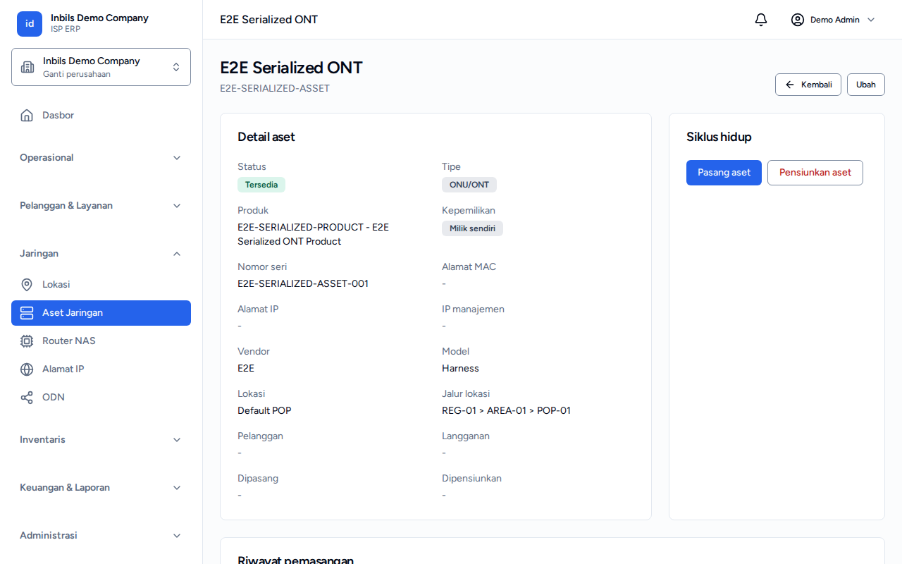

### Membuat aset

1. Klik **Buat Aset Jaringan**.
2. Isi form pada kartu **Detail**:
   - **Nama**: wajib, maksimal 255 karakter. Contoh: `OLT Huawei MA5800`.
   - **Produk**: opsional. Ketik SKU atau nama produk (sedikitnya 2 huruf), lalu pilih produk aktif dari katalog barang (bagian 6.2). Daftar menampilkan paling banyak 20 hasil. SPK memakai tautan ini untuk menawarkan aset (lihat bagian Memasang aset lewat SPK instalasi).
   - **Tipe aset**: wajib. Pilihan Router, Switch, OLT, ONU/ONT (isian awal), Radio, Antena, Fiber, ODP, ODC, Rak, Perangkat daya dan Lainnya.
   - **Nomor seri**: opsional, maksimal 255 karakter, tidak boleh sama dengan serial aset lain di perusahaan ini. Contoh: `HW-MA5800-002`.
   - **Alamat MAC**: opsional, maksimal 255 karakter. Format tidak diperiksa.
   - **Alamat IP** dan **IP manajemen**: opsional, harus alamat IP yang sah (IPv4 atau IPv6). Inbils ikut mencatat keduanya di register Alamat IP (bagian 5.4). Isi **IP manajemen** bila router akan didaftarkan sebagai Router NAS (bagian 5.3).
   - **Lokasi**: opsional. Ketik kode, nama atau jalur lokasi, lalu pilih. Hanya lokasi aktif yang tampil (bagian 5.1). Kosongkan bila aset ada di gudang, sesuai petunjuk `Kosongkan jika aset masih di gudang.`
   - **Kepemilikan**: Milik sendiri (isian awal), Sewa atau Milik pelanggan.
   - **Vendor** dan **Model**: opsional, maksimal 255 karakter.
   - **Tanggal pembelian** dan **Tanggal garansi berakhir**: opsional. Ketik tanggal dengan format tanggal perusahaan, atau buka kalender dengan **Pilih tanggal**. **Hari ini** mengisi tanggal hari ini dan **Hapus tanggal** mengosongkan isian.
   - **Harga beli**: opsional, angka 0 atau lebih.
   - **Catatan**: opsional, teks bebas.
3. Klik **Simpan**. Anda kembali ke daftar dan muncul toast "Aset jaringan dibuat." Aset baru berstatus Tersedia. Inbils membuat kodenya sendiri, dengan format yang diatur di Penomoran (bagian 7.13). Klik **Batal** untuk kembali ke daftar tanpa menyimpan.

### Mengubah aset

1. Di halaman rincian, klik **Ubah**.
2. Ubah isian di halaman **Ubah Aset Jaringan**. Aturannya sama dengan form buat. Produk dan lokasi yang sekarang tetap tampil di pilihannya, dan tanggal yang sudah tercatat sudah terisi. Kode dan status tidak ada di form ini.
3. Klik **Simpan**. Anda kembali ke daftar dan muncul toast "Aset jaringan diperbarui." Klik **Batal** untuk keluar tanpa menyimpan.

### Mengubah status aset

Status berubah hanya lewat tombol di kartu **Siklus hidup**. Tombol yang tampil mengikuti status aset:

| Status | Arti | Tombol yang tampil |
| --- | --- | --- |
| Tersedia | Belum terpasang. Status awal aset baru. | **Pasang aset**, **Pensiunkan aset** |
| Terpasang | Terpasang di sebuah lokasi. | **Lepas aset**, **Masukkan ke perawatan**, **Tandai rusak**, **Pensiunkan aset** |
| Perawatan | Terpasang, sedang dirawat. | **Selesaikan perawatan**, **Tandai rusak**, **Pensiunkan aset** |
| Rusak | Rusak, menunggu perbaikan. | **Selesai diperbaiki**, **Pensiunkan aset** |
| Dipensiunkan | Status akhir. | Tidak ada |

Setiap tombol punya izin dan isian sendiri:

| Tombol | Menjadi | Isian | Izin |
| --- | --- | --- | --- |
| **Pasang aset** | Terpasang | **Lokasi** (wajib) | `network_asset.install` |
| **Lepas aset** | Tersedia | **Alasan** (wajib) | `network_asset.remove` |
| **Masukkan ke perawatan** | Perawatan | **Alasan** (wajib) | `network_asset.maintenance` |
| **Selesaikan perawatan** | Terpasang | Tanpa isian | `network_asset.maintenance` |
| **Tandai rusak** | Rusak | **Alasan** (wajib) | `network_asset.repair` |
| **Selesai diperbaiki** | Tersedia | Tanpa isian | `network_asset.repair` |
| **Pensiunkan aset** | Dipensiunkan | **Alasan** (wajib) | `network_asset.retire` |

1. Di halaman rincian, klik tombol di kartu **Siklus hidup**. Jendela yang terbuka berjudul sama dengan tombolnya, dengan kalimat `Status aset menjadi <status>.`
2. Isi **Lokasi** (untuk **Pasang aset**: ketik kode, nama atau jalur, lalu pilih lokasi aktif) atau **Alasan** (untuk tombol lain yang memintanya). **Alasan** maksimal 500 karakter. Tombol **Pasang** baru aktif setelah Anda memilih lokasi. Galat isian tampil di bawah isian itu.
3. Klik tombol konfirmasi: **Pasang**, **Lepas**, **Mulai perawatan**, **Selesai perawatan**, **Tandai rusak**, **Selesai diperbaiki** atau **Pensiunkan**, sesuai tombol yang Anda buka. Klik **Batal** untuk menutup jendela. Muncul toast "Aset dipasang.", "Aset dilepas.", "Aset masuk perawatan.", "Aset kembali terpasang.", "Aset ditandai rusak.", "Aset diperbaiki." atau "Aset dipensiunkan."

Tombol **Pasang aset** hanya mencatat lokasi. Baris Pelanggan dan Langganan di kartu **Detail aset** terisi saat SPK instalasi disetujui.

**Lepas aset** dan **Selesai diperbaiki** mengosongkan lokasi, pelanggan, langganan dan tanggal pasang aset, lalu menutup baris aktif di **Riwayat pemasangan**. **Selesai diperbaiki** mencatat alasan `repair`.

**Pensiunkan aset** menutup baris aktif dengan alasan yang Anda isi dan mengisi tanggal **Dipensiunkan**. Lokasi, pelanggan dan langganan terakhir tetap tertulis di aset, dan tidak ada tombol untuk mengembalikan aset Dipensiunkan.

### Memasang aset lewat SPK instalasi

Teknisi memasang aset di rumah pelanggan, misalnya ONT, lewat SPK berjenis **Instalasi** di aplikasi teknisi. Di web, Anda menyiapkan item SPK dan menyetujui hasilnya (bagian 3.3).

1. Pastikan aset berstatus Tersedia dan isian **Produk**-nya terisi. Pastikan SPK punya **Lokasi**, **Pelanggan** dan **Langganan**.
2. Di halaman SPK, kartu **Item**, klik **Tambah item**. Pilih **Barang** bertipe Aset. Isian **Aset jaringan** muncul, wajib diisi, dan hanya menawarkan aset Tersedia dengan produk yang sama. Ketik kode atau nama aset, lalu pilih.
3. Setelah teknisi mengirim hasil kerja, pemegang izin `spk.approve` (admin atau manajer) mengklik **Setujui** pada SPK berstatus Menunggu review, lalu **Setujui** lagi di dialog **Setujui SPK**. Pembuat SPK dan teknisi yang ditugaskan tidak boleh menyetujui SPK itu sendiri. Server menolak dengan "Pembuat SPK tidak boleh menyetujui SPK sendiri." atau "Teknisi yang ditugaskan tidak boleh menyetujui SPK sendiri."
4. Saat itu Inbils memasang setiap aset di item SPK. Status aset menjadi Terpasang, lokasi, pelanggan dan langganan diambil dari SPK, dan satu baris baru muncul di **Riwayat pemasangan**. Inbils juga mengaktifkan langganan berstatus Menunggu.

Bila aset tidak lagi Tersedia atau produknya tidak cocok, persetujuan ditolak dengan pesan seperti "Aset jaringan yang dipilih harus berstatus tersedia." atau "Aset jaringan yang dipilih harus sesuai dengan barang pada item SPK."

### Menelusuri aset dengan Lacak Aset

Halaman **Lacak Aset** mencari aset dari serial, MAC, alamat IP atau kode, lalu menampilkan status, lokasi dan pelanggannya dalam satu tabel. Pakai halaman ini saat Anda hanya memegang serial di perangkat atau sebuah alamat IP dan perlu tahu di mana aset itu terpasang. Izinnya `network_asset.view`.

1. Buka alamat `/admin/network-assets/trace` di peramban. Halaman ini tidak punya tautan di sidebar maupun di daftar.
2. Isi **Cari** (petunjuk `Nomor seri, MAC, IP, atau kode`), lalu klik **Lacak**.
3. Baca tabel hasil dengan kolom **Nama**, **Kode**, **Tipe**, **Nomor seri**, **Status**, **Lokasi**, **Jalur**, **Pelanggan** dan **Langganan**. Kolom **Jalur** memuat jalur lokasi dari induk sampai lokasi aset. Sebelum Anda mencari, tabel menampilkan `Masukkan nomor seri, MAC, IP, atau kode, lalu pilih Lacak.` Bila tidak ada yang cocok, tabel menampilkan `Tidak ada aset yang cocok dengan "<kata>". Periksa penulisannya atau coba kata kunci lain.`

Pencarian mencocokkan sebagian teks, tetapi tidak mencari nama aset. Hasil tidak dibagi per halaman dan barisnya bukan tautan, jadi buka rincian aset lewat kotak **Cari** di daftar.

### Kesalahan umum

- Aset tidak muncul di isian **Aset jaringan** pada SPK: statusnya bukan Tersedia, atau **Produk**-nya berbeda dari produk item SPK. Perbaiki **Produk** lewat **Ubah**, atau kembalikan aset ke Tersedia dengan **Lepas aset** atau **Selesai diperbaiki**.
- SPK instalasi sudah disetujui tetapi aset tetap Tersedia: Inbils hanya memasang aset bila SPK berjenis **Instalasi**, punya **Lokasi**, dan item SPK memakai produk bertipe Aset. Lengkapi SPK sebelum disetujui.
- Serial ditolak dengan `nomor seri sudah digunakan.`: serial harus unik di perusahaan, termasuk terhadap aset Dipensiunkan. Cari serialnya dengan **Cari** di daftar.
- Alamat IP ditolak dengan pesan seperti `<alamat> sudah dipakai aset <kode>.`: alamat itu sudah tercatat di register Alamat IP atas pemegang lain. Pesan lain untuk pemegang lain berbunyi `<alamat> sudah dipakai langganan <kode>.` atau `<alamat> sudah dicadangkan (<catatan>).` Lepas pemegang itu lebih dulu atau pakai alamat lain (bagian 5.4). Alamat yang bukan IP ditolak dengan `alamat IP harus berupa alamat IP yang valid.`
- Tombol **Ubah** atau tombol di **Siklus hidup** ditolak dengan galat 403: tombol tampil untuk semua pemegang `network_asset.view`, tetapi server memeriksa izin tiap aksi. Staf hanya punya `network_asset.view`. Minta admin menambah izin atau mengubah perannya (bagian 8.6 dan 8.7).
- Tombol yang dicari tidak tampil di **Siklus hidup**: tombol mengikuti status. Misalnya **Pasang aset** hanya tampil saat status Tersedia, dan **Selesaikan perawatan** hanya saat Perawatan.
- Aksi status ditolak dengan pesan seperti "Aset harus berstatus tersedia untuk dipasang.", "Aset harus terpasang untuk dilepas.", "Aset harus dalam perawatan untuk dilanjutkan." atau "Aset sudah dipensiunkan.": status aset sudah berubah sejak halaman dibuka. Muat ulang halaman rincian dan baca status terbaru.
- Aset jaringan tidak punya tombol **Hapus**, baik di daftar maupun di rincian. Endpoint hapus hanya menerima admin dengan `network_asset.delete`, dan menolak aset Terpasang atau Perawatan dengan pesan "Aset yang terpasang atau dalam perawatan tidak dapat dihapus. Lepas dulu." Pakai **Lepas aset** lebih dulu bila penghapusan memang diperlukan. Untuk menghentikan pemakaian sambil mempertahankan riwayat, pakai **Pensiunkan aset**.

## 5.3 Router NAS

Router NAS adalah daftar router perusahaan yang meminta FreeRADIUS memeriksa login pelanggan sebelum membuka internet. Buka menu ini saat Anda mendaftarkan router baru, mengganti alamat atau secret-nya, atau melihat pelanggan yang sedang online di sebuah router.

Peran yang dapat memakai: admin, manajer dan staf untuk melihat, hanya admin untuk mengelola. Izin: `network_asset.nas.view` membuka menu, daftar dan rincian. `network_asset.nas.manage` mendaftarkan, mengubah dan menghapus router. Dengan peran bawaan, admin memegang keduanya, manajer dan staf hanya `network_asset.nas.view`. Router hanya bisa didaftarkan dari aset berjenis Router yang punya **IP manajemen** (bagian 5.2). Kode perusahaan harus berisi 1 sampai 24 huruf, angka atau strip, karena kode itu menjadi realm RADIUS.

### Membuka dan membaca daftar

1. Di sidebar, buka grup **Jaringan**, lalu klik **Router NAS**.
2. Baca daftar.

   - Kotak **Cari** (petunjuk `Kode, nama, atau alamat NAS`) mencari alamat NAS, serta kode, nama dan **IP manajemen** aset router.
   - Kolom: **Router** (kode aset dengan nama di bawahnya, tautan ke rincian, bisa diurutkan), **Lokasi**, **Alamat NAS**, **Port CoA**, **RADIUS** dan **Aksi**.
   - Lencana di kolom **RADIUS** menunjukkan hasil penulisan router ke FreeRADIUS: **Tertulis ke RADIUS**, **Menunggu ditulis** (belum tercatat berhasil atau gagal) atau **Gagal ditulis** (percobaan gagal, alasannya ada di rincian).
   - Pemegang `network_asset.nas.manage` melihat tombol **Ubah** di tiap baris, dengan menu **Aksi lainnya** yang berisi **Lihat detail**, dan tombol **Daftarkan router** di kanan atas. Pemegang `network_asset.nas.view` saja melihat tombol **Lihat**.
   - Daftar kosong menampilkan `Belum ada router NAS`, atau `Tidak ada router NAS yang cocok` dengan tombol **Reset filter** bila pencarian tidak menemukan apa pun.

   

3. Klik kode router atau **Lihat** (atau **Lihat detail** di menu **Aksi lainnya**) untuk membuka rincian.

### Mendaftarkan router

Siapkan dulu aset berjenis Router dengan **IP manajemen** di Aset Jaringan (bagian 5.2). Siapkan juga secret yang sama dengan yang terpasang di router.

1. Klik **Daftarkan router**.
2. Pilih **Aset router**: ketik kode, nama atau IP manajemen (sedikitnya 2 huruf), lalu pilih. Pilihan memuat aset Router ber-IP manajemen yang belum terdaftar, tertulis `kode - nama - lokasi` dengan IP manajemen di baris bawahnya. Daftar menampilkan paling banyak 20 hasil. Bila tidak ada aset yang bisa dipilih, halaman menampilkan `Belum ada aset router yang tersedia. Tambahkan aset bertipe Router dengan IP manajemen di Aset Jaringan lebih dulu.` dengan tombol **Aset Jaringan**.
3. Isi form pada kartu **Router**:
   - **Alamat NAS**: wajib, alamat IPv4 yang dilihat FreeRADIUS sebagai asal permintaan router. Isinya terisi otomatis dari IP manajemen aset yang Anda pilih dan bisa Anda ubah. Alamat harus unik di seluruh sistem, bukan hanya di perusahaan Anda.
   - **Port CoA**: wajib, bilangan bulat 1 sampai 65535, isian awal `1700`. Ini port `/radius incoming` di MikroTik.
   - **Secret RADIUS**: wajib, 8 sampai 60 karakter ASCII tercetak tanpa spasi, sama dengan secret di router.
   - **Realm**: hanya baca. Isinya kode perusahaan dalam huruf kecil. Pelanggan masuk dengan nama pengguna `nama@realm`.
4. Klik **Daftarkan router**. Inbils membuka rincian router dan muncul toast "Router NAS didaftarkan." Klik **Batal** untuk kembali ke daftar tanpa menyimpan.

Bila RADIUS dimatikan di instalasi ini (pengaturan server) atau basis datanya tidak terjangkau, router tetap tersimpan dan muncul toast peringatan `Tersimpan, tetapi RADIUS belum diperbarui: <alasan> Sinkronisasi mencoba lagi setiap 15 menit.` Lencana **RADIUS** menjadi **Menunggu ditulis** atau **Gagal ditulis** sampai penulisan berhasil.

### Membaca halaman rincian router

Judul halaman `Router NAS` diikuti kode aset, dengan nama aset dan alamat NAS di bawahnya. Tombol **Kembali** selalu tampil. **Ubah** dan **Hapus router** hanya tampil bagi pemegang `network_asset.nas.manage`.

- Peringatan `RADIUS dimatikan untuk instalasi ini. Tidak ada yang ditulis ke FreeRADIUS dan tidak ada sesi yang ditampilkan.` muncul bila RADIUS dimatikan. Saklarnya ada di pengaturan server, tidak di Inbils.
- Info `Mulai ulang FreeRADIUS setelah menambah NAS ini atau mengganti secret-nya.` selalu muncul. FreeRADIUS membaca daftar router hanya saat start, jadi pengelola server FreeRADIUS yang me-restart-nya. Tidak ada tombolnya di Inbils.
- Kartu **Status** memuat **Klien RADIUS** (lencana), **Terakhir ditulis** (waktu atau `Belum pernah`), **Alamat NAS**, **Target CoA**, **Realm** dan **Secret RADIUS** (`Tersimpan` atau `Belum diisi`). **Target CoA** adalah `IP manajemen:Port CoA`, tujuan permintaan putus sesi. Mengubah **IP manajemen** aset mengubah **Target CoA** tetapi tidak mengubah **Alamat NAS**. Bila penulisan terakhir gagal, kotak **Kesalahan terakhir** memuat alasannya.
- Kartu **Halaman isolir** memuat alamat halaman isolir perusahaan dan tombol **Salin URL**, yang berubah menjadi **Tersalin** sesaat setelah diklik (lihat bagian Isolir otomatis dan halaman isolir).
- Kartu **Sesi terbuka** menampilkan sampai 100 sesi terbuka lewat router ini, dengan kolom **Nama pengguna**, **Alamat** dan **Mulai**. **Nama pengguna** menjadi tautan ke halaman **Akses jaringan** bila Inbils mengenali langganannya. Bila kosong, tertulis `Tidak ada sesi terbuka`.

  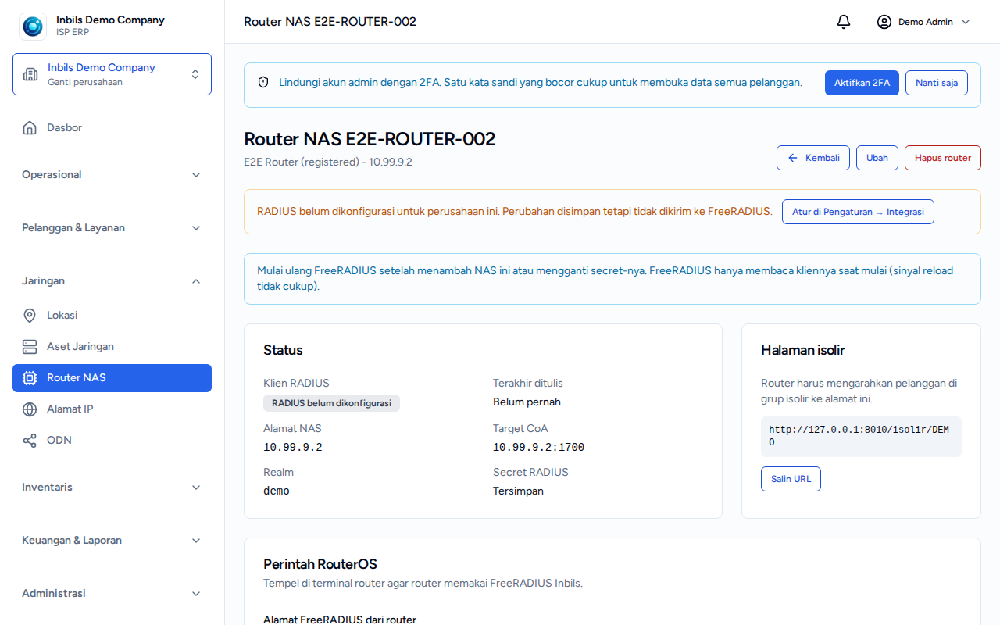

Halaman ini tidak punya tombol uji koneksi atau sinkron manual. Selama RADIUS menyala, Inbils mengulang penulisan yang gagal tiap 15 menit.

### Mengubah router

1. Klik **Ubah** di baris daftar atau di halaman rincian.
2. Ubah isian di halaman **Ubah Router NAS**. **Aset router** dan **Realm** tampil sebagai teks dan tidak bisa diganti. **Alamat NAS** dan **Port CoA** (wajib) memakai aturan yang sama dengan form daftar. Kosongkan **Secret RADIUS** untuk mempertahankan secret yang tersimpan, yang ditandai petunjuk `Secret sudah tersimpan. Kosongkan untuk mempertahankannya.`
3. Klik **Simpan router**. Anda kembali ke rincian dengan toast "Router NAS diperbarui." Inbils menulis ulang ke RADIUS hanya bila **Alamat NAS** atau secret berubah. Klik **Batal** untuk keluar tanpa menyimpan.

### Menghapus router

1. Di halaman rincian, klik **Hapus router**.
2. Baca dialog `Hapus router NAS ini?`, lalu klik **Hapus**. Klik **Batal** untuk batal.
3. Anda kembali ke daftar dan muncul toast "Router NAS dihapus."

Penghapusan tetap berjalan walau router masih punya sesi terbuka atau akun jaringan, karena router mengakhiri sesinya sendiri. Aset Router di Aset Jaringan tidak ikut terhapus. Bila baris klien di FreeRADIUS tidak bisa dihapus, muncul peringatan `Baris klien RADIUS tidak dapat dihapus (RADIUS dimatikan atau tidak terjangkau). Hapus dari tabel nas secara manual.` Pengelola server yang menghapus baris itu dari tabel `nas`.

### Rahasia dan catatan audit

- Inbils menyimpan **Secret RADIUS** router terenkripsi. Kolomnya tersamar, dan tidak ada halaman yang menampilkannya: rincian hanya menulis `Tersimpan` atau `Belum diisi`. Bila secret terlupa, isi secret baru lewat **Ubah** dan samakan dengan router.
- Setelah Anda mengirim form, Inbils mengosongkan kolom secret, juga saat ada galat validasi. Isi ulang secret pada percobaan berikutnya.
- Log audit (bagian 7.12) mencatat modul **Perangkat NAS**: pembuatan (`created`), perubahan (`updated`, dengan nama isian yang berubah), penggantian secret (`secret_changed`), penghapusan (`deleted`), serta kegagalan menulis ke RADIUS (`radius_failed`). Isi secret tidak pernah ikut tercatat.

### Akun jaringan pelanggan

Akun jaringan adalah nama pengguna dan kata sandi yang dipakai satu langganan untuk masuk lewat router perusahaan. Satu langganan punya satu akun. Akun tidak terikat pada satu router: pelanggan boleh masuk lewat router NAS mana pun milik perusahaan.

Izin: `network_asset.account.view` membuka halaman akun, `network_asset.account.manage` membuat, mengubah dan menjalankan **Sinkron ulang**, dan `network_asset.account.reveal` membuka kata sandi. Admin, manajer dan staf bawaan memegang ketiganya.

1. Buka halaman langganan (bagian 4.1), lalu klik **Akses jaringan** di kartu **Aksi langganan**. Tombol ini hanya tampil bagi pemegang `network_asset.account.view`. Dari rincian router, klik **Nama pengguna** di kartu **Sesi terbuka** untuk membuka halaman yang sama.
2. Baca halaman **Akses jaringan**.

   - Kartu **Langganan** memuat **Langganan**, **Status**, **Pelanggan**, **Profil kecepatan** (dengan nama grup RADIUS), **POP layanan** dan **Status yang diharapkan**.
   - **Status yang diharapkan** Aktif berarti akun ada di RADIUS dengan grup kecepatan paket. Diisolir berarti akun ada di grup isolir perusahaan dan sesinya diputus. Alasannya tertulis di bawahnya: `Diisolir karena ditangguhkan.`, `Diisolir karena diblokir.`, atau `Diisolir karena ditangguhkan dan diblokir.` Dihapus berarti akun dihapus dari RADIUS.
   - Kartu **Akun jaringan**, setelah akun dibuat, memuat **Jenis layanan**, **Nama pengguna**, **Status sinkronisasi** (Menunggu, Tersinkron atau Gagal, dengan alasan terakhir), **Grup RADIUS**, **Online**, **Alamat**, **NAS**, **Sesi mulai** dan **Bulan ini** (unggah dan unduh bulan berjalan). Baris **Alamat**, **NAS** dan **Sesi mulai** hanya tampil saat pelanggan online.
   - Peringatan `RADIUS dimatikan untuk instalasi ini. Perubahan disimpan tetapi tidak dikirim ke FreeRADIUS, dan status online serta pemakaian tidak tersedia.` muncul bila RADIUS dimatikan.
   - Langganan yang belum punya akun menampilkan `Langganan ini belum punya akun jaringan.` bagi pengguna tanpa `network_asset.account.manage`.

### Membuat akun jaringan

Langganan tidak boleh berstatus Berhenti, dan profil kecepatan paketnya harus punya **Nama profil RADIUS** (bagian 4.4). Tanpa itu halaman menampilkan peringatan `Profil kecepatan paket ini belum punya nama profil RADIUS. Isi dulu di profil kecepatan sebelum membuat akun jaringan.` dan server menolak.

1. Di halaman **Akses jaringan** langganan yang belum punya akun, isi kartu **Buat akun jaringan**:
   - **Jenis layanan**: **PPPoE** (isian awal) atau **Hotspot**.
   - **Nama pengguna**: wajib, 3 sampai 40 huruf kecil, angka, titik, strip atau garis bawah. Inbils menambahkan `@realm` di belakangnya, dan realm tampil di sebelah kolom. Nama lengkap harus unik di seluruh sistem. Bila bentrok, muncul `Nama pengguna ini tidak tersedia.`
   - **Kata sandi**: opsional, 6 sampai 64 karakter tanpa spasi. Kosongkan agar Inbils membuat kata sandi 12 karakter.
2. Klik **Buat akun jaringan**. Muncul toast "Akun jaringan dibuat."
3. Bila Inbils membuat kata sandi, kotak **Kata sandi hanya tampil sekali** menampilkannya dengan tombol **Salin kata sandi** dan **Tutup**. Salin sekarang: kata sandi hilang dari layar setelah Anda klik **Tutup** atau meninggalkan halaman.

### Mengubah akun, sinkron ulang dan membuka kata sandi

- Untuk mengubah akun, isi kartu **Ubah akun jaringan**: **Jenis layanan**, **Nama pengguna** (bagian lokal) dan **Kata sandi**. Kosongkan **Kata sandi** untuk mempertahankan yang lama. Klik **Simpan perubahan** (toast "Akun jaringan diperbarui."). Kartu ini nonaktif bila langganan Berhenti, dengan peringatan `Langganan yang sudah berhenti tidak dapat punya akun jaringan.`
- Untuk menulis ulang akun ke RADIUS dan memutus sesinya yang sedang terbuka, klik **Sinkron ulang** di kanan atas (toast "Sinkron ulang dijadwalkan."). Pakai tombol ini bila kecepatan paket berubah dan sesi lama belum berganti.
- Untuk melihat kata sandi akun, klik **Tampilkan kata sandi** di kanan atas. Dialog `Tampilkan kata sandi?` menyebut bahwa kata sandi tampil satu kali dan pengungkapannya dicatat di log audit. Klik **Tampilkan**, lalu salin kata sandi dari kotak **Kata sandi hanya tampil sekali**. Inbils mencatat entri `secret_revealed` di modul **Akun jaringan** sebelum menampilkan kata sandi.

### Isolir otomatis dan halaman isolir

Isolir menghentikan layanan internet pelanggan sementara: Inbils memindahkan akunnya ke grup isolir di RADIUS dan memutus sesinya. Router yang sudah diatur mengalihkan pelanggan terisolir ke halaman isolir perusahaan. Pengaturan pengalihan itu dikerjakan di router, bukan di Inbils.

Isolir otomatis berjalan bila admin menyalakan **Tangguhkan langganan yang menunggak** di bagian **Penangguhan otomatis** pada **Pengaturan Perusahaan** (menu **Perusahaan**, tombol **Pengaturan**, bagian 8.1). Pengaturan ini mati secara awal. **Batas keterlambatan** (1 sampai 60 hari, isian awal 7) menentukan batas hari, dan **Aktifkan kembali saat tagihan lunas** (isian awal menyala) menentukan pembukaan otomatis setelah pembayaran.

Setiap hari pukul 08:00 UTC (15:00 WIB), Inbils mengisolir langganan Aktif yang punya tagihan belum lunas dan sudah lewat lebih dari batas hari. Jatuh tempo tepat pada batas belum cukup. Langganan menjadi Ditangguhkan dengan sumber `overdue`, Log audit mencatat alasan `Automatic isolir: an invoice is more than <N> days past due.`, dan langganan itu tidak menerima tagihan berulang baru selama Ditangguhkan.

Alamat halaman isolir ada di kartu **Halaman isolir** pada rincian router, dan bentuknya `/isolir/` diikuti kode perusahaan. Halaman ini publik, tanpa login, dan tidak memuat data pelanggan. Kode yang salah atau perusahaan yang nonaktif menghasilkan halaman 404. Pelanggan melihat:

- Nama perusahaan, judul `Layanan internet Anda sedang diisolir`, dan penjelasan bahwa layanan dihentikan sementara karena ada tagihan yang belum dibayar dan akan aktif kembali setelah pembayaran tercatat.
- Bagian **Cara mengaktifkan kembali** dengan dua langkah: masuk ke akun pelanggan, lalu buka tagihan yang belum dibayar dan bayar secara online.
- Tombol **Masuk untuk melihat dan membayar tagihan**, yang membuka halaman masuk web. Akun pelanggan dipakai di aplikasi Android, jadi akun pelanggan murni yang masuk di web diarahkan ke halaman `Gunakan aplikasi Inbils`.
- Teks `Sudah membayar tetapi layanan belum aktif? Hubungi kami.` dengan **Telepon**, **Email** dan **Situs web** perusahaan. Baris yang kosong tidak tampil.

Nama dan kontak itu berasal dari profil perusahaan (**Nama**, **Telepon**, **Email**, **Situs web**), yang admin ubah di menu Perusahaan (bagian 8.1).

### Mengaktifkan kembali langganan

Langganan Ditangguhkan kembali Aktif lewat salah satu jalur:

- Otomatis setelah pembayaran, dari tagihan manual maupun Midtrans. Syaratnya: **Aktifkan kembali saat tagihan lunas** menyala, isolir bersumber `overdue`, setiap tagihan yang jatuh tempo paling lambat pada hari isolir sudah lunas, dan tidak ada tagihan belum lunas yang lewat batas hari. Pembayaran sebagian belum cukup. Isolir `manual` tidak pernah dibuka otomatis.
- Manual: di halaman langganan, kartu **Aksi langganan**, klik **Aktifkan kembali**. Aksi ini tidak meminta alasan, perlu izin `customer.subscription.reactivate` (admin dan manajer), dan menampilkan toast "Langganan diaktifkan kembali." Bila langganan tidak Ditangguhkan, server menolak dengan "Langganan harus berstatus Ditangguhkan untuk diaktifkan kembali."

### Mengisolir dan memblokir secara manual

Admin dan manajer bisa mengisolir atau memblokir tanpa menunggu jadwal.

- Isolir karena tunggakan: buka **Tunggakan** (bagian 7.2), lalu klik tombol **Isolir** yang diikuti kode langganan pada baris pelanggan. Tombol ini tampil untuk langganan Aktif bagi pemegang `customer.subscription.suspend`. Di dialog `Isolir langganan <kode>?`, isi **Alasan isolir (wajib)** lalu klik **Isolir**. Toast "Langganan ditangguhkan." muncul. Sumbernya `overdue`, jadi pembayaran bisa membukanya otomatis.
- Penangguhan biasa: di halaman langganan, klik **Tangguhkan**, isi **Alasan** di dialog **Tangguhkan Langganan**, lalu klik **Tangguhkan**. Sumbernya `manual`, jadi hanya **Aktifkan kembali** yang membukanya.
- Blokir internet pada langganan yang belum Berhenti: klik **Blokir internet** di halaman langganan, atau tombol **Blokir** yang diikuti kode langganan di baris **Tunggakan**. Di dialog `Blokir internet <kode>?`, isi **Alasan** (wajib, maksimal 500 karakter), lalu klik **Blokir internet**. Toast "Internet langganan diblokir." muncul. Tombol ini perlu izin `customer.subscription.block`.
- Buka blokir: klik **Buka blokir** di halaman langganan, atau tombol **Buka blokir** yang diikuti kode langganan di baris **Tunggakan**. Di dialog `Buka blokir internet <kode>?`, **Catatan (opsional)** boleh kosong. Klik **Buka blokir**. Toast "Blokir internet langganan dibuka." muncul.

Blokir bukan status. Kartu **Status** di halaman langganan menampilkan baris **Internet** dengan lencana **Diblokir**, **Alasan blokir** dan **Diblokir oleh**, dan halaman **Akses jaringan** menulis `Diisolir karena diblokir.` Baris langganan di **Tunggakan** juga memuat lencana **Diblokir**. Tagihan terus berjalan dan pembayaran tidak mencabut blokir. **Buka blokir** pada langganan Ditangguhkan tidak memulihkan layanan: dialog menyebut `Langganan sedang ditangguhkan, jadi layanan tetap diisolir sampai diaktifkan kembali.` dan langganan tetap terisolir sampai **Aktifkan kembali**.

Server menolak dengan "Internet langganan sudah diblokir." bila langganan sudah diblokir, "Internet langganan tidak sedang diblokir." bila Anda membuka blokir yang tidak ada, dan "Langganan yang sudah berhenti tidak bisa diblokir." bila langganan Berhenti. Tangguhkan yang bukan dari langganan Aktif ditolak dengan "Langganan harus berstatus Aktif untuk ditangguhkan."

### Kesalahan umum

- Pilihan **Aset router** kosong atau router yang dicari tidak ada: aset harus berjenis Router, punya **IP manajemen** dan belum terdaftar. Pesan server yang sesuai: `Pilih aset router milik perusahaan ini yang punya IP manajemen.` dan `Aset router ini sudah terdaftar sebagai router NAS.` Perbaiki asetnya lewat **Ubah** (bagian 5.2).
- Peringatan `Kode perusahaan tidak dapat dipakai sebagai realm RADIUS (huruf kecil, angka, dan tanda hubung, maksimal 24 karakter). Ubah kode perusahaan sebelum mendaftarkan router.` membuat form pendaftaran tidak tampil: kode perusahaan harus 1 sampai 24 huruf, angka atau strip. Admin mengubah **Kode** di profil perusahaan (bagian 8.1). Alamat halaman isolir memuat kode ini, jadi salin ulang alamatnya bila kode berubah.
- `Alamat ini tidak tersedia.`: **Alamat NAS** sudah dipakai router lain di sistem. Isi alamat yang benar-benar menjadi asal permintaan router.
- Secret router ditolak dengan `Gunakan karakter yang dapat dicetak, tanpa spasi.`: pakai 8 sampai 60 karakter ASCII tercetak, tanpa spasi.
- Lencana **Gagal ditulis** atau **Menunggu ditulis** tidak berubah: Inbils belum berhasil menulis router ke RADIUS. Baca **Kesalahan terakhir** di rincian dan pastikan RADIUS menyala di server. Setelah tertulis, minta pengelola server me-restart FreeRADIUS.
- Manajer atau staf tidak melihat **Daftarkan router**, **Ubah** dan **Hapus router**: hanya admin yang punya `network_asset.nas.manage`. Server juga menolak dengan galat 403.
- Akun jaringan ditolak dengan `Profil kecepatan paket ini belum punya nama profil RADIUS.`: isi **Nama profil RADIUS** pada profil kecepatan paket (bagian 4.4). Pesan `Langganan yang sudah berhenti tidak dapat punya akun jaringan.` berarti langganannya sudah Berhenti, dan `Langganan ini sudah punya akun jaringan.` berarti akunnya sudah ada.
- Kata sandi akun ditolak dengan `Kata sandi tidak boleh berisi spasi.`: pakai 6 sampai 64 karakter tanpa spasi. Nama pengguna ditolak dengan `Gunakan 3 sampai 40 huruf kecil, angka, titik, tanda hubung, atau garis bawah.`: pakai hanya karakter itu.
- **Tampilkan kata sandi** dan **Sinkron ulang** mengembalikan galat setelah dipakai berulang: server membatasi **Tampilkan kata sandi** 10 kali per menit dan **Sinkron ulang** 6 kali per menit.
- Pelanggan sudah membayar tetapi tetap terisolir: periksa sumber isolirnya. Isolir `manual` dan blokir tidak dibuka oleh pembayaran. Periksa juga apakah **Aktifkan kembali saat tagihan lunas** menyala, tidak ada tagihan belum lunas yang lewat batas hari, dan setiap tagihan yang jatuh tempo paling lambat pada hari isolir sudah lunas.
- Pelanggan yang diblokir manual tetap melihat halaman isolir yang menyebut tagihan belum dibayar. Halaman publik memakai teks yang sama untuk semua pelanggan terisolir dan tidak membaca sumber isolirnya. Jelaskan alasan blokir lewat petugas atau kontak perusahaan.

## 5.4 Alamat IP

Alamat IP adalah register pasif ruang alamat IP perusahaan: prefiks (blok CIDR), VLAN, dan alamat yang sudah dipegang. Register hanya mencatat. Sistem tidak membaca perangkat dan tidak mengirim konfigurasi ke router. Buka menu ini untuk melihat seberapa penuh tiap blok, mendaftarkan prefiks atau VLAN, dan melihat siapa memegang sebuah alamat statis.

Peran yang dapat memakai: admin dan manajer (semua tindakan), staf (hanya melihat). Izin: `ipam.view` untuk membuka daftar prefiks, detail prefiks, dan VLAN, `ipam.manage` untuk mendaftarkan, mengubah, dan menghapus prefiks dan VLAN serta menambah dan melepas reservasi, `ipam.assign` untuk memberi dan melepas alamat statis langganan. Data berlaku per perusahaan aktif (bagian 1.6).

### Membuka dan membaca daftar prefiks

1. Di sidebar, buka grup **Jaringan**, lalu klik **Alamat IP**.
2. Atur daftar dengan lima saringan di atas tabel. Daftar menyesuaikan diri setelah Anda mengetik atau memilih.
   - **Cari**: prefiks atau keterangan.
   - **Versi IP**: **IPv4 dan IPv6**, **IPv4**, atau **IPv6**.
   - **Peruntukan**: **Semua peruntukan**, **Induk**, **IP statis pelanggan**, **IP dinamis pelanggan**, atau **Infrastruktur**.
   - **POP** dan **VLAN**: ketik untuk mencari, lalu pilih. Isian awalnya **Semua POP** dan **Semua VLAN**. Tombol **Hapus pilihan** di ujung isian mengosongkannya.

   Prefiks yang berada di dalam prefiks lain diberi indentasi di bawah induknya. Urutannya IPv4 dulu, lalu IPv6, menurut alamat awal blok. Daftar ini tidak punya urutan manual dan halaman. Bila saringan tidak menemukan apa pun, tabel menulis "Tidak ada prefiks yang cocok" dengan tombol **Reset filter**. Bila belum ada prefiks sama sekali, tabel menulis "Belum ada prefiks".

   

3. Baca kolomnya.

   Kolom **Prefiks** berisi blok CIDR dengan keterangan di bawahnya, dan klik CIDR itu untuk membuka detail. Kolom **Peruntukan** berisi lencana peruntukan blok. Kolom **POP** berisi kode POP, dan kolom **VLAN** berisi ID dan nama VLAN yang terikat. Sel yang kosong berisi tanda "-". Kolom **Ukuran** menunjukkan jumlah alamat dalam blok.

   Kolom **Terpakai** menjumlahkan alamat yang sudah diberikan (**Dipakai**) dan yang dicadangkan (**Dicadangkan**), dan hanya terisi untuk **IP statis pelanggan** dan **Infrastruktur**. Kolom **Kosong** menunjukkan sisa alamat yang bisa dipakai. Untuk blok IPv4 selain /31 dan /32, sistem tidak menghitung alamat network dan broadcast.

   Kolom **Pemakaian** menampilkan bilah dan persen pemakaian: hijau di bawah 75%, kuning mulai 75%, merah mulai 90%. **IP dinamis pelanggan** hanya punya **Ukuran**. Untuk blok IPv6, **Kosong** dan **Pemakaian** berisi tanda "-" karena alamat IPv6 diketik manual. Untuk **Induk**, **Pemakaian** menunjukkan bagian blok yang sudah diisi prefiks di dalamnya.

### Mendaftarkan prefiks

1. Klik **Buat Prefiks** di kanan atas halaman. Tombol ini butuh `ipam.manage`.
2. Isi form di dialog **Buat Prefiks**:
   - **CIDR**: wajib, maksimal 64 karakter, berbentuk CIDR IPv4 atau IPv6, misalnya `10.20.0.0/22` atau `2001:db8::/48`. Alamat tunggal, rentang, dan panjang prefiks di atas 32 (IPv4) atau 128 (IPv6) ditolak. Bagian host dibuang otomatis, jadi yang tersimpan adalah alamat awal blok.
   - **Peruntukan**: wajib. Pilih dari daftar. Keterangan singkat tiap pilihan muncul di bawah isian.
   - **POP**: opsional. Ketik untuk mencari, lalu pilih kode dan nama POP yang aktif. Isian kosong (**Tidak terkait POP**) berarti blok tidak terikat POP.
   - **VLAN**: opsional. Ketik untuk mencari, lalu pilih. Pilihannya menampilkan ID dan nama VLAN, dengan kode POP atau **Seluruh perusahaan** di bawahnya. Isian kosong (**Tanpa VLAN**) berarti tanpa VLAN.
   - **Keterangan**: opsional, maksimal 255 karakter.
3. Klik **Daftarkan prefiks**. Daftar tampil kembali dengan toast `Prefiks <CIDR> didaftarkan.` Tombol **Batal** menutup dialog tanpa menyimpan.

Arti nilai **Peruntukan**:

| Peruntukan | Arti | Yang dihitung |
|---|---|---|
| Induk | Mengelompokkan prefiks lain. Tidak memuat alamat sendiri. | Pemakaian: bagian blok yang diisi prefiks di dalamnya. |
| IP statis pelanggan | Pool alamat statis pelanggan, diberikan dari halaman langganan. | Terpakai, lalu Kosong dan Pemakaian untuk IPv4. |
| IP dinamis pelanggan | Pool yang dibagikan router. Hanya ukurannya yang dicatat di sini. | Hanya Ukuran. |
| Infrastruktur | Alamat perangkat dan manajemen, dicadangkan secara manual. | Terpakai, lalu Kosong dan Pemakaian untuk IPv4. |

Sistem otomatis menempatkan prefiks baru di bawah prefiks terkecil yang sudah terdaftar dan memuatnya. Prefiks dan alamat yang sudah ada di dalam blok baru ikut berpindah ke bawahnya. Blok CIDR yang sudah terdaftar tidak bisa didaftarkan lagi, dan blok yang hanya sebagian tumpang tindih dengan prefiks lain ditolak.

### Membuka detail prefiks

1. Di daftar, klik CIDR prefiks.
2. Baca halaman detail. Judulnya CIDR prefiks, dengan keterangan (atau nama peruntukan) di bawahnya.

   Kartu **Detail** memuat **Peruntukan**, **Di dalam** (prefiks induk, atau **Tingkat atas**), **POP**, **VLAN**, dan **Ukuran**. Untuk **IP statis pelanggan** dan **Infrastruktur**, kartu ini juga memuat **Dapat dipakai**, **Dipakai**, **Dicadangkan**, dan **Kosong**. Di bawahnya ada bilah pemakaian dengan satu kalimat penjelasnya.

   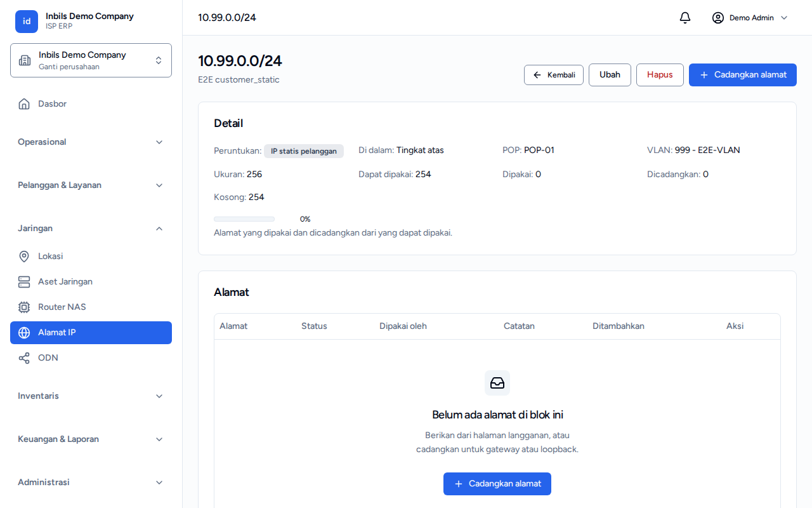

   Kartu **Prefiks di dalam** mendaftar prefiks di dalam blok dan selalu tampil untuk **Induk**. Kartu **Alamat** mendaftar alamat yang tercatat di rentang blok, termasuk alamat di prefiks bersarang, 25 per halaman. Kolomnya **Alamat**, **Status** (**Dipakai** atau **Dicadangkan**), **Dipakai oleh** (kode dan nama langganan atau aset pemegang, kosong untuk reservasi), **Catatan**, **Ditambahkan**, dan **Aksi** bagi pemegang `ipam.manage` atau `ipam.assign`. Bila blok belum berisi alamat, kartu menulis "Belum ada alamat di blok ini".
3. Klik **Kembali** untuk kembali ke daftar.

### Mengubah dan menghapus prefiks

1. Di halaman detail, klik **Ubah**. Tombol ini butuh `ipam.manage`.
2. Ubah **Peruntukan**, **POP**, **VLAN**, atau **Keterangan** di dialog **Ubah** diikuti CIDR prefiks, lalu klik **Simpan**. Isian **CIDR** terkunci, dengan petunjuk "Prefiks tetap memakai CIDR-nya. Daftarkan yang baru untuk mengubahnya." Toast "Prefiks diperbarui." muncul.
3. Untuk menghapus, klik **Hapus** di halaman yang sama, lalu klik **Hapus prefiks** di dialog konfirmasi. Dialog menjelaskan bahwa prefiks hanya bisa dihapus selama tidak memuat prefiks lain dan alamat.
   - Bila prefiks masih berisi prefiks lain atau alamat, dialog tetap terbuka dengan pesan merah.
   - Bila berhasil, daftar tampil kembali dengan toast `Prefiks <CIDR> dihapus.`

### Mereservasi alamat

Reservasi menahan satu alamat supaya tidak diberikan ke pelanggan, misalnya gateway atau loopback router.

1. Di halaman detail prefiks, klik **Cadangkan alamat**. Tombol ini butuh `ipam.manage`.
2. Isi form di dialog **Cadangkan alamat di** diikuti CIDR prefiks:
   - **Alamat**: wajib, alamat IP yang valid dan berada di dalam prefiks. Petunjuknya: "Alamat yang dicadangkan tidak pernah diberikan ke pelanggan."
   - **Catatan**: opsional, maksimal 255 karakter, misalnya gateway.
3. Klik **Cadangkan alamat**. Toast `Alamat <alamat> dicadangkan.` muncul, dan alamat tampil di kartu **Alamat** dengan status **Dicadangkan**.

Sistem menolak alamat network dan broadcast pada blok IPv4 selain /31 dan /32. Alamat yang sudah dipegang pihak lain ditolak dengan menyebut pemegangnya.

### Memberi alamat statis ke langganan

Gunakan halaman langganan untuk memberi alamat statis, bukan halaman Alamat IP. Langganan tanpa alamat tercatat dianggap dinamis, yaitu router yang membagikan alamatnya. Panelnya menulis "Dinamis (diberikan router)".

1. Buka halaman langganan (lihat bagian Pelanggan, bagian 4.1), lalu cari kartu **Alamat IP**.
2. Klik **Berikan IP statis**. Tombol ini butuh `ipam.assign` dan hanya muncul bila langganan belum berhenti dan masih ada pool yang bisa dipakai.
3. Di dialog **Berikan IP statis ke** diikuti kode langganan, pilih **Pool**: wajib, ketik untuk mencari, lalu pilih. Tiap pilihan menampilkan CIDR dan jumlah alamat kosong (atau "IPv6, ketik alamatnya"). Pool yang ditawarkan adalah pool **IP statis pelanggan** yang tidak terikat POP atau terikat ke POP pelayan langganan. Satu langganan hanya boleh punya satu alamat per versi IP, jadi pool untuk versi yang sudah terisi tidak muncul. Bila hanya ada satu pool, pool itu sudah terpilih.
4. Isi **Alamat**, atau kosongkan agar sistem memilih alamat bebas terendah. Pengosongan hanya berlaku untuk pool IPv4 /16 atau blok yang lebih kecil (/17 sampai /32). Pool IPv6 dan blok yang lebih besar dari /16 butuh alamat yang diketik, dan untuk IPv6 isian ini wajib.
5. Klik **Berikan alamat**. Toast `Alamat <alamat> diberikan ke <kode langganan>.` muncul. Alamat tampil di kartu **Alamat IP** dengan versi IP dan CIDR pool-nya, serta di kartu **Alamat** prefiks.

Bila langganan berhenti saat dialog masih terbuka, dialog menolak dengan pesan merah di bagian atasnya.

### Melepas alamat

1. Di kartu **Alamat IP** langganan, klik **Lepas** pada baris alamat. Atau di kartu **Alamat** halaman detail prefiks, klik **Lepas** pada baris **Dipakai** atau **Dicadangkan**.
2. Klik **Lepas alamat** di dialog konfirmasi **Lepas** diikuti alamatnya. Alamat langganan butuh `ipam.assign`, dan reservasi butuh `ipam.manage`. Toast `Alamat <alamat> dilepas.` muncul.

Langganan yang alamatnya dilepas kembali ke alamat dinamis, dan alamat itu kembali ke pool. Saat langganan dihentikan, sistem melepas alamat statisnya sendiri. Alamat milik aset jaringan tidak bisa dilepas di sini. Barisnya punya tombol **Ubah aset**: klik tombol itu, lalu ubah **Alamat IP** atau **IP manajemen** di aset (bagian 5.2).

### Mengelola VLAN

1. Di halaman daftar prefiks, klik **VLAN**.
2. Baca tabelnya: **ID VLAN**, **Nama**, **POP** (kode POP, atau **Seluruh perusahaan**), **Prefiks** (jumlah prefiks yang memakai VLAN itu), **Keterangan**, dan **Aksi** untuk pemegang `ipam.manage`. Klik angka di **Prefiks** untuk membuka daftar prefiks yang disaring menurut VLAN itu. Tombol **Alamat IP** kembali ke daftar prefiks. Tabel menampilkan 25 VLAN per halaman, diurutkan menurut ID VLAN.

   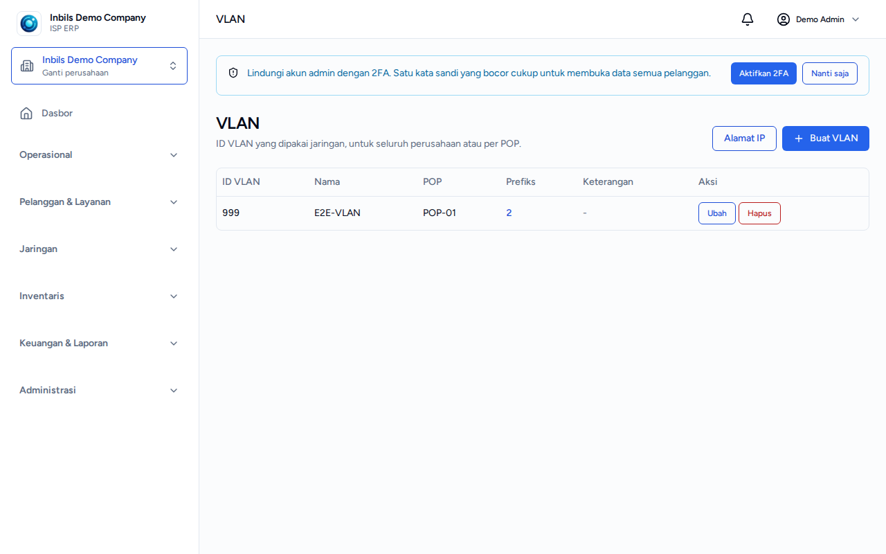

3. Klik **Buat VLAN**, lalu isi form di dialog **Buat VLAN**:
   - **ID VLAN**: wajib, bilangan bulat 1 sampai 4094.
   - **Nama**: wajib, maksimal 64 karakter.
   - **POP**: opsional, ketik untuk mencari, lalu pilih. Isian kosong (**Seluruh perusahaan**) berarti VLAN berlaku untuk seluruh perusahaan.
   - **Keterangan**: opsional, maksimal 255 karakter.
4. Klik **Daftarkan VLAN**. Toast `VLAN <ID> didaftarkan.` muncul.

ID yang sama boleh ada di beberapa POP, tetapi hanya sekali per POP dan hanya sekali untuk **Seluruh perusahaan**.

Untuk mengubah VLAN, klik **Ubah** pada baris, ubah isiannya di dialog **Ubah VLAN** diikuti ID, lalu klik **Simpan**. Toast "VLAN diperbarui." muncul. Untuk menghapus, klik **Hapus** pada baris, lalu klik **Hapus VLAN**. Toast `VLAN <ID> dihapus.` muncul. VLAN hanya terhapus bila tidak ada prefiks yang memakainya. Lepaskan VLAN dari prefiks lebih dulu dengan **Ubah** pada prefiks dan mengosongkan isian **VLAN**.

### Kesalahan umum

- `Masukkan prefiks IPv4 atau IPv6 dalam bentuk CIDR yang valid, misalnya 10.20.0.0/22.` berarti isian **CIDR** bukan blok CIDR: alamat tunggal, rentang, panjang prefiks di atas 32 (IPv4) atau 128 (IPv6), atau ada teks tambahan. Tulis ulang sebagai alamat jaringan diikuti garis miring dan panjang prefiks.
- `<CIDR> sudah terdaftar.` berarti blok itu sudah ada. Cari di daftar dengan **Cari**.
- `<CIDR> tumpang tindih sebagian dengan <CIDR lain>.` berarti blok baru memotong prefiks yang sudah terdaftar tanpa memuatnya atau berada di dalamnya. Pilih blok yang sejajar, lebih besar, atau lebih kecil dari prefiks itu.
- CIDR yang salah ketik pada prefiks tersimpan tidak bisa diperbaiki lewat **Ubah**. Daftarkan prefiks baru dengan CIDR yang benar, lalu hapus prefiks lama setelah kosong.
- `<CIDR> memuat prefiks lain. Hapus dulu.` dan `<CIDR> masih punya alamat. Lepas dulu.` menolak penghapusan prefiks. Hapus prefiks di dalamnya dan lepas semua alamatnya lebih dulu.
- Tombol **Berikan IP statis** hilang, atau kartu **Alamat IP** menulis "Belum ada pool statis untuk POP langganan ini." Tidak ada pool **IP statis pelanggan** yang tidak terikat POP atau terikat ke POP pelayan langganan. Daftarkan pool lewat **Buat Prefiks** dengan **Peruntukan** **IP statis pelanggan**. Bila langganan sudah punya alamat IPv4 dan IPv6, tombol juga hilang tanpa pesan itu.
- `<alamat> berada di luar <CIDR>.` dan `<alamat> adalah alamat jaringan atau broadcast dari <CIDR>.` berarti alamat yang diketik berada di luar blok, atau berupa alamat network atau broadcast. Pilih alamat host di dalam blok.
- `<alamat> sudah dipakai langganan <kode>.` berarti alamat sudah dipegang. Pesan yang sama dengan `dipakai aset <kode>` atau `dicadangkan (<catatan>)` menyebut pemegang lain. Pilih alamat lain, atau lepas alamat itu lebih dulu. `<alamat> baru saja diambil. Coba lagi.` berarti pemegangnya baru saja berubah.
- `Langganan <kode> sudah memakai alamat IPv<versi> <alamat>. Lepas dulu.` berarti satu langganan hanya boleh punya satu alamat per versi IP. Lepas alamat lama lebih dulu.
- "Alokasi otomatis hanya untuk pool IPv4. Ketik alamatnya." dan `<CIDR> lebih besar dari /16. Ketik alamatnya.` berarti kolom **Alamat** tidak boleh kosong untuk pool itu. Ketik alamatnya.
- `<CIDR> tidak punya alamat kosong.` berarti pool penuh. Pilih pool lain atau daftarkan pool baru. `<CIDR> sedang sibuk. Coba lagi.` berarti beberapa pemberian alamat berbenturan di pool yang sama. Ulangi sekali lagi.
- `<CIDR> bukan pool statis pelanggan.` dan `<alamat> berada di <CIDR>, yang bukan pool statis pelanggan.` berarti pool atau prefiks bersarang yang memuat alamat itu tidak berperuntukan **IP statis pelanggan**. Pilih pool lain.
- `Langganan <kode> sudah berhenti dan tidak dapat memakai alamat.` berarti langganan sudah berstatus Berhenti. Langganan itu tidak bisa lagi menerima alamat.
- `VLAN <ID> sudah terdaftar untuk seluruh perusahaan.` dan `VLAN <ID> sudah terdaftar di POP ini.` berarti ID itu sudah dipakai di cakupan yang sama. Pilih ID lain atau POP lain.
- `VLAN <ID> dipakai sebuah prefiks. Lepas dulu.` berarti VLAN masih terikat ke prefiks. Lepaskan dari prefiks itu lebih dulu.
- Tombol **Buat Prefiks**, **Ubah**, **Hapus**, **Cadangkan alamat**, **Berikan IP statis**, dan **Buat VLAN** tidak muncul bila izin `ipam.manage` atau `ipam.assign` tidak dimiliki. Staf hanya punya `ipam.view`.

## 5.5 ODN

ODN adalah register pasif jaringan serat optik: port PON pada OLT, splitter pada ODC dan ODP, dan port drop yang dipakai tiap langganan. Register hanya mencatat dan tidak menghubungi perangkat. Buka menu ini untuk melihat seberapa penuh tiap ODP, siapa berada di belakang tiap port PON, dan langganan aktif mana yang belum punya port drop.

OLT, ODC, dan ODP sendiri didaftarkan di **Aset Jaringan** (bagian 5.2), dengan **Tipe aset** OLT, ODC, atau ODP.

Peran yang dapat memakai: admin dan manajer (semua tindakan), staf (melihat dan mengatur port drop, tanpa mengelola port PON dan splitter). Izin: `odn.view` untuk membuka menu dan halaman ODN, `odn.manage` untuk menambah dan menghapus port PON dan splitter serta menyambung splitter, `odn.assign` untuk mencatat dan melepas port drop. Data berlaku per perusahaan aktif (bagian 1.6).

### Membuka dan membaca daftar

1. Di sidebar, buka grup **Jaringan**, lalu klik **ODN**.
2. Atur daftar dengan tiga saringan di atas tabel: **Cari**, **POP**, dan **ODP minimal terpakai (%)** (isi 0 sampai 100). **Cari** mencari kode dan nama ODP atau OLT, label port PON, atau kode langganan dan nama pelanggan di tab **Langganan tanpa port drop**. **POP**: ketik untuk mencari, lalu pilih, dan tombol **Hapus pilihan** mengosongkannya. Di tab ODP dan **Port PON**, **POP** menyisakan aset yang lokasinya berada di bawah POP itu. Di tab **Langganan tanpa port drop**, saringan ini mencocokkan POP pelayan langganan. **ODP minimal terpakai (%)** hanya berlaku di tab ODP dan menyisakan ODP yang terpakai sebesar itu atau lebih. Saringan baru selalu memulai tiap tab dari halaman pertama. Bila saringan tidak menemukan apa pun, tab menulis "Tidak ada ODP yang cocok" (atau "Tidak ada port PON yang cocok", "Tidak ada langganan yang cocok") dengan tombol **Reset filter**.

   

3. Baca tab **ODP**. Namanya diikuti jumlah ODP dalam kurung. Kolom **ODP** berisi kode ODP, dan klik kode itu untuk membuka halaman ODP. Kolom **Nama** dan **Lokasi** berisi nama ODP dan path lokasinya. Kolom **Kapasitas** menghitung port keluaran semua splitter di ODP itu, dengan lencana **Tanpa splitter** bila ODP belum punya splitter. Kolom **Terpakai** menghitung keluaran yang dipegang langganan atau menyuplai splitter lain. Kolom **Kosong** adalah sisanya, dengan lencana **Penuh** bila habis. Kolom **Pemakaian** menampilkan bilah dan persen pemakaian dengan warna yang sama seperti di Alamat IP.
4. Baca tab **Port PON**. Tiap baris adalah satu port PON milik OLT, ditulis "PON" diikuti nomor dan label bila ada. Kolom **Pelanggan** menghitung langganan di belakang port itu lewat semua tingkat splitter. Klik kode di kolom **OLT** untuk membuka halaman OLT.
5. Baca tab **Langganan tanpa port drop**. Tab ini mendaftar langganan berstatus Aktif yang belum punya port drop, sebagai daftar untuk melengkapi data. Kolomnya **Langganan**, **Pelanggan**, **POP layanan**, dan **Status**. Klik kode di kolom **Langganan** untuk membuka halaman langganan. Langganan berstatus lain tidak tampil. Bila semua langganan aktif sudah punya port drop, tab menulis "Semua langganan aktif punya port drop".

Setiap tab menampilkan 25 baris per halaman, dengan **Sebelumnya** dan **Berikutnya** bila lebih dari satu halaman.

### Membuka halaman OLT, ODC, atau ODP

1. Dari tab **ODP**, klik kode ODP. Dari tab **Port PON**, klik kode OLT.
2. Untuk ODC, atau OLT yang belum punya port PON, buka **Aset Jaringan** (bagian 5.2), buka aset itu, lalu klik **Port ODN**. Tombol ini muncul untuk aset bertipe OLT, ODC, dan ODP bagi pemegang `odn.view`.
3. Baca halamannya. Judulnya kode aset, dengan nama, tipe, dan path lokasinya di bawahnya. Tombol **ODN** kembali ke daftar, dan **Data aset** membuka aset di Aset Jaringan (butuh `network_asset.view`). Pemegang `odn.manage` juga melihat **Tambah port PON** pada OLT, atau **Tambah splitter** pada ODC dan ODP. ODC atau ODP tanpa splitter menulis "Belum ada splitter di" diikuti jenis asetnya.

   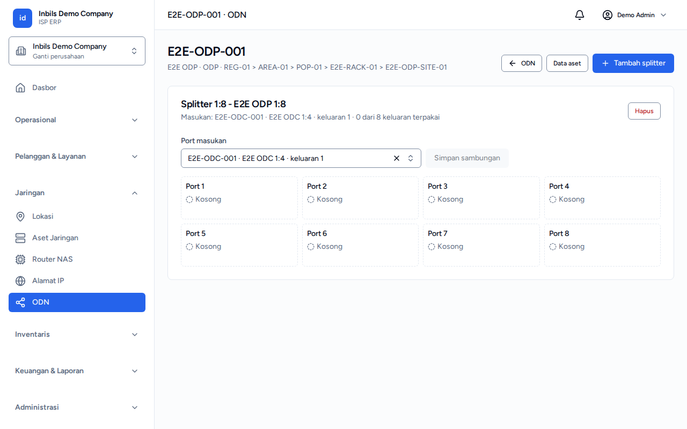

### Menambah port PON pada OLT

1. Buka halaman OLT, lalu klik **Tambah port PON**.
2. Isi **Jumlah port** di dialog **Tambah port PON ke** diikuti kode OLT: wajib, bilangan bulat 1 sampai 64, isian awal 1. Port baru diberi nomor setelah nomor tertinggi yang sudah ada.
3. Klik **Tambah port**. Toast `<jumlah> port PON dibuat di <kode OLT>.` muncul.

Kartu **Port PON** di halaman OLT berisi kolom **Port PON** (ditulis "PON" diikuti nomor), **Splitter** (**Belum terhubung**, atau "Splitter #" diikuti nomor internal splitter yang tersambung), **Pelanggan**, dan **Aksi** bagi pemegang `odn.manage`. Nomor internal itu tidak sama dengan rasio atau label splitter. Untuk mencari splitternya, buka halaman ODC atau ODP dan cocokkan lewat baris **Masukan** pada kartu splitter.

### Menambah splitter pada ODC atau ODP

1. Buka halaman ODC atau ODP, lalu klik **Tambah splitter**.
2. Isi form di dialog **Tambah splitter ke** diikuti kode aset:
   - **Rasio**: wajib. Pilihannya 1:2, 1:4, 1:8, 1:16, 1:32, dan 1:64, isian awal 1:8. Rasio menentukan jumlah port keluaran yang dibuat.
   - **Port masukan**: opsional. Ketik kode aset, label splitter, atau label port (paling sedikit 2 huruf), lalu pilih. Daftar menampilkan paling banyak 20 port kosong, yaitu port PON OLT atau port keluaran splitter lain di perusahaan ini, ditulis seperti "OLT-1 · PON 3" atau "ODC-2 · 1:4 · keluaran 2". Tombol **Hapus pilihan** mengosongkan isian, dan isian kosong berarti disambung nanti. Bila tidak ada hasil, daftar menulis "Tidak ada port kosong yang cocok."
   - **Label**: opsional, maksimal 100 karakter. Label membantu mengenali splitter pada kartu dan daftar port masukan.
3. Klik **Tambah splitter**. Toast `Splitter 1:<jumlah> ditambahkan ke <kode aset>.` muncul, dan kartu splitter tampil di halaman.

Judul kartu splitter berbunyi "Splitter 1:8", diikuti tanda "-" dan label bila ada. Di bawahnya ada baris **Masukan** dengan port hulu (atau "belum terhubung") dan jumlah keluaran yang terpakai. Pemegang `odn.manage` melihat isian **Port masukan** dengan tombol **Simpan sambungan**, serta tombol **Hapus**. Di bawahnya ada satu kotak per port keluaran. Kotak port bertuliskan **Kosong**, "Menyuplai splitter" diikuti nomor internal splitter hilirnya, atau kode langganan yang memegang port (klik untuk membuka langganan) dengan nama pelanggan dan tombol **Lepas** bagi pemegang `odn.assign`.

### Menyambung atau memutus splitter

1. Di kartu splitter, pilih port di **Port masukan**: ketik untuk mencari, lalu pilih. Isian kosong (**Belum terhubung**) memutus sambungan, dan tombol **Hapus pilihan** mengosongkannya.
2. Klik **Simpan sambungan**. Tombol ini aktif setelah pilihan berubah. Toast "Splitter diperbarui." muncul.

Port hulu harus bebas, yaitu tidak dipegang langganan dan bukan masukan splitter lain. Splitter tidak boleh disambung ke keluarannya sendiri atau ke hilirnya, dan rantai ke atas paling banyak 8 splitter.

### Menghapus port PON atau splitter

1. Untuk port PON, klik **Hapus** pada barisnya di kartu **Port PON**, lalu klik **Hapus port** di dialog **Hapus PON** diikuti nomornya. Tombol ini hanya ada pada port yang **Belum terhubung**. Nomor port lain tidak berubah. Toast "Port PON dihapus." muncul.
2. Untuk splitter, klik **Hapus** di kartunya, lalu klik **Hapus splitter**. Port keluaran ikut terhapus. Toast "Splitter dihapus." muncul.

Penghapusan ini butuh `odn.manage`. Splitter yang masih punya drop atau splitter hilir ditolak dengan pesan merah di dialog: "Masih ada yang terhubung ke keluarannya. Lepas port drop dan putuskan splitter hilir lebih dulu."

### Mencatat dan melepas port drop pelanggan

Catat port drop dari formulir pelanggan baru atau halaman langganan, bukan dari halaman ODN. Halaman ODN hanya menunjukkan siapa memegang port dan menyediakan tombol **Lepas**. Semua langkah ini butuh `odn.assign`.

1. Di formulir pelanggan baru, buka tab **Langganan & SPK**, pilih **POP pelayan**, lalu isi **Port drop (ODP)**. Isian ini opsional dan hanya tampil bagi pemegang `odn.assign`. Sebelum POP dipilih, isian nonaktif dengan petunjuk "Pilih POP layanan untuk melihat port kosongnya."
2. Di halaman langganan, buka kartu **Port drop**, lalu klik **Atur port drop**. Bila langganan sudah punya port, tombolnya **Pindahkan port drop**. Kartu menulis "Belum ada port drop tercatat." bila belum ada port.
3. Di dialog **Atur port drop** diikuti kode langganan, isi **Port drop (ODP)**: ketik kode ODP atau label splitter (paling sedikit 2 huruf), lalu pilih. Daftar menampilkan paling banyak 20 port keluaran ODP yang bebas di bawah POP pelayan langganan, ditulis `<kode ODP> · <rasio atau label splitter> · port <nomor>` dengan path lokasi di bawahnya. ODP yang sudah penuh tidak ditawarkan. Pilihan lama tetap berlaku selama Anda mengetik. Pilihan berubah hanya bila Anda memilih port lain atau menekan **Hapus pilihan**.
4. Klik **Atur port drop**, atau **Pindahkan port drop** bila memindahkan. Tombol ini baru aktif setelah Anda memilih port. Toast "Port drop dicatat." muncul, dan port lama dibebaskan saat memindahkan.
5. Untuk melepas, klik **Lepas** di kartu **Port drop**, lalu klik **Lepas port drop** di dialog konfirmasi. Atau klik **Lepas** pada port di kartu splitter. Langganan tetap berlangganan dan port menjadi kosong. Toast "Port drop dilepas." muncul.

Port drop harus berupa port keluaran ODP yang bebas, dan ODP harus berada di bawah POP pelayan langganan. Langganan harus berstatus Menunggu, Aktif, atau Ditangguhkan. Saat langganan dihentikan, sistem melepas port drop-nya sendiri.

### Kesalahan umum

- Isian **Port masukan** atau **Port drop (ODP)** tidak menampilkan daftar berarti Anda belum mengetik 2 huruf (isian menulis `Ketik minimal 2 huruf untuk mencari.`), atau tidak ada port bebas yang cocok. Tambah port PON atau splitter, atau lepas port yang tidak dipakai. Tiap pencarian menampilkan paling banyak 20 port, jadi ketik lebih banyak huruf bila port yang dicari tidak muncul.
- ODP tidak muncul di tab **ODP** bila asetnya bukan bertipe ODP, sudah dihapus, atau (saat saringan **POP** dipakai) ditempatkan langsung di lokasi POP itu. Saringan **POP** hanya mencocokkan lokasi di bawah POP, yaitu Rak atau Site. Perbaiki di Aset Jaringan (bagian 5.2).
- `ODP ini tidak berada di bawah POP layanan langganan <kode>.` berarti lokasi ODP berada di luar POP pelayan langganan. Ubah lokasi ODP di Aset Jaringan ke lokasi di bawah POP itu, atau ubah POP pelayan langganan.
- "Langganan ini belum punya POP layanan, jadi belum ada port yang bisa ditawarkan." berarti langganan belum punya POP pelayan. Isi POP pelayan lebih dulu.
- "Tidak ada port kosong yang cocok di bawah POP ini." berarti tidak ada port keluaran ODP yang bebas di bawah POP pelayan untuk kata yang diketik.
- "Port ini sudah dipakai." berarti port sudah dipegang langganan atau menjadi masukan splitter. Buka ulang halaman dan pilih port lain.
- "Splitter tidak dapat dihubungkan ke keluarannya sendiri atau ke apa pun di hilirnya." menolak sambungan yang membentuk lingkaran. Pilih port hulu di luar hilir splitter itu.
- `Rantai fiber di atas port ini lebih dari 8 splitter.` menolak rantai splitter yang terlalu dalam. Sambungkan ke port yang lebih dekat ke OLT.
- `Langganan <kode> tidak dalam layanan, jadi tidak dapat memakai port drop.` berarti hanya langganan berstatus Menunggu, Aktif, atau Ditangguhkan yang boleh memegang port drop.
- "Masih ada yang terhubung ke keluarannya. Lepas port drop dan putuskan splitter hilir lebih dulu." menolak penghapusan splitter. Lepas semua port drop dan putuskan splitter hilir lebih dulu.
- "Sebuah splitter terhubung ke port PON ini. Putuskan lebih dulu." menolak penghapusan port PON yang baru saja disambung. Putuskan splitternya, lalu hapus port.
- Tombol **Tambah port PON**, **Tambah splitter**, **Simpan sambungan**, dan **Hapus** tidak muncul tanpa `odn.manage`. Staf hanya punya `odn.view` dan `odn.assign`.

# 6. Inventaris

## 6.1 Permintaan Barang

Permintaan Barang mengatur pengambilan material dari gudang untuk pekerjaan lapangan: pengajuan, persetujuan, penyiapan, sampai serah terima barang. Buka menu ini untuk mengajukan barang, memutuskan pengajuan, atau memproses barang di gudang.

Peran yang dapat memakai: admin (semua langkah), manajer (melihat semua, menyetujui, menolak, membatalkan), dan staf (melihat semua, menyiapkan, menandai siap, menyerahkan). Izin: `inventory.request.view.own`, `inventory.request.view.all`, `inventory.request.create`, `inventory.request.cancel.own`, `inventory.request.approve`, `inventory.request.reject`, `inventory.request.prepare`, `inventory.request.issue`. Peran khusus dapat diberi izin ini di bagian 8.6 (Peran).

Menu tampil di sidebar bagi pemegang `inventory.request.view.own` atau `inventory.request.view.all`. Pemegang `view.own` hanya melihat permintaan buatannya, sedangkan pemegang `view.all` melihat semua permintaan di perusahaan aktif (bagian 1.6). Pada peran bawaan hanya admin yang memegang `inventory.request.create`, jadi hanya admin yang melihat tombol **Buat Permintaan Barang** di web.

Teknisi membuat permintaan di aplikasi teknisi, dan permintaan itu langsung berstatus **Menunggu persetujuan** tanpa tahap draf.

Pemisahan tugas berlaku untuk semua pengguna, termasuk admin. Pemohon tidak boleh menyetujui, menolak, atau menyerahkan permintaannya sendiri, dan penyetuju tidak boleh menyiapkan atau menyerahkan barang yang ia setujui. Tombol langkah yang dilarang itu tidak tampil. Peran non-admin juga tidak boleh memegang izin setujui atau tolak bersama izin siapkan, serahkan, terima, keluarkan, atau pindahkan stok. Bila Anda menyimpan peran dengan pasangan izin seperti itu (bagian 8.6), sistem menolak dengan pesan seperti `Pemisahan tugas (persetujuan permintaan barang vs pelaksanaan gudang): inventory.request.approve tidak boleh digabung dengan inventory.request.prepare.`

### Membuka dan membaca daftar

1. Di sidebar, buka grup **Inventaris**, lalu klik **Permintaan Barang**.
2. Lihat tab di atas daftar:
   - **Permintaan Saya**: permintaan yang Anda buat. Lencana angka menghitung permintaan Anda yang masih **Draf** atau sudah **Siap diambil**.
   - **Persiapan & Antrean Gudang**: permintaan berstatus **Menunggu persetujuan**, **Disetujui**, **Disiapkan**, atau **Siap diambil**. Tab ini tampil bagi pemegang izin setujui, siapkan, atau serahkan, dan lencana angkanya menghitung seluruh antrean itu.
   - **Semua Permintaan**: semua permintaan perusahaan dalam semua status. Tab ini tampil bagi pemegang `inventory.request.view.all`.
   - **Antrean Pengembalian**: berkas pengembalian material, dibahas di bagian 6.8.

   

3. Klik tab yang Anda perlukan, juga bila tab itu sudah tampak aktif. Saat halaman baru dibuka, daftar belum disaring menurut tab: pemegang `inventory.request.view.all` melihat semua permintaan sampai mengklik sebuah tab. Kartu **Antrean permintaan gudang** di Dasbor (bagian 2.1) membuka tab **Persiapan & Antrean Gudang** dengan penyaringan yang sudah aktif.
4. Baca kolom: **No. Permintaan** (kode dan umur permintaan, klik untuk membuka), **Status**, **Pemohon** (nama dan email), **Lokasi Gudang**, **Barang & Jumlah** (barang pertama dengan jumlahnya, lalu jumlah barang lain), **Tanggal Dibutuhkan**, **Rujukan** (SPK atau Tiket beserta nomor ID-nya, misalnya `SPK #12`), **Aksi Berikutnya** (langkah yang menunggu) dan **Aksi** (tombol **Detail**). Kolom **Lokasi Gudang** berisi tanda hubung bila permintaan tidak punya lokasi.
5. Cari dan saring:
   - Isi **Cari permintaan** untuk mencari kode permintaan, alasan, atau nama pemohon.
   - Pilih **Status permintaan**. Pilihannya **Semua status** dan semua nama status pada tabel di bawah, sama dengan lencana di daftar.
   - Isi **Tanggal Dibutuhkan** sebagai rentang: ketik tanggal dalam format tanggal perusahaan, atau klik **Buka kalender** lalu pilih tanggal awal dan tanggal akhir. Klik **Hapus rentang tanggal** untuk mengosongkannya.
   - Tombol **Reset filter** muncul bila pencarian, status, atau rentang tanggal aktif. Bila tidak ada baris yang cocok, daftar menulis **Tidak ada permintaan yang cocok** dan juga menawarkan **Reset filter**. Bila belum ada permintaan sama sekali, daftar menulis **Belum ada permintaan barang** dengan keterangan **Permintaan muncul di sini setelah dibuat, sesuai tab dan filter yang dipilih.**
6. Di bawah tabel, pilih **Baris per halaman** dan pindah halaman dengan **Sebelumnya** dan **Berikutnya**.

### Status permintaan

Lencana di daftar, di filter, dan di halaman detail memakai nama berikut.

| Status | Arti dan efek pada stok | Tombol berikut di halaman detail | Pelaksana (peran bawaan) |
|---|---|---|---|
| **Draf** | Tersimpan, belum diajukan. Stok tidak berubah. | **Ajukan ke Gudang** | Pemohon |
| **Menunggu persetujuan** | Menunggu keputusan penyetuju. Stok tidak berubah. | **Setujui & Reservasi Stok** atau **Tolak Permintaan** | Manajer atau admin, bukan pemohon |
| **Disetujui** | Stok direservasi di gudang sumber. | **Mulai Penyiapan Barang** | Staf atau admin, bukan penyetuju |
| **Disiapkan** | Gudang mengumpulkan barang. Reservasi tetap. | **Tandai Siap Diambil** | Staf atau admin |
| **Siap diambil** | Barang siap di meja serah terima. Reservasi tetap. | **Serah Terima & Kurangi Stok** | Staf atau admin, bukan pemohon dan bukan penyetuju |
| **Diserahkan** | Reservasi dilepas dan stok fisik berkurang. | Berkas pengembalian dibuat (bagian 6.8) | Teknisi dan gudang |
| **Ditolak** | Ditolak dengan alasan. Stok tidak berubah. | Status akhir | Tidak ada |
| **Dibatalkan** | Dibatalkan sebelum disetujui. Stok tidak berubah. | Status akhir | Tidak ada |

Kolom **Aksi Berikutnya** di daftar menulis langkah yang menunggu: **Ajukan Permintaan** (draf), **Persetujuan Gudang** (menunggu persetujuan), **Mulai Penyiapan Barang**, **Tandai Siap Diambil**, **Serah Terima Barang**, **Selesai (Deklarasi Pemakaian / Pengembalian)** (diserahkan), dan **Tidak Ada** (ditolak atau dibatalkan).

Stok yang direservasi atau dikurangi adalah stok di lokasi **Gudang Tujuan**. Di menu Stok (bagian 6.5), persetujuan menambah kolom **Dicadangkan** dan mengurangi **Tersedia**, sedangkan serah terima mengurangi **Jumlah**. Mutasi Stok (bagian 6.7) mencatat baris berjenis **Dicadangkan**, **Cadangan dilepas**, dan **Keluar**.

### Membaca halaman detail

Klik kode permintaan atau tombol **Detail** untuk membuka halaman detail. Halaman itu memuat:

- Judul **Permintaan Barang** dengan kode permintaan, keterangan siapa yang mengajukan dan kapan, tombol **Kembali**, dan tombol langkah yang boleh Anda lakukan pada status saat ini.
- Banner **Permintaan Barang Ditolak** (dengan **Alasan Penolakan**) atau **Permintaan Dibatalkan** (dengan **Alasan Pembatalan**).
- Kartu **Alur & Jejak Status Permintaan** dengan enam langkah: **Draf**, **Diajukan**, **Disetujui & Direservasi**, **Sedang Disiapkan Gudang**, **Siap Diambil**, dan **Selesai Diserahkan**. Langkah yang sudah dilewati memuat nama pelaksana dan tanggalnya.
- Kartu **Daftar Barang yang Diminta** dengan kolom **Barang**, **Jumlah Diminta**, **Jumlah Disetujui**, **Jumlah Diserahkan**, dan **Catatan**.
- Kartu **Detail Permohonan** dengan **Status**, **Gudang Penyedia**, **Tanggal Dibutuhkan**, **Rujukan** (misalnya `SPK #12`), **Alasan Permintaan**, dan **Catatan Persetujuan** bila ada.
- Kartu **Pelaporan Pemakaian Aktual & Pengembalian Material**, hanya setelah status **Diserahkan** (bagian 6.8).

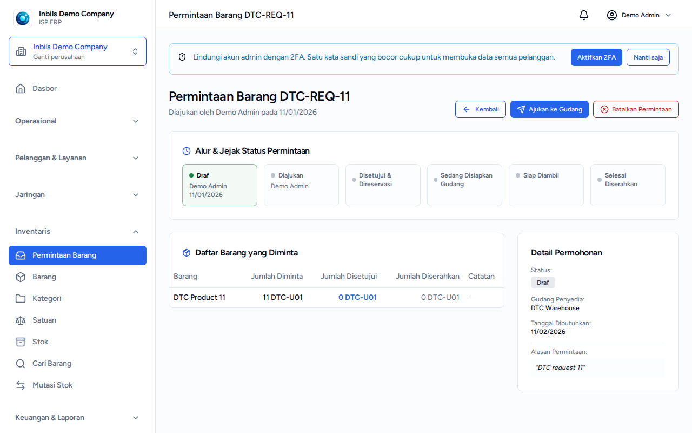

Setiap perubahan status juga tercatat di Log Audit (bagian 7.12) dengan modul `inventory_request`.

### Membuat permintaan barang

Izin: `inventory.request.create`. Sistem memberi nomor permintaan otomatis.

1. Klik **Buat Permintaan Barang** di kanan atas halaman daftar.

   

2. Di kartu **Informasi Pengajuan**, isi:
   - **Gudang Tujuan**: ketik untuk mencari, lalu pilih lokasi yang menyimpan barang, ditulis kode dan nama (contoh: `AREA-01 - Default Area`). Daftar memuat semua lokasi aktif perusahaan, dan lokasi pertama sudah terpilih. Stok direservasi dan dikurangi dari lokasi ini, jadi jangan dikosongkan.
   - **Tanggal Dibutuhkan**: opsional. Ketik tanggal dalam format tanggal perusahaan, atau klik **Buka kalender** lalu pilih tanggal.
   - **Rujukan (opsional)**: pilih **SPK** atau **Tiket** untuk mengaitkan permintaan dengan pekerjaan. Biarkan **Tanpa rujukan** bila tidak ada. Mengganti pilihan ini mengosongkan pilihan pekerjaan di bawahnya.
   - **SPK** atau **Tiket**: muncul setelah Anda memilih rujukan, dan wajib diisi. Ketik minimal 2 huruf kode atau judul pekerjaan, lalu pilih. Hasil ditulis kode dan judul dengan nama pelanggan di bawahnya, paling banyak 20 hasil. Anda hanya ditawari pekerjaan yang boleh Anda buka: tanpa izin lihat SPK atau lihat tiket daftarnya kosong, dan teknisi atau penangani tanpa izin menugaskan hanya melihat pekerjaan yang ditugaskan kepadanya.
   - **Alasan Kebutuhan Barang**: wajib, maksimal 2000 karakter. Contoh: Kebutuhan penarikan kabel dropcore pelanggan baru di Perum Grihi Asri.
3. Di kartu **Daftar Barang yang Diminta**, isi baris pertama:
   - **Barang 1**: ketik minimal 2 huruf nama atau SKU, lalu pilih barang. Pilihan ditulis SKU, nama, dan satuan dalam kurung, dengan nama kategori di bawahnya. Daftar memuat barang aktif selain aset serial.
   - **Jumlah**: wajib, harus lebih besar dari 0, nilai awalnya `1`.
   - **Catatan**: opsional, maksimal 255 karakter.
4. Klik **Tambah Barang** untuk menambah baris (**Barang 2**, dan seterusnya). Satu barang hanya boleh muncul satu kali. Klik ikon tempat sampah (**Hapus barang 1**, **Hapus barang 2**, dan seterusnya) untuk menghapus baris; baris terakhir tidak dapat dihapus.
5. Klik **Simpan sebagai Draf** untuk menyimpan tanpa mengajukan, atau **Ajukan ke Antrean Gudang** untuk menyimpan sekaligus mengajukan.

Halaman detail permintaan baru terbuka dengan pesan `Permintaan barang berhasil dibuat.` Statusnya **Draf** atau **Menunggu persetujuan**. Pada pilihan kedua, pengguna berizin `inventory.request.approve` menerima email pemberitahuan **Permintaan Barang Baru**.

### Mengajukan draf ke gudang

Hanya pembuat permintaan, dengan izin `inventory.request.create`, yang dapat mengajukan draf.

1. Buka halaman detail permintaan berstatus **Draf**.
2. Klik **Ajukan ke Gudang**.
3. Klik **Ya, Ajukan** pada dialog **Ajukan Permintaan ke Antrean Gudang?**, atau **Batal** bila Anda tidak jadi.

Muncul pesan `Permintaan barang berhasil diajukan ke antrean gudang.` dan status menjadi **Menunggu persetujuan**.

### Menyetujui permintaan

Izin: `inventory.request.approve`. Permintaan harus berstatus **Menunggu persetujuan**, dan Anda bukan pemohonnya. Pengajuan yang menunggu Anda juga muncul di menu Persetujuan (bagian 3.2), tetapi di sana jumlah yang disetujui selalu sama dengan jumlah diminta.

1. Buka halaman detail permintaan.
2. Klik **Setujui & Reservasi Stok**.
3. Di dialog **Setujui Permintaan & Reservasi Stok**, isi:
   - **Jumlah yang disetujui**: satu isian per barang, awalnya sama dengan **Jumlah Diminta**. Ubah bila gudang hanya dapat memenuhi sebagian. Jumlah harus lebih besar dari 0 dan tidak boleh melebihi jumlah diminta.
   - **Catatan Persetujuan (opsional)**: maksimal 1000 karakter. Catatan tampil di kartu **Detail Permohonan**.
4. Klik **Setujui & Reservasi**, atau **Batal**.

Sistem memeriksa stok tersedia (**Jumlah** dikurangi **Dicadangkan**) di Gudang Tujuan untuk setiap barang. Bila semuanya cukup, stok direservasi, status menjadi **Disetujui**, kolom **Jumlah Disetujui** terisi, pemohon menerima email **Permintaan Barang Disetujui**, dan muncul pesan `Permintaan barang disetujui dan stok berhasil direservasi.` Bila satu barang kurang, tidak ada stok yang direservasi, dialog tetap terbuka dan menampilkan pesan kesalahan di kotak merah (lihat Kesalahan umum).

Dialog persetujuan belum punya pilihan gudang. Permintaan yang disimpan tanpa **Gudang Tujuan** karena itu tidak dapat disetujui dari web (lihat Kesalahan umum).

### Menolak permintaan

Izin: `inventory.request.reject`. Syaratnya sama dengan persetujuan.

1. Buka halaman detail permintaan.
2. Klik **Tolak Permintaan**.
3. Isi **Alasan Penolakan** di dialog **Tolak Permintaan Barang**. Wajib, 3 sampai 1000 karakter. Tombol **Tolak Permintaan** di dialog baru aktif setelah alasan berisi minimal 3 karakter.
4. Klik **Tolak Permintaan** pada dialog, atau **Batal**.

Status menjadi **Ditolak**, banner **Permintaan Barang Ditolak** memuat alasannya, pemohon menerima email **Permintaan Barang Ditolak** berisi alasan itu, dan muncul pesan `Permintaan barang telah ditolak.` Stok tidak berubah, dan penolakan tidak dapat dibatalkan.

### Menyiapkan dan menyerahkan barang

Izin: `inventory.request.prepare` untuk langkah 1 dan 2, `inventory.request.issue` untuk langkah 3. Langkah gudang ini dilakukan berurutan pada halaman detail permintaan.

1. Pada status **Disetujui**, klik **Mulai Penyiapan Barang**, lalu klik **Ya, Mulai Penyiapan** pada dialog **Mulai Penyiapan Barang di Gudang?**. Muncul pesan `Status permintaan diubah menjadi sedang disiapkan gudang.` dan status menjadi **Disiapkan**.
2. Setelah barang terkumpul, klik **Tandai Siap Diambil**, lalu klik **Tandai Siap Diambil** di dialog **Tandai Barang Siap Diambil?**. Muncul pesan `Status permintaan diubah menjadi siap diambil.`, status menjadi **Siap diambil**, dan pemohon menerima email serta notifikasi di sistem.
3. Saat pemohon menerima barang fisik, klik **Serah Terima & Kurangi Stok**, lalu klik **Konfirmasi Serah Terima** di dialog **Konfirmasi serah terima barang?**. Status menjadi **Diserahkan** dan muncul pesan `Barang berhasil diserahterimakan dan stok berkurang.`

Serah terima bersifat permanen. Reservasi dilepas, stok fisik berkurang sebesar jumlah disetujui, kolom **Jumlah Diserahkan** terisi, dan sistem membuka berkas pengembalian untuk pemohon (bagian 6.8). Stok dikurangi sekali, saat serah terima: persetujuan SPK terkait tidak mengurangi lagi jumlah yang sudah diserahkan lewat permintaan ini.

### Membatalkan permintaan

Permintaan hanya dapat dibatalkan saat **Draf** atau **Menunggu persetujuan**. Izin `inventory.request.cancel.own` membatasi pembatalan ke permintaan buatan sendiri, sedangkan tanpa izin itu pemegang `inventory.request.approve` dapat membatalkan permintaan siapa pun. Pada peran bawaan, admin hanya dapat membatalkan permintaannya sendiri, dan manajer dapat membatalkan permintaan siapa pun.

1. Buka halaman detail permintaan.
2. Klik **Batalkan Permintaan**.
3. Isi **Alasan Pembatalan (opsional)** di dialog **Batalkan Permintaan Barang?** bila perlu, maksimal 1000 karakter.
4. Klik **Batalkan Permintaan** pada dialog, atau klik **Tutup** bila Anda tidak jadi membatalkan.

Muncul pesan `Permintaan barang berhasil dibatalkan.` Status menjadi **Dibatalkan**, banner **Permintaan Dibatalkan** memuat alasannya (atau `Dibatalkan oleh pemohon.` bila alasan kosong), dan stok tidak berubah karena belum ada reservasi.

### Kesalahan umum

- Tombol **Setujui & Reservasi Stok**, **Tolak Permintaan**, **Mulai Penyiapan Barang**, atau **Serah Terima & Kurangi Stok** tidak muncul. Cek status permintaan, izin peran Anda, dan apakah Anda pemohon atau penyetuju permintaan itu. Bila ya, minta pengguna lain yang berhak melanjutkan.
- Dialog persetujuan menampilkan `Permintaan barang tidak dapat disetujui karena status telah berubah atau Anda tidak berwenang.` (atau `... tidak dapat ditolak ...` pada dialog penolakan): pengguna lain sudah memutuskan lebih dulu, atau izin Anda berubah. Tutup dialog dan muat ulang halaman.
- Dialog persetujuan menampilkan `Stok tidak mencukupi untuk produk ID <id> di lokasi ID <id>. Tersedia: <jumlah>, Diminta: <jumlah>.` Pesan ini memakai nomor ID barang dan lokasi, bukan namanya. Kurangi jumlah di dialog atau tambah stok lebih dulu (bagian 6.5), lalu setujui lagi. Bila tidak dapat dipenuhi, tolak permintaan dengan alasan.
- Dialog persetujuan menolak jumlah 0 dengan pesan `jumlah disetujui harus lebih besar dari 0.`, dan menolak jumlah di atas permintaan dengan pesan `Jumlah barang yang disetujui (<jumlah>) tidak boleh melampaui jumlah yang diminta (<jumlah>).` Setiap barang harus disetujui lebih dari 0, jadi barang tidak dapat dicoret sebagian. Bila sebagian tidak dapat dipenuhi, tolak permintaan dan minta pemohon membuat ulang.
- Pesan `Lokasi gudang sumber wajib ditentukan untuk reservasi.` muncul di dialog persetujuan bila **Gudang Tujuan** dikosongkan saat membuat permintaan. Dialog persetujuan tidak punya pilihan lokasi, jadi tolak permintaan itu dan buat ulang dengan lokasi terpilih.
- Draf tidak dapat diubah setelah disimpan. Batalkan draf yang salah dan buat permintaan baru.
- Permintaan yang sudah disetujui tidak dapat dibatalkan dari layar ini, karena tombol **Batalkan Permintaan** hanya ada pada status **Draf** dan **Menunggu persetujuan**.
- Kotak merah **Terdapat kesalahan pengisian formulir:** muncul di atas form pembuatan dan mendaftar tiap isian yang salah. Penyebab umum: `alasan wajib diisi.`, `jumlah diminta harus lebih besar dari 0.`, `barang memiliki nilai ganda.` (barang yang sama dipilih dua kali), dan `Tanggal dibutuhkan harus berupa tanggal yang valid.` Perbaiki isian itu, lalu simpan lagi.
- Pesan `rujukan wajib diisi jika jenis rujukan terisi.` muncul di bawah isian **SPK** atau **Tiket** bila Anda memilih jenis rujukan tetapi belum memilih pekerjaannya. Pilih pekerjaan, atau ubah **Rujukan (opsional)** ke **Tanpa rujukan**.
- Pesan `SPK yang dipilih tidak valid untuk perusahaan ini.` atau `Tiket yang dipilih tidak valid untuk perusahaan ini.` berarti server menolak pekerjaan yang dipilih: pekerjaan itu bukan milik perusahaan aktif, atau akun Anda tidak boleh membukanya (tanpa izin lihat SPK atau lihat tiket, atau pekerjaan itu ditugaskan kepada orang lain dan Anda teknisi atau penangani tanpa izin menugaskan). Pilih ulang dari daftar.
- Isian **SPK** atau **Tiket** tidak menampilkan pekerjaan yang Anda cari: akun Anda tidak memegang izin lihat SPK atau lihat tiket, atau pekerjaan itu tidak ditugaskan kepada Anda (teknisi dan penangani tanpa izin menugaskan hanya melihat pekerjaan miliknya). Ketik minimal 2 huruf kode atau judul.

## 6.2 Barang

Barang adalah katalog yang dipakai oleh stok, permintaan barang dan SPK. Setiap barang punya SKU, kategori, satuan, harga dan batas stok minimum, dan datanya berlaku per perusahaan aktif. Buka menu ini saat Anda menambah barang baru, mengubah harganya, atau berhenti memakainya.

Peran yang dapat memakai: admin, manajer, staf. Izin: `inventory.view` membuka daftar dan rincian, `inventory.create` membuat barang, `inventory.update` mengubah barang, `inventory.delete` menghapus barang, `inventory.export` mengekspor daftar. Dengan peran bawaan, admin memegang semuanya, manajer memegang semuanya kecuali `inventory.delete`, dan staf hanya memegang `inventory.view`, `inventory.create` dan `inventory.update`.

### Membuka dan membaca daftar

1. Di sidebar, buka grup **Inventaris**, lalu klik **Barang**.
2. Baca daftar.

   - Isian **Cari barang** mencari SKU dan nama barang.
   - Filter **Kategori**: ketik untuk mencari, lalu pilih kategori aktif (ditulis kode dan nama). Bila kosong, tampil **Semua kategori**. Filter **Status** berisi **Semua status**, **Aktif** dan **Nonaktif**. Klik **Filter** (atau tekan Enter di kotak cari) untuk menerapkan pilihan. Klik **Hapus pilihan: Kategori** untuk mengosongkan kategori.
   - Kolom: **SKU**, **Nama**, **Kategori**, **Satuan** (nama dan simbol), **Harga Jual**, **Status** (lencana **Aktif** atau **Nonaktif**) dan **Aksi**. **SKU** dan **Nama** bisa diurutkan, dan barang terbaru tampil paling atas.
   - Harga pokok dan stok minimum tidak ada di daftar. Keduanya terlihat di rincian dan di form ubah.
   - Tombol **Ekspor** (pemegang `inventory.export`) menawarkan **Ekspor CSV** dan **Ekspor PDF** dari pencarian dan filter yang berlaku. Kolomnya SKU, Nama, Kategori, Satuan (simbol), Harga Jual, Harga Pokok, Stok Minimum dan Aktif (`Ya` atau `Tidak`). Satu file memuat paling banyak 5000 baris, batas yang sama untuk semua ekspor di bab ini.
   - Tombol **Buat Barang** tampil bagi pemegang `inventory.create`.
   - Baris punya tautan nama barang, tombol **Ubah**, dan menu **Aksi lainnya** berisi **Lihat detail** dan **Hapus**.
   - Bila tidak ada baris yang cocok, daftar menulis **Tidak ada barang yang cocok** dengan tombol **Reset filter**. Bila belum ada barang sama sekali, daftar menulis **Tidak ada data.** dengan keterangan **Barang yang dibuat muncul di sini, lengkap dengan kategori dan satuannya.** dan tombol **Buat Barang**.

   

3. Klik nama barang, atau pilih **Lihat detail** di menu **Aksi lainnya**, untuk membuka rincian barang. Halaman ini punya tombol **Kembali** dan **Ubah**, dan lencana **Aktif** atau **Nonaktif**.

   - Kartu **Rincian Barang** memuat **Kategori**, **Satuan**, **Harga Jual**, **Harga Pokok**, **Stok Minimum**, **Lacak Stok** dan **Deskripsi**.
   - Kartu **Stok per Lokasi** memuat kolom **Lokasi**, **Jalur**, **Jumlah**, **Dicadangkan** dan **Tersedia**. Barang yang belum pernah terkena operasi stok di suatu lokasi menampilkan **Belum ada stok barang ini di lokasi mana pun. Catat penerimaannya di halaman Stok.**
   - Kartu **Mutasi Terbaru** memuat 20 mutasi stok terakhir barang itu, yang terbaru di atas, dengan kolom **Jenis** (lencana seperti **Masuk**, **Keluar**, **Penyesuaian**), **Jumlah**, **Saldo**, **Catatan** dan **Waktu**. Barang tanpa mutasi menampilkan **Belum ada mutasi stok untuk barang ini.** Tautan **Lihat semua mutasi** di bawahnya membuka Mutasi Stok yang disaring ke barang itu (bagian 6.7).

   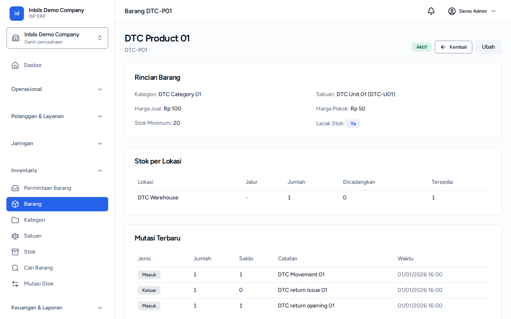

Tombol **Ubah** dan **Hapus** tampil untuk semua orang yang bisa melihat daftar, dan server menolak aksi dari pengguna tanpa izin yang sesuai dengan halaman **Akses ditolak** (galat 403). Cara kerja tombol dan dialog hapus ada di bagian 1.5.

### Membuat barang

Siapkan dulu satuan (bagian 6.4) dan kategori (bagian 6.3). Satuan barang tidak dipilih sendiri karena mengikuti kategori.

1. Klik **Buat Barang**.
2. Isi form pada kartu **Data Barang**:
   - Isian **SKU** opsional. Kosongkan agar sistem membuat kode berurutan, bawaannya berawalan `PRD-` diikuti angka lima digit, dan perkiraan kode berikutnya tampil di isian sebagai contoh. Isi sendiri bila Anda punya kode sendiri: maksimal 100 karakter dan belum dipakai barang lain di perusahaan ini. Contoh: `PTC-SC-3M`.
   - Isi **Nama**. Isian ini wajib, maksimal 255 karakter. Contoh: `Patch Cord SC/APC 3m`.
   - Pilih **Kategori**: ketik untuk mencari, lalu pilih kategori aktif. Isian ini wajib. Setiap pilihan menampilkan satuannya.
   - **Satuan** tidak bisa diisi. Isian ini menampilkan satuan kategori yang Anda pilih, misalnya `meter (m)`, atau `Pilih kategori dulu` sebelum ada pilihan.
   - **Harga Jual** dan **Harga Pokok** opsional. Keduanya menerima angka 0 atau lebih dengan dua desimal.
   - **Stok Minimum** opsional dan menerima angka 0 atau lebih. Isian kosong disimpan sebagai `0`. Nilai ini menjadi batas filter stok rendah di Stok (bagian 6.5).
   - Saklar **Lacak stok** menyala secara awal. Nilainya hanya disimpan dan ditampilkan di rincian (**Lacak Stok**), dan tidak ada aturan stok yang membacanya.
   - Saklar **Aktif** menyala secara awal.
   - Isian **Deskripsi** opsional dan menerima teks bebas.
3. Klik **Simpan**, atau **Batal** untuk kembali ke daftar. Setelah **Simpan**, Anda kembali ke daftar dan muncul toast `Barang berhasil dibuat.`

Bila admin mematikan **Izinkan input kode manual** untuk **Barang (SKU)** di Penomoran (bagian 7.13), isian **SKU** terkunci dan hanya menampilkan perkiraan kode dengan keterangan **Dibuat otomatis saat disimpan, perkiraan:** diikuti kodenya.

Form tidak punya isian jenis barang. Barang yang Anda buat di sini selalu bertipe habis pakai (`consumable`). Server mengenal juga tipe aset serial (dipasang per unit lewat SPK dengan memilih aset jaringan, bagian 3.3 dan 5.2) dan layanan, tetapi layar tidak menawarkannya dan tidak menampilkan jenis barang.

### Mengubah barang

1. Di daftar, klik **Ubah**, atau buka rincian barang lalu klik **Ubah**.
2. Ubah isian di halaman **Ubah Barang**. Aturannya sama dengan form buat, kecuali **SKU**: isian ini wajib terisi dan boleh diganti selama kode manual diizinkan. Bila terkunci, isian menampilkan `Dibuat otomatis dan tidak dapat diubah.`
3. Klik **Simpan**, atau **Batal** untuk membuang perubahan. Setelah **Simpan**, Anda kembali ke daftar dan muncul toast `Barang berhasil diubah.`

Mengganti **Kategori** ikut mengganti **Satuan** barang mengikuti satuan kategori baru. Jumlah stok tidak dikonversi.

### Menonaktifkan dan menghapus barang

1. Untuk berhenti memakai barang, buka **Ubah**, matikan saklar **Aktif**, lalu klik **Simpan**. Barang tetap ada di daftar dengan lencana **Nonaktif**, dan tidak lagi muncul di pilihan **Barang** pada halaman Stok dan Mutasi Stok.
2. Untuk menghapus, buka menu **Aksi lainnya** di baris barang, pilih **Hapus**, lalu klik **Hapus** di dialog **Hapus &lt;nama barang&gt;?** (atau **Batal**). Muncul toast `Barang berhasil dihapus.`

Sistem menolak penghapusan bila stok barang di salah satu lokasi masih lebih dari 0. Dialog tetap terbuka dan muncul toast `Data gagal disimpan. Periksa input.` Alasan rincinya (`Barang tidak dapat dihapus karena masih memiliki stok.`) tidak tampil di layar. Kosongkan stok lewat penyesuaian (bagian 6.5), atau cukup nonaktifkan barang.

Barang yang sudah dihapus hilang dari daftar dan tidak bisa dipulihkan dari layar ini. SKU-nya tetap terpakai, jadi barang baru tidak bisa memakai SKU yang sama.

### Kesalahan umum

- SKU ditolak dengan pesan `SKU sudah digunakan.`: SKU harus unik per perusahaan, termasuk SKU barang yang sudah dihapus. Pakai SKU lain, atau kosongkan isian agar sistem membuat kode.
- Kategori yang dicari tidak ada di pilihan: hanya kategori **Aktif** yang tampil. Aktifkan kategorinya di menu Kategori (bagian 6.3).
- Isian **Satuan** tidak bisa diketik: satuan mengikuti kategori. Pilih kategori lain, atau ubah satuan kategorinya (bagian 6.3).
- Barang tidak ada di pilihan **Barang** pada Stok: saklar **Aktif** barang mati.
- **Hapus** ditolak padahal barang tampak tidak dipakai: salah satu lokasi masih punya stok lebih dari 0. Cek kartu **Stok per Lokasi** di rincian.
- Staf atau manajer memilih **Hapus** dan muncul halaman **Akses ditolak** (galat 403): pada peran bawaan, izin `inventory.delete` hanya dipegang admin. Minta operator platform menambahkannya ke peran (bagian 8.6), atau minta admin memberi Anda peran yang memegangnya (bagian 8.7).
- Tombol **Ekspor** tidak ada: staf tidak memegang `inventory.export`.

## 6.3 Kategori

Kategori mengelompokkan barang dan menentukan satuannya. Setiap kategori punya satu satuan, dan semua barang di dalamnya memakai satuan itu. Buka menu ini sebelum membuat barang yang kategorinya belum ada.

Peran yang dapat memakai: sama dengan bagian 6.2. Izin: `inventory.view` membuka daftar, `inventory.create` membuat kategori, `inventory.update` mengubahnya, `inventory.delete` menghapusnya, `inventory.export` mengekspor daftar.

### Membuka dan membaca daftar

1. Di sidebar, buka grup **Inventaris**, lalu klik **Kategori**.
2. Baca daftar.

   - Isian **Cari kategori** mencari nama dan kode kategori. Klik **Filter** (atau tekan Enter) untuk menerapkan.
   - Kolom: **Kode**, **Nama**, **Satuan** (nama dan simbol satuan), **Sub-kategori** (jumlah kategori anak), **Status** (**Aktif** atau **Nonaktif**) dan **Aksi**. **Kode** dan **Nama** bisa diurutkan, urutan awalnya menurut nama.
   - Baris hanya punya tombol **Ubah** dan menu **Aksi lainnya** yang berisi **Hapus**. Tidak ada halaman detail, dan **Ubah** membuka dialog.
   - Tombol **Ekspor** (pemegang `inventory.export`) menawarkan **Ekspor CSV** dan **Ekspor PDF** dengan kolom Kode, Nama, Satuan (nama satuan) dan Sub-kategori. Tombol **Buat Kategori** tampil bagi pemegang `inventory.create`.
   - Bila belum ada kategori, daftar menulis **Tidak ada data.** dengan keterangan **Buat kategori lebih dulu, lalu pilih kategori itu saat membuat barang.** dan tombol **Buat Kategori**.

   

### Membuat kategori

1. Klik **Buat Kategori**. Dialog **Buat Kategori** terbuka.
2. Isi form:
   - Isi **Nama**. Isian ini wajib, maksimal 255 karakter. Contoh: `Connector`.
   - Isi **Kode**. Isian ini wajib, maksimal 100 karakter, dan belum dipakai kategori lain di perusahaan ini. Contoh: `CON`.
   - Pilih **Satuan**: ketik untuk mencari, lalu pilih satuan, misalnya `pcs (pcs)`. Isian ini wajib. Satuan dibuat di menu Satuan (bagian 6.4).
   - Pilih **Induk** bila kategori ini anak dari kategori lain: ketik untuk mencari, lalu pilih kategori (ditulis kode dan nama). Daftar memuat semua kategori. Biarkan kosong (**Tanpa induk (kategori utama)**) untuk kategori utama. Klik **Hapus pilihan: Induk** untuk mengosongkan pilihan.
   - Saklar **Aktif** menyala secara awal.
   - Isian **Deskripsi** opsional dan menerima teks bebas.
3. Klik **Buat**, atau **Batal**. Dialog menutup dan muncul toast `Kategori berhasil dibuat.`

### Mengubah dan menghapus kategori

1. Klik **Ubah**, ubah isian di dialog **Ubah Kategori**, lalu klik **Simpan**. Muncul toast `Kategori berhasil diubah.` Pilihan **Induk** tidak menawarkan kategori yang sedang diubah.
2. Untuk menghapus, buka menu **Aksi lainnya**, pilih **Hapus**, lalu klik **Hapus** di dialog **Hapus &lt;nama kategori&gt;?**. Muncul toast `Kategori berhasil dihapus.`

Mengganti **Satuan** kategori ikut mengganti satuan semua barang di kategori itu. Jumlah stok barang tidak dikonversi.

Sistem menolak penghapusan bila kategori masih punya kategori anak atau barang. Dialog tetap terbuka dan muncul toast `Data gagal disimpan. Periksa input.` Alasan rincinya (`Kategori tidak dapat dihapus karena masih memiliki sub-kategori atau barang.`) tidak tampil di layar, seperti pada Barang.

### Kesalahan umum

- Kode ditolak dengan pesan `kode sudah digunakan.`: kode harus unik per perusahaan, termasuk kode kategori yang sudah dihapus. Pakai kode lain.
- **Hapus** ditolak: pindahkan barangnya ke kategori lain lewat **Ubah** di menu Barang (bagian 6.2), dan kosongkan **Induk** pada kategori anak. Atau cukup matikan **Aktif**.
- Satuan barang berubah tanpa disengaja: Anda mengganti **Satuan** kategori. Pilih lagi satuan semula lewat **Ubah**.
- Staf atau manajer memilih **Hapus** dan muncul halaman **Akses ditolak** (galat 403): izin `inventory.delete` hanya dipegang admin pada peran bawaan (bagian 6.2).

## 6.4 Satuan

Satuan adalah ukuran barang, misalnya pcs, meter atau box. Satuan dipilih pada kategori, dan barang mengikuti satuan kategorinya. Buka menu ini saat Anda butuh ukuran baru yang belum ada.

Peran yang dapat memakai dan izin: sama dengan bagian 6.3.

### Membuka dan membaca daftar

1. Di sidebar, buka grup **Inventaris**, lalu klik **Satuan**.
2. Baca daftar. Kolomnya **Nama**, **Simbol** (keduanya bisa diurutkan) dan **Aksi** (tombol **Ubah** dan menu **Aksi lainnya** berisi **Hapus**). Menu ini tidak punya kotak cari dan tidak punya halaman detail. Tombol **Ekspor** (pemegang `inventory.export`) menawarkan **Ekspor CSV** dan **Ekspor PDF** dengan kolom Nama dan Simbol, dan tombol **Buat Satuan** tampil bagi pemegang `inventory.create`. Bila belum ada satuan, daftar menulis **Tidak ada data.** dengan keterangan **Buat satuan lebih dulu, lalu pakai satuan itu pada kategori barang.** dan tombol **Buat Satuan**.

   

### Membuat satuan

1. Klik **Buat Satuan**. Dialog **Buat Satuan** terbuka.
2. Isi form:
   - Isi **Nama**. Isian ini wajib, maksimal 100 karakter, dan belum dipakai satuan lain di perusahaan ini. Contoh: `box`.
   - Isi **Simbol**. Isian ini wajib, maksimal 20 karakter, dan belum dipakai satuan lain di perusahaan ini. Contoh: `box`.
3. Klik **Buat**, atau **Batal**. Dialog menutup dan muncul toast `Satuan berhasil dibuat.`

### Mengubah dan menghapus satuan

1. Klik **Ubah**, ubah isian di dialog **Ubah Satuan**, lalu klik **Simpan**. Muncul toast `Satuan berhasil diubah.`
2. Untuk menghapus, buka menu **Aksi lainnya**, pilih **Hapus**, lalu klik **Hapus** di dialog **Hapus &lt;nama satuan&gt;?**. Muncul toast `Satuan berhasil dihapus.`

Sistem menolak penghapusan bila satuan masih dipakai barang atau kategori. Dialog tetap terbuka dan muncul toast `Data gagal disimpan. Periksa input.` Alasan rincinya (`Satuan tidak dapat dihapus karena masih dipakai barang atau kategori.`) tidak tampil di layar. Satuan barang mengikuti kategori, jadi ganti dulu **Satuan** pada kategori yang bersangkutan (bagian 6.3), lalu hapus satuan lama.

### Kesalahan umum

- Penyimpanan ditolak dengan pesan `nama sudah digunakan.` atau `simbol sudah digunakan.`: **Nama** dan **Simbol** harus unik per perusahaan, termasuk milik satuan yang sudah dihapus.
- **Hapus** ditolak padahal tidak ada barang yang memakai satuan itu: satuan masih dipakai sebuah kategori. Periksa kolom **Satuan** di daftar Kategori (bagian 6.3) dan pilih satuan lain pada kategori itu.
- Staf atau manajer memilih **Hapus** dan muncul halaman **Akses ditolak** (galat 403): lihat bagian 6.2.

## 6.5 Stok

Stok menunjukkan jumlah setiap barang di setiap lokasi. Dari sini Anda mencatat barang masuk, mengajukan koreksi hasil hitung fisik, dan menyetujui koreksi itu. Buka menu ini untuk mengecek ketersediaan atau mencatat penerimaan.

Peran yang dapat memakai: admin, manajer, staf. Izin: `inventory.view` membuka daftar, `inventory.export` menampilkan **Ekspor**, `inventory.stock.receive` menampilkan **Terima Barang**, `inventory.stock.adjust.request` menampilkan **Ajukan Penyesuaian**, `inventory.stock.adjust.approve` menampilkan **Setujui** dan **Tolak**. Dengan peran bawaan, admin memegang semuanya, staf memegang `inventory.view`, `inventory.stock.receive` dan `inventory.stock.adjust.request`, dan manajer memegang `inventory.view`, `inventory.export` dan `inventory.stock.adjust.approve`.

Peran non-admin tidak bisa memegang izin menyetujui bersama izin mengajukan, menerima, mengeluarkan atau memindahkan stok (pemisahan tugas). Bila Anda menyimpan peran dengan pasangan itu (bagian 8.6), sistem menolak dengan pesan seperti `Pemisahan tugas (persetujuan penyesuaian stok vs operasi stok): inventory.stock.adjust.approve tidak boleh digabung dengan inventory.stock.adjust.request.` Pemohon juga tidak bisa memutuskan permintaannya sendiri, termasuk admin.

### Membuka dan membaca daftar

1. Di sidebar, buka grup **Inventaris**, lalu klik **Stok**.
2. Baca daftar.

   - Satu baris adalah satu barang di satu lokasi. Sistem membuat baris saat operasi stok pertama, misalnya penerimaan, pemindahan masuk atau penyesuaian.
   - Kolom: **Barang** (nama dan SKU), **Lokasi** (kode dan nama lokasi), **Jumlah** (jumlah fisik di lokasi, termasuk yang sudah dicadangkan), **Dicadangkan** (jumlah yang dicadangkan, misalnya oleh permintaan barang yang sudah disetujui) dan **Tersedia** (**Jumlah** dikurangi **Dicadangkan**). **Jumlah** dan **Dicadangkan** bisa diurutkan, dan baris terbaru tampil paling atas.
   - Isian **Cari stok** mencari nama dan SKU barang serta nama dan kode lokasi. Filter **Lokasi** (bila kosong tampil **Semua lokasi**) dan **Barang** (bila kosong tampil **Semua barang**) adalah isian cari: ketik minimal 2 huruf, lalu pilih. Pilihan ditampilkan paling banyak 20, hanya lokasi dan barang aktif, dan pilihan Anda tetap terlihat sampai Anda memilih yang lain atau mengklik **Hapus pilihan: Lokasi** atau **Hapus pilihan: Barang**. Tidak ada tombol **Filter**: daftar dimuat ulang sendiri saat Anda mengetik atau memilih.
   - Tombol **Ekspor** (pemegang `inventory.export`) menawarkan **Ekspor CSV** dan **Ekspor PDF** dari pencarian dan filter yang berlaku. Kolomnya Barang, Lokasi (kode lokasi), Jumlah, Dicadangkan dan Tersedia.
   - Bila tidak ada baris yang cocok, daftar menulis **Tidak ada stok yang cocok** dengan tombol **Reset filter**. Bila belum ada stok sama sekali, daftar menulis **Belum ada stok** dan **Stok muncul setelah barang diterima di sebuah lokasi.**, dengan tombol **Terima Barang** bagi pemegang `inventory.stock.receive`.

   

3. Untuk melihat stok rendah, klik kartu **Stok di bawah minimum** di Dasbor (bab 2).

   - Halaman Stok terbuka dengan filter stok rendah: hanya baris yang nilai **Jumlah**-nya sama dengan atau di bawah **Stok Minimum** barang (bagian 6.2).
   - Perbandingan dilakukan per baris (satu lokasi), bukan terhadap total semua lokasi, dan barang nonaktif ikut dihitung.
   - Filter ini tidak punya kotak atau tanda di layar, dan tetap berlaku saat Anda mencari atau mengganti filter lain. Tombol **Reset filter** juga menghapusnya, tetapi tombol itu hanya muncul bila tidak ada baris yang cocok. Buka **Stok** lagi dari sidebar untuk melihat semua baris.

### Menerima barang

Gunakan saat barang masuk ke sebuah lokasi, misalnya dari pembelian.

1. Klik **Terima Barang**. Dialog **Terima Barang** terbuka.

   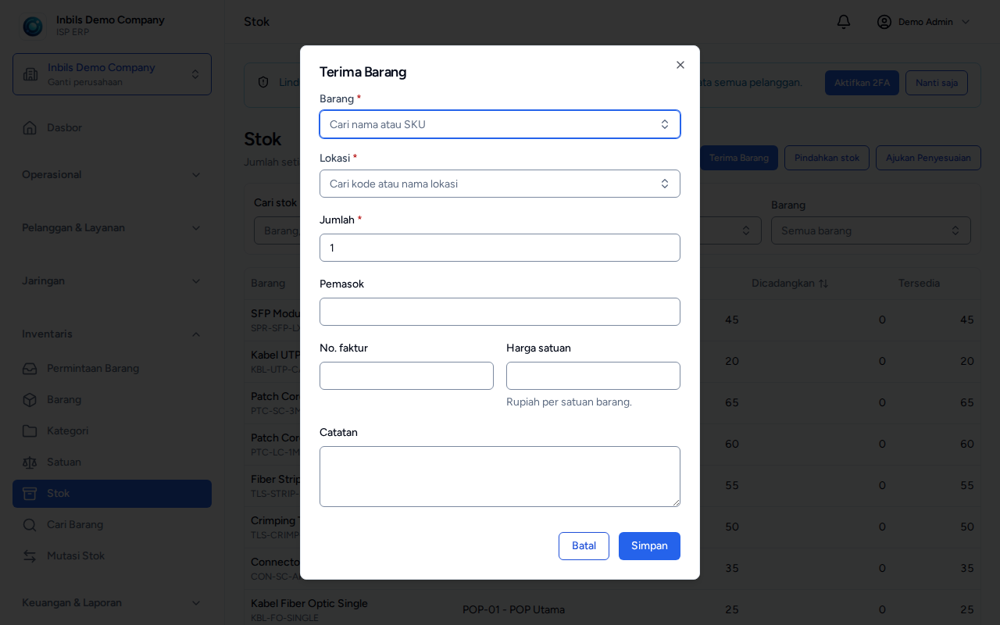

2. Isi form:
   - Pilih **Barang**: ketik minimal 2 huruf nama atau SKU, lalu pilih. Isian ini wajib dan hanya menawarkan barang aktif. Pilihan ditulis SKU, nama, dan satuan dalam kurung, dengan nama kategori di bawahnya.
   - Pilih **Lokasi**: ketik minimal 2 huruf kode atau nama lokasi, lalu pilih. Isian ini wajib dan hanya menawarkan lokasi aktif. Pilihan ditulis kode dan nama, dengan jalur lokasi di bawahnya. Lokasi dibuat di menu Lokasi (bagian 5.1).
   - Isi **Jumlah**. Isian ini wajib, harus lebih dari 0, dan nilai awalnya `1`.
   - **Catatan** opsional dan menerima maksimal 500 karakter. Tulis nomor dokumen penerimaan di sini agar mudah dicari di Mutasi Stok.
3. Klik **Simpan**, atau **Batal**. Dialog menutup dan muncul toast `Barang berhasil diterima.`

**Jumlah** barang di lokasi itu bertambah sebesar jumlah yang diterima, dan baris stok dibuat bila belum ada. Satu mutasi berjenis **Masuk** tercatat (bagian 6.7). Penerimaan berlaku langsung, tanpa persetujuan.

### Mengajukan penyesuaian stok

Gunakan saat hasil hitung fisik berbeda dari angka di sistem. Stok baru berubah setelah pengguna lain menyetujui.

1. Klik **Ajukan Penyesuaian**. Dialog **Ajukan Penyesuaian Stok** terbuka.
2. Isi form:
   - Pilih **Barang** dan **Lokasi**, seperti pada penerimaan. Keduanya wajib.
   - Isi **Jumlah baru (hasil hitung fisik)** dengan angka 0 atau lebih. Isian ini wajib. Isi total hasil hitung, bukan selisihnya.
   - Isi **Alasan**. Isian ini wajib, maksimal 500 karakter. Alasan ini menjadi catatan mutasi saat permintaan disetujui.
3. Klik **Ajukan**, atau **Batal**. Dialog menutup dan muncul toast `Permintaan penyesuaian stok diajukan dan menunggu persetujuan.` Stok belum berubah, dan permintaan muncul di panel **Penyesuaian stok menunggu persetujuan** di atas daftar.

### Menyetujui atau menolak penyesuaian

Panel **Penyesuaian stok menunggu persetujuan** muncul bila ada permintaan yang menunggu, dengan keterangan bahwa perubahan stok baru berlaku setelah disetujui orang lain, bukan pemohon. Pemohon hanya melihat permintaannya sendiri, sedangkan pemegang `inventory.stock.adjust.approve` melihat semuanya (paling banyak 50, yang terlama di atas). Kolomnya **Barang**, **Lokasi**, **Stok** (jumlah saat diajukan, tanda panah, dan jumlah baru), **Selisih** (jumlah baru dikurangi jumlah saat diajukan, bertanda plus atau minus), **Alasan**, **Pemohon**, **Status** (lencana **Menunggu**) dan **Aksi**.

1. Pada baris permintaan, klik **Setujui** atau **Tolak**. Kedua tombol hanya muncul bagi pemegang `inventory.stock.adjust.approve` yang bukan pemohon. Bagi pengguna lain, kolom **Aksi** berisi tanda hubung.
2. Untuk menyetujui, periksa barang, lokasi, jumlah, dan alasan pemohon di dialog **Setujui Penyesuaian Stok**, lalu klik **Setujui**. Muncul toast `Penyesuaian stok disetujui.`
3. Untuk menolak, isi **Alasan penolakan** di dialog **Tolak Penyesuaian Stok** (wajib, 3 sampai 500 karakter), lalu klik **Tolak**. Muncul toast `Penyesuaian stok ditolak.`

Saat disetujui, stok langsung diatur ke **Jumlah baru** dan satu mutasi berjenis **Penyesuaian** tercatat dengan **Alasan** sebagai catatan. Selisih pada mutasi dihitung dari stok saat persetujuan, bukan saat pengajuan. Saat ditolak, stok tidak berubah.

Sistem tidak mengirim notifikasi untuk pengajuan, persetujuan maupun penolakan. Permintaan yang sudah diputuskan hilang dari panel, dan alasan penolakan tercatat di audit trail (bagian 7.12), bukan di halaman Stok. Beri tahu pemohon secara langsung.

### Pengeluaran, pemindahan dan penyesuaian langsung

Izin untuk tiga operasi ini ada, tetapi halaman Stok tidak menyediakan tombolnya:

- Pengeluaran (`inventory.stock.issue`, dipegang admin, staf, dan teknisi) memerlukan barang, lokasi, jumlah lebih dari 0 dan catatan opsional. Stok tidak boleh berkurang melebihi **Tersedia**. Pada web, stok keluar lewat Permintaan Barang saat barang diserahkan (bagian 6.1), dan lewat SPK saat SPK disetujui dan menjadi `completed` (bagian 3.3).
- Pemindahan antar lokasi (`inventory.stock.transfer`, dipegang admin dan staf) memerlukan barang, lokasi asal, lokasi tujuan, jumlah lebih dari 0 dan catatan opsional. Lokasi asal dan tujuan harus berbeda, dan stok **Tersedia** di asal harus cukup. Satu pemindahan mengurangi asal dan menambah tujuan, tetapi tidak ada layar untuk memulainya.
- Penyesuaian langsung atau break-glass (`inventory.stock.adjust`, hanya admin) memakai barang, lokasi, jumlah baru 0 atau lebih dan alasan wajib. Perubahan berlaku langsung dan audit memberi penanda `break_glass`, tetapi tidak ada tombolnya. Koreksi stok dari layar selalu lewat pengajuan dan persetujuan di atas.

### Kesalahan umum

- Dialog **Terima Barang** menolak dengan `Barang, lokasi, dan jumlah (lebih dari 0) wajib diisi.`: pilih barang dan lokasi, lalu isi jumlah lebih dari 0.
- Barang tidak ada di pilihan **Barang**: barang itu **Nonaktif**, atau Anda belum mengetik minimal 2 huruf (isian menulis **Ketik minimal 2 huruf untuk mencari.**). Aktifkan di menu Barang (bagian 6.2). Untuk melihat stok barang nonaktif, pakai kotak **Cari stok**. Lokasi yang tidak aktif juga tidak ditawarkan (bagian 5.1).
- Tombol **Terima Barang** atau **Ajukan Penyesuaian** tidak ada: peran Anda tidak memegang izinnya. Manajer sengaja tidak memegangnya karena pemisahan tugas. Minta admin mengatur peran (bagian 8.6 dan 8.7).
- Tombol **Setujui** dan **Tolak** tidak ada pada permintaan Anda sendiri: pemohon tidak boleh memutuskan permintaannya, termasuk admin. Minta pengguna lain yang memegang `inventory.stock.adjust.approve`.
- Dialog keputusan menampilkan `Permintaan penyesuaian stok tidak dapat disetujui karena status telah berubah atau Anda tidak berwenang.` (atau `... tidak dapat ditolak ...`): pengguna lain sudah memutuskan lebih dulu, atau izin Anda berubah. Tutup dialog dan muat ulang halaman.
- **Jumlah baru (hasil hitung fisik)** salah isi: angka ini adalah total hasil hitung fisik, bukan selisih, dan tidak boleh negatif. Pemohon tidak bisa mengubah atau membatalkan permintaan yang sudah diajukan. Minta penyetuju menolaknya, lalu ajukan ulang.
- Persetujuan gagal dengan toast `Data gagal disimpan. Periksa input.` dan dialog tetap terbuka: **Jumlah baru** lebih kecil dari jumlah **Dicadangkan** barang itu di lokasi tersebut, dan stok tidak boleh turun di bawah jumlah yang dicadangkan. Pesan rincinya (`Stok tidak mencukupi. Diminta: <jumlah dicadangkan>, Tersedia: <jumlah baru>.`) tidak tampil di layar. Tolak permintaan, tunggu reservasi selesai, lalu ajukan ulang.
- Pemindahan ditolak karena lokasi asal sama dengan tujuan (`Lokasi asal dan tujuan harus berbeda.`), atau jumlah melebihi **Tersedia** di asal (`Stok tidak mencukupi. Diminta: <jumlah>, Tersedia: <jumlah>.`). Pilih dua lokasi berbeda dan kurangi jumlah. Karena layar pemindahan belum ada, galat ini hanya mungkin pada panggilan langsung ke rute backend.

## 6.6 Cari Barang

Cari Barang menjawab pertanyaan barang ini ada di lokasi mana dan berapa jumlahnya. Ketik sebagian nama atau SKU, lalu baca jumlah di setiap lokasi. Buka menu ini saat Anda perlu tahu di lokasi mana sebuah barang habis pakai tersedia.

Peran yang dapat memakai: admin, manajer, staf. Izin: `inventory.view` (Lihat barang). Tidak ada izin tambahan, dan menu ini tidak mengubah data.

### Membuka dan membaca hasil

1. Di sidebar, buka grup **Inventaris**, lalu klik **Cari Barang**. Tabel awal berisi teks `Ketik nama atau SKU di kolom atas, lalu klik Cari.` karena belum ada pencarian.

   

2. Ketik sebagian nama atau SKU di kolom **Nama atau SKU** (contoh isian: `Contoh: kabel`), lalu klik **Cari** atau tekan Enter. Kolom kosong tidak menghasilkan apa pun.
3. Baca hasil. Setiap baris adalah satu barang di satu lokasi, dengan kolom **Barang**, **SKU**, **Lokasi**, **Jalur** (jalur lokasi), **Tersedia** (jumlah yang bisa dipakai), **Jumlah** (jumlah fisik) dan **Dicadangkan** (jumlah yang dicadangkan). Hasil tidak dibagi per halaman dan tidak bisa diurutkan.

   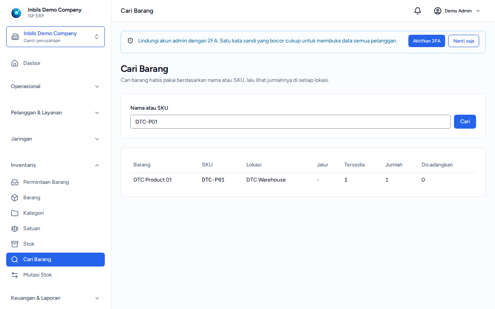

Subjudul layar berbunyi `Cari barang habis pakai berdasarkan nama atau SKU, lalu lihat jumlahnya di setiap lokasi.` Pencarian memang hanya memuat barang bertipe **Habis pakai**. Barang bertipe **Aset** atau **Layanan** tidak tampil, sedangkan barang nonaktif tetap tampil bila nama atau SKU-nya cocok.

### Kesalahan umum

- Muncul `Tidak ada barang habis pakai yang cocok dengan "<kata>". Coba potongan nama atau SKU yang lain.`: pencarian hanya mencocokkan potongan nama atau SKU, bukan kategori atau deskripsi. Barang bertipe **Aset** atau **Layanan** juga tidak pernah tampil di sini. Ketik potongan yang tepat.
- Barang tampil satu baris dengan teks `Belum ada stok di lokasi mana pun.`: barang itu belum pernah masuk ke lokasi mana pun. Catat penerimaannya dengan **Terima Barang** di Stok (bagian 6.5).
- **Tersedia** lebih kecil dari **Jumlah**: selisihnya adalah jumlah **Dicadangkan**, misalnya oleh permintaan barang yang sudah disetujui.

## 6.7 Mutasi Stok

Mutasi Stok adalah riwayat semua perubahan stok: barang masuk, keluar, koreksi dan pencadangan. Buka menu ini untuk menelusuri kenapa jumlah stok sebuah barang berubah. Layar ini hanya untuk dibaca, dan mutasi yang sudah tercatat tidak bisa diubah atau dihapus oleh siapa pun.

Peran yang dapat memakai: admin, manajer, staf. Izin: `inventory.view` (Lihat barang) membuka daftar, dan `inventory.export` (Ekspor barang) menampilkan **Ekspor**. Dengan peran bawaan, admin dan manajer bisa mengekspor, staf tidak.

### Membuka dan membaca daftar

1. Di sidebar, buka grup **Inventaris**, lalu klik **Mutasi Stok**.
2. Baca daftar.

   - Kolom: **Jenis** (lencana berwarna), **Barang** (nama dengan SKU di bawahnya), **Jumlah** (bertanda minus bila stok berkurang), **Dari**, **Ke**, **Catatan** dan **Waktu** (tanggal dan jam dalam format perusahaan). **Jenis**, **Jumlah** dan **Waktu** bisa diurutkan, dan mutasi terbaru tampil paling atas. Sel kosong tampil sebagai tanda hubung (`-`).
   - Kolom **Cari mutasi** (petunjuk `Barang, SKU, lokasi, atau catatan`) mencari nama atau SKU barang, nama atau kode lokasi asal dan tujuan, catatan, dan kode jenis mutasi dalam bahasa Inggris (misalnya `receive`, bukan label **Masuk**). Daftar dimuat ulang sendiri sebentar setelah Anda berhenti mengetik.
   - Filter **Jenis** berisi **Semua jenis** dan tujuh jenis mutasi: **Masuk**, **Keluar**, **Transfer**, **Penyesuaian**, **Dicadangkan**, **Cadangan dilepas** dan **Pengembalian**.
   - Filter **Barang** (petunjuk `Semua barang`) dan **Lokasi** (petunjuk `Semua lokasi`) adalah kotak pilih dengan pencarian: ketik untuk mencari, lalu pilih. Ketik sedikitnya 2 huruf. Daftar menampilkan paling banyak 20 hasil dari barang aktif atau lokasi aktif, berbentuk `SKU - nama (satuan)` dan `kode - nama`. Pilihan tetap tampil selama Anda mengetik dan baru berganti saat Anda memilih yang lain atau mengklik **Hapus pilihan**. Filter **Lokasi** cocok dengan mutasi yang lokasi **Dari** atau lokasi **Ke**-nya adalah lokasi itu.
   - Semua filter berlaku langsung tanpa tombol. Tidak ada filter tanggal. Untuk rentang tanggal dan saldo setelah tiap mutasi, pakai laporan Kartu Stok (bagian 7.7).
   - Menu **Ekspor** (pemegang `inventory.export`) berisi **Ekspor CSV** dan **Ekspor PDF** dari pencarian dan filter yang berlaku. Kolomnya Jenis, Barang, Dari, Ke, Jumlah, Saldo, Catatan dan Tanggal. Kolom Saldo (saldo setelah mutasi) hanya ada di file.
   - Tombol **Stok** membuka halaman Stok (bagian 6.5).

   

3. Untuk melihat satu barang, buka rincian barang di menu Barang (bagian 6.2). Kartu **Mutasi Terbaru** di sana memuat mutasi barang itu, yang terbaru di atas. Klik **Lihat semua mutasi**. Mutasi Stok terbuka dengan filter **Barang** sudah terisi barang itu. Klik **Hapus pilihan** pada filter **Barang** untuk melihat semua barang lagi.
4. Bila tidak ada baris, tabel menampilkan `Belum ada mutasi stok` (belum ada mutasi sama sekali) atau `Tidak ada mutasi yang cocok` dengan tombol **Reset filter** (pencarian atau filter terlalu sempit).

### Jenis mutasi

Kolom **Jenis** menampilkan salah satu dari tujuh label ini.

| Jenis | Arti | Jumlah | Dari dan Ke |
|---|---|---|---|
| **Masuk** | Barang masuk ke lokasi, dari **Terima Barang** atau penerimaan fisik retur material | Plus | Hanya **Ke** terisi |
| **Keluar** | Barang keluar dari lokasi, saat permintaan barang diserahkan atau SPK disetujui | Minus | Hanya **Dari** terisi |
| **Transfer** | Pemindahan antar lokasi, tercatat dua baris: keluar dari lokasi asal, masuk ke lokasi tujuan | Minus pada baris asal, plus pada baris tujuan | **Dari** pada baris keluar, **Ke** pada baris masuk |
| **Penyesuaian** | Koreksi stok ke hasil hitung fisik yang sudah disetujui | Selisih, plus atau minus | **Dari** dan **Ke** sama |
| **Dicadangkan** | Stok dicadangkan untuk permintaan barang yang disetujui, jumlah fisik tidak berubah | Plus | Hanya **Ke** terisi |
| **Cadangan dilepas** | Cadangan dilepas, jumlah fisik tidak berubah | Minus | Hanya **Ke** terisi |
| **Pengembalian** | Barang kembali ke lokasi | Plus | Hanya **Ke** terisi |

Satu permintaan barang meninggalkan jejak berurutan: **Dicadangkan** saat disetujui, lalu **Cadangan dilepas** dan **Keluar** saat barang diserahkan. Cadangan juga dilepas saat SPK ditolak. Catatan mutasi memuat kode sumbernya: `Penyerahan Permintaan Barang: <kode>` untuk serah terima, `SPK <kode>` untuk pemakaian pada SPK, dan `Penerimaan Fisik Pengembalian Material: Kasus #<nomor>` untuk retur material yang diterima. Cari kode itu di kolom **Cari mutasi** untuk menelusuri satu permintaan atau SPK.

Jenis **Pengembalian** tersedia di filter, tetapi belum ada layar web atau alur yang membuat mutasi ini. Penerimaan fisik retur material tercatat sebagai **Masuk**.

### Kesalahan umum

- Mencari mutasi menurut tanggal: layar ini tidak punya filter tanggal. Pakai laporan Kartu Stok (bagian 7.7), yang punya isian **Periode** dan kolom **Saldo**.
- Mutasi salah catat tidak bisa diubah atau dihapus: koreksi dengan **Ajukan Penyesuaian** di Stok (bagian 6.5). Setelah disetujui, koreksi itu menambah mutasi **Penyesuaian** baru dan tidak menghapus yang lama.
- Jumlah fisik tidak berubah setelah permintaan barang disetujui: baris **Dicadangkan** hanya menaikkan **Dicadangkan** di Stok. Jumlah fisik berkurang saat barang diserahkan (**Keluar**).
- Daftar hanya berisi satu barang: filter **Barang** terisi, misalnya karena Anda datang dari tautan **Lihat semua mutasi**. Klik **Hapus pilihan** pada filter itu.
- Mengetik **Masuk** di **Cari mutasi** tidak menemukan jenis itu: kolom pencarian membaca kode jenis dalam bahasa Inggris. Pakai filter **Jenis**.
- Menu **Ekspor** tidak ada: peran Anda tidak memegang `inventory.export`, dan staf bawaan tidak memegangnya.

## 6.8 Pengembalian Barang

Pengembalian Barang mencatat sisa material yang dibawa pulang teknisi setelah bekerja, dan menambah stok gudang hanya setelah petugas gudang memeriksa barangnya. Sistem membuka satu berkas pengembalian setiap kali permintaan barang berstatus **Diserahkan**. Teknisi melapor di aplikasi teknisi, dan gudang memverifikasi di web.

Peran yang dapat memakai: admin (semua langkah), manajer (melihat semua, menerima, menyelesaikan selisih), dan staf (melihat semua, menerima). Izin: `inventory.return.view.own` (Lihat pengembalian barang sendiri), `inventory.return.view.all` (Lihat semua pengembalian barang), `inventory.return.declare` (Laporkan sisa barang), `inventory.return.receive` (Terima pengembalian barang), `inventory.return.resolve` (Selesaikan selisih pengembalian).

Pemegang `inventory.return.view.all` melihat semua berkas di perusahaan aktif, sedangkan pemegang `inventory.return.view.own` hanya melihat berkas miliknya. `inventory.return.declare` memungkinkan pemilik berkas melapor pemakaian, `inventory.return.receive` memungkinkan menerima atau menolak penyerahan fisik, dan `inventory.return.resolve` memungkinkan menyelesaikan selisih.

Pemilik berkas adalah pemohon permintaan, biasanya teknisi. Pemilik tidak boleh menerima, menolak, atau menyelesaikan berkasnya sendiri, dan orang yang menerima fisik tidak boleh menyelesaikan selisih berkas yang sama.

### Membuka dan membaca daftar

Pengembalian tidak punya menu sendiri. Daftarnya adalah satu tab pada halaman Permintaan Barang.

1. Di sidebar, buka grup **Inventaris**, lalu klik **Permintaan Barang**.
2. Klik tab **Antrean Pengembalian**. Tab ini tampil bagi pemegang salah satu izin pengembalian di atas. Kartu **Antrean retur material** di Dasbor (bagian 2.1) membuka tab ini langsung pada antrean yang sesuai.

   

3. Baca bagian atas tab. Kotak **Prinsip keamanan stok pengembalian material** mengingatkan bahwa deklarasi teknisi tidak mengubah stok gudang. Pilih antrean dengan tombol di bawahnya:
   - **Antrean Penerimaan Gudang**: berkas **Menunggu penerimaan gudang**. Tampil bagi pemegang izin terima atau izin lihat semua, dan terbuka lebih dulu bagi pemegang `inventory.return.receive`.
   - **Antrean Selisih**: berkas **Selisih perlu penyelesaian**. Tampil bagi pemegang izin selesaikan atau izin lihat semua, dan terbuka lebih dulu bagi pemegang `inventory.return.resolve` yang tidak memegang izin terima.
   - **Antrean Deklarasi Teknisi**: berkas **Menunggu deklarasi teknisi**. Tampil bagi pemegang izin lapor, izin lihat milik sendiri, atau izin lihat semua.
   - **Perlu Koreksi**: berkas **Perlu koreksi**.
   - **Semua Status**: semua berkas.

   Bila Anda tidak memegang izin terima, selesaikan, maupun lapor, tab terbuka pada **Semua Status**. Pilihan **Status pengembalian** di sebelah tombol memuat **Semua status** dan enam status berkas, dan menyaring menurut satu status.
4. Setelah daftar dimuat, lencana angka muncul di tab dan di tombol antrean. Angka di **Antrean Penerimaan Gudang** menghitung berkas yang menunggu penerimaan ditambah berkas selisih. Angka di **Antrean Deklarasi Teknisi** menghitung berkas Anda sendiri yang menunggu deklarasi atau perlu koreksi. Kotak **Cari pengembalian** (petunjuk `Cari SPK atau teknisi`) mencari kode permintaan, nama teknisi, dan nomor berkas, bukan kode SPK. Tombol ikon panah melingkar (**Muat ulang antrean pengembalian**) menyegarkan daftar.
5. Baca kartu berkas: kode permintaan (atau `Pengembalian #<nomor>` bila tanpa permintaan), lencana status, **Teknisi**, **Gudang Tujuan**, **SPK**, **Tanggal Deklarasi**, daftar **Barang Dikembalikan** dengan jumlah **Baik** dan **Selisih** hasil deklarasi, serta **Alasan Penolakan** atau **Catatan Penyelesaian** bila ada. Lencana **Anda dapat menerima**, **Anda dapat menyelesaikan**, dan **Anda dapat mendeklarasikan** menandai tindakan yang boleh Anda lakukan pada berkas itu. Tanpa lencana, Anda hanya dapat membaca.
6. Klik tombol di bawah kartu: **Buka Permintaan & Terima Barang**, **Buka & Selesaikan Selisih**, **Buka Permintaan & Buat Deklarasi**, atau **Buka Permintaan**. Semuanya membuka halaman detail permintaan, tempat langkah dilakukan. Nama tombol mengikuti status berkas atau izin Anda, jadi tombol bisa muncul pada berkas yang belum boleh Anda proses. Tombol yang bisa diklik muncul di halaman detail. Berkas tanpa permintaan terkait menampilkan tombol nonaktif **Tidak terkait permintaan barang**.
7. Bila tidak ada kartu, daftar menampilkan `Belum ada berkas pengembalian material` (berkas dibuat otomatis saat barang diserahkan) atau `Tidak ada berkas pengembalian yang cocok` dengan tombol **Reset filter**.

### Status berkas pengembalian

| Status | Arti | Efek pada stok | Langkah berikut |
|---|---|---|---|
| **Menunggu deklarasi teknisi** | Barang sudah diserahkan, teknisi belum melapor. | Tidak ada. | Teknisi melapor di aplikasi teknisi |
| **Menunggu penerimaan gudang** | Teknisi sudah melapor, gudang belum memeriksa barang. | Tidak ada. Laporan tidak mengubah stok. | **Terima Pengembalian Fisik** atau **Tolak Fisik Barang** |
| **Perlu koreksi** | Gudang menolak penyerahan fisik dan menulis alasannya. | Tidak ada. | Teknisi melapor ulang |
| **Selisih perlu penyelesaian** | Gudang menerima barang, tetapi ada barang rusak atau selisih. | Barang baik sudah masuk stok. Barang rusak tidak masuk. | **Selesaikan Selisih** |
| **Diterima** | Semua barang cocok dan diterima. | Barang baik sudah masuk stok. | Status akhir |
| **Selisih diselesaikan** | Penyelesai menutup selisih dengan catatan. | Tidak ada tambahan. | Status akhir |

### Mendeklarasikan pemakaian

Teknisi mengerjakannya di aplikasi teknisi. Untuk setiap barang, jumlah dipakai, sisa baik, dan selisih harus berjumlah sama dengan jumlah yang dikeluarkan. Jika ada selisih, deklarasi wajib menyebut jenis selisihnya (rusak, hilang, atau lainnya). Alasan selisih bersifat opsional, maksimal 1000 karakter. Setelah laporan masuk, status berkas menjadi **Menunggu penerimaan gudang**, pengguna berizin `inventory.return.receive` menerima email berjudul `Deklarasi Pengembalian Material: Kasus #<nomor>`, dan stok belum berubah.

Di web, tombol **Laporkan Pemakaian & Ajukan Pengembalian** hanya muncul bagi pemilik berkas yang memegang `inventory.return.declare`, misalnya admin yang membuat permintaannya sendiri. Tombol itu muncul saat status berkas **Menunggu deklarasi teknisi** atau **Perlu koreksi**.

1. Buka halaman detail permintaan dari tombol **Buka Permintaan & Buat Deklarasi**. Kartu **Pelaporan Pemakaian Aktual & Pengembalian Material** hanya tampil pada permintaan berstatus **Diserahkan**.
2. Klik **Laporkan Pemakaian & Ajukan Pengembalian**.
3. Di dialog **Deklarasi Pemakaian Aktual & Sisa Barang**, isi per barang:
   - **Dipakai Aktual**: jumlah yang terpakai di lapangan, paling banyak sebesar **Dikeluarkan** (angka ini tertulis di baris nama barang).
   - **Sisa Dikembalikan**: terisi otomatis sebesar Dikeluarkan dikurangi Dipakai Aktual. Ubah bila perlu.
4. Klik **Kirim Laporan Deklarasi**. Dialog tertutup dan kartu memuat status baru. Tidak ada pesan sukses terpisah.

Dialog web tidak punya isian selisih, jadi **Dipakai Aktual** dan **Sisa Dikembalikan** harus berjumlah sama dengan **Dikeluarkan**. Selisih yang sudah tersimpan dari laporan sebelumnya ikut terkirim apa adanya.

### Menerima pengembalian fisik

Izin: `inventory.return.receive`. Berkas harus berstatus **Menunggu penerimaan gudang**.

1. Klik **Buka Permintaan & Terima Barang** pada kartu berkas.
2. Pada kartu **Pelaporan Pemakaian Aktual & Pengembalian Material**, periksa tabel dengan kolom **Barang**, **Dikeluarkan**, **Dipakai Riil**, **Sisa Diharapkan**, **Diterima Fisik**, dan **Rusak / Hilang**. Cocokkan **Sisa Diharapkan** dengan barang yang dibawa teknisi.
3. Klik **Terima Pengembalian Fisik**.
4. Di dialog **Terima Pengembalian Fisik Material**, isi per barang. Baris nama barang menampilkan **Deklarasi Sisa**.
   - **Diterima Baik (Tambah Stok)**: jumlah barang baik yang Anda terima. Awalnya sama dengan sisa yang dideklarasikan.
   - **Rusak**: jumlah barang rusak. Awalnya 0.
5. Klik **Konfirmasi Penerimaan Fisik**.

Pada setiap barang yang diproses lewat dialog web, **Dipakai Riil** ditambah **Diterima Baik** ditambah **Rusak** harus sama dengan **Dikeluarkan**. Dialog web tidak menyediakan isian hilang atau lainnya, jadi kasus itu tidak dapat dicatat secara tepat melalui dialog ini. Jangan mencatat barang hilang sebagai rusak hanya agar jumlahnya cocok.

Jumlah **Diterima Baik** langsung menambah stok di **Gudang Tujuan** berkas, dan Mutasi Stok (bagian 6.7) mencatat baris berjenis **Masuk** dengan catatan `Penerimaan Fisik Pengembalian Material: Kasus #<nomor>`. Bila **Rusak** nol di semua barang, status menjadi **Diterima**. Bila ada barang dengan **Rusak** lebih dari nol, status menjadi **Selisih perlu penyelesaian** dan pengguna berizin `inventory.return.resolve` menerima email berjudul `Selisih Material Perlu Diselesaikan: Kasus #<nomor>`. Bila tidak ada pemegang izin itu, email dikirim ke pemegang izin `inventory.request.approve`.

### Menolak penyerahan fisik

Izin dan syarat sama dengan penerimaan. Pakai langkah ini bila barang belum sampai di meja gudang atau tidak sesuai deklarasi.

1. Klik **Tolak Fisik Barang** pada kartu **Pelaporan Pemakaian Aktual & Pengembalian Material**.
2. Isi **Alasan Penolakan Fisik** di dialog **Tolak Penyerahan Fisik Barang** (petunjuk `Jelaskan mengapa penyerahan fisik ditolak`). Wajib, 3 sampai 1000 karakter. Tombol **Tolak Penyerahan** baru aktif setelah alasan berisi 3 karakter.
3. Klik **Tolak Penyerahan**.

Status menjadi **Perlu koreksi**, banner **Penyerahan Fisik Ditolak Gudang** memuat alasannya, dan stok tidak berubah. Teknisi menerima email berjudul `Penyerahan Pengembalian Material Ditolak: Kasus #<nomor>` berisi alasan, lalu melapor ulang. Setelah laporan baru masuk, status kembali ke **Menunggu penerimaan gudang**.

### Menyelesaikan selisih

Izin: `inventory.return.resolve`. Berkas harus berstatus **Selisih perlu penyelesaian**. Pada peran bawaan, staf menerima dan manajer menyelesaikan.

1. Klik **Buka & Selesaikan Selisih** pada kartu berkas. Di halaman detail, kotak **Selisih material perlu diselesaikan** menjelaskan keadaannya.
2. Tinjau kolom **Rusak / Hilang** pada tabel.
3. Klik **Selesaikan Selisih**.
4. Isi **Catatan Penyelesaian** di dialog **Selesaikan Selisih Material** (petunjuk `Jelaskan keputusan penyelesaian selisih`). Wajib, 3 sampai 1000 karakter. Tombol **Konfirmasi Penyelesaian** baru aktif setelah catatan berisi 3 karakter.
5. Klik **Konfirmasi Penyelesaian**.

Status menjadi **Selisih diselesaikan** dan catatan tampil di berkas, dalam kotak **Selisih material sudah diselesaikan**. Stok tidak berubah: barang rusak atau hilang tidak masuk stok karena sudah keluar saat serah terima.

### Hubungan dengan SPK

Bila permintaan memakai **Rujukan (opsional)** **SPK**, berkasnya terhubung ke SPK itu. Teknisi tidak dapat mengirim SPK untuk ditinjau selama ada berkas yang belum dilaporkan, yaitu berstatus **Menunggu deklarasi teknisi** atau **Perlu koreksi**. Saat berkas menjadi **Diterima** atau **Selisih diselesaikan**, jumlah pakai pada material SPK disesuaikan dengan jumlah **Dipakai Aktual** (bagian 3.3).

### Kesalahan umum

- Tab **Antrean Pengembalian** tampil, tetapi daftar menampilkan kotak galat merah dengan tombol **Coba lagi**. Peran Anda memegang izin lapor, terima, atau selesaikan tanpa `inventory.return.view.all` atau `inventory.return.view.own`. Minta operator platform menambahkan izin lihat ke peran (bagian 8.6) (Peran).
- Tombol **Terima Pengembalian Fisik** dan **Tolak Fisik Barang** tidak muncul. Status berkas bukan **Menunggu penerimaan gudang**, Anda tidak memegang `inventory.return.receive`, atau Anda sendiri pemilik berkas. Minta pengguna lain menerimanya. Bila halaman sudah lama terbuka, server tetap menolak dengan pesan seperti `Maker-checker: teknisi pemilik barang tidak boleh menerima fisiknya sendiri di gudang.`
- Tombol **Selesaikan Selisih** tidak muncul. Status berkas bukan **Selisih perlu penyelesaian**, Anda tidak memegang `inventory.return.resolve`, Anda pemilik berkas, atau Anda yang menerima fisiknya. Minta pengguna lain, misalnya manajer. Server menolak dengan `Teknisi tidak berhak menyelesaikan selisih barangnya sendiri.` atau `Penerima fisik gudang tidak boleh menyelesaikan selisih yang ia terima sendiri.`
- Pesan `Jumlah tidak cocok pada baris <nomor>: diserahkan (...) harus sama dengan ...` muncul di kotak merah dialog bila angka satu barang tidak cocok dengan jumlah **Dikeluarkan**. Ubah angka di dialog sampai totalnya sama dengan **Dikeluarkan**.
- Gudang tidak dapat menerima berkas yang masih **Menunggu deklarasi teknisi**: server menjawab `Kasus pengembalian harus berstatus menunggu penerimaan gudang untuk diterima.` Minta teknisi melapor di aplikasi teknisi lebih dulu.
- Alasan penolakan atau catatan penyelesaian kurang dari 3 karakter: dialog menampilkan `Harap isi alasan penolakan minimal 3 karakter.` atau `Catatan penyelesaian minimal 3 karakter.`
- Teknisi gagal mengirim SPK dengan pesan `Seluruh sisa material dari permintaan barang harus dideklarasikan terlebih dahulu sebelum SPK diajukan.` Minta teknisi melapor di aplikasi teknisi.
- SPK gagal disetujui dengan pesan `SPK belum bisa disetujui sampai seluruh retur material berstatus direkonsiliasi atau diselesaikan.` Selesaikan penerimaan atau selisih semua berkas SPK itu (status **Diterima** atau **Selisih diselesaikan**), lalu setujui lagi.

# 7. Keuangan & Laporan

## 7.1 Tagihan

Menu ini memuat tagihan pelanggan di perusahaan aktif: tagihan bulanan dari langganan, tagihan sekali bayar dari SPK, dan tagihan manual. Buka menu ini untuk menerbitkan tagihan bulanan, mengirim tagihan, mencatat atau membatalkan pembayaran, dan membatalkan tagihan.

Peran yang dapat memakai: admin, manajer, dan staf. Izin dasar: `billing.view`. Teknisi dan pelanggan tidak punya akses web. Tagihan perusahaan lain tidak tampil dan tidak bisa dibuka (galat 404). Setiap tindakan punya izin sendiri:

| Tindakan | Izin | Peran bawaan |
| --- | --- | --- |
| Melihat daftar dan detail, mengunduh PDF | `billing.view` | admin, manajer, staf |
| **Buat tagihan bulanan**, **Buat tagihan** | `billing.create` | admin, manajer, staf |
| **Tambah item** | `billing.update` | admin, manajer |
| **Kirim tagihan** | `billing.send` | admin, manajer, staf |
| **Catat pembayaran** | `billing.payment.record` | admin, manajer, staf |
| **Batalkan pembayaran** | `billing.payment.reverse` | admin, manajer |
| **Batalkan tagihan** | `billing.cancel` | admin, manajer |
| **Ekspor** | `billing.export` | admin, manajer |

Tombol **Buat tagihan bulanan**, **Buat tagihan**, dan **Ekspor** hanya tampil bagi pemilik izinnya. Di halaman detail, kartu **Aksi** menampilkan **Kirim tagihan**, **Catat pembayaran**, **Tambah item**, dan **Batalkan tagihan** menurut status tagihan, bukan menurut izin pengguna. Tombol **Batalkan pembayaran** di tabel **Pembayaran** juga memeriksa izin sebelum tampil. Server memeriksa semua izin saat tindakan disimpan dan menolak tindakan tanpa izin (galat 403).

### Membuka dan membaca daftar

1. Di sidebar, buka grup **Keuangan & Laporan**, lalu klik **Tagihan**.
2. Di atas daftar ada empat filter: kotak **Cari tagihan** ("Nomor tagihan atau pelanggan"), pilihan **Status**, pilihan **Pelanggan**, dan **Periode**. Daftar langsung menyesuaikan setiap kali Anda mengubah filter.
   - **Status** berisi Semua status, Draf, Belum dibayar, Sebagian, Lunas, Lewat jatuh tempo, dan Dibatalkan.
   - **Pelanggan** berupa kotak cari ("Semua pelanggan"): ketik minimal 2 huruf nama atau kode pelanggan, lalu pilih dari hasil (paling banyak 20). Tombol **Hapus pilihan: Pelanggan** mengosongkannya lagi.
   - **Periode** menyaring menurut **Tanggal terbit**, bukan jatuh tempo. Ketik rentang tanggal dalam format tanggal perusahaan atau klik **Buka kalender**. Pilihan cepatnya **Hari ini**, **7 hari terakhir**, **30 hari terakhir**, **Bulan ini**, **Bulan lalu**, dan **Tahun ini**. Tombol **Hapus rentang tanggal** mengosongkannya. Tanggal akhir tidak boleh sebelum tanggal awal.

   
3. Kolom daftar: **Nomor tagihan** (tautan ke detail), **Pelanggan** (nama dan kode), **Status** (lencana berwarna), **Tanggal terbit**, **Jatuh tempo**, **Total**, **Sisa** (yang belum dibayar), dan **Aksi**. Daftar urut menurut **Tanggal terbit**, terbaru dulu. Kolom **Nomor tagihan**, **Status**, **Tanggal terbit**, **Jatuh tempo**, dan **Total** bisa diurutkan. Halaman, jumlah baris, dan urutan bekerja seperti di bagian 1.5.
4. Klik nomor tagihan atau tombol **Lihat** di kolom **Aksi** untuk membuka detail. Baris tidak punya tombol **Ubah** atau **Hapus**.
5. Bila tidak ada hasil, daftar menulis "Tidak ada tagihan yang cocok" dengan tombol **Reset filter**. Bila perusahaan belum punya tagihan, daftar menulis "Belum ada tagihan" dengan tombol **Buat tagihan** (untuk pemilik izin `billing.create`).
6. Tombol **Ekspor** menawarkan **Ekspor CSV** dan **Ekspor PDF**. Berkas memuat kolom Nomor tagihan, Pelanggan, Status, Total, Tanggal terbit, Jatuh tempo, dan Dibuat, sesuai filter yang sedang aktif. Kolom Status di berkas berisi kode status (misalnya `sent`), bukan label lencana.

Sistem memakai enam status tagihan. Lencana di daftar dan di detail menulis labelnya:

| Status | Arti | Langkah berikut |
| --- | --- | --- |
| **Draf** | Baru dibuat, belum dikirim. Pelanggan belum melihatnya. Item masih bisa ditambah. | **Kirim tagihan**, atau **Batalkan tagihan** |
| **Belum dibayar** | Sudah dikirim, belum ada pembayaran. Pelanggan melihatnya di aplikasi pelanggan. | **Catat pembayaran**, atau **Batalkan tagihan** |
| **Sebagian** | Sudah dibayar sebagian. | **Catat pembayaran** untuk sisanya, atau **Batalkan pembayaran** |
| **Lewat jatuh tempo** | Lewat jatuh tempo dan belum lunas. | **Catat pembayaran**, atau **Batalkan tagihan** |
| **Lunas** | Lunas. | **Batalkan pembayaran** bila pembayaran salah |
| **Dibatalkan** | Dibatalkan dengan alasan. | Tidak ada |

Tagihan **Belum dibayar** atau **Sebagian** menjadi **Lewat jatuh tempo** lewat pengecekan harian bila jatuh tempo sudah lewat dan masih ada sisa. Pembayaran sebagian pada tagihan **Lewat jatuh tempo** mengembalikannya ke **Sebagian** sampai pengecekan berikutnya. Tagihan tidak pernah kembali ke **Draf**.

Untuk tagihan jatuh tempo, klik kartu **Tagihan jatuh tempo** di Dasbor (bab 2): daftar terbuka dengan filter **Status** **Lewat jatuh tempo**. Angka kartu dihitung dari tanggal jatuh tempo dan sisa tagihan, jadi bisa lebih besar daripada daftar sampai pengecekan harian berjalan.

### Membuka detail dan mengunduh PDF

1. Klik nomor tagihan atau **Lihat** di daftar.
2. Halaman **Tagihan &lt;nomor&gt;** memuat kartu **Detail** (Pelanggan, Langganan, Tanggal terbit, Jatuh tempo, Jenis, Sumber, Catatan), kartu **Ringkasan** (Status, Subtotal, Pajak, Diskon, Total, Terbayar, Sisa), kartu **Aksi**, tabel **Item**, dan tabel **Pembayaran**. Tombol **Kembali** membawa Anda ke daftar.

   
3. Angka tampil sebagai rupiah penuh, misalnya Rp 120.000. Tanggal mengikuti format tanggal perusahaan, dan kolom **Dibayar pada** memakai jam 24 jam.
4. **Jenis** dan **Sumber** menunjukkan asal tagihan. Jenis Berlangganan dengan sumber Langganan adalah tagihan bulanan. Jenis Sekali bayar dengan sumber SPK adalah tagihan dari SPK. Jenis Sekali bayar dengan sumber Manual dibuat lewat **Buat tagihan**.
5. Klik **Unduh PDF** untuk mengunduh berkas yang dinamai nomor tagihan, misalnya `&lt;nomor&gt;.pdf`. Berkas terbuka di tab baru. PDF memuat nama dan alamat perusahaan, "TAGIHAN" dan nomornya, tanggal, jatuh tempo, periode (tagihan bulanan), status dalam huruf kapital, "Kepada:" diikuti pelanggan dan kode langganan, tabel item, Subtotal, PPN dan Diskon (bila bernilai), Total, Terbayar dan Sisa (bila sudah ada pembayaran aktif), "Terbilang:", dan bagian "Pembayaran:" dengan isi **Rekening pembayaran** dari Pengaturan Perusahaan (bagian 8.1) bila terisi. Tanggal di PDF ditulis hari/bulan/tahun.
6. Kartu **Pembayaran online** muncul bila pembayaran online Midtrans aktif atau tagihan sudah punya percobaan bayar, dan hanya untuk dibaca. Tabelnya memuat **Status**, **Jumlah**, **Metode**, **ID transaksi**, **Dibuat**, dan **Selesai**. Pelanggan membayar lewat aplikasi pelanggan, lalu pembayaran masuk ke tagihan setelah Midtrans mengonfirmasi. Percobaan berstatus Menunggu, Lunas, Gagal, Kedaluwarsa, atau Perlu dicek. Percobaan yang gagal dibukukan (misalnya nominal berbeda atau refund) berstatus Perlu dicek, dengan "Alasan:" di bawah lencananya, dan tidak dibalik otomatis. Teks alasan itu ditulis sistem dan sebagian masih berbahasa Inggris. Pengguna dengan izin `billing.payment.reverse` membatalkan pembayaran yang sudah tercatat bila uang memang kembali.

### Menerbitkan tagihan bulanan

Izin yang dibutuhkan: `billing.create`. Sistem juga menjadwalkan penerbitan yang sama untuk bulan sebelumnya setiap hari pukul 02:00 UTC (09:00 WIB). Jendela ini dapat dipakai untuk memeriksa dan menerbitkan periode pilihan.

1. Klik **Buat tagihan bulanan**. Jendela **Buat tagihan bulanan** terbuka.
2. Isi **Periode** dengan bulan yang ditagih. Isian ini sudah terisi bulan lalu. Ketik bulannya (misalnya `Oktober 2026`, `10/2026`, atau `2026-10`) atau klik **Buka pilihan bulan** dan pilih dari 12 bulan dalam satu tahun. Tombol **Hapus bulan** mengosongkan isian.

   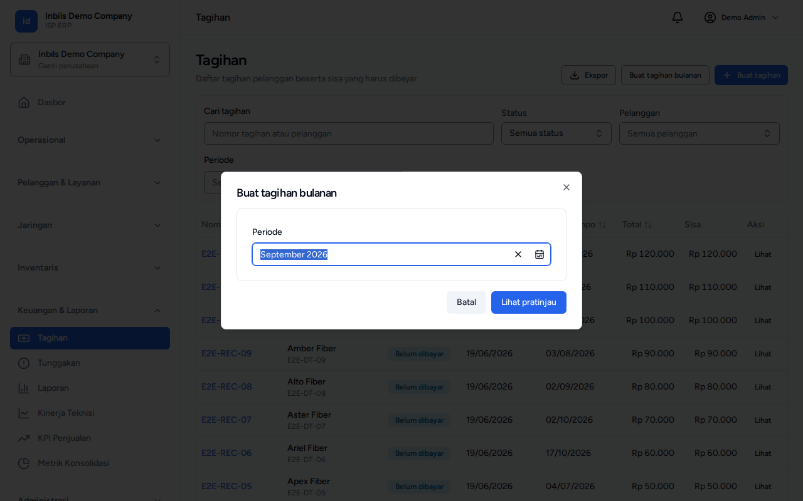
3. Klik **Lihat pratinjau**. Jendela menulis `<n> tagihan akan dibuat, <m> dilewati.` dan menampilkan tabel **Pelanggan**, **Paket**, **Hari aktif**, dan **Total**. **Hari aktif** adalah hari aktif dibanding jumlah hari dalam bulan (misalnya 15/30), dan nilai di bawah penuh berarti tagihan prorata. **Total** sudah termasuk PPN.
4. Periksa tabel. Bila Anda mengganti **Periode**, pratinjau terhapus dan Anda perlu klik **Lihat pratinjau** lagi. Tombol **Batal** menutup jendela tanpa membuat tagihan.
5. Klik **Buat &lt;n&gt; tagihan**. Tombol ini hanya ada bila pratinjau memuat tagihan baru. Bila tidak ada, tabel menulis "Tidak ada tagihan baru untuk periode ini."
6. Toast `Tagihan <periode>: <n> dibuat, <m> dilewati.` muncul (periode ditulis seperti `2026-06`) dan jendela tertutup.

Yang dibuat dan dilewati:

- Ikut ditagih: langganan Aktif atau Berhenti yang sudah aktif pada akhir periode dan belum berhenti sebelum awal periode. Langganan Menunggu dan Ditangguhkan tidak ikut.
- Nominal: MRC langganan. Langganan yang mulai aktif atau berhenti di tengah bulan ditagih prorata menurut hari aktif.
- Dilewati: langganan yang sudah punya tagihan bulanan untuk periode itu (tagihan **Dibatalkan** tidak dihitung) dan langganan bernominal 0. Menjalankan ulang periode yang sama tidak membuat tagihan ganda.
- Setiap tagihan baru memakai nomor otomatis (bagian 7.13), berjenis Berlangganan, bersumber Langganan, dan langsung berstatus **Belum dibayar**. Tidak ada tahap **Draf**, jadi pratinjau adalah satu-satunya pemeriksaan.
- **Tanggal terbit** adalah hari ini. **Jatuh tempo** adalah hari ini ditambah isian **Jatuh tempo tagihan** (bawaan 14 hari). PPN memakai isian **Tarif PPN** (bawaan 11). Keduanya diatur di Pengaturan Perusahaan (bagian 8.1).
- Satu item bertulis `MRC <nama paket> <tanggal awal> s/d <tanggal akhir>`, ditambah ` (prorata <hari aktif>/<hari dalam bulan> hari)` bila prorata. Tanggal di teks item ditulis tahun-bulan-tanggal.

### Membuat tagihan manual

Izin yang dibutuhkan: `billing.create`. Pakai tagihan manual untuk biaya di luar langganan bulanan.

1. Klik **Buat tagihan**. Halaman **Buat tagihan** terbuka dengan kartu **Data tagihan**.
2. Isi form:
   - **Pelanggan**: wajib. Kotak cari ("Cari nama atau kode pelanggan"): ketik minimal 2 huruf, lalu pilih dari hasil. Hasilnya hanya pelanggan aktif, paling banyak 20.
   - **Langganan (opsional)**: kotak cari ("Cari kode langganan"). Pilih **Pelanggan** lebih dulu. Daftar lalu hanya memuat langganan Menunggu dan Aktif milik pelanggan itu, dan daftar kosong bila pelanggan itu tidak punya langganan seperti itu. Ketik minimal 2 huruf kode langganan atau nama pelanggan, lalu pilih. Nama pelanggan tampil di bawah kode langganan. Bila Anda mengganti **Pelanggan**, isian ini dikosongkan dan daftar berganti ke langganan pelanggan baru. Sebelum **Pelanggan** dipilih, daftar memuat langganan semua pelanggan. Server menolak langganan milik pelanggan lain.
   - **Tanggal terbit**: opsional, pemilih tanggal. Ketik tanggal dalam format tanggal perusahaan atau klik **Buka kalender** (**Pilih tanggal**, **Hari ini**, **Hapus tanggal**). Kosong berarti hari ini.
   - **Jatuh tempo**: opsional, pemilih tanggal yang sama. Kosong berarti 14 hari dari hari ini. Petunjuk di bawah isian menulis "setelah tanggal terbit", tetapi sistem menghitung dari hari ini. Isi **Jatuh tempo** sendiri bila **Tanggal terbit** bukan hari ini.
   - **Catatan**: opsional.

   
3. Klik **Simpan**. Toast "Tagihan dibuat." muncul dan Anda kembali ke daftar. Tagihan baru berstatus **Draf**, berjenis Sekali bayar, bersumber Manual, bertotal 0, dengan nomor otomatis dari **Penomoran** (bagian 7.13). **Batal** dan **Kembali** menutup form tanpa menyimpan.
4. Cari tagihan itu lewat **Cari tagihan** atau filter **Pelanggan**, lalu klik **Lihat** untuk menambah item.

### Menambah item dan mengirim tagihan draf

Izin yang dibutuhkan: `billing.update` untuk **Tambah item** dan `billing.send` untuk **Kirim tagihan**. Hanya tagihan **Draf** yang bisa diberi item.

1. Buka detail tagihan **Draf**, lalu klik **Tambah item**.
2. Isi jendela **Tambah item**:
   - **Deskripsi**: wajib, maksimal 500 karakter.
   - **Kuantitas**: wajib, angka minimal 0,01. Terisi 1 sejak awal.
   - **Harga satuan**: wajib, angka minimal 0.
   - **Diskon**: opsional, nominal rupiah per baris (bukan persen), minimal 0. Terisi 0 sejak awal.
   - **Pajak (%)**: opsional, 0 sampai 100. Terisi 0 sejak awal.
3. Klik **Simpan**. Toast "Item ditambahkan." muncul, lalu tabel **Item** dan kartu **Ringkasan** terhitung ulang. Ulangi untuk item berikutnya. Isian yang ditolak diberi pesan merah di bawahnya, misalnya "Deskripsi wajib diisi.", "Kuantitas wajib diisi.", atau "Harga satuan wajib diisi.".
4. Periksa **Total** di kartu **Ringkasan**, lalu klik **Kirim tagihan**. Toast "Tagihan dikirim." muncul dan status menjadi **Belum dibayar**. Tidak ada jendela konfirmasi.

Per baris, **Total baris** adalah **Kuantitas** kali **Harga satuan** dikurangi **Diskon**. Pajak baris adalah **Total baris** kali **Pajak (%)** dibagi 100. **Total** adalah jumlah **Total baris** ditambah jumlah pajak, dikurangi diskon tagihan bila ada.

- **Pajak (%)** tidak terisi otomatis dengan PPN perusahaan. Isi tarifnya sendiri untuk item yang kena PPN. Tagihan bulanan dan tagihan dari SPK memakai tarif perusahaan otomatis.
- Layar tidak punya tombol untuk mengubah atau menghapus item. Setelah **Kirim tagihan**, item tidak bisa ditambah. Server menolak dengan "Hanya tagihan draf yang bisa diberi item." Bila isi tagihan salah, batalkan tagihan itu (lihat di bawah) dan buat ulang.
- **Kirim tagihan** tidak memeriksa jumlah item, jadi draf tanpa item terkirim dengan **Total** Rp 0. Karena **Sisa** nya 0, tombol **Catat pembayaran** tidak tampil untuk tagihan itu, dan satu-satunya langkah berikut adalah **Batalkan tagihan**. Server menolak kirim ulang dengan "Hanya tagihan draf yang bisa dikirim."
- Setelah **Kirim tagihan**, pelanggan melihat tagihan di aplikasi pelanggan. Pelanggan juga menerima WhatsApp "Tagihan terbit" bila WhatsApp aktif di Pengaturan Perusahaan (bagian 8.1), jenis pesan itu dicentang, dan pelanggan sudah menyetujui pesan WhatsApp.

### Mencatat pembayaran

Izin yang dibutuhkan: `billing.payment.record`. Hanya tagihan **Belum dibayar**, **Sebagian**, dan **Lewat jatuh tempo** yang punya sisa dan menerima pembayaran.

1. Buka detail tagihan, lalu klik **Catat pembayaran**. Jendela menulis "Sisa tagihan:" diikuti sisa tagihan.

   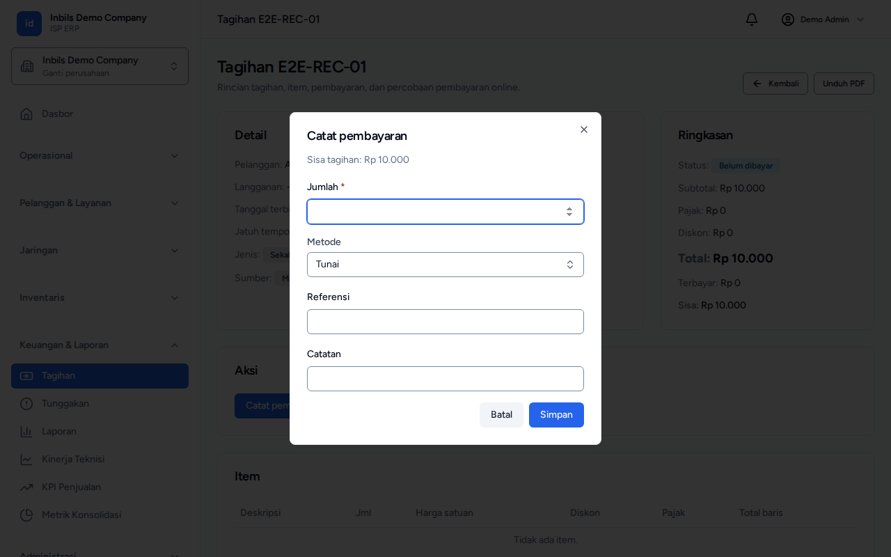
2. Isi form:
   - **Jumlah**: wajib, angka lebih dari nol dan tidak lebih besar dari sisa. Pembayaran sebagian boleh. Isian ini kosong sejak awal.
   - **Metode**: pilih **Tunai**, **Transfer**, **Cek**, atau **Lainnya**. Terisi **Tunai** sejak awal. Metode Midtrans hanya ditulis sistem untuk pembayaran online dan tidak ada di pilihan ini.
   - **Referensi**: opsional, maksimal 255 karakter (nomor transfer atau cek). Tidak boleh sama dengan referensi pembayaran aktif lain di perusahaan.
   - **Catatan**: opsional, maksimal 500 karakter.
3. Klik **Simpan**. Toast "Pembayaran dicatat." muncul dan pembayaran masuk ke tabel **Pembayaran** dengan status **Aktif**.

Tabel **Pembayaran** menyimpan riwayat pembayaran: **Jumlah**, **Metode**, **Referensi**, **Dibayar pada**, dan **Status**. Pembayaran yang dibatalkan tetap tampil dengan status **Dibatalkan**.

Waktu bayar dan pencatat tersimpan otomatis, jadi tidak ada isian tanggal. Status menjadi **Lunas** bila jumlah pembayaran aktif sudah menyamai **Total**, selain itu **Sebagian**. Pembayaran tidak bisa diubah atau dihapus. Koreksi salah catat dengan **Batalkan pembayaran**, lalu catat ulang. Pelanggan juga menerima WhatsApp "Pembayaran diterima" dengan tiga syarat yang sama seperti "Tagihan terbit" di atas.

### Membatalkan pembayaran

Izin yang dibutuhkan: `billing.payment.reverse`. Pembatalan ini juga disebut membalik pembayaran. Pencatat pembayaran tidak boleh membatalkannya sendiri. Pengguna lain dengan izin yang sama yang membatalkan.

1. Di tabel **Pembayaran**, klik **Batalkan pembayaran** pada baris pembayaran berstatus **Aktif**. Tombol tidak tampil tanpa izin.
2. Baca penjelasan di jendela **Batalkan pembayaran**: "Membatalkan pembayaran mengurangi jumlah terbayar pada tagihan dan menghitung ulang statusnya. Pembayaran ditandai dibatalkan beserta pelakunya." Isi **Alasan**: wajib, maksimal 500 karakter.
3. Klik **Konfirmasi pembatalan**. Toast "Pembayaran dibatalkan." muncul dan baris itu berstatus **Dibatalkan**. Tombol **Kembali** menutup jendela tanpa membatalkan.

Setelah pembatalan, tagihan menjadi **Belum dibayar** bila tidak ada pembayaran aktif tersisa, **Lunas** bila pembayaran aktif masih menutup **Total**, dan **Sebagian** selain itu. Pembayaran Midtrans dicatat oleh sistem, bukan oleh pengguna, jadi siapa pun dengan izin dapat membatalkannya.

Untuk tagihan **Lunas**, tombol **Batalkan tagihan** tidak ada. Batalkan pembayarannya sampai status kembali **Belum dibayar**, lalu batalkan tagihannya bila memang perlu.

### Membatalkan tagihan

Izin yang dibutuhkan: `billing.cancel`. Pembatalan tidak bisa dibatalkan lagi.

1. Buka detail tagihan, lalu klik **Batalkan tagihan** di kartu **Aksi**. Tombol tidak ada untuk tagihan **Lunas** dan **Dibatalkan**. Tombol ini tampil juga untuk tagihan **Sebagian**, tetapi server menolaknya (lihat di bawah).
2. Di jendela **Batalkan tagihan**, isi **Alasan**: wajib, maksimal 500 karakter.
3. Klik **Konfirmasi pembatalan**. Toast "Tagihan dibatalkan." muncul, status menjadi **Dibatalkan**, dan alasan tampil di kartu **Detail** sebagai **Alasan pembatalan**. Tombol **Kembali** menutup jendela tanpa membatalkan.

Sistem menolak pembatalan bila tagihan masih punya pembayaran aktif ("Tagihan yang punya pembayaran aktif tidak bisa dibatalkan. Batalkan pembayarannya dulu."). Batalkan semua pembayarannya dulu, termasuk pada tagihan **Lunas**. Sistem juga menolak bila Anda pembuat tagihan itu ("Tagihan yang Anda buat sendiri tidak bisa Anda batalkan.").

- Pembuat tagihan manual adalah pengguna yang mengklik **Simpan** di form **Buat tagihan**.
- Pembuat tagihan dari SPK adalah penyetuju SPK.
- Tagihan hasil **Buat tagihan bulanan** tidak punya pembuat, jadi siapa pun dengan izin dapat membatalkannya.
- Tagihan bulanan yang dibatalkan tidak mengunci periodenya: penerbitan berikutnya untuk periode itu dapat membuat tagihan baru.

### Melihat tagihan dari SPK

Tagihan sekali bayar dari SPK dibuat oleh sistem. Layar tidak punya tombol untuk membuatnya.

1. Setujui SPK yang menunggu review di halaman SPK (bagian 3.3). Status SPK menjadi Selesai.
2. Bila saklar **Buat tagihan otomatis saat SPK selesai** menyala, sistem membuat satu tagihan **Draf** untuk SPK itu (berjenis Sekali bayar, bersumber SPK).
3. Buka **Tagihan**, cari nomor atau nama pelanggannya, lalu buka tagihan itu.
4. Periksa item dan tambahkan bila perlu lewat **Tambah item**. Klik **Kirim tagihan** setelah isinya benar.

Item berasal dari bahan SPK yang terpakai (jumlah terpakai kali harga jual barang, dengan PPN perusahaan) dan satu baris "Biaya Instalasi" diikuti kode jenis SPK (misalnya `installation`) bila langganan punya biaya instalasi. **Jatuh tempo** adalah 14 hari setelah penyetujuan. Satu SPK hanya punya satu tagihan, dan pembuat tagihan adalah penyetuju SPK.

Bila saklar itu mati, tidak ada tagihan yang terbit. Buat tagihan manual lewat **Buat tagihan** bila biaya SPK tetap perlu ditagih. Pengaturan Perusahaan (bagian 8.1) menampilkan saklar itu di kartu **Tagihan** hanya bila kuncinya sudah ada di pengaturan perusahaan. Pengaturan sistem dengan nama kunci yang sama juga dapat menyalakannya.

### Memantau jatuh tempo dan isolir otomatis

- Setiap hari pukul 03:00 UTC (10:00 WIB), tagihan **Belum dibayar** dan **Sebagian** yang jatuh temponya sudah lewat dan masih ada sisa menjadi **Lewat jatuh tempo**.
- Bila WhatsApp aktif, pelanggan menerima pengingat 3 hari dan 1 hari sebelum jatuh tempo, dan 1 hari sesudahnya. Pesan ini bernama "Pengingat jatuh tempo (H-3, H-1, H+1)" di Pengaturan Perusahaan dan dikirim setiap hari pukul 01:00 UTC (08:00 WIB).
- Isolir otomatis mati sampai admin menyalakan saklar **Tangguhkan langganan yang menunggak** di kartu **Penangguhan otomatis** di Pengaturan Perusahaan (bagian 8.1). **Batas keterlambatan** menentukan batas hari (bawaan 7, isian 1 sampai 60).
- Setiap hari pukul 08:00 UTC (15:00 WIB), langganan Aktif yang punya tagihan belum lunas dengan jatuh tempo lebih dari batas hari lalu diisolir (status Ditangguhkan, sumber tunggakan). Tepat pada batas hari belum diisolir, satu hari lebih lama sudah. Alasan isolir yang sistem tulis sendiri berbahasa Inggris ("Automatic isolir: an invoice is more than N days past due.").
- Pelanggan kehilangan layanannya. Akun jaringan yang disinkronkan ke RADIUS masuk grup isolir perusahaan dan sesinya diputus (bab 5). Langganan Ditangguhkan tidak ditagih bulanan lagi.
- Pembayaran membuka isolir otomatis bila saklar **Aktifkan kembali saat tagihan lunas** menyala (bawaan menyala), langganan itu Ditangguhkan dengan sumber tunggakan, tagihannya yang sudah jatuh tempo saat isolir sudah lunas, dan tidak ada tagihan yang melewati batas hari. Pembayaran sebagian belum cukup, dan proses berjalan lewat antrean.
- Isolir manual tidak dibuka otomatis. Blokir juga tidak dicabut oleh pembayaran (bagian 7.2).
- Pengiriman, pembayaran, pembatalan pembayaran, dan pembatalan tagihan tercatat di Log Audit (bagian 7.12).

### Kesalahan umum

- Staf menekan **Tambah item** atau **Batalkan tagihan** dan ditolak (403). Tindakan itu perlu `billing.update` dan `billing.cancel`, yang dimiliki admin dan manajer. Minta mereka melakukannya.
- Toast "Data gagal disimpan. Periksa input." di jendela **Tambah item**, **Catat pembayaran**, **Batalkan tagihan**, atau **Batalkan pembayaran** berarti satu isian ditolak. Pesan merahnya tampil di bawah isian itu, misalnya "Alasan pembatalan wajib diisi." atau "Jumlah wajib diisi.". Perbaiki isiannya lalu simpan lagi.
- **Jumlah** lebih besar dari sisa ditolak (galat 422, "Jumlah pembayaran melebihi sisa tagihan."). **Referensi** yang sama dengan pembayaran aktif lain juga ditolak ("Referensi pembayaran sudah ada."). Perbaiki isiannya. Tagihan yang statusnya tidak menerima pembayaran ditolak dengan "Tagihan tidak menerima pembayaran pada statusnya saat ini."
- Pembatalan atau pembatalan pembayaran oleh pembuatnya ditolak ("Tagihan yang Anda buat sendiri tidak bisa Anda batalkan.", "Pembayaran yang Anda catat sendiri tidak bisa Anda batalkan."). Minta pengguna lain dengan izin yang sama.
- Pembatalan tagihan ditolak bila ada pembayaran aktif ("Tagihan yang punya pembayaran aktif tidak bisa dibatalkan. Batalkan pembayarannya dulu."). Batalkan pembayarannya dulu. Bila tagihan atau pembayaran sudah dibatalkan, server menjawab "Tagihan sudah dibatalkan." atau "Pembayaran sudah dibatalkan.".
- Draf tanpa item terkirim dengan **Total** Rp 0 dan tidak bisa diisi lagi. Tambahkan item sebelum **Kirim tagihan**.
- **Periode** di **Buat tagihan bulanan** hanya diperiksa formatnya. Bulan berjalan atau bulan depan tetap diproses dan langsung terbit sebagai **Belum dibayar**. Pastikan bulannya benar sebelum klik **Buat &lt;n&gt; tagihan**. Bila **Periode** dikosongkan, **Lihat pratinjau** tidak menampilkan apa pun.
- **Langganan (opsional)** kosong lagi setelah Anda mengganti **Pelanggan**. Ini disengaja karena daftar langganan mengikuti pelanggan. Pilih langganannya lagi. Bila server menolak simpan dengan pesan merah "langganan yang dipilih tidak sesuai dengan pelanggan yang dipilih.", langganan itu milik pelanggan lain: pilih pelanggan yang benar atau kosongkan isiannya. Pesan "Langganan yang dipilih tidak ditemukan." berarti langganan itu bukan milik perusahaan ini atau sudah dihapus.
- Tagihan yang dibuat dengan **Jatuh tempo** kosong jatuh tempo 14 hari dari hari ini, bukan dari **Tanggal terbit**. Isi **Jatuh tempo** sendiri bila tanggal terbitnya berbeda.
- Tagihan bulanan memakai isian **Jatuh tempo tagihan** di Pengaturan Perusahaan (bagian 8.1). Awalan nomor tagihan diatur di **Penomoran** (bagian 7.13).

## 7.2 Tunggakan

Halaman ini menjumlahkan sisa tagihan yang belum dibayar untuk tiap pelanggan dan mengelompokkannya menurut umur jatuh tempo. Buka halaman ini untuk melihat siapa yang menunggak dan sudah berapa lama, lalu mengisolir atau memblokir langganan pelanggan itu.

Peran yang dapat memakai: admin, manajer, dan staf. Izin: `billing.view`. Tombol **Isolir** perlu `customer.subscription.suspend`, tombol **Blokir** dan **Buka blokir** perlu `customer.subscription.block`. Admin dan manajer memiliki keduanya, jadi staf melihat angka tanpa tombol tindakan. Data hanya dari perusahaan aktif.

### Membuka dan membaca daftar

1. Di sidebar, buka grup **Keuangan & Laporan**, lalu klik **Tunggakan**. Halaman ini menulis "Pantau umur piutang pelanggan dan tindakan isolir."
2. Enam kartu di atas menjumlahkan semua pelanggan, bukan hanya halaman yang tampil: **Belum jatuh tempo**, tiga rentang umur (**1-30 hari**, **31-60 hari**, dan **61-90 hari**), **>90 hari**, dan **Total piutang**. Kartu tanpa nilai menulis Rp 0.

   
3. Tabel memuat satu baris per pelanggan: **Pelanggan** (nama dan jumlah tagihan terbuka, misalnya "(1 tagihan)"), **Belum jatuh tempo**, tiga kolom rentang umur, **>90 hari** (merah), **Total**, dan **Aksi**. Sel tanpa nilai menulis tanda hubung. Semua kolom kecuali **Aksi** bisa diurutkan, dan urutan awalnya **Pelanggan** dari A ke Z. Halaman, jumlah baris, dan urutan bekerja seperti di bagian 1.5. Halaman ini tidak punya kotak pencarian, filter, atau tombol ekspor. Bila tidak ada tunggakan, tabel menulis "Tidak ada tunggakan" dan "Tagihan yang belum lunas di perusahaan ini akan muncul di sini."
4. Klik nama pelanggan untuk membuka **Tagihan** dengan filter **Pelanggan** yang sudah terisi nama itu, semua status termasuk yang lunas. Klik **Hapus pilihan: Pelanggan** untuk melihat semua tagihan lagi.

Yang dihitung:

- Tagihan berstatus **Belum dibayar**, **Sebagian**, atau **Lewat jatuh tempo** yang masih punya sisa. Nilainya **Total** dikurangi jumlah terbayar. Tagihan **Draf**, **Lunas**, dan **Dibatalkan** tidak dihitung.
- Kolom ditentukan dari tanggal jatuh tempo dan hari ini, bukan dari status. Tagihan yang jatuh tempo hari ini atau belum lewat masuk **Belum jatuh tempo**. Tagihan yang lewat 1 sampai 30 hari masuk kolom pertama, dan seterusnya sampai **>90 hari**.
- Pelanggan yang semua tagihannya lunas tidak tampil.

Beda dengan **Tagihan** (bagian 7.1): **Tagihan** memuat setiap tagihan, satu baris per tagihan, semua status, dengan filter dan ekspor. **Tunggakan** hanya memuat sisa yang masih terbuka, dijumlahkan per pelanggan dan dikelompokkan menurut umur.

### Mengisolir langganan

Izin yang dibutuhkan: `customer.subscription.suspend`. Kolom **Aksi** menampilkan tombol untuk setiap langganan Aktif milik pelanggan di baris itu, termasuk langganan yang tagihannya belum jatuh tempo.

1. Di kolom **Aksi**, klik tombol **Isolir** diikuti kode langganan yang benar.
2. Isi **Alasan isolir (wajib)** di jendela `Isolir langganan <kode>?`. Tombol **Isolir** aktif setelah alasan terisi. Alasan maksimal 500 karakter, dan server menolak yang lebih panjang. Tombol **Batal** menutup jendela.
3. Klik **Isolir**. Toast "Langganan ditangguhkan." muncul, dan langganan berstatus Ditangguhkan dengan sumber tunggakan.

Isolir dari halaman ini dihitung sebagai isolir karena tunggakan, jadi pembayaran dapat membukanya otomatis dengan syarat di bagian 7.1 ("Memantau jatuh tempo dan isolir otomatis"). Langganan Ditangguhkan tidak lagi punya tombol **Isolir** di halaman ini. Aktifkan kembali secara manual dengan tombol **Aktifkan kembali** di halaman langganan, yang dibuka dari halaman pelanggan (bagian 4.1). Bila status langganan sudah berubah sebelum Anda menyimpan, server menolak dengan "Langganan harus berstatus Aktif untuk ditangguhkan."

### Memblokir atau membuka blokir

Izin yang dibutuhkan: `customer.subscription.block`. Blokir mengisolir pelanggan tanpa mengubah status langganan, dan pembayaran tidak mencabutnya.

1. Klik tombol **Blokir** diikuti kode langganan yang benar. Langganan yang sudah diblokir menampilkan lencana **Diblokir** dan tombol **Buka blokir** diikuti kodenya. Langganan Ditangguhkan hanya tampil di halaman ini selama diblokir.
2. Baca penjelasan di jendela `Blokir internet <kode>?` atau `Buka blokir internet <kode>?`. Blokir mengisolir dan memutus pelanggan, sedangkan penagihan jalan terus dan pembayaran tidak mencabut blokir. Buka blokir mengembalikan layanan normal saat router menyambung ulang. Bila langganan masih Ditangguhkan, layanan tetap diisolir sampai langganan diaktifkan kembali.
3. Isi **Alasan** (wajib, maksimal 500 karakter) untuk blokir, atau **Catatan (opsional)** untuk buka blokir. Tombol **Batal** menutup jendela.
4. Klik **Blokir internet** atau **Buka blokir**. Toast "Internet langganan diblokir." atau "Blokir internet langganan dibuka." muncul. Tombol **Blokir internet** aktif setelah alasan terisi.

### Kesalahan umum

- Jumlah di **Tunggakan** berbeda dari jumlah di **Tagihan**. **Tunggakan** menghitung sisa, bukan **Total**, dan hanya tagihan **Belum dibayar**, **Sebagian**, dan **Lewat jatuh tempo**. Cocokkan dengan kolom **Sisa** dan **Status** di daftar tagihan pelanggan itu.
- Tombol **Isolir** muncul untuk setiap langganan aktif pelanggan itu, bukan hanya yang menunggak. Cocokkan kode langganan dengan tagihan yang menunggak sebelum klik.
- Langganan Ditangguhkan tanpa blokir tidak punya tombol di halaman ini. Aktifkan kembali dari halaman langganan (bagian 4.1).
- Server menolak blokir bila langganan sudah berhenti ("Langganan yang sudah berhenti tidak bisa diblokir."), sudah diblokir ("Internet langganan sudah diblokir."), dan buka blokir bila langganan tidak sedang diblokir ("Internet langganan tidak sedang diblokir.").
- Staf tidak melihat tombol apa pun di kolom **Aksi**. Tombol hanya muncul untuk pemilik izin `customer.subscription.suspend` atau `customer.subscription.block`.

## 7.3 Laporan

Laporan menghitung angka langsung dari riwayat langganan, tagihan, tiket, SPK, aset, stok, dan evaluasi. Semua layar laporan hanya-baca. Layar ini tidak menyediakan tombol untuk menambah, mengubah, atau menghapus data sumber.

Peran yang dapat memakai hub: admin, manajer, dan staf dengan izin `report.view`. Setiap laporan tetap memerlukan izin khusus. Angka hanya mencakup perusahaan yang sedang aktif, kecuali Metrik Konsolidasi.

| Laporan di hub | Izin untuk membuka | Peran bawaan |
| --- | --- | --- |
| Metrik Bisnis | `report.business.view` | admin, manajer, staf |
| Pemanfaatan Aset | `report.asset.view` | admin, manajer, staf |
| Kepatuhan SLA | `report.sla.view` | admin, manajer, staf |
| Kartu Stok | `report.stock_card.view` | admin, manajer, staf |
| Kamus Data | `report.dictionary.view` | admin, manajer, staf |
| Kinerja Teknisi | `report.technician` dan aturan akses teknisi | admin, manajer |
| KPI Penjualan | `report.sales.view` | admin, manajer |
| Log Audit | `report.audit.view` | admin |
| Metrik Konsolidasi | `report.consolidated.view` dan perusahaan aktif berupa Head | admin |

Admin dengan `report.manage` dapat memilih teknisi aktif di perusahaan. Manajer harus mempunyai profil karyawan aktif pada unit organisasi aktif. Pilihan teknisinya terbatas pada unit tersebut dan unit di bawahnya. Aturan teknisi untuk melihat dirinya sendiri ada di server, tetapi akun teknisi memakai aplikasi Android, bukan web.

Laporan **Metrik Konsolidasi** hanya muncul saat perusahaan aktif berupa Head, yaitu perusahaan tanpa induk yang mempunyai anak perusahaan aktif. Tombol ekspor memerlukan `report.export` selain izin laporannya. Peran bawaan admin dan manajer memegang izin ekspor, sedangkan staf tidak.

### Membuka daftar laporan

1. Di sidebar, buka grup **Keuangan & Laporan**, lalu klik **Laporan**.
2. Baca daftar yang tampil. Setiap baris memuat judul laporan sebagai tautan dan satu kalimat uraian.

   

3. Klik judul laporan yang diperlukan. Hub hanya menampilkan laporan yang diizinkan untuk akun Anda.
4. **Kinerja Teknisi**, **KPI Penjualan**, dan **Metrik Konsolidasi** juga mempunyai menu sendiri di sidebar. Judul ketiganya di hub sama dengan nama menu itu.

Bila tidak ada laporan yang diizinkan, hub menampilkan **Belum ada laporan yang bisa dibuka** dengan keterangan "Peran Anda belum punya akses laporan. Minta administrator memberi akses." Admin dapat menambah izin lewat Peran (bagian 8.6) dan Hak Akses (bagian 8.7).

### Memilih Periode

1. Klik isian **Periode** yang mula-mula kosong dan bertuliskan **Semua tanggal**, atau klik tombol **Buka kalender**.
2. Pilih salah satu tombol di grup pilihan cepat: **Hari ini**, **7 hari terakhir**, **30 hari terakhir**, **Bulan ini**, **Bulan lalu**, atau **Tahun ini**. Rentang berjalan seperti **Bulan ini** dan **Tahun ini** berakhir pada hari ini menurut waktu perusahaan. Pilihan cepat langsung mengisi isian dan menutup kalender.
3. Untuk rentang lain, klik tanggal mulai lalu tanggal akhir. Teks di bawah kalender menuntun Anda ("Pilih tanggal mulai, lalu tanggal akhir." dan "Pilih tanggal akhir."). Kalender menutup setelah tanggal akhir dipilih. Kalender menampilkan dua bulan pada layar lebar dan satu bulan pada layar sempit.
4. Anda juga dapat mengetik rentang dalam format tanggal perusahaan. Pisahkan kedua tanggal dengan tanda hubung yang diberi spasi di kedua sisinya. Satu tanggal tanpa pemisah berarti satu hari itu. Tanda hubung di akhir tulisan membiarkan tanggal akhir kosong. Tahun harus memakai empat angka. Tulisan diterima saat Anda menekan Enter atau berpindah dari isian.
5. Klik **Tampilkan**. Log Audit memakai tombol **Terapkan filter**. Pilihan baru belum memengaruhi angka sebelum tombol ini diklik.
6. Untuk kembali ke semua tanggal, klik **Hapus rentang tanggal**, lalu klik **Tampilkan** lagi.

Kedua batas tanggal bersifat inklusif. Untuk kolom waktu, Inbils memakai awal hari tanggal mulai sampai akhir hari tanggal akhir menurut zona waktu perusahaan. Kolom kalender seperti tanggal terbit tagihan dibandingkan sebagai tanggal tanpa konversi zona waktu.

Rentang boleh hanya mempunyai tanggal mulai atau tanggal akhir. Tanggal akhir tidak boleh lebih awal daripada tanggal mulai. Isian menampilkan "Tanggal akhir tidak boleh sebelum tanggal mulai." bila urutannya terbalik. Bila tulisan tidak dapat dibaca, isian menampilkan "Format tanggal tidak valid." disertai contoh tanggal dalam format perusahaan.

Kode tidak membatasi jumlah hari dalam satu rentang. Rentang yang panjang hanya mengubah pengelompokan grafik. Setelah Anda mengklik **Tampilkan**, `date_from` dan `date_to` tersimpan pada URL, sehingga filter pulih saat halaman dimuat ulang atau dibagikan.

### Membaca grafik

Metrik Bisnis, Pemanfaatan Aset, Kepatuhan SLA, Kinerja Teknisi, dan KPI Penjualan memakai grafik berikut:

- Grafik garis menampilkan perubahan menurut waktu.
- Grafik batang membandingkan kategori, lokasi, atau petugas penjualan.
- Diagram donat membagi satu jumlah menurut status atau hasil SLA. Irisan status memakai warna yang sama dengan lencana status di tabel dan daftar.

Grafik waktu memakai kelompok harian untuk rentang sampai 31 hari, mingguan sampai 184 hari, lalu bulanan. Minggu dimulai hari Senin. Tanpa tanggal mulai, grafik memakai kelompok bulanan dari data tertua sampai hari ini, dengan paling banyak 36 kelompok bulan. Bulan yang lebih lama digabung ke kelompok pertama. Tanpa tanggal akhir, grafik berakhir hari ini.

Kelompok waktu yang masih berjalan, yaitu yang memuat hari ini, diberi tulisan **(berjalan)** setelah labelnya. Angka kelompok itu belum lengkap, sehingga angka yang rendah di sana belum tentu penurunan.

Arahkan penunjuk ke titik, batang, atau irisan untuk melihat nama seri dan nilai lengkap. Sumbu dapat menyingkat angka, sedangkan tooltip memakai nilai lengkap. Diagram donat menulis jumlah dan persentase pada legenda.

Grafik batang dan donat tertentu, misalnya **Aset jaringan per lokasi**, menampilkan paling banyak sepuluh baris. Bila datanya lebih banyak, sembilan baris terbesar tampil dan sisanya bergabung sebagai **Lainnya**. Bila seluruh nilainya nol, area grafik menampilkan **Tidak ada data pada periode ini**.

### Membaca angka dan definisinya

Banyak kartu angka mempunyai kalimat definisi, lalu satu baris yang berbunyi **Per periode** atau **Posisi saat ini**, diikuti versi rumus. **Per periode** berarti tanggal sumber harus masuk dalam **Periode**. **Posisi saat ini** berarti angka mencerminkan kondisi saat ini dan mengabaikan **Periode**. Kartu uang pada Metrik Bisnis dan KPI Penjualan menulis angka dalam bentuk singkat, misalnya "Rp 1,2 jt". Arahkan penunjuk ke angka itu untuk melihat jumlah rupiah yang tepat.

Klik **Rumus dan sumber data** untuk membuka rincian **Rumus**, **Satuan**, **Dasar tanggal**, **Status**, **Sumber data**, **Cakupan**, dan **Catatan penting**. Header laporan memuat **Versi rumus** diikuti nomor versi, misalnya `business.v1`. Buka Kamus Data (bagian 7.8) untuk membaca semua definisi pada satu halaman. Kinerja Teknisi tidak menampilkan rincian ini pada kartu, tetapi definisinya tetap ada di Kamus Data.

### Mengekspor laporan

1. Jalankan filter yang diperlukan dengan **Tampilkan**.
2. Klik **Ekspor**. Log Audit memakai tombol **Ekspor log**.
3. Pilih **Ekspor CSV** atau **Ekspor PDF**. Menu ekspor laporan hanya menawarkan kedua format ini.

Ekspor ringkasan memakai kolom Metrik, Rincian, Nilai, Satuan, Cakupan, Filter, dan Versi. Kolom Rincian dan Satuan berisi kode apa adanya, misalnya status `available` atau satuan `currency`. Kolom Cakupan menyebut apakah angka berlaku untuk periode atau posisi saat ini. Kartu Stok dan Log Audit mengekspor seluruh baris yang cocok dengan filter, bukan hanya halaman tabel yang sedang terlihat.

KPI Penjualan dan Kamus Data tidak menyediakan ekspor. Metrik Konsolidasi hanya menyediakan CSV. Ekspor baris (Kartu Stok, Log Audit, dan daftar di balik angka) dibatasi 5.000 baris. Pada CSV yang terpotong, baris terakhir berbunyi "# Ekspor dipotong pada 5000 baris. Persempit filter untuk mengekspor sisa barisnya." Batas ini dijelaskan juga di bagian 1.5.

### Melihat data di balik angka

1. Klik **Lihat data** di bawah angka atau baris rincian. Tautan hanya muncul bila akun Anda juga boleh membuka modul sumber.
2. Baca kartu **Kecocokan dengan laporan**. Kartu ini membandingkan jumlah baris atau penjumlahan baris dengan angka pada laporan. Kartu ini menampilkan **Baris ditampilkan**, penjumlahan kolom bila angkanya berupa uang, **Tepat waktu** bila angkanya persentase, dan **Angka di** diikuti judul laporan.
3. Baca lencana hasil:
   - **Cocok** berarti baris sama dengan angka laporan.
   - **Berbeda** berarti daftar dan angka laporan berbeda.
   - **Tidak bisa dicocokkan per baris** muncul untuk rata-rata atau daftar yang dibatasi oleh akses pengguna.
4. Klik nilai pada kolom pertama untuk membuka catatan sumber, misalnya tagihan, tiket, SPK, langganan, aset, atau evaluasi.
5. Pakai tombol **Kembali ke** yang diikuti judul laporan untuk kembali. Menu **Ekspor** pada halaman ini mengunduh daftar sumber sebagai CSV atau PDF. Menu ini muncul bila akun Anda memegang `report.export`.

Tautan sumber memerlukan izin modul terkait: `customer.subscription.view`, `billing.view`, `ticket.view`, `spk.view`, `network_asset.view`, atau `evaluation.view` maupun `evaluation.view.own`. Pengguna yang boleh mengerjakan tiket atau SPK tetapi tidak boleh menugaskannya hanya melihat baris yang ditugaskan kepadanya. Halaman daftar menyatakannya dengan "Anda hanya melihat baris yang ditugaskan kepada Anda, jadi ini sebagian dari angka."

Daftar di balik **Piutang** dapat menampilkan kartu **Rekonsiliasi** dan tombol **Buka Tunggakan**. Kartu ini memperlihatkan selisih terhadap Tunggakan karena kedua layar mempunyai aturan penyertaan sendiri. Kartu ini tidak muncul bila **Kategori paket** dipilih atau akun Anda tidak boleh membuka daftar tagihan.

### Kesalahan umum

- Laporan tidak ada di hub: peran Anda tidak memegang izin laporan itu. Minta admin memeriksa Peran dan Hak Akses.
- Tombol **Ekspor** tidak ada: akun tidak memegang `report.export`, laporan memang tidak mendukung ekspor, atau Kartu Stok belum menerapkan barang.
- Tautan **Lihat data** tidak ada: akun boleh melihat angka agregat tetapi tidak boleh membuka daftar sumbernya.
- Angka tidak berubah setelah memilih tanggal: klik **Tampilkan** atau **Terapkan filter**. Ekspor dan daftar di balik angka memakai filter yang sudah diterapkan.
- Angka **Posisi saat ini** tidak berubah saat **Periode** berganti. Ini perilaku rumus, bukan kegagalan filter.
- Angka berubah setelah ganti perusahaan: semua laporan biasa mengikuti perusahaan aktif. Periksa pemilih perusahaan di sidebar, lihat bagian 1.6.

## 7.4 Metrik Bisnis

Metrik Bisnis merangkum pendapatan berulang, pendapatan tagihan lunas, piutang, langganan, dan kepatuhan SLA. Buka laporan ini untuk memeriksa kondisi bisnis perusahaan aktif dan menelusuri catatan sumbernya.

Peran yang dapat memakai: admin, manajer, staf. Izin: `report.business.view`. Tombol **Ekspor** memerlukan `report.export`.

### Membuka dan membaca laporan

1. Buka **Laporan**, lalu klik **Metrik Bisnis**. Laporan langsung tampil untuk semua tanggal dan semua kategori.
2. Pilih **Periode**, lalu klik **Tampilkan**. Header menampilkan **Versi rumus** `business.v1`.

   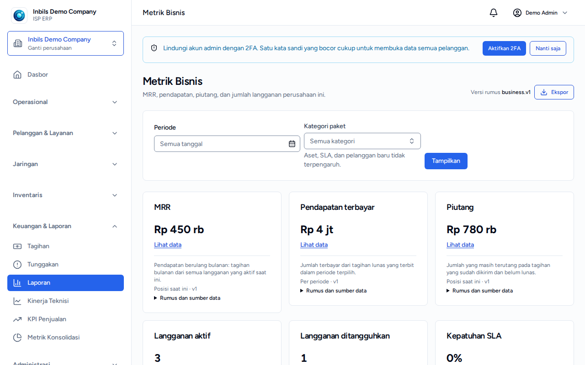

   Pilih juga **Kategori paket**: kosongkan untuk **Semua kategori**, atau klik isian dan pilih satu kategori (bagian 4.2). Daftar dapat disaring dengan mengetik. Tombol **Hapus pilihan: Kategori paket** mengembalikan ke semua kategori. Pilihan ini membatasi MRR, pendapatan, piutang, jumlah langganan, pemasangan, serta grafik tagihan dan MRR pada paket kategori itu. Kategori nonaktif tampil dengan tulisan `(nonaktif)`. Aset dan SLA tidak terpengaruh. Tagihan satu kali tanpa langganan tidak masuk kategori mana pun. Tautan **Lihat data** dan file ekspor mengikuti kategori yang dipilih.

3. Baca enam kartu. Kartu uang menulis angka dalam bentuk singkat, dan arahan penunjuk menampilkan rupiah yang tepat.
   - **MRR** menjumlahkan tarif bulanan semua langganan yang saat ini berstatus Aktif. Angka ini **Posisi saat ini**.
   - **Pendapatan terbayar** menjumlahkan jumlah terbayar tagihan berstatus Lunas berdasarkan tanggal terbit dalam **Periode**. Tagihan yang baru dibayar sebagian tidak masuk.
   - **Piutang** menjumlahkan total dikurangi jumlah terbayar pada tagihan berstatus Belum dibayar, Sebagian, atau Lewat jatuh tempo. Angka ini **Posisi saat ini**.
   - **Langganan aktif** menghitung langganan yang saat ini berstatus Aktif.
   - **Langganan ditangguhkan** menghitung langganan yang saat ini berstatus Ditangguhkan.
   - **Kepatuhan SLA** menghitung persentase tiket yang punya waktu selesai dan selesai paling lambat pada batas SLA. Angka ini memakai semua waktu dan mengabaikan **Periode**.
4. Klik **Lihat data** untuk membuka langganan, tagihan, atau tiket di balik kartu. Tautan mengikuti izin modul sumber.
5. Baca grafik **Pendapatan terbayar dan MRR per hari**, **per minggu**, atau **per bulan**. Garisnya bernama **Pendapatan terbayar** dan **MRR (akhir periode)**. Pendapatan memakai tanggal terbit tagihan lunas. MRR menunjukkan posisi pada akhir setiap kelompok waktu. Kelompok yang masih berjalan diberi tulisan **(berjalan)**.
6. Baca diagram **Tagihan menurut status**. Diagram memakai tanggal terbit dan memisahkan status yang ada di data: Draf, Belum dibayar, Sebagian, Lunas, Lewat jatuh tempo, dan Dibatalkan.
7. Klik **Ekspor** untuk mengunduh CSV atau PDF. File memuat semua 13 metrik Business, termasuk Langganan berhenti, Langganan baru, Churn, Pendapatan berulang, Pendapatan sekali bayar, Sebaran aset, dan Pemasangan selesai yang tidak tampil sebagai kartu.

### Kesalahan umum

- **Periode** hanya mengubah **Pendapatan terbayar** di antara enam kartu. Lima kartu lain merupakan **Posisi saat ini** atau angka semua waktu.
- Pendapatan terbayar dapat lebih kecil daripada uang yang masuk. Metrik ini memakai tagihan yang sudah Lunas dan tanggal terbit, sedangkan **Terkumpul** di KPI Penjualan memakai pembayaran yang tidak dibalik dan tanggal bayar.
- **Piutang** dapat berbeda dengan Tunggakan. Klik **Lihat data** pada kartu ini untuk melihat kartu **Rekonsiliasi** terhadap **Tunggakan**.
- **Kepatuhan SLA** dapat berbeda dari **Tingkat kepatuhan SLA** di bagian 7.6. Metrik Bisnis memakai semua tiket yang mempunyai waktu selesai, tanpa filter periode.
- Tanpa **Periode**, Langganan baru dan Churn pada file ekspor bernilai 0. Metrik periode lain memakai semua catatan yang cocok.
- Grafik menampilkan **Tidak ada data pada periode ini** bila tidak ada nilai yang dapat digambar. Kartu tetap menampilkan 0 atau nilai **Posisi saat ini**.

## 7.5 Pemanfaatan Aset

Pemanfaatan Aset merangkum status aset jaringan, lokasi aset, riwayat pemasangan, aset yang terhubung ke pelanggan, dan aset pensiun. Data sumbernya berasal dari Aset Jaringan (bagian 5.2).

Peran yang dapat memakai: admin, manajer, staf. Izin: `report.asset.view`. Tombol **Ekspor** memerlukan `report.export`.

### Membuka dan membaca laporan

1. Buka **Laporan**, lalu klik **Pemanfaatan Aset**. Laporan langsung tampil untuk semua jenis dan semua tanggal.
2. Pilih **Jenis aset**: klik isian lalu pilih, atau ketik untuk menyaring daftar. Pilihannya **Router**, **Switch**, **OLT**, **ONU/ONT**, **Radio**, **Antena**, **Fiber**, **ODP**, **ODC**, **Rak**, **Perangkat daya**, dan **Lainnya**. Isian kosong berarti **Semua jenis**. Tombol **Hapus pilihan: Jenis aset** mengosongkannya.
3. Pilih **Periode**, lalu klik **Tampilkan**. Header menampilkan **Versi rumus** `asset.v1`.

   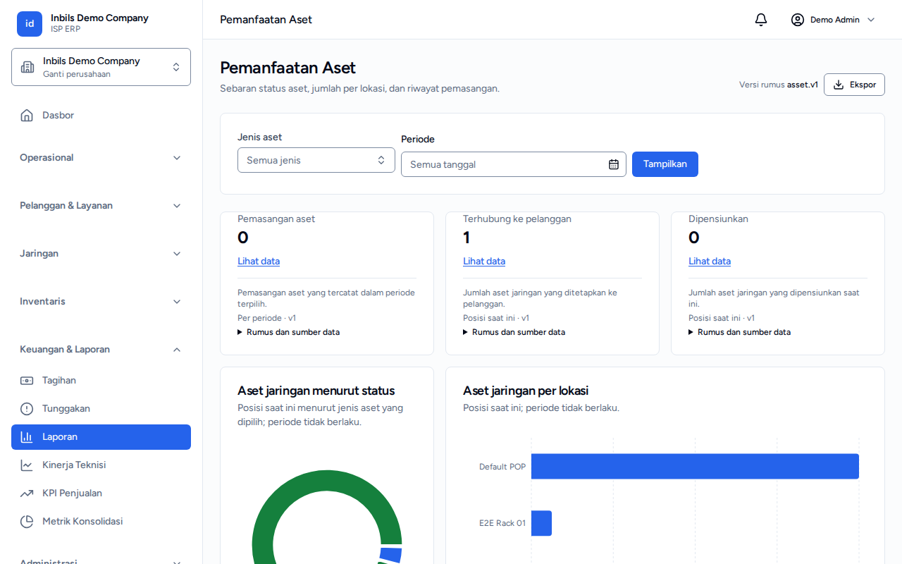

4. Baca tiga kartu:
   - **Pemasangan aset** menghitung catatan pemasangan aset yang tanggal pasangnya masuk dalam **Periode**. Angka ini mengabaikan **Jenis aset**.
   - **Terhubung ke pelanggan** menghitung aset yang saat ini mempunyai pelanggan. Angka ini mengabaikan semua filter.
   - **Dipensiunkan** menghitung aset yang saat ini berstatus Dipensiunkan. Angka ini mengabaikan semua filter.
5. Baca diagram **Aset jaringan menurut status**. Diagram memakai **Jenis aset** dan menampilkan kondisi saat ini. **Periode** tidak berlaku. Statusnya Tersedia, Terpasang, Perawatan, Rusak, dan Dipensiunkan, sebatas yang ada di data.
6. Baca grafik **Aset jaringan per lokasi**. Grafik menghitung aset yang mempunyai lokasi, tanpa memakai **Jenis aset** atau **Periode**.
7. Baca tabel **Sebaran status** dengan kolom **Status** dan **Jumlah**. Klik **Lihat data** pada satu status untuk membuka aset di balik jumlah itu.
8. Klik **Ekspor** untuk mengunduh CSV atau PDF. File memuat Sebaran status, Aset per lokasi, Pemasangan aset, Terhubung ke pelanggan, dan Dipensiunkan.

### Kesalahan umum

- **Jenis aset** hanya memengaruhi **Sebaran status**. Kartu, grafik lokasi, dan sebagian besar angka tidak berubah saat filter ini diganti.
- **Pemasangan aset** menghitung catatan pemasangan aset. Metrik **Pemasangan selesai** di Metrik Bisnis menghitung SPK pemasangan yang selesai, sehingga angkanya dapat berbeda.
- Lokasi bernama sama bergabung menjadi satu batang. Aset tanpa lokasi tidak masuk ke grafik lokasi.
- Layar tidak menyediakan filter Lokasi. URL dengan `location_id` dapat membatasi **Sebaran status**, tetapi filter itu tidak dapat dipilih dari form. Server menolak lokasi yang bukan milik perusahaan aktif dengan kesalahan validasi "Lokasi tidak ditemukan." Layar ini tidak menulis pesan itu.
- Tabel kosong menampilkan **Tidak ada data.** Grafik kosong menampilkan **Tidak ada data pada periode ini**.

## 7.6 Kepatuhan SLA

Kepatuhan SLA menghitung tiket selesai, tiket yang memenuhi batas SLA, pelanggaran, kecepatan respons pertama, waktu penyelesaian, dan rincian kategori. Data sumbernya berasal dari Tiket (bagian 3.4).

Peran yang dapat memakai: admin, manajer, staf. Izin: `report.sla.view`. Tombol **Ekspor** memerlukan `report.export`.

### Membuka dan membaca laporan

1. Buka **Laporan**, lalu klik **Kepatuhan SLA**. Laporan langsung tampil untuk semua tanggal.
2. Pilih **Periode**, lalu klik **Tampilkan**. Layar tidak mempunyai filter tambahan. Header menampilkan **Versi rumus** `sla.v1`.
3. Baca lima kartu:
   - **Tiket selesai** menghitung tiket yang mempunyai waktu selesai dalam **Periode**, apa pun statusnya saat ini.
   - **Tingkat kepatuhan SLA** adalah persentase tiket selesai yang selesai paling lambat pada batas SLA.
   - **Tingkat respons** adalah persentase tiket selesai yang respons pertamanya datang paling lambat pada target respons. Hanya tiket yang sudah dinilai yang dihitung: tiket yang punya target respons dan punya catatan respons pertama. Di bawah angka tertulis `N tepat waktu, N terlambat, N tanpa target respons`. Angka kosong tampil sebagai **-**.
   - **Pelanggaran SLA** menghitung tiket selesai yang selesai setelah batas SLA.
   - **Rata-rata waktu penyelesaian** adalah rata-rata menit dari pembuatan sampai penyelesaian. Nilai kosong tampil sebagai **- menit**.
4. Baca diagram **Tiket selesai menurut SLA**. Irisan **Sesuai SLA** dan **Melewati SLA** memakai jumlah tiket yang sesuai SLA dan angka **Pelanggaran SLA**.
5. Baca grafik **Tiket selesai per kategori**. Grafik membandingkan **Total selesai** dan **Sesuai SLA** pada setiap kategori.
6. Baca tabel **Tiket selesai per kategori** dengan kolom **Kategori**, **Total**, **Sesuai SLA**, dan **Persentase**. Klik **Lihat data** pada Total untuk membuka tiket kategori tersebut.
7. Klik **Ekspor** untuk mengunduh CSV atau PDF. File memuat semua metrik laporan ini: Tiket selesai, Sesuai SLA, Tingkat kepatuhan SLA, Pelanggaran SLA, Respons tepat waktu, Respons terlambat, Tanpa target respons, Tingkat respons, Rata-rata waktu penyelesaian, dan Rata-rata respons pertama. Rincian kategori ditulis tiga baris per kategori: total, sesuai SLA, dan persentase.

### Kesalahan umum

- Grafik dan tabel kategori mengabaikan **Periode**. Keduanya dapat berbeda dari lima kartu pada rentang yang sama.
- Jumlah tiket yang sesuai SLA ditambah **Pelanggaran SLA** dapat lebih kecil daripada **Tiket selesai**. Tiket tanpa batas SLA masuk Tiket selesai, tetapi tidak dianggap patuh atau melanggar.
- **Tingkat kepatuhan SLA** bernilai 0 bila tidak ada tiket selesai. **Rata-rata waktu penyelesaian** kosong pada kondisi yang sama.
- **Tingkat respons** kosong (**-**) bila belum ada tiket yang dinilai. Tiket lama yang dibuat sebelum target respons ada tidak punya target respons. Tiket itu masuk hitungan **tanpa target respons** dan tidak masuk penyebut. Tiket yang punya target tetapi tidak punya catatan respons pertama juga tidak dinilai.
- Definisi lengkap angka respons ada di Kamus Data (bagian 7.8): **Respons tepat waktu**, **Respons terlambat**, **Tanpa target respons**, dan **Tingkat respons**. Daftar tiket yang dibuka lewat **Lihat data** dan ekspornya memuat kolom **Target respons** dan **Respons**. Kolom **Respons** berisi Tepat waktu, Terlambat, Tanpa target, atau Belum ada respons. Kolom **SLA** berisi Tepat waktu, Terlambat, atau Tanpa batas.
- Kategori bernama sama bergabung menjadi satu baris.
- Parameter `category_id` dapat diterima server, tetapi layar ini tidak menyediakan pemilih kategori.

## 7.7 Kartu Stok

Kartu Stok adalah buku catatan pergerakan satu barang. Laporan ini menunjukkan kuantitas gerakan dan saldo lokasi tepat setelah setiap gerakan, tanpa menghitung ulang stok.

Peran yang dapat memakai: admin, manajer, staf. Izin: `report.stock_card.view`. Tombol **Ekspor** memerlukan `report.export`. Tombol menuju stok dan semua mutasi juga memerlukan `inventory.view`.

### Membuka dan membaca kartu stok

1. Buka **Laporan**, lalu klik **Kartu Stok**.
2. Pilih **Barang** (wajib, bertanda bintang). Ketik nama atau SKU di isian yang berbunyi **Cari nama atau SKU...**, lalu pilih barang dari daftar. Daftar baru muncul setelah Anda mengetik minimal dua huruf. Server mencari di barang perusahaan aktif dan menampilkan paling banyak 20 hasil, dengan SKU di bawah nama. Barang yang sudah dihapus tetap dapat dipilih, karena buku besar menyimpan gerakannya. Pilihan bertahan saat Anda mengetik dan berganti hanya saat Anda memilih barang lain atau mengklik **Hapus pilihan: Barang**.
3. Bila perlu, pilih **Lokasi** dengan cara yang sama (cari nama atau kode lokasi). Isian kosong bertuliskan **Semua lokasi**. Dengan lokasi terpilih, laporan hanya memuat gerakan yang memakai lokasi itu sebagai asal atau tujuan.
4. Pilih **Periode**, lalu klik **Tampilkan**. Tombol ini nonaktif sebelum barang dipilih. Sebelum Anda menerapkan barang, halaman menampilkan "Pilih barang lalu tekan Tampilkan untuk melihat pergerakan stok."
5. Baca tabel:
   - Kolom **Jenis** menampilkan jenis gerakan sebagai lencana: Masuk, Keluar, Transfer, Penyesuaian, Dicadangkan, Cadangan dilepas, atau Pengembalian.
   - Kolom **Jumlah** menampilkan kuantitas bertanda seperti yang dicatat Inventaris.
   - Kolom **Saldo** menampilkan saldo baris stok yang tersentuh tepat setelah gerakan.
   - Kolom **Dari** dan **Ke** menampilkan lokasi asal dan tujuan. Sel kosong ditulis **-**.
   - Kolom **Catatan** menampilkan catatan gerakan.
   - Kolom **Referensi** menampilkan SPK atau permintaan barang yang menimbulkan gerakan, misalnya "SPK" diikuti kode SPK. Teks itu menjadi tautan bila akun boleh membukanya. Sumber lain tampil sebagai teks biasa.
   - Kolom **Tanggal** menampilkan waktu pencatatan gerakan dalam format perusahaan.
6. Urutkan lewat judul kolom **Jumlah**, **Saldo**, atau **Tanggal**. Urutan awal memakai waktu terbaru. Di bawah tabel, pilih **Baris per halaman** (10, 25, atau 50 per halaman) dan pindah halaman dengan **Sebelumnya** dan **Berikutnya**.
7. Gunakan **Lihat stok** untuk membuka Stok (bagian 6.5), atau **Semua pergerakan** untuk membuka Mutasi Stok (bagian 6.7). Tombol hanya muncul setelah barang diterapkan, dan membawa barang serta lokasi yang sama.
8. Baca kartu **Definisi** di bawah tabel untuk definisi **Pergerakan stok**, **Jumlah**, dan **Saldo**.
9. Klik **Ekspor** untuk mengunduh seluruh ledger yang cocok sebagai CSV atau PDF. File memuat Tanggal, Barang, Jenis, Jumlah, Saldo setelah, Dari, Ke, Referensi, dan Catatan. Kolom Jenis pada file berisi kode jenis apa adanya, misalnya `receive`.

### Kesalahan umum

- **Barang** wajib. Tombol **Tampilkan** tetap nonaktif sampai Anda memilih barang.
- Barang atau lokasi tidak muncul di daftar: daftar hanya memuat data perusahaan aktif. Periksa pemilih perusahaan di sidebar. Lokasi yang sudah dihapus juga tidak ditawarkan. Alamat halaman yang memuat barang atau lokasi milik perusahaan lain, atau yang tidak ada, ditolak server dengan kesalahan validasi "Barang tidak ditemukan." atau "Lokasi tidak ditemukan." Pemilih tidak dapat menghasilkan kesalahan ini. Kartu Stok tidak menulis pesan itu di dekat isian. Yang tampil hanya pemberitahuan "Data gagal disimpan. Periksa input." bila server mengembalikan Anda ke layar.
- Pesan **Tidak ada pergerakan stok** berarti tidak ada gerakan untuk barang dan periode tersebut. Ubah filter lalu klik **Tampilkan** lagi.
- **Saldo** bukan saldo berjalan gabungan dari semua lokasi atau semua baris hasil filter. Nilainya adalah snapshot satu baris stok saat gerakan dicatat.
- Laporan tidak membuat baris saldo awal. Untuk saldo saat ini, klik **Lihat stok**.
- Tombol **Ekspor** baru muncul setelah barang diterapkan dan akun memegang `report.export`.

## 7.8 Kamus Data

Kamus Data menjelaskan arti, formula, unit, kolom sumber, ruang lingkup, dan keterbatasan setiap angka laporan. Buka halaman ini ketika dua angka tampak berbeda atau saat Anda perlu memeriksa rumus yang dipakai.

Peran yang dapat memakai: admin, manajer, staf. Izin: `report.dictionary.view`. Halaman ini tidak mempunyai filter, grafik, daftar di balik angka, atau ekspor.

### Membaca kamus data

1. Buka **Laporan**, lalu klik **Kamus Data**.

   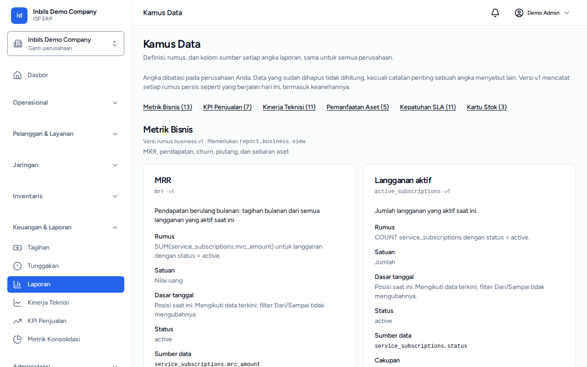

2. Baca catatan awal. Angka laporan dibatasi pada perusahaan Anda. Data yang sudah dihapus tidak dihitung kecuali catatan penting sebuah angka menyebut lain.
3. Di bawah catatan awal ada daftar tautan, satu per laporan, misalnya **Metrik Bisnis** diikuti jumlah definisi dalam kurung. Klik nama laporan untuk meloncat ke bagiannya.
4. Baca header setiap bagian. Header memuat judul laporan, **Versi rumus** dan nomor versinya, izin yang dibutuhkan (**Memerlukan** diikuti nama izin), dan uraian laporan.
5. Baca kartu metrik:
   - Judul kartu adalah nama angka pada laporan.
   - Baris kecil di bawah judul menampilkan key dan versi, misalnya `mrr` dan `v1`.
   - Kalimat di bawahnya adalah definisi angka.
   - **Rumus** menjelaskan hitungan yang dijalankan kode.
   - **Satuan** dapat berupa Nilai uang, Jumlah, Persen, Menit, Penilaian, Kuantitas, Rincian (jumlah per kelompok), atau Catatan (baris buku besar).
   - **Dasar tanggal** menyatakan Posisi saat ini atau Per periode, termasuk kolom tanggal untuk angka per periode.
   - **Status** mencantumkan status data yang ikut dihitung, sebagai kode tersimpan seperti `active` atau `sent`. Baris ini hanya ada bila status relevan.
   - **Sumber data** mencantumkan pasangan tabel dan kolom.
   - **Cakupan** menyatakan batas perusahaan atau teknisi.
   - **Catatan penting** mencatat pengecualian dan perilaku versi rumus tersebut. Baris ini hanya ada bila ada catatan.

Kamus berisi Metrik Bisnis, KPI Penjualan, Kinerja Teknisi, Pemanfaatan Aset, Kepatuhan SLA, dan Kartu Stok. Versi v1 merekam rumus yang benar-benar dijalankan saat ini, termasuk perilaku yang belum ideal.

### Kesalahan umum

- Metrik Konsolidasi tidak mempunyai bagian sendiri. Laporan itu memakai definisi Metrik Bisnis.
- Log Audit dan Kamus Data tidak mempunyai metrik dalam registri, sehingga keduanya tidak muncul sebagai bagian kamus.
- Judul grafik dapat berbeda dari nama metrik. Diagram **Aset jaringan menurut status** memakai definisi **Sebaran status**, sedangkan grafik **Aset jaringan per lokasi** memakai **Aset per lokasi**.
- Rumus dan catatan di kamus, juga di rincian **Rumus dan sumber data** pada kartu laporan, menyebut batas tanggal dengan kata Dari dan Sampai. Maksudnya awal dan akhir isian **Periode**.
- Nama serupa belum tentu memakai aturan sama. Baca **Dasar tanggal** dan **Catatan penting** sebelum membandingkan dua laporan.
- Halaman ini tidak menampilkan nilai perusahaan. Halaman hanya memuat definisi statis yang sama bagi semua perusahaan.

## 7.9 Kinerja Teknisi

Kinerja Teknisi menampilkan hasil satu teknisi: SPK selesai, tiket diselesaikan, kepatuhan SLA, rata-rata skor evaluasi, rata-rata respons pertama, dan beban kerja aktif. Layar tidak membandingkan banyak teknisi dalam satu tabel. Anda memilih satu teknisi lalu membaca hasilnya.

Peran yang dapat memakai di web: admin dengan `report.manage`, atau manajer dengan `report.technician`, profil karyawan aktif, dan penempatan pada organisasi aktif. Admin dapat memilih semua teknisi aktif pada perusahaan. Manajer hanya dapat memilih teknisi di unitnya dan unit di bawahnya. Aturan server juga mengizinkan peran teknisi dengan `report.technician` melihat dirinya sendiri, tetapi akun teknisi diarahkan ke aplikasi Android.

### Memilih teknisi dan membaca hasil

1. Di sidebar, buka **Keuangan & Laporan**, lalu klik **Kinerja Teknisi**. Anda juga dapat membuka **Laporan** lalu klik tautan **Kinerja Teknisi**.

   

2. Pada **Teknisi** (wajib), ketik minimal 2 huruf nama atau email teknisi, tunggu daftar muncul, lalu pilih satu. Kotak ini hanya mencari, jadi tidak ada daftar sebelum Anda mengetik. Daftar memuat paling banyak 20 hasil dan hanya berisi pengguna aktif dengan peran teknisi dan profil karyawan aktif pada perusahaan. Pilihan tetap sampai Anda memilih teknisi lain atau mengklik tombol **Hapus pilihan: Teknisi**.
3. Isi **Periode** bila perlu. Ketik rentang dengan format tanggal perusahaan, atau klik **Buka kalender**, pilih tanggal mulai lalu tanggal akhir, atau pakai pilihan cepat (**Hari ini**, **7 hari terakhir**, **30 hari terakhir**, **Bulan ini**, **Bulan lalu**, **Tahun ini**). Klik **Hapus rentang tanggal** untuk mengosongkan. Isian kosong (**Semua tanggal**) berarti tanpa batas.
4. Klik **Tampilkan**. Tombol tetap nonaktif sampai teknisi dipilih.
5. Baca enam kartu:
   - **SPK selesai** menghitung SPK berstatus Selesai yang ditugaskan kepada teknisi dan selesai dalam **Periode**.
   - **Tiket diselesaikan** menghitung tiket berstatus Diselesaikan atau Ditutup yang ditugaskan kepada teknisi dan mempunyai waktu selesai dalam **Periode**.
   - **Kepatuhan SLA** adalah persentase Tiket diselesaikan yang selesai paling lambat pada batas SLA. Tiket tanpa batas SLA tetap dihitung, tetapi tidak pernah dianggap sesuai SLA.
   - **Rata-rata skor evaluasi** adalah rata-rata skor pada Evaluasi (bagian 3.5) yang tanggal evaluasinya jatuh dalam **Periode**.
   - **Rata-rata respons pertama** adalah rata-rata menit dari pembuatan tiket sampai respons pertama, untuk Tiket diselesaikan yang mempunyai respons pertama.
   - **Beban kerja aktif** menghitung SPK berstatus Ditugaskan atau Dikerjakan, ditambah tiket berstatus Terbuka, Ditugaskan, atau Dikerjakan yang saat ini ditugaskan kepada teknisi.
6. Klik **Lihat data** di bawah kartu untuk membuka daftar sumber (bagian 7.3). Tautan hanya muncul bila akun Anda boleh membuka modul sumbernya. Kartu **Beban kerja aktif** mempunyai dua tautan **Lihat data**: yang pertama untuk SPK, yang kedua untuk tiket.
7. Baca tiga grafik:
   - **SPK selesai per hari**, **SPK selesai per minggu**, atau **SPK selesai per bulan** menampilkan SPK selesai sepanjang **Periode**. Satuan mengikuti panjang periode. Satuan yang masih berjalan hari ini diberi tulisan "(berjalan)".
   - **SPK selesai menurut jenis** memisahkan Instalasi, Perawatan, Peningkatan layanan, dan Pindah lokasi.
   - **Tiket selesai menurut kategori** membagi Tiket diselesaikan berdasarkan kategori tiket. Grafik batang menampilkan paling banyak 10 baris, sisanya digabung menjadi **Lainnya**.
8. Klik **Ekspor** setelah hasil muncul, lalu pilih **Ekspor CSV** atau **Ekspor PDF**. Menu ini hanya ada bila akun Anda memegang `report.export`. Kolom file adalah Metrik, Rincian, Nilai, Satuan, Cakupan, Filter, dan Versi. File juga memuat Rata-rata waktu SPK, Rata-rata waktu tiket, Rata-rata rating pelanggan, SPK per jenis, dan Tiket per kategori yang tidak tampil sebagai kartu.

### Kesalahan umum

- Menu tidak ada atau halaman menampilkan **Akses ditolak**: manajer tidak memegang `report.technician`, tidak mempunyai profil aktif, atau belum ditempatkan pada organisasi aktif. Perbaiki data pada Karyawan (bagian 8.3) dan Organisasi (bagian 8.2).
- Teknisi tidak muncul di daftar: akunnya nonaktif, profil karyawannya tidak aktif, perannya bukan teknisi, perusahaannya berbeda, atau posisinya di luar unit manajer. Ketik minimal 2 huruf, karena kotak **Teknisi** menampilkan "Ketik minimal 2 huruf untuk mencari." sebelum itu, dan "Tidak ada hasil." bila tidak ada yang cocok.
- Pesan **Pilih teknisi untuk melihat laporan.** berarti belum ada pilihan. **Tidak ada teknisi yang bisa dipilih.** muncul bila pencarian terakhir tidak menemukan teknisi dalam ruang lingkup akun.
- Nilai berupa tanda hubung (-) berarti tidak ada data yang dapat dirata-ratakan pada periode itu. Angka 0 berarti jumlah yang cocok memang nol.
- **Beban kerja aktif** adalah posisi saat ini. Angka ini tidak berubah saat **Periode** diganti.
- **Kepatuhan SLA** di sini hanya memakai tiket berstatus Diselesaikan atau Ditutup milik teknisi. Angkanya dapat berbeda dari Kepatuhan SLA pada bagian 7.6.
- **Tanggal akhir tidak boleh sebelum tanggal mulai.** muncul di bawah **Periode** bila rentang terbalik. Ketikan yang bukan tanggal menghasilkan **Format tanggal tidak valid.** dengan contoh format.

## 7.10 KPI Penjualan

KPI Penjualan membagi akuisisi pelanggan, aktivasi langganan, MRR, tagihan, pembayaran, piutang, dan tingkat penagihan menurut petugas penjualan pelanggan. Petugas penjualan adalah pengguna yang tercatat pada isian **Diperoleh oleh** di Pelanggan (bagian 4.1).

Peran yang dapat memakai: admin dan manajer. Izin: `report.sales.view`. Staf tidak memegang izin ini pada peran bawaan. Laporan tidak mempunyai tombol **Ekspor** dan tautan **Lihat data**.

### Membuka dan membaca laporan

1. Di sidebar, buka **Keuangan & Laporan**, lalu klik **KPI Penjualan**. Anda juga dapat membuka **Laporan** lalu klik tautan **KPI Penjualan**.

   

2. Isi **Periode** seperti pada Kinerja Teknisi (bagian 7.9): ketik rentang, atau buka kalender dan pakai pilihan cepat. Tanpa pilihan, baris keterangan menulis **Periode: semua waktu**.
3. Pilih **Petugas penjualan**. Klik kotaknya untuk membuka daftar, ketik untuk menyaring, lalu pilih satu nama. Isian kosong (**Semua petugas**) menampilkan semua petugas dan baris **Tanpa petugas**. Nama pengguna nonaktif diberi tulisan "(nonaktif)". Klik **Hapus pilihan: Petugas penjualan** untuk mengosongkan.

   Pilih juga **Kategori paket**: **Semua kategori** atau satu kategori (bagian 4.2). Kategori nonaktif tetap ada di daftar dengan tulisan "(nonaktif)", karena riwayat masih memakainya. Dengan satu kategori, **Langganan diaktifkan**, **MRR aktif**, **Ditagihkan**, **Terkumpul**, **Piutang**, dan **Tingkat penagihan** hanya menghitung langganan pada paket kategori itu beserta tagihan dan pembayarannya. Teks bantu di bawah isian menulis "Pelanggan baru tidak terpengaruh." karena **Pelanggan baru** tidak ikut terfilter.

4. Klik **Tampilkan**. Header menampilkan **Versi rumus sales.v1**.
5. Baca tujuh kartu total:
   - **Pelanggan baru** menghitung pelanggan yang saat ini dikreditkan kepada petugas dan dibuat dalam **Periode**. Pelanggan yang dihapus secara lunak tidak masuk.
   - **Langganan diaktifkan** menghitung langganan pelanggan petugas yang mempunyai tanggal aktivasi dalam **Periode**, apa pun statusnya saat ini.
   - **MRR aktif** menjumlahkan tarif bulanan langganan yang saat ini berstatus Aktif. Angka ini adalah posisi saat ini.
   - **Ditagihkan** menjumlahkan total tagihan berstatus Belum dibayar, Sebagian, Lunas, atau Lewat jatuh tempo menurut tanggal terbit dalam **Periode**.
   - **Terkumpul** menjumlahkan pembayaran yang tidak dibatalkan menurut tanggal bayar dalam **Periode**.
   - **Piutang** menjumlahkan sisa tagihan berstatus Belum dibayar, Sebagian, atau Lewat jatuh tempo. Angka ini adalah posisi saat ini.
   - **Tingkat penagihan** adalah Terkumpul dibagi Ditagihkan. Nilai tampil sebagai tanda hubung (-) bila Ditagihkan bernilai 0.

   Kartu uang menampilkan angka singkat, misalnya "Rp 1,2 jt". Arahkan penunjuk ke angka itu untuk melihat jumlah rupiah lengkap. Tabel di bawah selalu menampilkan jumlah lengkap. Setiap kartu juga memuat definisi singkat, keterangan **Per periode** atau **Posisi saat ini**, dan bagian **Rumus dan sumber data** yang dapat dibuka.
6. Baca grafik:
   - **Pelanggan baru per hari**, **Pelanggan baru per minggu**, atau **Pelanggan baru per bulan** memakai tanggal pembuatan pelanggan. Satuan yang masih berjalan hari ini diberi tulisan "(berjalan)".
   - **Pelanggan baru per petugas penjualan** membandingkan Pelanggan baru.
   - **Pembayaran diterima per petugas penjualan** membandingkan Terkumpul. Keterangannya menulis "Semua pembayaran yang tidak dibatalkan, menurut tanggal bayar."
7. Baca tabel petugas. Kolom pertama, **Petugas penjualan**, memuat nama dan lencana **Nonaktif**. Tujuh kolom metrik dan kolom nama dapat diurutkan dengan mengklik judul kolom. Tabel memakai paging bawaan (10, 25, atau 50 baris per halaman).
8. Lihat baris **Tanpa petugas** untuk pelanggan tanpa petugas yang sah. Baris **Total** menjumlahkan semua petugas dan Tanpa petugas. Memilih satu petugas menyembunyikan baris Tanpa petugas.

### Kesalahan umum

- Mengoreksi **Diperoleh oleh** memindahkan seluruh riwayat pelanggan ke petugas baru. Angka periode lama dapat berubah.
- **Pelanggan baru** memakai tanggal pembuatan pelanggan, bukan tanggal penetapan petugas.
- **Terkumpul** memakai tanggal pembayaran dan memasukkan pembayaran sebagian yang tidak dibatalkan. Nilainya tidak sama dengan **Pendapatan terbayar** di Metrik Bisnis (bagian 7.4).
- **Tingkat penagihan** dapat lebih dari 100 persen karena Terkumpul memakai tanggal bayar, sedangkan Ditagihkan memakai tanggal terbit.
- Nilai Piutang seluruh petugas ditambah Tanpa petugas harus sama dengan Piutang di Metrik Bisnis pada perusahaan yang sama.
- Pesan **Belum ada petugas penjualan** berarti belum ada karyawan yang dapat menerima kredit akuisisi. Isi **Diperoleh oleh** pada data pelanggan untuk memulai.
- Baris dengan **Tingkat penagihan** bertanda hubung (-) selalu ditempatkan terakhir saat kolom itu diurutkan.
- Alamat dengan `acquirer_id` pengguna di luar perusahaan aktif, atau yang tidak ada, ditolak dengan "Petugas penjualan tidak ditemukan." di bawah **Petugas penjualan**. Pengguna perusahaan aktif yang tidak ada di daftar petugas membuka halaman **Akses ditolak**. Pemilih tidak dapat menghasilkan keduanya.
- **Tanggal akhir tidak boleh sebelum tanggal mulai.** muncul di bawah **Periode** bila rentang terbalik.

## 7.11 Metrik Konsolidasi

Metrik Konsolidasi membandingkan Metrik Bisnis milik perusahaan Head dan setiap anak perusahaan aktif, lalu menjumlahkannya. Gunakan laporan ini untuk melihat angka per perusahaan dan total grup tanpa berpindah perusahaan satu per satu.

Peran yang dapat memakai: admin. Izin: `report.consolidated.view`. Perusahaan aktif juga harus berupa Head, yaitu perusahaan tanpa induk yang mempunyai anak perusahaan aktif. Menu **Ekspor** memerlukan `report.export`.

### Membuka dan membaca konsolidasi

1. Pastikan perusahaan aktif di sidebar adalah Head, lihat bagian 1.6.
2. Di sidebar, buka **Keuangan & Laporan**, lalu klik **Metrik Konsolidasi**. Anda juga dapat membuka **Laporan** lalu klik tautan **Metrik Konsolidasi**.

   

3. Baca subtitle. Layar menulis nama Head, jumlah anak perusahaan, dan mata uang yang dipakai, misalnya "Metrik bisnis gabungan &lt;nama Head&gt; dan 1 anak perusahaan. Nilai dalam IDR." Header menampilkan **Versi rumus business.v1**.
4. Isi **Periode** seperti pada Kinerja Teknisi (bagian 7.9), lalu klik **Tampilkan**. Baris keterangan di bawah filter menulis rentang yang berlaku, atau "Periode: semua waktu. Pilih rentang tanggal untuk membatasi periode." bila kosong. Teks di bawahnya menjelaskan bahwa laporan mencakup Head dan anak perusahaan aktif, dan setiap perusahaan memakai hari kalender dalam zona waktunya sendiri.
5. Baca bagian **Angka per perusahaan**:
   - Kolom **Perusahaan** memuat nama, kode dan zona waktu, dan lencana **Induk** pada perusahaan Head.
   - Kolom **MRR**, **Pendapatan terbayar**, **Piutang**, **Langganan aktif**, **Langganan ditangguhkan**, dan **Kepatuhan SLA** memakai definisi Metrik Bisnis (bagian 7.4). Sel Kepatuhan SLA juga menulis "n dari m tepat waktu".
   - Setiap perusahaan mempunyai satu baris. Baris **Total konsolidasi** berada paling bawah.
   - Pada layar yang lebih sempit dari 1200 piksel, tabel berubah menjadi kartu per perusahaan dengan angka yang sama, dan kartu **Total konsolidasi** di akhir.
6. Baca catatan SLA di bawah tabel. Kepatuhan SLA konsolidasi menggabungkan seluruh tiket tepat waktu lalu membaginya dengan seluruh tiket selesai. Inbils tidak merata-ratakan persentase perusahaan.
7. Baca bagian **Cara menghitung setiap angka** untuk definisi enam kolom. Klik **Rumus dan sumber data** pada satu angka untuk melihat rumus dan sumbernya.
8. Klik **Ekspor**, lalu **Ekspor CSV**. Menu ini hanya menawarkan CSV. File memuat seluruh metrik Metrik Bisnis per perusahaan, disusul baris Total konsolidasi, dengan kolom Perusahaan, Metrik, Rincian, Nilai, Satuan, Cakupan, Filter, dan Versi.

### Kesalahan umum

- Menu tidak ada: perusahaan aktif bukan Head, tidak mempunyai anak perusahaan aktif, atau akun tidak memegang `report.consolidated.view`.
- Pindah ke anak perusahaan menyembunyikan menu dan menolak alamat langsung dengan halaman **Akses ditolak**. Kembali ke Head melalui pemilih perusahaan.
- Bila mata uang perusahaan berbeda, layar menampilkan peringatan **Perusahaan ini tidak bisa dikonsolidasikan** dengan pesan "Laporan konsolidasi ditolak: perusahaan yang dipilih memakai mata uang berbeda" diikuti daftar mata uangnya. Samakan mata uang perusahaan sebelum menjumlahkan nilai uang. Bila akun Anda boleh membuka Metrik Bisnis, peringatan memuat tautan **Metrik Bisnis** untuk melihat angka tiap perusahaan. Menu **Ekspor** tidak muncul selama peringatan tampil.
- **MRR**, **Piutang**, langganan, dan Kepatuhan SLA merupakan posisi saat ini. **Periode** terutama mengubah Pendapatan terbayar dan metrik periode lain di file ekspor.
- Setiap perusahaan membaca batas hari dalam zona waktunya sendiri. Catatan dekat tengah malam dapat masuk ke hari berbeda pada dua perusahaan.
- Laporan tidak mempunyai tautan **Lihat data**. Buka Metrik Bisnis setelah berpindah ke perusahaan yang ingin diperiksa.
- **Tanggal akhir tidak boleh sebelum tanggal mulai.** muncul di bawah **Periode** bila rentang terbalik.

## 7.12 Log Audit

Log audit menelusuri aktivitas perusahaan menurut waktu, modul, aksi, pelaku, subjek, dan data perubahan. Buka laporan ini saat Anda perlu mengetahui siapa melakukan suatu tindakan atau nilai apa yang berubah.

Peran yang dapat memakai: admin. Izin: `report.audit.view`. Tombol **Ekspor log** memerlukan `report.export` selain izin audit.

### Menyaring dan membaca log

1. Buka **Laporan**, lalu klik tautan **Log Audit**. Judul halamannya **Log audit**.

   

2. Isi filter yang diperlukan:
   - **Pencarian teks** mencari pada deskripsi, modul, aksi, serta nama atau email pelaku. Isian ini mencari pada nama modul tersimpan (misalnya `customer`), bukan pada label modul yang tampil.
   - **Modul** memilih satu modul dari daftar, misalnya Pelanggan, Tagihan, Inventaris, SPK, Tiket, Pengguna, atau Autentikasi. Klik kotaknya, ketik untuk menyaring, lalu pilih. Isian kosong menampilkan **Semua modul**.
   - **Pengguna** memilih pelaku. Ketik minimal 2 huruf nama atau email ("Cari nama atau email..."), tunggu daftar, lalu pilih. Daftar hanya memuat anggota perusahaan aktif: pengguna perusahaan itu dan pengguna perusahaan lain yang diberi akses ke perusahaan aktif. Akun nonaktif ikut dalam daftar. Klik **Hapus pilihan: Pengguna** untuk mengosongkan.
   - **Periode** membatasi waktu kejadian menurut hari kalender. Ketik rentang, atau buka kalender dan pakai pilihan cepat, seperti pada bagian 7.9.
3. Klik **Terapkan filter**. Klik **Reset filter** untuk menghapus semua filter dan mengembalikan urutan waktu terbaru. Kartu filter juga menulis "Menampilkan n dari m log".
4. Klik **Muat ulang** di kanan atas untuk mengambil data terbaru tanpa mengubah filter.
5. Baca tabel:
   - **Waktu** menampilkan waktu terformat dan waktu UTC di bawahnya.
   - **Modul** menampilkan modul sebagai lencana, misalnya Pelanggan atau Tagihan. Log tanpa modul tampil sebagai **Umum**.
   - **Aksi** menampilkan lencana Dibuat, Diperbarui, Dihapus, atau Dipulihkan. Entri tanpa jenis aksi model (ditulis langsung oleh sistem) menampilkan tanda hubung (-), dan keterangannya ada di **Deskripsi**.
   - **Deskripsi** memuat keterangan aktivitas.
   - **Pelaku** memuat nama dan email, tulisan "Pengguna #" diikuti ID, atau **Sistem**.
   - **Subjek** memuat jenis data dan ID, misalnya `Customer #12`.
   - **Detail** membuka dialog rincian log. Titik kecil pada tombol berarti log itu mempunyai perubahan properti.
6. Urutkan lewat **Waktu**, **Modul**, **Aksi**, atau **Deskripsi**. **Pelaku** dan **Subjek** tidak dapat diurutkan.
7. Di bawah tabel, atur **Baris per halaman** menjadi 10, 15, 25, 50, atau 100. Nilai awal dari halaman ini adalah 25. Pindah halaman dengan **Sebelumnya** dan **Berikutnya**.

Pada layar yang lebih sempit dari 768 piksel, tabel berubah menjadi kartu. Tombol **Lihat detail properti** menggantikan kolom **Detail**.

### Membaca detail perubahan

1. Klik **Detail** pada baris log. Dialog berjudul **Detail log aktivitas #&lt;ID&gt;** terbuka.
2. Baca **Ringkasan**: Waktu kejadian, Modul dan aksi, Pelaku, Subjek, dan Deskripsi.
3. Baca bagian **Properti dan perubahan nilai**:
   - Perubahan model tampil sebagai tabel dengan kolom **Kolom**, **Nilai lama**, dan **Nilai baru**.
   - Klik **Lihat JSON lengkap** untuk melihat seluruh properti pada perubahan model.
   - Aktivitas dengan struktur lain menampilkan JSON langsung.
   - Bila tidak ada properti, layar menulis "Tidak ada perubahan properti yang dicatat untuk aktivitas ini."
   - Akun tanpa `report.audit.view` melihat peringatan **Akses properti dibatasi** sebagai pengganti properti.
4. Klik **Salin JSON** untuk menyalin data properti. Tombol berubah menjadi **Tersalin** setelah berhasil. Tombol ini hanya ada bila log mempunyai properti.
5. Klik **Tutup** untuk menutup dialog.

### Mengekspor log

1. Terapkan filter dan urutan yang diperlukan, lalu klik **Terapkan filter**.
2. Klik **Ekspor log**.
3. Pilih **Ekspor CSV** atau **Ekspor PDF**.

Kedua file memuat kolom ID, Waktu, Modul, Aksi, Deskripsi, Pelaku, ID pelaku, Jenis subjek, dan ID subjek. Kolom Modul dan Aksi di file berisi kode tersimpan, bukan label lencana. CSV juga memuat kolom Properti sebagai JSON. PDF sengaja tidak memuat Properti.

### Kesalahan umum

- Log audit hanya menampilkan baris milik perusahaan aktif. Baris lama tanpa `company_id` tidak ditampilkan.
- Daftar **Pengguna** hanya berisi anggota perusahaan aktif, yaitu pengguna perusahaan itu dan pengguna perusahaan lain yang diberi akses ke perusahaan aktif. Pengguna tanpa akses ke perusahaan aktif tidak dapat dipilih. Alamat dengan `user_id` pengguna seperti itu, atau yang tidak ada, ditolak dengan kesalahan validasi "Pengguna tidak ditemukan." Log Audit tidak menulis pesan itu di dekat isian. Yang tampil hanya pemberitahuan "Data gagal disimpan. Periksa input." bila server mengembalikan Anda ke layar.
- **Pencarian teks** tidak mencari jenis atau ID subjek. Gunakan **Modul**, **Pengguna**, atau **Deskripsi** untuk mempersempit hasil.
- Isian filter belum berlaku sebelum **Terapkan filter** diklik. **Ekspor log** memakai filter yang terakhir diterapkan.
- **Waktu** utama mengikuti jam browser, sedangkan baris kecil menunjukkan UTC. Filter tanggal tetap mengikuti zona waktu perusahaan.
- CSV memuat Properti, sedangkan PDF tidak. Buka dialog **Detail** atau gunakan CSV bila nilai lama dan baru diperlukan.
- Bila tidak ada hasil, tabel menulis **Tidak ada log aktivitas** dan tombol **Reset filter**.
- Halaman **Akses ditolak** berarti akun tidak memegang `report.audit.view`. Peran bawaan manajer dan staf tidak mempunyai izin ini.
- **Tanggal akhir tidak boleh sebelum tanggal mulai.** muncul di bawah **Periode** bila rentang terbalik.

## 7.13 Penomoran

Penomoran mengatur awalan, format, dan hitungan nomor otomatis untuk tagihan dan data lain. Menu ini ada di grup **Administrasi**, tetapi dibahas di sini karena menentukan nomor tagihan dan nomor dokumen lain.

Peran yang dapat memakai: pengguna dengan izin `system.setting`, yaitu admin pada peran bawaan. Manajer dan staf tidak melihat menu ini, dan alamatnya langsung ditolak dengan halaman **Akses ditolak** (galat 403). Izin ini bisa diberikan ke peran buatan sendiri di **Peran** (bagian 8.6). Tiap perusahaan punya hitungan sendiri, dan layar menampilkan hitungan perusahaan aktif.

### Membuka dan membaca daftar

1. Di sidebar, buka grup **Administrasi**, lalu klik **Penomoran**.
2. Catatan kuning di atas menulis "Perubahan format hanya berlaku untuk data baru. Kode yang sudah dibuat tidak berubah." Di bawahnya ada satu baris untuk tiap entitas bernomor, diurutkan menurut nama.

   
3. Kolom: **Entitas**, **Format** (pola yang dipakai), **Kode berikutnya** (kode yang akan keluar sekarang), **Reset** (lencana **Tidak pernah**, **Setiap tahun**, **Setiap bulan**, atau **Setiap hari**), **Input manual** (**Boleh** atau **Tidak**), dan **Aksi** dengan tombol **Ubah**. **Kode berikutnya** hanya perkiraan, karena pembuatan lain pada saat yang sama dapat mengambil nomor itu.
4. Entitas yang diatur (nilai awalnya terlihat di layar):
   - Aset Jaringan: kode aset jaringan (bagian 5.2).
   - Barang (SKU): SKU barang (bagian 6.2). Input manual awalnya **Boleh**.
   - Karyawan: nomor karyawan (bagian 8.3).
   - Langganan: kode langganan (bagian 4.1).
   - Pelanggan: kode pelanggan (bagian 4.1).
   - Permintaan Barang: kode permintaan barang (bagian 6.1). Reset awalnya **Setiap hari**.
   - SPK: kode SPK (bagian 3.3).
   - Tagihan: nomor tagihan (bagian 7.1). Format awalnya `{PREFIX}-{YYYY}-{SEQ:5}` dan tidak pernah reset, jadi nomor pertama tahun 2026 berbentuk `INV-2026-00001`.
   - Tiket: kode tiket (bagian 3.4). Reset awalnya **Setiap tahun**.

Nomor tagihan dari semua sumber (**Buat tagihan**, **Buat tagihan bulanan**, dan tagihan dari SPK) memakai satu hitungan **Tagihan**.

### Mengubah penomoran

1. Klik **Ubah** pada baris entitas. Jendela **Ubah penomoran &lt;entitas&gt;** terbuka dan mengingatkan "Hanya kode yang dibuat setelah ini yang memakai format baru."

   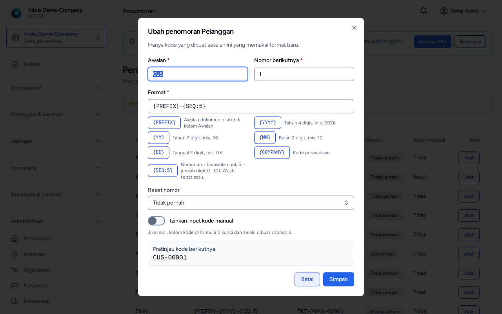

2. Isi form:
   - **Awalan**: wajib, 1 sampai 20 karakter, hanya huruf, angka, `-`, dan `_`.
   - **Nomor berikutnya**: wajib, bilangan bulat minimal 1, tidak lebih besar dari angka terbesar yang muat di `{SEQ:n}` (99999 untuk `{SEQ:5}`).
   - **Format**: wajib, maksimal 100 karakter. Ketik teks dan token, atau klik tombol token di bawah isian (`{PREFIX}`, `{YYYY}`, `{YY}`, `{MM}`, `{DD}`, `{COMPANY}`, `{SEQ:5}`) untuk menyisipkannya di posisi kursor. Setiap tombol punya keterangan singkat di sampingnya.
   - **Reset nomor**: pilih **Tidak pernah**, **Setiap tahun**, **Setiap bulan**, atau **Setiap hari**.
   - **Izinkan input kode manual**: saklar. Bila mati, kolom kode di formulir dikunci dan selalu dibuat otomatis. Teks bantu di bawahnya menulis "Jika mati, kolom kode di formulir dikunci dan selalu dibuat otomatis."
3. Baca **Pratinjau kode berikutnya**. Pratinjau berubah saat Anda mengetik dan memakai zona waktu perusahaan. Bila **Format** bermasalah, pesan merah muncul langsung di bawah isian sebelum Anda menyimpan.
4. Klik **Simpan**, atau **Batal** untuk menutup tanpa menyimpan. Setelah **Simpan**, notifikasi "Penomoran diperbarui." muncul, jendela tertutup, dan kolom **Kode berikutnya** berubah.

Aturan **Format**:

- Token yang dikenal: `{PREFIX}` (isi **Awalan**), `{YYYY}` (tahun 4 digit), `{YY}` (tahun 2 digit), `{MM}` (bulan), `{DD}` (tanggal), `{COMPANY}` (kode perusahaan), dan `{SEQ:n}` (nomor urut dengan nol di depan, n adalah jumlah digit dari 1 sampai 10). `{SEQ:n}` wajib ada tepat satu.
- Selain token, hanya huruf, angka, `-`, `_`, `/`, dan `.` yang boleh.
- **Setiap tahun** memerlukan `{YYYY}` atau `{YY}`. **Setiap bulan** memerlukan `{MM}` juga, dan **Setiap hari** memerlukan `{MM}` dan `{DD}` juga. Hitungan kembali ke 1 pada awal periode baru.
- Kode terpanjang yang mungkin tidak boleh melebihi 255 karakter.

Setelah **Simpan**:

- Hanya nomor yang dibuat sesudahnya yang berubah. Nomor lama tetap.
- Hitungan melanjutkan dari **Nomor berikutnya** yang Anda simpan. Format atau reset baru mulai dihitung pada periode saat Anda menyimpan.
- Sistem melewati nomor yang sudah dipakai data entitas itu, termasuk data yang sudah dihapus, jadi nomor tidak pernah ganda. Bila 1000 nomor berturut-turut sudah terpakai, pembuatan data gagal dan pesannya meminta **Nomor berikutnya** dinaikkan.
- Perubahan tercatat di Log audit (bagian 7.12) dengan modul **Penomoran**.

### Kesalahan umum

- Nomor lama tidak berubah setelah **Simpan**. Itu disengaja: hanya nomor baru yang memakai format baru.
- "Reset berkala memerlukan {YYYY} atau {YY}.", "Reset bulanan atau harian memerlukan {MM}.", dan "Reset harian memerlukan {DD}." muncul bila **Format** kurang token untuk **Reset nomor** yang dipilih. Tambahkan token itu atau pilih **Tidak pernah**.
- "Format harus memuat tepat satu {SEQ:n}, n antara 1 dan 10." muncul bila **Format** tidak punya `{SEQ:n}` atau punya lebih dari satu.
- "Token {X} tidak dikenal." muncul bila **Format** memuat token di luar daftar atau `{SEQ:n}` dengan n di luar 1 sampai 10. "Gunakan huruf, angka, tanda - _ / . dan token di dalam kurung kurawal." muncul bila ada karakter lain di luar token.
- "Awalan hanya boleh berisi huruf, angka, - dan _ (maksimal 20 karakter)." muncul bila **Awalan** memuat spasi atau tanda lain. "Awalan wajib diisi." muncul bila kosong.
- "Nomor berikutnya maksimal 99999 untuk {SEQ:5}." (angkanya mengikuti n) muncul bila **Nomor berikutnya** terlalu besar. Perbesar n atau kecilkan nomornya.
- "Format menghasilkan kode lebih dari 255 karakter." atau, pada pratinjau, "Kode terlalu panjang: n dari maksimal 255 karakter." muncul bila kode terpanjang yang mungkin melewati batas. Pendekkan **Awalan** atau **Format**.
- Pengaturan **Input manual** pada **Tagihan** tidak berpengaruh, karena formulir tagihan tidak punya kolom nomor dan nomornya selalu otomatis.
- Menurunkan **Nomor berikutnya** tidak memakai ulang nomor lama. Sistem melewati nomor yang sudah ada.
- Kunci pengaturan perusahaan `invoice_prefix`, `spk_prefix`, dan `ticket_prefix` (diisi oleh wizard awal) tidak dipakai sistem dan tidak tampil di layar. Awalan hanya diatur di **Penomoran**.

# 8. Administrasi

## 8.1 Perusahaan

Menu ini memuat identitas perusahaan yang sedang aktif dan pengaturan operasionalnya. Buka saat logo, kontak (telepon, WhatsApp, jam layanan), warna merek untuk aplikasi, tarif pajak, jatuh tempo tagihan, penangguhan otomatis, wilayah peta bawaan atau notifikasi WhatsApp perlu diubah.

Peran yang dapat memakai: admin. Izin: `company.manage`. Manajer dan staf tidak memegang izin ini, jadi item **Perusahaan** tidak tampil di sidebar mereka dan alamat layarnya ditolak. Perubahan berlaku untuk perusahaan yang sedang aktif; untuk berpindah perusahaan, lihat bagian 1.6.

### Membuka dan mengubah profil

1. Di sidebar, buka grup **Administrasi**, lalu klik **Perusahaan**. Layar **Perusahaan** terbuka dengan form profil dan tombol **Pengaturan** di kanan atas. Nama perusahaan tertulis sebagai judul kartu form.

   

2. Isi form:
   - **Nama**: wajib, paling banyak 255 karakter.
   - **Kode**: hanya terbaca (tidak dapat diubah). Kode ditetapkan operator platform saat perusahaan dibuat dan dipakai untuk mengonfirmasi tindakan berisiko. Contoh di demo: `DEMO`.
   - **Logo**: opsional. Seret berkas ke kotak atau klik **telusuri**. Pakai JPG, PNG atau WebP, paling besar 10 MB. Berkasnya diubah menjadi WebP dan diperkecil bila sisi terpanjangnya lebih dari 512 piksel. Petunjuk di layar juga menyebut SVG, tetapi aturan `image` di server tidak mengizinkan SVG, jadi jangan memakainya. Logo baru menggantikan logo lama; tanpa berkas baru, logo lama tetap.
   - **Telepon**: opsional, paling banyak 50 karakter. Hanya angka 0 sampai 9 dan tanda `(`, `)`, `+`, `-`. Karakter lain terhapus saat Anda mengetik.
   - **WhatsApp**: opsional, paling banyak 50 karakter, dengan karakter yang sama seperti **Telepon**. Keterangan di bawah isian: "Nomor tujuan tombol WhatsApp di aplikasi pelanggan." Tulis dengan kode negara, misalnya `6281234567890`. Aplikasi mengganti angka 0 di depan dengan 62 saat membuka WhatsApp. Ini nomor kontak ISP untuk pelanggan, bukan pengaturan pesan otomatis di **Pengaturan** (bagian di bawah).
   - **Email**: opsional, alamat e-mail yang valid, paling banyak 255 karakter.
   - **Situs web**: opsional, URL lengkap dengan awalan `https://`, paling banyak 255 karakter.
   - **Alamat**: opsional, paling banyak 1000 karakter.
   - **Jam layanan**: opsional, teks bebas paling banyak 120 karakter. Contoh di isian: "Senin sampai Sabtu, 08.00 sampai 17.00". Keterangan di bawah isian: "Tampil di aplikasi pelanggan sebagai jam dukungan." Isian ini hanya teks. Ia tidak mengubah **Jam tenang mulai** dan **Jam tenang selesai** pada pengaturan WhatsApp.
   - **Warna merek**: opsional. Pilih satu dari delapan bulatan warna (**Biru** `#2563EB`, **Hijau tosca** `#0F766E`, **Ungu** `#7C3AED`, **Merah muda** `#DB2777`, **Jingga** `#EA580C`, **Hijau** `#16A34A`, **Biru muda** `#0891B2`, **Abu kebiruan** `#334155`), atau ketik **Kode warna** dengan format `#RRGGBB`. Memilih bulatan mengisi **Kode warna**, dan mengetik kode yang sama dengan salah satu bulatan memilih bulatan itu. Kosongkan **Kode warna** untuk menghapus warna merek. Aplikasi pelanggan dan teknisi memakai warna ini untuk kartu utama, ikon, dan penanda menu. Tanpa warna merek, aplikasi memakai biru Inbils `#2563EB`.
     - Di samping isian, kotak **Contoh teks putih** menunjukkan warna itu dengan teks putih, disusul tulisan "Kontras N:1" (misalnya "Kontras 5,17:1. Teks putih terbaca jelas."). Rasio di bawah 4,5:1 menampilkan peringatan kuning "Di bawah 4,5:1, teks putih sulit dibaca. Pilih warna lebih gelap." Dari delapan warna siap pakai, **Jingga** (3,56:1), **Hijau** (3,30:1) dan **Biru muda** (3,68:1) memicu peringatan itu. Peringatan hanya saran, simpan tetap bisa dilakukan.
3. Klik **Simpan**. Selama logo diunggah, bilah **Mengunggah logo** menunjukkan kemajuan. Setelah berhasil, toast "Profil perusahaan diperbarui." muncul, dan nama serta logo di kepala sidebar ikut berubah.

**Profil dan aplikasi.** Aplikasi pelanggan menampilkan **Telepon**, **WhatsApp**, **Email**, **Situs web** dan **Jam layanan** di kartu "Hubungi {nama perusahaan}" pada tab **Akun**, dan di lembar **Hubungi ISP** pada Beranda. Ketukan pada **WhatsApp** membuka wa.me, **Telepon** membuka pemanggil, **Email** membuka aplikasi email, dan **Situs web** membuka peramban. **Jam layanan** tampil sebagai teks. Isian yang kosong tidak tampil. Bila semuanya kosong, lembar **Hubungi ISP** mengarahkan pelanggan ke tab **Bantuan** untuk membuat tiket. Aplikasi teknisi memakai nama dan logo perusahaan di kepala Beranda. **Warna merek** dipakai kedua aplikasi. Aplikasi membaca semua isian ini dari server saat memuat data akun, jadi perubahan baru terlihat setelah aplikasi memuat ulang.

### Membuka dan mengubah pengaturan

1. Di layar **Perusahaan**, klik tombol **Pengaturan** di kanan atas. Layar **Pengaturan Perusahaan** terbuka. Tombol **Profil perusahaan** di layar itu membawa Anda kembali. Keduanya adalah tombol biasa, bukan tab.

   

2. Ubah kartu pengaturan tagihan dan penangguhan. Setiap pengaturan punya nama, satuan dalam tanda kurung (bila ada) dan satu kalimat keterangan. Kartu **Tagihan** dan **Penangguhan otomatis** selalu tampil. Kartu **Format tanggal** dan baris **Buat tagihan otomatis saat SPK selesai** tampil hanya bila perusahaan sudah menyimpan pengaturan itu.
   - **Tarif PPN (%)**: angka 0 sampai 100, langkah 0,01, bawaan 11. Tarif pajak pada tagihan bulanan dan pada tagihan yang dibuat dari SPK. Keterangan: "Dipakai menghitung pajak pada tagihan baru."
   - **Jatuh tempo tagihan (hari)**: angka bulat 1 sampai 365, bawaan 14. Jumlah hari dari tanggal terbit sampai jatuh tempo pada tagihan bulanan buatan sistem (bagian 7.1).
   - **Rekening pembayaran**: kotak teks banyak baris, bawaan kosong. Tulis satu rekening per baris. Isinya tercetak di PDF tagihan di bawah label **Pembayaran:**.
   - **Buat tagihan otomatis saat SPK selesai**: saklar. Bila aktif, tagihan draf dibuat otomatis saat SPK selesai (bab 3).
   - **Tangguhkan langganan yang menunggak**: saklar, bawaan mati. Bila aktif, sistem menangguhkan (mengisolir) langganan aktif yang punya tagihan belum lunas dan lewat jatuh tempo lebih dari **Batas keterlambatan (hari)**. Pemeriksaannya berjalan setiap hari pukul 08:00.
   - **Batas keterlambatan (hari)**: angka bulat 1 sampai 60, bawaan 7.
   - **Aktifkan kembali saat tagihan lunas**: saklar, bawaan aktif. Bila aktif, langganan yang ditangguhkan otomatis kembali aktif setelah pembayaran, selama tidak ada lagi tagihannya yang lewat masa tenggang. Penangguhan manual tidak pernah dibuka otomatis.
   - **Format tanggal**: teks. Pola penulisan tanggal di seluruh halaman, misalnya `d M Y` atau `d/m/Y`. Dengan `d M Y`, tanggal tampil seperti 13 Okt 2026; pola yang tidak dikenal kembali ke 13/10/2026.
   - **Format tanggal dan jam**: teks, contoh `d M Y H:i`. Layar menulis tanggal beserta jam memakai **Format tanggal** lalu jam 24 jam `HH:mm`; isian ini tidak mengubah tampilan tersebut.
3. Pengaturan lain yang tersimpan untuk perusahaan, misalnya simbol mata uang atau awalan nomor dokumen dari Setup Wizard, tidak punya isian di layar ini. Menyimpan layar ini tidak menghapus atau mengubahnya.
4. Gulir ke kartu **Peta**. Kartu ini mengatur tempat peta pelanggan, alamat dan lokasi dibuka. Titik yang sudah tersimpan pada data tetap lebih utama:
   - **Wilayah default**: ketik untuk mencari, lalu pilih kota atau kabupaten (petunjuk "Cari kota atau kabupaten"). Memilih wilayah mengisi **Lintang**, **Bujur** dan **Zoom**. Tombol silang di isian ("Hapus pilihan: Wilayah default") mengosongkan pilihan.
   - **Lintang** dan **Bujur**: angka desimal. Server menolak lintang di luar -11 sampai 6 dengan "Lintang harus di antara -11 dan 6." dan bujur di luar 94 sampai 142 dengan "Bujur harus di antara 94 dan 142." Salah satu tidak boleh diisi sendirian. Kosongkan keduanya untuk kembali ke seluruh Indonesia.
   - **Zoom**: angka bulat 3 sampai 18. Keterangan: "3 untuk seluruh Indonesia, 12 untuk satu kota." Di luar rentang itu muncul "Zoom harus di antara 3 dan 18."
   - Peta di bawahnya: klik peta atau seret penanda untuk mengisi lintang dan bujur, atau klik **Gunakan lokasi saya** bila peramban mengizinkan. Titik yang dipilih di peta atau diketik melepas pilihan **Wilayah default**.
5. Gulir ke kartu **WhatsApp**. Bagian ini ada di bawah batas tangkapan layar di atas:
   - Peringatan "Notifikasi tidak akan terkirim sampai kredensial diatur di server." muncul bila server belum punya kredensial pengirim. Baris **Kredensial terkonfigurasi** menunjukkan Ya atau Tidak. Pengelola server yang mengatur kredensial, bukan layar ini.
   - **Aktifkan notifikasi WhatsApp**: saklar, bawaan mati.
   - **Jenis pesan yang dikirim**: sembilan kotak centang, semuanya tercentang secara bawaan: **Tagihan terbit**, **Pengingat jatuh tempo (H-3, H-1, H+1)**, **Pembayaran diterima**, **Tiket dibuat**, **Tiket mulai ditangani**, **Tiket selesai**, **Penugasan SPK ke teknisi**, **Jadwal kunjungan teknisi ke pelanggan** dan **Info link akses portal (tanpa link)**. Hanya **Penugasan SPK ke teknisi** berketerangan **Untuk teknisi**; delapan lainnya berketerangan **Untuk pelanggan**.
   - **Jam tenang mulai** dan **Jam tenang selesai**: pilih jam dengan pemilih jam. Ketik jam seperti 08:30, atau klik isian lalu pilih dari daftar per 30 menit ("Pilih jam"). Tombol "Hapus jam" mengosongkan isian, tetapi keduanya wajib terisi. Jam menurut zona waktu perusahaan, bawaan 21:00 dan 07:00. Rentang boleh melewati tengah malam. Pesan **Tagihan terbit** dan pengingat jatuh tempo menunggu sampai jam tenang selesai; jenis pesan lain dikirim langsung. Jam mulai yang sama dengan jam selesai berarti tidak ada jam tenang.
   - **Batas pesan per bulan**: angka bulat 0 sampai 100000, bawaan 1000. Pesan di atas batas dilewati. Keterangan: "Pesan di atas batas dilewati. Isi 0 untuk tidak mengirim apa pun." Isian tidak boleh kosong.
   - **Pemakaian bulan ini**: empat angka yang hanya dibaca, **Terkirim**, **Diterima**, **Gagal** dan **Berbayar**, untuk bulan kalender berjalan.

   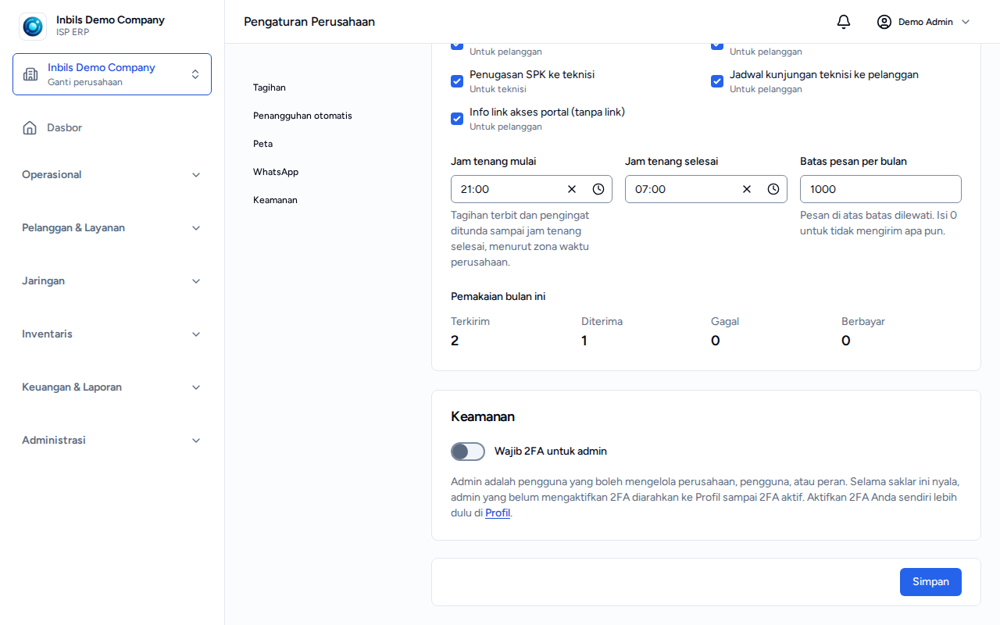

   Pelanggan hanya menerima pesan bila persetujuan WhatsApp mereka tercatat di data pelanggan (bab 4).
6. Klik **Simpan**. Toast "Pengaturan perusahaan diperbarui." muncul. Nilai baru dipakai oleh proses berikutnya: tagihan yang dibuat sesudahnya, pemeriksaan penangguhan berikutnya dan pesan WhatsApp yang dikirim sesudahnya.

Mata uang, zona waktu dan alamat Play Store aplikasi tidak punya isian di kedua layar ini.

### Kesalahan umum

- Logo ditolak: pesan merah muncul di bawah kotak **Logo**, misalnya "logo harus berupa gambar." bila berkasnya SVG atau bukan gambar, dan "Ukuran logo tidak boleh lebih dari 10240 kilobita." bila lebih dari 10 MB. Toast "Data gagal disimpan. Periksa input." ikut muncul. Pakai JPG, PNG atau WebP, perkecil bila perlu, lalu unggah lagi.
- **Situs web** ditolak dengan "situs web harus berupa URL yang valid.": tulis URL lengkap, misalnya dengan awalan `https://`.
- **WhatsApp** ditolak dengan "Nomor WhatsApp hanya boleh berisi angka dan karakter ( ) + -.", **Warna merek** ditolak dengan "Warna merek harus berupa kode warna heksadesimal seperti #2563EB.", dan **Jam layanan** ditolak bila lebih dari 120 karakter. Tulis ulang isiannya sesuai format di atas, atau kosongkan.
- Peringatan kontras di bawah **Warna merek** (kuning, berbunyi "Di bawah 4,5:1, teks putih sulit dibaca. Pilih warna lebih gelap.") tidak menghalangi **Simpan**. Pilih warna yang lebih gelap bila ingin teks putih di atasnya terbaca jelas.
- Kotak angka pada kartu **Tagihan** yang dikosongkan tersimpan sebagai kosong, dan sistem lalu memakai bawaannya (jatuh tempo 14 hari, tarif PPN bawaan sistem). **Batas keterlambatan (hari)**, **Batas pesan per bulan**, **Jam tenang mulai** dan **Jam tenang selesai** tidak boleh kosong: muncul pesan seperti "hari tunggakan penangguhan otomatis wajib diisi." di bawah isian.
- Server tidak memeriksa rentang **Tarif PPN (%)** dan **Jatuh tempo tagihan (hari)**. Batas 0 sampai 100 dan 1 sampai 365 hanya ada pada isian di layar, jadi periksa angkanya sebelum menyimpan.
- Pesan WhatsApp tidak terkirim padahal saklar aktif: periksa **Kredensial terkonfigurasi**, kotak centang jenis pesan, jam tenang, **Batas pesan per bulan** dan persetujuan WhatsApp di data pelanggan.

## 8.2 Organisasi

Organisasi menyimpan struktur perusahaan sebagai pohon unit: cabang, area, unit dan tim. Buka menu ini saat Anda menyusun struktur baru, memindahkan unit ke induk lain, atau menyiapkan unit sebelum menempatkan karyawan di dalamnya (bagian 8.3).

Peran yang dapat memakai: admin. Izin: `organization.view` membuka menu dan daftar, `organization.manage` mengizinkan tambah, ubah dan hapus unit, `organization.export` menampilkan tombol **Ekspor**. Pada peran bawaan hanya admin yang memegang ketiganya. Manajer, staf dan teknisi tidak melihat menu ini, kecuali admin memberi izinnya pada peran khusus (bagian 8.6 dan 8.7). Daftar memuat unit perusahaan aktif (bagian 1.6).

### Membuka dan membaca daftar

1. Di sidebar, buka grup **Administrasi**, lalu klik **Organisasi**.
2. Baca daftar. Layar ini berupa tabel, bukan tampilan pohon: kolom **Jalur** menunjukkan letak unit di pohon. Cara kerja pencarian, urutan, tombol baris, halaman dan dialog hapus ada di bagian 1.5.

   - Kotak **Cari** (teks petunjuk "Kode, nama, atau jalur") mencari di kode, nama dan jalur.
   - Kolom: **Kode**, **Nama**, **Jenis**, **Jalur**, **Sub-unit**, **Status** dan **Aksi**. **Kode**, **Nama** dan **Jenis** bisa diurutkan; urutan awal menurut **Kode**.
   - Di bawah nama unit tertulis "Induk: &lt;nama induk&gt;", atau "Unit utama" untuk unit paling atas.
   - **Jenis** dan **Status** berupa lencana berwarna: **Perusahaan**, **Cabang**, **Area**, **Unit** atau **Tim** untuk jenis, dan **Aktif** atau **Nonaktif** untuk status.
   - **Jalur** menulis kode unit dari yang paling atas sampai unit itu, dipisah tanda `>`. Unit paling atas hanya menampilkan kodenya sendiri.
   - **Sub-unit** menghitung unit anak langsung, misalnya "1 sub-unit" atau "2 sub-unit".
   - Tombol **Buat Unit**, **Ubah** dan menu **Aksi lainnya** (isinya **Hapus**) tampil untuk semua pemegang `organization.view`. Server menolak aksi dari pengguna tanpa `organization.manage`. Layar ini tidak punya tombol **Lihat** atau **Lihat detail**.
   - Bila belum ada unit, layar menulis "Belum ada unit organisasi" beserta tombol **Buat Unit**. Bila pencarian tidak menemukan apa pun, layar menulis "Tidak ada unit organisasi yang cocok" dengan tombol **Reset filter**.

   

### Menambah unit

1. Klik **Buat Unit**.
2. Isi form pada dialog **Buat Unit**:
   - **Kode**: wajib, maksimal 50 karakter. Kode tidak boleh sama dengan kode unit lain di perusahaan yang sama, termasuk unit yang sudah dihapus. Kode ikut menyusun **Jalur**.
   - **Nama**: wajib, maksimal 255 karakter.
   - **Jenis**: wajib. Pilih **Perusahaan**, **Cabang**, **Area**, **Unit** atau **Tim**. Isian awalnya **Cabang**. Sistem tidak memeriksa kecocokan tingkat dengan induknya.
   - **Induk**: opsional. Ketik untuk mencari, lalu pilih unit di daftar (petunjuk "Cari unit induk"). Daftar hanya memuat unit aktif, ditulis "kode - nama" dengan jalur unit di bawahnya, dan memfilter menurut yang Anda ketik. Pilihan tetap sampai Anda memilih unit lain atau mengklik tombol silang ("Hapus pilihan: Induk"). Mengetik di kotak tidak mengubah pilihan. Kosongkan isian agar unit menjadi unit paling atas, sesuai teks bantuan "Kosongkan untuk unit utama." Isian ini nonaktif dengan teks "Belum ada unit lain" selama belum ada unit aktif.
   - **Telepon**: opsional, maksimal 50 karakter.
   - **Email**: opsional, harus berformat email, maksimal 255 karakter.
   - **Alamat**: opsional, teks bebas.
   - **Aktif**: saklar, aktif secara awal.
3. Klik **Buat**. Dialog menutup dan muncul toast "Unit organisasi dibuat." Sistem mengisi **Jalur** otomatis.

### Mengubah dan memindahkan unit

1. Klik **Ubah** pada baris unit. Dialog **Ubah Unit** terbuka dengan data unit.
2. Ubah isian. Untuk memindahkan unit, pilih **Induk** yang baru, atau klik tombol silang pada **Induk** agar unit menjadi unit paling atas.
3. Klik **Simpan**. Muncul toast "Unit organisasi diperbarui."

Mengubah **Kode** atau **Induk** menghitung ulang **Jalur** unit itu dan semua unit di bawahnya. Unit yang sedang Anda ubah tidak muncul di pilihan **Induk**. Layar ini tidak punya tombol pindah atau seret-dan-lepas.

### Menghapus unit

1. Klik **Aksi lainnya** pada baris unit, lalu **Hapus**.
2. Konfirmasi di dialog "Hapus &lt;nama unit&gt;?" (keterangan: "Unit "&lt;nama unit&gt;" akan dihapus. Unit yang masih punya sub-unit atau karyawan tidak bisa dihapus."). Klik **Hapus**. Muncul toast "Unit organisasi dihapus."

Unit yang masih punya unit anak (kolom **Sub-unit** lebih dari 0) atau karyawan tidak bisa dihapus. Dialog tetap terbuka, toast "Data gagal disimpan. Periksa input." muncul, dan kotak merah di atas daftar menulis alasannya: "Unit masih punya sub-unit. Pindahkan atau hapus sub-unitnya dulu." atau "Unit masih punya karyawan. Pindahkan karyawannya ke unit lain dulu." Klik **Batal** untuk melihat kotak itu, lalu pindahkan atau hapus unit anaknya, atau pindahkan karyawannya (bagian 8.3).

### Menempatkan karyawan dan manajer di unit

Unit dipakai lewat isian **Organisasi** pada profil karyawan (bagian 8.3). Layar ini tidak punya isian kepala unit. Seorang manajer terhubung ke unit hanya lewat isian **Organisasi** pada profil karyawannya sendiri.

- Di Kinerja Teknisi (bagian 7.9), manajer (peran `manager` dengan izin `report.technician`) melihat teknisi yang ditempatkan di unitnya sendiri dan di semua unit di bawahnya. Admin (izin `report.manage`) melihat semua teknisi perusahaan.
- Syarat untuk manajer: profil karyawannya berstatus **Aktif** dan unitnya aktif. Bila belum, menu **Kinerja Teknisi** tidak tampil. Teknisi tanpa unit atau di unit nonaktif tidak terlihat oleh manajer.
- Di halaman SPK (bagian 3.3), daftar **Teknisi** pada dialog penugasan menampilkan nomor karyawan, nama unit dan nomor telepon di bawah nama teknisi. Unit tidak membatasi pilihan: Penugasan (bagian 3.1) dan halaman SPK menawarkan semua teknisi aktif di perusahaan.

### Mengekspor daftar

1. Isi kotak **Cari** bila Anda hanya butuh sebagian unit.
2. Klik **Ekspor**, lalu pilih **Ekspor CSV** atau **Ekspor PDF**.

Berkas bernama `organizations-export-<tanggal>-<jam>.csv` atau `.pdf` dan berisi kolom Kode, Nama, Jenis, Jalur, Sub-unit dan Status. Tombol **Ekspor** hanya tampil bagi pemegang `organization.export`.

### Kesalahan umum

- Muncul "Unit tidak bisa dipindahkan ke bawah dirinya sendiri atau sub-unitnya." di bawah **Induk**: induk yang Anda pilih adalah sub-unit dari unit itu sendiri. Pilih unit lain, atau pindahkan dulu unit anaknya.
- Penyimpanan gagal dengan toast "Data gagal disimpan. Periksa input.": baca pesan merah di bawah isian. **Kode** menulis "kode wajib diisi." atau "kode sudah digunakan.", **Email** menulis "email harus berupa alamat email yang valid." dan **Telepon** menolak lebih dari 50 karakter.
- Menghapus unit ditolak selama unit itu punya unit anak atau karyawan (lihat "Menghapus unit"). Pindahkan karyawan ke unit lain (bagian 8.3) sebelum menghapus.
- Unit yang dinonaktifkan (saklar **Aktif** mati) tidak muncul di pilihan **Induk** dan **Organisasi**, dan tidak dihitung untuk Kinerja Teknisi manajer. Nyalakan lagi lewat **Ubah**.

## 8.3 Karyawan

Karyawan menyimpan profil karyawan yang terhubung ke satu akun pengguna: nomor karyawan, unit, kendaraan, nomor telepon, tanggal masuk, status dan catatan. Akun pengguna saja belum cukup untuk pekerjaan lapangan, karena fitur lapangan juga meminta profil berstatus **Aktif**. Buka menu ini setelah Anda membuat akun baru di Pengguna (bagian 8.5).

Peran yang dapat memakai: admin. Izin: `employee.view` membuka menu dan daftar, `employee.manage` menampilkan tombol **Buat Karyawan** dan **Ubah**, `employee.export` menampilkan tombol **Ekspor**. Pada peran bawaan hanya admin yang memegang ketiganya. Layar ini tidak punya tombol **Lihat** dan **Hapus**.

### Membuka dan membaca daftar

1. Di sidebar, buka grup **Administrasi**, lalu klik **Karyawan**.
2. Baca daftar. Cara kerja pencarian, urutan dan halaman ada di bagian 1.5.

   - Kotak **Cari** (teks petunjuk "Nomor, nama, email, atau telepon") mencari nomor karyawan, telepon, nama dan email pengguna.
   - Filter **Organisasi** adalah kotak cari: ketik, lalu pilih unit aktif (petunjuk "Semua organisasi"). Tombol silang ("Hapus pilihan: Organisasi") mengembalikannya ke semua unit. Filter **Status** berisi **Semua status**, **Aktif**, **Nonaktif** dan **Berhenti**.
   - Kolom: **Nomor karyawan**, **Nama** (nama akun pengguna, dengan email di bawahnya), **Organisasi**, **Kendaraan** (nomor polisi), **Status** dan **Aksi**. **Nomor karyawan** dan **Status** bisa diurutkan; urutan awal menurut karyawan terbaru. Sel kosong berisi `-`.
   - Lencana **Status** berwarna hijau untuk **Aktif**, abu-abu untuk **Nonaktif** dan **Berhenti**.
   - Tombol **Buat Karyawan** dan tombol **Ubah** di tiap baris hanya tampil bagi pemegang `employee.manage`. Baris tidak punya menu **Aksi lainnya**.
   - Bila belum ada profil, layar menulis "Belum ada karyawan". Bila filter tidak menemukan apa pun, layar menulis "Tidak ada karyawan yang cocok" dengan tombol **Reset filter**.

   

### Menambah profil karyawan

1. Pastikan akun pengguna karyawan sudah ada dan aktif (bagian 8.5).
2. Klik **Buat Karyawan**.
3. Isi form pada dialog **Buat Karyawan**:
   - **Pengguna**: wajib. Ketik nama atau email, lalu pilih akun (petunjuk "Cari nama atau email"). Server mencari setelah Anda mengetik sedikitnya 2 karakter dan menampilkan paling banyak 20 hasil. Daftar hanya memuat pengguna aktif yang belum punya profil karyawan di perusahaan ini, baik akun milik perusahaan ini maupun akun yang diberi akses ke perusahaan ini, sesuai teks bantuan "Hanya pengguna aktif yang belum punya profil karyawan." Bila tidak ada yang cocok, layar menulis "Tidak ada pengguna aktif yang cocok dan belum punya profil." Satu akun hanya bisa punya satu profil. Pilihan berubah hanya saat Anda memilih akun lain atau mengklik tombol silang ("Hapus pilihan: Pengguna").
   - **Nomor karyawan**: terisi otomatis dan terkunci selama Penomoran (bagian 7.13) tidak mengizinkan input manual. Isian menampilkan perkiraan nomor berikutnya, bentuk awalnya `EMP-0001`, dengan teks "Dibuat otomatis saat disimpan, perkiraan: &lt;nomor&gt;". Bila input manual diizinkan, Anda bisa mengetik nomor (maksimal 50 karakter, unik per perusahaan) atau mengosongkannya agar dibuat otomatis ("Kosongkan untuk dibuat otomatis").
   - **Organisasi**: opsional. Ketik untuk mencari, lalu pilih unit aktif (petunjuk "Cari organisasi"). Daftar ditulis "kode - nama".
   - **Kendaraan**: opsional. Ketik untuk mencari, lalu pilih kendaraan aktif menurut nomor polisi (petunjuk "Cari nomor polisi").
   - **Telepon**: opsional, maksimal 50 karakter. Sistem memakai nomor ini untuk pesan WhatsApp penjadwalan SPK bila WhatsApp perusahaan aktif. Sistem melewati nomor yang bukan seluler Indonesia dengan awalan `08` atau `+62`.
   - **Tanggal masuk**: opsional. Ketik tanggal dalam format tanggal perusahaan, atau klik isian untuk membuka kalender ("Pilih tanggal") lalu pilih hari, atau klik **Hari ini**. Tombol "Hapus tanggal" mengosongkan isian.
   - **Status**: pilih **Aktif**, **Nonaktif** atau **Berhenti**. Isian awalnya **Aktif**.
   - **Catatan**: opsional, teks bebas.
4. Klik **Buat**. Muncul toast "Karyawan dibuat."

   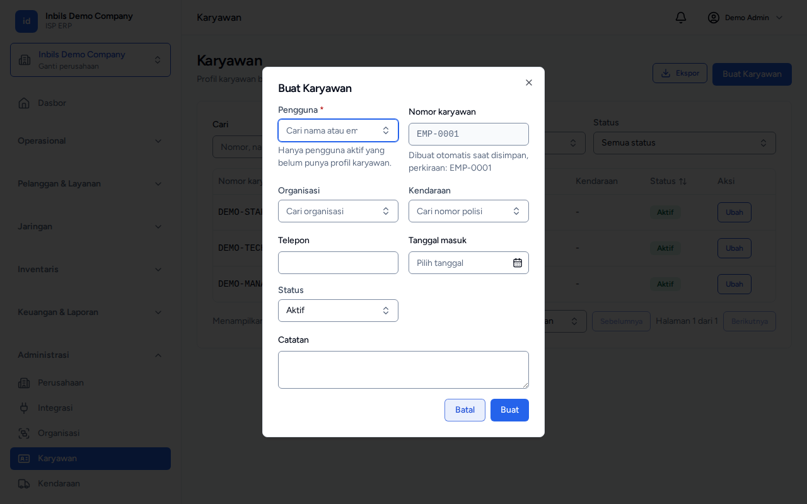

### Mengubah profil karyawan

1. Klik **Ubah** pada baris karyawan. Dialog **Ubah Karyawan** terbuka dengan semua data profil yang tersimpan: organisasi, kendaraan, telepon, tanggal masuk, status dan catatan sudah terisi.
2. Ubah isian yang perlu. **Pengguna** tampil sebagai teks yang hanya bisa dibaca, dengan keterangan "Pengguna tidak bisa diganti." **Nomor karyawan** hanya bisa dibaca (keterangan "Dibuat otomatis dan tidak dapat diubah.") selama input manual tidak diizinkan; bila diizinkan, isian wajib terisi dan unik per perusahaan.
3. Klik **Simpan**. Muncul toast "Karyawan diperbarui."

Untuk mencabut akses lapangan seorang karyawan, ubah **Status** menjadi **Nonaktif** atau **Berhenti**. Layar ini tidak punya tombol hapus profil.

### Menyiapkan karyawan untuk pekerjaan lapangan

- Pekerjaan Saya (bagian 3.6) tampil di sidebar hanya untuk pengguna aktif yang memegang izin kerja (`ticket.start`, `ticket.resolve`, `ticket.close`, `spk.start` atau `spk.submit`) dan punya profil **Aktif** di perusahaan aktif.
- Aplikasi teknisi memakai syarat tersebut, ditambah email pengguna yang sudah diverifikasi. Aplikasi memeriksanya saat masuk dan pada setiap permintaan berikutnya. Teknisi mengerjakan tugasnya di aplikasi itu, bukan di web.
- Pilihan teknisi untuk SPK, di Penugasan (bagian 3.1) dan di halaman SPK (bagian 3.3), hanya memuat pengguna aktif dengan profil **Aktif** dan izin `spk.start` atau `spk.submit`.
- Pilihan penerima tiket di Penugasan tidak meminta profil. Tiket yang ditugaskan ke pengguna tanpa profil **Aktif** tidak muncul di Pekerjaan Saya.
- Isian **Diperoleh oleh** pada pelanggan (bagian 4.1) hanya menawarkan pengguna aktif dengan profil **Aktif** yang memegang `customer.create`. Admin tanpa profil tidak ditawarkan.
- Evaluasi (bagian 3.5) menilai akun pengguna. Nilai evaluasi itu masuk ke rata-rata skor dan rating pelanggan di Kinerja Teknisi (bagian 7.9).
- Kinerja Teknisi hanya memuat teknisi dengan profil **Aktif**.

### Mengekspor daftar

1. Atur kotak **Cari**, filter **Organisasi** dan filter **Status** sesuai data yang Anda butuhkan.
2. Klik **Ekspor**, lalu pilih **Ekspor CSV** atau **Ekspor PDF**.

Berkas `employees-export-<tanggal>-<jam>.csv` atau `.pdf` memuat Nomor karyawan, Nama, Email, Organisasi, Kendaraan, Status dan Telepon. Tombol **Ekspor** hanya tampil bagi pemegang `employee.export`.

### Kesalahan umum

- Akun tidak ada di pilihan **Pengguna**: daftar hanya memuat pengguna aktif di perusahaan ini yang belum punya profil, dan baru mencari setelah Anda mengetik 2 karakter. Buat atau aktifkan akunnya di Pengguna (bagian 8.5). Akun yang sudah punya profil tidak bisa dipilih lagi.
- Pengguna muncul di pilihan tetapi ditolak dengan "Pengguna ini sudah punya profil karyawan.": akun itu sudah punya profil di perusahaan lain, atau profil lamanya pernah dihapus dan masih menahan akun itu. Satu akun hanya boleh punya satu profil karyawan, di semua perusahaan. Layar web tidak punya langkah untuk memperbaikinya.
- Pekerjaan Saya atau aplikasi teknisi tidak terbuka untuk karyawan yang sudah punya profil: periksa akun aktif, email terverifikasi, profil **Aktif** (kolom **Status**) dan izin kerja pada perannya.
- Teknisi tidak muncul di pilihan SPK: perannya belum memegang `spk.start` atau `spk.submit`, atau profilnya belum **Aktif**.
- Tanggal masuk ditolak dengan "Format tanggal tidak valid. Contoh: &lt;tanggal&gt;." di bawah isian: tulis tanggal sesuai contoh itu, atau pilih dari kalender.
- Nomor karyawan ditolak dengan "nomor karyawan sudah digunakan." (hanya saat input manual diizinkan): pilih nomor lain atau kosongkan isian pada dialog **Buat Karyawan**.
- Layar ini tidak punya isian jabatan dan tombol **Hapus**. Untuk mencabut akses lapangan, ubah **Status** profil, atau matikan saklar **Aktif** pada akun orangnya di Pengguna (bagian 8.5).

## 8.4 Kendaraan

Kendaraan mencatat kendaraan operasional teknisi: nomor polisi, jenis, merek, model, tanggal pembelian dan status aktif. Buka menu ini saat perusahaan menambah, mengganti atau menghentikan kendaraan. Siapa yang memakai kendaraan dicatat di profil karyawan (bagian 8.3), bukan di layar ini.

Peran yang dapat memakai: admin. Izin: `vehicle.view` membuka menu dan daftar, `vehicle.manage` mengizinkan tambah, ubah dan hapus, `vehicle.export` menampilkan tombol **Ekspor**. Pada peran bawaan hanya admin yang memegang izin kendaraan. Tombol **Buat Kendaraan** dan kolom **Aksi** (**Ubah** dan **Hapus**) hanya tampil bagi pemegang `vehicle.manage`; server juga menolak aksi dari pengguna tanpa izin itu.

### Membuka dan membaca daftar

1. Di sidebar, buka grup **Administrasi**, lalu klik **Kendaraan**.
2. Baca daftar. Kotak **Cari** (teks petunjuk "Nomor polisi, jenis, merek, atau model") mencari di empat kolom itu. Kolomnya **Nomor polisi**, **Jenis**, **Merek**, **Model**, **Status** dan **Aksi**. **Nomor polisi**, **Jenis**, **Merek** dan **Model** bisa diurutkan. Urutan awal menunjukkan kendaraan terbaru di atas. Sel kosong berisi `-`, dan lencana **Status** berisi **Aktif** atau **Nonaktif**. Daftar memakai halaman: lihat teks "Menampilkan" dengan rentang baris dan jumlah total, pilihan "Baris per halaman" serta tombol halaman sebelumnya dan berikutnya di bawah tabel (bagian 1.5). Bila belum ada kendaraan, layar menulis "Belum ada kendaraan".

   

### Menambah kendaraan

1. Klik **Buat Kendaraan**.
2. Isi form pada dialog **Buat Kendaraan**:
   - **Nomor polisi**: wajib, maksimal 20 karakter. Nomor tidak boleh sama dengan kendaraan lain di perusahaan yang sama, termasuk kendaraan yang sudah dihapus.
   - **Jenis**: opsional, maksimal 50 karakter. Teks petunjuk "Motor, mobil, atau pikap".
   - **Merek**: opsional, maksimal 100 karakter.
   - **Model**: opsional, maksimal 100 karakter.
   - **Tanggal pembelian**: opsional. Ketik tanggal dalam format tanggal perusahaan, atau klik isian untuk membuka kalender ("Pilih tanggal") lalu pilih hari, atau klik **Hari ini**. Tombol "Hapus tanggal" mengosongkan isian.
   - **Aktif**: saklar, aktif secara awal. Hanya kendaraan aktif yang muncul di pilihan **Kendaraan** pada profil karyawan.
   - **Catatan**: opsional, teks bebas.
3. Klik **Buat**. Muncul toast "Kendaraan dibuat."

### Mengubah kendaraan

1. Klik **Ubah** pada baris kendaraan. Dialog **Ubah Kendaraan** terbuka dengan semua data yang tersimpan, termasuk **Tanggal pembelian** dan **Catatan**.
2. Ubah isian yang perlu. Mengosongkan **Tanggal pembelian** menghapus tanggal yang tersimpan.
3. Klik **Simpan**. Muncul toast "Kendaraan diperbarui."

### Menghapus kendaraan

1. Klik **Aksi lainnya** pada baris kendaraan, lalu **Hapus**.
2. Konfirmasi di dialog "Hapus &lt;nomor polisi&gt;?" (keterangan: "Kendaraan "&lt;nomor polisi&gt;" akan dihapus dari daftar."). Klik **Hapus**. Muncul toast "Kendaraan dihapus."

Kendaraan hilang dari daftar dan dari pilihan **Kendaraan** pada form karyawan. Karyawan yang memakainya lalu tampil dengan **Kendaraan** `-`. Layar ini tidak menolak penghapusan kendaraan yang masih dipakai karyawan.

### Mengekspor daftar

1. Isi kotak **Cari** bila Anda hanya butuh sebagian kendaraan.
2. Klik **Ekspor**, lalu pilih **Ekspor CSV** atau **Ekspor PDF**.

Berkas bernama `vehicles-export-<tanggal>-<jam>.csv` atau `.pdf` dan berisi kolom Nomor polisi, Jenis, Merek, Model dan Status. Tombol **Ekspor** hanya tampil bagi pemegang `vehicle.export`.

### Kesalahan umum

- Pesan "nomor polisi sudah digunakan." di bawah **Nomor polisi**: nomor itu sudah dipakai kendaraan lain, termasuk kendaraan yang sudah dihapus. Nomor yang sudah dihapus tetap dianggap terpakai, jadi untuk kendaraan yang berhenti dipakai matikan saklar **Aktif** lewat **Ubah**, jangan hapus.
- Penyimpanan gagal dengan toast "Data gagal disimpan. Periksa input.": baca pesan merah di bawah isian. **Nomor polisi** menulis "nomor polisi wajib diisi." bila kosong, dan **Jenis**, **Merek**, **Model** menolak teks yang melewati batas panjangnya.
- Tombol **Buat Kendaraan**, **Ubah** atau **Hapus** tidak tampil, atau server menolaknya: peran Anda belum memegang `vehicle.manage`. Minta operator platform menambahkannya ke peran (bagian 8.6), atau minta admin memberi Anda peran yang memegangnya (bagian 8.7).

## 8.5 Pengguna

Menu ini mengelola akun login karyawan back-office: nama, e-mail, kata sandi awal, status aktif dan peran. Buka saat ada orang baru, saat peran berubah, saat akun perlu dinonaktifkan, atau saat seseorang kehilangan perangkat autentikasi dua langkah.

Peran yang dapat memakai: admin. Izin: `users.manage` (daftar, tambah, ubah, hapus, ekspor) dan `users.two_factor.reset` (atur ulang 2FA, hanya admin). Daftar hanya memuat pengguna yang perusahaan asalnya adalah perusahaan yang sedang aktif.

### Membuka dan membaca daftar

1. Di sidebar, buka grup **Administrasi**, lalu klik **Pengguna**.
2. Baca layar:
   - **Cari** (petunjuk "Nama atau email") mencari di nama dan e-mail. **Status** menyaring **Semua status**, **Aktif** atau **Nonaktif**.
   - Kolom: **Nama** (tautan ke halaman detail) dan **Email** (keduanya bisa diurutkan), **Peran** (satu lencana per peran), **Status** (bisa diurutkan; lencana **Aktif** atau **Nonaktif**), **2FA** (lencana **Aktif** atau **Nonaktif**) dan **Aksi**.
   - Kolom **Aksi** berisi tombol **Ubah** dan menu **Aksi lainnya** dengan **Lihat detail** dan **Hapus**.
   - **Hapus** tidak muncul di baris akun Anda sendiri, di baris admin bila Anda bukan admin, dan di baris pengguna yang juga tergabung di perusahaan lain yang tidak Anda ikuti.
   - **Ekspor** menawarkan **Ekspor CSV** dan **Ekspor PDF** dengan kolom Nama, Email, Peran dan Status (**Aktif** atau **Nonaktif**). Hasilnya mengikuti pencarian dan filter yang aktif, paling banyak 5000 baris (batas bawaan). Bila lebih, berkas CSV berakhir dengan baris "# Ekspor dipotong pada 5000 baris. Persempit filter untuk mengekspor sisa barisnya." dan PDF menandai pemotongan itu. Persempit filter bila itu terjadi.
   - Bila tidak ada baris, layar menampilkan "Belum ada pengguna", atau "Tidak ada pengguna yang cocok" dengan tombol **Reset filter** saat filter aktif.

   

### Membuat pengguna

1. Klik **Buat Pengguna**.

   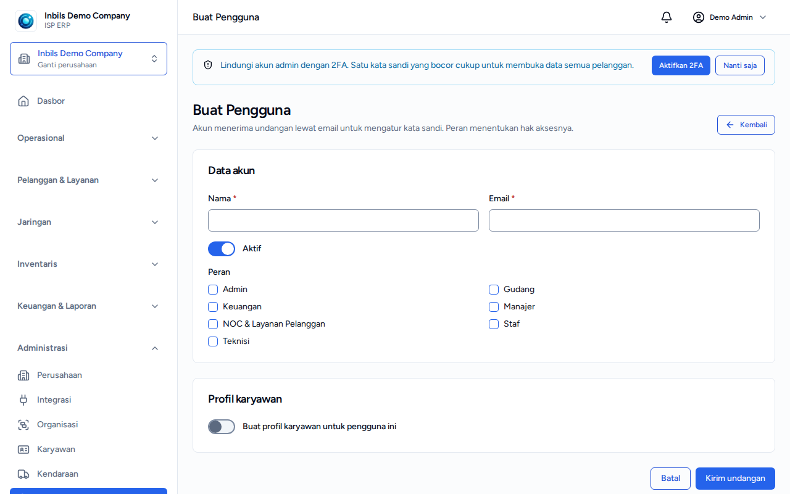

2. Isi kartu **Data akun**:
   - **Nama**: wajib, paling banyak 255 karakter.
   - **Email**: wajib, e-mail yang valid, paling banyak 255 karakter, belum dipakai akun lain di sistem (perusahaan mana pun).
   - **Kata sandi**: wajib, paling sedikit 8 karakter (petunjuk "Minimal 8 karakter."). Ini kata sandi awal. Sistem tidak mengirim e-mail apa pun ke pengguna baru, jadi sampaikan sendiri kata sandi itu dan minta pengguna menggantinya di profilnya (bagian 1.7).
   - **Aktif**: saklar, bawaan hidup. Matikan bila akun baru belum boleh masuk. Nilainya tersimpan, jadi akun itu langsung berstatus **Nonaktif**.
   - **Peran**: satu kotak centang per peran, berlabel nama peran (lima peran bawaan dan peran buatan sendiri). Boleh memilih lebih dari satu; baca "Aturan saat memberi peran" di bawah.
3. Klik **Buat**. Anda kembali ke daftar dan toast "Pengguna dibuat." muncul. **Batal** kembali ke daftar tanpa menyimpan.

Akun baru berasal dari perusahaan yang sedang aktif dan e-mailnya langsung terverifikasi. Akun yang hanya berperan **technician** dan atau **customer** dialihkan di web ke halaman "Gunakan aplikasi Inbils"; peran lain yang ikut dicentang menghilangkan pengalihan itu. Login pelanggan dibuat otomatis saat pelanggan dibuat (bab 4), jadi jangan membuatnya di sini. Teknisi juga memerlukan profil karyawan aktif (bagian 8.3).

### Aturan saat memberi peran

Pesan penolakan muncul dalam warna merah di bawah daftar **Peran**, disertai toast "Data gagal disimpan. Periksa input."

- Hanya admin yang dapat mencentang peran **admin**. Bila yang menyimpan bukan admin, pesannya "Hanya administrator yang boleh memberi peran admin."
- Hanya admin yang dapat membuka **Ubah**, menghapus atau mengatur ulang 2FA akun ber-peran admin.
- Bila yang menyimpan bukan admin, izin gabungan dari semua peran yang dicentang tidak boleh memuat pasangan yang bertentangan menurut pemisahan tugas (daftar pasangan ada di bagian 8.6). Contoh: **manager** dan **staff** pada satu akun ditolak, karena manajer menyetujui permintaan barang sedangkan staf menyiapkan dan mengeluarkannya. Pesannya berbentuk "Pemisahan tugas (persetujuan permintaan barang vs pelaksanaan gudang): ... tidak boleh digabung dengan ...", diikuti kode izin yang bertabrakan. Admin dikecualikan sebagai jalan darurat.
- Bila pengguna juga tergabung di perusahaan lain yang tidak Anda ikuti, halaman detail, **Ubah** dan **Hapus** ditolak (403, "Akses ditolak").
- Sistem tidak memeriksa apakah masih ada admin lain. Admin yang melepas peran admin dari akunnya sendiri, atau menonaktifkannya, dapat meninggalkan sistem tanpa admin. Pastikan ada admin lain sebelum melakukannya.

### Mengubah pengguna

1. Di daftar, klik **Ubah** pada baris pengguna, atau klik **Ubah** di halaman detail.
2. Ubah isian di form **Ubah Pengguna**. Isiannya sama dengan form pembuatan, dengan perbedaan berikut:
   - **Email**: tetap harus unik. Mengubahnya di sini tidak mereset status verifikasi e-mail.
   - **Kata sandi**: kosongkan untuk mempertahankan kata sandi lama (petunjuk "Kosongkan untuk mempertahankan kata sandi saat ini."). Bila diisi, paling sedikit 8 karakter.
   - **Peran**: hasilnya persis peran yang tercentang. Peran yang tidak dicentang dilepas.
3. Klik **Simpan**. Anda kembali ke daftar dan toast "Pengguna diperbarui." muncul. **Batal** kembali ke daftar tanpa menyimpan. Tombol **Kembali** di kanan atas membuka halaman detail pengguna itu.

Menonaktifkan akun atau mengganti kata sandinya langsung mencabut semua token aplikasi pengguna itu, sehingga aplikasi Android meminta masuk ulang pada panggilan berikutnya. Pengguna nonaktif tidak dapat masuk lagi, dan login menolaknya dengan pesan yang sama seperti kata sandi salah ("Email atau kata sandi salah."). Sesi web yang sudah terbuka tidak ditutup otomatis dan berjalan sampai sesinya berakhir. Penugasan SPK dan tiket menolak pengguna nonaktif (bab 3).

### Melihat detail pengguna

1. Klik nama pengguna di daftar, atau **Lihat detail** di menu **Aksi lainnya**.
2. Judul halaman memuat nama dan e-mail, dengan tombol **Kembali**, **Log audit** dan **Ubah**. **Log audit** hanya tampil bila Anda memegang `report.audit.view` (bawaan: admin). Tombol itu membuka log audit yang sudah disaring untuk pengguna ini. Kartu **Data pengguna** menampilkan **Status**, **Dibuat**, **Terakhir masuk** (tanggal dan jam memakai format perusahaan), **Pelanggan** (kode dan nama, bila akun tertaut ke pelanggan) dan **Peran** ("Belum ada peran" bila kosong). Kartu **Autentikasi dua langkah** menampilkan lencana **Aktif** atau **Nonaktif**.

   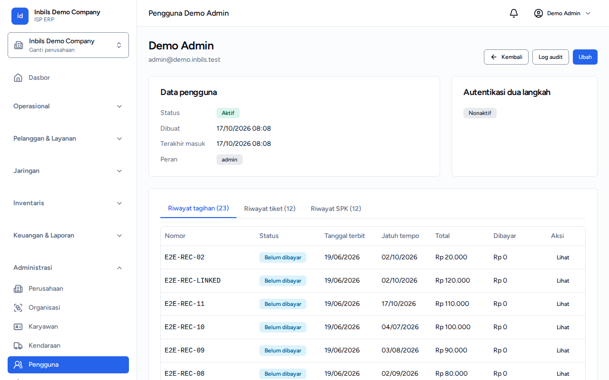

3. Di bawahnya muncul tab riwayat sesuai izin Anda: **Riwayat tagihan (n)** (`billing.view`), **Riwayat tiket (n)** (`ticket.view`) dan **Riwayat SPK (n)** (`spk.view`). Tiap tab memuat paling banyak 50 baris terbaru dan tombol **Lihat** ke dokumennya. Tanpa satu pun izin itu, tab tidak tampil.
   - **Riwayat tagihan**: tagihan yang dibuat pengguna itu atau milik pelanggan yang tertaut. Kolom Nomor, Status, Tanggal terbit, Jatuh tempo, Total, Dibayar dan Aksi.
   - **Riwayat tiket**: tiket yang dibuat oleh atau ditugaskan kepadanya, atau milik pelanggan yang tertaut. Kolom Kode, Judul, Prioritas, Status, Dibuat, Diselesaikan dan Aksi.
   - **Riwayat SPK**: SPK yang dibuat oleh atau ditugaskan kepadanya, atau milik pelanggan yang tertaut. Kolom Kode, Judul, Jenis, Prioritas, Status, Jadwal, Selesai dan Aksi.
   - Tab tanpa isi menampilkan "Belum ada riwayat tagihan", "Belum ada riwayat tiket" atau "Belum ada riwayat SPK".

### Mengatur ulang autentikasi dua langkah

Pakai fitur ini bila pengguna kehilangan perangkat autentikator dan kode pemulihannya. Pengguna yang masih memegang kode pemulihan dapat memakainya sendiri (bagian 1.4). Tombol hanya tampil bila pengguna berstatus 2FA **Aktif**, Anda memegang `users.two_factor.reset` (bawaan: admin saja), ini bukan akun Anda sendiri, Anda boleh mengubah akun itu (akun admin hanya oleh admin) dan Anda tergabung di semua perusahaan pengguna itu.

1. Buka halaman detail pengguna (bagian "Melihat detail pengguna").
2. Pada kartu **Autentikasi dua langkah**, klik **Atur ulang 2FA**.
3. Baca dialog berjudul "Atur ulang autentikasi dua langkah untuk" diikuti nama pengguna dan tanda tanya. Isinya: pengguna bisa masuk hanya dengan kata sandi sampai ia mengaturnya lagi, dan kode pemulihannya tidak berlaku. Pastikan dulu bahwa yang meminta benar orangnya, lalu klik **Atur ulang**. **Batal** menutup dialog.
4. Toast "Autentikasi dua langkah direset." muncul, disusul nama pengguna dan keterangan bahwa ia bisa masuk hanya dengan kata sandi, lalu mengaturnya lagi. Lencana berubah menjadi **Nonaktif** dan tombolnya hilang.

Reset menghapus rahasia autentikator dan kode pemulihan, mengakhiri login lain pengguna itu (cookie "Ingat saya", token aplikasi, dan sesi web lainnya bila server memakai sesi database) dan tercatat di log keamanan bersama id admin yang melakukannya.

### Menghapus pengguna

1. Klik menu **Aksi lainnya** pada baris pengguna, pilih **Hapus**, lalu klik **Hapus** di dialog konfirmasi. Judul dialog berbunyi "Hapus" diikuti nama pengguna dan tanda tanya, dengan keterangan "Pengguna yang tercatat pada pelanggan atau penyesuaian stok tidak bisa dihapus. Nonaktifkan akunnya."
2. Toast "Pengguna dihapus." muncul. Penghapusan bersifat permanen dan tidak bisa dibatalkan. Semua token aplikasi pengguna itu ikut dicabut.

Penghapusan ditolak bila pengguna dikreditkan sebagai pembawa pelanggan (bab 4), atau pernah mengajukan atau meninjau penyesuaian stok (bab 6). Dialog tetap terbuka, kotak merah di atas daftar menampilkan alasannya, dan toast "Data gagal disimpan. Periksa input." muncul. Alasan itu berbunyi "Pengguna yang dicatat memperoleh pelanggan tidak bisa dihapus. Nonaktifkan akunnya." atau "Pengguna yang pernah mengajukan atau memeriksa penyesuaian stok tidak bisa dihapus. Nonaktifkan akunnya." Klik **Batal**, lalu nonaktifkan akunnya lewat **Ubah**.

### Kesalahan umum

- Simpan ditolak dengan toast "Data gagal disimpan. Periksa input.": baca pesan merah di bawah isian atau di bawah **Peran**. Penyebab umum: kombinasi peran (lihat "Aturan saat memberi peran"), "email sudah digunakan." bila e-mail dipakai akun lain, dan "kata sandi minimal 8 karakter." bila **Kata sandi** kurang dari 8 karakter.
- Akun baru seharusnya nonaktif tetapi tampil **Aktif**: saklar **Aktif** di form pembuatan masih hidup saat Anda menyimpan. Matikan saklar itu, atau ubah akunnya lewat **Ubah**.
- Teknisi atau pelanggan melihat halaman "Gunakan aplikasi Inbils": itu perilaku normal untuk akun yang hanya berperan **technician** dan atau **customer**. Beri peran back-office bila orangnya memang harus memakai web.
- Pengguna sudah dinonaktifkan tetapi masih bisa bekerja di web: sesi yang sudah terbuka belum berakhir. Token aplikasinya sudah dicabut.
- Tombol **Atur ulang 2FA** tidak ada: pengguna belum mengaktifkan 2FA, Anda bukan admin, akun itu milik Anda sendiri, atau akun itu berperan admin dan Anda bukan admin.
- **Hapus** tidak ada di baris pengguna: baris itu akun Anda sendiri, akun admin dan Anda bukan admin, atau pengguna itu tergabung di perusahaan yang tidak Anda ikuti.
- Admin tunggal yang kehilangan perangkat 2FA tidak dapat diatur ulang dari layar ini karena tidak ada admin lain. Pengelola server mematikan 2FA-nya lewat perintah server.

## 8.6 Peran

Menu ini mendaftar peran (kumpulan izin) dan menampilkan isi tiap peran, hanya untuk dibaca. Buka saat Anda perlu tahu hak akses apa yang dipegang sebuah peran sebelum memberikannya ke pengguna.

Peran yang dapat memakai: admin. Izin: `roles.manage` (daftar dan halaman detail) dan `roles.export` (tombol **Ekspor**). Definisi peran bersifat global dan berlaku untuk semua perusahaan, jadi dikelola oleh operator platform Inbils, bukan oleh admin perusahaan. Membuat peran baru, mengubah nama atau izin peran, dan menghapus peran tidak bisa dilakukan dari web perusahaan, di perusahaan induk, mandiri maupun anak perusahaan. Untuk peran baru atau perubahan izin, hubungi operator platform. Memberikan peran yang sudah ada ke pengguna tetap dilakukan di menu **Pengguna** (bagian 8.5).

### Membuka dan membaca daftar

1. Di sidebar, buka grup **Administrasi**, lalu klik **Peran**.
2. Baca layar:
   - Keterangan di atas tabel berbunyi "Definisi peran dikelola oleh operator platform. Tetapkan peran ke pengguna di menu Pengguna."
   - **Cari** (petunjuk "Nama peran") mencari di nama peran.
   - Kolom: **Nama** (bisa diurutkan; berupa tautan ke halaman detail; lencana **Bawaan** pada lima peran bawaan), **Hak akses** (jumlah izin), **Pengguna** (jumlah pengguna ber-peran itu di perusahaan yang sedang aktif) dan **Aksi**.
   - **Aksi** hanya berisi tombol **Lihat**. Tidak ada **Ubah**, **Hapus** atau **Buat Peran**.
   - Tombol **Ekspor** (**Ekspor CSV** dan **Ekspor PDF**; kolom Nama, Hak akses, Pengguna, Guard) tampil di kanan atas bila Anda memegang `roles.export`.

   

3. Lima peran bawaan berlaku global. Angka izin berikut berasal dari seeder peran (`RolePermissionSeeder`), dengan 166 izin seluruhnya:

   | Peran | Fungsi | Jumlah izin |
   |---|---|---|
   | `admin` | Administrator penuh dan jalan darurat. Memegang semua izin kecuali izin portal pelanggan | 164 |
   | `manager` | Pengendali: menyetujui permintaan barang, SPK dan penyesuaian stok, membatalkan tagihan, membatalkan pembayaran, melihat laporan | 103 |
   | `staff` | Operator: mencatat pelanggan, membuat SPK, tiket dan tagihan, menjalankan stok masuk dan keluar | 50 |
   | `technician` | Pekerjaan lapangan, di aplikasi teknisi | 26 |
   | `customer` | Tiket, evaluasi dan portal tagihan, di aplikasi pelanggan | 8 |

   Tidak ada peran bawaan yang dapat dihapus atau diganti namanya.

### Membaca detail peran

1. Di daftar, klik nama peran atau tombol **Lihat**. Judul halaman berbunyi "Peran" diikuti nama peran, dengan subjudul yang sama dengan keterangan di daftar. **Kembali** membuka daftar.
2. Kartu **Ringkasan** memuat **Nama**, **Hak akses** (jumlah izin peran) dan **Pengguna di perusahaan ini** (jumlah pengguna ber-peran itu di perusahaan yang sedang aktif), disusul keterangan "Peran berlaku sama di semua perusahaan."
3. Kartu **Hak akses peran** mengelompokkan izin peran per kategori, dengan nama Indonesia (daftar kodenya ada di bagian 8.7) dan lencana jumlah izin di tiap kategori. Setiap izin tampil sebagai kalimat Indonesia, misalnya `billing.payment.record` sebagai "Catat pembayaran". Arahkan kursor ke kalimat itu untuk melihat kode lengkapnya. Hanya izin yang dipegang peran yang tampil. Peran tanpa izin menampilkan "Peran ini belum memegang hak akses apa pun."

   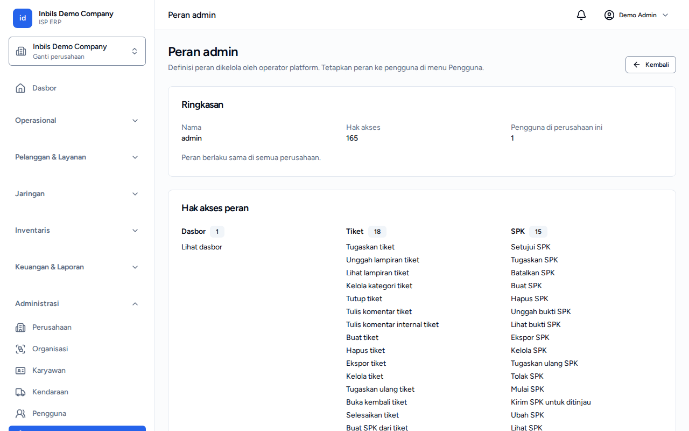

Isi lima peran bawaan ditimpa kembali ke matriks standar saat pengelola server menjalankan seeder peran pada pembaruan sistem.

### Pemisahan tugas pada peran

Operator platform menolak menyimpan peran non-admin yang memuat salah satu pasangan izin ini. Admin dikecualikan.

- Pengendali permintaan barang (`inventory.request.approve`, `inventory.request.reject`) bersama pelaksana gudang (`inventory.request.prepare`, `inventory.request.issue`, `inventory.stock.receive`, `inventory.stock.issue`, `inventory.stock.transfer`).
- Penyetuju penyesuaian stok (`inventory.stock.adjust.approve`) bersama pengaju atau pelaksana (`inventory.stock.adjust.request`, `inventory.stock.receive`, `inventory.stock.issue`, `inventory.stock.transfer`).
- `inventory.stock.adjust` ("Sesuaikan stok langsung", penyesuaian langsung, jalan darurat) hanya boleh diberikan oleh admin.

Aturan yang sama berlaku saat Anda memberi beberapa peran ke satu pengguna di menu **Pengguna** (bagian 8.5): izin gabungan tidak boleh memuat pasangan di atas.

### Kesalahan umum

- Tidak ada tombol **Buat Peran**, **Ubah** atau **Hapus**: memang tidak ada. Definisi peran dikelola operator platform. Minta mereka menambah peran atau mengubah izin.
- Peran yang dibutuhkan belum ada di daftar: minta operator platform membuatnya, lalu muat ulang halaman.
- Izin peran bawaan kembali ke standar setelah pembaruan sistem: seeder menimpanya. Minta operator platform membuat peran tersendiri bila perlu izin tambahan yang permanen.
- Halaman detail menolak dengan **Akses ditolak** (403): Anda tidak memegang `roles.manage`.
- Tombol **Ekspor** tidak ada: Anda tidak memegang `roles.export`.

## 8.7 Hak Akses

Menu ini adalah katalog kode izin yang dikenal sistem, hanya untuk dibaca. Buka saat Anda perlu memastikan kode izin yang tepat atau kelompoknya, misalnya untuk meminta operator platform mengubah sebuah peran (bagian 8.6).

Peran yang dapat memakai: admin. Izin: `roles.manage`, sama dengan menu **Peran**. Layar ini tidak punya tombol tambah, ubah, hapus atau ekspor.

### Membuka dan membaca daftar

1. Di sidebar, buka grup **Administrasi**, lalu klik **Hak Akses**.
2. Baca layar (subjudul "Semua hak akses yang bisa diberikan ke peran. Daftar ini hanya untuk dibaca."):
   - **Cari** (petunjuk "Kode hak akses, mis. billing.view") mencari bagian dari kode izin. Pencarian tidak membaca kolom **Fungsi**.
   - **Kode** (bisa diurutkan): kode izin, berpola `<area>.<aksi>` atau `<area>.<objek>.<aksi>`, misalnya `billing.payment.record`.
   - **Fungsi**: apa yang dibolehkan izin itu dalam kalimat Indonesia, misalnya "Catat pembayaran". Teks ini sama dengan label izin di halaman detail peran (bagian 8.6).
   - **Kelompok**: lencana berisi nama Indonesia dari awalan kode sebelum titik pertama, misalnya **Tagihan** untuk `billing`. Kelompok ini sama dengan kategori di halaman detail peran.
   - Di bawah tabel ada keterangan jumlah baris yang tampil, pemilih "Baris per halaman" (10, 25 atau 50), serta tombol **Sebelumnya** dan **Berikutnya** dengan keterangan "Halaman n dari m". Seeder peran membuat 166 izin.
   - Bila tidak ada baris, layar menampilkan "Belum ada hak akses" (keterangan "Hak akses dibuat bersama pembaruan sistem."), atau "Tidak ada hak akses yang cocok" dengan tombol **Reset filter** saat pencarian aktif.

   

3. Pakai katalog ini sebagai kamus. Cari bagian kode, misalnya `export` untuk izin ekspor atau `approve` untuk izin persetujuan, lalu periksa apakah peran Anda memegangnya di halaman detail peran (bagian 8.6). Ringkasan izin per peran ada di lampiran 10.1.

Nama kelompok di kolom **Kelompok** dan di pemilih izin:

| Awalan kode | Nama di layar |
|---|---|
| `billing` | Tagihan |
| `company` | Perusahaan |
| `customer` | Pelanggan |
| `dashboard` | Dasbor |
| `developer` | Pengembang |
| `employee` | Karyawan |
| `evaluation` | Evaluasi |
| `inventory` | Inventaris |
| `ipam` | IPAM |
| `location` | Lokasi |
| `network_asset` | Aset jaringan |
| `odn` | ODN |
| `organization` | Organisasi |
| `portal` | Portal pelanggan |
| `report` | Laporan |
| `roles` | Peran |
| `service` | Paket layanan |
| `spk` | SPK |
| `system` | Sistem |
| `ticket` | Tiket |
| `users` | Pengguna |
| `vehicle` | Kendaraan |

Layar ini tidak menunjukkan peran mana yang memegang suatu izin. Untuk itu buka **Ubah** pada peran yang bersangkutan.

### Kesalahan umum

- Item **Hak Akses** tidak tampil di sidebar: akun Anda tidak memegang `roles.manage`.
- Izin yang dicari tidak ada di daftar: katalog hanya memuat izin yang dibuat sistem. Admin tidak dapat menambah izin dari layar ini.
- Pencarian dengan kata Indonesia, misalnya "Catat pembayaran", tidak menemukan apa pun: kotak **Cari** di layar ini hanya mencocokkan kode. Cari dengan bagian kode, atau pakai kotak **Cari hak akses** di form peran, yang juga membaca label Indonesia.
- Izin sudah ada tetapi tidak berefek pada seseorang: izin itu harus dipegang peran orang itu (bagian 8.6) dan peran itu harus diberikan ke penggunanya (bagian 8.5).

## 8.8 Dokumen

Dokumen mengelola jenis dokumen bisnis, yaitu kategori berkas dengan nama, kode, objek yang dicakup, status wajib dan masa berlaku. Buka menu ini saat Anda menambah atau mengubah jenis dokumen. Halaman ini hanya mengelola jenisnya: tidak ada tombol untuk mengunggah atau menghapus berkas di sini, dan lampiran tiket serta bukti SPK dikelola di halaman tiket (bagian 3.4) dan SPK (bagian 3.3).

Peran yang dapat memakai: admin. Izin: `system.setting` membuka menu dan mengizinkan semua aksi (lihat, tambah, ubah, hapus), `system.document.export` menampilkan tombol **Ekspor**. Pada peran bawaan hanya admin yang memegang keduanya. Izin `system.setting` juga membuka menu Penomoran (bagian 7.13).

### Membuka dan membaca daftar

1. Di sidebar, buka grup **Administrasi**, lalu klik **Dokumen**.
2. Baca daftar. Cara kerja pencarian, urutan, tombol baris dan dialog hapus ada di bagian 1.5.

   - Kotak **Cari** (petunjuk "Nama, kode, atau berlaku untuk") mencari di nama, kode dan **Berlaku untuk**.
   - Kolom: **Nama**, **Kode**, **Berlaku untuk**, **Wajib**, **Masa berlaku**, **Status** dan **Aksi**. **Nama**, **Kode** dan **Berlaku untuk** bisa diurutkan.
   - **Wajib** berisi "Ya" atau "Tidak". **Masa berlaku** berisi jumlah hari diikuti kata "hari" (misalnya "30 hari"), atau tanda "-". **Berlaku untuk** kosong tampil sebagai "-". **Status** berisi lencana **Aktif** atau **Nonaktif**.
   - Daftar menampilkan 10 baris per halaman. Pemilih "Baris per halaman" menawarkan 10, 25 dan 50, dan tombol **Sebelumnya** dan **Berikutnya** dengan keterangan "Halaman n dari m" ada di bawah tabel.
   - Tombol **Buat Jenis Dokumen**, **Ubah** dan menu **Aksi lainnya** dengan **Hapus** tampil untuk semua orang yang bisa membuka halaman ini.
   - Bila tidak ada baris, layar menampilkan "Belum ada jenis dokumen" dengan tombol **Buat Jenis Dokumen**, atau "Tidak ada jenis dokumen yang cocok" dengan tombol **Reset filter** saat pencarian aktif.

   

### Menambah jenis dokumen

1. Klik **Buat Jenis Dokumen**.
2. Isi form pada dialog **Buat Jenis Dokumen**:
   - **Nama**: wajib, maksimal 255 karakter.
   - **Kode**: wajib, maksimal 50 karakter (petunjuk "Unik di perusahaan ini dan tidak bisa diubah nanti."). Kode tidak boleh sama dengan kode jenis lain di perusahaan yang sama, termasuk jenis yang sudah dihapus. Bila sama, pesan "kode sudah digunakan." muncul di bawah isian. Kode tidak bisa diubah setelah disimpan.
   - **Berlaku untuk**: opsional, teks bebas maksimal 100 karakter. Petunjuk "Mis. pelanggan". Sistem tidak memeriksa isinya.
   - **Masa berlaku (hari)**: opsional, bilangan bulat 1 atau lebih. Kosong berarti jenis ini tanpa masa berlaku.
   - **Wajib**: saklar, mati secara awal. Saklar ini hanya penanda yang tampil di kolom **Wajib** dan di ekspor. Layar lain tidak memakainya untuk menolak atau mengingatkan apa pun.
   - **Aktif**: saklar, hidup secara awal. Nilainya tersimpan: matikan bila jenis baru belum dipakai.
3. Klik **Buat**. Muncul toast "Jenis dokumen dibuat." **Batal** menutup dialog tanpa menyimpan.

### Mengubah jenis dokumen

1. Klik **Ubah** pada baris jenis dokumen. Dialog **Ubah Jenis Dokumen** terbuka dengan data jenis itu.
2. Ubah **Nama**, **Berlaku untuk**, **Masa berlaku (hari)**, **Wajib** atau **Aktif**. Isian **Kode** tampil abu-abu dan hanya bisa dibaca, dengan keterangan "Kode tidak bisa diubah setelah jenis dokumen dibuat."
3. Klik **Simpan**. Muncul toast "Jenis dokumen diperbarui."

### Menghapus jenis dokumen

1. Klik menu **Aksi lainnya** pada baris jenis dokumen, lalu pilih **Hapus**.
2. Konfirmasi di dialog "Hapus" diikuti nama dan tanda tanya (keterangan "Jenis dokumen" diikuti nama dalam tanda kutip, "akan dihapus dari daftar."). Klik **Hapus**. Muncul toast "Jenis dokumen dihapus."

Kode jenis yang sudah dihapus tetap dianggap terpakai. Untuk jenis yang tidak dipakai lagi, matikan saklar **Aktif** lewat **Ubah**.

### Berkas dokumen pelanggan

Halaman **Dokumen** tidak menyediakan kontrol unggah, daftar berkas atau tombol hapus berkas. Backend hanya menyediakan rute untuk berkas pelanggan, tetapi belum ada layar web yang memakainya.

- Unggah berkas memerlukan `system.setting`, hanya menerima pelanggan di perusahaan aktif sebagai pemilik, dan hanya memakai koleksi `documents`.
- Validasi menerima semua jenis berkas yang dikenali sebagai file. Tidak ada pembatasan ekstensi atau MIME. Ukuran maksimalnya 10.240 KB.
- Kode jenis dokumen bersifat opsional. Bila diisi, kodenya harus menunjuk jenis dokumen perusahaan aktif. Sistem menyimpan kode jenis, pengunggah dan tanggal kedaluwarsa sebagai metadata berkas.
- Penghapusan berkas juga memerlukan `system.setting`. Sistem hanya menghapus berkas koleksi `documents` milik pelanggan di perusahaan aktif.

### Mengekspor daftar

1. Isi kotak **Cari** bila Anda hanya butuh sebagian jenis.
2. Klik **Ekspor**, lalu pilih **Ekspor CSV** atau **Ekspor PDF**.

Berkas `document-types-export-<tanggal>-<jam>.csv` (atau `.pdf`, berjudul "Jenis dokumen") berisi kolom Kode, Nama, Berlaku untuk, Wajib ("Ya" atau "Tidak"), Masa berlaku (hari) dan Status (**Aktif** atau **Nonaktif**). Kolom yang kosong berisi "-". Tombol **Ekspor** hanya tampil bagi pemegang `system.document.export`.

### Kesalahan umum

- Pesan "kode sudah digunakan." di bawah **Kode**: perusahaan ini sudah punya jenis dengan kode itu, termasuk yang sudah dihapus. Pakai kode lain, atau ubah jenis yang lama lewat **Ubah**.
- Anda mengubah **Kode** di **Ubah Jenis Dokumen**: isian itu hanya bisa dibaca. Untuk kode lain, buat jenis baru.
- Penyimpanan gagal dengan toast "Data gagal disimpan. Periksa input.": baca pesan merah di bawah isian. Periksa **Masa berlaku (hari)** (bilangan bulat 1 atau lebih) dan panjang **Berlaku untuk** (maksimal 100 karakter).
- Anda mencari tombol untuk mengunggah berkas: halaman ini tidak punya tombol itu. Halaman ini hanya mengelola jenisnya.

# 9. Alur kerja

## 9.1 Pelanggan baru sampai pembayaran

Bab ini menyambung menu di bab 3 sampai 8 menjadi tiga alur kerja. Setiap langkah menyebut siapa yang bertindak, menu yang dipakai, dan bagian yang menjelaskan layarnya.

Alur pertama mengikuti satu pelanggan dari pendaftaran sampai tagihan pertamanya lunas. Alur ini melibatkan admin atau manajer, teknisi, dan pelanggan.

Siapkan dulu:

- Paket layanan yang aktif, lengkap dengan profil bandwidth, profil kecepatan, dan tingkat SLA yang aktif (bagian 4.2 sampai 4.5).
- Lokasi POP yang melayani alamat pelanggan (bagian 5.1). Bila port drop ODP ingin dicatat sejak awal, siapkan juga ODP dengan port bebas (bagian 5.5).
- Akun teknisi yang aktif, dengan profil karyawan aktif (bagian 8.3) dan aplikasi teknisi terpasang.
- Dua orang berbeda untuk mendaftarkan dan menyetujui SPK. Orang yang membuat SPK tidak boleh menyetujuinya (bagian 3.3).
- Perangkat ONT sebagai aset berstatus **Tersedia** di **Aset Jaringan** (bagian 5.2), bila SPK akan memasang perangkat.

### Langkah

1. Admin atau manajer membuka **Pelanggan** (bagian 4.1) lalu klik **Buat Pelanggan**. Staf bawaan tidak melihat tombol ini karena pendaftaran juga memerlukan izin langganan (`customer.subscription.manage`).
2. Isi keempat tab: **Data pelanggan**, **Alamat**, **Kontak**, dan **Langganan & SPK**. Di **Data pelanggan**, centang **Pelanggan setuju menerima notifikasi WhatsApp** hanya bila pelanggan sudah menyetujuinya, dan pilih **Diperoleh oleh** bila penjualan perlu dikreditkan (ketik untuk mencari, lalu pilih; bagian 7.10). Di **Langganan & SPK**, pilih **Paket layanan** dan **POP pelayan** dengan cara yang sama. Klik **Buat pelanggan dan SPK**.
3. Dalam satu transaksi, Inbils membuat pelanggan, akun masuk berperan `customer`, alamat, kontak, langganan berstatus **Menunggu**, dan SPK **Instalasi** berstatus **Menunggu penugasan**. SPK itu berjudul "Pemasangan &lt;kode langganan&gt; - &lt;nama pelanggan&gt;" dan memakai **POP pelayan** sebagai **Lokasi**. Status pelanggan masih **Prospek**. Inbils lalu membuka detail pelanggan dan menampilkan toast "Pelanggan, langganan, dan SPK pemasangan dibuat. Link akses dikirim ke &lt;email&gt;."
4. Bila **Akun aktif** menyala, pelanggan menerima email **Akun pelanggan Anda sudah dibuat** dengan tombol **Atur kata sandi**, berlaku 60 menit. Setelah mengatur kata sandi, pelanggan masuk ke aplikasi pelanggan. Toast pendaftaran tidak memeriksa **Akun aktif**: bila akunnya nonaktif, email tidak terkirim. Bila email hilang atau tautannya kedaluwarsa, buka detail pelanggan dan klik **Kirim ulang link akses**.
5. Admin atau manajer membuka **Penugasan** (bagian 3.1), mencari SPK **Menunggu penugasan** itu, lalu klik **Tugaskan**. Pilih teknisi di **Pilih teknisi lapangan** dan klik **Simpan penugasan**. Status SPK menjadi **Ditugaskan**. Teknisi menerima WhatsApp bila WhatsApp perusahaan aktif. Pelanggan menerima pesan jadwal hanya bila SPK punya tanggal jadwal, dan SPK dari pendaftaran dibuat tanpa tanggal itu.
6. Bila SPK harus memasang perangkat atau memakai barang, admin atau manajer membuka SPK itu (bagian 3.3) dan klik **Tambah item**. Pilih **Barang** bertipe **Aset** lalu **Aset jaringan** yang **Tersedia**, atau pilih barang **Habis pakai** dan isi **Jumlah dicadangkan** atau **Jumlah terpakai** sebagai rencana bahan. Bila bahan diambil dari gudang lewat permintaan barang, ikuti alur 9.3.
7. Teknisi mengerjakan SPK di aplikasi teknisi: memulai pekerjaan (status **Dikerjakan**), mencatat bahan yang dipakai, mengunggah foto bukti, lalu mengajukan hasil (status **Menunggu review**). Pengajuan ditolak dengan pesan "Bukti pekerjaan wajib diunggah sebelum SPK diajukan." bila belum ada bukti. Pengajuan juga ditolak bila ada permintaan barang **Diserahkan** yang sisa materialnya belum dilaporkan (bagian 6.8).
8. Manajer atau admin yang bukan pembuat SPK dan bukan teknisinya membuka **Persetujuan** (bagian 3.2), klik **Tinjau**, lalu **Setujui**. Persetujuan butuh minimal satu bukti dan tidak bisa dibatalkan.
9. Saat disetujui, SPK menjadi **Selesai** dan Inbils menjalankan langkah ini dalam satu transaksi:
   - Stok bahan yang tercatat di **Jumlah terpakai** berkurang di **Lokasi** SPK, dan **Mutasi Stok** mencatatnya sebagai **Keluar** (bagian 6.7). Jumlah yang sudah keluar lewat permintaan barang tidak dikurangi dua kali.
   - Pada SPK **Instalasi**, aset yang dipilih menjadi **Terpasang** pada pelanggan dan langganan (bagian 5.2).
   - Langganan **Menunggu** menjadi **Aktif**, dan status pelanggan menjadi **Aktif**.
   - Bila saklar **Buat tagihan otomatis saat SPK selesai** di **Pengaturan Perusahaan** menyala, Inbils membuat tagihan sekali bayar berstatus **Draf** dengan jatuh tempo 14 hari. Isinya bahan terpakai dan baris "Biaya Instalasi installation" bila langganan punya biaya pemasangan.
10. Untuk tagihan pemasangan, buka **Tagihan** (bagian 7.1) dan cari tagihan **Draf** itu. Periksa itemnya, tambah item lewat **Tambah item** bila perlu (izin `billing.update`, admin dan manajer), lalu klik **Kirim tagihan**. Status menjadi **Belum dibayar**, dan pelanggan melihatnya di aplikasi pelanggan. Bila saklar **Buat tagihan otomatis saat SPK selesai** mati, tidak ada tagihan otomatis. Buat tagihan lewat **Buat tagihan** bila biaya pemasangan tetap perlu ditagih.
11. Untuk tagihan bulanan, klik **Buat tagihan bulanan** di **Tagihan**, pilih **Periode**, klik **Lihat pratinjau**, lalu **Buat &lt;n&gt; tagihan**. Penerbitan juga berjalan terjadwal setiap hari. Tagihan langsung berstatus **Belum dibayar**, dan bulan pertama dihitung prorata sejak tanggal aktivasi. Langganan yang **Menunggu** atau **Ditangguhkan** tidak ikut tagihan bulanan.
12. Pelanggan membayar lewat aplikasi pelanggan. Pembayaran masuk ke tagihan setelah Midtrans mengonfirmasi. Pemegang izin `billing.payment.record` (admin, manajer, dan staf) juga dapat mencatat pembayaran: buka tagihan yang belum lunas (**Belum dibayar**, **Sebagian**, atau **Lewat jatuh tempo**), klik **Catat pembayaran**, isi **Jumlah** (tidak lebih dari sisa) dan **Metode** (**Tunai**, **Transfer**, **Cek**, atau **Lainnya**), isi **Referensi** bila ada, lalu klik **Simpan**. Tagihan menjadi **Sebagian** atau **Lunas**.
13. Bila tagihan tidak dibayar sampai lewat jatuh tempo, pekerjaan terjadwal menandainya **Lewat jatuh tempo**. Pelanggan juga menerima pengingat WhatsApp tiga hari dan satu hari sebelum jatuh tempo, dan satu hari sesudahnya. Bila saklar **Tangguhkan langganan yang menunggak** menyala di **Pengaturan Perusahaan** (bagian 8.1), langganan yang tagihannya melewati **Batas keterlambatan** diisolir otomatis dan berstatus **Ditangguhkan**. Pembayaran yang melunasi semua tunggakan mengaktifkan kembali langganan yang diisolir otomatis, bila saklar **Aktifkan kembali saat tagihan lunas** menyala. Nilai awalnya: penangguhan mati, batas 7 hari, aktif kembali menyala. Penangguhan manual dan blokir internet tidak pernah dibuka otomatis. Admin dan manajer juga dapat mengisolir atau memblokir sendiri dari **Tunggakan** (bagian 7.2 dan 5.3).

Hasil akhirnya: langganan **Aktif** dan tagihan **Lunas**. Tagihan dan pembayaran pelanggan itu ikut terhitung di **Metrik Bisnis** dan **KPI Penjualan** (bagian 7.4 dan 7.10).

### Kesalahan umum

- Tombol **Buat Pelanggan** tidak ada: peran Anda belum memegang semua izin pendaftaran, yaitu `customer.create`, `customer.address.manage`, `customer.subscription.manage`, dan `spk.create`. Minta admin atau manajer mendaftarkan pelanggan, atau tambahkan izinnya di Peran (bagian 8.6).
- Anda mendaftarkan pelanggan lalu tidak bisa menyetujui SPK-nya. Itu aturan pemisahan tugas dan berlaku juga untuk admin. Di **Persetujuan**, SPK itu tidak punya tombol **Tinjau**, dan kolom **Tindakan** menulis "Perlu penyetuju lain". Minta rekan yang berhak menyetujuinya.
- Langganan masih **Menunggu** padahal teknisi sudah selesai: SPK belum disetujui. Buka **Persetujuan**.
- Stok tidak berkurang dan aset tidak terpasang setelah persetujuan: SPK tidak punya **Lokasi**. SPK dari pendaftaran selalu punya **Lokasi**, tetapi SPK manual belum tentu, dan layar SPK tidak punya tombol untuk mengubah **Lokasi** sesudah SPK dibuat.
- Tagihan pemasangan tidak muncul setelah persetujuan: saklar **Buat tagihan otomatis saat SPK selesai** mati. Nilai awalnya mati.
- Pelanggan tidak bisa masuk ke aplikasi: **Akun aktif** mati saat pendaftaran sehingga email tidak terkirim, atau tautannya sudah lewat 60 menit. Aktifkan pelanggan di Pelanggan (bagian 4.1) dan penggunanya di Pengguna (bagian 8.5), lalu klik **Kirim ulang link akses**. Bila salah satunya nonaktif, Inbils menolak dengan pesan "Customer atau akun portalnya nonaktif, tautan akses tidak dikirim." Tombol ini dibatasi tiga kali per menit.
- Pelanggan tidak menerima WhatsApp: buka kartu **WhatsApp** di detail pelanggan. Kolom **Status** dan **Keterangan** menyebut alasan pesan dilewati, misalnya "Pelanggan belum setuju" atau "WhatsApp perusahaan nonaktif".
- Pembayaran gagal dengan pesan "Jumlah pembayaran melebihi sisa tagihan." atau "Referensi pembayaran sudah ada.": kurangi **Jumlah** atau pakai referensi lain (bagian 7.1).

## 9.2 Tiket sampai SPK

Alur kedua mengikuti satu gangguan layanan dari laporan sampai tiket ditutup, lewat satu SPK perbaikan. Alur ini melibatkan staf atau admin yang mencatat tiket, admin atau manajer yang menugaskan, dan teknisi yang mengerjakannya.

Gangguan yang selesai dari jarak jauh melewati langkah 5 sampai 9 dan tidak butuh SPK: petugas langsung menulis catatan penyelesaian di langkah 10. SPK perbaikan hanya perlu bila ada kunjungan lapangan.

### Langkah

1. Catat tiket. Buka **Tiket** (bagian 3.4), klik **Buat tiket**, isi **Judul**, **Sumber** (**Pelanggan**, **NOC**, atau **Internal**), **Kategori**, **Prioritas**, dan **Pelanggan** untuk tiket pelanggan, lalu klik **Simpan**. Isi **Langganan**, **Aset jaringan**, dan **Lokasi** bila diketahui. Isian **Pelanggan**, **Langganan**, dan **Aset jaringan** adalah kotak cari: ketik minimal 2 karakter, lalu pilih dari paling banyak 20 hasil. Pelanggan juga dapat membuat tiket sendiri dari aplikasi pelanggan, dan tiketnya tampil di daftar yang sama. Pelanggan menerima WhatsApp bahwa tiketnya tercatat bila WhatsApp perusahaan aktif dan pelanggan sudah setuju. Syarat yang sama berlaku untuk setiap pesan WhatsApp ke pelanggan di alur ini.
2. Tiket baru berstatus **Terbuka**. **Target respons** dan **Target penyelesaian** dihitung dari waktu pembuatan. Sumbernya tingkat SLA paket langganan tiket itu, atau **Kategori Tiket** bila tidak ada langganan atau tingkatnya nonaktif, dan halaman tiket menyebut sumbernya di samping kedua target. Prioritas **Mendesak** memotong keduanya jadi separuh, dibulatkan ke atas. Tiket yang lewat **Target penyelesaian** tampil di kartu **SLA terlampaui** di Dasbor (bagian 2.1).
3. Tugaskan petugas. Admin atau manajer membuka **Penugasan** (bagian 3.1), mencari tiket itu, klik **Tugaskan**, memilih petugas di **Pilih petugas tiket**, lalu klik **Simpan penugasan**. Dari halaman tiket berstatus **Terbuka**, tombol **Tugaskan** membuka dialog dengan pilihan **Petugas** (ketik untuk mencari, lalu pilih). Status menjadi **Ditugaskan**. Petugas menerima email dan notifikasi di lonceng. Pada penugasan pertama, pelanggan menerima WhatsApp bahwa tiketnya ditangani.
4. Petugas memulai tiket. Teknisi melakukannya di aplikasi teknisi. Pengguna web yang memegang `ticket.start` memakai **Mulai** di halaman tiket atau di **Pekerjaan Saya** (bagian 3.6). Status menjadi **Dikerjakan** dan **Respons pertama** terisi.
5. Bila gangguan butuh kunjungan, admin atau manajer dengan izin `ticket.spawn_spk` membuka tiket berstatus **Ditugaskan** atau **Dikerjakan** yang belum punya catatan penyelesaian, klik **Buat SPK** di kartu **Tindakan**, lalu konfirmasi dengan **Buat SPK** di dialog. Inbils membuat SPK **Perawatan** berstatus **Menunggu penugasan** dengan judul "SPK dari tiket &lt;kode tiket&gt;", lalu langsung membuka halaman SPK itu dengan toast "SPK berhasil dibuat dari tiket." **Pelanggan**, **Langganan**, **Lokasi**, **Prioritas**, dan deskripsi disalin dari tiket. Aset jaringan tiket tidak ikut disalin ke SPK.
6. Tiket tidak ikut selesai dan tidak menampilkan tautan ke SPK itu. Untuk menemukan SPK lagi, cari kode tiket di kotak **Cari** pada **SPK** (bagian 3.3), karena judul SPK memuat kode tiket. Satu tiket hanya bisa dibuatkan satu SPK.
7. Tugaskan SPK. Buka **Penugasan** atau halaman SPK, klik **Tugaskan**, lalu pilih teknisi dan simpan. Status SPK menjadi **Ditugaskan** dan teknisi menerima WhatsApp. SPK dari tiket dibuat tanpa tanggal jadwal, jadi pelanggan tidak menerima pesan jadwal.
8. Teknisi mengerjakan SPK di aplikasi: memulai, mencatat bahan, mengunggah foto bukti, lalu mengajukan hasil. Bahan yang diambil dari gudang mengikuti alur 9.3.
9. Manajer atau admin yang bukan pembuat SPK dan bukan teknisinya menyetujui SPK di **Persetujuan** (bagian 3.2). Pembuat SPK adalah orang yang menekan **Buat SPK** di tiket, jadi orang itu butuh rekan untuk menyetujui. SPK menjadi **Selesai**, dan stok bahan yang terpakai berkurang di **Lokasi** SPK bila SPK punya lokasi.
10. Petugas tiket mengisi catatan penyelesaian: klik **Selesaikan**, isi **Catatan penyelesaian** (wajib, maksimal 1000 karakter), lalu klik **Selesaikan** di dialog. Status menjadi **Diselesaikan** dan pelanggan menerima WhatsApp bahwa tiketnya selesai. Tiket hanya bisa diselesaikan dari status **Dikerjakan**.
11. Pemegang `ticket.close` yang bukan petugas tiket itu membuka tiket, klik **Tutup**, lalu **Tutup tiket** di dialog. Status menjadi **Ditutup**.
12. Setelah itu, buat Evaluasi (bagian 3.5) untuk tiket atau SPK tadi lewat **Buat evaluasi** bila perlu. Waktu respons dan penyelesaian tiket masuk ke Kepatuhan SLA dan Kinerja Teknisi (bagian 7.6 dan 7.9).

### Kesalahan umum

- **Buat SPK** tidak tampil: tiket harus **Ditugaskan** atau **Dikerjakan** dan belum punya catatan penyelesaian. Bila tombol tampil tetapi server menolak, penyebabnya salah satu dari ini: Anda tidak memegang `ticket.spawn_spk`, atau tiket itu sudah punya SPK ("SPK sudah dibuat dari tiket ini.").
- SPK perbaikan tidak bisa Anda setujui sendiri karena Anda pembuatnya. Server menolak dengan pesan "Pembuat SPK tidak boleh menyetujui SPK sendiri." Minta rekan yang berhak.
- Persetujuan SPK perbaikan ikut membuat tagihan: bila saklar **Buat tagihan otomatis saat SPK selesai** menyala, Inbils membuat tagihan **Draf** berisi bahan terpakai, dan baris "Biaya Instalasi maintenance" bila langganan punya biaya pemasangan. Periksa tagihan itu di **Tagihan** (bagian 7.1) sebelum **Kirim tagihan**. Tagihan yang tidak perlu dibatalkan oleh pengguna lain dengan izin `billing.cancel`, karena pembuat tagihan adalah penyetuju SPK ("Tagihan yang Anda buat sendiri tidak bisa Anda batalkan.").
- **Selesaikan** ditolak pada tiket **Ditugaskan**: petugas klik **Mulai** dulu. Pesannya "Tiket harus berstatus dikerjakan untuk bisa diselesaikan."
- **Tutup** tidak tampil: tiket belum **Diselesaikan**, Anda tidak memegang `ticket.close`, atau Anda petugas tiket itu.
- Tiket yang **Diselesaikan** atau **Ditutup** tidak bisa dibuka lagi di web. Catat masalah yang muncul lagi sebagai tiket baru.

## 9.3 Permintaan barang sampai pengeluaran stok

Alur ketiga mengikuti barang dari permintaan sampai keluar dari gudang, lalu sisanya kembali. Alur ini melibatkan pemohon (biasanya teknisi), penyetuju (manajer), petugas gudang (staf), dan penerima retur. Pemisahan tugas berlaku di setiap titik, termasuk untuk admin.

### Langkah

1. Pemohon membuat permintaan. Teknisi membuatnya di aplikasi teknisi, dan permintaan itu langsung berstatus **Menunggu persetujuan**. Di web, hanya peran yang memegang `inventory.request.create` (admin pada peran bawaan) melihat **Buat Permintaan Barang** di **Permintaan Barang** (bagian 6.1). Isi **Gudang Tujuan**, **Alasan Kebutuhan Barang** (wajib), dan **Tanggal Dibutuhkan** bila perlu. Di **Rujukan (opsional)**, pilih SPK atau tiket, lalu ketik kodenya untuk mencari dan pilih. Di **Barang 1**, ketik nama atau SKU barang habis pakai dan isi **Jumlah**. Klik **Tambah Barang** untuk baris berikutnya. Klik **Ajukan ke Antrean Gudang**. **Simpan sebagai Draf** menyimpan tanpa mengajukan, dan draf diajukan nanti lewat **Ajukan ke Gudang** di halaman detail. Pastikan **Gudang Tujuan** terisi: dialog persetujuan di web tidak punya pilihan gudang, jadi permintaan tanpa gudang tidak bisa disetujui dari web.
2. Pengguna dengan izin setujui menerima email **Permintaan Barang Baru** dengan kode permintaan. Permintaan masuk ke **Persetujuan** (bagian 3.2) dan ke kartu **Menunggu persetujuan saya** di Dasbor.
3. Manajer atau admin yang bukan pemohon memutuskan. Di **Persetujuan**, klik **Tinjau** lalu **Setujui** untuk menyetujui seluruh jumlah. Untuk menyetujui sebagian, buka halaman detail permintaan (klik kodenya), klik **Setujui & Reservasi Stok**, ubah **Jumlah yang disetujui** per barang, lalu klik **Setujui & Reservasi**. Untuk menolak dari **Persetujuan**, klik **Tinjau**, **Tolak**, isi **Alasan penolakan** (3 sampai 500 karakter), lalu **Konfirmasi tolak**. Dari halaman detail, klik **Tolak Permintaan**, isi **Alasan Penolakan** (3 sampai 1000 karakter), lalu klik **Tolak Permintaan** di dialog. Pemohon menerima email **Permintaan Barang Ditolak** berisi alasannya.
4. Saat disetujui, Inbils memeriksa stok tersedia (**Jumlah** dikurangi **Dicadangkan**) di **Gudang Tujuan** untuk setiap barang. Bila semuanya cukup, stok direservasi (**Mutasi Stok** mencatat **Dicadangkan**), status menjadi **Disetujui**, dan pemohon menerima email **Permintaan Barang Disetujui**. Bila satu barang kurang, tidak ada yang direservasi dan dialog menampilkan pesan kesalahan.
5. Petugas gudang yang bukan penyetuju membuka tab **Persiapan & Antrean Gudang** (kartu **Antrean permintaan gudang** di Dasbor membukanya) lalu membuka detail permintaan. Klik **Mulai Penyiapan Barang** lalu **Ya, Mulai Penyiapan**. Status menjadi **Disiapkan**.
6. Setelah barang terkumpul, klik **Tandai Siap Diambil** lalu konfirmasi dengan **Tandai Siap Diambil**. Status menjadi **Siap diambil**, dan pemohon menerima email serta notifikasi di lonceng.
7. Saat pemohon menerima barang fisik, petugas yang bukan pemohon dan bukan penyetuju klik **Serah Terima & Kurangi Stok**, lalu **Konfirmasi Serah Terima**. Status menjadi **Diserahkan**. Reservasi dilepas (**Mutasi Stok** mencatat **Cadangan dilepas**), stok fisik berkurang (**Keluar**), dan **Jumlah Diserahkan** terisi. Serah terima tidak bisa dibatalkan.
8. Inbils membuka berkas pengembalian untuk permintaan itu dengan status **Menunggu deklarasi teknisi**. Setelah pekerjaan selesai, teknisi melaporkan pemakaian aktual dan sisa barang di aplikasi teknisi. Pemilik berkas yang bekerja di web memakai **Laporkan Pemakaian & Ajukan Pengembalian** di halaman detail permintaan, mengisi **Dipakai Aktual** dan **Sisa Dikembalikan**, lalu klik **Kirim Laporan Deklarasi**. Jumlah dipakai, sisa baik, dan selisih harus berjumlah sama dengan jumlah **Dikeluarkan**. Berkas menjadi **Menunggu penerimaan gudang**, dan stok belum berubah.
9. Pemegang `inventory.return.receive` yang bukan pemilik berkas membuka **Permintaan Barang**, tab **Antrean Pengembalian** (bagian 6.8), lalu klik **Buka Permintaan & Terima Barang**. Di halaman detail, klik **Terima Pengembalian Fisik**, isi **Diterima Baik (Tambah Stok)** dan **Rusak** per barang, lalu klik **Konfirmasi Penerimaan Fisik**. Barang baik masuk kembali ke stok (**Mutasi Stok** mencatat **Masuk**).
10. Bila tidak ada barang rusak, berkas menjadi **Diterima**. Bila ada, berkas menjadi **Selisih perlu penyelesaian**, dan pemegang `inventory.return.resolve` menerima email. Manajer yang bukan penerima fisik klik **Buka & Selesaikan Selisih**, **Selesaikan Selisih**, isi **Catatan Penyelesaian**, lalu **Konfirmasi Penyelesaian**. Berkas menjadi **Selisih diselesaikan**, dan stok tidak berubah lagi.
11. Bila barang tidak sampai di meja gudang atau tidak sesuai laporan, klik **Tolak Fisik Barang**, isi **Alasan Penolakan Fisik**, lalu **Tolak Penyerahan**. Berkas menjadi **Perlu koreksi**. Teknisi menerima email berisi alasan dan melapor ulang.
12. Periksa hasilnya. **Stok** (bagian 6.5) menunjukkan **Jumlah**, **Dicadangkan**, dan **Tersedia**. **Mutasi Stok** (bagian 6.7) menunjukkan jejak **Dicadangkan**, **Cadangan dilepas**, **Keluar**, dan **Masuk** untuk permintaan itu. Catatan mutasi **Keluar** memuat kode permintaan, jadi kode itu dapat dicari di kotak **Cari mutasi**.

Permintaan yang masih **Draf** atau **Menunggu persetujuan** bisa dibatalkan lewat **Batalkan Permintaan**. Pemohon membatalkan permintaannya sendiri bila perannya memegang `inventory.request.cancel.own` (admin pada peran bawaan). Pemegang `inventory.request.approve` yang tidak memegang izin itu (manajer pada peran bawaan) dapat membatalkan permintaan siapa pun. Setelah disetujui, layar ini tidak menyediakan pembatalan.

### Hubungan dengan SPK

Bila permintaan memakai **Rujukan** SPK, berkas pengembaliannya terhubung ke SPK itu.

- Teknisi tidak bisa mengajukan SPK untuk ditinjau selama ada berkas yang belum dilaporkan, yaitu **Menunggu deklarasi teknisi** atau **Perlu koreksi**. Pesannya "Seluruh sisa material dari permintaan barang harus dideklarasikan terlebih dahulu sebelum SPK diajukan."
- Penyetuju tidak bisa menyetujui SPK sampai semua berkasnya **Diterima** atau **Selisih diselesaikan**. Pesannya "SPK belum bisa disetujui sampai seluruh retur material berstatus direkonsiliasi atau diselesaikan."
- Saat SPK disetujui, jumlah pakai pada material SPK disesuaikan dengan **Dipakai Aktual**, dan stok bahan hanya berkurang untuk bagian yang belum keluar lewat permintaan barang.

### Kesalahan umum

- Dialog persetujuan menampilkan "Stok tidak mencukupi untuk produk ID &lt;id&gt; di lokasi ID &lt;id&gt;. Tersedia: &lt;jumlah&gt;, Diminta: &lt;jumlah&gt;.": kurangi jumlah yang disetujui, atau tambah stok lewat **Terima Barang** di **Stok** (bagian 6.5), lalu setujui lagi. Bila tidak dapat dipenuhi, tolak permintaan dengan alasan.
- Dialog persetujuan menampilkan "Lokasi gudang sumber wajib ditentukan untuk reservasi.": permintaan itu tersimpan tanpa **Gudang Tujuan**, dan dialog persetujuan di web tidak punya pilihan gudang. Permintaan seperti itu tidak bisa disetujui dari web (bagian 6.1). Batalkan dengan **Batalkan Permintaan**, lalu buat permintaan baru dengan **Gudang Tujuan** terisi.
- Tombol **Setujui & Reservasi Stok**, **Mulai Penyiapan Barang**, atau **Serah Terima & Kurangi Stok** tidak tampil: cek status permintaan dan izin Anda, dan apakah Anda pemohon atau penyetuju permintaan itu. Pemohon tidak boleh menyetujui atau menyerahkan permintaannya sendiri, dan penyetuju tidak boleh menyiapkan atau menyerahkan barang yang ia setujui.
- Peran non-admin tidak boleh memegang izin setujui bersama izin siapkan atau serahkan. Di peran bawaan, manajer menyetujui dan staf menyiapkan dan menyerahkan. Bila perusahaan Anda hanya punya satu orang gudang yang juga penyetuju, tambahkan orang kedua. Saat peran seperti itu disimpan, Inbils menolak dengan pesan yang diawali "Pemisahan tugas (persetujuan permintaan barang vs pelaksanaan gudang)".
- Daftar **Antrean Pengembalian** menampilkan kotak galat: peran Anda memegang izin retur tetapi tanpa `inventory.return.view.all` atau `inventory.return.view.own`. Minta operator platform menambahkannya ke peran (bagian 8.6).
- Pesan yang diawali "Jumlah tidak cocok pada baris" muncul bila angka satu barang tidak berjumlah sama dengan jumlah yang dikeluarkan. Ubah angkanya sampai cocok.
- Koreksi jumlah stok yang bukan akibat permintaan barang memakai **Ajukan Penyesuaian** di **Stok**, yang butuh persetujuan orang lain (bagian 6.5).

# 10. Lampiran

## 10.1 Peran dan izin ringkas

Inbils memakai lima peran bawaan: admin, manajer, staf, teknisi, dan pelanggan. Di layar Peran dan Pengguna, nama perannya tampil sebagai `admin`, `manager`, `staff`, `technician`, dan `customer`. Peran bersifat global, jadi isinya sama di setiap perusahaan. Satu peran adalah kumpulan izin, dan izin adalah hak untuk satu tindakan, misalnya `spk.approve`. Operator platform membuat, mengubah, dan menghapus peran. Admin perusahaan hanya melihat isi peran di menu Peran (bagian 8.6) dan daftar izin di Hak Akses (bagian 8.7), lalu memberikan peran yang sudah ada ke pengguna di menu Pengguna (bagian 8.5). Peran bawaan tidak bisa dihapus.

Tabel di bagian ini menggambarkan peran bawaan saat ini. Peran khusus yang dibuat di menu Peran dapat berbeda, dan satu pengguna dapat memegang lebih dari satu peran. Bila tabel dan layar Anda tidak cocok, cek peran pengguna itu di menu Pengguna (bagian 8.5).

Teknisi dan pelanggan memakai aplikasi Android, bukan web. Akun yang hanya berperan teknisi atau pelanggan dialihkan ke halaman **Gunakan aplikasi Inbils** (bagian 1.1). Akun yang juga memegang peran admin, manajer, atau staf tidak dialihkan.

### Menu yang tampil di sidebar

Kolom izin menyebut izin yang membuka menu: satu saja sudah cukup. Menu hanya menentukan apakah tautannya tampil. Setiap layar tetap memeriksa izin untuk setiap tindakan.

| Grup | Menu | Izin yang membuka | Admin | Manajer | Staf |
| --- | --- | --- | --- | --- | --- |
| Tanpa grup | Dasbor | `dashboard.view` | ya | ya | ya |
| Operasional | Pekerjaan Saya | izin kerja lapangan dan profil karyawan aktif | bila profil aktif | bila profil aktif | bila profil aktif |
| Operasional | Penugasan | `ticket.assign` atau `ticket.reassign` atau `spk.assign` atau `spk.reassign` | ya | ya | tidak |
| Operasional | Persetujuan | `spk.approve` atau `spk.reject` atau `inventory.request.approve` atau `inventory.request.reject` | ya | ya | tidak |
| Operasional | SPK | `spk.view` | ya | ya | ya |
| Operasional | Tiket | `ticket.view` | ya | ya | ya |
| Operasional | Evaluasi | `evaluation.view` atau `evaluation.view.own` | ya | ya | ya |
| Pelanggan & Layanan | Pelanggan | `customer.view` | ya | ya | ya |
| Pelanggan & Layanan | Paket Layanan | `service.view` atau `service.manage` | ya | ya | ya |
| Pelanggan & Layanan | Kategori Paket | `service.view` atau `service.manage` | ya | ya | ya |
| Pelanggan & Layanan | Profil Bandwidth | `service.view` atau `service.manage` | ya | ya | ya |
| Pelanggan & Layanan | Profil Kecepatan | `service.view` atau `service.manage` | ya | ya | ya |
| Pelanggan & Layanan | Tingkat SLA | `service.view` atau `service.manage` | ya | ya | ya |
| Pelanggan & Layanan | Kategori Tiket | `ticket.category.manage` | ya | ya | tidak |
| Pelanggan & Layanan | Pengumuman & Promo | `announcement.manage` | ya | ya | tidak |
| Jaringan | Lokasi | `location.view` | ya | ya | ya |
| Jaringan | Aset Jaringan | `network_asset.view` | ya | ya | ya |
| Jaringan | Router NAS | `network_asset.nas.view` | ya | ya | ya |
| Jaringan | Alamat IP | `ipam.view` | ya | ya | ya |
| Jaringan | ODN | `odn.view` | ya | ya | ya |
| Inventaris | Permintaan Barang | `inventory.request.view.own` atau `inventory.request.view.all` | ya | ya | ya |
| Inventaris | Barang | `inventory.view` | ya | ya | ya |
| Inventaris | Kategori | `inventory.view` | ya | ya | ya |
| Inventaris | Satuan | `inventory.view` | ya | ya | ya |
| Inventaris | Stok | `inventory.view` | ya | ya | ya |
| Inventaris | Cari Barang | `inventory.view` | ya | ya | ya |
| Inventaris | Mutasi Stok | `inventory.view` | ya | ya | ya |
| Keuangan & Laporan | Tagihan | `billing.view` | ya | ya | ya |
| Keuangan & Laporan | Tunggakan | `billing.view` | ya | ya | ya |
| Keuangan & Laporan | Laporan | `report.view` | ya | ya | ya |
| Keuangan & Laporan | Kinerja Teknisi | `report.technician`, lalu aturan akses laporan teknisi | ya | bila profil aktif dan ditempatkan di organisasi aktif | tidak |
| Keuangan & Laporan | KPI Penjualan | `report.sales.view` | ya | ya | tidak |
| Keuangan & Laporan | Metrik Konsolidasi | `report.consolidated.view`, perusahaan aktif berupa Head | bila Head | tidak | tidak |
| Administrasi | Perusahaan | `company.manage` | ya | tidak | tidak |
| Administrasi | Organisasi | `organization.view` | ya | tidak | tidak |
| Administrasi | Karyawan | `employee.view` | ya | tidak | tidak |
| Administrasi | Kendaraan | `vehicle.view` | ya | tidak | tidak |
| Administrasi | Pengguna | `users.manage` | ya | tidak | tidak |
| Administrasi | Peran | `roles.manage` | ya | tidak | tidak |
| Administrasi | Hak Akses | `roles.manage` | ya | tidak | tidak |
| Administrasi | Dokumen | `system.setting` | ya | tidak | tidak |
| Administrasi | Penomoran | `system.setting` | ya | tidak | tidak |

Catatan untuk menu bersyarat dan angka:

- **Pekerjaan Saya** tampil bagi pengguna yang memegang izin kerja lapangan (`spk.start`, `spk.submit`, `ticket.start`, `ticket.resolve`, atau `ticket.close`) dan punya profil karyawan yang aktif di perusahaan aktif (bagian 3.6 dan 8.3).
- **Penugasan** juga mensyaratkan pengguna yang aktif.
- **Kinerja Teknisi** tampil bagi admin, dan bagi manajer yang berizin `report.technician`, punya profil karyawan aktif, dan ditempatkan di organisasi aktif (bagian 7.9).
- **Metrik Konsolidasi** tampil hanya saat perusahaan aktif berupa Head dan akun memegang `report.consolidated.view` (bagian 1.6 dan 7.11).
- **Pekerjaan Saya**, **Penugasan**, dan **Persetujuan** menampilkan angka jumlah antrean di sebelah namanya bila ada isinya.
- Menu **Komponen** di grup **Administrasi** hanya muncul di lingkungan pengembangan dan tidak dibahas di panduan ini.
- Menu **Dasbor** terbuka untuk semua peran bawaan.

### Kemampuan: Operasional

| Kemampuan | Izin | Admin | Manajer | Staf |
| --- | --- | --- | --- | --- |
| Menugaskan tiket dan SPK | `ticket.assign`, `spk.assign` | ya | ya | tidak |
| Menugaskan ulang tiket dan SPK | `ticket.reassign`, `spk.reassign` | ya | ya | tidak |
| Mengubah nama, target, dan status Kategori Tiket | `ticket.category.manage` | ya | ya | tidak |
| Membuat SPK | `spk.create` | ya | ya | ya |
| Mengubah SPK (item, bukti) | `spk.update` | ya | ya | tidak |
| Menyetujui dan menolak SPK | `spk.approve`, `spk.reject` | ya | ya | tidak |
| Membatalkan SPK | `spk.cancel` | ya | ya | tidak |
| Memulai dan mengajukan SPK | `spk.start`, `spk.submit` | ya | tidak | ya |
| Mengekspor SPK | `spk.export` | ya | ya | tidak |
| Membuat tiket | `ticket.create` | ya | ya | ya |
| Membuat SPK dari tiket | `ticket.spawn_spk` | ya | ya | tidak |
| Menutup tiket | `ticket.close` | ya | ya | tidak |
| Memulai dan menyelesaikan tiket | `ticket.start`, `ticket.resolve` | ya | tidak | tidak |
| Komentar dan lampiran tiket | `ticket.comment.create`, `ticket.attachment.upload` | ya | tidak | ya |
| Mengekspor tiket | `ticket.export` | ya | ya | tidak |
| Melihat dan membuat evaluasi | `evaluation.view`, `evaluation.create`, `evaluation.update` | ya | ya | ya |

### Kemampuan: Pelanggan dan layanan

| Kemampuan | Izin | Admin | Manajer | Staf |
| --- | --- | --- | --- | --- |
| Melihat pelanggan | `customer.view` | ya | ya | ya |
| Membuat dan mengubah pelanggan, alamat, kontak | `customer.create`, `customer.update`, `customer.address.manage` | ya | ya | ya |
| Mengekspor pelanggan | `customer.export` | ya | ya | tidak |
| Menghapus pelanggan | `customer.delete` | ya | tidak | tidak |
| Melihat langganan | `customer.subscription.view` | ya | ya | ya |
| Membuat, mengaktifkan, dan menangguhkan langganan | `customer.subscription.manage`, `customer.subscription.activate`, `customer.subscription.suspend` | ya | ya | tidak |
| Mengaktifkan kembali, memblokir, dan menghentikan langganan | `customer.subscription.reactivate`, `customer.subscription.block`, `customer.subscription.terminate` | ya | ya | tidak |
| Menetapkan Diperoleh oleh | `customer.sales.assign` | ya | ya | ya |
| Mengoreksi Diperoleh oleh | `customer.sales.correct` | ya | ya | tidak |
| Melihat paket, kategori paket, dan profil layanan | `service.view` atau `service.manage` | ya | ya | ya |
| Membuat dan mengubah paket, kategori paket, dan profil layanan | `service.create`, `service.update`, atau `service.manage` | ya | ya | tidak |
| Menghapus paket, kategori paket, dan profil layanan | `service.delete` atau `service.manage` | ya | ya | tidak |
| Mengekspor paket dan profil layanan | `service.export` | ya | tidak | tidak |
| Membuat, menerbitkan, dan menonaktifkan pengumuman dan banner promo | `announcement.manage` | ya | ya | tidak |

### Kemampuan: Jaringan

| Kemampuan | Izin | Admin | Manajer | Staf |
| --- | --- | --- | --- | --- |
| Melihat aset jaringan | `network_asset.view` | ya | ya | ya |
| Membuat, mengubah, memasang, dan melepas aset | `network_asset.create`, `network_asset.update`, `network_asset.install`, `network_asset.remove` | ya | ya | tidak |
| Pemeliharaan, perbaikan, dan pensiun aset | `network_asset.maintenance`, `network_asset.repair`, `network_asset.retire` | ya | ya | tidak |
| Menghapus aset | `network_asset.delete` | ya | tidak | tidak |
| Melihat Router NAS | `network_asset.nas.view` | ya | ya | ya |
| Mengelola Router NAS | `network_asset.nas.manage` | ya | tidak | tidak |
| Melihat, mengelola, dan menampilkan kata sandi akun jaringan | `network_asset.account.view`, `network_asset.account.manage`, `network_asset.account.reveal` | ya | ya | ya |
| Melihat Alamat IP | `ipam.view` | ya | ya | ya |
| Mengelola prefiks dan VLAN | `ipam.manage` | ya | ya | tidak |
| Mencatat alamat IP statis | `ipam.assign` | ya | ya | tidak |
| Melihat ODN | `odn.view` | ya | ya | ya |
| Mengelola port PON dan splitter | `odn.manage` | ya | ya | tidak |
| Mencatat port drop | `odn.assign` | ya | ya | ya |
| Melihat lokasi | `location.view` | ya | ya | ya |
| Membuat, mengubah, dan memindahkan lokasi | `location.create`, `location.update`, `location.move` | ya | ya | tidak |
| Menghapus lokasi | `location.delete` | ya | tidak | tidak |

### Kemampuan: Inventaris

| Kemampuan | Izin | Admin | Manajer | Staf |
| --- | --- | --- | --- | --- |
| Melihat barang, stok, dan mutasi | `inventory.view` | ya | ya | ya |
| Membuat dan mengubah barang, kategori, satuan | `inventory.create`, `inventory.update` | ya | ya | ya |
| Menghapus barang, kategori, satuan | `inventory.delete` | ya | tidak | tidak |
| Mengekspor data inventaris | `inventory.export` | ya | ya | tidak |
| Menerima dan memindahkan stok | `inventory.stock.receive`, `inventory.stock.transfer` | ya | tidak | ya |
| Mengeluarkan stok | `inventory.stock.issue` | ya | tidak | ya |
| Mengajukan penyesuaian stok | `inventory.stock.adjust.request` | ya | tidak | ya |
| Menyetujui penyesuaian stok | `inventory.stock.adjust.approve` | ya | ya | tidak |
| Penyesuaian stok langsung (break-glass) | `inventory.stock.adjust` | ya | tidak | tidak |
| Melihat semua permintaan barang | `inventory.request.view.all` | ya | ya | ya |
| Membuat permintaan barang | `inventory.request.create` | ya | tidak | tidak |
| Menyetujui dan menolak permintaan barang | `inventory.request.approve`, `inventory.request.reject` | ya | ya | tidak |
| Menyiapkan dan menyerahkan barang | `inventory.request.prepare`, `inventory.request.issue` | ya | tidak | ya |
| Melihat semua pengembalian barang | `inventory.return.view.all` | ya | ya | ya |
| Menerima pengembalian fisik | `inventory.return.receive` | ya | ya | ya |
| Menyelesaikan selisih pengembalian | `inventory.return.resolve` | ya | ya | tidak |

Layar web **Stok** hanya menyediakan **Terima Barang**, **Ajukan Penyesuaian**, dan persetujuan penyesuaian. Izin memindahkan stok, mengeluarkan stok, dan penyesuaian langsung ada di server, tetapi layar webnya belum ada (bagian 6.5).

### Kemampuan: Keuangan dan laporan

| Kemampuan | Izin | Admin | Manajer | Staf |
| --- | --- | --- | --- | --- |
| Melihat tagihan dan tunggakan | `billing.view` | ya | ya | ya |
| Membuat dan mengirim tagihan, mencatat pembayaran | `billing.create`, `billing.send`, `billing.payment.record` | ya | ya | ya |
| Menambah item tagihan | `billing.update` | ya | ya | tidak |
| Membatalkan pembayaran dan membatalkan tagihan | `billing.payment.reverse`, `billing.cancel` | ya | ya | tidak |
| Mengekspor tagihan | `billing.export` | ya | ya | tidak |
| Laporan (daftar), Metrik Bisnis, Pemanfaatan Aset | `report.view`, `report.business.view`, `report.asset.view` | ya | ya | ya |
| Kepatuhan SLA, Kartu Stok, Kamus Data | `report.sla.view`, `report.stock_card.view`, `report.dictionary.view` | ya | ya | ya |
| KPI Penjualan | `report.sales.view` | ya | ya | tidak |
| Kinerja Teknisi | `report.technician` | ya | ya | tidak |
| Mengekspor laporan | `report.export` | ya | ya | tidak |
| Log audit | `report.audit.view` | ya | tidak | tidak |
| Metrik Konsolidasi | `report.consolidated.view` | ya | tidak | tidak |

### Kemampuan: Administrasi

| Kemampuan | Izin | Admin | Manajer | Staf |
| --- | --- | --- | --- | --- |
| Melihat Dasbor | `dashboard.view` | ya | ya | ya |
| Mengelola pengguna | `users.manage` | ya | tidak | tidak |
| Mengatur ulang 2FA pengguna lain | `users.two_factor.reset` | ya | tidak | tidak |
| Mengelola peran dan melihat Hak Akses | `roles.manage` | ya | tidak | tidak |
| Mengelola profil dan pengaturan perusahaan | `company.manage` | ya | tidak | tidak |
| Berpindah perusahaan (juga butuh keanggotaan di perusahaan tujuan) | `company.switch` | ya | ya | tidak |
| Mengelola organisasi | `organization.manage` | ya | tidak | tidak |
| Mengelola karyawan | `employee.manage` | ya | tidak | tidak |
| Mengelola kendaraan | `vehicle.manage` | ya | tidak | tidak |
| Mengelola jenis dokumen dan penomoran | `system.setting` | ya | tidak | tidak |

Nilai "ya" berarti peran memegang semua izin di baris itu. Bila izin dipisah dengan kata atau, satu izin saja sudah cukup.

### Teknisi dan pelanggan

Dua peran ini bekerja di aplikasi. Izin peran teknisi:

- `customer.view`
- `dashboard.view`
- `evaluation.view.own`
- `inventory.request.cancel.own`, `inventory.request.create`, `inventory.request.view.own`, `inventory.return.declare`, `inventory.return.view.own`, `inventory.stock.issue`, `inventory.view`
- `ipam.view`
- `location.view`
- `network_asset.view`
- `odn.view`
- `report.technician`
- `spk.evidence.upload`, `spk.evidence.view`, `spk.start`, `spk.submit`, `spk.view`
- `ticket.attachment.upload`, `ticket.comment.create`, `ticket.create`, `ticket.resolve`, `ticket.start`, `ticket.view`

Izin peran pelanggan:

- `dashboard.view`
- `evaluation.customer.submit`
- `portal.invoice.pay`, `portal.invoice.view`
- `ticket.attachment.upload`, `ticket.comment.create`, `ticket.create`, `ticket.view`

### Pemisahan tugas

Beberapa keputusan tidak boleh diambil oleh orang yang sama dengan yang membuat atau mengajukannya. Server memeriksa aturan ini untuk semua pengguna, termasuk admin. Di sebagian layar tombolnya disembunyikan bagi orang yang dilarang. Di layar lain tombolnya tetap tampil, dan server menolak tindakannya dengan pesan di kolom terakhir tabel ini. Layar **Persetujuan**, dialog permintaan barang, dan dialog pengembalian menampilkan pesan itu. Di layar lain, misalnya halaman SPK, Anda bisa hanya melihat toast "Data gagal disimpan. Periksa input." atau galat umum.

| Tindakan | Tidak boleh dilakukan oleh | Bagian | Pesan penolakan |
| --- | --- | --- | --- |
| Menyetujui atau menolak SPK | Pembuat SPK dan teknisi yang ditugaskan | 3.3 | "Pembuat SPK tidak boleh menyetujui SPK sendiri." atau "Teknisi yang ditugaskan tidak boleh menyetujui SPK sendiri." Saat menolak, katanya menolak. |
| Menyetujui atau menolak permintaan barang | Pemohon | 6.1 | "Maker-checker: pemohon tidak boleh menyetujui permintaan sendiri." Saat menolak, katanya menolak. |
| Menyiapkan barang untuk permintaan | Penyetuju permintaan | 6.1 | "Maker-checker: penyetujui tidak boleh menyiapkan barang." |
| Menyerahkan barang untuk permintaan | Pemohon dan penyetuju | 6.1 | "Maker-checker: pemohon tidak boleh melakukan serah terima barang kepada dirinya sendiri." atau "Maker-checker: penyetujui tidak boleh melakukan serah terima barang." |
| Menyetujui atau menolak penyesuaian stok | Pemohon penyesuaian | 6.5 | "Maker-checker: pemohon tidak boleh menyetujui permintaan penyesuaian stoknya sendiri." Saat menolak, katanya menolak. |
| Membatalkan tagihan | Pembuat tagihan | 7.1 | "Tagihan yang Anda buat sendiri tidak bisa Anda batalkan." |
| Membatalkan pembayaran | Pencatat pembayaran | 7.1 | "Pembayaran yang Anda catat sendiri tidak bisa Anda batalkan." |
| Menutup tiket | Petugas tiket itu | 3.4 | "Tiket yang Anda selesaikan tidak bisa Anda tutup sendiri." |
| Menerima atau menolak berkas pengembalian | Pemilik berkas | 6.8 | "Maker-checker: teknisi pemilik barang tidak boleh menerima fisiknya sendiri di gudang." atau "Maker-checker: teknisi tidak boleh menolak serah terima barangnya sendiri." |
| Menyelesaikan selisih pengembalian | Pemilik berkas dan orang yang menerima fisik barangnya | 6.8 | "Teknisi tidak berhak menyelesaikan selisih barangnya sendiri." atau "Penerima fisik gudang tidak boleh menyelesaikan selisih yang ia terima sendiri." |
| Mengatur ulang 2FA sebuah akun | Pemilik akun itu sendiri, dan semua pengguna selain admin untuk akun admin | 1.4 dan 8.5 | Tombolnya tidak tampil. |
| Memberi peran admin, mengubah peran bawaan, mengubah atau menghapus pengguna admin | Semua pengguna selain admin | 8.5 dan 8.6 | Memberi peran admin ditolak dengan pesan "Hanya administrator yang boleh memberi peran admin." Dua tindakan lainnya ditolak dengan halaman **Akses ditolak**. |

Selain itu, peran non-admin tidak boleh memegang pasangan izin yang berbenturan. Izin menyetujui atau menolak permintaan barang tidak boleh bersama izin menyiapkan atau menyerahkan barang, atau menerima, mengeluarkan, dan memindahkan stok. Izin menyetujui penyesuaian stok tidak boleh bersama izin mengajukan penyesuaian, atau menerima, mengeluarkan, dan memindahkan stok. Izin darurat `inventory.stock.adjust` hanya boleh diberikan oleh admin. Pemeriksaan ini berjalan saat peran atau pengguna disimpan, termasuk saat dua peran digabung di satu akun, misalnya manajer dan staf bawaan. Bila yang menyimpan bukan admin, Inbils menolak penyimpanan yang melanggar dengan pesan seperti "Pemisahan tugas (persetujuan permintaan barang vs pelaksanaan gudang): &lt;izin&gt; tidak boleh digabung dengan &lt;izin&gt;." atau "Hanya administrator yang boleh memberikan hak akses darurat &lt;izin&gt;." Admin dikecualikan dari pemeriksaan ini.

## 10.2 Istilah

| Istilah | Arti |
| --- | --- |
| 2FA | Autentikasi dua langkah. Kode 6 digit dari aplikasi autentikator diminta setelah kata sandi (bagian 1.4). |
| Akses dukungan | Sesi terbatas 30 menit saat operator platform masuk sebagai seorang pengguna untuk menangani keluhan. Mulai dalam mode baca, tercatat di Log Audit perusahaan, dan ditandai banner di atas halaman (bagian 11.5). |
| Aset jaringan | Perangkat jaringan yang dilacak satu per satu, dengan nomor seri, lokasi, dan status (**Tersedia**, **Terpasang**, **Perawatan**, **Rusak**, atau **Dipensiunkan**) (bagian 5.2). |
| Blokir internet | Isolasi jaringan manual pada satu langganan, lewat tombol **Blokir internet** di langganan atau **Blokir** di **Tunggakan**. Blokir bukan status, dan pembayaran tidak mencabutnya. **Buka blokir** mencabutnya (bagian 4.1 dan 7.2). |
| Break-glass | Penyesuaian stok langsung oleh admin tanpa persetujuan. Layar web tidak menyediakan tombolnya (bagian 6.5). |
| Dicadangkan | Jumlah stok yang dicadangkan oleh permintaan barang yang sudah disetujui (bagian 6.5). |
| Diperoleh oleh | Karyawan yang dikreditkan memperoleh pelanggan. Angkanya dibaca KPI Penjualan (bagian 4.1 dan 7.10). |
| Drill-down | Membuka baris data sumber di balik satu angka laporan lewat tautan **Lihat data** (bagian 7.3). |
| Head | Perusahaan induk: perusahaan tanpa induk yang punya minimal satu anak perusahaan aktif. Di **Metrik Konsolidasi** ia ditandai badge **Induk** (bagian 1.6). |
| Isolir | Pembatasan akses jaringan pelanggan yang menunggak. Berjalan otomatis atau lewat tombol **Isolir** di **Tunggakan**, dan langganan berstatus **Ditangguhkan** (bagian 5.3 dan 7.2). |
| Izin | Hak untuk satu tindakan, misalnya `spk.approve`. Peran adalah kumpulan izin (bagian 8.6 dan 8.7). |
| Langganan | Layanan satu paket untuk satu pelanggan. Statusnya **Menunggu**, **Aktif**, **Ditangguhkan**, atau **Berhenti** (bagian 4.1). |
| Maker-checker | Pemisahan tugas: orang yang membuat atau mengajukan tidak boleh memutuskan persetujuannya (bagian 10.1). |
| MRC | Monthly Recurring Charge, harga langganan per bulan. Di paket namanya **Harga bulanan**, dan di langganan **Biaya bulanan** (bagian 4.2). |
| NAS | Router yang meneruskan otentikasi pelanggan ke RADIUS (bagian 5.3). |
| NPWP | Nomor pokok wajib pajak, diisi di kolom **NPWP** pelanggan (bagian 4.1). |
| ODN | Register jaringan serat optik: port PON pada OLT, splitter pada ODC dan ODP, dan port drop tiap langganan. OLT, ODC, dan ODP didaftarkan sebagai aset jaringan (bagian 5.5). |
| Operator platform | Orang di tim Inbils yang memakai panel `/platform`: membuat dan menangguhkan perusahaan, mengelola definisi peran, dan memberi akses dukungan. Bukan pengguna perusahaan (bab 11). |
| OTC | One-Time Charge, biaya sekali bayar seperti biaya pemasangan. Di paket namanya **Harga pemasangan**, dan di langganan **Biaya pemasangan** (bagian 4.2). |
| Periode | Rentang tanggal yang dihitung sebuah laporan (bagian 7.3). |
| Petugas tiket | Petugas yang ditunjuk menangani tiket (bagian 3.4). |
| POP pelayan | Lokasi POP yang melayani sebuah langganan (bagian 4.1 dan 5.5). |
| Port drop | Port output ODP yang dipakai satu langganan (bagian 5.5). |
| PPN | Pajak pertambahan nilai pada item tagihan, dengan tarif perusahaan (bagian 7.1). |
| PPPoE, Hotspot | Dua jenis layanan untuk akun jaringan pelanggan (bagian 4.1). |
| Prefiks | Blok alamat IP dalam notasi CIDR yang dicatat di Alamat IP (bagian 5.4). |
| RADIUS | Server otentikasi akses jaringan. Inbils mengisinya dengan akun dan grup kecepatan pelanggan (bagian 4.4 dan 5.3). |
| Respons pertama | Waktu petugas pertama kali memulai tiket (bagian 3.4). |
| SLA | Service Level Agreement, batas waktu layanan. Tingkat SLA dipilih di paket (bagian 4.5). Target respons dan penyelesaian sebuah tiket diambil dari tingkat SLA paket langganannya, atau dari Kategori Tiket bila tidak ada tingkat aktif (bagian 3.4). |
| SPK | Surat Perintah Kerja, perintah kerja lapangan untuk teknisi (bagian 3.3). |
| Splitter | Pembagi yang mengubah satu port hulu menjadi beberapa port output, dengan rasio 1:2 sampai 1:64 (bagian 5.5). |
| Tersedia | Jumlah stok yang bisa dipakai, yaitu **Jumlah** dikurangi **Dicadangkan** (bagian 6.5). |
| Tunggakan | Menu yang mengelompokkan tagihan belum lunas per pelanggan menurut umur sejak jatuh tempo (bagian 7.2). |
| VLAN | Nomor jaringan virtual yang dicatat di Alamat IP dan ditautkan ke prefiks (bagian 5.4). |

# 11. Panel operator (/platform)

Bab ini untuk operator platform Inbils, yaitu tim yang menjalankan seluruh instalasi dan melayani banyak perusahaan ISP. Admin, manajer dan staf perusahaan tidak memakai panel ini dan tidak melihatnya di sidebar. Panel dibuka di alamat `/platform` pada instalasi yang sama (atau di alamat khusus bila tim server mengatur `PLATFORM_DOMAIN`).

Akun operator berdiri sendiri. Operator bukan pengguna perusahaan mana pun: tidak punya perusahaan asal, keanggotaan, atau peran perusahaan, dan tidak muncul di menu Pengguna. Untuk melihat layar seorang pengguna, operator memakai akses dukungan (bagian 11.5), bukan akun perusahaan.

## 11.1 Masuk dan 2FA operator

Tim server membuat akun operator dengan perintah `php artisan inbils:platform:admin-create`. Panel tidak punya pendaftaran, lupa kata sandi, atau tombol mematikan 2FA. Buat akun hanya saat calon operator siap langsung mendaftarkan autentikatornya: siapa pun yang memegang kata sandi sebelum pendaftaran selesai dapat mendaftarkan autentikatornya lebih dulu.

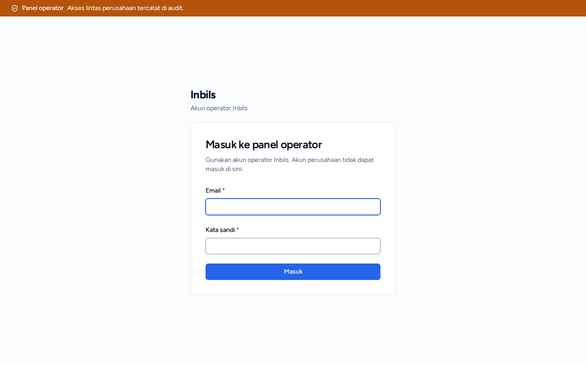

Masuk pertama kali:

1. Buka `/platform`, isi **Email** dan **Kata sandi**, lalu klik **Masuk**.
2. Di halaman **Autentikasi dua langkah**, klik **Mulai pengaturan**, lalu pindai kode QR dengan aplikasi autentikator. Kode QR hanya tampil sekali. Bila terlewat, klik **Mulai lagi** untuk mendapat yang baru.
3. Isi **Kode autentikasi** (6 digit), lalu klik **Konfirmasi dan aktifkan**.
4. Halaman **Kode pemulihan Anda** menampilkan 8 kode pemulihan sekali saja. Salin dengan tombol salin atau klik **Unduh sebagai teks**, lalu simpan di tempat aman. Setiap kode hanya berlaku sekali. **Buat kode pemulihan baru** membuat kumpulan baru dan membatalkan yang lama.

Sebelum pendaftaran selesai, halaman lain di panel tidak dapat dibuka.

Masuk berikutnya: setelah email dan kata sandi, isi **Kode autentikasi**, atau klik **Pakai kode pemulihan** dan masukkan satu kode pemulihan. Setiap sesi browser harus lolos pemeriksaan kodenya sendiri, jadi masuk di browser kedua meminta kode lagi. Sebuah kode hanya diterima sekali: bila Anda masuk dua kali dalam 30 detik yang sama, tunggu kode berikutnya muncul di aplikasi.

Batas dan sesi:

- Lima kegagalan per menit untuk satu email dan alamat IP, atau 20 per jam untuk satu email, menahan login sementara. Akun nonaktif gagal dengan pesan kredensial salah yang sama seperti kata sandi salah.
- Sesi berakhir setelah 30 menit tanpa aktivitas.
- Tindakan berisiko (tangguhkan, ajukan hapus, ekspor, mode ubah, perubahan peran) meminta **Kata sandi operator** di dialognya. Kata sandi itu berlaku 5 menit untuk tindakan berikutnya. Halaman **Konfirmasi kata sandi** muncul bila Anda perlu memasukkannya di luar dialog.
- Operator yang kehilangan autentikator dan kode pemulihan tidak dapat memulihkan diri sendiri. Hubungi tim server untuk membuat akun operator baru.

## 11.2 Dasbor dan daftar perusahaan

Dasbor memantau setiap perusahaan top-level (satu perusahaan induk beserta anak perusahaannya dihitung sebagai satu baris).

- Kartu di atas: **Perusahaan aktif**, **Ditangguhkan**, **Pengajuan hapus**, dan **Job gagal tanpa perusahaan** (job gagal yang tidak dapat dikaitkan ke perusahaan mana pun).
- Filter: **Cari** (nama atau kode perusahaan) dan **Status** (**Semua status**, **Aktif**, **Ditangguhkan**, **Pengajuan hapus**).
- Kolom: **Perusahaan**, **Kode**, **Status**, **Anak perusahaan**, **Pengguna**, **Pelanggan**, **Job gagal 7 hari**, **WhatsApp gagal 7 hari**, **Masuk terakhir**, **Penyimpanan**. Angka perusahaan induk sudah mencakup anak perusahaannya. **Penyimpanan** dibaca dari data media yang tercatat, sehingga berkas lama tanpa data itu membuat angkanya lebih rendah dari ukuran sebenarnya.
- Klik nama perusahaan untuk membuka halamannya (bagian 11.4). Tombol **Perusahaan baru** di kanan atas membuka formulir pembuatan.

## 11.3 Membuat perusahaan

Hanya operator yang membuat perusahaan baru dan anak perusahaan.

1. Klik **Perusahaan baru** (di dasbor atau sidebar).
2. Isi **Nama perusahaan** dan **Kode perusahaan**. Kode tidak dapat diubah setelah dibuat dan dipakai untuk mengonfirmasi tindakan berisiko. Admin perusahaan juga tidak dapat mengubahnya di menu Perusahaan.
3. Pilih **Zona waktu** dan **Mata uang**, dan bila perlu unggah **Logo** (JPG, PNG, WebP atau SVG hingga 10 MB).
4. Isi **Nama admin** dan **Email admin**. Inbils membuat akun admin pertama dengan kata sandi acak dan mengirim email undangan berisi tautan atur kata sandi yang berlaku 60 menit.
5. Centang **Isi data contoh** bila perusahaan ini untuk uji coba. Data contoh (pelanggan, tagihan, SPK, tiket, inventaris) diisi lewat antrean, tanpa perangkat jaringan dan tanpa pesan WhatsApp. Akun contohnya memakai kata sandi acak yang tidak diberitahukan kepada siapa pun.
6. Klik **Buat perusahaan**.

Perusahaan langsung aktif dengan peran, penomoran dan pengaturan dasar. Bila admin belum membuka undangannya, kolom **Masuk terakhir** di halaman perusahaan menampilkan **Undangan belum dipakai**. Pengisian data contoh dan ekspor berjalan di worker `platform-queue`. Tanpa worker itu keduanya tetap menunggu di antrean.

## 11.4 Halaman perusahaan

Halaman perusahaan berisi **Profil perusahaan**, **Ringkasan** (angka yang sama dengan dasbor), **Status perusahaan**, **Admin perusahaan**, **Anak perusahaan**, **Pengguna**, **Ekspor**, **Audit terbaru**, serta daftar **Job gagal** dan **WhatsApp gagal** (tombol **Lihat 30 hari terakhir** membuka 30 hari penuh).

### Tangguhkan, aktifkan kembali, ajukan hapus

Tombol di **Status perusahaan** mengikuti status perusahaan:

- **Tangguhkan** (perusahaan aktif). Dialog meminta **Alasan** (5 sampai 200 karakter, tercatat di audit), **Ketik {kode} untuk melanjutkan** dan **Kata sandi operator**. Perusahaan dan anak perusahaan yang aktif kehilangan akses: pengguna tidak dapat masuk dan token aplikasi dicabut. Data tetap tersimpan.
- **Aktifkan kembali** (perusahaan ditangguhkan). Dialog hanya meminta **Alasan**. Anak perusahaan yang ikut ditangguhkan aktif lagi, dan pengajuan hapus yang masih ada dibatalkan.
- **Ajukan hapus** (hanya pada perusahaan yang ditangguhkan, nonaktif sampai syaratnya terpenuhi). Syaratnya: sudah ditangguhkan 30 hari dan ada ekspor selesai setelah penangguhan. Bagian **Syarat pengajuan hapus** menyebut syarat yang belum terpenuhi. Dialog meminta kode perusahaan dan kata sandi operator. Tombol ini hanya mencatat pengajuan. Panel web tidak pernah menghapus data. Penghapusan permanen hanya dengan perintah `php artisan inbils:platform:purge-company {kode}` oleh tim server (interaktif, mengetik ulang kode).

### Anak perusahaan

**Tambah anak perusahaan** (nonaktif selama perusahaan ditangguhkan) meminta **Nama**, **Kode** dan admin mana yang menjadi anggotanya. Mata uang dan zona waktu mengikuti perusahaan induk. Anak perusahaan baru memperoleh satu akun sistem internal (`system-seed-...@inbils.internal`) yang ikut tampil di daftar pengguna perusahaan itu.

### Pengguna dan alat dukungan

Tabel **Pengguna** punya filter **Cari** dan **Status**, dan kolom **Pengguna**, **Perusahaan**, **Peran**, **Status**, **2FA**, **Masuk terakhir**, **Aksi**.

- **Masuk sebagai** membuka akses dukungan (bagian 11.5).
- Menu **Aksi lain** berisi **Atur ulang 2FA** (mematikan 2FA pengguna dan mengakhiri semua sesi serta tokennya; pengguna mendaftar ulang sendiri), **Buka kunci masuk** (menghapus hitungan kode 2FA salah supaya pengguna tidak menunggu 15 menit) dan **Kirim ulang undangan** (hanya untuk admin aktif yang belum pernah masuk; 6 kali per menit untuk setiap pengguna). Pengguna harus berasal dari perusahaan ini, bukan sekadar anggota dari perusahaan lain, karena 2FA berlaku untuk seluruh akun.

## 11.5 Akses dukungan (masuk sebagai pengguna)

Akses dukungan memperlihatkan layar tenant persis seperti pengguna itu melihatnya, untuk menangani keluhan.

Untuk operator:

1. Di tabel **Pengguna**, klik **Masuk sebagai** pada baris pengguna. Tombol hanya tampil untuk pengguna aktif di perusahaan aktif.
2. Isi **Alasan** dan **Kata sandi operator**, lalu klik **Mulai akses dukungan**. Panel perusahaan terbuka sebagai pengguna itu.
3. Sesi dimulai dalam mode baca, berlaku paling lama 30 menit dan berakhir pada hitungan itu apa pun yang Anda lakukan. Sesi juga berakhir saat Anda keluar, perusahaan ditangguhkan, atau pengguna dinonaktifkan.
4. Untuk mengubah data, klik **Mode ubah** di banner, ketik kode perusahaan, lalu konfirmasi. Bila kata sandi operator sudah kedaluwarsa, Inbils membuka halaman **Konfirmasi kata sandi** dan mengembalikan Anda ke halaman tenant yang sama. Klik **Mode ubah** sekali lagi. **Mode baca** di banner kembali ke baca saja.
5. Klik **Keluar** untuk mengakhiri sesi.

Di tenant, banner tampil di atas semua halaman selama sesi berjalan: "Anda masuk sebagai {pengguna} ({perusahaan}) · superadmin {nama operator} · mode Baca (atau Ubah) · sisa mm:ss". Hitungan mundur hanya penunjuk. Server memeriksa batas 30 menit pada setiap permintaan, dan halaman dimuat ulang saat hitungan habis. Pengguna perusahaan sendiri tidak melihat banner ini, karena sesi mereka terpisah.

Aturan selama akses dukungan:

- Mode baca menolak setiap perubahan. Pesan yang tampil: "Mode baca saja: perubahan tidak diizinkan selama akses dukungan. Aktifkan mode ubah dari banner untuk melanjutkan."
- Izin tetap mengikuti pengguna yang dimasuki: operator tidak mendapat hak lebih daripada pengguna itu.
- Tidak tersedia dalam mode apa pun: pengaturan akun pribadi (profil, kata sandi, 2FA) dengan pesan "Pengaturan akun pribadi tidak tersedia selama akses dukungan.", melihat rahasia akun jaringan, menerbitkan token API, dan berpindah ke perusahaan di luar tenant itu.
- Aktivitas tercatat atas nama operator, dengan satu kode kelompok untuk seluruh sesi. Perusahaan melihat sesi itu di **Log Audit** (bagian 7.12) sebagai modul **Akses dukungan**, dengan teks "Akses dukungan oleh tim Inbils: {aksi}". Email atau id operator tidak ditampilkan.

## 11.6 Peran & hak akses

Definisi peran berlaku untuk pengguna di semua perusahaan, jadi hanya operator yang mengubahnya. Admin perusahaan hanya melihat peran (bagian 8.6) dan memberikannya ke pengguna di menu Pengguna (bagian 8.5).

- Menu **Peran & hak akses** di sidebar panel menampilkan kolom **Nama**, **Hak akses** dan **Pengguna semua perusahaan**, dengan pencarian **Cari**.
- **Buat peran**, **Ubah** dan **Hapus** (konfirmasi **Hapus peran**) meminta kata sandi operator (**Konfirmasi perubahan peran**). Setiap perubahan tercatat di audit platform.
- Lima peran bawaan (`admin`, `manager`, `staff`, `technician`, `customer`, bertanda **Bawaan**) tidak dapat dihapus atau diganti namanya. Izinnya boleh diubah, dan halaman ubahnya memberi peringatan. Seeder (`RolePermissionSeeder`) menimpa izin kelima peran itu pada setiap pembaruan sistem, jadi perubahan izin yang permanen sebaiknya dibuat di peran baru.
- Peran selain `admin` tidak boleh memuat pasangan izin yang berbenturan (pemisahan tugas, bagian 10.1).

## 11.7 Ekspor data perusahaan

1. Di halaman perusahaan, bagian **Ekspor**, klik **Minta ekspor**. Dialog meminta kode perusahaan dan kata sandi operator.
2. Arsip dibuat di latar belakang. Hanya satu ekspor yang boleh berjalan untuk satu perusahaan.
3. Buka **Ekspor** di sidebar. Kolom: **Perusahaan**, **Status** (**Antrean**, **Berjalan**, **Siap diunduh**, **Gagal**, **Kedaluwarsa**), **Diminta**, **Ukuran**, **Baris**, **Berlaku sampai**, **Catatan**, **Unduh**. Halaman memuat ulang sendiri selama ada ekspor yang antre atau berjalan.
4. Klik **Unduh** pada ekspor **Siap diunduh**. Tautannya bertanda tangan, berlaku 24 jam, dan hanya dapat dibuka dalam sesi operator yang aktif.

Arsip ZIP berisi satu CSV per tabel perusahaan, folder berkas media, dan `manifest.json` yang mencatat jumlah baris dan kolom yang sengaja tidak diekspor: kata sandi, TOTP, kode pemulihan, token, rahasia RADIUS, NAS dan PPPoE, serta token pembayaran. Setelah masa berlaku habis, arsip dihapus dan barisnya tetap ada dengan status **Kedaluwarsa** sebagai bukti ekspor untuk syarat pengajuan hapus (bagian 11.4).

## 11.8 Audit platform

**Audit platform** mencatat kegiatan operator dan akses dukungan di semua perusahaan. Filter: **Cari**, **Perusahaan** (termasuk anak perusahaannya), **Operator**, **Kegiatan** dan **Rentang tanggal** (dihitung per hari UTC). Kolom: **Waktu**, **Kegiatan**, **Sumber** (**Platform** atau **Akses dukungan**), **Pelaku**, **Perusahaan**, **Subjek**, **Rincian**. Tombol di kolom **Rincian** membuka dialog dengan properti baris dan kode kelompok sesi akses dukungan. Setelah perusahaan dihapus permanen, barisnya tetap ada dan menampilkan kode serta nama perusahaan yang tersimpan.

Log platform tidak tampil di Log Audit perusahaan. Hanya baris **Akses dukungan** yang tampil di sana (bagian 11.5).
