# 1. Pendahuluan

## 1.1 Siapa memakai panduan ini

Panduan ini untuk pengguna web Inbils di kantor: admin, manajer, dan staf. Ketiganya membuka alamat web yang sama. Yang berbeda adalah menu dan tombol yang muncul, karena Inbils hanya menampilkan apa yang diizinkan untuk peran Anda.

- Admin memegang semua izin kecuali izin portal pelanggan. Admin mengelola pengguna, peran, perusahaan, dan pengaturan sistem.
- Manajer menyetujui SPK dan permintaan barang, memantau laporan, mengelola pelanggan, layanan, jaringan, dan tagihan, serta boleh membatalkan tagihan dan membalik pembayaran.
- Staf menjalankan pekerjaan harian: mengubah data pelanggan, membuat SPK, tiket, dan tagihan, mencatat pembayaran, serta memproses stok masuk dan keluar di gudang.

Pembagian izin yang rinci ada di bagian 10.1. Admin dapat membuat peran lain (bagian 8.6), jadi daftar menu per orang di perusahaan Anda bisa berbeda dari uraian di atas.

Teknisi dan pelanggan tidak memakai web. Akun yang hanya berperan teknisi atau pelanggan dialihkan ke halaman **Gunakan aplikasi Inbils**, yang menyebut aplikasi Android yang harus dipakai. Pekerjaan teknisi (memulai dan menyerahkan SPK, mengerjakan tiket, mengembalikan material) dan pekerjaan pelanggan (melihat dan membayar tagihan, membuat tiket) dilakukan di aplikasi masing-masing, dengan panduan terpisah: Panduan Aplikasi Teknisi dan Panduan Aplikasi Pelanggan. Di web, mereka hanya membuka halaman masuk, lupa kata sandi, profil (termasuk 2FA), dan halaman hasil pembayaran. Akun yang juga memegang peran admin, manajer, atau staf tidak dialihkan.

### Cara membaca panduan

- Nama menu, tombol, tab, dan isian ditulis tebal persis seperti tulisan di layar. Sebagian layar Inbils berbahasa Inggris (misalnya tombol **Show**, **Edit**, **Delete**, **Save**) dan sebagian berbahasa Indonesia. Panduan mengikuti tulisan di layar.
- Gambar diambil dari data contoh "Inbils Demo Company" dengan login admin. Data dan tombol di layar Anda bisa berbeda, terutama bila peran Anda bukan admin.
- Setiap menu dimulai dengan tujuan dan peran yang dapat memakainya, disusul langkah bernomor dan daftar kesalahan umum.
- Bab 9 menyusun alur kerja yang melewati beberapa menu. Bab 10 memuat tabel peran dan istilah.

Bila menu yang disebut panduan tidak ada di sidebar Anda, peran Anda belum memiliki izinnya. Minta admin menambahkannya di menu Peran (bagian 8.6). Bila Anda membuka halaman yang tidak diizinkan, Inbils menampilkan **Access denied** dengan pesan "You do not have permission to view this page."

## 1.2 Masuk

Akun dibuat oleh admin lewat menu Pengguna (bagian 8.5). Web tidak menyediakan pendaftaran sendiri.

Peran yang dapat memakai: semua pengguna dengan akun aktif. Akun nonaktif ditolak dengan pesan yang sama seperti kata sandi salah.

1. Buka alamat Inbils di browser. Admin atau tim IT Anda memberi alamatnya.
2. Isi **Email** dan **Password**.

   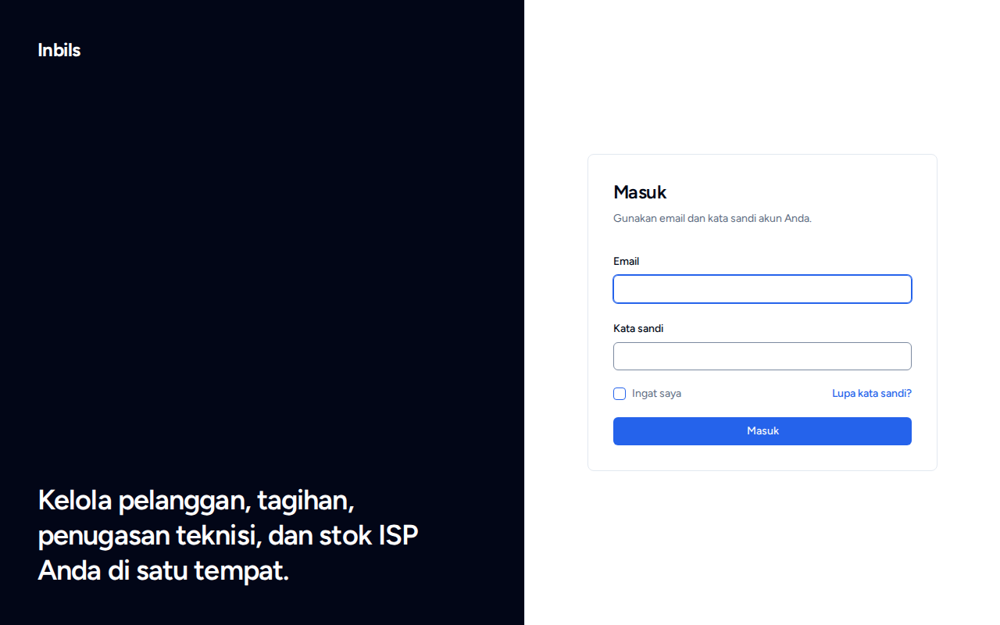

3. Centang **Remember me** bila Anda memakai perangkat pribadi. Tanpa centang ini, sesi berakhir setelah 120 menit tanpa aktivitas (pengaturan standar yang dapat diubah admin server).
4. Klik **Log in**.

Setelah **Log in**, ada beberapa kemungkinan:

- Berhasil: Inbils membuka halaman yang Anda tuju sebelumnya, atau **Dasbor** (bab 2).
- Akun memakai 2FA: Inbils membuka halaman **Two-factor authentication** (bagian 1.4).
- Akun hanya berperan teknisi atau pelanggan: Inbils membuka halaman **Gunakan aplikasi Inbils** (bagian 1.1).
- Instalasi baru: akun admin pertama melihat **Setup Wizard** dengan empat langkah (**Company info**, **System config**, **Initial admin**, **Confirmation**) untuk membuat perusahaan. Wizard tidak muncul lagi setelah perusahaan ada.

Untuk keluar, klik nama Anda di kanan atas, lalu **Logout**.

### Kesalahan umum

- Pesan "These credentials do not match our records." berarti email atau kata sandi salah, atau akun Anda nonaktif. Periksa tulisan email, lalu minta admin memeriksa status akun bila kata sandi sudah benar.
- Pesan "Too many login attempts. Please try again in N seconds." muncul setelah lima percobaan gagal dari alamat dan email yang sama. Tunggu sampai hitungan detik habis, lalu coba lagi.

## 1.3 Lupa kata sandi

Peran yang dapat memakai: semua pengguna. Inbils mengirim tautan ke email akun, jadi email di akun Anda harus masih aktif.

1. Di halaman masuk, klik **Forgot password?**.
2. Isi email akun Anda, lalu klik **Email Password Reset Link**.
3. Baca pesan hijau yang muncul: "If an account exists for that email address, we have emailed a password reset link." Pesan ini sama untuk email yang terdaftar maupun tidak, supaya orang lain tidak bisa menebak akun yang ada.
4. Buka email Anda dan klik tautan di dalamnya. Tautan berlaku 60 menit.
5. Di halaman **Reset Password**, isi **Password** baru dan **Confirm Password** dengan kata sandi yang sama (minimal 8 karakter), lalu klik **Reset Password**.
6. Inbils membawa Anda ke halaman masuk dengan pesan "Your password has been reset." Masuk dengan kata sandi baru.

### Kesalahan umum

- Pesan "This password reset token is invalid." berarti tautan sudah lewat 60 menit atau sudah dipakai. Ulangi dari langkah 1 dan pakai tautan dari email terbaru.
- Email tidak datang: tunggu beberapa menit, periksa folder spam, lalu minta ulang. Permintaan baru baru bisa dikirim setelah 60 detik, dan satu alamat dibatasi enam permintaan per menit.
- Setelah kata sandi berganti, login aplikasi Android milik akun yang sama berakhir. Masuk lagi di aplikasi dengan kata sandi baru.

## 1.4 Autentikasi dua langkah (2FA)

2FA meminta kode 6 digit dari aplikasi authenticator di ponsel setelah kata sandi, sehingga kata sandi yang bocor saja tidak cukup untuk masuk. Fitur ini opsional dan diatur sendiri oleh setiap pengguna. Kode berganti setiap 30 detik.

Peran yang dapat memakai: semua pengguna, untuk akunnya sendiri. Teknisi dan pelanggan menyalakannya di web lewat tombol **Kelola akun & 2FA** pada halaman **Gunakan aplikasi Inbils**.

### Menyalakan 2FA

1. Klik nama Anda di kanan atas, lalu **Profile** (bagian 1.7).
2. Di bagian **Two-Factor Authentication** (status **Off**), klik **Enable two-factor authentication**.
3. Bila Inbils membuka halaman **Confirm Password**, isi kata sandi Anda lalu klik **Confirm**. Konfirmasi ini berlaku 3 jam, jadi Anda tidak ditanya lagi saat mengelola 2FA dalam rentang itu.
4. Pindai kode QR dengan aplikasi authenticator di ponsel. Bila tidak bisa memindai, ketik setup key yang tampil di bawah kode QR ke dalam aplikasi.
5. Ketik kode 6 digit dari aplikasi ke isian **Authentication code**, lalu klik **Confirm and turn on**. Status berubah menjadi **On**.
6. Inbils menampilkan **Your recovery codes**: delapan kode, masing-masing hanya berlaku sekali. Klik **Copy** atau **Download as text**, simpan di tempat aman seperti pengelola kata sandi, lalu klik **I have saved these codes**. Kode tidak ditampilkan lagi.

Kode QR hanya tampil sekali. Bila Anda menutup halaman sebelum langkah 5, status menjadi **Setup not finished**. Klik **Start again** untuk mendapat kode QR baru, atau **Cancel setup** untuk membatalkan.

### Masuk dengan 2FA

1. Isi email dan kata sandi di halaman masuk, lalu klik **Log in**.
2. Di halaman **Two-factor authentication**, isi **Authentication code** dengan kode 6 digit dari aplikasi, lalu klik **Log in**.
3. Bila ponsel hilang atau rusak, klik **Use a recovery code**, isi **Recovery code**, lalu klik **Log in**. Klik **Use an authentication code** untuk kembali ke kode biasa.

Sisa kode pemulihan tampil di Profile ("N recovery codes left."). Klik **Generate new recovery codes** untuk membuat set baru. Set lama berhenti berlaku saat itu juga.

### Mematikan 2FA

1. Buka **Profile**, bagian **Two-Factor Authentication**.
2. Klik **Turn off two-factor authentication**.
3. Di dialog **Turn off two-factor authentication?**, klik **Turn off**. Akun kembali hanya dilindungi kata sandi, dan kode pemulihan tidak berlaku lagi.

### Kesalahan umum

- Pesan "The provided two-factor code was invalid." berarti kode salah atau sudah berganti. Ketik kode terbaru dari aplikasi dan pastikan jam ponsel akurat.
- Satu kode hanya diterima sekali. Setelah kode dipakai untuk masuk, tunggu kode berikutnya untuk masuk lagi.
- Lima percobaan salah dalam semenit menghentikan percobaan berikutnya sementara, bahkan bila kode yang diketik benar. Tunggu sampai hitungan detik pada pesan "Too many login attempts. Please try again in N seconds." habis.
- Ponsel hilang dan kode pemulihan habis: minta admin mereset 2FA akun Anda (bagian 8.5). Setelah reset, Anda masuk dengan kata sandi saja dan bisa mendaftar ulang.
- Menyalakan, mematikan, atau membuat ulang kode pemulihan mengakhiri login "Remember me" di perangkat lain dan login aplikasi Android. Masuk lagi di aplikasi setelahnya.

## 1.5 Mengenal layar

Hampir semua menu memakai kerangka yang sama. Bagian ini menjelaskan kerangka itu sekali. Bab berikutnya hanya menyebut hal yang khusus untuk menu tersebut.

### Sidebar dan bilah atas

- Sidebar di kiri memuat nama atau logo perusahaan, tombol ganti perusahaan bila ada (bagian 1.6), **Dasbor**, dan enam grup menu: **Operasional**, **Pelanggan & Layanan**, **Jaringan**, **Inventaris**, **Keuangan & Laporan**, **Administrasi**. Klik judul grup untuk membuka atau menutupnya. Grup yang berisi halaman aktif terbuka sendiri.
- Hanya menu yang diizinkan untuk peran Anda yang tampil. Grup tanpa menu tidak tampil.
- Angka kecil di samping **Pekerjaan Saya**, **Penugasan**, dan **Persetujuan** menunjukkan jumlah antrean yang menunggu.
- Di layar sempit, sidebar tersembunyi. Klik ikon tiga garis di kiri atas untuk membukanya.
- Di bilah atas, lonceng membuka notifikasi (bagian 2.2). Angka merah pada lonceng adalah jumlah yang belum dibaca, ditulis 99+ bila lebih dari 99.
- Klik nama Anda di kanan atas untuk menu **Profile**, **Dark mode** (atau **Light mode**), dan **Logout**. Pilihan tema disimpan di browser.

### Daftar dan tabel

- Kotak **Search** mencari pada kolom yang disebut di isiannya (misalnya "Name, code, phone"). Beberapa daftar mencari setelah Anda berhenti mengetik, daftar lain menunggu tombol **Filter**. Ikuti tombol yang ada di layar.
- Kotak pilihan di samping pencarian menyaring daftar, misalnya status atau jenis. Mengubah filter selalu kembali ke halaman pertama.
- Klik judul kolom yang berpanah untuk mengurutkan. Klik lagi untuk membalik urutan.
- Di bawah tabel, Inbils menulis rentang baris yang tampil dan totalnya, pemilih jumlah baris (10, 25, atau 50 per halaman), tombol **Previous** dan **Next**, dan nomor halaman.
- Kolom **Actions** memuat tombol **Show**, **Edit**, dan **Delete**. Tombol hanya tampil bila Anda punya izinnya. **Delete** selalu membuka dialog konfirmasi dengan tombol **Cancel** dan **Delete**. Data yang masih dipakai tidak bisa dihapus, dan Inbils menjelaskan alasannya dengan pesan merah.
- Tombol **Export** membuka menu **Export CSV** dan, di sebagian besar daftar, **Export PDF**. Hasilnya mengikuti filter yang sedang aktif. Satu ekspor dibatasi 5.000 baris. Bila terpotong, baris terakhir CSV berisi "# Export truncated at 5000 rows. Narrow the filters to export the remaining rows." Persempit filter lalu ekspor lagi.

### Formulir dan pesan

- Isian wajib harus terisi sebelum menyimpan. Pesan merah di bawah isian menjelaskan apa yang salah. Di bagian atas layar, toast merah "Data gagal disimpan. Periksa input." menandai bahwa penyimpanan gagal.
- Toast hijau menandai penyimpanan berhasil. Isinya dari server dan bisa berbahasa Inggris atau Indonesia.
- Tombol yang sedang memproses menampilkan indikator dan tidak bisa diklik dua kali.
- Rupiah tampil tanpa desimal. Format tanggal mengikuti pengaturan perusahaan (bagian 8.1), dan jam memakai format 24 jam.
- Halaman yang tidak ada menampilkan **Page not found**. Halaman yang tidak diizinkan menampilkan **Access denied**.

## 1.6 Ganti perusahaan

Satu instalasi Inbils dapat memuat lebih dari satu perusahaan, misalnya perusahaan induk (Head) dan anak perusahaannya. Data setiap perusahaan terpisah: pelanggan, tagihan, stok, dan laporan hanya milik perusahaan yang sedang aktif.

Peran yang dapat memakai: admin dan manajer (izin `company.switch`), dan hanya bila akun itu punya akses ke lebih dari satu perusahaan. Tombol ganti perusahaan tidak tampil untuk akun lain.

1. Lihat bagian atas sidebar. Tombol di bawah nama perusahaan menampilkan perusahaan aktif dan tulisan **Switch company**.
2. Klik tombol itu. Daftar **Companies** terbuka dengan nama dan kode setiap perusahaan. Perusahaan asal akun Anda diberi tanda "default".
3. Pilih perusahaan tujuan. Inbils membuka **Dasbor** perusahaan itu dan menampilkan "Now working in &lt;nama perusahaan&gt;."
4. Untuk kembali, ulangi langkah 1 sampai 3 dan pilih perusahaan asal.

Perpindahan berlaku selama sesi login. Setiap login baru dimulai lagi di perusahaan asal. Peran dan izin Anda tidak berubah saat pindah.

Akses ke perusahaan lain dan anak perusahaan dibuat oleh administrator server dengan perintah `inbils:company:grant-membership` dan `inbils:company:create-subsidiary`, bukan lewat layar web.

Perusahaan induk (Head) adalah perusahaan tanpa induk yang punya minimal satu anak perusahaan aktif. Hanya saat Anda bekerja di Head dan akun Anda punya izin `report.consolidated.view` (admin), menu **Metrik Konsolidasi** muncul di grup **Keuangan & Laporan** (bagian 7.11).

### Kesalahan umum

- Angka di layar mendadak berbeda: periksa perusahaan aktif di tombol sidebar. Anda mungkin masih berada di perusahaan lain.
- Tombol ganti perusahaan tidak ada: akun Anda hanya punya satu perusahaan, atau perannya tidak memiliki izin `company.switch`. Minta administrator server menambah akses.
- Menu **Metrik Konsolidasi** tidak ada di anak perusahaan. Pindah ke Head dulu.

## 1.7 Profil dan kata sandi

Profil memuat data akun Anda sendiri. Halaman ini sama untuk semua peran.

1. Klik nama Anda di kanan atas, lalu **Profile**.

   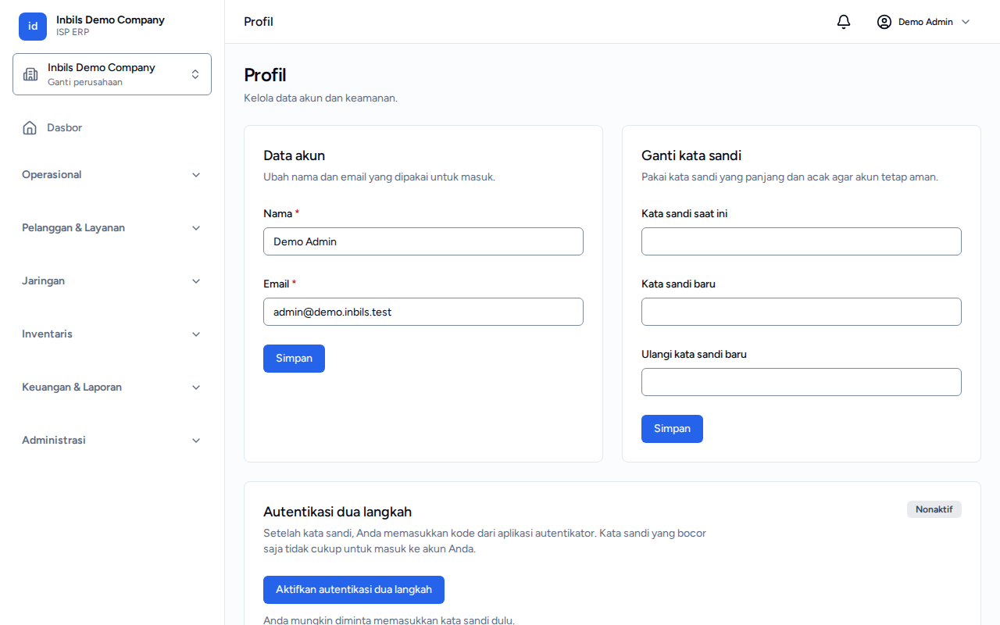

2. Untuk mengubah nama atau email, ubah isian **Name** atau **Email** di bagian **Profile Information**, lalu klik **Save**.
3. Untuk mengganti kata sandi, isi **Current Password**, **New Password**, dan **Confirm Password** di bagian **Update Password**, lalu klik **Save**. Kata sandi baru minimal 8 karakter.
4. Bagian **Two-Factor Authentication** dijelaskan di bagian 1.4.
5. Bagian **Delete Account** menghapus akun Anda secara permanen. Klik **Delete Account**, isi kata sandi di dialog, lalu klik **Delete Account** sekali lagi. Jangan lakukan ini kecuali admin memintanya. Untuk menutup akses, lebih aman minta admin menonaktifkan akun (bagian 8.5).

### Kesalahan umum

- Pesan "The password is incorrect." di **Current Password** berarti kata sandi lama salah.
- Pesan "The password field confirmation does not match." berarti **New Password** dan **Confirm Password** berbeda.
- Mengganti kata sandi mengakhiri login aplikasi Android milik akun Anda. Masuk lagi di aplikasi.
- **Delete Account** ditolak dengan pesan "Cannot delete a user who requested or reviewed stock adjustments. Deactivate the account instead." bila akun pernah mengajukan atau memeriksa penyesuaian stok. Minta admin menonaktifkan akun itu.
- Mengubah email tidak mengubah kata sandi, tetapi email baru dipakai untuk masuk dan menerima tautan lupa kata sandi. Pastikan alamat baru benar.

# 2. Dasbor

## 2.1 Kartu antrean

Dasbor adalah halaman pertama setelah masuk. Isinya antrean dan pengecualian yang perlu Anda tangani hari ini. Setiap kartu menampilkan angka langsung untuk perusahaan yang sedang aktif. Klik pada kartu membuka menu tujuannya dengan filter yang sudah terpasang.

Peran yang dapat memakai: semua akun web dengan izin `dashboard.view` (admin, manajer, staf). Kartu muncul hanya bila peran Anda boleh mengerjakan antrean itu. Kartu yang tidak tampil berarti antrean itu bukan tugas Anda, bukan berarti angkanya nol.

### Membaca kartu

1. Klik **Dasbor** di sidebar. Dasbor juga terbuka otomatis setelah masuk.

   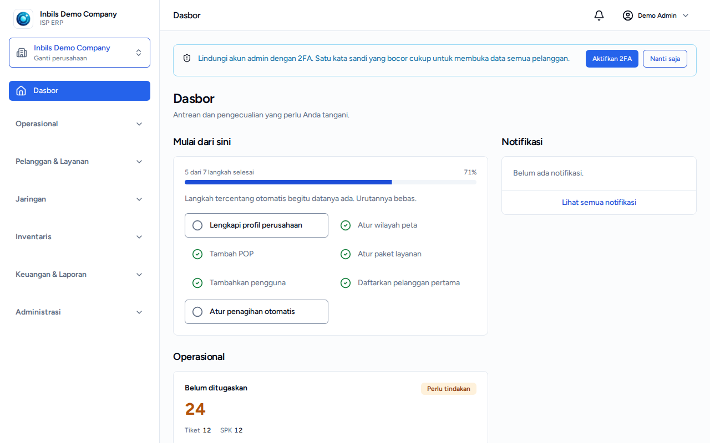

2. Baca kartu per grup: **Operasional**, **Persetujuan**, **Gudang**, **Keuangan**. Grup yang tidak relevan untuk peran Anda tidak tampil.
3. Perhatikan penanda di kanan atas kartu. **Perlu tindakan** (kuning) dan **Segera tangani** (merah) muncul hanya bila angkanya lebih dari nol. Angka nol tampil abu-abu dengan tulisan "Tidak ada yang perlu ditangani."
4. Klik kartu untuk membuka menu tujuannya.
5. Pada kartu **SLA terlampaui**, lihat daftar sampai lima tiket di bawah angka. Setiap baris memuat kode tiket, prioritas (**Mendesak**, **Tinggi**, **Sedang**, **Rendah**), judul, dan "Batas SLA" dengan tanggal dan jam. Tiket dengan batas SLA tertua tampil paling atas. Bila tiket lebih dari lima, Inbils menulis "Menampilkan 5 dari N tiket, batas SLA terlama lebih dulu." Klik satu baris untuk membuka tiketnya.

### Daftar kartu

| Kartu | Yang dihitung | Dibuka ke | Muncul untuk |
| --- | --- | --- | --- |
| Pekerjaan saya | SPK dan tiket yang ditugaskan kepada Anda. Rincian: **Belum dimulai**, **Dikerjakan**, **Menunggu tindakan** | Pekerjaan Saya (3.6) | Pemegang izin kerja lapangan (mulai atau serahkan SPK; mulai, selesaikan, atau tutup tiket) yang punya profil karyawan aktif |
| Belum ditugaskan | Tiket dan SPK tanpa penerima. Rincian: **Tiket**, **SPK** | Penugasan (3.1), filter belum ditugaskan | Pengguna aktif dengan izin menugaskan atau menugaskan ulang tiket atau SPK |
| SLA terlampaui | Tiket yang belum selesai dan sudah lewat batas SLA | Tiket (3.4), filter SLA terlampaui | Pemegang `ticket.view` yang juga menugaskan, mengerjakan, atau melaporkan SLA tiket |
| Menunggu persetujuan saya | SPK dan permintaan barang yang menunggu keputusan Anda | Persetujuan (3.2) | Pemegang izin setujui atau tolak SPK atau permintaan barang |
| Antrean permintaan gudang | Permintaan barang di antrean gudang | Permintaan Barang (6.1), tab gudang | Pemegang `inventory.request.view.all` |
| Antrean retur material | Pengembalian material yang menunggu diproses. Rincian: **Pengecualian** | Pengembalian Barang (6.8) | Pemegang `inventory.return.view.all` |
| Stok di bawah minimum | Baris stok (satu barang di satu lokasi) yang jumlahnya sama dengan atau di bawah stok minimum | Stok (6.5), filter stok rendah | Pemegang `inventory.view` |
| Invoice jatuh tempo | Tagihan terbuka yang lewat jatuh tempo dan masih bersisa. Rincian: **Terutang** | Tagihan (7.1), filter overdue | Pemegang `billing.view` |

### Kesalahan umum

- Angka kartu berbeda dengan daftar di menu tujuan: periksa perusahaan yang sedang aktif (bagian 1.6). Angka dasbor dan daftar memakai aturan hitung yang sama, tetapi hanya untuk perusahaan aktif.
- Kartu **Menunggu persetujuan saya** tidak menghitung SPK yang Anda buat atau tugaskan ke diri sendiri, dan permintaan barang yang Anda ajukan sendiri. Aturan pemisahan tugas melarang Anda menyetujuinya (bagian 3.2).
- Kartu **Pekerjaan saya** tidak ada padahal Anda punya izin: akun Anda perlu profil karyawan yang aktif di perusahaan ini (bagian 8.3).
- Dasbor kosong dengan judul "Belum ada antrean untuk akun Anda": peran Anda belum punya izin ke antrean mana pun. Hubungi admin untuk menambah izin.
- Halaman **Access denied** saat membuka dasbor: peran Anda tidak memegang izin `dashboard.view`.

## 2.2 Notifikasi

Notifikasi adalah pemberitahuan yang ditujukan ke akun Anda, misalnya tiket yang ditugaskan kepada Anda, tiket yang melewati batas SLA, permintaan barang yang siap, atau kegagalan penjadwalan tagihan. Notifikasi tampil di tiga tempat: panel di dasbor, angka di lonceng bilah atas, dan halaman **Notifications**.

Peran yang dapat memakai: semua pengguna web, untuk notifikasi miliknya sendiri.

1. Lihat panel **Notifikasi** di kanan dasbor. Panel menampilkan lima notifikasi terbaru dan lencana "N belum dibaca" bila ada yang belum dibuka. Klik **Lihat semua notifikasi** di dasar panel.
2. Atau klik ikon lonceng di bilah atas. Angka merah pada lonceng adalah jumlah yang belum dibaca.

   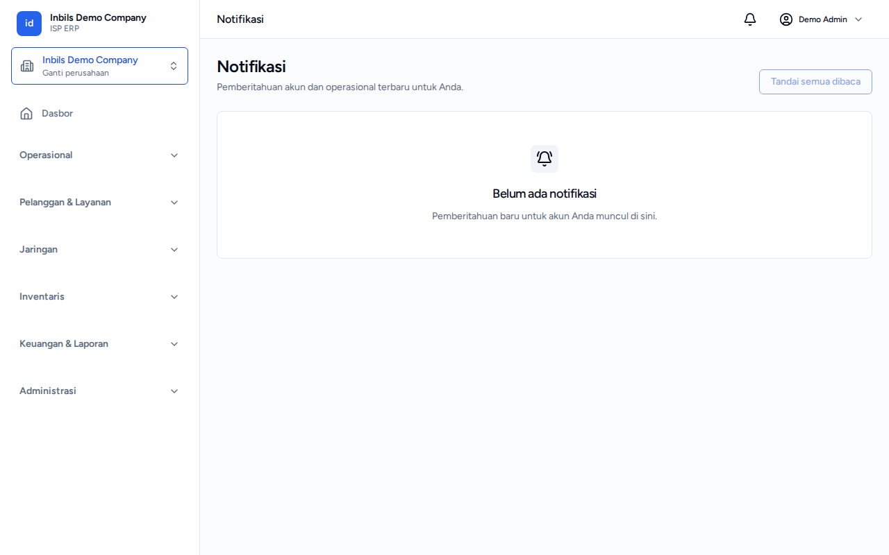

3. Baca daftar. Setiap notifikasi memuat judul, pesan, waktu, dan lencana **Unread** bila belum dibaca. Daftar menampilkan 20 notifikasi per halaman.
4. Klik **View details** untuk membuka halaman yang dimaksud. Notifikasi yang belum dibaca otomatis ditandai sudah dibaca.
5. Klik **Mark read** pada satu notifikasi untuk menandainya tanpa membuka halamannya.
6. Klik **Mark all as read** di kanan atas untuk menandai semuanya. Tombol ini nonaktif bila tidak ada yang belum dibaca.
7. Bila daftar panjang, pakai nomor halaman di bawah daftar.

### Kesalahan umum

- Lonceng tanpa angka hanya berarti tidak ada yang belum dibaca. Notifikasi lama tetap ada di halaman **Notifications**. Layar ini tidak menyediakan tombol hapus.
- Tombol **View details** tidak ada pada notifikasi yang tidak punya halaman tujuan.
- Notifikasi hanya untuk akun Anda. Admin tidak melihat notifikasi pengguna lain.

## 2.3 Ringkasan administrasi

Di bagian bawah dasbor, region **Administrasi** merangkum kondisi perusahaan untuk orang yang mengelola pengguna, peran, atau perusahaan.

Peran yang dapat memakai: pengguna dengan izin `users.manage`, `roles.manage`, atau `company.manage` (admin pada pengaturan standar). Region ini tidak tampil untuk akun lain.

1. Buka **Dasbor** lalu gulir ke bawah sampai judul **Administrasi**.
2. Baca empat kartu angka: **Pengguna** (pengguna perusahaan aktif), **Pengguna aktif**, **Peran**, dan **Izin akses**. Angka **Peran** dan **Izin akses** mencakup seluruh sistem, bukan satu perusahaan.
3. Lihat kartu **Perusahaan**: **Nama**, **Kode**, **Mata uang**, dan **Zona waktu** perusahaan aktif.
4. Lihat **Aktivitas terbaru**: sepuluh catatan audit terakhir di perusahaan aktif. Setiap baris memuat deskripsi, waktu, dan lencana nama log (misalnya `security` atau `inventory`). Untuk telusur lengkap, pakai Audit Log (bagian 7.12).
5. Di kartu **Modul**, klik satu modul (Customer, Service, Inventory, Network Asset, SPK, Billing, Ticketing) untuk membuka menunya. Angka di lencana adalah jumlah data modul itu di perusahaan aktif. Modul yang menunya tidak boleh Anda buka tidak tampil.

### Kesalahan umum

- Region **Administrasi** tidak ada: akun Anda tidak punya izin `users.manage`, `roles.manage`, atau `company.manage`.
- Angka **Pengguna** lebih kecil dari yang Anda harapkan: angka itu menghitung pengguna yang perusahaan asalnya adalah perusahaan aktif. Pindah perusahaan (bagian 1.6) untuk melihat perusahaan lain.

# 3. Operasional

## 3.1 Penugasan

Penugasan adalah antrean tiket dan SPK yang menunggu petugas. Buka menu ini untuk memilih petugas bagi item baru atau untuk mengganti petugas yang sudah dipilih.

Peran yang dapat memakai: admin dan manajer pada peran bawaan, staf tidak. Izin: `ticket.assign` dan `spk.assign` untuk menugaskan item yang belum punya petugas, `ticket.reassign` dan `spk.reassign` untuk mengganti petugas. Menu tampil bila akun Anda aktif dan memegang salah satu dari keempat izin itu. Izin tiket menampilkan tiket di daftar, izin SPK menampilkan SPK.

### Membuka dan membaca daftar

1. Di sidebar, buka grup **Operasional**, lalu klik **Penugasan**. Angka di samping menu adalah jumlah tiket dan SPK yang belum ditugaskan dan boleh Anda tugaskan. Angka tidak tampil bila hasilnya 0.

   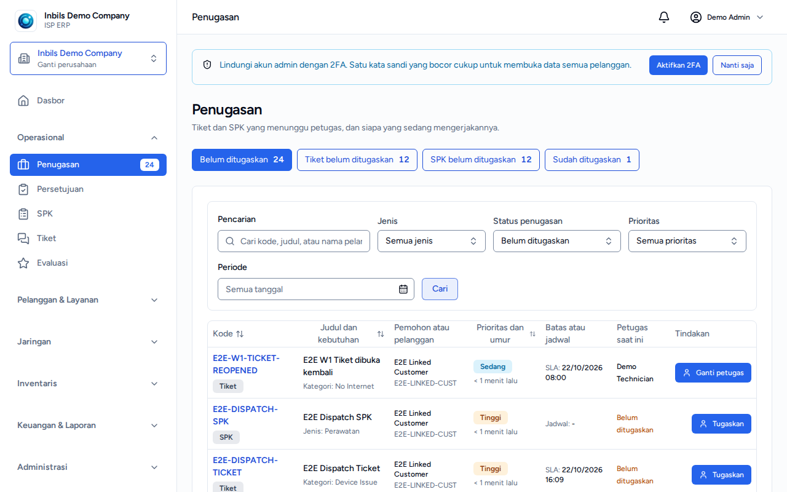

2. Baca empat kartu di atas daftar. Kartu menghitung seluruh antrean perusahaan dan tidak berubah saat Anda memakai filter.
   - Kartu **Belum Ditugaskan** menghitung tiket dan SPK yang menunggu petugas. Angkanya sama dengan angka di sidebar.
   - Kartu **Tiket Belum Ditugaskan** dan **SPK Belum Ditugaskan** memecah angka itu per jenis.
   - Kartu **Sudah Ditugaskan** menghitung item yang sudah punya petugas dan masih berada di antrean penugasan.
3. Klik sebuah kartu untuk mengisi filter **Status Penugasan**. Tiga kartu pertama memilih **Belum Ditugaskan**, kartu terakhir memilih **Sudah Ditugaskan**.
4. Persempit daftar dengan filter di atas tabel:
   - Kotak **Pencarian** mencari kode, judul, serta nama dan kode pelanggan. Pencarian berjalan sendiri sesaat setelah Anda berhenti mengetik. Tombol **Cari** menjalankan pencarian yang sama.
   - Pilihan **Domain** berisi **Semua Domain**, **Tiket**, dan **SPK**. Pilihan ini hanya tampil bila Anda memegang izin tiket dan izin SPK.
   - Pilihan **Status Penugasan** berisi **Belum Ditugaskan**, **Sudah Ditugaskan**, dan **Semua Status**.
   - Pilihan **Prioritas** berisi **Semua Prioritas**, **Kritis**, **Tinggi**, **Sedang**, dan **Rendah**.
   - Isian **Periode** menyaring tanggal tiket atau SPK dibuat. Tanggal akhir tidak boleh sebelum tanggal awal.
   - Tombol **Reset** muncul saat ada filter aktif. Tombol ini mengosongkan filter dan memilih **Belum Ditugaskan**.
5. Saat menu baru dibuka, kotak **Status Penugasan** tampak **Belum Ditugaskan** tetapi belum menyaring apa pun bagi pemegang izin assign dan reassign (admin dan manajer). Daftar memuat item yang belum dan sudah ditugaskan sekaligus. Pilih statusnya sendiri bila ingin menyaring.
6. Baca tabel antrean.
   - Antrean memuat tiket berstatus `open` dan `assigned`, serta SPK berstatus `draft`, `generated`, `rejected`, dan `assigned`. Tiket dan SPK yang sudah dikerjakan tidak ada di sini.
   - Kolom: **Kode & Domain** (kode, tautan ke detail bila Anda boleh membukanya, lencana **Tiket** atau **SPK**), **Judul / Kebutuhan** (judul, **Kategori** untuk tiket atau **Tipe** untuk SPK, dan tanda **SLA Terlampaui** bila batas SLA lewat), **Pemohon / Pelanggan**, **Prioritas & Umur**, **Batas / Jadwal** (**SLA** untuk tiket, **Jadwal** untuk SPK), **Petugas Saat Ini** (nama petugas, atau lencana **Belum Ditugaskan**), dan **Tindakan** (tautan **Detail** serta tombol **Tugaskan** atau **Ganti Petugas**).
   - Judul kolom **Kode & Domain**, **Judul / Kebutuhan**, dan **Prioritas & Umur** bisa diurutkan. Urutan awal: terbaru di atas.
7. Bila akun Anda juga memenuhi syarat **Pekerjaan Saya** (bagian 3.6), dua tab muncul di atas kartu: **Antrean Penugasan** dan **Pekerjaan Saya**. Tab **Pekerjaan Saya** membuka daftar tugas Anda di halaman yang sama.

### Menugaskan atau mengganti petugas

1. Di baris yang dituju, klik **Tugaskan** (item belum punya petugas) atau **Ganti Petugas** (item sudah punya petugas). **Tugaskan** butuh `ticket.assign` atau `spk.assign`. **Ganti Petugas** butuh `ticket.reassign` atau `spk.reassign`.
2. Baca dialog **Tugaskan Tiket** atau **Tugaskan SPK**, yang diikuti kode item. Bagian atas memuat judul, pemohon, prioritas, umur antrean, dan **Batas SLA** (tiket) atau **Jadwal Kerja** (SPK). Baris **Alasan Tindakan**, **Dampak**, dan **Alur Berikutnya** menjelaskan akibat penugasan.
3. Pilih petugas di isian **Pilih Petugas Tiket (Handler)** (tiket) atau **Pilih Teknisi Lapangan** (SPK). Isian ini wajib dan tiap pilihan tertulis "Nama (email)". Saat mengganti petugas, isian sudah berisi petugas lama.
   - Pilihan untuk tiket: pengguna aktif di perusahaan Anda yang memegang `ticket.start`, `ticket.resolve`, atau `ticket.close`.
   - Pilihan untuk SPK: pengguna aktif di perusahaan Anda yang memegang `spk.start` atau `spk.submit` dan punya profil karyawan berstatus `active` di perusahaan itu.
4. Klik **Simpan Penugasan**. Dialog tertutup, daftar dimuat ulang, dan toast hijau muncul, misalnya "Tiket E2E-DISPATCH-TICKET berhasil ditugaskan." atau "SPK E2E-DISPATCH-SPK berhasil ditugaskan." Klik **Batal** untuk menutup dialog tanpa menyimpan.

Setelah penugasan tersimpan:

- Tiket berstatus `assigned`. Petugas menerima email dan notifikasi Inbils. Sistem mengantrekan pesan WhatsApp ke pelanggan hanya pada penugasan pertama, bukan pada pergantian petugas.
- SPK berstatus `assigned`. Riwayat penugasan mencatat petugas baru. Saat mengganti petugas, riwayat juga menutup penugasan lama. Sistem mengantrekan pesan WhatsApp ke teknisi yang baru ditunjuk (kode, judul, tanggal kunjungan, tautan SPK), dan satu pesan ke pelanggan pada penugasan pertama bila SPK punya pelanggan dan tanggal kunjungan.
- Item pindah dari **Belum Ditugaskan** ke **Sudah Ditugaskan**. Teknisi mengerjakannya di aplikasi teknisi. Pengguna web yang ditunjuk membukanya di **Pekerjaan Saya** (bagian 3.6).

### Menugaskan ulang SPK yang ditolak

SPK yang ditolak reviewer di **Persetujuan** (bagian 3.2) berstatus `rejected` dan kembali ke antrean ini.

1. Pilih **Sudah Ditugaskan** di **Status Penugasan**, lalu cari kode SPK itu di kotak **Pencarian**.
2. Klik **Ganti Petugas** (butuh `spk.reassign`), pilih teknisi (boleh teknisi yang sama), lalu klik **Simpan Penugasan**.
3. SPK kembali berstatus `assigned`, dan teknisi dapat mengerjakannya lagi.

### Kesalahan umum

- Baris tidak punya tombol **Tugaskan** atau **Ganti Petugas**: izin Anda tidak cocok dengan keadaan item. Item tanpa petugas butuh `ticket.assign` atau `spk.assign`, item yang sudah punya petugas butuh `ticket.reassign` atau `spk.reassign`.
- Pilihan petugas kosong dan **Simpan Penugasan** tidak bisa diklik, dengan pesan "Tidak ada petugas tiket (handler) aktif yang memiliki izin penanganan domain ini." (untuk SPK: "teknisi lapangan"): tidak ada pengguna yang memenuhi syarat pada langkah 3. Aktifkan akun di Pengguna (bagian 8.5), tambahkan izin lewat Peran (bagian 8.6), dan untuk SPK pastikan profil karyawan aktif di Karyawan (bagian 8.3).
- Pesan merah "Silakan pilih Petugas Tiket (Handler) penerima penugasan." (SPK: "Teknisi Lapangan"): isian belum dipilih. Pilih satu nama, lalu simpan lagi.
- Alert **Konflik Konkurensi** dengan pesan seperti "Ticket assignment conflict: item has been assigned by another user.": pengguna lain mengubah item saat dialog terbuka. Klik **Muat Ulang Antrean**. Dialog memuat data terbaru, atau menutup bila item tidak bisa ditugaskan lagi.
- Galat "Ticket must be open or assigned to assign." atau "SPK must be generated, draft, rejected, or assigned to assign.": status item sudah berubah, misalnya petugas sudah memulainya. Muat ulang halaman.
- Galat "Self-assignment is forbidden by company policy.": perusahaan Anda melarang menugaskan item ke akun sendiri. Pilih orang lain.
- Pilihan **Kritis** di **Prioritas** selalu menghasilkan daftar kosong, karena tiket dan SPK memakai prioritas `urgent`, `high`, `medium`, dan `low`. Item `urgent` tampil dengan lencana **Urgent** dan hanya terlihat saat **Semua Prioritas** dipilih.

## 3.2 Persetujuan

Persetujuan adalah satu kotak masuk untuk SPK yang menunggu review dan permintaan barang yang menunggu persetujuan. Buka menu ini saat angka di samping **Persetujuan** di sidebar bertambah.

Peran yang dapat memakai: admin dan manajer pada peran bawaan. Izin: `spk.approve` dan `spk.reject` untuk SPK, `inventory.request.approve` dan `inventory.request.reject` untuk permintaan barang. Menu tampil bila Anda memegang salah satu dari keempatnya. Tombol **Setujui** butuh izin approve dan tombol **Tolak** butuh izin reject.

### Membuka dan membaca antrean

1. Di sidebar, buka grup **Operasional**, lalu klik **Persetujuan**. Angka di samping menu adalah jumlah item yang menunggu Anda.

   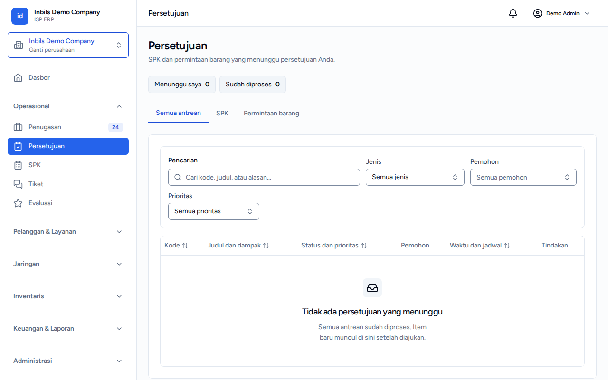

2. Ketahui apa yang tidak tampil. Antrean hanya memuat item yang boleh Anda putuskan (aturan maker-checker). SPK yang Anda buat atau yang ditugaskan kepada Anda dan permintaan barang yang Anda ajukan tidak tampil dan tidak ikut dihitung. Aturan ini berlaku juga bagi admin.
3. Baca empat kartu di atas daftar.
   - Kartu **Menunggu Saya** menghitung SPK berstatus `waiting_review` dan permintaan barang berstatus `submitted` yang boleh Anda putuskan. Angkanya sama dengan angka di sidebar.
   - Kartu **Mendesak / Terlambat** tidak pernah berisi angka, karena antrean ini tidak memakai batas waktu.
   - Kartu **Diproses** menghitung SPK `completed` atau `rejected` dan permintaan barang yang sudah disetujui, diproses gudang, diserahkan, atau ditolak. Hitungannya mencakup keputusan siapa pun, kecuali item milik Anda sendiri.
   - Kartu **Riwayat Kanonikal** memuat tautan ke daftar SPK (bagian 3.3) dan Permintaan Barang (bagian 6.1).
4. Bila Anda memegang izin SPK dan izin permintaan barang, tab **Semua Antrean**, **SPK**, dan **Permintaan Barang** muncul di atas filter. Memilih tab membatasi daftar dan angka kartu pada jenis itu. Dengan satu jenis izin saja, tab tidak muncul.
5. Persempit daftar dengan filter:
   - Kotak **Pencarian** mencari kode, judul, atau alasan. Pencarian berjalan setelah Anda berhenti mengetik.
   - Pilihan **Tipe** berisi jenis SPK (`installation`, `maintenance`, `upgrade_service`, `relocation`) dan asal permintaan barang (`work_order`, `ticket`, atau `inventory_request` bila tanpa asal), sebatas yang ada di antrean Anda.
   - Pilihan **Pemohon** berisi pembuat item yang ada di antrean Anda.
   - Pilihan **Prioritas** berisi **Urgent**, **High**, **Medium**, dan **Low**.
   - Tombol **Reset Filter** muncul saat ada filter aktif. Antrean ini tidak punya filter tanggal.
6. Baca kolom tabel: **Kode** (tautan ke detail bila Anda boleh membukanya, lencana **SPK** atau **Permintaan Barang**), **Judul / Alasan**, **Tipe**, **Status** (**Menunggu Review** untuk SPK, **Diajukan** untuk permintaan barang), **Prioritas** (lencana Urgent, Tinggi, Sedang, atau Rendah; permintaan barang selalu Sedang), **Pemohon** (pembuat SPK atau pengaju permintaan), **Dampak Material** (dua nama barang pertama, jumlah jenis, dan total unit), **Waktu & Jadwal** (tanggal **Diajukan**, lalu **Jadwal** untuk SPK atau **Dibutuhkan** untuk permintaan barang), dan **Aksi**. Untuk SPK, tanggal **Diajukan** adalah tanggal SPK dibuat. Kolom **Kode**, **Judul / Alasan**, **Tipe**, **Prioritas**, dan **Waktu & Jadwal** bisa diurutkan.

### Meninjau, menyetujui, atau menolak

1. Di kolom **Aksi**, klik **Tinjau**. Panel **Tinjau SPK** atau **Tinjau Permintaan Barang**, diikuti kode item, terbuka di sisi kanan.
2. Baca panel. Bagian atas memuat lencana jenis, status, prioritas, dan tipe. Kartu **Informasi SPK** atau **Informasi Permintaan Barang** memuat judul, **Pemohon**, **Status**, **Pengajuan**, **Tanggal Pengajuan**, dan **Jadwal Pelaksanaan** (SPK) atau **Tanggal Dibutuhkan** (permintaan barang). Kartu **Dampak Material & Penggunaan Barang** memuat **Jenis Item** dan **Total Kuantitas**. Klik **Lihat detail** untuk membuka halaman SPK (bagian 3.3) atau permintaan barang (bagian 6.1) di tab baru.
3. Untuk menyetujui, klik **Setujui**. Proses langsung berjalan tanpa dialog konfirmasi. Pada permintaan barang Anda dapat mengisi **Catatan Persetujuan (Opsional)** lebih dulu, maksimal 1000 karakter. Inbox ini menyetujui jumlah sesuai permintaan. Untuk menyetujui sebagian, buka **Lihat detail** dan setujui di sana.
4. Untuk menolak, klik **Tolak**. Isi **Alasan Penolakan** (wajib, maksimal 500 karakter, penghitung "n/500 karakter" tampil di atas isian). Permintaan barang butuh minimal 3 karakter. Klik **Konfirmasi Tolak**, atau **Batal** untuk kembali ke tinjauan.
5. Setelah berhasil, panel menutup, item keluar dari antrean, dan toast muncul: "SPK approved." atau "SPK rejected." untuk SPK, "Permintaan barang disetujui dan stok berhasil direservasi." atau "Permintaan barang telah ditolak." untuk permintaan barang.
6. Bila server menolak, alert merah **Gagal Memproses Tindakan** memuat pesannya, tombol **Setujui** dan **Tolak** terkunci, dan tombol **Muat Ulang Antrean** muncul. Klik tombol itu. Panel menutup bila item sudah diproses orang lain, atau tetap terbuka dengan data terbaru.

Hasil setiap keputusan:

- SPK disetujui: status `completed`. Sistem memakai stok material yang tercatat di SPK, memasang aset berseri pada SPK pemasangan, dan mengaktifkan langganan pelanggan yang masih `pending`.
- SPK ditolak: status `rejected` dan stok yang direservasi dilepas. Alasan tersimpan di SPK dan riwayat audit. SPK muncul lagi di **Penugasan** (bagian 3.1) untuk ditugaskan ulang.
- Permintaan barang disetujui: status `approved_reserved`, stok direservasi di gudang sumber, dan pemohon menerima email. Gudang lalu menyiapkan dan menyerahkan barang (bagian 6.1).
- Permintaan barang ditolak: status `rejected`, dan pemohon menerima email berisi alasan.

### Kesalahan umum

- Antrean kosong padahal ada SPK atau permintaan barang yang menunggu: item yang Anda buat, ajukan, atau yang ditugaskan kepada Anda tidak tampil bagi Anda, bahkan untuk admin. Minta pengguna lain yang berhak untuk memutuskannya.
- Menyetujui atau menolak item sendiri lewat halaman detail tetap ditolak server, dengan pesan seperti "Creator cannot approve own SPK.", "Assigned technician cannot approve own SPK.", atau "Maker-checker: pemohon tidak boleh menyetujui permintaan sendiri."
- Pesan "Alasan penolakan wajib diisi.", "Alasan penolakan minimal 3 karakter." (permintaan barang), atau "Alasan penolakan maksimal 500 karakter.": sesuaikan isian **Alasan Penolakan**, lalu klik **Konfirmasi Tolak**.
- Alert **Gagal Memproses Tindakan** dengan pesan "SPK must be waiting review to approve." atau "Permintaan barang bukan berstatus submitted.": pengguna lain sudah memproses item itu. Klik **Muat Ulang Antrean**.
- Setujui SPK gagal dengan pesan "SPK tidak dapat disetujui (fail-closed) sampai seluruh retur material berstatus reconciled atau resolved.": selesaikan retur material SPK itu di Pengembalian Barang (bagian 6.8), klik **Muat Ulang Antrean**, lalu setujui lagi.
- Setujui permintaan barang gagal dengan pesan "Stok tidak mencukupi untuk produk ID ...": stok di gudang sumber kurang. Tambah stok (bagian 6.5), atau setujui sebagian jumlah dari **Lihat detail**.

## 3.3 SPK

SPK (Surat Perintah Kerja) adalah perintah kerja lapangan untuk teknisi. Jenisnya `installation` (pemasangan baru), `maintenance` (perbaikan), `upgrade_service` (naik paket), dan `relocation` (pindah lokasi). Buka menu ini untuk membuat SPK, menugaskan teknisi, memeriksa material dan bukti kerja, lalu menyetujui hasilnya.

Teknisi mengerjakan SPK di aplikasi teknisi: memulai, mencatat material, mengunggah foto, dan mengajukan hasil. Web punya tombol yang sama bagi pengguna yang memegang izin `spk.start` dan `spk.submit`.

Peran yang dapat memakai: admin, manajer, staf. Izin `spk.view` membuka menu dan daftar, `spk.create` membuat SPK, `spk.export` mengekspor daftar. Dengan peran bawaan:

- Admin memegang semua izin SPK.
- Manajer memegang `spk.view`, `spk.create`, `spk.update`, `spk.assign`, `spk.reassign`, `spk.approve`, `spk.reject`, `spk.cancel`, dan `spk.export`.
- Staf memegang `spk.view`, `spk.create`, `spk.start`, dan `spk.submit`.

Pengguna yang memegang `spk.start` atau `spk.submit` tetapi tidak `spk.assign` (staf bawaan) hanya melihat SPK yang ditugaskan kepadanya.

### Membuka dan membaca daftar

1. Di sidebar, buka grup **Operasional**, lalu klik **SPK**.
2. Baca daftar SPK.

   - Kotak **Search** mencari pada nomor dan judul SPK (isian bertuliskan "Number or title…").
   - Filter **Type** berisi **All** dan keempat jenis SPK. Filter **Status** berisi **All** dan delapan status SPK.
   - Kolom: **Number** (tautan ke detail), **Type**, **Status** (lencana berisi kode status), **Customer**, **Scheduled**, **Created**. Semua kolom kecuali **Customer** bisa diurutkan, dan urutan awal menaruh SPK terbaru di atas.
   - Tombol **Export** (pemegang `spk.export`) mengunduh CSV atau PDF dengan kolom Code, Title, Type, Status, Priority, Customer, dan Technician sesuai pencarian dan filter aktif.
   - Tombol **New SPK** (pemegang `spk.create`) membuka form buat.

   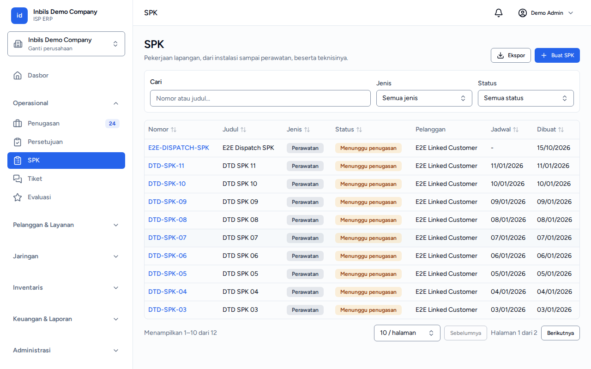

3. Klik nomor SPK untuk membuka detail. Baris tidak punya tombol **Show**, **Edit**, atau **Delete**.

### Status SPK

SPK dari **New SPK** berstatus `draft` dan bersumber manual. SPK dari pendaftaran pelanggan baru (bagian 4.1) dan dari tiket (bagian 3.4) langsung berstatus `generated`.

| Status | Arti | Langkah berikut | Siapa |
|---|---|---|---|
| `draft` | SPK baru, belum siap | **Generate**, atau langsung **Assign** | **Generate**: `spk.update`. **Assign**: `spk.assign` |
| `generated` | Siap ditugaskan | **Assign** | `spk.assign` |
| `assigned` | Teknisi sudah ditunjuk | **Start** | Teknisi yang ditugaskan |
| `in_progress` | Teknisi bekerja di lokasi | **Submit for Review** | Teknisi yang ditugaskan |
| `waiting_review` | Hasil menunggu tinjauan | **Approve** atau **Reject** | `spk.approve` atau `spk.reject`, bukan pembuat dan bukan teknisi SPK |
| `rejected` | Ditolak, alasan tampil di **Rejection** | **Assign** ulang untuk kerja ulang | `spk.reassign` |
| `completed` | Disetujui, final | Tidak ada | Tidak ada |
| `cancelled` | Dibatalkan, final | Tidak ada | Tidak ada |

**Generate** hanya menandai SPK siap, jadi boleh dilewati. **Cancel** (izin `spk.cancel`) tersedia pada semua status selain `completed` dan `cancelled`. Teknisi yang ditugaskan berarti pengguna yang ditunjuk pada SPK itu, berstatus karyawan aktif, dan memegang `spk.start` atau `spk.submit`.

### Membuat SPK

1. Di daftar SPK, klik **New SPK**.

   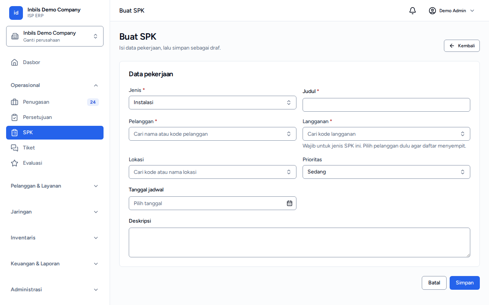

2. Isi kartu **Details**:
   - **Type**: wajib. Pilih **Installation** (isian awal), **Maintenance**, **Upgrade Service**, atau **Relocation**.
   - **Title**: wajib, maksimal 255 karakter. Contoh: `E2E Dispatch SPK`.
   - **Customer**: wajib untuk **Installation**, **Upgrade Service**, dan **Relocation**, opsional untuk **Maintenance**. Daftar memuat pelanggan aktif, misalnya `E2E Linked Customer`.
   - **Subscription**: aturan wajibnya sama dengan **Customer**. Daftar memuat kode langganan `pending` dan `active`, dan langganan harus milik pelanggan yang dipilih.
   - **Location**: opsional, berisi lokasi aktif (kode dan nama). Isi bila SPK memakai barang dari stok atau memasang aset, karena stok dan aset mengikuti lokasi ini.
   - **Priority**: **Low**, **Medium** (isian awal), **High**, atau **Urgent**.
   - **Scheduled Date**: opsional, tanggal kunjungan.
   - **Description**: opsional.
3. Klik **Create**. Daftar SPK terbuka dengan toast `SPK created.` SPK baru berstatus `draft` dan bernomor otomatis (aturan nomor di bagian 7.13).

### Membuka detail SPK

1. Di daftar, klik nomor SPK di kolom **Number**.

   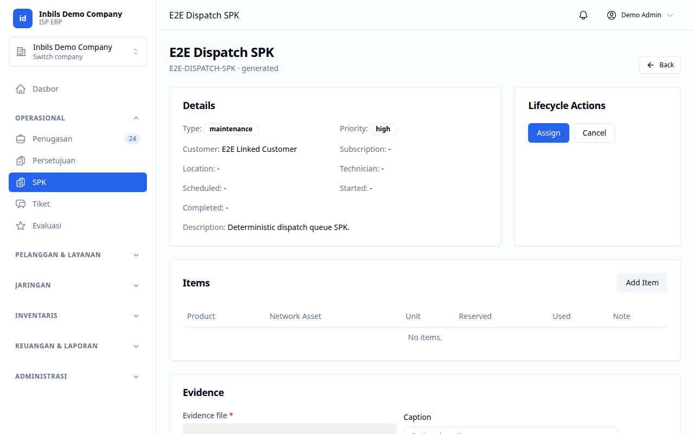

2. Baca halaman dari atas ke bawah:
   - Judul halaman memuat judul SPK, dengan nomor dan status di bawahnya. Tombol **Back** kembali ke daftar.
   - Kartu **Details** memuat **Type**, **Priority**, **Customer**, **Subscription**, **Location**, **Technician**, **Scheduled**, **Started**, **Completed**, dan **Description**. **Result** dan **Rejection** tampil bila terisi.
   - Baris **Check-in** tampil bila aplikasi teknisi mencatat lokasi saat memulai (jarak dari lokasi pekerjaan, atau alasan lokasi tidak tersedia). Baris **Drop port** (ODP dan nomor port yang dicadangkan untuk pelanggan, bagian 5.5) tampil pada SPK `installation` yang punya langganan, bagi pemegang `odn.view`.
   - Kartu **Lifecycle Actions** memuat tombol langkah berikut sesuai status. Pada gambar, SPK berstatus `generated`, jadi hanya **Assign** dan **Cancel** yang tampil.
   - Kartu **Items**, **Evidence**, dan **Assignment History** (kolom **Technician**, **Assigned At**, **Unassigned At**).

Tombol **Approve** dan **Reject** hanya tampil bagi pemegang `spk.approve` dan `spk.reject`. Tombol lain tampil menurut status saja, dan server memeriksa izinnya saat tombol ditekan.

### Menugaskan teknisi

Izin: `spk.assign`, atau `spk.reassign` bila SPK sudah punya teknisi (misalnya setelah ditolak).

1. Buka SPK berstatus `draft`, `generated`, atau `rejected`.
2. Klik **Assign**. Dialog **Assign** terbuka.
3. Di **Technician**, ketik nama, nomor karyawan, organisasi, atau telepon, lalu klik teknisi dari hasil pencarian. Teks yang diketik belum memilih teknisi.
4. Klik **Confirm**. Muncul toast `SPK assigned.`, status menjadi `assigned`, dan **Assignment History** menambah satu baris.

Daftar **Technician** memuat karyawan aktif (bagian 8.3) yang perannya memegang `spk.start` atau `spk.submit`. Daftar kosong menampilkan "No technician employees found."

Bila WhatsApp perusahaan aktif, teknisi menerima pesan berisi nomor, judul, tanggal kunjungan, dan tautan SPK. Pelanggan menerima satu pesan jadwal pada penugasan pertama, bila SPK punya **Customer** dan **Scheduled Date**.

Untuk mengganti teknisi SPK berstatus `assigned`, pakai Penugasan (bagian 3.1), karena halaman ini tidak menampilkan **Assign** pada status itu. Bila dialog menampilkan **Work order changed**, pengguna lain mengubah SPK lebih dulu: klik **Reload work order**, lalu ulangi dari langkah 2.

### Memulai dan mengajukan SPK

Teknisi melakukan kedua langkah ini di aplikasi teknisi. Di web, langkah yang sama ada di halaman SPK dan di Pekerjaan Saya (bagian 3.6).

1. Buka SPK berstatus `assigned`.
2. Klik **Start**. Dialog **Start** terbuka.
3. Klik **Confirm**. Status menjadi `in_progress` dan **Started** terisi. Izin `spk.start`.
4. Setelah SPK punya bukti, klik **Submit for Review**. Dialog **Submit** terbuka.
5. Klik **Confirm**. Status menjadi `waiting_review`. Izin `spk.submit`.

Server hanya menerima kedua tindakan dari teknisi yang ditugaskan pada SPK itu. Admin yang tidak ditunjuk ditolak, walau tombolnya tampil.

Pengajuan juga ditolak bila SPK belum punya bukti. Ia ditolak pula bila permintaan barang berstatus `issued` yang ditautkan ke SPK (bagian 6.1) masih punya sisa material yang belum dideklarasikan (bagian 6.8).

### Mengelola item material

Izin: `spk.update` (admin, manajer). Kartu **Items** mencatat barang dan perangkat SPK. **Reserved** adalah jumlah rencana yang Anda tulis, **Used** adalah jumlah yang dipakai, dan stok baru berkurang saat SPK disetujui, sebesar **Used**.

1. Di kartu **Items**, klik **Add Item**. Dialog **AddItem** terbuka. Tombol ini hilang pada SPK `completed` dan `cancelled`.
2. Isi dialog:
   - **Product**: wajib. Ketik untuk mencari, lalu pilih produk aktif (format "SKU - Nama (satuan)").
   - **Network Asset**: tampil dan wajib hanya bila produk bertipe `asset`. Daftar memuat aset `available` milik produk itu.
   - **Quantity Reserved** dan **Quantity Used**: opsional, angka 0 atau lebih dengan dua desimal. Kosong dihitung 0.
   - **Note**: opsional, maksimal 500 karakter.
3. Klik **Confirm**. Muncul toast `Item added.` dan baris tampil di tabel.

Mengisi **Reserved** tidak mencadangkan stok. Satu produk hanya punya satu baris, jadi menambah produk yang sama mengganti jumlah, catatan, dan aset pada baris lama, dan isian yang dikosongkan menjadi 0. Web tidak punya tombol hapus baris, walau rute hapus server memerlukan `spk.update`.

Teknisi mengisi **Used** produk biasa di aplikasi saat SPK `in_progress`. Teknisi dapat menarik kembali pemakaian itu selama status masih `in_progress`; baris rencana tetap ada dengan **Used** 0, sedangkan baris tanpa rencana atau catatan dihapus. Teknisi tidak dapat menambah atau menghapus baris produk `asset`; baris itu hanya dikelola kantor di web.

### Mengunggah bukti kerja

Izin di web: `spk.update` (admin, manajer), selama SPK belum `completed` atau `cancelled`. Pengguna lain tidak melihat formulir unggah. Teknisi yang ditugaskan mengunggah foto dari aplikasi saat SPK `in_progress`.

1. Di kartu **Evidence**, klik **browse** pada area "Drop file here or browse", atau seret satu berkas ke area itu.
2. Isi **Caption** bila perlu (opsional, maksimal 255 karakter).
3. Klik **Upload**. Bilah **Mengunggah bukti** menunjukkan kemajuan, lalu muncul toast `Evidence uploaded.`

Berkas boleh `jpg`, `jpeg`, `png`, `pdf`, `doc`, atau `docx`, maksimal 10 MB, satu berkas per unggahan. Berkas yang tidak memenuhi syarat ditolak dengan "File type is not allowed" atau "File is too large", dan penolakan server menampilkan toast `Failed to upload evidence.`

Daftar bukti menampilkan **Photo** atau **Document**, keterangan, dan waktu unggah. Gambar punya tombol **Open** (tab baru) dan **Download**, sedangkan PDF dan dokumen Word hanya punya **Download**.

Web tidak punya tombol hapus bukti. Rute hapus server hanya menerima pemegang `spk.update` selama SPK belum `completed` atau `cancelled`, atau pengunggah sendiri yang memegang `spk.evidence.upload` selama SPK `in_progress`.

### Menyetujui, menolak, dan membatalkan SPK

Izin: `spk.approve` untuk **Approve**, `spk.reject` untuk **Reject**, `spk.cancel` untuk **Cancel**. Antrean **Persetujuan** (bagian 3.2) menampilkan SPK `waiting_review` dan memakai aturan yang sama.

1. Buka SPK berstatus `waiting_review`, lalu periksa jumlah **Used** di kartu **Items** dan berkas di kartu **Evidence**.
2. Untuk menyetujui, klik **Approve**. Dialog **Approve** terbuka.
3. Klik **Confirm**. Muncul toast `SPK approved.`, status menjadi `completed`, dan **Completed** terisi.
4. Untuk menolak, klik **Reject**. Dialog **Reject** terbuka.
5. Isi **Reason** (wajib, maksimal 500 karakter), lalu klik **Confirm**. Muncul toast `SPK rejected.`, status menjadi `rejected`, dan alasan tampil di baris **Rejection**.
6. Untuk membatalkan, klik **Cancel** di kartu **Lifecycle Actions**. Dialog **Cancel** terbuka.
7. Isi **Reason** (wajib, maksimal 500 karakter), lalu klik **Confirm**. Muncul toast `SPK cancelled.` dan status menjadi `cancelled`.

Pembuat SPK dan teknisi yang ditugaskan tidak boleh menyetujui atau menolak SPK itu, termasuk admin. SPK dari pendaftaran pelanggan atau dari **Spawn SPK** tercatat dibuat oleh orang yang melakukannya, jadi orang itu butuh rekan lain untuk menyetujuinya.

Persetujuan butuh minimal satu bukti. Bila SPK punya permintaan barang `issued`, semua retur materialnya harus berstatus `reconciled` atau `resolved` (bagian 6.8).

Pembatalan tidak bisa dibalik, dan alasannya hanya tercatat di Audit Log (bagian 7.12). Pembatalan dan penolakan melepas cadangan stok sebanyak **Reserved** pada setiap baris dan mengosongkan **Reserved**, bila SPK punya **Location**. Bila stok lokasi itu tidak punya cadangan sebanyak itu, tindakan gagal dan SPK tidak berubah.

### Yang terjadi saat SPK disetujui

**Approve** menjalankan langkah berikut dalam satu transaksi. Bila satu langkah gagal, SPK tetap `waiting_review` dan tidak ada yang berubah. Persetujuan tidak bisa dibatalkan dari web.

- Setiap baris dengan **Used** lebih dari 0 mengurangi stok produk di **Location** SPK sebesar **Used**, dengan mutasi `issue` bercatatan "SPK &lt;nomor SPK&gt;" (bagian 6.7). Jumlah yang sudah dikeluarkan lewat permintaan barang untuk SPK ini tidak dikurangi dua kali.
- Tanpa **Location**, stok tidak berubah dan aset tidak dipasang. Stok yang kurang membuat persetujuan gagal.
- Pada SPK `installation`, setiap baris produk `asset` memasang **Network Asset** yang dipilih: aset berstatus `installed` pada lokasi, pelanggan, dan langganan SPK (bagian 5.2). Aset pertama dicatat sebagai ONT langganan bila langganan belum punya.
- Langganan SPK yang berstatus `pending` menjadi `active`, dengan tanggal aktivasi hari itu dan tanggal tagihan berikutnya dari hari tagih langganan (bagian 4.1). Jenis `upgrade_service` dan `relocation` tidak mengubah paket, alamat, atau aset langganan.
- Bila saklar `spk_auto_invoice` aktif di **Company Settings** (bagian 8.1), sistem membuat satu tagihan sekali bayar berstatus `draft` dengan jatuh tempo 14 hari (bagian 7.1). Isinya setiap item **Used** dikali harga jual produk, ditambah baris "Biaya Instalasi &lt;jenis SPK&gt;" bila langganan punya biaya pemasangan, dengan pajak perusahaan.

Satu SPK paling banyak punya satu tagihan, dan web tidak punya tombol untuk membuatnya manual.

### Kesalahan umum

- Pesan "Customer and subscription required for this SPK type." muncul di **Customer**: jenis `installation`, `upgrade_service`, dan `relocation` butuh pelanggan dan langganan. Isi keduanya, atau pilih **Maintenance** bila pekerjaan tidak terkait langganan.
- Pesan "Subscription does not belong to customer." muncul di **Subscription**: daftarnya memuat semua langganan `pending` dan `active` perusahaan. Pilih langganan milik pelanggan yang dipilih.
- Staf membuat SPK tetapi tidak melihatnya di daftar: daftar staf hanya memuat SPK yang ditugaskan kepadanya. SPK tetap ada dan terlihat oleh manajer dan admin.
- Isian SPK salah setelah **Create**: web tidak punya layar ubah, **Edit**, maupun **Delete** untuk SPK. Batalkan dengan **Cancel**, lalu buat SPK baru. Server hanya menghapus SPK `draft` atau `cancelled`, untuk pemegang `spk.delete` (admin), tetapi tidak ada layar yang memanggilnya.
- Tombol **Start**, **Submit for Review**, atau **Assign** tampil tetapi ditolak: tombol mengikuti status, sedangkan izin dan penunjukan teknisi diperiksa server. Hanya teknisi yang ditugaskan boleh memulai dan mengajukan, termasuk bila Anda admin.
- **Approve** gagal dan hanya muncul toast "Data gagal disimpan. Periksa input.": dialog di halaman SPK tidak menulis penyebabnya. Penyebab yang mungkin: Anda pembuat atau teknisi SPK itu, bukti belum ada, retur material belum `reconciled` atau `resolved`, atau stok di **Location** kurang. Buka SPK dari **Persetujuan** (bagian 3.2) supaya penyebabnya tampil di panel tinjauan, atau minta orang lain menyetujui.
- **Cancel** atau **Reject** gagal dan hanya muncul toast "Data gagal disimpan. Periksa input.": SPK punya baris dengan **Reserved** lebih dari 0 dan **Location**, sedangkan stok lokasi itu tidak punya cadangan sebanyak itu, karena isian **Reserved** di web tidak mencadangkan stok. Tambahkan lagi produk yang sama lewat **Add Item** dengan **Reserved** 0 dan **Quantity Used** yang benar, lalu ulangi.
- Stok tidak berkurang dan aset tidak terpasang setelah **Approve**: SPK tidak punya **Location**. Isi **Location** saat membuat SPK, karena tidak bisa diubah sesudahnya.
- Tagihan tidak muncul setelah **Approve**: saklar `spk_auto_invoice` mati, dan itu nilai awalnya.
- Jumlah salah pada **Add Item**: tambahkan lagi produk yang sama dengan jumlah yang benar, dan baris lama diganti.
- Unggahan bukti ditolak: berkas bukan `jpg`, `jpeg`, `png`, `pdf`, `doc`, atau `docx`, atau lebih dari 10 MB. Formulir unggah tidak tampil bagi pengguna tanpa `spk.update`, atau bila SPK sudah `completed` atau `cancelled`.
- **Cancel** di dalam dialog hanya menutup dialog. Untuk membatalkan SPK, klik **Cancel** di kartu **Lifecycle Actions**.

## 3.4 Tiket

Tiket mencatat keluhan atau gangguan layanan, dari pelanggan, dari NOC (pemantau jaringan), atau dari laporan internal. Buka menu ini untuk mencatat laporan, menugaskan petugas, memantau tenggat SLA, dan menerbitkan SPK perbaikan bila perlu. Petugas lapangan mengerjakan tiket di aplikasi teknisi.

Peran yang dapat memakai: admin, manajer, staf. Izin `ticket.view` membuka menu, `ticket.create` membuat tiket, `ticket.export` mengekspor daftar. Dengan peran bawaan:

- Admin memegang semua izin tiket.
- Manajer memegang `ticket.view`, `ticket.create`, `ticket.update`, `ticket.assign`, `ticket.reassign`, `ticket.close`, `ticket.spawn_spk`, dan `ticket.export`.
- Staf memegang `ticket.view`, `ticket.create`, `ticket.comment.create`, dan `ticket.attachment.upload`.

Pengguna yang memegang `ticket.start`, `ticket.resolve`, atau `ticket.close` tetapi tidak `ticket.assign` hanya melihat tiket yang ditugaskan kepadanya.

### Membuka dan membaca daftar

1. Di sidebar, buka grup **Operasional**, lalu klik **Tiket**.
2. Baca daftar tiket.

   - Kotak **Search** mencari pada nomor dan judul tiket (isian bertuliskan "Number or subject…").
   - Filter **Priority** berisi **All**, `low`, `medium`, `high`, dan `urgent`. Filter **Status** berisi **All** dan lima status tiket.
   - Kolom: **Number** (tautan ke detail), **Subject**, **Priority** (lencana), **Status** (lencana), **Customer**, **Created** (tanggal dan jam). Semua kolom kecuali **Customer** bisa diurutkan, dan urutan awal menaruh tiket terbaru di atas.
   - Tombol **Export** (pemegang `ticket.export`) mengunduh CSV atau PDF dengan kolom Code, Title, Priority, Status, Customer, dan Created sesuai pencarian dan filter aktif.
   - Tombol **New ticket** (pemegang `ticket.create`) membuka form buat.

   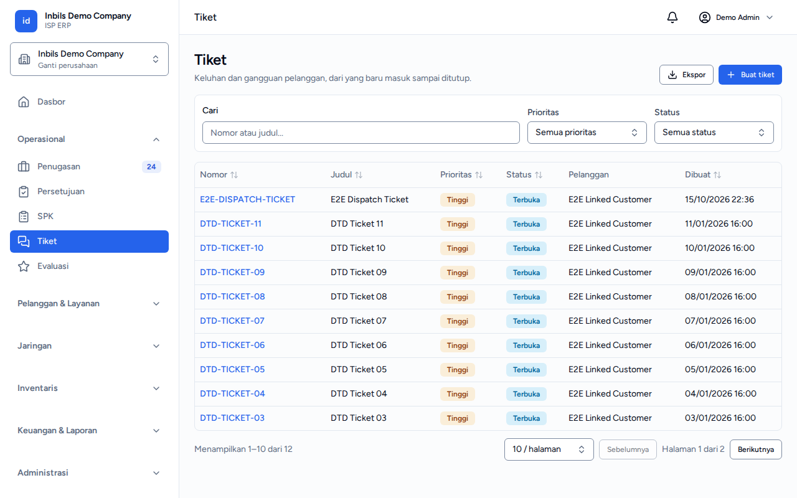

3. Klik nomor tiket untuk membuka detail. Baris tidak punya tombol **Show**, **Edit**, atau **Delete**.

Kartu **SLA terlampaui** di Dasbor (bagian 2.1) membuka daftar ini dengan filter tersembunyi `sla_breached`. Daftar hanya memuat tiket yang lewat **Target penyelesaian** dan belum `resolved` atau `closed`. Layar tidak menampilkan filter itu, dan filter lain yang Anda ubah tetap membawanya. Klik **Tiket** di sidebar untuk melihat semua tiket lagi.

### Status tiket

| Status | Arti | Langkah berikut | Siapa |
|---|---|---|---|
| `open` | Tiket baru, belum ada petugas | **Assign** | `ticket.assign` |
| `assigned` | Petugas (handler) sudah ditunjuk | **Start** | Petugas tiket itu, izin `ticket.start` |
| `on_progress` | Petugas bekerja, **First Response** terisi | **Resolve** dengan catatan | Petugas tiket itu, izin `ticket.resolve` |
| `resolved` | Selesai, menunggu pemeriksaan | **Close** | Pemegang `ticket.close` yang bukan petugas tiket itu |
| `closed` | Selesai dan ditutup, final | Tidak ada | Tidak ada |

Mengganti petugas tiket `assigned` memakai `ticket.reassign` lewat Penugasan (bagian 3.1). Web tidak punya status atau tombol untuk membuka kembali tiket `resolved` atau `closed`, jadi catat masalah yang muncul lagi sebagai tiket baru.

### Membuat tiket

1. Di daftar tiket, klik **New ticket**.

   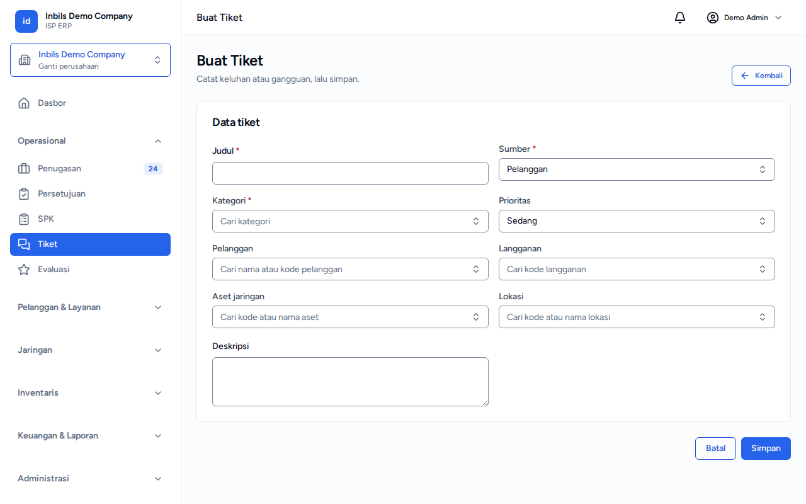

2. Isi kartu **Details**:
   - **Title**: wajib, maksimal 255 karakter.
   - **Source**: wajib. Pilih **Customer** (isian awal), **NOC**, atau **Internal**.
   - **Category**: wajib. Daftar memuat kategori aktif perusahaan. Kategori menjadi sumber target bila tiket tidak punya **Subscription** atau paket langganannya tidak punya tingkat SLA aktif. Bila ada tingkat SLA aktif, targetnya dipakai dan kategori tidak menentukan jam.
   - **Priority**: **Low**, **Medium** (isian awal), **High**, atau **Urgent**. Isian ini dipakai apa adanya, prioritas bawaan kategori tidak diterapkan form ini.
   - **Customer**: opsional di form. Isi untuk tiket dari pelanggan, karena pelanggan hanya menerima WhatsApp bila tiket punya **Customer**.
   - **Subscription**: opsional. Daftar memuat langganan `active` dan `suspended`, dan langganan harus milik pelanggan yang dipilih.
   - **Network Asset**: opsional. Daftar memuat paling banyak 100 aset pertama menurut kode (bukan aset `retired` atau `decommissioned`). Aset yang sudah terkait pelanggan atau langganan harus cocok dengan pilihan Anda.
   - **Location**: opsional, berisi lokasi aktif (kode dan nama).
   - **Description**: opsional.
3. Klik **Create**. Daftar tiket terbuka dengan toast `Ticket created.` Tiket baru berstatus `open`, bernomor otomatis, dan **Target respons** serta **Target penyelesaian** sudah terisi (bagian "SLA dan tenggat" di bawah).

### Membuka detail tiket

1. Di daftar, klik nomor tiket.

   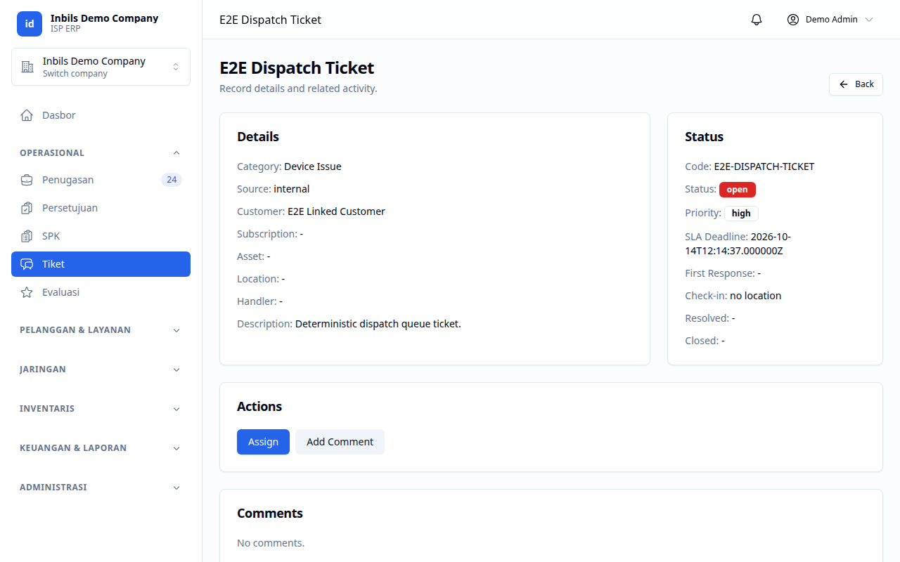

2. Baca halaman dari atas ke bawah:
   - Kartu **Details** memuat **Category**, **Source**, **Customer**, **Subscription**, **Asset**, **Location**, **Handler**, dan **Description**. **Resolution** muncul setelah tiket diselesaikan.
   - Kartu **Status** memuat **Code**, **Status**, **Priority**, **Target respons**, **Respons pertama**, **Target penyelesaian**, **Check-in**, **Resolved**, dan **Closed**. **Target respons** dan **Target penyelesaian** memuat waktu tenggat dan sumbernya dalam tanda kurung, misalnya `(Target Gold)` bila berasal dari tingkat SLA atau `(Target kategori No Internet)` bila berasal dari kategori. Tiket lama tanpa target respons menulis `Tanpa target respons`. Lencana **Respons terlambat** dan **Penyelesaian terlambat** tampil di samping tenggatnya bila terlewat. **Respons pertama** berisi waktu **Start**, atau `-` bila belum ada. Waktu tampil sebagai teks ISO dalam UTC, misalnya `2026-10-14T11:43:57.000000Z`.
   - **Check-in** memuat catatan lokasi dari aplikasi teknisi saat tiket dimulai. Tanpa catatan, tertulis `no location`.
   - Kartu **Actions** memuat tombol langkah berikut. **Assign** tampil pada tiket `open`, **Start** bagi petugas yang boleh memulai, **Resolve** pada `assigned` dan `on_progress`, **Close** bagi yang boleh menutup, dan **Spawn SPK** pada `assigned` dan `on_progress` selama belum ada catatan penyelesaian. **Add Comment** selalu tampil.
   - Kartu **Comments** dan **Attachments**.

### Menugaskan petugas

Izin: `ticket.assign` untuk tiket `open`, `ticket.reassign` bila tiket sudah punya petugas.

1. Buka tiket berstatus `open`.
2. Klik **Assign**. Dialog **Assign** terbuka.
3. Isi **Handler ID** dengan nomor ID pengguna petugas (wajib, angka).
4. Klik **Confirm**. Muncul toast `Ticket assigned.`, status menjadi `assigned`, dan **Handler** terisi.

Dialog ini hanya menerima ID, bukan nama. Untuk memilih petugas dari daftar nama (**Petugas Tiket (Handler)**), tugaskan tiket lewat Penugasan (bagian 3.1).

Petugas harus pengguna aktif perusahaan ini yang berperan `admin`, `manager`, `noc`, `staff`, atau `technician` (peran buatan sendiri tidak diterima) dan memegang `ticket.start`, `ticket.resolve`, atau `ticket.close`. Petugas menerima email dan notifikasi di lonceng (bagian 2.2). Pada penugasan pertama, pelanggan tiket menerima WhatsApp bahwa tiketnya ditangani, bila WhatsApp perusahaan aktif.

Bila dialog menampilkan **Ticket changed**, pengguna lain mengubah tiket lebih dulu: klik **Reload ticket**, lalu ulangi dari langkah 2.

### Mengerjakan dan menutup tiket

Petugas memulai dan menyelesaikan tiket di aplikasi teknisi. Di web, langkah yang sama ada di halaman tiket dan di Pekerjaan Saya (bagian 3.6).

1. Buka tiket berstatus `assigned`, lalu klik **Start**. Tidak ada dialog. Status menjadi `on_progress`, dan **First Response** terisi saat tiket pertama kali dimulai. Izin `ticket.start`.
2. Pada tiket `on_progress`, klik **Resolve**. Dialog **Resolve** terbuka.
3. Isi **Resolution Note** (wajib, maksimal 1000 karakter).
4. Klik **Confirm**. Muncul toast `Ticket resolved.`, status menjadi `resolved`, dan catatan tampil di **Resolution**. Izin `ticket.resolve`.
5. Pada tiket `resolved`, klik **Close**. Dialog **Close** terbuka.
6. Klik **Confirm**. Muncul toast `Ticket closed.`, status menjadi `closed`, dan **Closed** terisi. Izin `ticket.close`.

Hanya petugas yang ditunjuk pada tiket yang boleh memulai dan menyelesaikan, termasuk bila Anda admin. Saat tiket diselesaikan, pelanggan tiket menerima WhatsApp bahwa tiketnya selesai.

**Resolve** juga tampil pada tiket `assigned`, tetapi hanya diterima setelah **Start**. Petugas tiket tidak boleh menutup tiketnya sendiri, jadi pemegang `ticket.close` lain yang menutupnya.

### Komentar dan lampiran

1. Di kartu **Actions**, klik **Add Comment**. Dialog **Comment** terbuka.
2. Isi **Comment** (wajib, maksimal 2000 karakter), lalu pilih **Visibility**: **Public** (isian awal) atau **Internal**.
3. Klik **Confirm**. Muncul toast `Comment added.` Komentar tampil di kartu **Comments** dengan nama penulis dan waktu, dan komentar internal diberi lencana **Internal**.

Izin `ticket.comment.create`. Komentar **Public** terlihat oleh pelanggan di aplikasinya, sedangkan komentar **Internal** hanya terlihat oleh pengguna web dan teknisi. Komentar tidak bisa diubah atau dihapus.

4. Untuk melampirkan berkas, klik **browse** pada area "Drop file here or browse" di kartu **Attachments**, atau seret satu berkas ke area itu.
5. Klik **Upload**. Bilah **Mengunggah lampiran** menunjukkan kemajuan, lalu muncul toast `Attachment uploaded.`

Izin `ticket.attachment.upload`. Berkas boleh `jpg`, `jpeg`, `png`, `pdf`, `doc`, `docx`, atau `txt`, maksimal 10 MB, satu berkas per unggahan. Formulir tampil bagi semua pengguna, tetapi server menolak unggahan tanpa izin. Berkas yang tidak memenuhi syarat menampilkan toast `Failed to upload attachment.`

Berkas tampil dengan nama, waktu, dan tombol **Download**, serta **Open** untuk gambar. Aturan server: hanya pengunggah yang boleh menghapus lampiran, dan hanya selama tiket `open`, `assigned`, atau `on_progress`. Web tidak punya tombol hapus lampiran.

### Membuat SPK dari tiket

Izin: `ticket.spawn_spk` (admin, manajer). Pakai bila gangguan butuh kunjungan teknisi.

1. Buka tiket berstatus `assigned` atau `on_progress` yang belum punya catatan penyelesaian.
2. Klik **Spawn SPK**. Dialog **Spawn Spk** terbuka.
3. Klik **Confirm**. Inbils membuka detail SPK baru dengan toast `SPK spawned from ticket.`

SPK baru berjenis `maintenance`, berstatus `generated`, dan berjudul "SPK from Ticket &lt;kode tiket&gt;". **Customer**, **Subscription**, **Location**, **Priority**, dan deskripsi disalin dari tiket. Aset jaringan tiket tidak disalin.

Pembuat SPK itu adalah Anda, jadi Anda tidak bisa menyetujuinya (bagian 3.3). Tugaskan teknisi dari halaman SPK itu atau dari Penugasan (bagian 3.1).

Satu tiket hanya boleh melahirkan satu SPK. Halaman tiket tidak menampilkan tautan ke SPK itu, dan tiket tidak ikut selesai saat SPK selesai: selesaikan dan tutup tiket sendiri. Cari SPK-nya di daftar SPK dengan kode tiket di kotak **Search**.

### SLA dan tenggat

Setiap tiket baru mendapat dua tenggat saat dibuat. Keduanya dihitung dalam jam kalender dari waktu pembuatan:

- **Target respons**: batas waktu sampai petugas menekan **Start**. Klik itu mengisi **Respons pertama**.
- **Target penyelesaian**: batas waktu sampai tiket diselesaikan lewat **Resolve**. Isian ini tersimpan di kolom `sla_deadline`.

Sumber kedua target:

1. Tiket yang punya **Subscription** mengambil target dari tingkat SLA aktif pada paket langganan itu (bagian 4.5). Halaman tiket menulis `(Target <nama tingkat>)` di samping tenggat.
2. Tiket tanpa **Subscription**, atau yang paket langganannya memakai tingkat nonaktif, mengambil target dari **Kategori Tiket** yang dipilih (lihat di bawah). Halaman tiket menulis `(Target kategori <nama kategori>)`.

Prioritas **Urgent** memotong kedua target menjadi separuh, dibulatkan ke atas, apa pun sumbernya. Contoh: 5 jam menjadi 3 jam. Kategori bawaan perusahaan baru: **No Internet** 4 jam penyelesaian dan 2 jam respons, **Slow Connection** 8 dan 4, **Packet Loss** 8 dan 4, **Device Issue** 12 dan 6, **Fiber Issue** 12 dan 6. Target respons bawaan adalah separuh target penyelesaian, dibulatkan ke atas.

Tenggat tersimpan di tiket saat tiket dibuat. Mengubah tingkat, kategori, atau prioritas sesudahnya tidak menghitung ulang tiket yang sudah ada. Tiket yang dibuat sebelum target respons ada tetap memakai tenggat penyelesaiannya dan tidak punya target respons: halaman menulis `Tanpa target respons`.

Halaman tiket menandai pelanggaran dengan dua lencana:

- **Respons terlambat**: respons pertama datang setelah **Target respons**, atau belum ada respons dan targetnya sudah lewat. Tiket tanpa target respons tidak pernah mendapat lencana ini.
- **Penyelesaian terlambat**: tiket lewat **Target penyelesaian** dan belum `resolved` atau `closed`.

Setiap 15 menit sistem memeriksa tiket yang lewat **Target penyelesaian** dan mengirim notifikasi **SLA tiket terlampaui** kepada pembuat tiket, satu kali per tiket. Pemeriksaan ini tidak memakai target respons, jadi respons terlambat tidak memicu notifikasi.

### Kategori Tiket

Kategori Tiket menyimpan target cadangan untuk tiket yang tidak bisa memakai tingkat SLA, yaitu tiket tanpa **Subscription** atau dengan paket yang tingkatnya nonaktif. Buka layar ini saat Anda ingin mengubah jam target kategori, mengganti namanya, atau menonaktifkannya. Sebelumnya jam itu hanya bisa diubah lewat basis data.

Peran yang dapat memakai: admin dan manajer pada peran bawaan, staf tidak. Izin: `ticket.category.manage`. Tanpa izin ini menu tidak tampil dan alamat `/admin/ticket-categories` ditolak.

1. Di sidebar, buka grup **Pelanggan & Layanan**, lalu klik **Kategori Tiket** (di bawah **Tingkat SLA**).
2. Baca daftar. Subjudulnya menyebut bahwa target ini cadangan untuk tiket tanpa langganan atau tanpa tingkat SLA aktif, dan bahwa tiket urgent memakai separuh target. Kolomnya **Kode**, **Nama**, **Target respons (jam)**, **Target penyelesaian (jam)**, **Status** (**Aktif** atau **Nonaktif**) dan **Aksi**. Daftar kosong menulis `Belum ada kategori tiket untuk perusahaan ini.`
3. Klik **Ubah** pada sebuah baris. Dialog **Ubah kategori** diikuti kode kategori terbuka dengan isian berikut:
   - **Nama**: wajib.
   - **Target respons (jam)**: wajib, bilangan bulat 1 sampai 720, tidak boleh melebihi target penyelesaian.
   - **Target penyelesaian (jam)**: wajib, bilangan bulat 1 sampai 720. Hanya berlaku untuk tiket baru.
   - **Aktif**: saklar. Kategori nonaktif tidak muncul di pilihan **Category** pada form tiket.
4. Klik **Simpan**. Muncul toast `Kategori tiket diperbarui.` Klik **Batal** untuk menutup dialog tanpa menyimpan.

Layar ini tidak punya tombol untuk menambah atau menghapus kategori, dan **Kode** tidak bisa diubah. Pesan `Target respons tidak boleh lebih lama dari target penyelesaian.` muncul bila target respons lebih besar dari target penyelesaian.

### Kesalahan umum

- Dialog **Assign** meminta **Handler ID**, bukan nama: ketik nomor ID pengguna, atau tugaskan lewat Penugasan (bagian 3.1) yang memakai daftar nama. ID yang tidak ada di perusahaan ini, pengguna nonaktif, atau pengguna tanpa peran dan izin petugas ditolak di bawah isian.
- **Resolve** ditolak pada tiket `assigned`: tombolnya tampil, tetapi hanya tiket `on_progress` yang bisa diselesaikan. Petugas klik **Start** dulu.
- **Start** atau **Resolve** ditolak untuk Anda: hanya petugas yang ditunjuk pada tiket yang boleh, dan peran manajer atau staf bawaan tidak memegang `ticket.start` maupun `ticket.resolve`. Tugaskan tiket ke pengguna yang berhak, atau biarkan teknisi mengerjakannya di aplikasi.
- **Close** tidak tampil: tiket belum `resolved`, Anda tidak memegang `ticket.close`, atau Anda petugas tiket itu. Minta pemegang `ticket.close` lain menutupnya.
- **Resolution Note** kosong atau lebih dari 1000 karakter ditolak. Ringkas catatannya.
- **Spawn SPK** tidak tampil atau ditolak: tiket harus `assigned` atau `on_progress`, belum punya catatan penyelesaian, dan belum pernah melahirkan SPK. Anda juga butuh `ticket.spawn_spk`.
- **Add Comment** atau unggah lampiran ditolak untuk manajer bawaan: peran itu tidak memegang `ticket.comment.create` dan `ticket.attachment.upload`. Minta admin menambahkannya di Peran (bagian 8.6).
- Pesan "Subscription does not belong to customer." di **Subscription**, atau "Network asset does not belong to customer." dan "Network asset does not belong to subscription." di **Network Asset**: pilihan tidak cocok satu sama lain. Pilih langganan dan aset milik pelanggan yang sama.
- Daftar tiket tampak terpotong setelah dibuka dari Dasbor: filter `sla_breached` masih aktif. Klik **Tiket** di sidebar.
- Judul atau prioritas tiket salah: web tidak punya layar ubah, **Edit**, maupun **Delete** untuk tiket. Server hanya mengubah tiket `open` (izin `ticket.update`) dan menghapus tiket `closed` (izin `ticket.delete`), tetapi tidak ada layar yang memanggilnya. Tulis koreksi sebagai komentar.

## 3.5 Evaluasi

Evaluasi mencatat nilai kinerja seorang karyawan untuk satu tiket atau satu SPK. Rata-rata skor dan rating pelanggan dari evaluasi dibaca laporan Kinerja Teknisi (bagian 7.9). Buat evaluasi setelah tiket diselesaikan atau SPK disetujui, supaya angka waktunya terisi.

Peran yang dapat memakai: admin, manajer, dan staf pada peran bawaan. Izin: `evaluation.view` melihat semua evaluasi perusahaan, `evaluation.create` membuat, `evaluation.update` mengubah. Peran teknisi memegang `evaluation.view.own` dan hanya melihat evaluasi atas dirinya, tetapi teknisi bekerja di aplikasi. Menu tampil bagi pemegang `evaluation.view` atau `evaluation.view.own`. Izin `evaluation.delete` dan `evaluation.export` ada, tetapi layar Evaluasi tidak punya tombol **Delete** maupun **Export**.

### Membuka dan membaca daftar

1. Di sidebar, buka grup **Operasional**, lalu klik **Evaluasi**.

   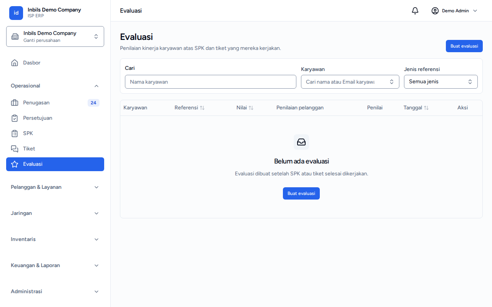

2. Tombol hijau **Create** di kanan atas tampil bagi pemegang `evaluation.create`.
3. Isi filter, lalu klik **Filter** (pencarian tidak jalan sendiri):
   - Isian **Search** mencari nama karyawan.
   - Pilihan **Employee** berisi **All** dan pengguna aktif berperan `technician`, `staff`, atau `noc`.
   - Pilihan **Reference Type** berisi **All**, **SPK**, dan **Ticket**.
4. Baca tabel. Kolom: **Employee**, **Reference**, **Score**, **Customer Rating**, **Evaluator**, **Date**, dan **Actions**. Kolom **Reference** menulis jenis dan nomor id, yaitu `Ticket:<id>` atau `WorkOrder:<id>`. Kolom **Date** menampilkan waktu evaluasi apa adanya dari server, tanpa format tanggal Indonesia. Setiap baris hanya punya tombol **Show**.
5. Daftar memuat 10 evaluasi, terbaru di atas. Halaman ini tidak menampilkan tombol halaman berikutnya, jadi persempit daftar dengan ketiga filter di atas.

### Membuat evaluasi

1. Klik **Create**. Halaman **Create Evaluation** terbuka.
2. Isi kartu **Details**:
   - **Employee**: wajib. Pilih karyawan yang dinilai. Karyawan harus berasal dari perusahaan yang sedang aktif.
   - **Reference Type**: wajib. Pilih **Ticket** (nilai awal) atau **SPK (WorkOrder)**.
   - **Reference ID**: wajib, angka. Isi nomor id internal tiket atau SPK, bukan kodenya. Buka halaman detail tiket atau SPK, lalu baca angka di ujung alamat browser (setelah `/admin/tickets/` atau `/admin/spk/`). Tiket atau SPK itu harus milik perusahaan aktif.
   - **Score (1.0-5.0)**: wajib. Angka 1.0 sampai 5.0 dengan langkah 0.1, nilai awal 5.0.
   - **Customer Rating (optional)**: opsional. Angka 1.0 sampai 5.0 dengan langkah 0.1. Isi bila Anda mencatat rating dari pelanggan.
   - **Comment**: opsional, maksimal 1000 karakter.
3. Klik **Create**. Daftar terbuka dan toast "Evaluation created." muncul. Klik **Cancel** atau **Back** untuk kembali tanpa menyimpan.

Inbils mengisi sendiri **Evaluator** (akun Anda) dan waktu evaluasi. Inbils juga menyalin waktu dari tiket atau SPK saat Anda menyimpan, dan tidak memperbaruinya lagi:

- Untuk tiket, **FRT (min)** adalah menit dari tiket dibuat sampai petugas memulai tiket, dan **Resolution (min)** adalah menit dari tiket dibuat sampai diselesaikan. Keduanya kosong bila kejadiannya belum ada.
- Untuk SPK, **Resolution (min)** adalah menit dari SPK mulai dikerjakan sampai disetujui. **FRT (min)** tidak diisi.

### Melihat dan mengubah evaluasi

1. Di daftar, klik **Show**. Halaman **Evaluation** memuat kartu **Details** (**Employee**, **Evaluator**, **Score**, **Customer Rating**, **FRT (min)**, **Resolution (min)**, dan **Comment** bila diisi) dan kartu **Reference** (**Reference** dan **Evaluated At**). Nilai kosong tampil sebagai tanda hubung (-).
2. Klik **Edit** (tombol kuning) untuk mengubah. Halaman **Edit Evaluation** hanya menawarkan **Score (1.0-5.0)**, **Customer Rating (optional)**, dan **Comment**, dengan aturan yang sama seperti saat membuat. Karyawan dan referensi tidak bisa diubah.
3. Klik **Save**. Daftar terbuka dan toast "Evaluation updated." muncul. Klik **Cancel** atau **Back** untuk kembali ke halaman **Evaluation**.

Tombol **Edit** tampil bagi semua orang yang bisa membuka halaman **Evaluation**. Menyimpan perubahan butuh `evaluation.update`. Tanpa izin itu, **Save** ditolak dengan halaman 403.

### Kesalahan umum

- Pesan "The selected reference id is invalid for this company." di bawah **Reference ID**: nomor itu tidak ada, atau milik perusahaan lain. Periksa angka pada alamat halaman detail dan pastikan perusahaan aktif Anda benar (bagian 1.6).
- Pesan "The selected employee id is invalid." di bawah **Employee**: karyawan itu bukan dari perusahaan yang sedang aktif. Pindah ke perusahaan yang tepat atau pilih karyawan lain.
- Pesan "The score field must be between 1.0 and 5.0." (untuk **Customer Rating**: "The customer rating field must be between 1.0 and 5.0."): isi angka 1.0 sampai 5.0.
- Pesan "The comment field must not be greater than 1000 characters.": persingkat komentar.
- Evaluasi kedua oleh penilai yang sama untuk tiket atau SPK yang sama ditolak basis data, karena satu penilai hanya boleh punya satu evaluasi per referensi. Perbaiki evaluasi yang ada lewat **Edit**.
- **FRT (min)** atau **Resolution (min)** kosong: tiket belum dimulai atau diselesaikan, atau SPK belum disetujui, saat evaluasi dibuat. **Edit** tidak mengisinya ulang, jadi buat evaluasi setelah pekerjaan selesai.
- Evaluasi lama tidak terlihat di daftar: layar hanya memuat 10 baris tanpa tombol halaman berikutnya. Pakai **Search**, **Employee**, dan **Reference Type** untuk menemukannya.

## 3.6 Pekerjaan Saya

Pekerjaan Saya memuat tiket dan SPK yang ditugaskan kepada akun Anda sendiri, lengkap dengan tombol untuk mengerjakannya. Teknisi mengerjakan tugas yang sama di aplikasi teknisi, jadi halaman ini untuk pengguna web (admin, manajer, staf) yang menerima penugasan.

Peran yang dapat memakai: pengguna yang memenuhi dua syarat. Pertama, akun aktif dan memegang minimal satu izin kerja: `ticket.start`, `ticket.resolve`, `ticket.close`, `spk.start`, atau `spk.submit`. Kedua, akun tertaut ke profil karyawan berstatus `active` di perusahaan yang sedang aktif (bagian 8.3). Peran bawaan yang bisa memenuhinya: admin (semua izin), staf (`spk.start`, `spk.submit`), dan manajer (`ticket.close`). Izin tiket menampilkan tiket, izin SPK menampilkan SPK.

### Membuka dan membaca daftar

1. Di sidebar, buka grup **Operasional**, lalu klik **Pekerjaan Saya**. Angka di samping menu adalah jumlah tugas Anda.
2. Bila syaratnya belum terpenuhi, menu tidak tampil. Membuka alamatnya langsung menampilkan halaman 403 dengan pesan "No operational permission for any domain." Minta admin membuat profil karyawan aktif untuk akun Anda di menu Karyawan (bagian 8.3).

   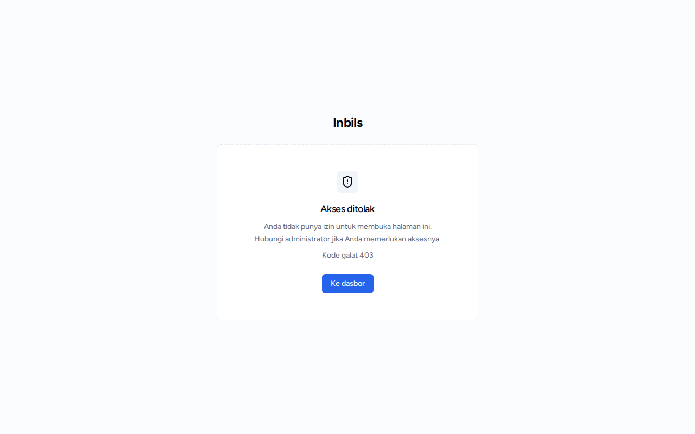

3. Baca kartu di atas daftar. Klik kartu untuk memfilter daftar.
   - Kartu **Total Tugas Saya** menghitung semua tiket dan SPK yang ditugaskan kepada Anda dalam status yang terkait dengan izin Anda.
   - Kartu **Belum Dimulai** menghitung tugas berstatus `assigned`.
   - Kartu **Sedang Dikerjakan** menghitung tiket `on_progress` dan SPK `in_progress`.
   - Kartu **Menunggu Tindakan Lanjutan** menghitung tiket `resolved` dan SPK `in_progress`. SPK yang sedang dikerjakan dihitung di dua kartu terakhir, jadi jumlah ketiga kartu terakhir bisa melebihi **Total Tugas Saya**.
4. Persempit daftar dengan filter:
   - Kotak **Pencarian** mencari kode, judul, serta nama dan kode pelanggan.
   - Pilihan **Domain** (**Semua Domain**, **Tiket**, **SPK**) tampil bila Anda memegang izin tiket dan izin SPK.
   - Pilihan **Status Pekerjaan** berisi **Semua Status**, **Belum Dimulai**, **Sedang Dikerjakan**, dan **Selesai Ditangani**. **Selesai Ditangani** menampilkan tiket `resolved` dan SPK `in_progress`.
   - Pilihan **Prioritas** dan isian **Periode** bekerja seperti di Penugasan (bagian 3.1). Tombol **Cari** menjalankan pencarian yang sama dan **Reset** mengosongkan filter.
5. Baca kolom tabel: **Kode & Domain**, **Judul & Pelanggan**, **Prioritas & Umur**, **Status & Alur** (lencana status dan satu baris yang menyebut status berikutnya), **Batas / Jadwal**, dan **Tindakan Operasional**. Judul kolom **Kode & Domain**, **Judul & Pelanggan**, **Prioritas & Umur**, dan **Status & Alur** bisa diurutkan.
6. Bila akun Anda juga memegang izin penugasan, dua tab muncul di atas kartu: **Pekerjaan Saya** dan **Antrean Penugasan**. Tab **Antrean Penugasan** membuka halaman Penugasan (bagian 3.1).

Tombol di kolom **Tindakan Operasional** mengikuti status tugas. Tautan **Detail** ada di setiap baris yang boleh Anda buka.

| Status | Jenis | Tombol | Syarat |
|---|---|---|---|
| **Ditugaskan (Siap Mulai)** | Tiket dan SPK | **Mulai** | `ticket.start` atau `spk.start` |
| **Sedang Dikerjakan** | Tiket | **Selesaikan** | `ticket.resolve` |
| **Sedang Dikerjakan** | SPK | **Ajukan Review** | `spk.submit` |
| **Selesai Ditangani** | Tiket | **Tutup** | `ticket.close`, dan Anda bukan penanggung jawab tiket |

### Memulai pekerjaan

1. Pada tugas berstatus **Ditugaskan (Siap Mulai)**, klik **Mulai**.
2. Di dialog **Mulai Pengerjaan Tiket** atau **Mulai Pengerjaan SPK**, yang diikuti kode tugas, klik **Mulai Kerja**. Klik **Batal** untuk menutup tanpa memulai.
3. Status berubah menjadi **Sedang Dikerjakan** dan waktu mulai tercatat di audit. Toast "Ticket started." atau "SPK started." muncul. Pada tiket, langkah ini juga mencatat waktu respons pertama bila belum ada. Angka itu disalin ke Evaluasi (bagian 3.5).

### Menyelesaikan tiket

1. Pada tiket berstatus **Sedang Dikerjakan**, klik **Selesaikan**.
2. Di dialog **Selesaikan Tiket**, isi **Catatan Solusi / Penanganan**. Isian ini wajib dan maksimal 1000 karakter. Catatan tersimpan di riwayat audit tiket dan dibaca saat penutupan.
3. Klik **Selesaikan Tiket**. Status menjadi **Selesai Ditangani** dan toast "Ticket resolved." muncul. Sistem mengantrekan pesan WhatsApp ke pelanggan tiket. Klik **Batal** untuk menutup dialog tanpa menyimpan.

### Mengajukan SPK untuk review

Syarat: SPK sudah punya minimal satu bukti (evidence), dan sisa material dari permintaan barang yang sudah diserahkan sudah dideklarasikan teknisi (bagian 6.1 dan 6.8).

1. Pada SPK berstatus **Sedang Dikerjakan**, klik **Ajukan Review**.
2. Di dialog **Ajukan Peninjauan SPK**, yang diikuti kode SPK, baca peringatan bahwa item pekerjaan tidak bisa diubah sampai review selesai, lalu klik **Ajukan Review**.
3. SPK berstatus `waiting_review` dan toast "SPK submitted for review." muncul. SPK keluar dari daftar ini dan masuk ke antrean **Persetujuan** pengguna lain (bagian 3.2). Anda sendiri tidak melihatnya di sana karena Anda teknisi yang ditugaskan.

### Kesalahan umum

- Alert **Item Sudah Berubah** di dialog, dengan tombol **Muat Ulang Pekerjaan**: status tugas diubah di tempat lain, misalnya teknisi memulainya di aplikasi. Klik **Muat Ulang Pekerjaan**. Dialog memuat data terbaru, atau menutup bila tombolnya sudah tidak berlaku.
- Pesan "Catatan resolusi/penanganan wajib diisi." di dialog **Selesaikan Tiket**: isi **Catatan Solusi / Penanganan** dengan teks selain spasi.
- Galat "Evidence required before submission.": SPK belum punya bukti. Unggah bukti di halaman detail SPK (bagian 3.3), lalu ajukan lagi.
- Galat "Seluruh sisa material dari Inventory Request harus dideklarasikan terlebih dahulu sebelum submit SPK.": deklarasi sisa material belum lengkap. Lengkapi deklarasinya (bagian 6.1 dan 6.8), lalu ajukan lagi.
- Tombol **Tutup** tidak muncul untuk tiket Anda sendiri: penanggung jawab tiket tidak boleh menutup tiket yang ia selesaikan ("Cannot close a ticket you resolved."). Pengguna lain pemegang `ticket.close` menutupnya dari halaman detail tiket (bagian 3.4).
- Tugas yang baru ditugaskan tidak tampil: daftar hanya memuat tugas yang ditugaskan ke akun Anda, dan hanya pada status yang cocok dengan izin Anda. Contohnya, tiket `assigned` baru tampil bila Anda memegang `ticket.start`.
- Pilihan **Kritis** di **Prioritas** tidak menemukan apa pun, seperti di Penugasan (bagian 3.1).

# 4. Pelanggan & Layanan

## 4.1 Pelanggan

Menu **Pelanggan** menyimpan identitas pelanggan, alamat, kontak, atribusi penjualan, langganan, dan riwayat layanan. Gunakan menu ini untuk onboarding pelanggan baru dan meninjau seluruh hubungan pelanggan.

Peran yang dapat membuka daftar: admin, manajer, dan staf. Izin dasar: `customer.view`. Peran bawaan memiliki batas berikut:

| Tindakan | Izin | Peran bawaan |
|---|---|---|
| Melihat pelanggan | `customer.view` | Admin, manajer, staf |
| Onboarding lengkap | `customer.create`, `customer.address.manage`, `customer.subscription.manage`, `spk.create` | Admin, manajer |
| Mengubah pelanggan dan mengirim link akses | `customer.update` | Admin, manajer, staf |
| Mengelola alamat dan kontak | `customer.address.manage` | Admin, manajer, staf |
| Menghapus pelanggan | `customer.delete` | Admin |
| Mengekspor pelanggan | `customer.export` | Admin, manajer |
| Menetapkan **Acquired by** | `customer.sales.assign` | Admin, manajer, staf |
| Mengoreksi **Acquired by** | `customer.sales.correct` | Admin, manajer |
| Melihat langganan | `customer.subscription.view` | Admin, manajer, staf |
| Membuat dan menjalankan siklus langganan | `customer.subscription.manage` dan izin aksi terkait | Admin, manajer |
| Melihat, mengelola, dan membuka secret akun jaringan | `network_asset.account.view`, `network_asset.account.manage`, `network_asset.account.reveal` | Admin, manajer, staf |

Admin dapat mengubah susunan izin melalui **Peran** dan **Hak Akses**. Tombol yang terlihat pada peran khusus dapat berbeda dari tabel ini.

### Membuka dan membaca daftar

1. Di sidebar, buka grup **Pelanggan & Layanan**, lalu klik **Pelanggan**.
2. Gunakan **Search** untuk mencari nama, kode, atau nomor telepon. Pilih **Type**, **Status**, **Account**, dan **Acquired by**, lalu klik **Filter**.
   - **Type** berisi **Individual** dan **Company**.
   - **Status** berisi **Prospective**, **Active**, **Suspended**, **Inactive**, dan **Terminated**.
   - **Account** menyaring saklar akun manual. Nilai ini berbeda dari status layanan.
   - **Acquired by** hanya terlihat dengan `customer.sales.assign` atau `customer.sales.correct`.
3. Baca kolom **Code**, **Name**, **Type**, **Phone**, **Status**, **Account**, **Acquired by**, **Addresses**, **Subscriptions**, dan **Actions**. Kolom kode, nama, tipe, telepon, status, dan akun dapat diurutkan. Urutan awal memakai kode dari kecil ke besar.

   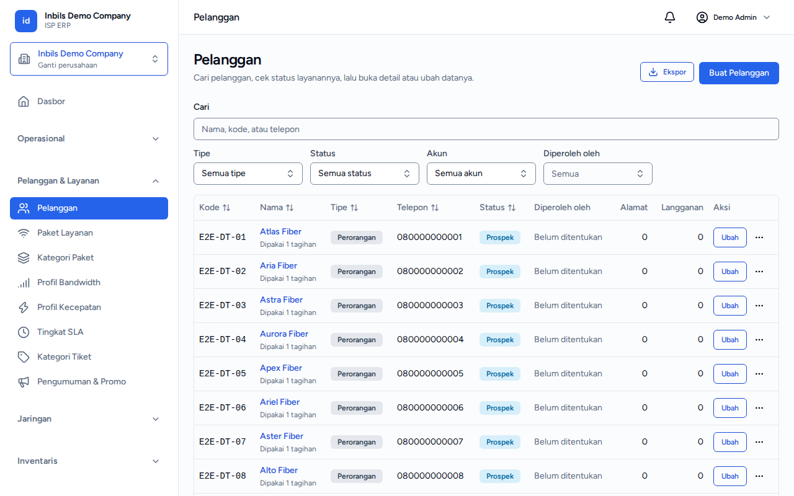

4. Gunakan **Export** untuk mengunduh CSV atau PDF dengan filter aktif. Ekspor memuat maksimal 5.000 baris secara bawaan. Persempit filter bila hasil dipotong.
5. Bedakan dua indikator berikut:

   | Indikator | Nilai | Arti |
   |---|---|---|
   | **Account** | **Active**, **Inactive** | Saklar manual pada data pelanggan |
   | **Status** | **Prospective** | Belum ada langganan atau semua masih `pending` |
   | **Status** | **Active** | Ada langganan `active` |
   | **Status** | **Suspended** | Tidak ada yang `active`, tetapi ada yang `suspended` |
   | **Status** | **Terminated** | Semua langganan `terminated` |
   | **Status** | **Inactive** | Kombinasi lain, misalnya `pending` dan `terminated` |

### Menambah pelanggan baru

1. Klik **Create Customer**. Tombol hanya muncul bila semua izin onboarding lengkap tersedia.

   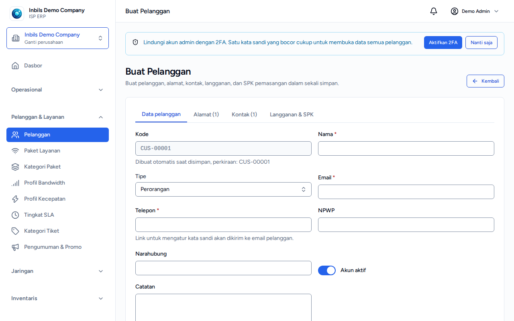

2. Pada tab **Customer Data**, isi data identitas:
   - **Code**: sistem membuat kode saat disimpan. Jika penomoran manual diaktifkan pada Penomoran (bagian 7.13), isian boleh kosong untuk kode otomatis atau diisi maksimal 50 karakter. Kode harus unik dalam perusahaan.
   - **Name**: wajib, maksimal 255 karakter.
   - **Type**: wajib. Pilih **Individual** atau **Company**.
   - **Email**: wajib, format e-mail, maksimal 255 karakter, dan harus unik di seluruh akun pengguna. E-mail ini menjadi e-mail masuk pelanggan.
   - **Phone**: wajib, maksimal 50 karakter. Gunakan angka serta karakter `(`, `)`, `+`, atau `-`.
   - **Tax ID (NPWP)**: wajib untuk **Company**, opsional untuk **Individual**, maksimal 100 karakter.
   - **Contact Person**: wajib untuk **Company**, opsional untuk **Individual**, maksimal 255 karakter. Nilai ini menjadi nama akun masuk. Jika kosong, sistem memakai **Name**.
   - **Account active**: aktif secara bawaan. Jika dimatikan, sistem tetap membuat akun masuk dalam keadaan nonaktif dan tidak mengirim link akses.
   - **Notes**: opsional.
3. Tentukan persetujuan dan atribusi pada tab yang sama:
   - **Pelanggan setuju menerima notifikasi WhatsApp**: tidak dicentang secara bawaan. Centang hanya setelah pelanggan menyetujui tagihan terbit, pengingat jatuh tempo, pembayaran diterima, status tiket, dan jadwal kunjungan teknisi. Pengiriman tetap memerlukan fitur WhatsApp perusahaan yang aktif dan nomor seluler Indonesia yang valid.
   - **Acquired by**: muncul dengan `customer.sales.assign`. Pilih pegawai yang memperoleh pelanggan atau biarkan **Unassigned**. Pilihan hanya memuat akun aktif dalam perusahaan, memiliki profil karyawan aktif, dan memegang `customer.create`. Sistem memilih pembuat sebagai nilai awal bila pembuat memenuhi syarat.
4. Buka tab **Addresses**. Sediakan sedikitnya satu alamat dan pilih tepat satu alamat utama serta satu alamat instalasi. Alamat pertama sudah menjadi keduanya.
   - **Label**: wajib, maksimal 100 karakter, dan tidak boleh sama dengan label alamat lain milik pelanggan ini.
   - Peta: klik peta, geser pin, cari alamat, masukkan koordinat lewat **Lat / Long**, atau klik **Current Location**. Pencarian membutuhkan sedikitnya 3 karakter.
   - **Latitude** dan **Longitude**: wajib. Latitude harus antara -90 sampai 90. Longitude harus antara -180 sampai 180.
   - **Province**, **City / Regency**, **District**, dan **Village / Subdistrict**: wajib. Pilih berurutan. Kombinasinya harus membentuk hierarki wilayah yang valid.
   - **Address**: wajib. **Postal Code** dan **Notes** opsional.
   - **Primary address** dan **Installation address**: pilih satu kartu untuk masing-masing penanda. Mengaktifkan penanda pada kartu lain memindahkannya dari kartu lama.
   - Klik **Add Address** untuk menambah kartu. Tombol **Remove** tidak dapat menghapus satu-satunya alamat.
5. Buka tab **Contacts**. Sediakan sedikitnya satu kontak dan pilih tepat satu kontak utama.
   - **Name**: wajib, maksimal 255 karakter.
   - **Position**: opsional, maksimal 255 karakter.
   - **Phone**: wajib pada onboarding, maksimal 50 karakter, dengan format angka serta `(`, `)`, `+`, atau `-`.
   - **Email**: wajib pada onboarding, format e-mail, maksimal 255 karakter.
   - **Notes**: opsional.
   - **Primary contact**: pilih satu kartu. Klik **Add Contact** untuk menambah kontak. Tombol **Remove** tidak dapat menghapus satu-satunya kontak.
6. Buka tab **Subscription & SPK**:
   - **Service Package**: wajib. Pilihan hanya memuat paket aktif dari kategori aktif, dikelompokkan dengan judul nama kategori. Mengganti **Type** menata ulang kelompok: **Individual** menampilkan **Rumahan** paling atas, **Company** menampilkan **Bisnis** lalu **Korporat**. Semua paket tetap bisa dipilih untuk tipe apa pun. Memilih paket mengisi MRC, OTC, dan masa kontrak dari paket.
   - **Serving POP / Location**: wajib. Pilihan hanya memuat lokasi aktif dalam perusahaan.
   - **Drop port (ODP)**: opsional dan hanya muncul dengan `odn.assign`. Pilih port bebas di bawah POP tersebut atau biarkan **No port chosen**.
   - **Billing Day**: wajib, bilangan bulat 1 sampai 28. Nilai awal 1.
   - **Contract Months**: opsional, bilangan bulat minimal 1. Kosongkan untuk memakai masa minimum paket.
   - **MRC Amount** dan **OTC Installation Fee**: opsional, angka minimal 0. Kosongkan untuk memakai harga paket.
   - **Subscription Notes**: opsional.
   - Periksa ringkasan alamat instalasi dan status SPK **Generated**.
7. Klik **Create Customer & SPK**. Bila validasi gagal, layar berpindah ke tab yang berisi masalah.
8. Sistem menyimpan seluruh onboarding dalam satu transaksi:
   - customer, alamat, kontak, persetujuan WhatsApp, dan atribusi penjualan;
   - akun pengguna berperan `customer`, tergabung pada perusahaan, e-mail sudah ditandai terverifikasi, dan terhubung ke customer;
   - langganan baru berstatus `pending`, port ODP bila dipilih, serta SPK instalasi berstatus `generated` dengan prioritas `medium`;
   - catatan audit onboarding.
9. Tidak ada isian kata sandi pada form. Sistem membuat kata sandi acak 32 karakter yang tidak pernah ditampilkan. Nomor telepon bukan kata sandi.
10. Jika **Account active** menyala, sistem mengantrekan e-mail berjudul **Akun pelanggan Anda sudah dibuat** setelah transaksi selesai. Tombol **Atur kata sandi** berlaku 60 menit. Pelanggan mengatur kata sandi melalui link itu, lalu masuk ke aplikasi Inbils Pelanggan memakai e-mail tersebut.
11. Setelah berhasil, layar membuka detail pelanggan baru. Toast menyebut customer, langganan, dan SPK instalasi telah dibuat. Kode pelanggan dan langganan mengikuti pengaturan Penomoran (bagian 7.13).

### Membuka detail pelanggan

1. Pada daftar, klik **Show** pada baris pelanggan.

   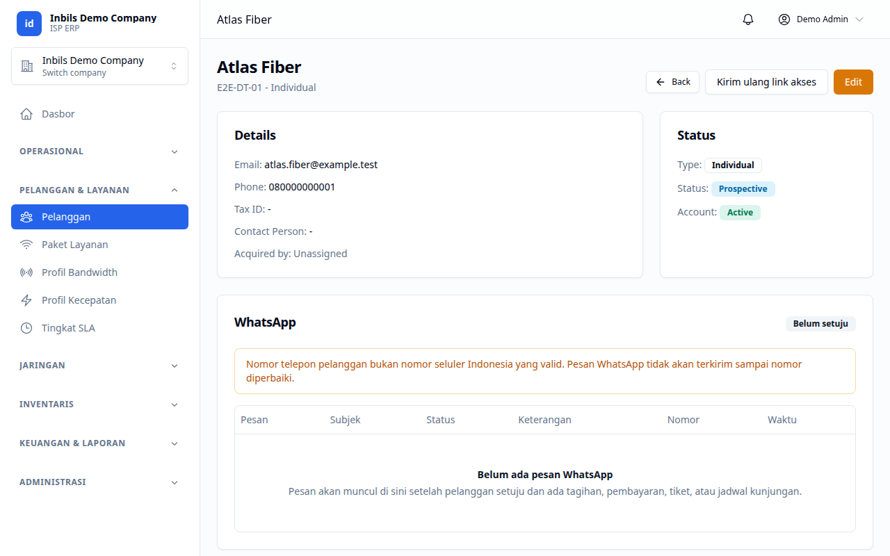

2. Baca kartu **Details** untuk e-mail, telepon, NPWP, contact person, **Acquired by**, dan catatan. Kartu **Status** menampilkan tipe, status layanan, dan status akun.
3. Baca kartu **WhatsApp**. Badge menampilkan **Setuju sejak**, **Berhenti sejak**, atau **Belum setuju**. Tabel memuat 20 pesan terbaru dengan kolom **Pesan**, **Subjek**, **Status**, **Keterangan**, **Nomor**, dan **Waktu**. Nomor hanya menampilkan empat digit terakhir.
4. Buka tab **Addresses**, **Contacts**, dan **Subscriptions** untuk ringkasan data terkait. Tab **Billing**, **SPK**, dan **Tickets** muncul bila pengguna memiliki izin modul terkait. Masing-masing riwayat menampilkan maksimal 50 data terbaru.
5. Tab **Subscriptions** pada detail hanya berupa ringkasan. Halaman ini tidak menyediakan tombol untuk membuat atau membuka langganan.

### Mengirim ulang link akses

1. Buka detail pelanggan, lalu klik **Kirim ulang link akses**. Tombol membutuhkan `customer.update`.
2. Pastikan customer memiliki akun masuk dengan e-mail. Pastikan status customer dan akun pengguna sama-sama aktif.
3. Sistem mengirim link ke e-mail akun masuk dan menampilkan toast **Link akses dikirim ke &lt;email&gt;.** Batasnya 3 permintaan per menit. Permintaan keempat ditolak dengan HTTP 429.
4. Link baru membatalkan link lama. Link berlaku 60 menit. Setelah mengatur kata sandi, pelanggan memakai aplikasi Inbils Pelanggan.
5. Jika pelanggan sudah menyetujui WhatsApp, sistem juga mengantrekan pemberitahuan bahwa link ada di e-mail. Pesan WhatsApp tidak membawa link atau token. Pemberitahuan ini dibatasi satu kali per akun setiap jam.

### Mengubah customer, alamat, dan kontak

1. Dari detail, klik **Edit**. Ubah tab **Customer Data**, lalu klik **Save Customer**. Klik **Cancel** untuk membuang perubahan dan kembali ke detail.
2. Pengguna dengan `customer.update` dapat mengubah checkbox **Pelanggan setuju menerima notifikasi WhatsApp**. Mencentang mencatat waktu, sumber `staff`, dan pengguna pencatat. Melepas centang mencatat waktu berhenti.
3. Jika nomor tidak dapat dinormalisasi sebagai nomor seluler Indonesia, layar menampilkan peringatan. Pesan WhatsApp dilewati sampai nomor diperbaiki.
4. Pelanggan dapat membalas `STOP` atau `BERHENTI`, tanpa membedakan huruf besar atau kecil. Sistem mencabut persetujuan untuk semua customer dengan nomor cocok. Staf dapat mencentang kembali setelah memperoleh persetujuan baru.
5. Pada tab **Addresses**, klik **Add Address**, **Edit**, atau **Delete**. Form memuat peta, wilayah berjenjang, alamat, kode pos, catatan, dan dua penanda. Alamat pertama selalu menjadi utama dan instalasi. Sistem mempertahankan tepat satu alamat utama dan satu alamat instalasi.
6. Alamat yang dipakai oleh langganan tidak dapat dihapus. Mengubah penanda instalasi tidak mengubah `installation_address_id` pada langganan lama.
7. Pada tab **Contacts**, klik **Add Contact**, **Edit**, atau **Delete**. **Name** dan **Phone** ditandai wajib pada form; **Position**, **Email**, dan **Notes** opsional. Jika kontak utama dihapus, sistem memilih kontak tertua yang tersisa sebagai kontak utama.
8. E-mail dan status customer pada halaman ini tidak disinkronkan ke akun masuk yang dibuat saat onboarding. Admin mengubah e-mail atau status akun pengguna pada Pengguna (bagian 8.5). **Kirim ulang link akses** selalu memakai e-mail akun pengguna.

### Mengelola atribusi penjualan

1. **Acquired by** terlihat pada daftar, filter, detail, edit, dan ekspor hanya dengan `customer.sales.assign` atau `customer.sales.correct`.
2. Untuk customer **Unassigned**, pengguna dengan `customer.sales.assign` dapat memilih pegawai yang memenuhi syarat.
3. Untuk customer yang sudah memiliki acquirer, perubahan atau pengosongan membutuhkan `customer.sales.correct`.
4. Isi **Correction reason** saat mengoreksi. Alasannya wajib, maksimal 500 karakter, dan masuk Audit Log (bagian 7.12) bersama nilai lama dan baru.
5. Acquirer lama yang menjadi nonaktif tetap tampil dengan badge **Inactive**, tetapi tidak tersedia sebagai pilihan baru.

### Mengelola langganan pelanggan

1. Halaman khusus langganan berada di `/admin/customers/<id>/subscriptions`. Dalam checkout ini, detail pelanggan tidak memiliki link menuju halaman tersebut.
2. Halaman **Subscriptions** menyediakan pencarian kode atau paket, filter paket dan status, serta kolom **Code**, **Package**, **Status**, **MRC**, **Billing Day**, dan **Actions**.
3. Klik **Create Subscription** dengan `customer.subscription.manage`, lalu isi:
   - **Service Package**, **Installation Address**, dan **Billing Day (1-28)**: wajib.
   - **Service Package** berisi paket aktif dari kategori aktif, dikelompokkan dengan judul nama kategori. Kategori yang cocok dengan tipe pelanggan tampil paling atas: pelanggan **Individual** melihat **Rumahan** dulu, pelanggan **Company** melihat **Bisnis**, lalu **Korporat**. Kategori lain mengikuti urutannya di **Kategori Paket**. Tiap pilihan menulis nama paket dan `KODE · harga/bln`.
   - **MRC Amount**, **OTC Installation Fee**, dan **Contract Months**: opsional. MRC kosong memakai harga paket. OTC bernilai awal 0.
4. Klik **Create**. Sistem membuat kode langganan dan status `pending`. Jalur ini tidak membuat SPK instalasi dan tidak meminta serving POP. Buat SPK instalasi pada SPK (bagian 3.3) bila pekerjaan lapangan diperlukan.
5. Buka langganan melalui tombol **Show** pada halaman tersebut, melalui link kode langganan di ODN, atau dari Aset Jaringan yang terpasang.
6. Gunakan **Lifecycle Actions** sesuai status dan izin:

   | Tombol | Syarat | Izin | Efek |
   |---|---|---|---|
   | **Activate** | `pending` | `customer.subscription.activate` | Menjadi `active`, mengisi tanggal aktivasi dan tanggal tagihan berikutnya |
   | **Suspend** | `active` | `customer.subscription.suspend` | Alasan wajib, maksimal 500 karakter. Menjadi `suspended` dan akses jaringan terisolir |
   | **Reactivate** | `suspended` | `customer.subscription.reactivate` | Menjadi `active` dan menghitung ulang tanggal tagihan berikutnya |
   | **Block internet** | Belum `terminated` dan belum diblok | `customer.subscription.block` | Alasan wajib. Status tetap, penagihan lanjut, jaringan terisolir |
   | **Unblock** | Sedang diblok | `customer.subscription.block` | Catatan opsional. Jika masih `suspended`, jaringan tetap terisolir |
   | **Terminate** | `active` atau `suspended` | `customer.subscription.terminate` | Alasan wajib. Menjadi `terminated`, melepas IP statis dan drop port, menghapus blok |

7. Persetujuan SPK instalasi yang berstatus `waiting_review` juga mengaktifkan langganan `pending`. Jika pengaturan invoice otomatis aktif, persetujuan itu membuat tagihan OTC satu kali. Lihat SPK (bagian 3.3) dan Tagihan (bagian 7.1).
8. Aktivasi tidak langsung membuat tagihan MRC. Proses Tagihan membuat invoice pascabayar per periode dan menghitung prorata sejak tanggal aktivasi. Langganan `suspended` tidak masuk tagihan berkala. Langganan `terminated` dapat ditagih prorata sampai tanggal terminasi.
9. Suspend manual tidak dibuka otomatis setelah pembayaran. Suspend dengan sumber tunggakan dapat kembali aktif setelah seluruh syarat pembayaran terpenuhi dan pengaturan reaktivasi otomatis menyala.
10. **Block internet** berbeda dari suspend. Pembayaran tidak menghapus blok. Gunakan **Unblock** secara terpisah.
11. Terminate tidak dapat dibatalkan. Layar saat ini tidak menyediakan pilihan melepas ONT pada saat terminasi.

### Mengelola akun jaringan

1. Pada detail langganan, klik **Network access**. Link membutuhkan `network_asset.account.view`.
2. Halaman menampilkan langganan, customer, speed profile, serving POP, **Desired state**, status sinkronisasi, akun RADIUS, sesi online, IP, NAS, dan pemakaian bulan berjalan.
3. Bila belum ada akun dan pengguna memiliki `network_asset.account.manage`, isi kartu **Create network account**:
   - **Service type**: wajib, **PPPoE** atau **Hotspot**.
   - **Username**: wajib. Isi bagian sebelum realm dengan 3 sampai 40 huruf kecil, angka, titik, tanda hubung, atau garis bawah. Username lengkap harus unik lintas perusahaan.
   - **Secret**: opsional, 6 sampai 64 karakter tanpa spasi. Kosongkan agar sistem membuat 12 karakter.
4. Secret buatan sistem hanya tampil sekali. Salin sebelum menutup pesan atau meninggalkan halaman.
5. Gunakan **Edit network account** untuk mengganti tipe, username, atau secret. Secret kosong mempertahankan nilai lama. Langganan `terminated` tidak dapat memiliki akun jaringan.
6. Klik **Reveal secret** dengan `network_asset.account.reveal`. Konfirmasi menjelaskan bahwa secret tampil sekali dan pembukaan dicatat di audit. Rute dibatasi 10 permintaan per menit.
7. Klik **Resync** dengan `network_asset.account.manage` untuk mengantrekan penulisan ulang ke RADIUS dan pemutusan sesi. Rute dibatasi 6 permintaan per menit.
8. Bila RADIUS nonaktif atau tidak terjangkau, perubahan tetap tersimpan. Status online dan pemakaian tidak tersedia sampai RADIUS kembali tersedia.

### Menghapus pelanggan

1. Pada daftar, klik **Delete**. Tombol hanya tersedia dengan `customer.delete`.
2. Konfirmasikan **Delete** pada dialog. Sistem melakukan soft delete dan menutup dialog setelah berhasil.
3. Penghapusan ditolak selama ada langganan selain `terminated`. Terminasikan semua langganan terlebih dahulu.

### Kesalahan umum

- Tombol **Create Customer** tidak muncul pada staf bawaan karena onboarding juga memerlukan `customer.subscription.manage`. Gunakan admin atau manajer, atau ubah izin peran.
- Pesan **The email has already been taken.** berarti e-mail sudah dipakai akun pengguna mana pun. Periksa Pengguna (bagian 8.5) atau gunakan e-mail lain.
- Kesalahan alamat muncul bila koordinat belum dipilih, hierarki wilayah tidak lengkap, atau lebih dari satu penanda utama atau instalasi dipilih. Lengkapi peta dan pilih satu kartu untuk tiap penanda.
- Label alamat harus unik untuk customer. Gunakan label berbeda untuk rumah, kantor, atau titik instalasi.
- Pembuatan **Company** gagal tanpa **Tax ID (NPWP)** dan **Contact Person**. Isi keduanya sebelum menyimpan.
- Port ODP yang sudah dipakai atau berada di luar serving POP menolak seluruh onboarding. Pilih port bebas di bawah POP yang benar.
- Toast onboarding tetap menyebut link akses terkirim ketika **Account active** dimatikan, tetapi kode tidak mengirim e-mail pada kondisi itu. Aktifkan akun lalu gunakan **Kirim ulang link akses**.
- Mengubah e-mail atau **Account active** pada customer tidak mengubah akun pengguna. Perbarui akun pada Pengguna (bagian 8.5).
- Resend keempat dalam satu menit menghasilkan HTTP 429. Tunggu sampai jendela satu menit berlalu.
- Tombol siklus langganan mengikuti status, tetapi server tetap memeriksa izin. HTTP 403 berarti peran tidak memegang izin aksi itu.
- Alamat yang terhubung ke langganan tidak dapat dihapus. Pilih alamat lain pada langganan yang sesuai sebelum mencoba lagi.
- Customer tidak dapat dihapus selama masih memiliki langganan `pending`, `active`, atau `suspended`. Terminasikan seluruh langganan lebih dahulu.

## 4.2 Paket Layanan

Paket Layanan adalah katalog paket internet yang dijual ke pelanggan. Satu paket menggabungkan satu profil bandwidth, satu profil kecepatan dan satu tingkat SLA, ditambah harga bulanan dan harga pemasangan. Buka menu ini saat Anda menambah paket baru, mengubah harga, atau menonaktifkan paket yang tidak dijual lagi.

Peran yang dapat memakai: admin, manajer, staf. Izin: `service.view` atau `service.manage` membuka menu dan daftar, `service.create` membuat paket, `service.update` mengubah paket, `service.delete` menghapus paket, `service.export` mengekspor daftar. Izin `service.manage` sudah mencakup lihat, buat, ubah dan hapus, tetapi tidak mencakup ekspor. Dengan peran bawaan: admin memegang semua izin, manajer memegang `service.view`, `service.create`, `service.update` dan `service.manage` (tanpa ekspor), staf hanya `service.view`. Teknisi dan pelanggan tidak punya izin layanan.

### Membuka dan membaca daftar

1. Di sidebar, buka grup **Pelanggan & Layanan**, lalu klik **Paket Layanan**.
2. Baca daftar paket.

   - Kotak **Search** mencari kode dan nama paket.
   - Filter **Active** berisi **All**, **Active** dan **Inactive**.
   - Filter **SLA Tier** berisi semua tingkat SLA perusahaan.
   - Filter **Kategori** berisi **Semua kategori** dan semua kategori perusahaan. Kategori nonaktif tampil dengan tulisan `(nonaktif)`.
   - Kolom: **Name**, **Code**, **Kategori**, **Monthly** (harga bulanan), **One-time** (harga pemasangan), **Active** (lencana `active` atau `inactive`), **Created**, **Actions**. Semua kolom kecuali **Actions** bisa diurutkan.
   - Nama paket adalah tautan ke halaman Edit.
   - Tombol **Export** muncul hanya bagi pemegang `service.export`. Ekspor memakai pencarian dan filter yang sedang aktif, dalam format CSV atau PDF, dengan kolom Code, Name, Kategori, Bandwidth, Speed, SLA, MRC, OTC dan Status.
   - Tombol **New package** muncul bagi pemegang `service.create` atau `service.manage`.

   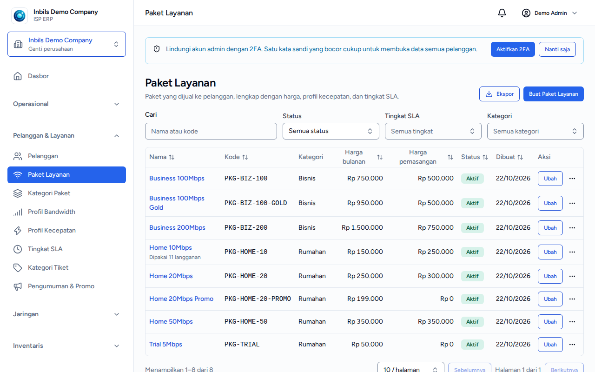

3. Klik **Show** untuk membuka halaman rincian. Kartu **Package Details** memuat bandwidth, kecepatan, SLA, masa kontrak minimal dan deskripsi. Kartu **Pricing** memuat MRC, OTC dan status. Dari sini tombol **Edit** membuka form ubah.

Tombol **Edit** dan **Delete** tampil untuk semua orang yang bisa melihat daftar. Server menolak aksi dari pengguna tanpa izin yang sesuai. Cara kerja tombol dan dialog hapus ada di bagian 1.5.

### Menyiapkan bahan paket

Form paket hanya menawarkan profil bandwidth, profil kecepatan dan tingkat SLA yang berstatus aktif. Buat dulu ketiganya, lihat bagian 4.3, 4.4 dan 4.5, baru buat paketnya.

### Membuat paket

1. Klik **New package**.
2. Isi form pada kartu **Details**:
   - **Code**: wajib, maksimal 255 karakter, tidak boleh sama dengan kode paket lain di perusahaan yang sama. Contoh: `PKG-HOME-50`.
   - **Name**: wajib, maksimal 255 karakter. Contoh: `Home 50Mbps`.
   - **Bandwidth Profile**: wajib, pilih dari daftar profil bandwidth aktif.
   - **Speed Profile**: wajib, pilih dari daftar profil kecepatan aktif.
   - **Kategori**: wajib, pilih **Pilih kategori...** lalu salah satu kategori aktif (lihat Kategori Paket di bawah). Pada form ubah, kategori nonaktif yang sedang dipakai paket tetap tampil.
   - **SLA Tier**: wajib, pilih dari daftar tingkat SLA aktif.
   - **Price MRC**: wajib, angka 0 atau lebih. Ini harga langganan per bulan (Monthly Recurring Charge). Di daftar kolom ini bernama **Monthly**.
   - **Price OTC**: angka 0 atau lebih, isian awal `0`. Ini biaya sekali bayar untuk pemasangan (One-Time Charge). Di daftar kolom ini bernama **One-time**. Isi `0` bila paket tidak memungut biaya pemasangan.
   - **Contract Min Months**: bilangan bulat 0 atau lebih, lama kontrak minimal dalam bulan. Isi `0` bila paket tanpa kontrak. Jangan dikosongkan.
   - **Active**: saklar, aktif secara awal. Paket nonaktif tidak muncul di pilihan paket pada form pelanggan baru.
   - **Description**: opsional, teks bebas.
3. Klik **Create**. Anda kembali ke daftar dan muncul toast `Service package created.`

Form tidak punya isian pajak. Harga yang Anda isi adalah angka yang akan disalin ke langganan.

### Mengubah paket

1. Di daftar, klik nama paket atau tombol **Edit**.
2. Ubah isian. Aturannya sama dengan form buat.
3. Klik **Save**. Muncul toast `Service package updated.`

Harga disalin ke langganan saat langganan dibuat: **MRC** pelanggan diisi dari **Price MRC** dan biaya pemasangan dari **Price OTC**. Karena itu mengubah harga atau isian lain pada paket tidak mengubah langganan yang sudah ada. Hanya langganan baru yang memakai harga baru. Harga di langganan lama dapat diubah sendiri pada langganan itu (lihat bagian Pelanggan, bab 4).

### Menonaktifkan dan menghapus paket

1. Untuk berhenti menjual paket, buka **Edit**, matikan saklar **Active**, lalu klik **Save**. Paket tetap ada di daftar dengan lencana `inactive`, langganan yang sudah berjalan tidak terganggu, dan paket tidak ditawarkan pada pelanggan baru. Untuk menyembunyikan satu kelompok paket sekaligus, nonaktifkan kategorinya (bagian Kategori Paket di bawah).
2. Untuk menghapus, klik **Delete** di baris paket, lalu konfirmasi di dialog. Muncul toast `Service package deleted.`

Penghapusan ditolak dengan pesan `Service package has active subscriptions.` bila masih ada langganan berstatus `active` atau `pending` pada paket itu. Langganan yang sudah berhenti tidak menghalangi. Bila ragu, nonaktifkan paketnya, jangan hapus.

### Kesalahan umum

- Pesan kode sudah dipakai: **Code** harus unik per perusahaan. Ganti kodenya.
- Paket baru tidak muncul pada form pelanggan baru: saklar **Active** paket masih mati. Nyalakan di **Edit**.
- Pilihan profil atau tingkat SLA kosong atau tidak lengkap: hanya data aktif yang tampil. Buat atau aktifkan dulu di menu yang bersangkutan.
- Harga paket sudah diubah tetapi tagihan pelanggan lama tetap memakai harga lama: harga tersimpan di langganan, bukan di paket. Ubah harga di langganan itu bila memang perlu.
- Tombol **Delete** mengembalikan galat `Service package has active subscriptions.`: akhiri atau pindahkan langganan `active` dan `pending` dulu, atau nonaktifkan paket.
- Staf menekan **Edit** atau **Delete** dan ditolak: staf hanya punya `service.view`. Minta admin menambah izin atau mengubah perannya (bagian 8.6 dan 8.7).
- Paket baru tidak bisa disimpan karena **Kategori** kosong: pilih kategori. Kategori yang nonaktif tidak ada di daftar. Aktifkan lagi di **Kategori Paket** atau pilih kategori lain.

### Kategori Paket

Kategori Paket mengelompokkan paket menurut segmen pelanggan, misalnya rumahan atau bisnis. Setiap paket wajib punya tepat satu kategori. Kategori dipakai untuk filter di daftar paket, pengelompokan di pilihan paket pada form pelanggan dan langganan, dan filter **Kategori paket** pada laporan Business Metrics dan Sales KPI (bagian 7.4 dan 7.10).

Peran dan izin sama dengan Paket Layanan: `service.view` atau `service.manage` membuka halaman, `service.create` membuat kategori, `service.update` mengubah, `service.delete` menghapus. Staf bawaan hanya melihat.

Setiap perusahaan punya tiga kategori bawaan: **Rumahan** (urutan 1), **Bisnis** (urutan 2) dan **Korporat** (urutan 3), dengan kode `RUMAHAN`, `BISNIS` dan `KORPORAT`. Perusahaan baru, termasuk anak perusahaan, mendapat ketiganya otomatis. Paket yang sudah ada sebelum fitur ini dimasukkan ke kategori menurut kata di kode atau namanya: `ENT`, `Enterprise`, `Dedicated`, `Korporat` atau `Corporate` masuk **Korporat**, lalu `BIZ`, `Business`, `Bisnis`, `SOHO` atau `UMKM` masuk **Bisnis**, sisanya (termasuk `Home`, `Rumah`, `Kos`, `Asrama`, `Gamer`, `Trial`, `Promo`) masuk **Rumahan**. Korporat didahulukan, jadi "Business 100Mbps Dedicated" masuk **Korporat**. Periksa hasilnya di daftar paket dan pindahkan paket yang salah tempat lewat **Edit**.

1. Di sidebar, buka grup **Pelanggan & Layanan**, lalu klik **Kategori Paket** (di bawah **Paket Layanan**).
2. Baca daftar. Kotak **Cari** mencari kode atau nama, filter **Status** berisi **Semua**, **Aktif** dan **Nonaktif**. Kolom: **Kode**, **Nama**, **Urutan**, **Paket** (jumlah paket di kategori itu, termasuk paket yang sudah dihapus), **Status** dan **Aksi**.
3. Klik **Kategori baru** (pemegang `service.create` atau `service.manage`). Isi dialog:
   - **Kode**: wajib, huruf besar, angka, `_` dan `-`, maksimal 30 karakter, unik per perusahaan. Sistem mengubah huruf kecil menjadi besar. Kode tidak bisa diubah setelah kategori dibuat, karena pilihan paket mengenali Rumahan, Bisnis dan Korporat lewat kode.
   - **Nama**: wajib, maksimal 100 karakter.
   - **Urutan**: angka 0 sampai 65535, isian awal `0`. Kategori dengan angka kecil tampil lebih dulu di daftar dan di pilihan paket.
   - **Aktif**: saklar, aktif secara awal.
4. Klik **Tambah kategori**. Muncul toast `Kategori paket dibuat.` Untuk mengubah, klik **Edit** di baris, ubah **Nama**, **Urutan** atau **Aktif**, lalu klik **Simpan** (`Kategori paket diperbarui.`).
5. Untuk berhenti memakai kategori, matikan saklar **Aktif**. Kategori nonaktif tidak muncul di pilihan **Kategori** saat membuat paket baru dan tidak muncul di pilihan paket pada form pelanggan dan langganan. Paket yang sudah memakainya tetap utuh, dan kategorinya tetap tampil di form ubah paket itu.
6. Untuk menghapus, klik ikon hapus di baris, lalu konfirmasi. Muncul toast `Kategori paket dihapus.` Kategori yang masih dipakai paket (paket yang sudah dihapus ikut dihitung) tidak bisa dihapus. Dialog menampilkan `Kategori masih dipakai {n} paket. Nonaktifkan saja.` Nonaktifkan kategorinya sebagai gantinya.

## 4.3 Profil Bandwidth

Profil Bandwidth adalah templat kapasitas yang dipilih pada paket: kecepatan unduh dan unggah, jenis (bersama atau khusus) dan rasio contention. Buka menu ini sebelum membuat paket baru yang membutuhkan kapasitas berbeda.

Peran yang dapat memakai: sama dengan bagian 4.2. Izin: `service.view` atau `service.manage` membuka menu, `service.create`, `service.update`, `service.delete` dan `service.export` untuk aksi masing-masing.

### Membuka dan membaca daftar

1. Di sidebar, buka grup **Pelanggan & Layanan**, lalu klik **Profil Bandwidth**.
2. Baca daftar. Kolomnya **Name**, **Download (Mbps)**, **Upload (Mbps)**, **Created** dan **Actions**. Kotak **Search** mencari nama dan jenis (`shared` atau `dedicated`), walau teks petunjuknya `Name or code...`. Tidak ada tombol **Show**: nama profil dan tombol **Edit** sama-sama membuka form ubah. Jenis, rasio dan status aktif hanya terlihat di form ubah. Tombol **Export** (pemegang `service.export`) menghasilkan CSV atau PDF dengan kolom Name, Download, Upload, Type, Contention dan Status.

   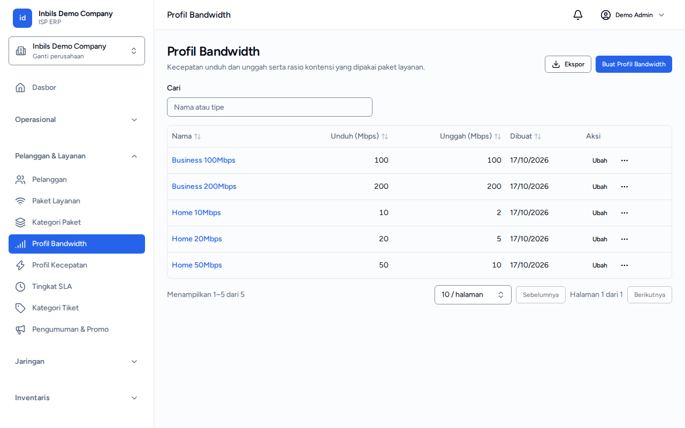

### Membuat profil

1. Klik **New profile**.
2. Isi form:
   - **Name**: wajib, maksimal 255 karakter, unik per perusahaan. Contoh: `Home 50Mbps`.
   - **Type**: pilih **Shared** (bersama, isian awal) atau **Dedicated** (khusus).
   - **Download (Mbps)**: wajib, bilangan bulat minimal 1.
   - **Upload (Mbps)**: wajib, bilangan bulat minimal 1.
   - **Contention Ratio**: bilangan bulat minimal 1, isian awal `1`. Wajib bila **Type** adalah **Shared**. Untuk **Dedicated** server tidak mewajibkannya, tetapi isian ini masih bertanda wajib di layar.
   - **Active**: saklar, aktif secara awal.
3. Klik **Create**. Muncul toast `Bandwidth profile created.`

Untuk mengubah, klik **Edit**, ubah isian, lalu klik **Save** (toast `Bandwidth profile updated.`). Untuk menghapus, klik **Delete** lalu konfirmasi (toast `Bandwidth profile deleted.`).

### Kesalahan umum

- Profil tidak muncul di form paket: saklar **Active** mati. Nyalakan di **Edit**.
- Penyimpanan ditolak karena nama: **Name** sudah dipakai profil lain di perusahaan ini.
- Profil yang masih dipakai paket bisa dihapus tanpa peringatan, karena penghapusan tidak memeriksa paket. Untuk berhenti memakai profil, matikan **Active** saja.

## 4.4 Profil Kecepatan

Profil Kecepatan adalah label kecepatan yang dipilih pada paket. Isinya batas unduh dan unggah, kecepatan burst (opsional) dan nama grup kecepatan RADIUS. Buka menu ini saat Anda menambah label kecepatan baru atau mengubah batas kecepatan paket.

Peran yang dapat memakai: sama dengan bagian 4.2. Izin: `service.view` atau `service.manage` membuka menu, `service.create`, `service.update`, `service.delete` dan `service.export` untuk aksi masing-masing.

### Membuka dan membaca daftar

1. Di sidebar, buka grup **Pelanggan & Layanan**, lalu klik **Profil Kecepatan**.
2. Baca daftar. Kolomnya **Name**, **Download (Mbps)**, **Upload (Mbps)**, **Created** dan **Actions**, seperti Profil Bandwidth. Kotak **Search** mencari nama profil dan nama profil RADIUS. Tombol **Export** (pemegang `service.export`) menghasilkan CSV atau PDF dengan kolom Name, Download Max, Upload Max, Burst Download, Burst Upload, RADIUS Profile dan Status.

   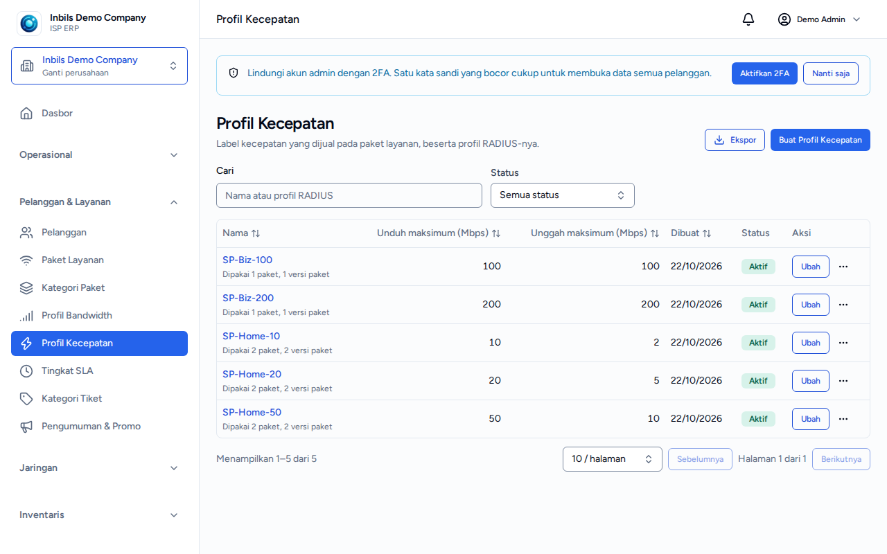

### Membuat profil

1. Klik **New profile**.
2. Isi form:
   - **Name**: wajib, maksimal 255 karakter, unik per perusahaan. Contoh: `SP-Home-50`.
   - **Download Max (Mbps)**: wajib, bilangan bulat minimal 1.
   - **Upload Max (Mbps)**: wajib, bilangan bulat minimal 1.
   - **Burst Download (Mbps)**: opsional, bilangan bulat minimal 1.
   - **Burst Upload (Mbps)**: opsional, bilangan bulat minimal 1.
   - **RADIUS Profile Name**: opsional, maksimal 255 karakter. Ini nama grup kecepatan di RADIUS. Isi bila paket ini akan dipasang pada akun jaringan pelanggan.
   - **Active**: saklar, aktif secara awal.
3. Klik **Create**. Muncul toast `Speed profile created.`

Untuk mengubah, klik **Edit**, ubah isian, lalu klik **Save**. Untuk menghapus, klik **Delete** lalu konfirmasi (toast `Speed profile deleted.`).

### Hubungan dengan RADIUS

Bila integrasi RADIUS aktif, Inbils menulis satu grup kecepatan per perusahaan dan profil, dengan nama `<realm>/<RADIUS Profile Name>` (realm adalah kode perusahaan huruf kecil). Batas kecepatannya diambil dari **Upload Max** dan **Download Max** dalam format unggah/unduh. Nilai burst tidak dikirim ke RADIUS.

Saat Anda mengubah **RADIUS Profile Name**, **Download Max** atau **Upload Max**, Inbils menulis ulang grup itu. Login baru langsung memakai kecepatan baru. Sesi yang sedang online memakai kecepatan lama sampai pelanggan tersambung ulang atau staf menekan **Resync** di halaman akun jaringan pelanggan.

Paket yang profil kecepatannya tidak punya **RADIUS Profile Name** tidak dapat diberi akun jaringan. Inbils menolaknya dengan pesan `The speed profile of this package has no RADIUS profile name.`

### Kesalahan umum

- Akun jaringan pelanggan ditolak dengan pesan di atas: isi **RADIUS Profile Name** pada profil kecepatan paket itu.
- Penyimpanan ditolak karena nama: **Name** sudah dipakai profil lain di perusahaan ini.
- Profil yang masih dipakai paket bisa dihapus tanpa peringatan. Untuk berhenti memakai profil, matikan **Active** saja.

## 4.5 Tingkat SLA

Tingkat SLA mencatat target layanan sebuah paket: batas waktu respons dan batas waktu penyelesaian tiket. Target ini dipakai saat tiket dari langganan paket itu dibuat. Hasilnya tidak diisi manual: sistem mengukurnya dari tiket. Buka menu ini saat Anda menambah tingkat layanan baru, misalnya untuk paket bisnis.

Peran yang dapat memakai: sama dengan bagian 4.2. Izin: `service.view` atau `service.manage` membuka menu, `service.create`, `service.update`, `service.delete` dan `service.export` untuk aksi masing-masing.

### Membuka dan membaca daftar

1. Di sidebar, buka grup **Pelanggan & Layanan**, lalu klik **Tingkat SLA**.
2. Baca daftar. Kolomnya **Nama**, **Target respons (jam)**, **Target penyelesaian (jam)**, **Respons tepat waktu (30 hari)**, **Penyelesaian tepat waktu (30 hari)**, **Tiket (30 hari)**, **Dibuat** dan **Aksi**. Kotak **Cari** mencari nama tingkat. Tiga kolom 30 hari dihitung dari tiket yang dibuat dalam 30 hari terakhir pada langganan paket bertingkat itu. Kolom persen bernilai **—** bila belum ada tiket yang bisa dinilai. Tombol **Export** (pemegang `service.export`) menghasilkan CSV atau PDF dengan kolom Name, Response Time, Resolution Time dan Status.

   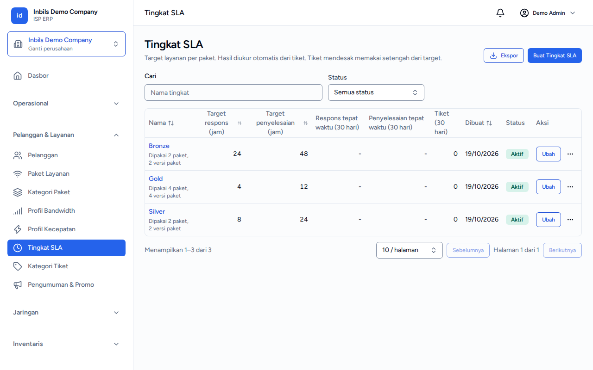

### Membuat tingkat SLA

1. Klik **Tingkat baru**. Halaman terbuka dengan judul **Tambah Tingkat SLA**.
2. Isi form:
   - **Nama**: wajib, maksimal 255 karakter, unik per perusahaan. Contoh: `Silver`.
   - **Target respons (jam)**: wajib, bilangan bulat 1 sampai 720. Batas waktu sampai teknisi menekan **Start** pada tiket. Nilainya tidak boleh melebihi target penyelesaian.
   - **Target penyelesaian (jam)**: wajib, bilangan bulat 1 sampai 720. Batas waktu sampai tiket diselesaikan.
   - **Aktif**: saklar, aktif secara awal.
3. Klik **Simpan**. Muncul toast `SLA tier created.`

Untuk mengubah, klik **Edit** (halaman **Ubah Tingkat SLA**), ubah isian, lalu klik **Simpan**. Untuk menghapus, klik **Delete** lalu konfirmasi (toast `SLA tier deleted.`). Perubahan jam hanya berlaku untuk tiket yang dibuat sesudahnya. Tiket yang sudah ada tidak dihitung ulang.

Sebuah tingkat memengaruhi tiket seperti ini:

- Tiket yang punya **Subscription** pada paket dengan tingkat ini mengambil kedua targetnya dari tingkat itu, selama tingkatnya **Aktif**. Tingkat nonaktif dilewati dan tiket memakai **Kategori Tiket** (bagian 3.4).
- Tiket berprioritas **Urgent** memakai separuh dari kedua target, dibulatkan ke atas.
- Jam dihitung kalender, bukan jam kerja.
- Hasilnya muncul di kolom 30 hari pada daftar ini dan di laporan SLA Compliance (bagian 7.6). Sistem tidak memakai tingkat ini untuk menghitung uptime atau kredit tagihan. Kedua isian itu sudah dihapus dari tingkat SLA.

### Kesalahan umum

- Tingkat tidak muncul di form paket: saklar **Aktif** mati. Nyalakan di **Edit**.
- Target respons atau penyelesaian ditolak: isi bilangan bulat jam antara 1 dan 720. Angka desimal tidak diterima.
- Target respons ditolak dengan pesan `Target respons tidak boleh lebih lama dari target penyelesaian.`: turunkan target respons atau naikkan target penyelesaian.
- Tingkat yang masih dipakai paket bisa dihapus tanpa peringatan. Untuk berhenti memakainya, matikan **Aktif** saja.

# 5. Jaringan

## 5.1 Lokasi

Lokasi adalah daftar tempat fisik jaringan dalam satu pohon: region, area, POP, rack, dan site. Aset jaringan, stok, VLAN, dan prefix IP memilih lokasinya dari daftar ini, jadi isi pohon ini lebih dulu. Buka menu ini untuk menambah, memperbaiki, memindahkan, atau menghapus lokasi.

Peran yang dapat memakai: admin (semua tindakan), manajer (tambah, ubah, dan pindah, tanpa hapus), staf (hanya melihat). Izin: `location.view` untuk membuka menu, `location.create` untuk **Tambah Lokasi**, `location.update` untuk **Edit**, `location.move` untuk **Move**, `location.delete` untuk **Delete**. Daftar dan kode lokasi berlaku per perusahaan aktif (bagian 1.6).

### Membuka dan membaca daftar

1. Di sidebar, buka grup **Jaringan**, lalu klik **Lokasi**.
2. Halaman terbuka di tab **Peta**. Setiap lokasi yang punya koordinat tampil sebagai penanda, dan penanda abu-abu berarti lokasi **Inactive**. Kotak **Cari lokasi...** menyaring penanda menurut kode atau nama. Tombol **REGION**, **AREA**, **POP**, **RACK**, **SITE**, **Active**, dan **Inactive** menyaring menurut tipe dan status, sedangkan **All Types** dan **All Status** melepas saringan itu.

   Di kanan bawah peta ada jumlah lokasi yang tampil dan tombol **Fit All**, yang memusatkan peta ke semua penanda. **Legenda** di kiri bawah menjelaskan bentuk penanda tiap tipe.

   

3. Klik sebuah penanda untuk membuka kartunya. Kartu memuat kode, nama, tipe, dan koordinat, serta tombol **Edit** dan **Delete** sesuai izin Anda.
4. Klik tab **Tabel** untuk melihat semua lokasi, termasuk yang tanpa koordinat. Kolomnya **Code**, **Name**, **Type**, **Path**, **Status**, **Coordinates**, dan **Actions**.

   Kotak **Cari** mencari di kode, nama, path, dan alamat, sedangkan **Type** dan **Status** menyaring daftar. Urutan bawaan mengikuti **Path**, jadi lokasi anak berada di dekat induknya. Pencarian, urutan, dan halaman bekerja seperti di layar lain (bagian 1.5).

### Menambah lokasi

1. Klik **Tambah Lokasi** di kanan atas halaman.
   - Cara lain: di tab **Peta**, klik titik kosong. Pin sementara muncul dan bisa digeser. Pilih **Tambah POP** atau **Tambah SITE** di kartu pin, dan dialog terbuka dengan **Type**, **Latitude**, dan **Longitude** sudah terisi. **Cancel** di kartu pin membuang pin.
2. Isi form di dialog **Tambah Lokasi**:
   - **Code**: wajib, maksimal 50 karakter, unik di perusahaan, dan tanpa tanda `>` (tanda ini memisahkan tingkat di Path).
   - **Name**: wajib, maksimal 255 karakter.
   - **Type**: wajib. Pilihannya Region, Area, POP, Rack, dan Site. Isian awalnya POP.
   - **Parent**: induk lokasi. Pilih lokasi bertipe satu tingkat di atasnya (aturan di bawah). Untuk Region biarkan **No parent (region)**.
   - **Address**: opsional.
   - **Latitude** dan **Longitude**: opsional, tetapi isi keduanya atau kosongkan keduanya. Lintang -90 sampai 90, bujur -180 sampai 180.
3. Klik **Create**. Toast "Location created." muncul dan lokasi tampil di daftar. Lokasi yang punya koordinat juga tampil di peta.

Setiap tipe punya induk tertentu:

- Region: tanpa induk.
- Area: induknya Region.
- POP: induknya Area.
- Rack: induknya POP.
- Site: induknya Rack.

**Path** terbentuk dari path induk, tanda ` > `, dan kode lokasi, misalnya `REG-01 > AREA-01 > POP-01`.

### Mengubah lokasi

1. Di tab **Tabel**, klik **Edit** pada baris lokasi. Dari tab **Peta**, klik penanda, lalu klik **Edit** di kartunya.
2. Ubah isian di dialog **Edit** yang memuat kode lokasi di judulnya. Isiannya sama dengan dialog tambah. Dialog tidak punya isian untuk mengubah status **Active** atau **Inactive**.
   - Mengubah **Code** atau **Parent** memperbarui **Path** lokasi itu dan semua lokasi di bawahnya.
   - Mengubah **Type** hanya diterima bila semua sub-lokasi masih cocok dengan tipe baru.
   - Bila **Latitude** atau **Longitude** berubah, kotak **Koordinat berubah** menampilkan nilai **Lama** dan **Baru**, dan tombol simpan menjadi **Simpan & Konfirmasi Koordinat**.
3. Klik **Simpan**. Toast "Location updated." muncul.

### Memindahkan lokasi

1. Di tab **Tabel**, klik **Move** pada baris lokasi. Tombol ini tidak ada di kartu penanda.
2. Di dialog **Pindah**, pilih **New parent**. Isian ini wajib.
3. Klik **Pindah**. Toast "Location moved." muncul, dan **Path** lokasi serta semua lokasi di bawahnya ikut berubah.

Parent baru harus bertipe satu tingkat di atas lokasi yang dipindah, sama seperti saat menambah. Region tidak bisa dipindah. Sistem juga menolak memindahkan lokasi ke bawah dirinya sendiri atau turunannya dengan pesan "Location cannot be moved below itself."

### Menghapus lokasi

1. Klik **Delete** pada baris di tab **Tabel**, atau pada kartu penanda di peta. Tombol ini butuh `location.delete`, yang dimiliki peran admin.
2. Di dialog **Hapus**, klik **Hapus**. Dialog menyatakan lokasi dihapus permanen dan tidak dapat dibatalkan (dialog hapus umum: bagian 1.5).

Sistem hanya menghapus lokasi yang tidak punya sub-lokasi, tidak dipakai aset jaringan, dan tidak punya catatan stok. Bila menolak, toast merah "Data gagal disimpan. Periksa input." muncul dan dialog tetap terbuka. Klik **Cancel**, lalu pindahkan atau hapus sub-lokasinya dan pindahkan asetnya ke lokasi lain (bagian 5.2). Bila penolakan berlanjut padahal lokasi tampak kosong, periksa stok di lokasi itu (bagian 6.5).

Lokasi yang sudah dihapus tidak bisa dikembalikan dari layar ini, dan kodenya tetap tidak bisa dipakai lagi.

### Kesalahan umum

- "Parent location is required for non-region location." muncul di **Parent** saat menambah lokasi bila **Type** masih POP (isian awal) dan **Parent** kosong. Pilih parent, atau ganti **Type** ke Region bila ini lokasi puncak.
- "A pop location must have a area parent." berarti parent salah tipe. Ganti **Parent** dengan lokasi bertipe satu tingkat di atasnya. Pesan yang sama berlaku untuk tipe lain, dengan nama tipenya.
- "Region location cannot have parent." berarti **Type** Region tetapi **Parent** terisi. Kosongkan **Parent**.
- "Latitude and longitude must be provided together." berarti hanya satu koordinat yang terisi. Isi keduanya atau kosongkan keduanya.
- Kode ditolak karena sudah dipakai lokasi lain di perusahaan (termasuk lokasi yang sudah dihapus) atau karena memuat tanda `>`. Pakai kode lain.
- Perubahan **Type** ditolak dengan `A <tipe> location cannot have a <tipe baru> parent.` bila ada sub-lokasi yang tidak cocok dengan tipe baru. Pindahkan atau hapus sub-lokasi itu lebih dulu.
- Peta kosong atau penanda kurang: lokasi tanpa koordinat tidak punya penanda, jadi cari di tab **Tabel**. Isian **Cari**, **Type**, dan **Status** di tab **Tabel** juga ikut menyaring peta, jadi kosongkan isian itu.
- Untuk admin, klik **Tabel** pada versi ini dapat membuat halaman kosong karena galat hitung sub-lokasi. Muat ulang halaman, gunakan **Peta**, lalu laporkan kepada pengembang.
- "Lapisan peta tidak dapat dimuat" berarti peta dasar OpenStreetMap tidak bisa diakses dari browser Anda. Klik **Coba lagi**. Penanda dan tab **Tabel** tetap bisa dipakai.

## 5.2 Aset Jaringan

Aset Jaringan memuat satu baris untuk tiap perangkat jaringan perusahaan, misalnya router, OLT, ONU/ONT, ODP dan rak. Buka menu ini saat Anda mencatat perangkat baru, mengubah status pakainya (pasang, lepas, rawat, rusak, pensiun) atau mencari perangkat dari serial, MAC atau alamat IP.

Peran yang dapat memakai: admin, manajer, staf. Izin: `network_asset.view` membuka menu, daftar, rincian dan Asset Trace. Aksi lain punya izin sendiri: `network_asset.create`, `network_asset.update`, `network_asset.delete`, `network_asset.export`, `network_asset.install`, `network_asset.remove`, `network_asset.maintenance`, `network_asset.repair` dan `network_asset.retire`. Dengan peran bawaan, admin memegang semuanya, manajer memegang semua kecuali `network_asset.delete`, staf hanya `network_asset.view`. Daftar hanya memuat aset perusahaan yang sedang dipilih.

### Membuka dan membaca daftar

1. Di sidebar, buka grup **Jaringan**, lalu klik **Aset Jaringan**.
2. Baca daftar.

   - Kotak **Search** mencari sebagian kode, nama, serial, MAC dan alamat IP, walau teks petunjuknya hanya `Code, name, serial...`.
   - Filter **Type** berisi **All** dan 12 jenis aset (daftarnya ada di form buat). Filter **Status** berisi **All** dan lima status (lihat tabel di bagian Mengubah status aset).
   - Kolom: **Code** (tautan ke rincian), **Name**, **Type**, **Serial**, **Status**, **Location**, **Created** dan **Actions**. Kolom **Type** menampilkan kode jenis, misalnya `onu_ont` untuk ONU/ONT. Kolom **Code**, **Name**, **Type**, **Status** dan **Created** bisa diurutkan, dan urutan awalnya dari aset terbaru.
   - Kolom **Created** berisi `-` di semua baris, karena server tidak mengirim tanggal pembuatan ke halaman ini.
   - Tombol **Export** (pemegang `network_asset.export`) membuka menu **Export CSV** dan **Export PDF**. Berkas memuat kolom Code, Name, Type, Serial, Status dan Ownership dari hasil yang sedang difilter.
   - Tombol **New asset** (pemegang `network_asset.create`) membuka form buat. Baris daftar hanya punya tombol **Show**, tanpa **Edit** dan **Delete**.

   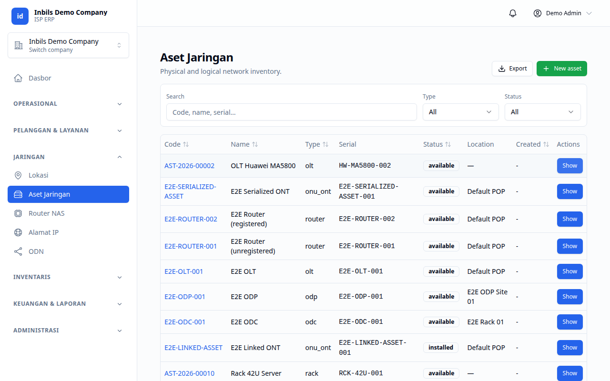

3. Klik kode aset atau tombol **Show** untuk membuka halaman rincian.

### Membaca halaman rincian

Judul halaman memuat nama aset, dengan kode dan status di bawahnya. Tombol di kanan atas adalah **Back**, **Edit** dan, untuk aset `olt`, `odc` atau `odp` bagi pemegang `odn.view`, **ODN ports** (lihat bagian 5.5).

- Kartu **Asset Details** memuat Type, Product, Serial, MAC, IP, Mgmt IP, Ownership, Vendor, Model, Location, Path, Customer, Subscription, Installed, Retired dan Notes (bila terisi). Customer dan Subscription adalah tautan ke halaman pelanggan dan langganan. Tanggal beli, harga beli dan masa garansi hanya terlihat di form **Edit**.
- Kartu **Lifecycle Actions** berisi tombol ubah status.
- Kartu **Installation History** mencatat tiap pemasangan dengan kolom **Location**, **Installed At**, **Removed At** dan **Reason**. Aset yang belum pernah dipasang menampilkan `No installations.`

### Membuat aset

1. Klik **New asset**.
2. Isi form pada kartu **Details**:
   - **Name**: wajib, maksimal 255 karakter. Contoh: `OLT Huawei MA5800`.
   - **Product**: opsional. Pilih produk aktif dari katalog barang (bagian 6.2). SPK memakai tautan ini untuk menawarkan aset (lihat bagian Memasang aset lewat SPK instalasi).
   - **Asset Type**: wajib. Pilihan **Router**, **Switch**, **OLT**, **ONU/ONT** (isian awal), **Radio**, **Antenna**, **Fiber**, **ODP**, **ODC**, **Rack**, **Power** dan **Other**.
   - **Serial Number**: opsional, maksimal 255 karakter, tidak boleh sama dengan serial aset lain di perusahaan ini. Contoh: `HW-MA5800-002`.
   - **MAC Address**: opsional, maksimal 255 karakter. Format tidak diperiksa.
   - **IP Address** dan **Management IP**: opsional, harus alamat IP yang sah (IPv4 atau IPv6). Inbils ikut mencatat keduanya di register Alamat IP (bagian 5.4). Isi **Management IP** bila router akan didaftarkan sebagai Router NAS (bagian 5.3).
   - **Location**: opsional, hanya lokasi aktif yang tampil (bagian 5.1). Kosongkan bila aset ada di gudang.
   - **Ownership**: **Owned** (isian awal), **Leased** atau **Customer Provided**.
   - **Vendor** dan **Model**: opsional, maksimal 255 karakter.
   - **Purchase Date** dan **Warranty Expiry**: opsional, tanggal.
   - **Purchase Price**: opsional, angka 0 atau lebih.
   - **Notes**: opsional, teks bebas.
3. Klik **Create**. Anda kembali ke daftar dan muncul toast `Network asset created.` Aset baru berstatus `available`. Inbils membuat kodenya sendiri, dengan format yang diatur di Penomoran (bagian 7.13).

### Mengubah aset

1. Di halaman rincian, klik **Edit**.
2. Ubah isian. Aturannya sama dengan form buat. Kode dan status tidak ada di form ini.
3. Klik **Save**. Anda kembali ke daftar dan muncul toast `Network asset updated.` Klik **Cancel** untuk keluar tanpa menyimpan.

### Mengubah status aset

Status berubah hanya lewat tombol di kartu **Lifecycle Actions**. Tombol yang tampil mengikuti status aset:

| Status | Arti | Tombol yang tampil |
| --- | --- | --- |
| `available` | Tersedia, belum terpasang. Status awal aset baru. | **Install**, **Retire** |
| `installed` | Terpasang di sebuah lokasi. | **Remove**, **Maintenance**, **Damage**, **Retire** |
| `maintenance` | Terpasang, sedang dirawat. | **Resume**, **Damage**, **Retire** |
| `damaged` | Rusak, menunggu perbaikan. | **Repair**, **Retire** |
| `retired` | Dipensiunkan. Status akhir. | Tidak ada |

Setiap tombol punya izin dan isian sendiri:

| Tombol | Menjadi | Isian | Izin |
| --- | --- | --- | --- |
| **Install** | `installed` | **Location** (wajib) | `network_asset.install` |
| **Remove** | `available` | **Reason** (wajib) | `network_asset.remove` |
| **Maintenance** | `maintenance` | **Reason** (wajib) | `network_asset.maintenance` |
| **Resume** | `installed` | Tanpa isian | `network_asset.maintenance` |
| **Damage** | `damaged` | **Reason** (wajib) | `network_asset.repair` |
| **Repair** | `available` | Tanpa isian | `network_asset.repair` |
| **Retire** | `retired` | **Reason** (wajib) | `network_asset.retire` |

1. Di halaman rincian, klik tombol di kartu **Lifecycle Actions**. Jendela yang terbuka berjudul sama dengan tombolnya.
2. Isi **Location** (untuk **Install**) atau **Reason** (untuk tombol lain yang memintanya). **Reason** maksimal 500 karakter.
3. Klik **Submit** (jendela **Install**, **Remove** dan **Maintenance**) atau **Confirm** (jendela **Damage**, **Repair**, **Resume** dan **Retire**). Muncul toast `Asset installed.`, `Asset removed.`, `Asset set to maintenance.`, `Asset resumed.`, `Asset marked damaged.`, `Asset repaired.` atau `Asset retired.`

Tombol **Install** hanya mencatat lokasi. Baris Customer dan Subscription di kartu **Asset Details** terisi saat SPK instalasi disetujui.

**Remove** dan **Repair** mengosongkan lokasi, pelanggan, langganan dan tanggal pasang aset, lalu menutup baris aktif di **Installation History**. **Repair** mencatat alasan `repair`.

**Retire** menutup baris aktif dengan alasan yang Anda isi dan mengisi tanggal **Retired**. Lokasi, pelanggan dan langganan terakhir tetap tertulis di aset, dan tidak ada tombol untuk mengembalikan aset `retired`.

### Memasang aset lewat SPK instalasi

Teknisi memasang aset di rumah pelanggan, misalnya ONT, lewat SPK berjenis **Installation** di aplikasi teknisi. Di web, Anda menyiapkan item SPK dan menyetujui hasilnya (bagian 3.3).

1. Pastikan aset berstatus `available` dan isian **Product**-nya terisi. Pastikan SPK punya **Location**, **Customer** dan **Subscription**.
2. Di halaman SPK, kartu **Items**, klik **Add Item**. Pilih **Product** bertipe `asset`. Isian **Network Asset** muncul dan hanya menawarkan aset `available` dengan **Product** yang sama.
3. Setelah teknisi mengirim hasil kerja, pemegang izin `spk.approve` (admin atau manajer) mengklik **Approve** pada SPK berstatus `waiting_review`.
4. Saat itu Inbils memasang setiap aset di item SPK. Status aset menjadi `installed`, lokasi, pelanggan dan langganan diambil dari SPK, dan satu baris baru muncul di **Installation History**. Inbils juga mengaktifkan langganan berstatus `pending`.

Bila aset tidak lagi `available` atau produknya tidak cocok, persetujuan ditolak dengan pesan seperti `Selected network asset must be available.`

### Menelusuri aset dengan Asset Trace

Halaman **Asset Trace** mencari aset dari serial, MAC, alamat IP atau kode, lalu menampilkan status, lokasi dan pelanggannya dalam satu tabel. Pakai halaman ini saat Anda hanya memegang serial di perangkat atau sebuah alamat IP dan perlu tahu di mana aset itu terpasang. Izinnya `network_asset.view`.

1. Buka alamat `/admin/network-assets/trace` di peramban. Halaman ini tidak punya tautan di sidebar maupun di daftar.
2. Isi **Search** (petunjuk `Serial, MAC, IP, code`), lalu klik **Trace**.
3. Baca tabel hasil dengan kolom **Name**, **Code**, **Type**, **Serial**, **Status**, **Location**, **Path**, **Customer** dan **Subscription**. Kolom **Path** memuat jalur lokasi dari induk sampai lokasi aset. Sebelum Anda mencari, dan bila tidak ada yang cocok, tabel menampilkan `No data found.`

Pencarian mencocokkan sebagian teks, tetapi tidak mencari nama aset. Hasil tidak dibagi per halaman dan barisnya bukan tautan, jadi buka rincian aset lewat kotak **Search** di daftar.

### Kesalahan umum

- Aset tidak muncul di isian **Network Asset** pada SPK: statusnya bukan `available`, atau **Product**-nya berbeda dari produk item SPK. Perbaiki **Product** lewat **Edit**, atau kembalikan aset ke `available` dengan **Remove** atau **Repair**.
- SPK instalasi sudah disetujui tetapi aset tetap `available`: Inbils hanya memasang aset bila SPK punya **Location** dan item SPK memakai produk bertipe `asset`. Lengkapi SPK sebelum disetujui.
- Serial ditolak dengan `The serial number has already been taken.`: serial harus unik di perusahaan, termasuk terhadap aset `retired`. Cari serialnya dengan **Search** di daftar.
- Alamat IP ditolak dengan pesan seperti `<alamat> is already held by asset <kode>.`: alamat itu sudah tercatat di register Alamat IP atas pemegang lain, yaitu aset, langganan atau reservasi. Lepas pemegang itu lebih dulu atau pakai alamat lain (bagian 5.4).
- Tombol **Edit** atau tombol di **Lifecycle Actions** ditolak dengan galat 403: tombol tampil untuk semua pemegang `network_asset.view`, tetapi server memeriksa izin tiap aksi. Staf hanya punya `network_asset.view`. Minta admin menambah izin atau mengubah perannya (bagian 8.6 dan 8.7).
- Tombol yang dicari tidak tampil di **Lifecycle Actions**: tombol mengikuti status. Misalnya **Install** hanya tampil saat status `available`, dan **Resume** hanya saat `maintenance`.
- Jendela status tetap terbuka setelah dikirim: server menolak **Location** yang kosong atau **Reason** yang lebih dari 500 karakter, tetapi jendela ini tidak menampilkan galat validasi. Isi lokasi atau persingkat alasannya.
- Aset jaringan tidak punya tombol **Delete**, baik di daftar maupun di rincian. Endpoint hapus hanya menerima admin dengan `network_asset.delete`, dan menolak aset `installed` atau `maintenance` dengan pesan `Cannot delete installed/maintenance asset. Remove first.` Pakai **Remove** lebih dulu bila penghapusan memang diperlukan. Untuk menghentikan pemakaian sambil mempertahankan riwayat, pakai **Retire**.

## 5.3 Router NAS

Router NAS adalah daftar router perusahaan yang meminta FreeRADIUS memeriksa login pelanggan sebelum membuka internet. Buka menu ini saat Anda mendaftarkan router baru, mengganti alamat atau secret-nya, atau melihat pelanggan yang sedang online di sebuah router.

Peran yang dapat memakai: admin, manajer dan staf untuk melihat, hanya admin untuk mengelola. Izin: `network_asset.nas.view` membuka menu, daftar dan rincian. `network_asset.nas.manage` mendaftarkan, mengubah dan menghapus router. Dengan peran bawaan, admin memegang keduanya, manajer dan staf hanya `network_asset.nas.view`. Router hanya bisa didaftarkan dari aset berjenis Router yang punya **Management IP** (bagian 5.2). Kode perusahaan harus berisi 1 sampai 24 huruf, angka atau strip, karena kode itu menjadi realm RADIUS.

### Membuka dan membaca daftar

1. Di sidebar, buka grup **Jaringan**, lalu klik **Router NAS**.
2. Baca daftar.

   - Kotak **Search** (petunjuk `Code, name or NAS address`) mencari alamat NAS, serta kode, nama dan **Management IP** aset router.
   - Kolom: **Router** (kode aset dengan nama di bawahnya, tautan ke rincian, bisa diurutkan), **Location**, **NAS address**, **CoA port**, **RADIUS** dan **Actions**.
   - Lencana di kolom **RADIUS** menunjukkan hasil penulisan router ke FreeRADIUS: **Written to RADIUS**, **Waiting to be written** (belum tercatat berhasil atau gagal) atau **Not written** (percobaan gagal, alasannya ada di rincian).
   - Setiap baris punya tombol **Show**. Tombol **Edit** dan **Register router** hanya tampil bagi pemegang `network_asset.nas.manage`.
   - Daftar kosong menampilkan `No NAS routers`, atau `No NAS routers match your search` bila pencarian tidak menemukan apa pun.

   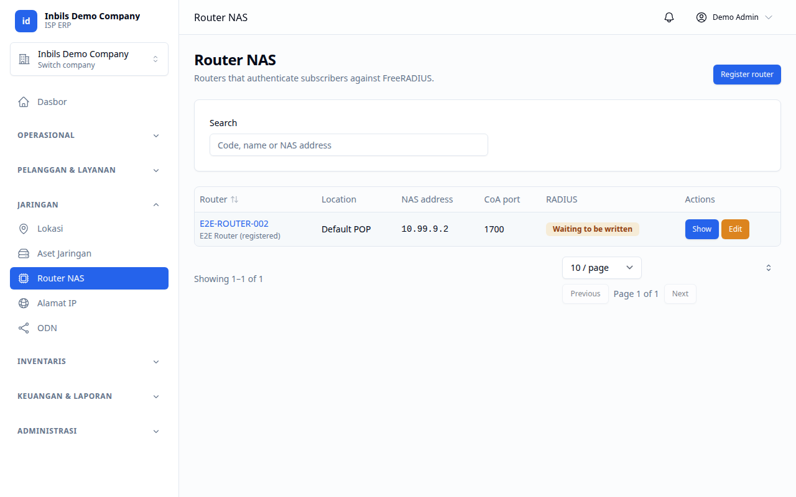

3. Klik kode router atau **Show** untuk membuka rincian.

### Mendaftarkan router

Siapkan dulu aset berjenis Router dengan **Management IP** di Aset Jaringan (bagian 5.2). Siapkan juga secret yang sama dengan yang terpasang di router.

1. Klik **Register router**.
2. Pilih **Router asset**. Pilihan memuat aset Router ber-Management IP yang belum terdaftar, tertulis `kode - nama (Management IP) - lokasi`. Bila tidak ada pilihan, muncul pesan `No router asset is available. Add a router in Network Assets with a management IP first.` dengan tombol **Network assets**.
3. Isi form:
   - **NAS address**: wajib, alamat IPv4 yang dilihat FreeRADIUS sebagai asal permintaan router. Isinya terisi otomatis dari **Management IP** aset dan bisa Anda ubah. Alamat harus unik di seluruh sistem, bukan hanya di perusahaan Anda.
   - **CoA port**: wajib, bilangan bulat 1 sampai 65535, isian awal `1700`. Ini port `/radius incoming` di MikroTik.
   - **RADIUS secret**: wajib, 8 sampai 60 karakter ASCII tercetak tanpa spasi, sama dengan secret di router.
   - **Realm**: hanya baca. Isinya kode perusahaan dalam huruf kecil. Pelanggan masuk dengan nama pengguna `nama@realm`.
4. Klik **Register router**. Inbils membuka rincian router dan muncul toast `NAS router registered.`

Bila RADIUS dimatikan di instalasi ini (pengaturan server) atau basis datanya tidak terjangkau, router tetap tersimpan dan muncul toast peringatan `Saved, but RADIUS was not updated: <alasan> The sync retries every 15 minutes.` Lencana **RADIUS** menjadi **Not written** sampai penulisan berhasil.

### Membaca halaman rincian router

Judul halaman `NAS router` diikuti kode aset, dengan nama aset dan alamat NAS di bawahnya. Tombol **Back** selalu tampil. **Edit** dan **Remove router** hanya tampil bagi pemegang `network_asset.nas.manage`.

- Peringatan `RADIUS is switched off for this installation. Nothing is written to FreeRADIUS and no session is listed.` muncul bila RADIUS dimatikan. Saklarnya ada di pengaturan server, tidak di Inbils.
- Info `Restart FreeRADIUS after adding this NAS or changing its secret.` selalu muncul. FreeRADIUS membaca daftar router hanya saat start, jadi pengelola server FreeRADIUS yang me-restart-nya. Tidak ada tombolnya di Inbils.
- Kartu **Status** memuat **RADIUS client** (lencana), **Last written** (waktu atau `Never`), **NAS address**, **CoA target**, **Realm** dan **RADIUS secret** (`Stored` atau `Not set`). **CoA target** adalah `Management IP:CoA port`, tujuan permintaan putus sesi. Mengubah **Management IP** aset mengubah **CoA target** tetapi tidak mengubah **NAS address**. Bila penulisan terakhir gagal, kotak **Last error** memuat alasannya.
- Kartu **Isolir page** memuat alamat halaman isolir perusahaan dan tombol **Copy URL** (lihat bagian Isolir otomatis dan halaman isolir).
- Kartu **Open sessions** menampilkan sampai 100 sesi terbuka lewat router ini, dengan kolom **Username**, **Address** dan **Started**. **Username** menjadi tautan ke halaman **Network access** bila Inbils mengenali langganannya. Bila kosong, tertulis `No open sessions`.

Halaman ini tidak punya tombol uji koneksi atau sinkron manual. Selama RADIUS menyala, Inbils mengulang penulisan yang gagal tiap 15 menit.

### Mengubah router

1. Klik **Edit** di baris daftar atau di halaman rincian.
2. Ubah isian. **Router asset** dan **Realm** tampil sebagai teks dan tidak bisa diganti. **NAS address** dan **CoA port** (wajib) memakai aturan yang sama dengan form daftar. Kosongkan **RADIUS secret** untuk mempertahankan secret yang tersimpan, yang ditandai petunjuk `A secret is stored. Leave blank to keep it.`
3. Klik **Save router**. Anda kembali ke rincian dengan toast `NAS router updated.` Inbils menulis ulang ke RADIUS hanya bila **NAS address** atau secret berubah. Klik **Cancel** untuk keluar tanpa menyimpan.

### Menghapus router

1. Di halaman rincian, klik **Remove router**.
2. Baca dialog `Remove this NAS router?`, lalu klik **Remove**. Klik **Cancel** untuk batal.
3. Anda kembali ke daftar dan muncul toast `NAS router removed.`

Penghapusan tetap berjalan walau router masih punya sesi terbuka atau akun jaringan, karena router mengakhiri sesinya sendiri. Aset Router di Aset Jaringan tidak ikut terhapus. Bila baris klien di FreeRADIUS tidak bisa dihapus, muncul peringatan `The RADIUS client row could not be removed (RADIUS is switched off or unreachable). Remove it from the nas table by hand.` Pengelola server yang menghapus baris itu dari tabel `nas`.

### Rahasia dan catatan audit

- Inbils menyimpan **RADIUS secret** router terenkripsi. Kolomnya tersamar, dan tidak ada halaman yang menampilkannya: rincian hanya menulis `Stored` atau `Not set`. Bila secret terlupa, isi secret baru lewat **Edit** dan samakan dengan router.
- Setelah Anda mengirim form, Inbils mengosongkan kolom secret, juga saat ada galat validasi. Isi ulang secret pada percobaan berikutnya.
- Audit Log (bagian 7.12) mencatat modul `nas_device`: pembuatan, perubahan (dengan nama isian yang berubah), penggantian secret, penghapusan, serta keberhasilan atau kegagalan menulis ke RADIUS. Isi secret tidak pernah ikut tercatat.

### Akun jaringan pelanggan

Akun jaringan adalah nama pengguna dan secret yang dipakai satu langganan untuk masuk lewat router perusahaan. Satu langganan punya satu akun. Akun tidak terikat pada satu router: pelanggan boleh masuk lewat router NAS mana pun milik perusahaan.

Izin: `network_asset.account.view` membuka halaman akun, `network_asset.account.manage` membuat, mengubah dan menjalankan **Resync**, dan `network_asset.account.reveal` membuka secret. Admin, manajer dan staf bawaan memegang ketiganya.

1. Buka halaman langganan (bagian 4.1), lalu klik **Network access** di kartu **Lifecycle Actions**. Tombol ini hanya tampil bagi pemegang `network_asset.account.view`. Dari rincian router, klik **Username** di kartu **Open sessions** untuk membuka halaman yang sama.
2. Baca halaman **Network access**.

   - Kartu **Subscription** memuat **Subscription**, **Status**, **Customer**, **Speed profile** (dengan nama grup RADIUS), **Serving POP** dan **Desired state**.
   - **Desired state** `Enabled` berarti akun ada di RADIUS dengan grup kecepatan paket. `Isolated` berarti akun ada di grup isolir perusahaan dan sesinya diputus. Alasannya tertulis di bawahnya: `Isolated because Suspended`, `Blocked`, atau `Suspended and Blocked`. `Absent` berarti akun dihapus dari RADIUS.
   - Kartu **Network account**, setelah akun dibuat, memuat **Service type**, **Username**, **Sync status** (`Pending`, `Synced` atau `Failed`, dengan alasan terakhir), **RADIUS group**, **Online**, **Address**, **NAS**, **Session start** dan **This month** (unggah dan unduh bulan berjalan).
   - Peringatan `RADIUS is switched off for this installation. Changes are saved but not sent to FreeRADIUS, and online status and usage are not available.` muncul bila RADIUS dimatikan.

### Membuat akun jaringan

Langganan tidak boleh `terminated`, dan profil kecepatan paketnya harus punya **RADIUS Profile Name** (bagian 4.4). Tanpa itu halaman menampilkan peringatan dan server menolak.

1. Di halaman **Network access** langganan yang belum punya akun, isi kartu **Create network account**:
   - **Service type**: **PPPoE** (isian awal) atau **Hotspot**.
   - **Username**: wajib, 3 sampai 40 huruf kecil, angka, titik, strip atau garis bawah. Inbils menambahkan `@realm` di belakangnya. Nama lengkap harus unik di seluruh sistem. Bila bentrok, muncul `This username is not available.`
   - **Secret**: opsional, 6 sampai 64 karakter tanpa spasi. Kosongkan agar Inbils membuat secret 12 karakter.
2. Klik **Create network account**. Muncul toast `Network account created.`
3. Bila Inbils membuat secret, kotak **Secret shown once** menampilkannya dengan tombol **Copy secret** dan **Dismiss**. Salin sekarang: secret hilang dari layar setelah Anda klik **Dismiss** atau meninggalkan halaman.

### Mengubah akun, sinkron ulang dan membuka secret

- Untuk mengubah akun, isi kartu **Edit network account**: **Service type**, **Username** (bagian lokal) dan **Secret**. Kosongkan **Secret** untuk mempertahankan yang lama. Klik **Save changes** (toast `Network account updated.`). Kartu ini nonaktif bila langganan `terminated`.
- Untuk menulis ulang akun ke RADIUS dan memutus sesinya yang sedang terbuka, klik **Resync** di kanan atas (toast `Resync queued.`). Pakai tombol ini bila kecepatan paket berubah dan sesi lama belum berganti.
- Untuk melihat secret akun, klik **Reveal secret** di kanan atas. Dialog `Reveal secret?` menyebut bahwa secret tampil satu kali dan pembukaannya dicatat di audit log. Klik **Reveal**, lalu salin secret dari kotak **Secret shown once**. Inbils mencatat entri `secret_revealed` di modul `network_account` sebelum menampilkan secret.

### Isolir otomatis dan halaman isolir

Isolir menghentikan layanan internet pelanggan sementara: Inbils memindahkan akunnya ke grup isolir di RADIUS dan memutus sesinya. Router yang sudah diatur mengalihkan pelanggan terisolir ke halaman isolir perusahaan. Pengaturan pengalihan itu dikerjakan di router, bukan di Inbils.

Isolir otomatis berjalan bila admin menyalakan `auto_suspend_enabled` di **Company Settings** (bagian 8.1). Pengaturan ini mati secara awal. `auto_suspend_overdue_days` (1 sampai 60, isian awal 7) menentukan batas hari, dan `auto_reactivate_on_payment` (isian awal menyala) menentukan pembukaan otomatis setelah pembayaran.

Setiap hari pukul 08:00 menurut jam server, Inbils mengisolir langganan `active` yang punya tagihan belum lunas dan sudah lewat lebih dari batas hari. Jatuh tempo tepat pada batas belum cukup. Langganan menjadi `suspended` dengan sumber `overdue`, Audit Log mencatat alasan `Automatic isolir: an invoice is more than <N> days past due.`, dan langganan itu tidak menerima tagihan berulang baru selama `suspended`.

Alamat halaman isolir ada di kartu **Isolir page** pada rincian router, dan bentuknya `/isolir/` diikuti kode perusahaan. Halaman ini publik, tanpa login, dan tidak memuat data pelanggan. Kode yang salah atau perusahaan yang nonaktif menghasilkan halaman 404. Pelanggan melihat:

- Nama perusahaan, judul `Layanan internet Anda sedang diisolir`, dan penjelasan bahwa layanan dihentikan sementara karena ada tagihan yang belum dibayar dan akan aktif kembali setelah pembayaran tercatat.
- Bagian **Cara mengaktifkan kembali** dengan dua langkah: masuk ke akun pelanggan, lalu buka tagihan yang belum dibayar dan bayar secara online.
- Tombol **Masuk untuk melihat dan membayar tagihan**, yang membuka halaman masuk web. Akun pelanggan dipakai di aplikasi Android, jadi akun pelanggan murni yang masuk di web diarahkan ke halaman `Gunakan aplikasi Inbils`.
- Teks `Sudah membayar tetapi layanan belum aktif? Hubungi kami.` dengan **Telepon**, **Email** dan **Situs web** perusahaan. Baris yang kosong tidak tampil.

Nama dan kontak itu berasal dari profil perusahaan (**Name**, **Phone**, **Email**, **Website**), yang admin ubah di menu Perusahaan (bagian 8.1).

### Mengaktifkan kembali langganan

Langganan `suspended` kembali `active` lewat salah satu jalur:

- Otomatis setelah pembayaran, dari tagihan manual maupun Midtrans. Syaratnya: `auto_reactivate_on_payment` menyala, isolir bersumber `overdue`, setiap tagihan yang jatuh tempo paling lambat pada hari isolir sudah lunas, dan tidak ada tagihan belum lunas yang lewat batas hari. Pembayaran sebagian belum cukup. Isolir `manual` tidak pernah dibuka otomatis.
- Manual: di halaman langganan, kartu **Lifecycle Actions**, klik **Reactivate**. Aksi ini tidak meminta alasan, perlu izin `customer.subscription.reactivate` (admin dan manajer), dan menampilkan toast `Subscription reactivated.`

### Mengisolir dan memblokir secara manual

Admin dan manajer bisa mengisolir atau memblokir tanpa menunggu jadwal.

- Isolir karena tunggakan: buka **Tunggakan** (bagian 7.2), lalu klik tombol **Isolir** yang diikuti kode langganan pada baris pelanggan. Tombol ini tampil untuk langganan `active` bagi pemegang `customer.subscription.suspend`. Isi **Alasan isolir (wajib)** lalu klik **Isolir**. Sumbernya `overdue`, jadi pembayaran bisa membukanya otomatis.
- Penangguhan biasa: di halaman langganan, klik **Suspend**, isi **Reason**, lalu klik **Suspend**. Sumbernya `manual`, jadi hanya **Reactivate** yang membukanya.
- Blokir internet pada langganan yang belum `terminated`: klik **Block internet** di halaman langganan, atau tombol **Block** yang diikuti kode langganan di baris **Tunggakan**. Isi **Reason** (wajib, maksimal 500 karakter), lalu klik **Block internet**. Tombol ini perlu izin `customer.subscription.block`.
- Buka blokir: klik **Unblock** di halaman langganan, atau tombol **Unblock** yang diikuti kode langganan di baris **Tunggakan**. Catatan boleh kosong. Klik **Unblock** di dialognya.

Blokir bukan status. Halaman langganan menampilkan lencana **Blocked**, **Block reason** dan **Blocked by**, dan halaman **Network access** menulis `Isolated because Blocked`. Tagihan terus berjalan dan pembayaran tidak mencabut blokir. **Unblock** pada langganan `suspended` tidak memulihkan layanan: langganan tetap terisolir sampai **Reactivate**.

### Kesalahan umum

- Pilihan **Router asset** kosong atau router yang dicari tidak ada: aset harus berjenis Router, punya **Management IP** dan belum terdaftar. Pesan server yang sesuai: `Choose a router asset of this company that has a management IP.` dan `This router asset is already registered as a NAS router.` Perbaiki asetnya lewat **Edit** (bagian 5.2).
- Peringatan `The company code cannot be used as a RADIUS realm` membuat form pendaftaran tidak tampil: kode perusahaan harus 1 sampai 24 huruf, angka atau strip. Admin mengubah **Code** di profil perusahaan (bagian 8.1). Alamat halaman isolir memuat kode ini, jadi salin ulang alamatnya bila kode berubah.
- `This address is not available.`: **NAS address** sudah dipakai router lain di sistem. Isi alamat yang benar-benar menjadi asal permintaan router.
- Secret router ditolak dengan `Use printable characters without spaces.`: pakai 8 sampai 60 karakter ASCII tercetak, tanpa spasi.
- Lencana **Not written** atau **Waiting to be written** tidak berubah: Inbils belum berhasil menulis router ke RADIUS. Baca **Last error** di rincian dan pastikan RADIUS menyala di server. Setelah tertulis, minta pengelola server me-restart FreeRADIUS.
- Manajer atau staf tidak melihat **Register router**, **Edit** dan **Remove router**: hanya admin yang punya `network_asset.nas.manage`. Server juga menolak dengan galat 403.
- Akun jaringan ditolak dengan `The speed profile of this package has no RADIUS profile name.`: isi **RADIUS Profile Name** pada profil kecepatan paket (bagian 4.4). Pesan `A terminated subscription cannot have a network account.` berarti langganannya sudah `terminated`.
- **Reveal secret** dan **Resync** mengembalikan galat setelah dipakai berulang: server membatasi **Reveal secret** 10 kali per menit dan **Resync** 6 kali per menit.
- Pelanggan sudah membayar tetapi tetap terisolir: periksa sumber isolirnya. Isolir `manual` dan blokir tidak dibuka oleh pembayaran. Periksa juga apakah `auto_reactivate_on_payment` menyala, tidak ada tagihan belum lunas yang lewat batas hari, dan setiap tagihan yang jatuh tempo paling lambat pada hari isolir sudah lunas.
- Pelanggan yang diblokir manual tetap melihat halaman isolir yang menyebut tagihan belum dibayar. Halaman publik memakai teks yang sama untuk semua pelanggan terisolir dan tidak membaca sumber isolirnya. Jelaskan alasan blokir lewat petugas atau kontak perusahaan.

## 5.4 Alamat IP

Alamat IP adalah register pasif ruang alamat IP perusahaan: prefix (blok CIDR), VLAN, dan alamat yang sudah dipegang. Register hanya mencatat. Sistem tidak membaca perangkat dan tidak mengirim konfigurasi ke router. Buka menu ini untuk melihat seberapa penuh tiap blok, mendaftarkan prefix atau VLAN, dan melihat siapa memegang sebuah alamat statis.

Peran yang dapat memakai: admin dan manajer (semua tindakan), staf (hanya melihat). Izin: `ipam.view` untuk membuka daftar prefix, detail prefix, dan VLAN, `ipam.manage` untuk mendaftarkan, mengubah, dan menghapus prefix dan VLAN serta menambah dan melepas reservasi, `ipam.assign` untuk memberi dan melepas alamat statis langganan. Data berlaku per perusahaan aktif (bagian 1.6).

### Membuka dan membaca daftar prefix

1. Di sidebar, buka grup **Jaringan**, lalu klik **Alamat IP**.
2. Atur daftar dengan lima saringan di atas tabel: **Search** (prefix atau deskripsi), **IP version**, **Usage**, **POP**, dan **VLAN**. Prefix yang berada di dalam prefix lain diberi indentasi di bawah induknya. Urutannya IPv4 dulu, lalu IPv6, menurut alamat awal blok. Daftar ini tidak punya urutan manual dan halaman.

   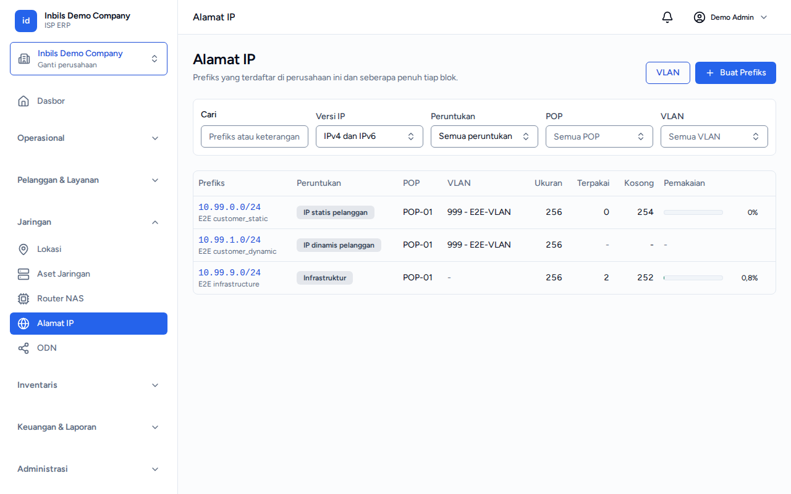

3. Baca kolomnya.

   Kolom **Prefix** berisi blok CIDR dengan deskripsi di bawahnya, dan klik CIDR itu untuk membuka detail. Kolom **Usage**, **POP**, dan **VLAN** menunjukkan peruntukan blok, kode POP, serta ID dan nama VLAN yang terikat. Kolom **Size** menunjukkan jumlah alamat dalam blok.

   Kolom **Used** menjumlahkan alamat yang sudah diberikan dan yang direservasi, dan hanya terisi untuk Customer static dan Infrastructure. Kolom **Free** menunjukkan sisa alamat yang bisa dipakai. Untuk blok IPv4 selain /31 dan /32, sistem tidak menghitung alamat network dan broadcast.

   Kolom **Utilisation** menampilkan bilah dan persen pemakaian: hijau di bawah 75%, kuning mulai 75%, merah mulai 90%. Customer dynamic hanya punya **Size**. Untuk blok IPv6, **Free** dan **Utilisation** kosong karena alamat IPv6 diketik manual. Untuk Container, **Utilisation** menunjukkan bagian blok yang sudah diisi prefix di dalamnya.

### Mendaftarkan prefix

1. Klik **New prefix** di kanan atas halaman.
2. Isi form di dialog **New prefix**:
   - **CIDR**: wajib, maksimal 64 karakter, berbentuk CIDR IPv4 atau IPv6, misalnya `10.20.0.0/22` atau `2001:db8::/48`. Alamat tunggal, rentang, dan panjang prefix di atas 32 (IPv4) atau 128 (IPv6) ditolak. Bagian host dibuang otomatis, jadi yang tersimpan adalah alamat awal blok.
   - **Usage**: wajib. Keterangan singkat tiap pilihan muncul di bawah isian.
   - **POP**: opsional. Pilihannya kode dan nama POP yang aktif. **Not tied to a POP** berarti blok tidak terikat POP.
   - **VLAN**: opsional. Pilihannya menampilkan ID dan nama VLAN serta POP-nya (atau company-wide). **No VLAN** berarti tanpa VLAN.
   - **Description**: opsional, maksimal 255 karakter.
3. Klik **Register prefix**. Daftar tampil kembali dengan toast `Prefix <CIDR> registered.`

Arti nilai **Usage**:

| Usage | Arti | Yang dihitung |
|---|---|---|
| Container | Mengelompokkan prefix lain. | Utilisation: bagian blok yang diisi prefix di dalamnya. |
| Customer static | Pool alamat statis pelanggan, diberikan dari halaman langganan. | Used, lalu Free dan Utilisation untuk IPv4. |
| Customer dynamic | Pool yang dibagikan router. | Hanya Size. |
| Infrastructure | Alamat perangkat dan manajemen, direservasi manual. | Used, lalu Free dan Utilisation untuk IPv4. |

Sistem otomatis menempatkan prefix baru di bawah prefix terkecil yang sudah terdaftar dan memuatnya. Prefix dan alamat yang sudah ada di dalam blok baru ikut berpindah ke bawahnya. Blok CIDR yang sudah terdaftar tidak bisa didaftarkan lagi.

### Membuka detail prefix

1. Di daftar, klik CIDR prefix.
2. Baca halaman detail. Judulnya CIDR prefix, dengan deskripsi (atau nama Usage) di bawahnya.

   Kartu **Details** memuat Usage, **Inside** (prefix induk, atau Top level), POP, VLAN, dan Size. Untuk Customer static dan Infrastructure, kartu ini juga memuat Usable, Assigned, Reserved, dan Free.

   Kartu **Prefixes inside** mendaftar prefix di dalam blok dan selalu tampil untuk Container. Kartu **Addresses** mendaftar alamat yang tercatat di rentang blok, termasuk alamat di prefix bersarang, 25 per halaman. Kolomnya **Address**, **Status** (**Assigned** atau **Reserved**), **Held by** (langganan atau aset pemegang, kosong untuk reservasi), **Note**, **Added**, dan **Actions**.
3. Klik **Back** untuk kembali ke daftar.

### Mengubah dan menghapus prefix

1. Di halaman detail, klik **Edit**. Tombol ini butuh `ipam.manage`.
2. Ubah **Usage**, **POP**, **VLAN**, atau **Description**, lalu klik **Save**. Isian **CIDR** terkunci. Toast "Prefix updated." muncul.
3. Untuk menghapus, klik **Delete** di halaman yang sama, lalu klik **Delete prefix** di dialog konfirmasi.
   - Prefix hanya terhapus bila tidak berisi prefix lain dan tidak punya alamat. Bila tidak, dialog tetap terbuka dengan pesan merah.
   - Bila berhasil, daftar tampil kembali dengan toast `Prefix <CIDR> deleted.`

### Mereservasi alamat

Reservasi menahan satu alamat supaya tidak diberikan ke pelanggan, misalnya gateway atau loopback router.

1. Di halaman detail prefix, klik **Reserve address**. Tombol ini butuh `ipam.manage`.
2. Isi form di dialog:
   - **Address**: wajib, alamat IP yang valid dan berada di dalam prefix.
   - **Note**: opsional, maksimal 255 karakter, misalnya gateway.
3. Klik **Reserve address**. Toast `Address <alamat> reserved.` muncul, dan alamat tampil di kartu **Addresses** dengan status **Reserved**.

Sistem menolak alamat network dan broadcast pada blok IPv4 selain /31 dan /32. Alamat yang sudah dipegang pihak lain ditolak dengan nama pemegangnya.

### Memberi alamat statis ke langganan

Gunakan halaman langganan untuk memberi alamat statis, bukan halaman Alamat IP. Langganan tanpa alamat tercatat dianggap dinamis, yaitu router yang membagikan alamatnya.

1. Buka halaman langganan (lihat bagian Pelanggan, bagian 4.1), lalu cari panel **IP address**.
2. Klik **Assign static IP**. Tombol ini butuh `ipam.assign` dan hanya muncul bila langganan belum terminated dan masih ada pool yang bisa dipakai.
3. Di dialog, pilih **Pool**. Pool yang ditawarkan adalah pool Customer static yang tidak terikat POP atau terikat ke serving POP langganan. Satu langganan hanya boleh punya satu alamat per versi IP, jadi pool untuk versi yang sudah terisi tidak muncul.
4. Isi **Address**, atau kosongkan agar sistem memilih alamat bebas terendah. Pengosongan hanya berlaku untuk pool IPv4 /16 atau blok yang lebih kecil (/17 sampai /32). Pool IPv6 dan blok yang lebih besar dari /16 butuh alamat yang diketik.
5. Klik **Assign address**. Toast `Address <alamat> assigned to <kode langganan>.` muncul, dan alamat tampil di panel serta di kartu **Addresses** prefix.

### Melepas alamat

1. Di panel **IP address** langganan, klik **Release** pada baris alamat. Atau di kartu **Addresses** halaman detail prefix, klik **Release** pada baris Assigned atau Reserved.
2. Klik **Release address** di dialog konfirmasi. Alamat langganan butuh `ipam.assign`, dan reservasi butuh `ipam.manage`. Toast `Address <alamat> released.` muncul.

Langganan yang alamatnya dilepas kembali ke alamat dinamis, dan alamat itu kembali ke pool. Saat langganan dihentikan (terminated), sistem melepas alamat statisnya sendiri. Alamat milik aset jaringan tidak bisa dilepas di sini: klik **Edit asset**, lalu ubah **IP Address** atau **Management IP** di aset (bagian 5.2).

### Mengelola VLAN

1. Di halaman daftar prefix, klik **VLANs**.
2. Baca tabelnya: **VLAN ID**, **Name**, **POP** (kode POP, atau Company-wide), **Prefixes** (jumlah prefix yang memakai VLAN itu), **Description**, dan **Actions** untuk pemegang `ipam.manage`. Klik angka di **Prefixes** untuk membuka daftar prefix yang disaring menurut VLAN itu. Tombol **IP Addresses** kembali ke daftar prefix. Tabel menampilkan 25 VLAN per halaman.
3. Klik **New VLAN**, lalu isi form:
   - **VLAN ID**: wajib, bilangan bulat 1 sampai 4094.
   - **Name**: wajib, maksimal 64 karakter.
   - **POP**: opsional. **Company-wide** berarti VLAN berlaku untuk seluruh perusahaan.
   - **Description**: opsional, maksimal 255 karakter.
4. Klik **Register VLAN**. Toast `VLAN <ID> registered.` muncul.

ID yang sama boleh ada di beberapa POP, tetapi hanya sekali per POP dan hanya sekali untuk Company-wide.

Untuk mengubah VLAN, klik **Edit** pada baris, ubah isiannya, lalu klik **Save**. Untuk menghapus, klik **Delete** pada baris, lalu klik **Delete VLAN**. VLAN hanya terhapus bila tidak ada prefix yang memakainya. Lepaskan VLAN dari prefix lebih dulu dengan **Edit** prefix dan pilihan **No VLAN**.

### Kesalahan umum

- `Enter a valid IPv4 or IPv6 prefix in CIDR form, for example 10.20.0.0/22.` berarti isian **CIDR** bukan blok CIDR: alamat tunggal, rentang, panjang prefix di atas 32 (IPv4) atau 128 (IPv6), atau ada teks tambahan. Tulis ulang sebagai alamat jaringan diikuti garis miring dan panjang prefix.
- `<CIDR> is already registered.` berarti blok itu sudah ada. Cari di daftar dengan **Search**.
- CIDR yang salah ketik pada prefix tersimpan tidak bisa diperbaiki lewat **Edit**. Daftarkan prefix baru dengan CIDR yang benar, lalu hapus prefix lama setelah kosong.
- `<CIDR> contains other prefixes. Delete those first.` dan `<CIDR> still has addresses. Release them first.` menolak penghapusan prefix. Hapus prefix di dalamnya dan lepas semua alamatnya lebih dulu.
- Tombol **Assign static IP** hilang, atau panel **IP address** menyebut "No static pool is registered for this subscription's POP." Tidak ada pool Customer static yang tidak terikat POP atau terikat ke serving POP langganan. Daftarkan pool lewat **New prefix** dengan **Usage** Customer static.
- `<alamat> is outside <CIDR>.` dan `<alamat> is the network or broadcast address of <CIDR>.` berarti alamat yang diketik berada di luar blok, atau berupa alamat network atau broadcast. Pilih alamat host di dalam blok.
- `<alamat> is already held by subscription <kode>.` berarti alamat sudah dipegang. Pesan yang sama dengan "held by asset" atau "reserved" menyebut pemegang lain. Pilih alamat lain, atau lepas alamat itu lebih dulu.
- `Subscription <kode> already holds the IPv4 address <alamat>. Release it first.` berarti satu langganan hanya boleh punya satu alamat per versi IP. Lepas alamat lama lebih dulu.
- "Automatic allocation works for IPv4 pools only. Type the address." dan `<CIDR> is larger than a /16. Type the address.` berarti kolom **Address** tidak boleh kosong untuk pool itu. Ketik alamatnya.
- `<CIDR> has no free address.` berarti pool penuh. Pilih pool lain atau daftarkan pool baru.
- `VLAN <ID> is already registered company-wide.` dan `VLAN <ID> is already registered at this POP.` berarti ID itu sudah dipakai di cakupan yang sama. Pilih ID lain atau POP lain.
- `VLAN <ID> is used by a prefix. Detach it first.` berarti VLAN masih terikat ke prefix. Lepaskan dari prefix itu lebih dulu.
- `<alamat> belongs to a network asset. Change it on the asset instead.` berarti alamat dipegang aset jaringan. Klik **Edit asset** dan ubah di sana.
- Tombol **New prefix**, **Edit**, **Delete**, **Reserve address**, dan **Assign static IP** tidak muncul bila izin `ipam.manage` atau `ipam.assign` tidak dimiliki. Staf hanya punya `ipam.view`.

## 5.5 ODN

ODN adalah register pasif jaringan serat optik: port PON pada OLT, splitter pada ODC dan ODP, dan port drop yang dipakai tiap langganan. Register hanya mencatat dan tidak menghubungi perangkat. Buka menu ini untuk melihat seberapa penuh tiap ODP, siapa berada di belakang tiap port PON, dan langganan aktif mana yang belum punya port drop.

OLT, ODC, dan ODP sendiri didaftarkan di **Aset Jaringan** (bagian 5.2), dengan **Asset Type** OLT, ODC, atau ODP.

Peran yang dapat memakai: admin dan manajer (semua tindakan), staf (melihat dan mengatur port drop, tanpa mengelola port PON dan splitter). Izin: `odn.view` untuk membuka menu dan halaman ODN, `odn.manage` untuk menambah dan menghapus port PON dan splitter serta menyambung splitter, `odn.assign` untuk mencatat dan melepas port drop. Data berlaku per perusahaan aktif (bagian 1.6).

### Membuka dan membaca daftar

1. Di sidebar, buka grup **Jaringan**, lalu klik **ODN**.
2. Atur daftar dengan tiga saringan di atas tabel: **Search**, **POP**, dan **ODP minimum used (%)** (isi 0 sampai 100). **Search** mencari kode dan nama ODP atau OLT, label port PON, atau kode langganan dan nama pelanggan di tab **Unmapped subscriptions**. Di tab ODP dan PON, **POP** menyisakan aset yang lokasinya berada di bawah POP itu. Di tab **Unmapped subscriptions**, saringan ini mencocokkan serving POP langganan. **ODP minimum used (%)** hanya berlaku di tab **ODPs** dan menyisakan ODP yang terpakai sebesar itu atau lebih.

   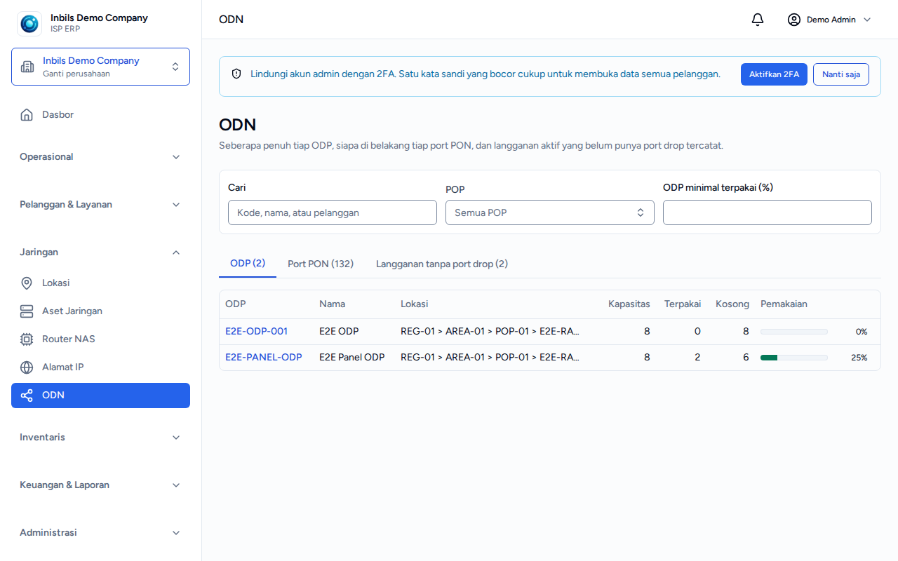

3. Baca tab **ODPs**. Kolom **ODP** berisi kode ODP, dan klik kode itu untuk membuka halaman ODP. Kolom **Capacity** menghitung port output semua splitter di ODP itu, dengan lencana **No splitter** bila ODP belum punya splitter. Kolom **Used** menghitung port yang dipegang langganan atau menjadi input splitter lain. Kolom **Free** adalah sisanya, dengan lencana **Full** bila habis.
4. Baca tab **PON ports**. Tiap baris adalah satu port PON milik OLT. Kolom **Subscribers** menghitung langganan di belakang port itu lewat semua tingkat splitter. Klik kode di kolom **OLT** untuk membuka halaman OLT.
5. Baca tab **Unmapped subscriptions**. Tab ini mendaftar langganan berstatus `active` yang belum punya port drop, sebagai daftar untuk melengkapi data. Klik kode di kolom **Subscription** untuk membuka halaman langganan. Langganan berstatus lain tidak tampil.

Setiap tab menampilkan 25 baris per halaman.

### Membuka halaman OLT, ODC, atau ODP

1. Dari tab **ODPs**, klik kode ODP. Dari tab **PON ports**, klik kode OLT.
2. Untuk ODC, atau OLT yang belum punya port PON, buka **Aset Jaringan** (bagian 5.2), buka aset itu, lalu klik **ODN ports**. Tombol ini muncul untuk aset bertipe OLT, ODC, dan ODP bagi pemegang `odn.view`.
3. Baca halamannya. Judulnya kode aset, dengan nama, tipe, dan path lokasinya di bawahnya. Tombol **ODN** kembali ke daftar, dan **Asset record** membuka aset di Aset Jaringan (butuh `network_asset.view`). Pemegang `odn.manage` juga melihat **Add PON ports** pada OLT, atau **Add splitter** pada ODC dan ODP.

### Menambah port PON pada OLT

1. Buka halaman OLT, lalu klik **Add PON ports**.
2. Isi **Number of ports**: wajib, bilangan bulat 1 sampai 64, isian awal 1. Port baru diberi nomor setelah nomor tertinggi yang sudah ada.
3. Klik **Add ports**. Toast `<jumlah> PON port(s) created on <kode OLT>.` muncul.

Tabel **PON ports** di halaman OLT berisi kolom **PON port**, **Splitter** (Not connected, atau nomor splitter yang tersambung), dan **Subscribers**.

### Menambah splitter pada ODC atau ODP

1. Buka halaman ODC atau ODP, lalu klik **Add splitter**.
2. Isi form di dialog:
   - **Ratio**: wajib. Pilihannya 1:2, 1:4, 1:8, 1:16, 1:32, dan 1:64, isian awal 1:8. Rasio menentukan jumlah port output yang dibuat.
   - **Upstream port**: opsional. Pilih port hulu yang bebas, yaitu port PON OLT atau port output splitter lain. Biarkan **Not connected yet** untuk menyambung nanti.
   - **Label**: opsional, maksimal 100 karakter. Label membantu mengenali splitter pada kartu dan daftar port hulu.
3. Klik **Add splitter**. Toast `Splitter 1:<jumlah> added to <kode aset>.` muncul, dan kartu splitter tampil di halaman.

Kartu splitter menampilkan baris Input dengan jumlah output yang terpakai, pilihan **Upstream port** dengan tombol **Save connection**, tombol **Delete**, dan satu kotak per port output. Kotak port bertuliskan **Free**, **Feeds splitter** diikuti nomor splitter hilirnya, atau kode langganan yang memegang port (klik untuk membuka langganan) dengan nama pelanggan dan tombol **Release** bagi pemegang `odn.assign`.

### Menyambung atau memutus splitter

1. Di kartu splitter, pilih port di **Upstream port**. **Not connected** memutus sambungan.
2. Klik **Save connection**. Tombol ini aktif setelah pilihan berubah. Toast "Splitter updated." muncul.

Port hulu harus bebas, yaitu tidak dipegang langganan dan bukan input splitter lain. Splitter tidak boleh disambung ke output miliknya sendiri atau ke hilirnya, dan rantai ke atas paling banyak 8 splitter.

### Menghapus port PON atau splitter

1. Untuk port PON, klik **Delete** pada barisnya di tabel **PON ports**, lalu klik **Delete port**. Tombol ini hanya ada pada port yang **Not connected**. Nomor port lain tidak berubah. Toast "PON port deleted." muncul.
2. Untuk splitter, klik **Delete** di kartunya, lalu klik **Delete splitter**. Port output ikut terhapus. Toast "Splitter deleted." muncul.

Penghapusan ini butuh `odn.manage`. Splitter yang masih punya drop atau splitter hilir ditolak dengan pesan merah di dialog: "Something is still connected to its outputs. Release the drops and disconnect downstream splitters first."

### Mencatat dan melepas port drop pelanggan

Catat port drop dari formulir pelanggan baru atau halaman langganan, bukan dari halaman ODN. Halaman ODN hanya menunjukkan siapa memegang port dan menyediakan tombol **Release**. Semua langkah ini butuh `odn.assign`.

1. Di formulir pelanggan baru, pilih **Serving POP / Location**, lalu pilih port di **Drop port (ODP)**. Isian ini opsional dan hanya tampil bagi pemegang `odn.assign`.
2. Di halaman langganan, buka panel **Drop port**, lalu klik **Set drop port**. Bila langganan sudah punya port, tombolnya **Move drop port**.
3. Pilih port di **Drop port (ODP)**. Daftarnya mengelompokkan port bebas menurut ODP di bawah serving POP langganan.
4. Klik **Set drop**, atau **Move drop** bila memindahkan. Toast "Drop recorded." muncul, dan port lama dibebaskan saat memindahkan.
5. Untuk melepas, klik **Release** di panel **Drop port**, lalu klik **Release drop**. Atau klik **Release** pada port di kartu splitter. Langganan tetap berjalan dan port menjadi bebas. Toast "Drop released." muncul.

Port drop harus berupa port output ODP yang bebas, dan ODP harus berada di bawah serving POP langganan. Langganan harus berstatus `pending`, `active`, atau `suspended`. Saat langganan dihentikan (terminated), sistem melepas port drop-nya sendiri.

### Kesalahan umum

- Daftar **Upstream port** atau **Drop port (ODP)** kosong berarti tidak ada port bebas. Tambah port PON atau splitter, atau lepas port yang tidak dipakai. Kedua daftar memuat paling banyak 500 port.
- ODP tidak muncul di tab **ODPs** bila asetnya bukan bertipe ODP, sudah dihapus, atau (saat saringan **POP** dipakai) ditempatkan langsung di lokasi POP itu. Saringan **POP** hanya mencocokkan lokasi di bawah POP, yaitu rack atau site. Perbaiki di Aset Jaringan (bagian 5.2).
- `This ODP is not under the serving POP of subscription <kode>.` berarti lokasi ODP berada di luar serving POP langganan. Ubah lokasi ODP di Aset Jaringan ke lokasi di bawah POP itu, atau ubah serving POP langganan.
- "This subscription has no serving POP, so no ports can be offered." berarti langganan belum punya serving POP. Isi serving POP lebih dulu.
- "This port is already in use." berarti port sudah dipegang langganan atau menjadi input splitter. Buka ulang halaman dan pilih port lain.
- "A splitter cannot be connected to its own output or to anything downstream of it." menolak sambungan yang membentuk lingkaran. Pilih port hulu di luar hilir splitter itu.
- `The fibre chain above this port is deeper than 8 splitters.` menolak rantai splitter yang terlalu dalam. Sambungkan ke port yang lebih dekat ke OLT.
- `Subscription <kode> is <status> and cannot take a drop.` berarti hanya langganan `pending`, `active`, atau `suspended` yang boleh memegang port drop.
- Tombol **Add PON ports**, **Add splitter**, **Save connection**, dan **Delete** tidak muncul tanpa `odn.manage`. Staf hanya punya `odn.view` dan `odn.assign`.

# 6. Inventaris

## 6.1 Permintaan Barang

Permintaan Barang mengatur pengambilan material dari gudang untuk pekerjaan lapangan: pengajuan, persetujuan, penyiapan, sampai serah terima barang. Buka menu ini untuk mengajukan barang, memutuskan pengajuan, atau memproses barang di gudang.

Peran yang dapat memakai: admin (semua langkah), manajer (melihat semua, menyetujui, menolak, membatalkan), dan staf (melihat semua, menyiapkan, menandai siap, menyerahkan). Izin: `inventory.request.view.own`, `inventory.request.view.all`, `inventory.request.create`, `inventory.request.cancel.own`, `inventory.request.approve`, `inventory.request.reject`, `inventory.request.prepare`, `inventory.request.issue`. Peran khusus dapat diberi izin ini di bagian 8.6 (Peran).

Menu tampil di sidebar bagi pemegang `inventory.request.view.own` atau `inventory.request.view.all`. Pemegang `view.own` hanya melihat permintaan buatannya, sedangkan pemegang `view.all` melihat semua permintaan di perusahaan aktif (bagian 1.6). Pada peran bawaan hanya admin yang memegang `inventory.request.create`, jadi hanya admin yang melihat tombol **Buat Permintaan Baru** di web.

Teknisi membuat permintaan di aplikasi teknisi, dan permintaan itu langsung berstatus **Menunggu Persetujuan** tanpa tahap draf.

Pemisahan tugas berlaku untuk semua pengguna, termasuk admin. Pemohon tidak boleh menyetujui, menolak, atau menyerahkan permintaannya sendiri, dan penyetuju tidak boleh menyiapkan atau menyerahkan barang yang ia setujui. Peran non-admin juga tidak boleh memegang izin setujui atau tolak bersama izin siapkan atau serahkan.

### Membuka dan membaca daftar

1. Di sidebar, buka grup **Inventaris**, lalu klik **Permintaan Barang**.
2. Lihat tab di atas daftar:
   - **Permintaan Saya**: permintaan yang Anda buat. Lencana angka menghitung permintaan Anda yang masih **Draf** atau sudah **Siap Diambil (Ready for Pickup)**.
   - **Persiapan & Antrean Gudang**: permintaan berstatus **Menunggu Persetujuan**, **Disetujui (Stok Direservasi)**, **Sedang Disiapkan Gudang**, atau **Siap Diambil (Ready for Pickup)**. Tab ini tampil bagi pemegang izin setujui, siapkan, atau serahkan, dan lencana angkanya menghitung seluruh antrean itu.
   - **Semua Permintaan**: semua permintaan perusahaan dalam semua status. Tab ini tampil bagi pemegang `inventory.request.view.all`.
   - **Antrean Pengembalian (Custody Return)**: berkas pengembalian material, dibahas di bagian 6.8.

   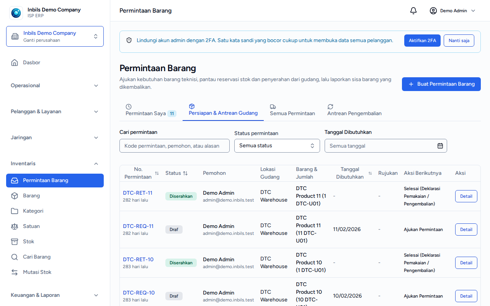

3. Klik tab yang Anda perlukan, juga bila tab itu sudah tampak aktif. Saat halaman baru dibuka, daftar belum disaring menurut tab: pemegang `inventory.request.view.all` melihat semua permintaan sampai mengklik sebuah tab. Kartu **Antrean permintaan gudang** di Dasbor (bagian 2.1) membuka tab **Persiapan & Antrean Gudang** dengan penyaringan yang sudah aktif.
4. Baca kolom: **No. Permintaan** (kode dan umur permintaan, klik untuk membuka), **Status**, **Pemohon**, **Lokasi Gudang**, **Barang & Jumlah** (barang pertama dan jumlah barang lainnya), **Tgl Dibutuhkan**, **Ref SPK / Tiket**, **Aksi Berikutnya** (langkah yang menunggu), dan **Aksi** (tombol **Detail**).
5. Cari dan saring: kotak pencarian mencari kode permintaan, alasan, dan nama pemohon. Pilihan **Semua Status** menyaring menurut status, dengan nama yang sedikit berbeda dari lencana di daftar. Tombol **Reset Filter** muncul bila pencarian atau status aktif.

### Status permintaan

Lencana di daftar dan di halaman detail memakai nama berikut.

| Status | Arti dan efek pada stok | Langkah berikut | Pelaksana (peran bawaan) |
|---|---|---|---|
| **Draf** (`draft`) | Tersimpan, belum diajukan. Stok tidak berubah. | **Ajukan ke Gudang** | Pemohon |
| **Menunggu Persetujuan** (`submitted`) | Menunggu keputusan penyetuju. Stok tidak berubah. | **Setujui & Reservasi Stok** atau **Tolak Permintaan** | Manajer atau admin, bukan pemohon |
| **Disetujui (Stok Direservasi)** (`approved_reserved`) | Stok direservasi di gudang sumber. | **Mulai Penyiapan Barang** | Staf atau admin, bukan penyetuju |
| **Sedang Disiapkan Gudang** (`preparing`) | Gudang mengumpulkan barang. Reservasi tetap. | **Tandai Siap Diambil** | Staf atau admin |
| **Siap Diambil (Ready for Pickup)** (`ready_for_pickup`) | Barang siap di meja serah terima. Reservasi tetap. | **Serah Terima (Issue & Kurangi Stok)** | Staf atau admin, bukan pemohon dan bukan penyetuju |
| **Selesai Diserahkan (Issued)** (`issued`) | Reservasi dilepas dan stok fisik berkurang. | Berkas pengembalian dibuat (bagian 6.8) | Teknisi dan gudang |
| **Ditolak** (`rejected`) | Ditolak dengan alasan. Stok tidak berubah. | Status akhir | Tidak ada |
| **Dibatalkan** (`cancelled`) | Dibatalkan sebelum disetujui. Stok tidak berubah. | Status akhir | Tidak ada |

Stok yang direservasi atau dikurangi adalah stok di lokasi **Gudang Tujuan**. Di menu Stok (bagian 6.5), persetujuan menambah kolom **Reserved** dan mengurangi **Available**, sedangkan serah terima mengurangi **Quantity**. Mutasi Stok (bagian 6.7) mencatat baris bertipe `reserve`, `release`, dan `issue`.

### Membaca halaman detail

Klik kode permintaan atau tombol **Detail** untuk membuka halaman detail. Halaman itu memuat:

- Judul **Permintaan** dengan kode permintaan, tombol **Kembali**, dan tombol langkah yang boleh Anda lakukan pada status saat ini.
- Banner **Permintaan Barang Ditolak** atau **Permintaan Dibatalkan** beserta alasannya.
- Kartu **Alur & Jejak Status Permintaan** dengan enam langkah: **Draf**, **Diajukan**, **Disetujui & Direservasi**, **Sedang Disiapkan Gudang**, **Siap Diambil**, dan **Selesai Diserahkan (Issued)**. Langkah yang sudah dilewati memuat nama pelaksana dan tanggalnya.
- Kartu **Daftar Barang yang Diminta** dengan kolom **Barang**, **Qty Diminta**, **Qty Disetujui**, **Qty Diserahkan**, dan **Catatan**.
- Kartu **Detail Permohonan** dengan status, gudang penyedia, tanggal dibutuhkan, referensi tugas (SPK atau TIKET beserta ID), alasan, dan catatan persetujuan.
- Kartu **Pelaporan Pemakaian Aktual & Pengembalian Material**, hanya setelah status **Selesai Diserahkan (Issued)** (bagian 6.8).

Setiap perubahan status juga tercatat di Audit Log (bagian 7.12) dengan modul `inventory_request`.

### Membuat permintaan barang

Izin: `inventory.request.create`. Sistem memberi nomor permintaan otomatis.

1. Klik **Buat Permintaan Baru** di kanan atas halaman daftar.

   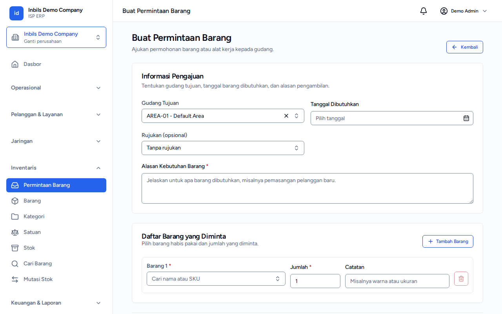

2. Di kartu **Informasi Pengajuan**, isi:
   - **Gudang Tujuan**: pilih lokasi yang menyimpan barang, ditulis nama dan kode (contoh: Default Area (AREA-01)). Daftar memuat semua lokasi aktif perusahaan. Stok direservasi dan dikurangi dari lokasi ini, jadi jangan dikosongkan.
   - **Tanggal Dibutuhkan**: opsional. Pilih tanggal.
   - **Kategori Referensi (Opsional)**: pilih **SPK / Work Order** atau **Tiket Layanan** untuk mengaitkan permintaan dengan pekerjaan. Biarkan **Tidak ada referensi** bila tidak ada.
   - **ID SPK** atau **ID Tiket**: muncul setelah Anda memilih kategori referensi, dan wajib diisi. Isi angka ID pekerjaan, yaitu angka di alamat halaman detailnya (misalnya `/admin/spk/<ID>`).
   - **Alasan Kebutuhan Barang**: wajib, maksimal 2000 karakter. Contoh: Kebutuhan penarikan kabel dropcore pelanggan baru di Perum Grihi Asri.
3. Di kartu **Daftar Barang yang Diminta**, isi baris pertama:
   - Pilih barang. Daftar memuat barang aktif selain aset serial, ditulis nama dan SKU dalam kurung siku.
   - Isi jumlah. Angka harus lebih besar dari 0, dan satuan barang tampil di sisi kanan isian.
   - Isi catatan item bila perlu. Isian ini opsional, maksimal 255 karakter.
4. Klik **Tambah Barang** untuk menambah baris. Satu barang hanya boleh muncul satu kali. Klik ikon tempat sampah (**Hapus baris ini**) untuk menghapus baris; baris terakhir tidak dapat dihapus.
5. Klik **Simpan sebagai Draf** untuk menyimpan tanpa mengajukan, atau **Ajukan ke Antrean Gudang** untuk menyimpan sekaligus mengajukan.

Halaman detail permintaan baru terbuka dengan pesan `Permintaan barang berhasil dibuat.` Statusnya **Draf** atau **Menunggu Persetujuan**. Pada pilihan kedua, pengguna berizin `inventory.request.approve` menerima email pemberitahuan.

### Mengajukan draf ke gudang

Hanya pembuat permintaan, dengan izin `inventory.request.create`, yang dapat mengajukan draf.

1. Buka halaman detail permintaan berstatus **Draf**.
2. Klik **Ajukan ke Gudang**.
3. Klik **Ya, Ajukan** pada dialog **Ajukan Permintaan ke Antrean Gudang?**.

Muncul pesan `Permintaan barang berhasil diajukan ke antrean gudang.` dan status menjadi **Menunggu Persetujuan**.

### Menyetujui permintaan

Izin: `inventory.request.approve`. Permintaan harus berstatus **Menunggu Persetujuan**. Pengajuan yang menunggu Anda juga muncul di menu Persetujuan (bagian 3.2), tetapi di sana jumlah yang disetujui selalu sama dengan jumlah diminta.

1. Buka halaman detail permintaan.
2. Klik **Setujui & Reservasi Stok**.
3. Di dialog **Setujui Permintaan & Reservasi Stok**, isi:
   - **Penyesuaian Kuantitas yang Disetujui**: satu isian per barang, awalnya sama dengan **Qty Diminta**. Ubah bila gudang hanya dapat memenuhi sebagian. Jumlah harus lebih besar dari 0 dan tidak boleh melebihi jumlah diminta.
   - **Catatan Persetujuan (Opsional)**: maksimal 1000 karakter. Catatan tampil di kartu **Detail Permohonan**.
4. Klik **Setujui & Reservasi**.

Sistem memeriksa stok tersedia (Quantity dikurangi Reserved) di Gudang Tujuan untuk setiap barang. Bila semuanya cukup, stok direservasi, status menjadi **Disetujui (Stok Direservasi)**, kolom **Qty Disetujui** terisi, pemohon menerima email, dan muncul pesan `Permintaan barang disetujui dan stok berhasil direservasi.` Bila satu barang kurang, tidak ada stok yang direservasi dan dialog menampilkan pesan kesalahan.

### Menolak permintaan

Izin: `inventory.request.reject`. Syaratnya sama dengan persetujuan.

1. Buka halaman detail permintaan.
2. Klik **Tolak Permintaan**.
3. Isi **Alasan Penolakan** di dialog **Tolak Permintaan Barang**. Wajib, 3 sampai 1000 karakter.
4. Klik **Tolak Permintaan** pada dialog.

Status menjadi **Ditolak**, banner **Permintaan Barang Ditolak** memuat alasannya, pemohon menerima email, dan muncul pesan `Permintaan barang telah ditolak.` Stok tidak berubah, dan penolakan tidak dapat dibatalkan.

### Menyiapkan dan menyerahkan barang

Izin: `inventory.request.prepare` untuk langkah 1 dan 2, `inventory.request.issue` untuk langkah 3. Langkah gudang ini dilakukan berurutan pada halaman detail permintaan.

1. Pada status **Disetujui (Stok Direservasi)**, klik **Mulai Penyiapan Barang**, lalu klik **Ya, Mulai Penyiapan**. Status menjadi **Sedang Disiapkan Gudang**.
2. Setelah barang terkumpul, klik **Tandai Siap Diambil**, lalu klik **Tandai Siap Diambil** di dialog **Tandai Barang Siap Diambil?**. Status menjadi **Siap Diambil (Ready for Pickup)**, dan pemohon menerima email serta notifikasi di sistem.
3. Saat pemohon menerima barang fisik, klik **Serah Terima (Issue & Kurangi Stok)**, lalu klik **Konfirmasi Serah Terima (Issue)** di dialog **Konfirmasi Serah Terima Fisik (Handover)?**. Status menjadi **Selesai Diserahkan (Issued)** dan muncul pesan `Barang berhasil diserahterimakan dan stok berkurang.`

Serah terima bersifat permanen. Reservasi dilepas, stok fisik berkurang sebesar jumlah disetujui, kolom **Qty Diserahkan** terisi, dan sistem membuka berkas pengembalian untuk pemohon (bagian 6.8). Stok dikurangi sekali, saat serah terima: persetujuan SPK terkait tidak mengurangi lagi jumlah yang sudah diserahkan lewat permintaan ini.

### Membatalkan permintaan

Permintaan hanya dapat dibatalkan saat **Draf** atau **Menunggu Persetujuan**. Izin `inventory.request.cancel.own` membatasi pembatalan ke permintaan buatan sendiri, sedangkan tanpa izin itu pemegang `inventory.request.approve` dapat membatalkan permintaan siapa pun. Pada peran bawaan, admin hanya dapat membatalkan permintaannya sendiri, dan manajer dapat membatalkan permintaan siapa pun.

1. Buka halaman detail permintaan.
2. Klik **Batalkan Permintaan**.
3. Isi **Alasan Pembatalan (Opsional)** bila perlu, maksimal 1000 karakter.
4. Klik **Batalkan Permintaan** pada dialog, atau klik **Tutup** bila Anda tidak jadi membatalkan.

Status menjadi **Dibatalkan**, banner **Permintaan Dibatalkan** memuat alasannya, dan stok tidak berubah karena belum ada reservasi.

### Kesalahan umum

- Tombol **Setujui & Reservasi Stok**, **Tolak Permintaan**, **Mulai Penyiapan Barang**, atau **Serah Terima (Issue & Kurangi Stok)** tidak muncul. Cek status permintaan, izin peran Anda, dan apakah Anda pemohon atau penyetuju permintaan itu. Bila ya, minta pengguna lain yang berhak melanjutkan.
- Dialog persetujuan menampilkan `Stok tidak mencukupi untuk produk ID <id> di lokasi ID <id>. Tersedia: <jumlah>, Diminta: <jumlah>.` Kurangi jumlah di dialog atau tambah stok lebih dulu (bagian 6.5), lalu setujui lagi. Bila tidak dapat dipenuhi, tolak permintaan dengan alasan.
- Dialog persetujuan menolak jumlah 0 dengan pesan bawaan sistem berbahasa Inggris, dan menolak jumlah di atas permintaan dengan pesan `Jumlah barang yang disetujui (<jumlah>) tidak boleh melampaui jumlah yang diminta (<jumlah>).` Setiap barang harus disetujui lebih dari 0, jadi barang tidak dapat dicoret sebagian. Bila sebagian tidak dapat dipenuhi, tolak permintaan dan minta pemohon membuat ulang.
- Pesan `Lokasi gudang sumber wajib ditentukan untuk reservasi.` muncul bila **Gudang Tujuan** dikosongkan saat membuat permintaan. Dialog persetujuan tidak punya pilihan lokasi, jadi tolak permintaan itu dan buat ulang dengan lokasi terpilih. Kolom **Lokasi Gudang** menulis **Gudang Utama** untuk permintaan tanpa lokasi, tetapi itu hanya teks pengganti.
- Draf tidak dapat diubah setelah disimpan. Batalkan draf yang salah dan buat permintaan baru.
- Permintaan yang sudah disetujui tidak dapat dibatalkan dari layar ini, karena tombol **Batalkan Permintaan** hanya ada pada status **Draf** dan **Menunggu Persetujuan**.
- Kotak merah **Terdapat kesalahan pengisian formulir:** muncul di atas form pembuatan dan mendaftar tiap isian yang salah, sebagian dalam bahasa Inggris. Penyebab umum: **Alasan Kebutuhan Barang** kosong, jumlah 0 atau kurang, atau barang yang sama dipilih dua kali. Perbaiki isian itu, lalu simpan lagi.
- Pesan `Work order yang dipilih tidak valid untuk perusahaan ini.` atau `Ticket yang dipilih tidak valid untuk perusahaan ini.` berarti angka pada **ID SPK** atau **ID Tiket** tidak cocok dengan pekerjaan di perusahaan aktif. Isi angka ID, bukan kode SPK atau kode tiket.

## 6.2 Barang

Barang adalah katalog yang dipakai oleh stok, permintaan barang dan SPK. Setiap barang punya SKU, kategori, satuan, harga dan batas stok minimum, dan datanya berlaku per perusahaan aktif. Buka menu ini saat Anda menambah barang baru, mengubah harganya, atau berhenti memakainya.

Peran yang dapat memakai: admin, manajer, staf. Izin: `inventory.view` membuka daftar dan rincian, `inventory.create` membuat barang, `inventory.update` mengubah barang, `inventory.delete` menghapus barang, `inventory.export` mengekspor daftar. Dengan peran bawaan, admin memegang semuanya, manajer memegang semuanya kecuali `inventory.delete`, dan staf hanya memegang `inventory.view`, `inventory.create` dan `inventory.update`.

### Membuka dan membaca daftar

1. Di sidebar, buka grup **Inventaris**, lalu klik **Barang**.
2. Baca daftar.

   - Kotak **Search** mencari SKU dan nama barang.
   - Filter **Category** berisi **All** dan kategori yang aktif. Filter **Active** berisi **All**, **Active** dan **Inactive**. Klik **Filter** untuk menerapkan pilihan.
   - Kolom: **SKU**, **Name**, **Category**, **Unit**, **Sell Price**, **Status** (lencana **Active** atau **Inactive**) dan **Actions**. **SKU** dan **Name** bisa diurutkan, dan barang terbaru tampil paling atas.
   - Harga modal dan stok minimum tidak ada di daftar. Keduanya terlihat di rincian dan di form ubah.
   - Tombol **Export** (pemegang `inventory.export`) menghasilkan CSV atau PDF dari pencarian dan filter yang berlaku. Kolomnya SKU, Name, Category, Unit (simbol), SellPrice, CostPrice, MinStock dan IsActive (`Yes` atau `No`). Satu file memuat paling banyak 5000 baris, batas yang sama untuk semua ekspor di bab ini.
   - Tombol **Create Product** tampil bagi pemegang `inventory.create`.

   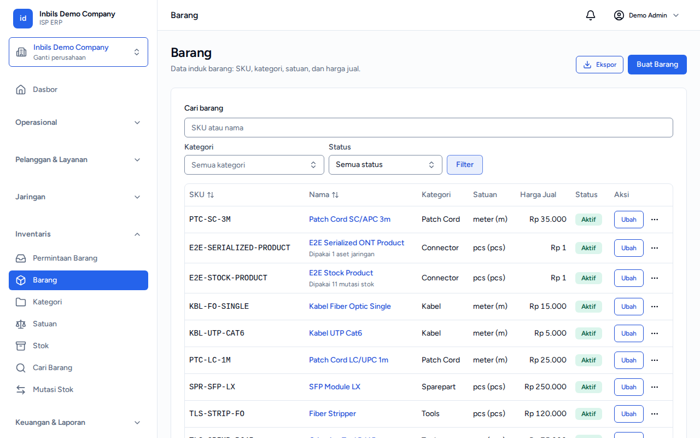

3. Klik **Show** untuk membuka rincian barang.

   - Kartu **Product Details** memuat **Category**, **Unit**, **Sell Price**, **Cost Price**, **Min Stock**, **Track Stock** dan **Description**.
   - Kartu **Stocks per Location** memuat kolom **Location**, **Path**, **Quantity**, **Reserved** dan **Available**. Barang yang belum pernah terkena operasi stok di suatu lokasi menampilkan **No stock records.**
   - Kartu **Recent Movements** di versi ini belum menampilkan baris dan selalu berisi **No movements.** Tautan **View all movements** di bawahnya membuka Mutasi Stok yang disaring ke barang itu (bagian 6.7).

Tombol **Edit** dan **Delete** tampil untuk semua orang yang bisa melihat daftar, dan server menolak aksi dari pengguna tanpa izin yang sesuai (galat 403). Cara kerja tombol dan dialog hapus ada di bagian 1.5.

### Membuat barang

Siapkan dulu satuan (bagian 6.4) dan kategori (bagian 6.3). Satuan barang tidak dipilih sendiri karena mengikuti kategori.

1. Klik **Create Product**.
2. Isi form pada kartu **Create Product**:
   - Isian **SKU** opsional. Kosongkan agar sistem membuat kode berurutan, bawaannya berawalan `PRD-` diikuti angka lima digit, dan perkiraan kode berikutnya tampil di isian. Isi sendiri bila Anda punya kode sendiri: maksimal 100 karakter dan belum dipakai barang lain di perusahaan ini. Contoh: `PTC-SC-3M`.
   - Isi **Name**. Isian ini wajib, maksimal 255 karakter. Contoh: `Patch Cord SC/APC 3m`.
   - Pilih **Category**. Isian ini wajib.
   - **Unit** tidak bisa diisi. Isian ini menampilkan satuan kategori yang Anda pilih, misalnya `meter (m)`.
   - **Sell Price** dan **Cost Price** opsional. Keduanya menerima angka 0 atau lebih dengan dua desimal.
   - **Min Stock** opsional dan menerima angka 0 atau lebih. Isian kosong disimpan sebagai `0`. Nilai ini menjadi batas filter stok rendah di Stok (bagian 6.5).
   - Saklar **Track Stock** menyala secara awal. Nilainya hanya disimpan dan ditampilkan di rincian, dan tidak ada aturan stok yang membacanya.
   - Saklar **Active** menyala secara awal.
   - Isian **Description** opsional dan menerima teks bebas.
3. Klik **Create**. Anda kembali ke daftar dan muncul toast `Product created.`

Bila admin mematikan **Izinkan input kode manual** untuk **Barang (SKU)** di Penomoran (bagian 7.13), isian **SKU** terkunci dan hanya menampilkan perkiraan kode.

Form tidak punya isian jenis barang. Barang yang Anda buat di sini selalu bertipe `consumable`. Server mengenal juga tipe `asset` (aset serial, dipasang per unit lewat SPK dengan memilih aset jaringan, bagian 3.3 dan 5.2) dan `service`, tetapi layar tidak menawarkannya dan tidak menampilkan jenis barang.

### Mengubah barang

1. Di daftar, klik **Edit**, atau buka **Show** lalu klik **Edit**.
2. Ubah isian. Aturannya sama dengan form buat, kecuali **SKU**: isian ini wajib terisi dan boleh diganti selama kode manual diizinkan. Bila terkunci, isian menampilkan `Dibuat otomatis dan tidak dapat diubah.`
3. Klik **Save**. Anda kembali ke daftar dan muncul toast `Product updated.`

Mengganti **Category** ikut mengganti **Unit** barang mengikuti satuan kategori baru. Jumlah stok tidak dikonversi.

### Menonaktifkan dan menghapus barang

1. Untuk berhenti memakai barang, buka **Edit**, matikan saklar **Active**, lalu klik **Save**. Barang tetap ada di daftar dengan lencana **Inactive**, dan tidak lagi muncul di pilihan **Product** dan **Produk** pada halaman Stok.
2. Untuk menghapus, klik **Delete** di baris barang, lalu konfirmasi di dialog. Muncul toast `Product deleted.`

Sistem menolak penghapusan bila stok barang di salah satu lokasi masih lebih dari 0 (pesan sistem `Cannot delete product with stock.`). Dialog tetap terbuka dan muncul toast `Data gagal disimpan. Periksa input.` Kosongkan stok lewat penyesuaian (bagian 6.5), atau cukup nonaktifkan barang.

Barang yang sudah dihapus hilang dari daftar dan tidak bisa dipulihkan dari layar ini. SKU-nya tetap terpakai, jadi barang baru tidak bisa memakai SKU yang sama.

### Kesalahan umum

- SKU ditolak dengan pesan `The sku has already been taken.`: SKU harus unik per perusahaan, termasuk SKU barang yang sudah dihapus. Pakai SKU lain, atau kosongkan isian agar sistem membuat kode.
- Kategori yang dicari tidak ada di pilihan: hanya kategori **Active** yang tampil. Aktifkan kategorinya di menu Kategori (bagian 6.3).
- Isian **Unit** tidak bisa diketik: satuan mengikuti kategori. Pilih kategori lain, atau ubah satuan kategorinya (bagian 6.3).
- Barang tidak ada di pilihan **Produk** pada Stok: saklar **Active** barang mati.
- **Delete** ditolak padahal barang tampak tidak dipakai: salah satu lokasi masih punya stok lebih dari 0. Cek kartu **Stocks per Location** di rincian.
- Staf atau manajer menekan **Delete** dan ditolak dengan galat 403: pada peran bawaan, izin `inventory.delete` hanya dipegang admin. Minta admin menambahkannya lewat peran (bagian 8.6 dan 8.7).
- Tombol **Export** tidak ada: staf tidak memegang `inventory.export`.

## 6.3 Kategori

Kategori mengelompokkan barang dan menentukan satuannya. Setiap kategori punya satu satuan, dan semua barang di dalamnya memakai satuan itu. Buka menu ini sebelum membuat barang yang kategorinya belum ada.

Peran yang dapat memakai: sama dengan bagian 6.2. Izin: `inventory.view` membuka daftar, `inventory.create` membuat kategori, `inventory.update` mengubahnya, `inventory.delete` menghapusnya, `inventory.export` mengekspor daftar.

### Membuka dan membaca daftar

1. Di sidebar, buka grup **Inventaris**, lalu klik **Kategori**.
2. Baca daftar.

   - Kotak **Search** mencari nama dan kode kategori. Klik **Filter** untuk menerapkan.
   - Kolom: **Code**, **Name**, **Unit** (nama dan simbol satuan), **Children** (jumlah kategori anak), **Status** (**Active** atau **Inactive**) dan **Actions**. **Code** dan **Name** bisa diurutkan, urutan awalnya menurut nama.
   - Baris hanya punya tombol **Edit** dan **Delete**. Tidak ada tombol **Show**, dan **Edit** membuka dialog.
   - Tombol **Export** (pemegang `inventory.export`) menghasilkan CSV atau PDF dengan kolom Code, Name, Unit (nama satuan) dan Children. Tombol **Create** tampil bagi pemegang `inventory.create`.

   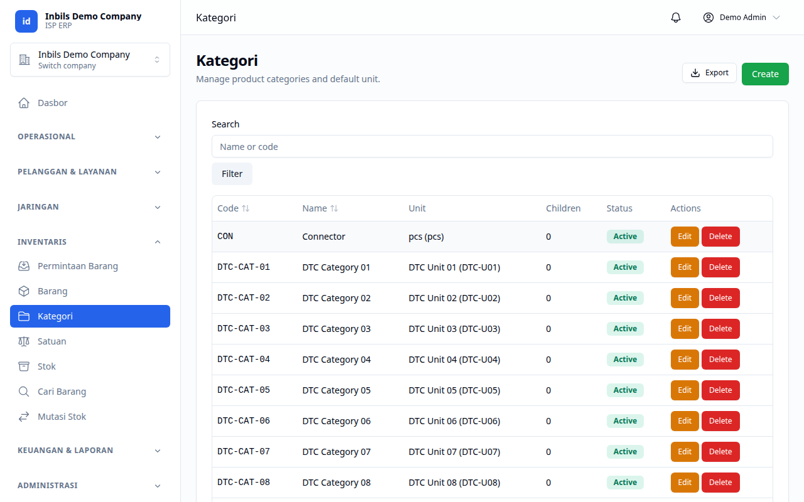

### Membuat kategori

1. Klik **Create**. Dialog **Create Category** terbuka.
2. Isi form:
   - Isi **Name**. Isian ini wajib, maksimal 255 karakter. Contoh: `Connector`.
   - Isi **Code**. Isian ini wajib, maksimal 100 karakter, dan belum dipakai kategori lain di perusahaan ini. Contoh: `CON`.
   - Pilih **Unit**. Isian ini wajib. Ketik di kotak **Search unit**, lalu pilih satuan, misalnya `pcs (pcs)`. Satuan dibuat di menu Satuan (bagian 6.4).
   - **Parent ID** opsional. Isi nomor ID kategori induk untuk membuat kategori anak, atau kosongkan untuk kategori utama. Di versi ini daftar tidak menampilkan ID kategori.
   - Saklar **Active** menyala secara awal.
   - Isian **Description** opsional dan menerima teks bebas.
3. Klik **Create**. Dialog menutup dan muncul toast `Category created.`

### Mengubah dan menghapus kategori

1. Klik **Edit**, ubah isian di dialog **Edit Category**, lalu klik **Save**. Muncul toast `Category updated.`
2. Untuk menghapus, klik **Delete**, lalu konfirmasi di dialog. Muncul toast `Category deleted.`

Mengganti **Unit** kategori ikut mengganti satuan semua barang di kategori itu. Jumlah stok barang tidak dikonversi.

Sistem menolak penghapusan (pesan sistem `Cannot delete category with children or products.`) bila kategori masih punya kategori anak atau barang. Dialog tetap terbuka, seperti pada Barang.

### Kesalahan umum

- Kode ditolak dengan pesan `The code has already been taken.`: kode harus unik per perusahaan, termasuk kode kategori yang sudah dihapus. Pakai kode lain.
- **Delete** ditolak: pindahkan barangnya ke kategori lain lewat **Edit** di menu Barang (bagian 6.2), dan kosongkan **Parent ID** pada kategori anak. Atau cukup matikan **Active**.
- Satuan barang berubah tanpa disengaja: Anda mengganti **Unit** kategori. Pilih lagi satuan semula lewat **Edit**.
- Staf atau manajer menekan **Delete** dan ditolak dengan galat 403: izin `inventory.delete` hanya dipegang admin pada peran bawaan (bagian 6.2).

## 6.4 Satuan

Satuan adalah ukuran barang, misalnya pcs, meter atau box. Satuan dipilih pada kategori, dan barang mengikuti satuan kategorinya. Buka menu ini saat Anda butuh ukuran baru yang belum ada.

Peran yang dapat memakai dan izin: sama dengan bagian 6.3.

### Membuka dan membaca daftar

1. Di sidebar, buka grup **Inventaris**, lalu klik **Satuan**.
2. Baca daftar. Kolomnya **Name**, **Symbol** (keduanya bisa diurutkan) dan **Actions** (**Edit** dan **Delete**). Menu ini tidak punya kotak **Search** dan tidak punya tombol **Show**. Tombol **Export** (pemegang `inventory.export`) menghasilkan CSV atau PDF dengan kolom Name dan Symbol, dan tombol **Create** tampil bagi pemegang `inventory.create`.

   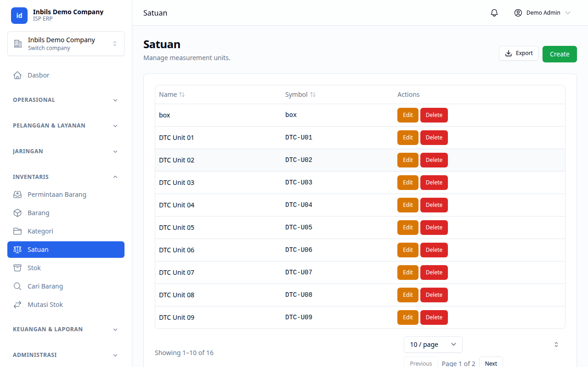

### Membuat satuan

1. Klik **Create**. Dialog **Create Unit** terbuka.
2. Isi form:
   - Isi **Name**. Isian ini wajib, maksimal 100 karakter, dan belum dipakai satuan lain di perusahaan ini. Contoh: `box`.
   - Isi **Symbol**. Isian ini wajib, maksimal 20 karakter, dan belum dipakai satuan lain di perusahaan ini. Contoh: `box`.
3. Klik **Create**. Dialog menutup dan muncul toast `Unit created.`

### Mengubah dan menghapus satuan

1. Klik **Edit**, ubah isian di dialog **Edit Unit**, lalu klik **Save**. Muncul toast `Unit updated.`
2. Untuk menghapus, klik **Delete**, lalu konfirmasi di dialog. Muncul toast `Unit deleted.`

Sistem menolak penghapusan (pesan sistem `Cannot delete unit with products.`) bila masih ada barang yang memakai satuan itu. Satuan barang mengikuti kategori, jadi ganti dulu **Unit** pada kategori yang bersangkutan (bagian 6.3), lalu hapus satuan lama.

### Kesalahan umum

- Penyimpanan ditolak dengan pesan `The name has already been taken.` atau `The symbol has already been taken.`: **Name** dan **Symbol** harus unik per perusahaan, termasuk milik satuan yang sudah dihapus.
- Kolom **Unit** sebuah kategori mendadak kosong: pengecekan hapus hanya melihat barang, bukan kategori, sehingga satuan yang hanya dipakai kategori masih bisa dihapus. Periksa kolom **Unit** di daftar Kategori (bagian 6.3) sebelum menghapus satuan, atau pilih satuan lain pada kategori itu.
- Staf atau manajer menekan **Delete** dan ditolak dengan galat 403: lihat bagian 6.2.

## 6.5 Stok

Stok menunjukkan jumlah setiap barang di setiap lokasi. Dari sini Anda mencatat barang masuk, mengajukan koreksi hasil hitung fisik, dan menyetujui koreksi itu. Buka menu ini untuk mengecek ketersediaan atau mencatat penerimaan.

Peran yang dapat memakai: admin, manajer, staf. Izin: `inventory.view` membuka daftar, `inventory.export` menampilkan **Export**, `inventory.stock.receive` menampilkan **Terima Barang**, `inventory.stock.adjust.request` menampilkan **Ajukan Penyesuaian**, `inventory.stock.adjust.approve` menampilkan **Setujui** dan **Tolak**. Dengan peran bawaan, admin memegang semuanya, staf memegang `inventory.view`, `inventory.stock.receive` dan `inventory.stock.adjust.request`, dan manajer memegang `inventory.view`, `inventory.export` dan `inventory.stock.adjust.approve`.

Peran non-admin tidak bisa memegang izin menyetujui bersama izin mengajukan, menerima, mengeluarkan atau memindahkan stok (pemisahan tugas, bagian 8.6). Pemohon juga tidak bisa memutuskan permintaannya sendiri, termasuk admin.

### Membuka dan membaca daftar

1. Di sidebar, buka grup **Inventaris**, lalu klik **Stok**.
2. Baca daftar.

   - Satu baris adalah satu barang di satu lokasi. Sistem membuat baris saat operasi stok pertama, misalnya penerimaan, pemindahan masuk atau penyesuaian.
   - Kolom: **Product**, **Location** (nama dan kode lokasi), **Quantity** (jumlah fisik di lokasi, termasuk yang sudah dicadangkan), **Reserved** (jumlah yang dicadangkan, misalnya oleh permintaan barang yang sudah disetujui) dan **Available** (**Quantity** dikurangi **Reserved**). **Quantity** dan **Reserved** bisa diurutkan, dan baris terbaru tampil paling atas.
   - Kotak **Search** mencari nama dan SKU barang serta nama dan kode lokasi. Filter **Location** dan **Product** berisi **All** dan pilihan yang aktif. Tidak ada tombol **Filter**: daftar dimuat ulang sendiri saat Anda mengetik atau memilih.
   - Tombol **Export** (pemegang `inventory.export`) menghasilkan CSV atau PDF dari pencarian dan filter yang berlaku. Kolomnya Product, Location (kode lokasi), Quantity, Reserved dan Available.

   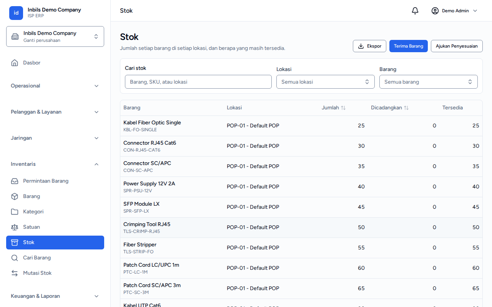

3. Untuk melihat stok rendah, klik kartu **Stok di bawah minimum** di Dasbor (bab 2).

   - Halaman Stok terbuka dengan filter stok rendah: hanya baris yang nilai **Quantity**-nya sama dengan atau di bawah **Min Stock** barang (bagian 6.2).
   - Perbandingan dilakukan per baris (satu lokasi), bukan terhadap total semua lokasi, dan barang nonaktif ikut dihitung.
   - Filter ini tidak punya kotak atau tanda di layar, dan tetap berlaku saat Anda mencari atau mengganti filter lain. Buka **Stok** lagi dari sidebar untuk melihat semua baris.

### Menerima barang

Gunakan saat barang masuk ke sebuah lokasi, misalnya dari pembelian.

1. Klik **Terima Barang**. Dialog **Terima Barang** terbuka.
2. Isi form:
   - Pilih **Produk**. Isian ini wajib dan hanya menawarkan barang aktif. Pilihan tampil sebagai nama dan SKU.
   - Pilih **Lokasi**. Isian ini wajib dan hanya menawarkan lokasi aktif. Pilihan tampil sebagai nama dan kode. Lokasi dibuat di menu Lokasi (bagian 5.1).
   - Isi **Jumlah**. Isian ini wajib, harus lebih dari 0, dan nilai awalnya `1`.
   - **Catatan** opsional dan menerima maksimal 500 karakter. Tulis nomor dokumen penerimaan di sini agar mudah dicari di Mutasi Stok.
3. Klik **Simpan**. Dialog menutup dan muncul toast `Stock received.`

**Quantity** barang di lokasi itu bertambah sebesar jumlah yang diterima, dan baris stok dibuat bila belum ada. Satu mutasi `receive` tercatat (bagian 6.7). Penerimaan berlaku langsung, tanpa persetujuan.

### Mengajukan penyesuaian stok

Gunakan saat hasil hitung fisik berbeda dari angka di sistem. Stok baru berubah setelah pengguna lain menyetujui.

1. Klik **Ajukan Penyesuaian**. Dialog **Ajukan Penyesuaian Stok** terbuka.
2. Isi form:
   - Pilih **Produk** dan **Lokasi**, seperti pada penerimaan. Keduanya wajib.
   - Isi **Jumlah Baru (hasil hitung fisik)** dengan angka 0 atau lebih. Isian ini wajib. Isi total hasil hitung, bukan selisihnya.
   - Isi **Alasan**. Isian ini wajib, maksimal 500 karakter. Alasan ini menjadi catatan mutasi saat permintaan disetujui.
3. Klik **Ajukan**. Dialog menutup dan muncul toast `Stock adjustment requested; awaiting approval.` Stok belum berubah, dan permintaan muncul di panel **Penyesuaian stok menunggu persetujuan** di atas daftar.

### Menyetujui atau menolak penyesuaian

Panel **Penyesuaian stok menunggu persetujuan** muncul bila ada permintaan yang menunggu. Pemohon hanya melihat permintaannya sendiri, sedangkan pemegang `inventory.stock.adjust.approve` melihat semuanya (paling banyak 50, yang terlama di atas). Kolomnya **Produk**, **Lokasi**, **Stok** (jumlah saat diajukan dan jumlah baru), **Selisih** (jumlah baru dikurangi jumlah saat diajukan, bertanda plus atau minus), **Alasan**, **Pemohon** dan **Aksi**.

1. Pada baris permintaan, klik **Setujui** atau **Tolak**. Kedua tombol hanya muncul bagi pemegang `inventory.stock.adjust.approve` yang bukan pemohon. Bagi pengguna lain, kolom **Aksi** berisi **Menunggu penyetujuan**.
2. Untuk menyetujui, periksa produk, lokasi, jumlah dan alasan pemohon di dialog **Setujui Penyesuaian Stok**, lalu klik **Setujui**. Muncul toast `Stock adjustment approved.`
3. Untuk menolak, isi **Alasan Penolakan** di dialog **Tolak Penyesuaian Stok** (wajib, 3 sampai 500 karakter), lalu klik **Tolak**. Muncul toast `Stock adjustment rejected.`

Saat disetujui, stok langsung diatur ke **Jumlah Baru** dan satu mutasi `adjustment` tercatat dengan **Alasan** sebagai catatan. Selisih pada mutasi dihitung dari stok saat persetujuan, bukan saat pengajuan. Saat ditolak, stok tidak berubah.

Sistem tidak mengirim notifikasi untuk pengajuan, persetujuan maupun penolakan. Permintaan yang sudah diputuskan hilang dari panel, dan alasan penolakan tercatat di audit trail (bagian 7.12), bukan di halaman Stok. Beri tahu pemohon secara langsung.

### Pengeluaran, pemindahan dan penyesuaian langsung

Izin untuk tiga operasi ini ada, tetapi halaman Stok tidak menyediakan tombolnya:

- Pengeluaran (`inventory.stock.issue`, dipegang admin dan staf) memerlukan barang, lokasi, jumlah lebih dari 0 dan catatan opsional. Stok tidak boleh berkurang melebihi **Available**. Pada web, stok keluar lewat Permintaan Barang saat barang diserahkan (bagian 6.1), dan lewat SPK saat SPK disetujui dan menjadi `completed` (bagian 3.3).
- Pemindahan antar lokasi (`inventory.stock.transfer`, dipegang admin dan staf) memerlukan barang, lokasi asal, lokasi tujuan, jumlah lebih dari 0 dan catatan opsional. Lokasi asal dan tujuan harus berbeda, dan stok **Available** di asal harus cukup. Satu pemindahan mengurangi asal dan menambah tujuan, tetapi tidak ada layar untuk memulainya.
- Penyesuaian langsung atau break-glass (`inventory.stock.adjust`, hanya admin) memakai barang, lokasi, jumlah baru 0 atau lebih dan alasan wajib. Perubahan berlaku langsung dan audit memberi penanda `break_glass`, tetapi tidak ada tombolnya. Koreksi stok dari layar selalu lewat pengajuan dan persetujuan di atas.

### Kesalahan umum

- Dialog **Terima Barang** menolak dengan `Produk, lokasi, dan jumlah (> 0) wajib diisi.`: pilih produk dan lokasi, lalu isi jumlah lebih dari 0.
- Barang tidak ada di pilihan **Produk**: barang itu **Inactive**. Aktifkan di menu Barang (bagian 6.2). Untuk melihat stok barang nonaktif, pakai kotak **Search**. Lokasi yang tidak aktif juga tidak ditawarkan (bagian 5.1).
- Tombol **Terima Barang** atau **Ajukan Penyesuaian** tidak ada: peran Anda tidak memegang izinnya. Manajer sengaja tidak memegangnya karena pemisahan tugas. Minta admin mengatur peran (bagian 8.6 dan 8.7).
- Tombol **Setujui** dan **Tolak** tidak ada pada permintaan Anda sendiri: pemohon tidak boleh memutuskan permintaannya, termasuk admin. Minta pengguna lain yang memegang `inventory.stock.adjust.approve`.
- Dialog keputusan menampilkan `Permintaan penyesuaian stok tidak dapat disetujui karena status telah berubah atau Anda tidak berwenang.` (atau `... tidak dapat ditolak ...`): pengguna lain sudah memutuskan lebih dulu, atau izin Anda berubah. Tutup dialog dan muat ulang halaman.
- **Jumlah Baru** salah isi: angka ini adalah total hasil hitung fisik, bukan selisih, dan tidak boleh negatif. Pemohon tidak bisa mengubah atau membatalkan permintaan yang sudah diajukan. Minta penyetuju menolaknya, lalu ajukan ulang.
- Persetujuan gagal dengan toast `Data gagal disimpan. Periksa input.` dan dialog tetap terbuka: **Jumlah Baru** lebih kecil dari jumlah **Reserved** barang itu di lokasi tersebut, dan stok tidak boleh turun di bawah jumlah yang dicadangkan. Tolak permintaan, tunggu reservasi selesai, lalu ajukan ulang.
- Pemindahan ditolak karena lokasi asal sama dengan tujuan, atau jumlah melebihi **Available** di asal. Pilih dua lokasi berbeda dan kurangi jumlah. Karena layar pemindahan belum ada, galat ini hanya mungkin pada panggilan langsung ke rute backend.

## 6.6 Cari Barang

Cari Barang menjawab pertanyaan barang ini ada di lokasi mana dan berapa jumlahnya. Ketik sebagian nama atau SKU, lalu baca jumlah di setiap lokasi. Buka menu ini saat Anda perlu tahu di lokasi mana sebuah barang tersedia.

Peran yang dapat memakai: admin, manajer, staf. Izin: `inventory.view`. Tidak ada izin tambahan, dan menu ini tidak mengubah data.

### Membuka dan membaca hasil

1. Di sidebar, buka grup **Inventaris**, lalu klik **Cari Barang**. Tabel awal berisi **No data found.** karena belum ada pencarian.

   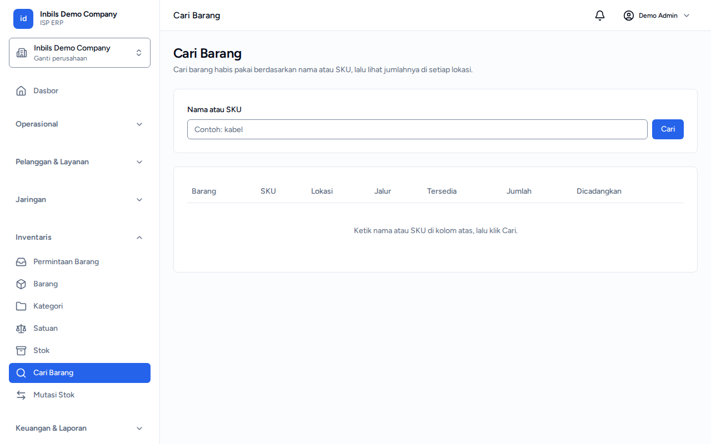

2. Ketik sebagian nama atau SKU di kotak **Search** (petunjuk `Name or SKU`), lalu klik **Search**. Kotak kosong tidak menghasilkan apa pun.
3. Baca hasil. Setiap baris adalah satu barang di satu lokasi, dengan kolom **Product**, **SKU**, **Location**, **Path** (jalur lokasi), **Available** (jumlah yang bisa dipakai), **Total** (jumlah fisik) dan **Reserved** (jumlah yang dicadangkan). Hasil tidak dibagi per halaman dan tidak bisa diurutkan.

Subjudul layar berbunyi `Search consumable items by name or SKU.`, tetapi pencarian tidak menyaring jenis atau status barang. Barang nonaktif dan barang bertipe `asset` ikut tampil bila nama atau SKU-nya cocok.

### Kesalahan umum

- Hasil kosong padahal barang ada: pencarian hanya mencocokkan potongan nama atau SKU, bukan kategori atau deskripsi. Ketik potongan yang tepat.
- Barang tampil satu baris dengan **No stock records.**: barang itu belum pernah masuk ke lokasi mana pun. Catat penerimaannya di Stok (bagian 6.5).
- **Available** lebih kecil dari **Total**: selisihnya adalah jumlah **Reserved**, misalnya oleh permintaan barang yang sudah disetujui.

## 6.7 Mutasi Stok

Mutasi Stok adalah riwayat semua perubahan stok: barang masuk, keluar, koreksi dan pencadangan. Buka menu ini untuk menelusuri kenapa jumlah stok sebuah barang berubah. Layar ini hanya untuk dibaca, dan mutasi yang sudah tercatat tidak bisa diubah atau dihapus oleh siapa pun.

Peran yang dapat memakai: admin, manajer, staf. Izin: `inventory.view` membuka daftar, dan `inventory.export` menampilkan **Export**. Dengan peran bawaan, admin dan manajer bisa mengekspor, staf tidak.

### Membuka dan membaca daftar

1. Di sidebar, buka grup **Inventaris**, lalu klik **Mutasi Stok**.
2. Baca daftar.

   - Kolom: **Type**, **Product** (nama dengan SKU di bawahnya), **Qty** (bertanda minus bila stok berkurang), **From**, **To**, **Note** dan **Created** (tanggal dan jam). **Type**, **Qty** dan **Created** bisa diurutkan, dan mutasi terbaru tampil paling atas.
   - Kotak **Search** mencari nama atau SKU barang, nama atau kode lokasi asal dan tujuan, catatan dan jenis mutasi. Hasil dimuat ulang sendiri saat Anda mengetik.
   - Filter **Type** berisi **All** dan tujuh jenis mutasi. Klik **Filter** untuk menerapkannya.
   - Tidak ada filter tanggal. Untuk rentang tanggal dan saldo setelah tiap mutasi, pakai laporan Stock Card (bagian 7.7).
   - Tombol **Export** (pemegang `inventory.export`) menghasilkan CSV atau PDF dari pencarian dan filter yang berlaku. Kolomnya Type, Product, From, To, Quantity, Balance, Note dan Date. Kolom Balance (saldo setelah mutasi) hanya ada di file.
   - Tombol **Stocks** membuka halaman Stok (bagian 6.5).

   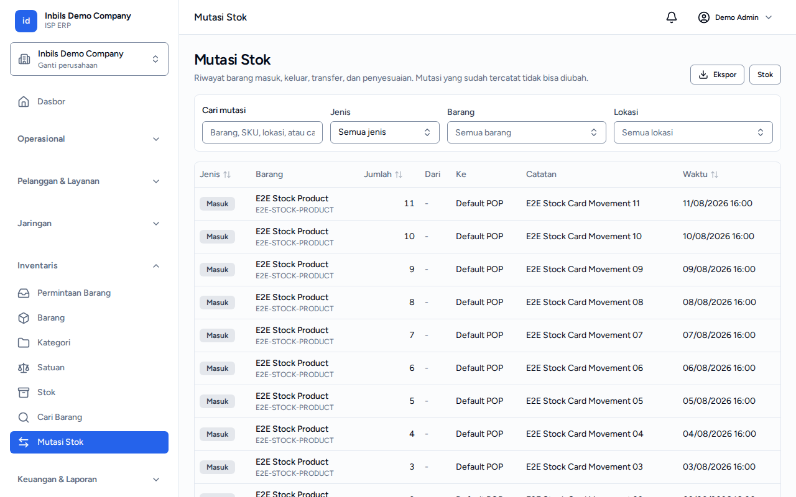

3. Untuk melihat satu barang, buka rincian barang di menu Barang (bagian 6.2), lalu klik **View all movements**. Daftar lalu hanya berisi mutasi barang itu, tanpa tanda di layar. Buka **Mutasi Stok** lagi dari sidebar untuk melihat semuanya.

### Jenis mutasi

Kolom **Type** menampilkan salah satu dari tujuh nilai ini.

| Type | Arti | Qty | From dan To |
|---|---|---|---|
| `receive` | Barang masuk ke lokasi, dari **Terima Barang** atau penerimaan fisik retur material | Plus | Hanya **To** terisi |
| `issue` | Barang keluar dari lokasi, saat permintaan barang diserahkan atau SPK disetujui | Minus | Hanya **From** terisi |
| `transfer` | Pemindahan antar lokasi, tercatat dua baris: keluar dari lokasi asal, masuk ke lokasi tujuan | Minus pada baris asal, plus pada baris tujuan | **From** pada baris keluar, **To** pada baris masuk |
| `adjustment` | Koreksi stok ke hasil hitung fisik yang sudah disetujui | Selisih, plus atau minus | **From** dan **To** sama |
| `reserve` | Stok dicadangkan untuk permintaan barang yang disetujui, jumlah fisik tidak berubah | Plus | Hanya **To** terisi |
| `release` | Cadangan dilepas, jumlah fisik tidak berubah | Minus | Hanya **To** terisi |
| `return` | Barang kembali ke lokasi | Plus | Hanya **To** terisi |

Satu permintaan barang meninggalkan jejak berurutan: `reserve` saat disetujui, lalu `release` dan `issue` saat barang diserahkan. Catatan mutasi memuat kode sumbernya: `Penyerahan Permintaan Barang: <kode>` untuk serah terima, `SPK <kode>` untuk pemakaian pada SPK, dan `Penerimaan Fisik Retur Material: Case #<id>` untuk retur material yang diterima. Cari kode itu di kotak **Search** untuk menelusuri satu permintaan atau SPK.

### Kesalahan umum

- Mencari mutasi menurut tanggal: layar ini tidak punya filter tanggal. Pakai laporan Stock Card (bagian 7.7), yang punya isian **Periode** dan kolom saldo.
- Mutasi salah catat tidak bisa diubah atau dihapus: koreksi dengan **Ajukan Penyesuaian** di Stok (bagian 6.5). Koreksi itu menambah mutasi `adjustment` baru dan tidak menghapus yang lama.
- Jumlah fisik tidak berubah setelah permintaan barang disetujui: baris `reserve` hanya menaikkan **Reserved** di Stok. Jumlah fisik berkurang saat barang diserahkan (`issue`).
- Daftar tampak terbatas pada satu barang dan Anda tidak menemukan filternya: Anda datang dari tautan **View all movements**. Buka **Mutasi Stok** dari sidebar.
- Tombol **Export** tidak ada: peran Anda tidak memegang `inventory.export`, dan staf bawaan tidak memegangnya.

## 6.8 Pengembalian Barang

Pengembalian Barang mencatat sisa material yang dibawa pulang teknisi setelah bekerja, dan menambah stok gudang hanya setelah petugas gudang memeriksa barangnya. Sistem membuka satu berkas pengembalian setiap kali permintaan barang berstatus **Selesai Diserahkan (Issued)**. Teknisi melapor di aplikasi teknisi, dan gudang memverifikasi di web.

Peran yang dapat memakai: admin (semua langkah), manajer (melihat semua, menerima, menyelesaikan diskrepansi), dan staf (melihat semua, menerima). Izin: `inventory.return.view.own`, `inventory.return.view.all`, `inventory.return.declare`, `inventory.return.receive`, `inventory.return.resolve`.

Pemegang `inventory.return.view.all` melihat semua berkas di perusahaan aktif, sedangkan pemegang `inventory.return.view.own` hanya melihat berkas miliknya. `inventory.return.declare` memungkinkan pemilik berkas melapor pemakaian, `inventory.return.receive` memungkinkan menerima atau menolak penyerahan fisik, dan `inventory.return.resolve` memungkinkan menyelesaikan diskrepansi.

Pemilik berkas adalah pemohon permintaan, biasanya teknisi. Pemilik tidak boleh menerima, menolak, atau menyelesaikan berkasnya sendiri, dan orang yang menerima fisik tidak boleh menyelesaikan diskrepansi berkas yang sama.

### Membuka dan membaca daftar

Pengembalian tidak punya menu sendiri. Daftarnya adalah satu tab pada halaman Permintaan Barang.

1. Di sidebar, buka grup **Inventaris**, lalu klik **Permintaan Barang**.
2. Klik tab **Antrean Pengembalian (Custody Return)**. Tab ini tampil bagi pemegang salah satu izin pengembalian di atas. Kartu **Antrean retur material** di Dasbor (bagian 2.1) membuka tab ini langsung pada antrean yang sesuai.

   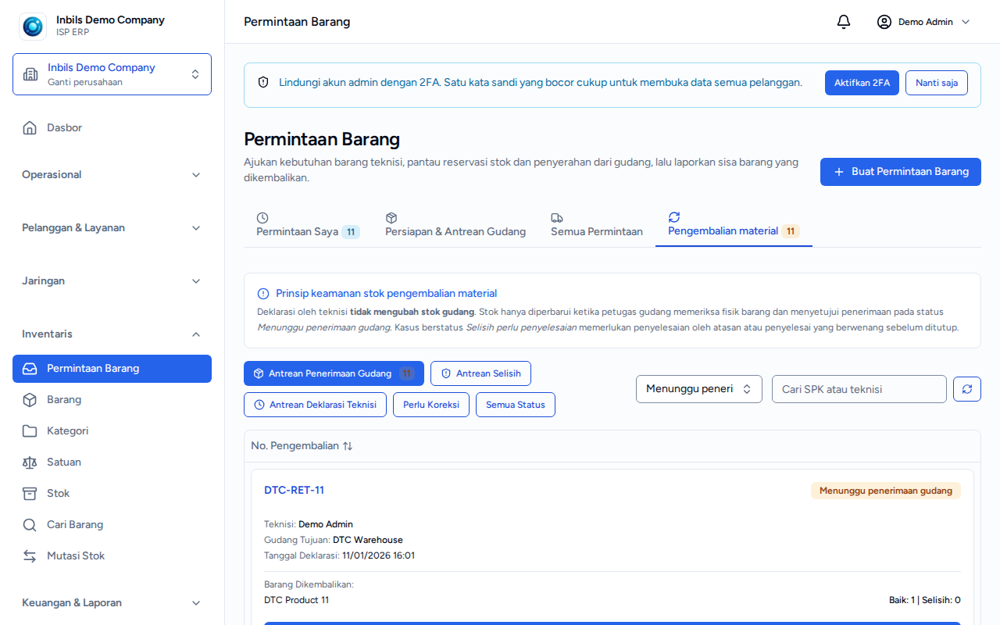

3. Baca bagian atas tab. Kartu **Prinsip Keamanan Stok Material Return** mengingatkan bahwa deklarasi teknisi tidak mengubah stok. Pilih antrean dengan tombol di bawahnya:
   - **Antrean Penerimaan Gudang**: berkas **Menunggu Penerimaan Gudang**. Terbuka lebih dulu bagi pemegang `inventory.return.receive`.
   - **Antrean Diskrepansi (Exception)**: berkas **Diskrepansi (Perlu Resolusi)**. Terbuka lebih dulu bagi pemegang `inventory.return.resolve` yang tidak memegang izin terima.
   - **Antrean Deklarasi Teknisi**: berkas **Menunggu Deklarasi Teknisi**.
   - **Perlu Koreksi**: berkas **Perlu Koreksi / Ditolak Gudang**.
   - **Semua Status**: semua berkas. Daftar pilihan di sebelah tombol memuat enam status berkas dan menyaring menurut satu status.
4. Setelah daftar dimuat, lencana angka muncul di tab dan di tombol antrean. Angka di **Antrean Penerimaan Gudang** menghitung berkas yang menunggu penerimaan ditambah berkas diskrepansi. Kotak **Cari SPK / teknisi...** mencari kode permintaan, nama teknisi, dan nomor berkas, bukan kode SPK, dan tombol ikon panah melingkar menyegarkan daftar.
5. Baca kartu berkas: kode permintaan, lencana status, **Teknisi**, **Gudang Tujuan**, **SPK**, **Tgl Deklarasi**, daftar **Barang Dikembalikan** dengan jumlah **Baik** dan **Sisa/Beda**, serta **Alasan Penolakan** atau **Catatan Resolusi** bila ada. Lencana **Eligible Receive**, **Eligible Resolve**, dan **Eligible Declare** menandai tindakan yang boleh Anda lakukan pada berkas itu. Tanpa lencana, Anda hanya dapat membaca.
6. Klik tombol di bawah kartu: **Buka Permintaan & Terima Fisik**, **Buka & Selesaikan Diskrepansi**, **Buka Permintaan & Buat Deklarasi**, atau **Buka Permintaan**. Semuanya membuka halaman detail permintaan, tempat langkah dilakukan.

### Status berkas pengembalian

| Status | Arti | Efek pada stok | Langkah berikut |
|---|---|---|---|
| **Menunggu Deklarasi Teknisi** (`awaiting_declaration`) | Barang sudah diserahkan, teknisi belum melapor. | Tidak ada. | Teknisi melapor di aplikasi teknisi |
| **Menunggu Penerimaan Gudang** (`awaiting_receipt`) | Teknisi sudah melapor, gudang belum memeriksa barang. | Tidak ada. Laporan tidak mengubah stok. | **Terima Pengembalian Fisik** atau **Tolak Fisik Barang** |
| **Perlu Koreksi / Ditolak Gudang** (`correction_required`) | Gudang menolak penyerahan fisik dan menulis alasannya. | Tidak ada. | Teknisi melapor ulang |
| **Diskrepansi (Perlu Resolusi)** (`exception_open`) | Gudang menerima barang, tetapi ada barang rusak atau selisih. | Barang baik sudah masuk stok. Barang rusak tidak masuk. | **Selesaikan Diskrepansi (Resolve)** |
| **Selesai Rekonsiliasi (Diterima)** (`reconciled`) | Semua barang cocok dan diterima. | Barang baik sudah masuk stok. | Status akhir |
| **Diskrepansi Diselesaikan** (`resolved`) | Resolver menutup diskrepansi dengan catatan. | Tidak ada tambahan. | Status akhir |

### Mendeklarasikan pemakaian

Teknisi mengerjakannya di aplikasi teknisi. Untuk setiap barang, jumlah dipakai, sisa baik, dan selisih harus berjumlah sama dengan jumlah yang dikeluarkan. Jika ada selisih, data deklarasi wajib memakai kode `damaged`, `lost`, atau `other`; alasan selisih bersifat opsional, maksimal 1000 karakter. Setelah laporan masuk, status berkas menjadi **Menunggu Penerimaan Gudang**, pengguna berizin `inventory.return.receive` menerima email, dan stok belum berubah.

Di web, tombol **Laporkan Pemakaian & Ajukan Pengembalian** hanya muncul bagi pemilik berkas yang memegang `inventory.return.declare`, misalnya admin yang membuat permintaannya sendiri. Tombol itu muncul saat status berkas **Menunggu Deklarasi Teknisi** atau **Perlu Koreksi / Ditolak Gudang**.

1. Buka halaman detail permintaan dari tombol **Buka Permintaan & Buat Deklarasi**.
2. Klik **Laporkan Pemakaian & Ajukan Pengembalian**.
3. Di dialog **Deklarasi Pemakaian Aktual & Sisa Barang**, isi per barang:
   - **Dipakai Aktual**: jumlah yang terpakai di lapangan, paling banyak sebesar **Dikeluarkan**.
   - **Sisa Dikembalikan**: terisi otomatis sebesar Dikeluarkan dikurangi Dipakai Aktual. Ubah bila perlu.
4. Klik **Kirim Laporan Deklarasi**.

Dialog web tidak punya isian selisih, jadi **Dipakai Aktual** dan **Sisa Dikembalikan** harus berjumlah sama dengan **Dikeluarkan**.

### Menerima pengembalian fisik

Izin: `inventory.return.receive`. Berkas harus berstatus **Menunggu Penerimaan Gudang**.

1. Klik **Buka Permintaan & Terima Fisik** pada kartu berkas.
2. Pada kartu **Pelaporan Pemakaian Aktual & Pengembalian Material**, periksa tabel dengan kolom **Barang**, **Dikeluarkan**, **Dipakai Riil**, **Sisa Diharapkan**, **Diterima Fisik**, dan **Rusak / Hilang**. Cocokkan **Sisa Diharapkan** dengan barang yang dibawa teknisi.
3. Klik **Terima Pengembalian Fisik**.
4. Di dialog **Terima Pengembalian Fisik Material**, isi per barang:
   - **Diterima Baik (Tambah Stok)**: jumlah barang baik yang Anda terima. Awalnya sama dengan sisa yang dideklarasikan.
   - **Kondisi Rusak (Damaged)**: jumlah barang rusak. Awalnya 0.
5. Klik **Konfirmasi Penerimaan Fisik**.

Pada setiap barang yang diproses lewat dialog web, **Dipakai Riil** ditambah **Diterima Baik** ditambah **Kondisi Rusak** harus sama dengan **Dikeluarkan**. Dialog web tidak menyediakan isian **Hilang** atau **Lainnya**, jadi kasus itu tidak dapat dicatat secara tepat melalui dialog ini. Jangan mencatat barang hilang sebagai rusak hanya agar jumlahnya cocok.

Jumlah **Diterima Baik** langsung menambah stok di lokasi gudang berkas, dan Mutasi Stok (bagian 6.7) mencatat baris bertipe `receive` dengan keterangan `Penerimaan Fisik Retur Material: Case #<nomor>`. Bila **Kondisi Rusak** nol di semua barang, status menjadi **Selesai Rekonsiliasi (Diterima)**. Bila ada barang dengan **Kondisi Rusak** lebih dari nol, status menjadi **Diskrepansi (Perlu Resolusi)** dan pengguna berizin `inventory.return.resolve` menerima email.

### Menolak penyerahan fisik

Izin dan syarat sama dengan penerimaan. Pakai langkah ini bila barang belum sampai di meja gudang atau tidak sesuai deklarasi.

1. Klik **Tolak Fisik Barang** pada kartu **Pelaporan Pemakaian Aktual & Pengembalian Material**.
2. Isi **Alasan Penolakan Fisik** di dialog **Tolak Penyerahan Fisik Barang**. Wajib, 3 sampai 1000 karakter.
3. Klik **Tolak Penyerahan**.

Status menjadi **Perlu Koreksi / Ditolak Gudang**, banner **Penyerahan Fisik Ditolak Gudang** memuat alasannya, dan stok tidak berubah. Teknisi menerima email berisi alasan, lalu melapor ulang. Setelah laporan baru masuk, status kembali ke **Menunggu Penerimaan Gudang**.

### Menyelesaikan diskrepansi

Izin: `inventory.return.resolve`. Berkas harus berstatus **Diskrepansi (Perlu Resolusi)**. Pada peran bawaan, staf menerima dan manajer menyelesaikan.

1. Klik **Buka & Selesaikan Diskrepansi** pada kartu berkas.
2. Tinjau kolom **Rusak / Hilang** pada tabel.
3. Klik **Selesaikan Diskrepansi (Resolve)**.
4. Isi **Catatan Resolusi** di dialog **Selesaikan Pengecualian Diskrepansi**. Wajib, 3 sampai 1000 karakter.
5. Klik **Konfirmasi Penyelesaian**.

Status menjadi **Diskrepansi Diselesaikan** dan catatan tampil di berkas. Stok tidak berubah: barang rusak atau hilang tidak masuk stok karena sudah keluar saat serah terima.

### Hubungan dengan SPK

Bila permintaan memakai **Kategori Referensi** SPK / Work Order, berkasnya terhubung ke SPK itu. Teknisi tidak dapat mengirim SPK untuk ditinjau selama ada berkas yang belum dilaporkan, yaitu berstatus **Menunggu Deklarasi Teknisi** atau **Perlu Koreksi / Ditolak Gudang**. Saat berkas menjadi **Selesai Rekonsiliasi (Diterima)** atau **Diskrepansi Diselesaikan**, jumlah pakai pada material SPK disesuaikan dengan jumlah **Dipakai Aktual** (bagian 3.3).

### Kesalahan umum

- Tab **Antrean Pengembalian (Custody Return)** tampil, tetapi daftar menampilkan kotak galat merah dengan tombol **Coba Lagi**. Peran Anda memegang izin lapor, terima, atau selesaikan tanpa `inventory.return.view.all` atau `inventory.return.view.own`. Minta admin menambahkan izin lihat di bagian 8.6 (Peran).
- Tombol **Terima Pengembalian Fisik** dan **Tolak Fisik Barang** tidak muncul. Status berkas bukan **Menunggu Penerimaan Gudang**, Anda tidak memegang `inventory.return.receive`, atau Anda sendiri pemilik berkas. Minta pengguna lain menerimanya.
- Tombol **Selesaikan Diskrepansi (Resolve)** tidak muncul. Status berkas bukan **Diskrepansi (Perlu Resolusi)**, Anda tidak memegang `inventory.return.resolve`, Anda pemilik berkas, atau Anda yang menerima fisiknya. Minta pengguna lain, misalnya manajer.
- Pesan yang diawali `Invariant gagal pada baris` muncul bila angka satu barang tidak cocok dengan jumlah **Dikeluarkan**. Ubah angka di dialog sampai totalnya sama dengan **Dikeluarkan**.
- Gudang tidak dapat menerima berkas yang masih **Menunggu Deklarasi Teknisi**. Minta teknisi melapor di aplikasi teknisi lebih dulu.
- SPK gagal disetujui dengan pesan `SPK tidak dapat disetujui (fail-closed) sampai seluruh retur material berstatus reconciled atau resolved.` Selesaikan penerimaan atau diskrepansi semua berkas SPK itu, lalu setujui lagi.

# 7. Keuangan & Laporan

## 7.1 Tagihan

Menu ini memuat tagihan pelanggan di perusahaan aktif: tagihan bulanan dari langganan, tagihan sekali bayar dari SPK, dan tagihan manual. Buka menu ini untuk menerbitkan tagihan bulanan, mengirim tagihan, mencatat atau membalik pembayaran, dan membatalkan tagihan.

Peran yang dapat memakai: admin, manajer, dan staf. Izin dasar: `billing.view`. Teknisi dan pelanggan tidak punya akses web. Tagihan perusahaan lain tidak tampil dan tidak bisa dibuka (galat 404). Setiap tindakan punya izin sendiri:

| Tindakan | Izin | Peran bawaan |
| --- | --- | --- |
| Melihat daftar dan detail, mengunduh PDF | `billing.view` | admin, manajer, staf |
| **Generate Tagihan**, **New invoice** | `billing.create` | admin, manajer, staf |
| **Add Item** | `billing.update` | admin, manajer |
| **Send** | `billing.send` | admin, manajer, staf |
| **Record Payment** | `billing.payment.record` | admin, manajer, staf |
| **Reverse** | `billing.payment.reverse` | admin, manajer |
| **Cancel** | `billing.cancel` | admin, manajer |
| **Export** | `billing.export` | admin, manajer |

Halaman detail menampilkan **Send**, **Add Item**, **Record Payment**, dan **Cancel** menurut status tagihan, bukan menurut izin pengguna. **Reverse** juga memeriksa izin sebelum tampil. Server memeriksa semua izin saat tindakan disimpan dan menolak tindakan tanpa izin (galat 403).

### Membuka dan membaca daftar

1. Di sidebar, buka grup **Keuangan & Laporan**, lalu klik **Tagihan**.
2. Di atas daftar ada kotak **Search** ("Number or customer..."), pilihan **Status**, dan **Periode**. **Periode** menyaring menurut **Issue Date**, bukan jatuh tempo. Ketik rentang tanggal atau klik ikon kalender. Pilihan cepatnya **Hari ini**, **7 hari terakhir**, **30 hari terakhir**, **Bulan ini**, **Bulan lalu**, dan **Tahun ini**. Pencarian, urutan, dan halaman bekerja seperti di bagian 1.5.

   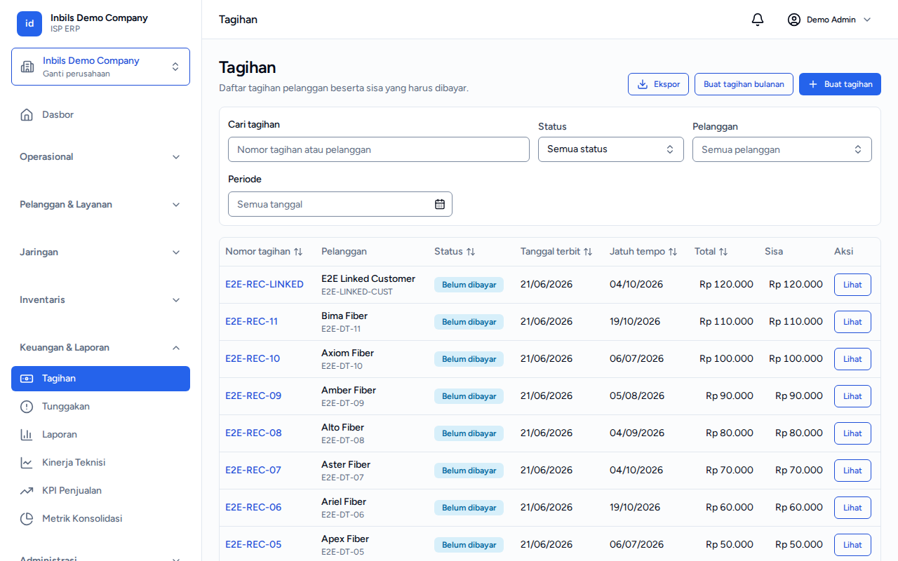
3. Kolom daftar: **Number** (tautan ke detail), **Customer** (nama dan kode), **Status**, **Issue Date**, **Due Date**, **Total**, **Remaining** (sisa yang belum dibayar), dan **Actions**. Daftar urut menurut **Issue Date**, terbaru dulu. Kolom **Number**, **Status**, **Issue Date**, **Due Date**, dan **Total** bisa diurutkan.
4. Klik nomor tagihan atau tombol **Show** untuk membuka detail. Baris tidak punya tombol **Edit** atau **Delete**.
5. Tombol **Export** menawarkan **Export CSV** dan **Export Excel**. Pada versi ini, kedua pilihan mengunduh berkas CSV dengan kolom Number, Customer, Status, Total, Issue Date, Due Date, dan Created, sesuai filter yang sedang aktif.

Sistem memakai enam status tagihan. Daftar menulis `draft`, `partial`, dan `paid` sebagai Draft, Partial, dan Paid. Status lain tampil sebagai kode, dan halaman detail selalu menampilkan kodenya.

| Status | Arti | Langkah berikut |
| --- | --- | --- |
| `draft` | Baru dibuat, belum dikirim. Pelanggan belum melihatnya. Item masih bisa ditambah. | **Send**, atau **Cancel** |
| `sent` | Sudah dikirim, belum ada pembayaran. Pelanggan melihatnya di aplikasi pelanggan. | **Record Payment**, atau **Cancel** |
| `partial` | Sudah dibayar sebagian. | **Record Payment** untuk sisanya, atau **Reverse** |
| `overdue` | Lewat jatuh tempo dan belum lunas. | **Record Payment**, atau **Cancel** |
| `paid` | Lunas. | **Reverse** bila pembayaran salah |
| `cancelled` | Dibatalkan dengan alasan. | Tidak ada |

Tagihan `sent` atau `partial` menjadi `overdue` lewat pengecekan harian bila jatuh tempo sudah lewat dan masih ada sisa. Pembayaran sebagian pada tagihan `overdue` mengembalikannya ke `partial` sampai pengecekan berikutnya. Tagihan tidak pernah kembali ke `draft`.

Pilihan **Status** bertulis All, Draft, Issued, Partial, Paid, Void, dan Written off. Hanya Draft, Partial, dan Paid yang cocok dengan status di atas, sedangkan `sent`, `overdue`, dan `cancelled` tidak ada di pilihan itu. Untuk tagihan jatuh tempo, klik kartu **Invoice jatuh tempo** di Dasbor (bab 2): daftar terbuka dengan filter status `overdue`. Angka kartu dihitung dari tanggal dan sisa tagihan, jadi bisa lebih besar daripada daftar sampai pengecekan harian berjalan.

### Membuka detail dan mengunduh PDF

1. Klik nomor tagihan atau **Show** di daftar.
2. Detail memuat kartu **Details** (Customer, Subscription, Issue Date, Due Date, Type, Source, Notes), kartu **Status** (status, Subtotal, Tax, Discount, Total, Paid, Remaining), kartu **Actions**, tabel **Items**, dan tabel **Payments**.

   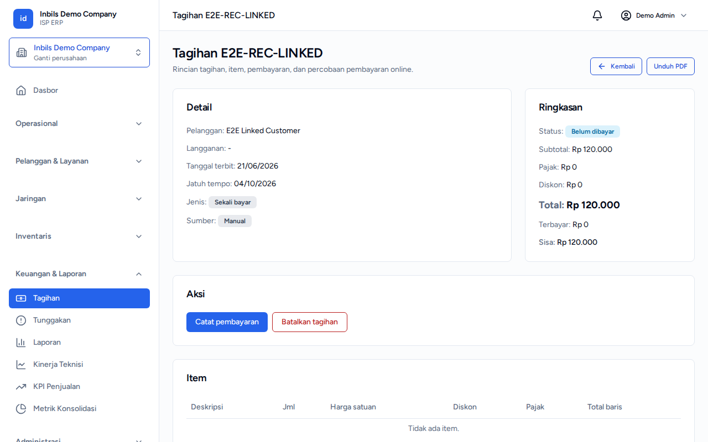
3. Angka di detail tampil tanpa "Rp" dan dengan dua desimal, misalnya 120000.00. Tanggal tampil dalam format teknis, misalnya 2026-06-15T00:00:00.000000Z.
4. **Type** dan **Source** menunjukkan asal tagihan: `recurring` dari `subscription` adalah tagihan bulanan, `one_time` dari `spk` adalah tagihan dari SPK, dan `one_time` dari `manual` dibuat lewat **New invoice**.
5. Klik **Download PDF** untuk mengunduh berkas dengan nama nomor tagihan. PDF memuat nama dan alamat perusahaan, nomor, tanggal, jatuh tempo, periode (tagihan bulanan), status, pelanggan, item, subtotal, PPN, diskon, total, jumlah terbayar dan sisa (bila ada pembayaran), terbilang, dan nomor rekening dari `bank_account_info` di Company Settings (bagian 8.1) bila terisi.
6. Kartu **Online payments** muncul bila pembayaran online Midtrans aktif atau tagihan sudah punya percobaan bayar, dan hanya untuk dibaca. Pelanggan membayar lewat aplikasi pelanggan, lalu pembayaran masuk ke tagihan setelah Midtrans mengonfirmasi. Percobaan yang gagal dibukukan (misalnya nominal berbeda atau refund) berstatus `exception` dengan alasannya dan tidak dibalik otomatis; pengguna dengan izin `billing.payment.reverse` membalik pembayaran yang sudah tercatat bila uang memang kembali.

### Menerbitkan tagihan bulanan

Izin yang dibutuhkan: `billing.create`. Sistem juga menjadwalkan penerbitan yang sama untuk bulan sebelumnya setiap hari pukul 02:00 UTC (09:00 WIB). Dialog ini dapat dipakai untuk memeriksa dan menerbitkan periode pilihan.

1. Klik **Generate Tagihan**. Jendela **Generate Tagihan Bulanan** terbuka.
2. Isi **Periode** dengan bulan yang ditagih. Isian ini sudah terisi bulan lalu.
3. Klik **Preview**. Jendela menulis `<n> tagihan akan dibuat, <m> dilewati.` dan menampilkan tabel **Pelanggan**, **Paket**, **Hari**, dan **Total**. **Hari** adalah hari aktif dibanding jumlah hari dalam bulan, dan nilai di bawah penuh berarti tagihan prorata. **Total** sudah termasuk PPN.
4. Periksa tabel. Bila Anda mengganti **Periode**, pratinjau terhapus dan Anda perlu klik **Preview** lagi.
5. Klik **Terbitkan &lt;n&gt; Tagihan**. Tombol ini hanya ada bila pratinjau memuat tagihan baru. Bila tidak ada, tabel menulis "Tidak ada tagihan baru."
6. Toast `Tagihan <periode>: <n> dibuat, <m> dilewati.` muncul dan jendela tertutup.

Yang dibuat dan dilewati:

- Ikut ditagih: langganan `active` atau `terminated` yang sudah aktif pada akhir periode dan belum berhenti sebelum awal periode. Langganan `pending` dan `suspended` tidak ikut.
- Nominal: MRC langganan. Langganan yang mulai aktif atau berhenti di tengah bulan ditagih prorata menurut hari aktif.
- Dilewati: langganan yang sudah punya tagihan bulanan untuk periode itu (tagihan `cancelled` tidak dihitung) dan langganan bernominal 0. Menjalankan ulang periode yang sama tidak membuat tagihan ganda.
- Setiap tagihan baru memakai nomor otomatis (bagian 7.13), `recurring`, `subscription`, dan langsung berstatus `sent`. Tidak ada tahap `draft`, jadi pratinjau adalah satu-satunya pemeriksaan.
- **Issue Date** adalah hari ini. **Due Date** adalah hari ini ditambah `invoice_due_days` (bawaan 14). PPN memakai `tax_ppn_rate` (bawaan 11). Keduanya diatur di Company Settings (bagian 8.1).
- Satu item bertulis `MRC <nama paket> <tanggal awal> s/d <tanggal akhir>`, ditambah ` (prorata <hari aktif>/<hari dalam bulan> hari)` bila prorata.

### Membuat tagihan manual

Izin yang dibutuhkan: `billing.create`. Pakai tagihan manual untuk biaya di luar langganan bulanan.

1. Klik **New invoice**. Halaman **Create Invoice** terbuka.
2. Isi form:
   - **Customer**: wajib. Daftar memuat pelanggan aktif, urut nama.
   - **Subscription (optional)**: opsional. Daftar memuat kode langganan `pending` dan `active` milik semua pelanggan, dan sistem tidak memeriksa kecocokannya dengan pelanggan yang dipilih. Pilih kode milik pelanggan yang sama.
   - **Issue Date**: opsional. Kosong berarti hari ini.
   - **Due Date**: opsional. Kosong berarti 14 hari dari hari ini.
   - **Notes**: opsional.

   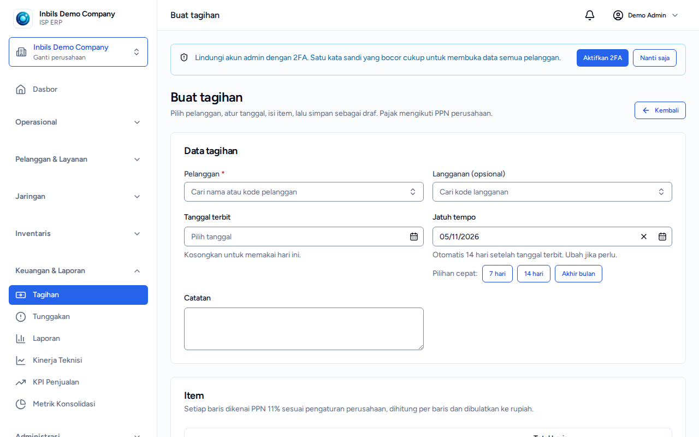
3. Klik **Create**. Toast "Invoice created." muncul dan Anda kembali ke daftar. Tagihan baru berstatus `draft`, `one_time`, `manual`, bertotal 0, dengan nomor otomatis dari **Penomoran** (bagian 7.13).
4. Cari tagihan itu lewat **Search**, lalu klik **Show** untuk menambah item.

### Menambah item dan mengirim tagihan draft

Izin yang dibutuhkan: `billing.update` untuk **Add Item** dan `billing.send` untuk **Send**. Hanya tagihan `draft` yang bisa diberi item.

1. Buka detail tagihan `draft`, lalu klik **Add Item**.
2. Isi jendela **Add Item**:
   - **Description**: wajib, maksimal 500 karakter.
   - **Quantity**: wajib, angka minimal 0,01.
   - **Unit Price**: wajib, angka minimal 0.
   - **Discount**: opsional, nominal rupiah per baris (bukan persen), minimal 0. Terisi 0 sejak awal.
   - **Tax Rate (%)**: opsional, 0 sampai 100. Terisi 0 sejak awal.
3. Klik **Add**. Toast "Item added." muncul, lalu tabel **Items** dan kartu **Status** terhitung ulang. Ulangi untuk item berikutnya.
4. Periksa **Total** di kartu **Status**, lalu klik **Send**. Toast "Invoice sent." muncul dan status menjadi `sent`.

Per baris, **Line Total** adalah **Quantity** kali **Unit Price** dikurangi **Discount**. PPN baris adalah **Line Total** kali **Tax Rate** dibagi 100. **Total** adalah jumlah **Line Total** ditambah jumlah PPN.

- **Tax Rate (%)** tidak terisi otomatis dengan PPN perusahaan. Isi tarifnya sendiri untuk item yang kena PPN. Tagihan bulanan dan tagihan dari SPK memakai tarif perusahaan otomatis.
- Layar tidak punya tombol untuk mengubah atau menghapus item, walau server menyediakan penghapusan item `draft`. Setelah **Send**, item tidak bisa ditambah atau dihapus. Bila isi tagihan salah, batalkan tagihan itu (lihat di bawah) dan buat ulang.
- **Send** tidak memeriksa jumlah item, jadi draft tanpa item terkirim dengan **Total** 0.
- Setelah **Send**, pelanggan melihat tagihan di aplikasi pelanggan. Pelanggan juga menerima WhatsApp "Tagihan terbit" bila WhatsApp aktif di Company Settings (bagian 8.1), jenis pesannya dicentang, dan pelanggan sudah menyetujui pesan WhatsApp.

### Mencatat pembayaran

Izin yang dibutuhkan: `billing.payment.record`. Hanya tagihan `sent`, `partial`, dan `overdue` yang menerima pembayaran.

1. Buka detail tagihan, lalu klik **Record Payment**. Jendela menulis "Remaining:" diikuti sisa tagihan.
2. Isi form:
   - **Amount**: wajib, angka minimal 0,01 dan tidak lebih besar dari sisa. Pembayaran sebagian boleh.
   - **Method**: pilih **Cash**, **Transfer**, **Cheque**, atau **Other**. Terisi **Cash** sejak awal.
   - **Reference**: opsional, maksimal 255 karakter (nomor transfer atau cek). Tidak boleh sama dengan referensi pembayaran aktif lain di perusahaan.
   - **Notes**: opsional, maksimal 500 karakter.
3. Klik **Record**. Toast "Payment recorded." muncul dan pembayaran masuk ke tabel **Payments** dengan status **Active**.

Tabel **Payments** menyimpan riwayat pembayaran: **Amount**, **Method**, **Reference**, **Paid At**, dan **Status**. Pembayaran yang dibalik tetap tampil dengan status **Cancelled**.

Waktu bayar dan pencatat tersimpan otomatis, jadi tidak ada isian tanggal. Status menjadi `paid` bila jumlah pembayaran aktif sudah menyamai **Total**, selain itu `partial`. Pembayaran tidak bisa diubah atau dihapus. Koreksi salah catat dengan **Reverse**, lalu catat ulang.

### Membalik pembayaran

Izin yang dibutuhkan: `billing.payment.reverse`. Pencatat pembayaran tidak boleh membaliknya sendiri. Pengguna lain dengan izin yang sama yang membalik.

1. Di tabel **Payments**, klik **Reverse** pada baris pembayaran berstatus **Active**. Tombol tidak tampil tanpa izin.
2. Isi **Reason**: wajib, maksimal 500 karakter. Jendela **Reverse Payment** menjelaskan bahwa pembalikan mengurangi jumlah terbayar dan menurunkan ulang status tagihan.
3. Klik **Confirm Reverse**. Toast "Payment reversed." muncul dan baris itu berstatus **Cancelled**.

Setelah pembalikan, tagihan menjadi `sent` bila tidak ada pembayaran aktif tersisa, `paid` bila pembayaran aktif masih menutup **Total**, dan `partial` selain itu. Pembayaran Midtrans dicatat oleh sistem, bukan oleh pengguna, jadi siapa pun dengan izin dapat membaliknya.

Untuk tagihan `paid`, tombol **Cancel** tidak ada. Balik pembayarannya sampai status kembali `sent`, lalu batalkan tagihannya bila memang perlu.

### Membatalkan tagihan

Izin yang dibutuhkan: `billing.cancel`. Pembatalan tidak bisa dibatalkan lagi.

1. Buka detail tagihan, lalu klik **Cancel** di kartu **Actions**. Tombol tidak ada untuk tagihan `paid` dan `cancelled`.
2. Isi **Reason**: wajib, maksimal 500 karakter.
3. Klik **Confirm Cancel**. Toast "Invoice cancelled." muncul, status menjadi `cancelled`, dan alasan tampil di kartu **Details** sebagai **Cancel Reason**.

Sistem menolak pembatalan bila tagihan masih punya pembayaran aktif. Balik semua pembayarannya dulu, termasuk pada tagihan `paid`. Sistem juga menolak bila Anda pembuat tagihan itu.

- Pembuat tagihan manual adalah pengguna yang mengklik **Create**.
- Pembuat tagihan dari SPK adalah penyetuju SPK.
- Tagihan hasil **Generate Tagihan** tidak punya pembuat, jadi siapa pun dengan izin dapat membatalkannya.
- Tagihan bulanan yang dibatalkan tidak mengunci periodenya: penerbitan berikutnya untuk periode itu dapat membuat tagihan baru.

### Melihat tagihan dari SPK

Tagihan sekali bayar dari SPK dibuat oleh sistem. Layar tidak punya tombol untuk membuatnya.

1. Setujui SPK yang selesai di halaman SPK (bagian 3.3). Status SPK menjadi `completed`.
2. Bila pengaturan perusahaan `spk_auto_invoice` menyala, sistem membuat satu tagihan `draft` untuk SPK itu (`one_time`, `spk`).
3. Buka **Tagihan**, cari nomor atau nama pelanggannya, lalu buka tagihan itu.
4. Periksa item dan tambahkan bila perlu lewat **Add Item**. Klik **Send** setelah isinya benar.

Item berasal dari bahan SPK yang terpakai (jumlah terpakai kali harga jual barang, dengan PPN perusahaan) dan satu baris "Biaya Instalasi" diikuti jenis SPK bila langganan punya biaya instalasi. **Due Date** adalah 14 hari setelah penyetujuan. Satu SPK hanya punya satu tagihan, dan pembuat tagihan adalah penyetuju SPK.

Bila `spk_auto_invoice` mati, tidak ada tagihan yang terbit. Buat tagihan manual lewat **New invoice** bila biaya SPK tetap perlu ditagih. Company Settings (bagian 8.1) menampilkan `spk_auto_invoice` sebagai saklar hanya bila kunci itu sudah ada di pengaturan perusahaan.

### Memantau jatuh tempo dan isolir otomatis

- Setiap hari pukul 03:00 UTC (10:00 WIB), tagihan `sent` dan `partial` yang jatuh temponya sudah lewat dan masih ada sisa menjadi `overdue`.
- Bila WhatsApp aktif, pelanggan menerima pengingat 3 hari dan 1 hari sebelum jatuh tempo, dan 1 hari sesudahnya.
- Isolir otomatis mati sampai admin menyalakan saklar `auto_suspend_enabled` di Company Settings (bagian 8.1). `auto_suspend_overdue_days` menentukan batas hari (bawaan 7, isian 1 sampai 60).
- Setiap hari pukul 08:00 UTC (15:00 WIB), langganan `active` yang punya tagihan belum lunas dengan jatuh tempo lebih dari batas hari lalu diisolir (`suspended`, sumber `overdue`). Tepat pada batas hari belum diisolir, satu hari lebih lama sudah.
- Pelanggan kehilangan layanannya. Akun jaringan yang disinkronkan ke RADIUS masuk grup isolir perusahaan dan sesinya diputus (bab 5). Langganan `suspended` tidak ditagih bulanan lagi.
- Pembayaran membuka isolir otomatis bila saklar `auto_reactivate_on_payment` menyala (bawaan menyala), langganan itu `suspended` dengan sumber `overdue`, tagihannya yang sudah jatuh tempo saat isolir sudah lunas, dan tidak ada tagihan yang melewati batas hari. Pembayaran sebagian belum cukup, dan proses berjalan lewat antrean.
- Isolir manual tidak dibuka otomatis. Block juga tidak dicabut oleh pembayaran (bagian 7.2).
- Pengiriman, pembayaran, pembalikan, dan pembatalan tercatat di Audit Log (bagian 7.12).

### Kesalahan umum

- Staf menekan **Add Item** atau **Cancel** dan ditolak (403). Tindakan itu perlu `billing.update` dan `billing.cancel`, yang dimiliki admin dan manajer. Minta mereka melakukannya.
- Toast "Data gagal disimpan. Periksa input." di jendela **Add Item**, **Record Payment**, **Cancel Invoice**, atau **Reverse Payment** berarti satu isian ditolak. Jendela tidak menandai isiannya, jadi cocokkan dengan aturan di bagian ini.
- **Amount** lebih besar dari **Remaining** ditolak (galat 422, "Payment amount exceeds remaining balance."). **Reference** yang sama dengan pembayaran aktif lain juga ditolak ("Payment reference already exists."). Perbaiki isiannya.
- Pembatalan atau pembalikan oleh pembuatnya ditolak ("Cannot cancel own created invoice.", "Cannot reverse own recorded payment."). Minta pengguna lain dengan izin yang sama.
- Pembatalan ditolak bila ada pembayaran aktif ("Cannot cancel invoice with active payments. Reverse payments first."). Balik pembayarannya dulu.
- Draft tanpa item terkirim dengan **Total** 0 dan tidak bisa diisi lagi. Tambahkan item sebelum **Send**.
- Memilih Issued, Void, atau Written off di **Status** menghasilkan daftar kosong ("No invoices"). Pilihan itu bukan status yang dipakai sistem. Pilih All, lalu urutkan kolom **Status**.
- **Periode** di **Generate Tagihan** hanya diperiksa formatnya. Bulan berjalan atau bulan depan tetap diproses dan langsung terbit sebagai `sent`. Pastikan bulannya benar sebelum klik **Terbitkan**.
- Mengubah `invoice_prefix` atau `billing_default_due_days` di Company Settings tidak mengubah apa pun. Awalan nomor tagihan diatur di **Penomoran** (bagian 7.13), dan jatuh tempo tagihan bulanan memakai `invoice_due_days`.

## 7.2 Tunggakan

Halaman ini menjumlahkan sisa tagihan yang belum dibayar untuk tiap pelanggan dan mengelompokkannya menurut umur jatuh tempo. Buka halaman ini untuk melihat siapa yang menunggak dan sudah berapa lama, lalu mengisolir atau memblokir langganan pelanggan itu.

Peran yang dapat memakai: admin, manajer, dan staf. Izin: `billing.view`. Tombol **Isolir** perlu `customer.subscription.suspend`, tombol **Block** dan **Unblock** perlu `customer.subscription.block`. Admin dan manajer memiliki keduanya, jadi staf melihat angka tanpa tombol tindakan. Data hanya dari perusahaan aktif.

### Membuka dan membaca daftar

1. Di sidebar, buka grup **Keuangan & Laporan**, lalu klik **Tunggakan**.
2. Enam kartu di atas menjumlahkan semua pelanggan, bukan hanya halaman yang tampil: **Belum jatuh tempo**, tiga rentang umur (1 sampai 30 hari, 31 sampai 60 hari, dan 61 sampai 90 hari), **>90 hari**, dan **Total piutang**. Angka 0 tampil sebagai "-".

   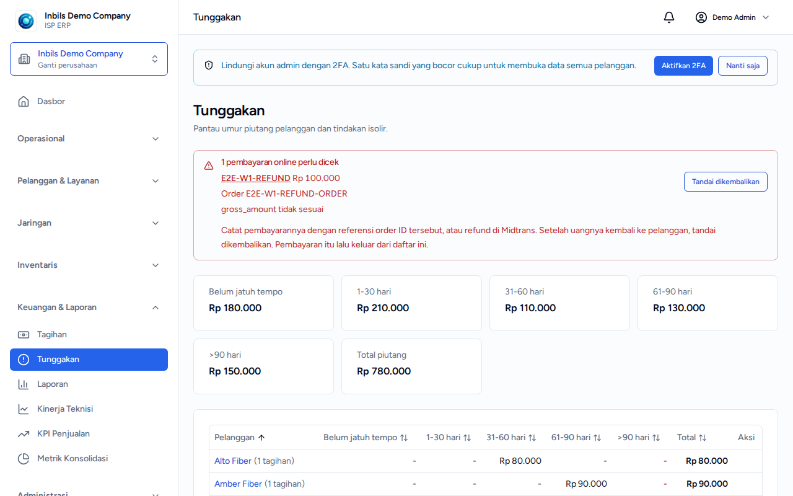
3. Tabel memuat satu baris per pelanggan: **Pelanggan** (nama dan jumlah tagihan terbuka, misalnya "(1 invoice)"), **Belum Jatuh Tempo**, tiga kolom rentang umur, **>90 hari** (merah), **Total**, dan **Tindakan**. Semua kolom kecuali **Tindakan** bisa diurutkan, dan urutan awalnya **Pelanggan** dari A ke Z. Halaman ini tidak punya kotak pencarian, filter, atau tombol ekspor.
4. Klik nama pelanggan untuk membuka **Tagihan** yang hanya menampilkan tagihan pelanggan itu, semua status termasuk yang lunas. Daftar itu tidak menampilkan filter pelanggan. Klik **Tagihan** di sidebar untuk kembali ke semua tagihan.

Yang dihitung:

- Tagihan berstatus `sent`, `partial`, atau `overdue` yang masih punya sisa. Nilainya **Total** dikurangi jumlah terbayar. Tagihan `draft`, `paid`, dan `cancelled` tidak dihitung.
- Kolom ditentukan dari tanggal jatuh tempo dan hari ini, bukan dari status. Tagihan yang jatuh tempo hari ini atau belum lewat masuk **Belum Jatuh Tempo**. Tagihan yang lewat 1 sampai 30 hari masuk kolom pertama, dan seterusnya sampai **>90 hari**.
- Pelanggan yang semua tagihannya lunas tidak tampil.

Beda dengan **Tagihan** (bagian 7.1): **Tagihan** memuat setiap tagihan, satu baris per tagihan, semua status, dengan filter dan ekspor. **Tunggakan** hanya memuat sisa yang masih terbuka, dijumlahkan per pelanggan dan dikelompokkan menurut umur.

### Mengisolir langganan

Izin yang dibutuhkan: `customer.subscription.suspend`. Kolom **Tindakan** menampilkan tombol untuk setiap langganan `active` milik pelanggan di baris itu, termasuk langganan yang tagihannya lunas atau belum jatuh tempo.

1. Di kolom **Tindakan**, klik tombol **Isolir** diikuti kode langganan yang benar.
2. Isi **Alasan isolir (wajib)** di jendela `Isolir subscription <kode>?`. Isian ini maksimal 500 karakter, dan tombol **Isolir** aktif setelah alasan terisi.
3. Klik **Isolir**. Toast "Subscription suspended." muncul, dan langganan berstatus `suspended` dengan sumber `overdue`.

Isolir dari halaman ini dihitung sebagai isolir karena tunggakan, jadi pembayaran dapat membukanya otomatis dengan syarat di bagian 7.1 ("Memantau jatuh tempo dan isolir otomatis"). Langganan `suspended` tidak lagi punya tombol di halaman ini kecuali diblokir. Aktifkan kembali secara manual dari halaman pelanggan (bagian 4.1).

### Memblokir atau membuka blokir

Izin yang dibutuhkan: `customer.subscription.block`. Block mengisolir pelanggan tanpa mengubah status langganan, dan pembayaran tidak mencabutnya.

1. Klik tombol **Block** diikuti kode langganan yang benar. Langganan yang sudah diblokir menampilkan lencana **Blocked** dan tombol **Unblock** diikuti kodenya.
2. Baca penjelasan di jendela `Block internet of <kode>?` atau `Unblock internet of <kode>?`. Block mengisolir dan memutus pelanggan, sedangkan penagihan jalan terus. Unblock mengembalikan layanan normal saat router menyambung ulang. Bila langganan masih `suspended`, layanan tetap terisolir sampai langganan diaktifkan kembali.
3. Isi **Reason** (wajib, maksimal 500 karakter) untuk Block, atau **Note (optional)** untuk Unblock.
4. Klik **Block internet** atau **Unblock**. Toast "Subscription blocked." atau "Subscription unblocked." muncul.

### Kesalahan umum

- Jumlah di **Tunggakan** berbeda dari jumlah di **Tagihan**. **Tunggakan** menghitung sisa, bukan **Total**, dan hanya tagihan `sent`, `partial`, dan `overdue`. Cocokkan dengan kolom **Remaining** dan **Status** di daftar tagihan pelanggan itu.
- Tombol **Isolir** muncul untuk setiap langganan aktif pelanggan itu, bukan hanya yang menunggak. Cocokkan kode langganan dengan tagihan yang menunggak sebelum klik.
- Langganan `suspended` tanpa blokir tidak punya tombol di halaman ini. Aktifkan kembali dari halaman pelanggan (bagian 4.1).
- Staf tidak melihat tombol apa pun di kolom **Tindakan**. Tombol hanya muncul untuk pemilik izin `customer.subscription.suspend` atau `customer.subscription.block`.

## 7.3 Laporan

Laporan menghitung angka langsung dari riwayat langganan, tagihan, tiket, SPK, aset, stok, dan evaluasi. Semua layar laporan hanya-baca. Layar ini tidak menyediakan tombol untuk menambah, mengubah, atau menghapus data sumber.

Peran yang dapat memakai hub: admin, manajer, dan staf dengan izin `report.view`. Setiap kartu laporan tetap memerlukan izin khusus. Angka hanya mencakup perusahaan yang sedang aktif, kecuali Metrik Konsolidasi.

| Kartu laporan | Izin untuk membuka | Peran bawaan |
| --- | --- | --- |
| Business Metrics | `report.business.view` | admin, manajer, staf |
| Asset Utilization | `report.asset.view` | admin, manajer, staf |
| SLA Compliance | `report.sla.view` | admin, manajer, staf |
| Stock Card | `report.stock_card.view` | admin, manajer, staf |
| Data Dictionary | `report.dictionary.view` | admin, manajer, staf |
| Technician Performance | `report.technician` dan aturan akses teknisi | admin, manajer |
| Sales KPI | `report.sales.view` | admin, manajer |
| Audit Log | `report.audit.view` | admin |
| Consolidated Metrics | `report.consolidated.view` dan perusahaan aktif berupa Head | admin |

Admin dengan `report.manage` dapat memilih teknisi aktif di perusahaan. Manajer harus mempunyai profil karyawan aktif pada unit organisasi aktif. Pilihan teknisinya terbatas pada unit tersebut dan unit di bawahnya. Aturan teknisi untuk melihat dirinya sendiri ada di server, tetapi akun teknisi memakai aplikasi Android, bukan web.

Kartu **Consolidated Metrics** hanya muncul saat perusahaan aktif berupa Head, yaitu perusahaan tanpa induk yang mempunyai anak perusahaan aktif. Tombol ekspor memerlukan `report.export` selain izin laporannya. Peran bawaan admin dan manajer memegang izin ekspor, sedangkan staf tidak.

### Membuka daftar laporan

1. Di sidebar, buka grup **Keuangan & Laporan**, lalu klik **Laporan**.
2. Baca kartu yang tersedia. Setiap kartu memuat judul, uraian singkat, dan tombol **Open** yang diikuti judul laporan.

   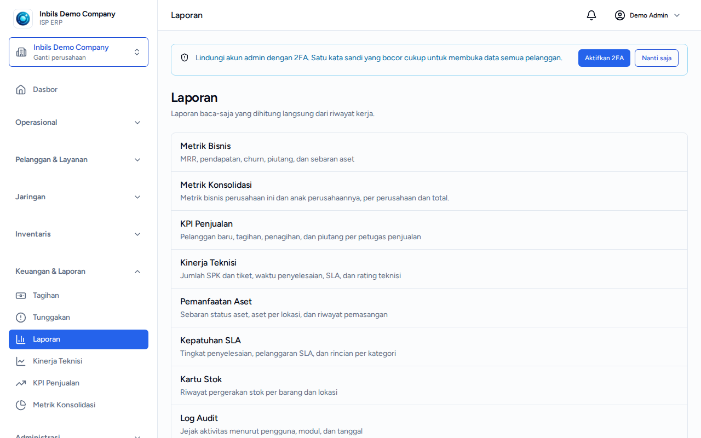

3. Klik tombol **Open** pada kartu yang diperlukan. Hub hanya menampilkan kartu yang diizinkan untuk akun Anda.
4. **Kinerja Teknisi**, **KPI Penjualan**, dan **Metrik Konsolidasi** juga mempunyai menu sendiri di sidebar. Judul kartu hub untuk ketiganya adalah **Technician Performance**, **Sales KPI**, dan **Consolidated Metrics**.

Bila tidak ada kartu yang diizinkan, hub menampilkan **No reports available**. Admin dapat menambah izin lewat Peran (bagian 8.6) dan Hak Akses (bagian 8.7).

### Memilih Periode

1. Klik isian **Periode** yang mula-mula bertuliskan **Semua tanggal**, atau klik tombol **Buka kalender**.
2. Pilih salah satu pilihan cepat: **Hari ini**, **7 hari terakhir**, **30 hari terakhir**, **Bulan ini**, **Bulan lalu**, atau **Tahun ini**. Pilihan periode berjalan berakhir pada hari ini menurut waktu perusahaan.
3. Untuk rentang lain, klik tanggal mulai lalu tanggal akhir. Kalender menampilkan dua bulan pada layar lebar dan satu bulan pada layar sempit.
4. Anda juga dapat mengetik rentang dalam format tanggal perusahaan. Pisahkan kedua tanggal dengan tanda hubung yang diberi spasi. Tahun harus memakai empat angka.
5. Klik **Run**. Audit Log memakai tombol **Terapkan Filter**. Pilihan baru belum memengaruhi angka sebelum tombol ini diklik.
6. Untuk kembali ke semua tanggal, klik **Hapus rentang tanggal**, lalu jalankan laporan lagi.

Kedua batas tanggal bersifat inklusif. Untuk kolom waktu, Inbils memakai awal hari tanggal mulai sampai akhir hari tanggal akhir menurut zona waktu perusahaan. Kolom kalender seperti tanggal terbit tagihan dibandingkan sebagai tanggal tanpa konversi zona waktu.

Rentang boleh hanya mempunyai tanggal mulai atau tanggal akhir. Tanggal akhir tidak boleh lebih awal daripada tanggal mulai. Isian menampilkan "Tanggal akhir tidak boleh sebelum tanggal mulai." bila urutannya terbalik, atau pesan format tidak valid bila tulisan tidak dapat dibaca.

Kode tidak membatasi jumlah hari dalam satu rentang. Rentang yang panjang hanya mengubah pengelompokan grafik. Setelah laporan dijalankan, `date_from` dan `date_to` tersimpan pada URL, sehingga filter pulih saat halaman dimuat ulang atau dibagikan.

### Membaca grafik

Business Metrics, Asset Utilization, SLA Compliance, Kinerja Teknisi, dan KPI Penjualan memakai grafik berikut:

- Grafik garis menampilkan perubahan menurut waktu.
- Grafik batang membandingkan kategori, lokasi, atau acquirer.
- Diagram donat membagi satu jumlah menurut status atau hasil SLA.

Grafik waktu memakai kelompok harian untuk rentang sampai 31 hari, mingguan sampai 184 hari, lalu bulanan. Minggu dimulai hari Senin. Tanpa tanggal mulai, grafik memakai kelompok bulanan dari data tertua sampai hari ini, dengan paling banyak 36 kelompok bulan. Bulan yang lebih lama digabung ke kelompok pertama.

Arahkan penunjuk ke titik, batang, atau irisan untuk melihat nama seri dan nilai lengkap. Sumbu dapat menyingkat angka, sedangkan tooltip memakai nilai lengkap. Diagram donat menulis jumlah dan persentase pada legenda.

Grafik batang dan donat pada beberapa laporan menampilkan paling banyak sepuluh baris. Bila datanya lebih banyak, sembilan baris terbesar tampil dan sisanya bergabung sebagai **Lainnya**. Bila seluruh nilainya nol, area grafik menampilkan **Tidak ada data pada periode ini**.

### Membaca angka dan definisinya

Banyak kartu angka mempunyai kalimat definisi, lalu label **Period** atau **Snapshot** dan versi rumus. **Period** berarti tanggal sumber harus masuk dalam **Periode**. **Snapshot** berarti angka mencerminkan kondisi saat ini dan mengabaikan **Periode**.

Klik **Formula and sources** untuk membuka rincian **Formula**, **Unit**, **Date basis**, **Statuses**, **Sources**, **Scope**, dan **Known caveats**. Buka Data Dictionary (bagian 7.8) untuk membaca semua definisi pada satu halaman. Kinerja Teknisi tidak menampilkan rincian ini pada kartu, tetapi definisinya tetap ada di Data Dictionary.

### Mengekspor laporan

1. Jalankan filter yang diperlukan.
2. Klik **Export**. Audit Log memakai tombol **Ekspor Log**.
3. Pilih **Export CSV** atau **Export PDF**.

Ekspor ringkasan memakai kolom Metric, Breakdown, Value, Unit, Scope, Filters, dan Version. Stock Card dan Audit Log mengekspor seluruh baris yang cocok dengan filter, bukan hanya halaman tabel yang sedang terlihat.

Sales KPI dan Data Dictionary tidak menyediakan ekspor. Metrik Konsolidasi hanya menyediakan CSV. Batas 5.000 baris dan penanda file terpotong dijelaskan di bagian 1.5.

### Melihat data di balik angka

1. Klik **View records** di bawah angka atau baris rincian. Tautan hanya muncul bila akun Anda juga boleh membuka modul sumber.
2. Baca kartu **Tie-out to the report**. Kartu ini membandingkan jumlah atau penjumlahan baris dengan angka pada laporan.
3. Baca lencana hasil:
   - **Ties out** berarti baris cocok dengan angka laporan.
   - **Differs** berarti daftar dan angka laporan berbeda.
   - **Not reconcilable by rows** muncul untuk rata-rata atau daftar yang dibatasi oleh akses pengguna.
4. Klik nilai pada kolom pertama untuk membuka catatan sumber, misalnya tagihan, tiket, SPK, langganan, aset, atau evaluasi.
5. Pakai tombol **Back to** yang diikuti judul laporan untuk kembali. Menu **Export** pada halaman ini mengunduh daftar sumber sebagai CSV atau PDF.

Tautan sumber memerlukan izin modul terkait: `customer.subscription.view`, `billing.view`, `ticket.view`, `spk.view`, `network_asset.view`, atau `evaluation.view` maupun `evaluation.view.own`. Pengguna yang boleh mengerjakan tiket atau SPK tetapi tidak boleh menugaskannya hanya melihat baris yang ditugaskan kepadanya.

Drill-down Outstanding dapat menampilkan kartu **Reconciliation** dan tombol **Open Receivables**. Kartu ini memperlihatkan selisih terhadap Tunggakan karena kedua layar mempunyai aturan penyertaan sendiri.

### Kesalahan umum

- Kartu laporan tidak ada: peran Anda tidak memegang izin laporan itu. Minta admin memeriksa Peran dan Hak Akses.
- Tombol **Export** tidak ada: akun tidak memegang `report.export`, atau laporan memang tidak mendukung ekspor.
- Tautan **View records** tidak ada: akun boleh melihat angka agregat tetapi tidak boleh membuka daftar sumbernya.
- Angka tidak berubah setelah memilih tanggal: klik **Run** atau **Terapkan Filter**. Ekspor dan drill-down memakai filter yang sudah diterapkan.
- Angka **Snapshot** tidak berubah saat **Periode** berganti. Ini perilaku rumus, bukan kegagalan filter.
- Angka berubah setelah ganti perusahaan: semua laporan biasa mengikuti perusahaan aktif. Periksa pemilih perusahaan di sidebar, lihat bagian 1.6.

## 7.4 Business Metrics (metrik bisnis)

Business Metrics merangkum pendapatan berulang, pendapatan tagihan lunas, saldo belum dibayar, langganan, dan kepatuhan SLA. Buka laporan ini untuk memeriksa kondisi bisnis perusahaan aktif dan menelusuri catatan sumbernya.

Peran yang dapat memakai: admin, manajer, staf. Izin: `report.business.view`. Tombol **Export** memerlukan `report.export`.

### Membuka dan membaca laporan

1. Buka **Laporan**, lalu klik **Open Business Metrics**.
2. Pilih **Periode**, lalu klik **Run**. Header menampilkan **Formula version business.v1**.

   Pilih juga **Kategori paket**: **Semua kategori** atau satu kategori (bagian 4.2). Pilihan ini membatasi MRR, pendapatan, saldo belum dibayar, jumlah langganan, pemasangan, serta grafik tagihan dan MRR pada paket kategori itu. Kategori nonaktif tampil dengan tulisan `(nonaktif)`. Aset, SLA, dan pelanggan baru tidak terpengaruh. Tagihan satu kali tanpa langganan tidak masuk kategori mana pun. Tautan **View records** dan file ekspor mengikuti kategori yang dipilih.

3. Baca enam kartu:
   - **MRR** menjumlahkan tarif bulanan semua langganan yang saat ini berstatus `active`. Angka ini **Snapshot**.
   - **Revenue (Paid)** menjumlahkan `paid_amount` tagihan berstatus `paid` berdasarkan tanggal terbit dalam **Periode**. Tagihan yang baru dibayar sebagian tidak masuk.
   - **Outstanding** menjumlahkan `total` dikurangi `paid_amount` pada tagihan berstatus `sent`, `partial`, atau `overdue`. Angka ini **Snapshot**.
   - **Active Subscriptions** menghitung langganan yang saat ini berstatus `active`.
   - **Suspended Subscriptions** menghitung langganan yang saat ini berstatus `suspended`.
   - **SLA Compliance** menghitung persentase tiket dengan `resolved_at` yang selesai paling lambat pada batas SLA. Angka ini memakai semua waktu dan mengabaikan **Periode**.
4. Klik **View records** untuk membuka langganan, tagihan, atau tiket di balik kartu. Tautan mengikuti izin modul sumber.
5. Baca grafik **Pendapatan terbayar dan MRR per hari**, **per minggu**, atau **per bulan**. Pendapatan memakai tanggal terbit tagihan lunas. MRR menunjukkan posisi pada akhir setiap kelompok waktu.
6. Baca diagram **Tagihan menurut status**. Diagram memakai tanggal terbit dan memisahkan Draf, Terkirim, Dibayar sebagian, Lunas, Lewat jatuh tempo, dan Dibatalkan.
7. Klik **Export** untuk mengunduh CSV atau PDF. File memuat semua 13 metrik Business, termasuk Terminated Subscriptions, New Subscriptions, Churn, Recurring Revenue, One-Time Revenue, Asset Distribution, dan Installations Completed yang tidak tampil sebagai kartu.

### Kesalahan umum

- **Periode** hanya mengubah **Revenue (Paid)** di antara enam kartu. Lima kartu lain merupakan Snapshot atau angka semua waktu.
- Revenue dapat lebih kecil daripada uang yang masuk. Metrik ini memakai tagihan yang sudah `paid` dan tanggal terbit, sedangkan **Collected** di KPI Penjualan memakai pembayaran yang tidak dibalik dan tanggal bayar.
- **Outstanding** dapat berbeda dengan Tunggakan. Klik **View records** pada kartu ini untuk melihat **Reconciliation** terhadap **Receivables**.
- **SLA Compliance** dapat berbeda dari SLA Rate di bagian 7.6. Business Metrics memakai semua tiket yang mempunyai `resolved_at`, tanpa filter periode.
- Tanpa **Periode**, New Subscriptions dan Churn pada file ekspor bernilai 0. Metrik periode lain memakai semua catatan yang cocok.
- Grafik menampilkan **Tidak ada data pada periode ini** bila tidak ada nilai yang dapat digambar. Kartu tetap menampilkan 0 atau nilai Snapshot.

## 7.5 Asset Utilization (pemakaian aset)

Asset Utilization merangkum status aset jaringan, lokasi aset, riwayat pemasangan, aset yang terhubung ke pelanggan, dan aset pensiun. Data sumbernya berasal dari Aset Jaringan (bagian 5.2).

Peran yang dapat memakai: admin, manajer, staf. Izin: `report.asset.view`. Tombol **Export** memerlukan `report.export`.

### Membuka dan membaca laporan

1. Buka **Laporan**, lalu klik **Open Asset Utilization**.
2. Pilih **Asset Type**: **All**, **Router**, **Switch**, **OLT**, **ONU/ONT**, **Radio**, atau **Antenna**.
3. Pilih **Periode**, lalu klik **Run**. Header menampilkan **Formula version asset.v1**.
4. Baca tiga kartu:
   - **Installations** menghitung catatan pemasangan aset dengan `installed_at` dalam **Periode**. Angka ini mengabaikan **Asset Type**.
   - **Customer-Linked** menghitung aset yang saat ini mempunyai pelanggan. Angka ini mengabaikan semua filter.
   - **Retired** menghitung aset yang saat ini berstatus `retired`. Angka ini mengabaikan semua filter.
5. Baca diagram **Aset jaringan menurut status**. Diagram memakai **Asset Type** dan menampilkan kondisi saat ini. **Periode** tidak berlaku.
6. Baca grafik **Aset jaringan per lokasi**. Grafik menghitung aset yang mempunyai lokasi, tanpa memakai **Asset Type** atau **Periode**.
7. Baca tabel **Status Distribution** dengan kolom **Status** dan **Count**. Klik **View records** pada satu status untuk membuka aset di balik jumlah itu.
8. Klik **Export** untuk mengunduh CSV atau PDF. File memuat Status Distribution, Assets by Location, Installations, Customer-Linked, dan Retired.

### Kesalahan umum

- **Asset Type** hanya memengaruhi Status Distribution. Kartu, grafik lokasi, dan sebagian besar angka tidak berubah saat filter ini diganti.
- Pilihan **Asset Type** tidak mencantumkan Fiber, ODP, ODC, Rack, Power, dan Other. Pilih **All** agar jenis tersebut tetap masuk.
- **Installations** menghitung catatan pemasangan aset. Metrik Installations Completed di Business Metrics menghitung SPK pemasangan yang selesai, sehingga angkanya dapat berbeda.
- Lokasi bernama sama bergabung menjadi satu batang. Aset tanpa lokasi tidak masuk ke grafik lokasi.
- Layar tidak menyediakan filter Location. URL dengan `location_id` dapat membatasi Status Distribution, tetapi filter itu tidak dapat dipilih dari form.
- Tabel kosong menampilkan **No data found.** Grafik kosong menampilkan **Tidak ada data pada periode ini**.

## 7.6 SLA Compliance (kepatuhan SLA)

SLA Compliance menghitung tiket selesai, tiket yang memenuhi batas SLA, pelanggaran, kecepatan respons pertama, waktu penyelesaian, dan rincian kategori. Data sumbernya berasal dari Tiket (bagian 3.4).

Peran yang dapat memakai: admin, manajer, staf. Izin: `report.sla.view`. Tombol **Export** memerlukan `report.export`.

### Membuka dan membaca laporan

1. Buka **Laporan**, lalu klik **Open SLA Compliance**.
2. Pilih **Periode**, lalu klik **Run**. Layar tidak mempunyai filter tambahan. Header menampilkan **Formula version sla.v1**.
3. Baca lima kartu:
   - **Total Resolved** menghitung tiket yang mempunyai `resolved_at` dalam **Periode**, apa pun statusnya saat ini.
   - **SLA Rate** adalah persentase Total Resolved yang selesai paling lambat pada `sla_deadline`.
   - **Response Rate** adalah persentase Total Resolved yang respons pertamanya (**Start**) datang paling lambat pada `response_deadline`. Hanya tiket yang sudah dinilai yang dihitung: tiket yang punya target respons dan punya catatan respons pertama. Di bawah angka tertulis `N tepat waktu, N terlambat, N tanpa target respons`. Angka kosong tampil sebagai **-**.
   - **Breaches** menghitung Total Resolved yang selesai setelah `sla_deadline`.
   - **Avg Resolution** adalah rata-rata menit dari pembuatan sampai penyelesaian. Nilai kosong tampil sebagai **- min**.
4. Baca diagram **Tiket selesai menurut SLA**. Irisan **Sesuai SLA** dan **Melewati SLA** memakai angka pada kartu.
5. Baca grafik **Tiket selesai per kategori**. Grafik membandingkan **Total selesai** dan **Sesuai SLA** pada setiap kategori.
6. Baca tabel **Resolved by Category** dengan kolom **Category**, **Total**, **Compliant**, dan **Rate**. Klik **View records** pada Total untuk membuka tiket kategori tersebut.
7. Klik **Export** untuk mengunduh CSV atau PDF. File juga memuat SLA Compliant, Avg First Response, dan rincian total, compliant, serta rate untuk setiap kategori.

### Kesalahan umum

- Grafik dan tabel kategori mengabaikan **Periode**. Keduanya dapat berbeda dari lima kartu pada rentang yang sama.
- Jumlah **SLA Compliant** ditambah **Breaches** dapat lebih kecil daripada **Total Resolved**. Tiket tanpa `sla_deadline` masuk Total Resolved, tetapi tidak dianggap patuh atau melanggar.
- **SLA Rate** bernilai 0 bila tidak ada tiket selesai. **Avg Resolution** kosong pada kondisi yang sama.
- **Response Rate** kosong (**-**) bila belum ada tiket yang dinilai. Tiket lama yang dibuat sebelum target respons ada tidak punya `response_deadline`. Tiket itu masuk hitungan **tanpa target respons** dan tidak masuk penyebut. Tiket yang punya target tetapi tidak punya catatan respons pertama juga tidak dinilai.
- Definisi lengkap kartu respons ada di Data Dictionary (bagian 7.8): **Response On Time**, **Response Breaches**, **No Response Target**, dan **Response Rate**. Daftar tiket yang dibuka lewat **View records** dan ekspornya memuat kolom `Response deadline` dan `Response` (On time, Breached, No target, atau No response).
- Kategori bernama sama bergabung menjadi satu baris.
- Parameter `category_id` dapat diterima server, tetapi layar ini tidak menyediakan pemilih kategori.

## 7.7 Stock Card (kartu stok)

Stock Card adalah buku catatan pergerakan satu barang. Laporan ini menunjukkan kuantitas gerakan dan saldo lokasi tepat setelah setiap gerakan, tanpa menghitung ulang stok.

Peran yang dapat memakai: admin, manajer, staf. Izin: `report.stock_card.view`. Tombol **Export** memerlukan `report.export`. Tombol menuju stok dan semua mutasi juga memerlukan `inventory.view`.

### Membuka dan membaca kartu stok

1. Buka **Laporan**, lalu klik **Open Stock Card**.
2. Isi **Product ID** dengan ID numerik barang. ID terlihat pada alamat halaman **Show** Barang setelah `/admin/products/`.
3. Pilih **Periode**, lalu klik **Run**. Laporan tetap kosong sebelum Product ID dijalankan.
4. Baca tabel:
   - Kolom **Type** menampilkan jenis gerakan tersimpan, misalnya `receive`, `issue`, `transfer`, `adjustment`, `reserve`, `release`, atau `return`.
   - Kolom **Qty** menampilkan kuantitas bertanda seperti yang dicatat Inventaris.
   - Kolom **Balance** menampilkan saldo baris stok yang tersentuh tepat setelah gerakan.
   - Kolom **From** dan **To** menampilkan lokasi asal dan tujuan.
   - Kolom **Note** menampilkan catatan gerakan.
   - Kolom **Reference** dapat menautkan SPK atau permintaan barang bila akun boleh membukanya.
   - Kolom **Date** menampilkan waktu pencatatan gerakan.
5. Urutkan lewat **Qty**, **Balance**, atau **Date**. Urutan awal memakai waktu terbaru.
6. Gunakan **Stock levels** untuk membuka Stok (bagian 6.5), atau **All movements** untuk membuka Mutasi Stok (bagian 6.7). Tombol hanya muncul setelah Product ID valid dijalankan.
7. Baca kartu **Definitions** di bawah tabel untuk definisi **Stock Movements**, **Qty**, dan **Balance**.
8. Klik **Export** untuk mengunduh seluruh ledger yang cocok sebagai CSV atau PDF. File memuat Date, Product, Type, Quantity, Balance after, From, To, Reference, dan Note.

### Kesalahan umum

- **Product ID** wajib. Browser tidak menjalankan form bila isian kosong.
- **Page not found** setelah **Run** berarti barang tidak ditemukan pada perusahaan aktif. Periksa ID dan perusahaan aktif.
- Pesan **No stock movements** berarti tidak ada gerakan untuk barang dan periode tersebut.
- **Balance** bukan saldo berjalan gabungan dari semua lokasi atau semua baris hasil filter. Nilainya adalah snapshot satu baris stok saat gerakan dicatat.
- Laporan tidak membuat baris saldo awal. Untuk saldo saat ini, klik **Stock levels**.
- Layar tidak mempunyai filter Location. `location_id` pada URL membatasi gerakan yang mempunyai lokasi itu sebagai asal atau tujuan.
- Tombol **Export** baru muncul setelah Product ID diterapkan dan akun memegang `report.export`.

## 7.8 Data Dictionary (kamus data)

Data Dictionary menjelaskan arti, formula, unit, kolom sumber, ruang lingkup, dan keterbatasan setiap angka laporan. Buka halaman ini ketika dua angka tampak berbeda atau saat Anda perlu memeriksa rumus yang dipakai.

Peran yang dapat memakai: admin, manajer, staf. Izin: `report.dictionary.view`. Halaman ini tidak mempunyai filter, grafik, drill-down, atau ekspor.

### Membaca kamus data

1. Buka **Laporan**, lalu klik **Open Data Dictionary**.
2. Baca catatan awal. Angka laporan dibatasi pada perusahaan aktif. Catatan yang sudah dihapus secara lunak tidak dihitung kecuali Known caveats menyebut sebaliknya.
3. Pada **Reports in this dictionary**, klik nama laporan untuk meloncat ke bagiannya. Angka dalam kurung adalah jumlah definisi metrik.
4. Baca header setiap bagian. Header memuat Formula version, izin yang dibutuhkan, dan uraian laporan.
5. Baca kartu metrik:
   - Judul kartu adalah label angka pada laporan.
   - Baris kode menampilkan key dan versi, misalnya `mrr` dan `v1`.
   - **Formula** menjelaskan hitungan yang dijalankan kode.
   - **Unit** dapat berupa Currency, Count, Percent, Minutes, Rating, Quantity, Breakdown, atau Records.
   - **Date basis** menyatakan Snapshot atau Period, termasuk kolom tanggal untuk angka Period.
   - **Statuses** mencantumkan status data yang ikut dihitung.
   - **Sources** mencantumkan pasangan tabel dan kolom.
   - **Scope** menyatakan batas perusahaan atau teknisi.
   - **Known caveats** mencatat pengecualian dan perilaku versi rumus tersebut.

Kamus berisi Business Metrics, Sales KPI, Technician Performance, Asset Utilization, SLA Compliance, dan Stock Card. Formula version v1 merekam rumus yang benar-benar dijalankan saat ini, termasuk perilaku yang belum ideal.

### Kesalahan umum

- Metrik Konsolidasi tidak mempunyai bagian sendiri. Laporan itu memakai definisi Business Metrics.
- Audit Log dan Data Dictionary tidak mempunyai metrik dalam registri, sehingga keduanya tidak muncul sebagai bagian kamus.
- Nama pada layar dapat lebih pendek. **Avg Score** memakai definisi **Avg Evaluation Score**, sedangkan **Avg FRT (min)** memakai **Avg First Response**.
- Nama serupa belum tentu memakai aturan sama. Baca Date basis dan Known caveats sebelum membandingkan dua laporan.
- Halaman ini tidak menampilkan nilai perusahaan. Halaman hanya memuat definisi statis yang sama bagi semua perusahaan.

## 7.9 Kinerja Teknisi

Kinerja Teknisi menampilkan hasil satu teknisi: SPK selesai, tiket selesai, kepatuhan SLA, nilai evaluasi, waktu respons pertama, dan beban kerja aktif. Layar tidak membandingkan banyak teknisi dalam satu tabel. Anda memilih satu teknisi lalu membaca hasilnya.

Peran yang dapat memakai di web: admin dengan `report.manage`, atau manajer dengan `report.technician`, profil karyawan aktif, dan penempatan pada organisasi aktif. Admin dapat memilih semua teknisi aktif pada perusahaan. Manajer hanya dapat memilih teknisi di unitnya dan unit di bawahnya. Aturan server juga mengizinkan peran teknisi dengan `report.technician` melihat dirinya sendiri, tetapi akun teknisi diarahkan ke aplikasi Android.

### Memilih teknisi dan membaca hasil

1. Di sidebar, buka **Keuangan & Laporan**, lalu klik **Kinerja Teknisi**. Anda juga dapat membuka **Technician Performance** dari hub **Laporan**.

   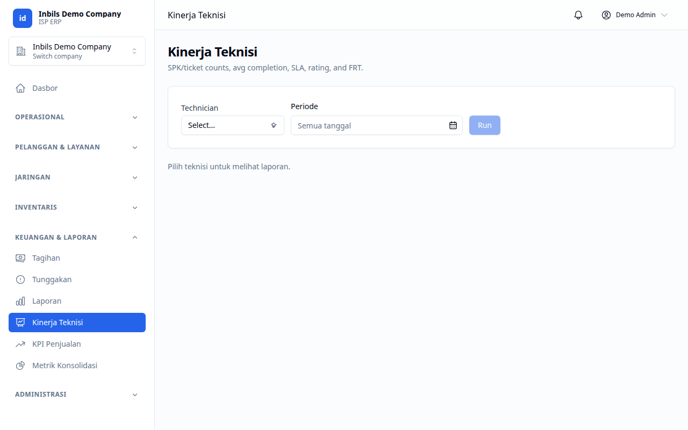

2. Pada **Technician**, pilih teknisi. Daftar hanya memuat pengguna aktif dengan peran teknisi dan profil karyawan aktif pada perusahaan.
3. Pilih **Periode**, lalu klik **Run**. Tombol tetap nonaktif sampai pilihan teknisi valid.
4. Baca enam kartu:
   - **SPK Completed** menghitung SPK berstatus `completed` yang ditugaskan kepada teknisi dan selesai dalam **Periode**.
   - **Tickets Resolved** menghitung tiket berstatus `resolved` atau `closed` yang ditugaskan kepada teknisi dan mempunyai `resolved_at` dalam **Periode**.
   - **SLA Compliance** adalah persentase Tickets Resolved yang selesai paling lambat pada batas SLA.
   - **Avg Score** adalah rata-rata score pada Evaluasi (bagian 3.5) dengan `evaluated_at` dalam **Periode**.
   - **Avg FRT (min)** adalah rata-rata menit dari pembuatan tiket sampai respons pertama, untuk Tickets Resolved yang mempunyai respons pertama.
   - **Active Workload** menghitung SPK berstatus `assigned` atau `in_progress`, ditambah tiket berstatus `open`, `assigned`, atau `on_progress` yang saat ini ditugaskan kepada teknisi.
5. Klik **View records** di bawah kartu untuk membuka daftar sumber. **Active Workload** mempunyai dua tautan, satu untuk SPK dan satu untuk tiket.
6. Baca tiga grafik:
   - **SPK selesai per hari**, **per minggu**, atau **per bulan** menampilkan SPK Completed sepanjang waktu.
   - **SPK selesai menurut jenis** memisahkan Pemasangan, Perawatan, Peningkatan layanan, Relokasi, dan jenis lain.
   - **Tiket selesai menurut kategori** membagi Tickets Resolved berdasarkan kategori tiket.
7. Klik **Export** setelah hasil muncul untuk mengunduh CSV atau PDF. File juga memuat Avg SPK Time, Avg Ticket Time, Avg Customer Rating, SPK by Type, dan Tickets by Category yang tidak tampil sebagai kartu.

### Kesalahan umum

- Menu tidak ada atau halaman menampilkan **Access denied**: manajer tidak memegang `report.technician`, tidak mempunyai profil aktif, atau belum ditempatkan pada organisasi aktif. Perbaiki data pada Karyawan (bagian 8.3) dan Organisasi (bagian 8.2).
- Teknisi tidak muncul: akunnya nonaktif, profil karyawannya tidak aktif, perannya bukan teknisi, perusahaannya berbeda, atau posisinya di luar unit manajer.
- Pesan **Pilih teknisi untuk melihat laporan.** berarti belum ada pilihan. **Tidak ada teknisi yang dapat dipilih.** berarti tidak ada teknisi dalam ruang lingkup akun.
- Nilai berupa tanda hubung berarti tidak ada data yang dapat dirata-ratakan pada periode itu. Angka 0 berarti jumlah yang cocok memang nol.
- **Active Workload** adalah Snapshot. Angka ini tidak berubah saat **Periode** diganti.
- SLA Compliance di sini hanya memakai tiket berstatus `resolved` atau `closed` milik teknisi. Angkanya dapat berbeda dari SLA Compliance pada bagian 7.6.

## 7.10 KPI Penjualan

KPI Penjualan membagi akuisisi pelanggan, aktivasi langganan, MRR, tagihan, pembayaran, saldo belum dibayar, dan collection rate menurut acquirer pelanggan. Acquirer adalah pengguna yang tercatat pada isian **Acquired by** di Pelanggan (bagian 4.1).

Peran yang dapat memakai: admin dan manajer. Izin: `report.sales.view`. Staf tidak memegang izin ini pada peran bawaan. Laporan tidak menyediakan ekspor atau drill-down.

### Membuka dan membaca laporan

1. Di sidebar, buka **Keuangan & Laporan**, lalu klik **KPI Penjualan**. Anda juga dapat membuka **Sales KPI** dari hub **Laporan**.

   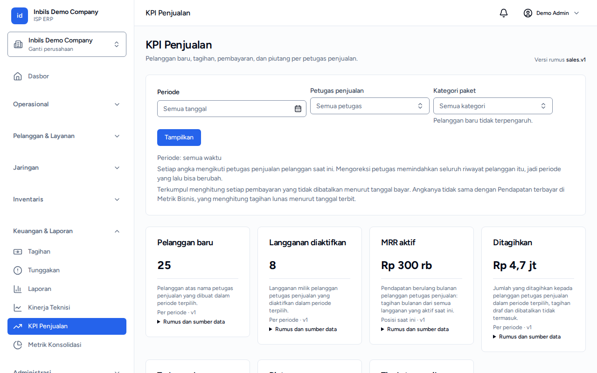

2. Pilih **Periode**. Tanpa pilihan, baris keterangan menulis **Periode: semua waktu**.
3. Pilih **Acquirer**. **All acquirers** menampilkan semua acquirer dan baris Unassigned. Nama pengguna nonaktif diberi tulisan **Inactive**.

   Pilih juga **Kategori paket**: **Semua kategori** atau satu kategori (bagian 4.2). Kategori nonaktif tetap ada di daftar dengan tulisan `(nonaktif)`, karena riwayat masih memakainya. Dengan satu kategori, **Subscriptions Activated**, **Active MRR**, **Invoiced**, **Collected**, **Outstanding** dan Collection Rate hanya menghitung langganan pada paket kategori itu beserta tagihan dan pembayarannya. **Customers Acquired** tidak ikut terfilter.

4. Klik **Run**. Header menampilkan **Formula version sales.v1**.
5. Baca tujuh kartu total:
   - **Customers Acquired** menghitung pelanggan yang saat ini dikreditkan kepada acquirer dan dibuat dalam **Periode**. Pelanggan yang dihapus secara lunak tidak masuk.
   - **Subscriptions Activated** menghitung langganan pelanggan acquirer yang mempunyai activation date dalam **Periode**, apa pun statusnya saat ini.
   - **Active MRR** menjumlahkan tarif bulanan langganan yang saat ini `active`. Angka ini **Snapshot**.
   - **Invoiced** menjumlahkan total tagihan berstatus `sent`, `partial`, `paid`, atau `overdue` menurut issue date dalam **Periode**.
   - **Collected** menjumlahkan pembayaran yang tidak dibalik menurut paid date dalam **Periode**.
   - **Outstanding** menjumlahkan sisa tagihan berstatus `sent`, `partial`, atau `overdue`. Angka ini **Snapshot**.
   - **Collection Rate** adalah Collected dibagi Invoiced. Nilai tampil **n/a** bila Invoiced bernilai 0.
6. Baca grafik:
   - **Pelanggan baru per hari**, **per minggu**, atau **per bulan** memakai tanggal pembuatan pelanggan.
   - **Pelanggan baru per acquirer** membandingkan Customers Acquired.
   - **Pembayaran diterima per acquirer** membandingkan Collected.
7. Baca tabel acquirer. Kolom pertama memuat nama dan penanda **Inactive**. Tujuh kolom metrik dapat diurutkan.
8. Lihat baris **Unassigned** untuk pelanggan tanpa acquirer yang sah. Baris **Total** menjumlahkan semua acquirer dan Unassigned. Filter satu acquirer menyembunyikan Unassigned.

### Kesalahan umum

- Mengoreksi **Acquired by** memindahkan seluruh riwayat pelanggan ke acquirer baru. Angka periode lama dapat berubah.
- **Customers Acquired** memakai tanggal pembuatan pelanggan, bukan tanggal penetapan acquirer.
- **Collected** memakai tanggal pembayaran dan memasukkan pembayaran sebagian yang tidak dibalik. Nilainya tidak sama dengan **Revenue (Paid)** di Business Metrics.
- **Collection Rate** dapat lebih dari 100 persen karena Collected memakai tanggal bayar, sedangkan Invoiced memakai tanggal terbit.
- Nilai Outstanding seluruh acquirer ditambah Unassigned harus sama dengan Business Metrics Outstanding pada perusahaan yang sama.
- Pesan **No acquirers yet** berarti belum ada karyawan yang dapat menerima kredit akuisisi. Isi **Acquired by** pada pelanggan untuk memulai.
- Baris dengan Collection Rate **n/a** selalu ditempatkan terakhir saat kolom itu diurutkan.

## 7.11 Metrik Konsolidasi

Metrik Konsolidasi membandingkan Business Metrics milik perusahaan Head dan setiap anak perusahaan aktif, lalu menjumlahkannya. Gunakan laporan ini untuk melihat angka per perusahaan dan total grup tanpa berpindah perusahaan satu per satu.

Peran yang dapat memakai: admin. Izin: `report.consolidated.view`. Perusahaan aktif juga harus berupa Head, yaitu perusahaan tanpa induk yang mempunyai anak perusahaan aktif. Tombol **Export** memerlukan `report.export`.

### Membuka dan membaca konsolidasi

1. Pastikan perusahaan aktif di sidebar adalah Head, lihat bagian 1.6.
2. Di sidebar, buka **Keuangan & Laporan**, lalu klik **Metrik Konsolidasi**. Anda juga dapat membuka **Consolidated Metrics** dari hub **Laporan**.

   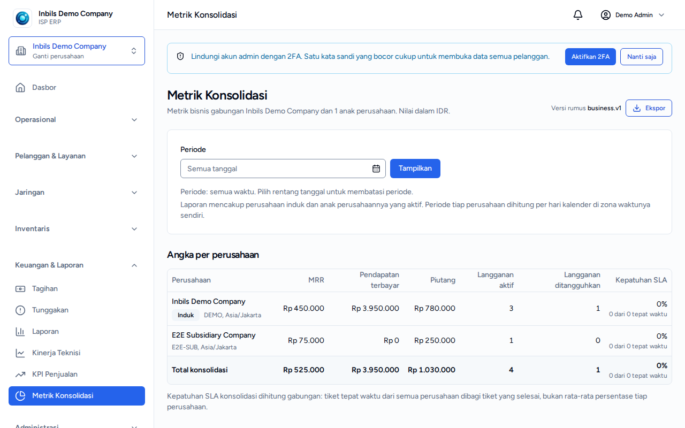

3. Baca subtitle. Layar menulis nama Head, jumlah anak perusahaan, dan mata uang yang dipakai. Header menampilkan **Formula version business.v1**.
4. Pilih **Periode**, lalu klik **Run**. Teks di bawah filter menjelaskan bahwa setiap perusahaan memakai hari kalender dalam zona waktunya sendiri.
5. Baca bagian **Figures by company**:
   - Kolom **Company** memuat nama, kode, zona waktu, dan lencana **Head** pada perusahaan induk.
   - Kolom **MRR**, **Revenue (Paid)**, **Outstanding**, **Active Subscriptions**, **Suspended Subscriptions**, dan **SLA Compliance** memakai definisi Business Metrics.
   - Setiap perusahaan mempunyai satu baris. Baris **Consolidated total** berada paling bawah.
   - Pada layar sempit, tabel berubah menjadi kartu per perusahaan dengan angka yang sama.
6. Baca catatan SLA di bawah tabel. Total SLA menggabungkan seluruh tiket tepat waktu lalu membaginya dengan seluruh tiket selesai. Inbils tidak merata-ratakan persentase perusahaan.
7. Baca bagian **How each figure is calculated** untuk definisi enam kolom.
8. Klik **Export**, lalu **Export CSV**. File memuat seluruh 13 Business Metrics per perusahaan, disusul baris Consolidated, dengan kolom Company, Metric, Breakdown, Value, Unit, Scope, Filters, dan Version.

### Kesalahan umum

- Menu tidak ada: perusahaan aktif bukan Head, tidak mempunyai anak perusahaan aktif, atau akun tidak memegang `report.consolidated.view`.
- Pindah ke anak perusahaan menyembunyikan menu dan menolak URL langsung. Kembali ke Head melalui pemilih perusahaan.
- Laporan menampilkan **These companies cannot be consolidated** bila mata uang perusahaan berbeda. Samakan mata uang perusahaan sebelum menjumlahkan nilai uang.
- **MRR**, **Outstanding**, langganan, dan SLA Compliance merupakan Snapshot. **Periode** terutama mengubah Revenue (Paid) dan metrik periode lain di file ekspor.
- Setiap perusahaan membaca batas hari dalam zona waktunya sendiri. Catatan dekat tengah malam dapat masuk ke hari berbeda pada dua perusahaan.
- Laporan tidak mempunyai **View records**. Buka Business Metrics setelah berpindah ke perusahaan yang ingin diperiksa.

## 7.12 Audit Log

Audit Log menelusuri aktivitas perusahaan menurut waktu, modul, aksi, pelaku, subjek, dan data perubahan. Buka laporan ini saat Anda perlu mengetahui siapa melakukan suatu tindakan atau nilai apa yang berubah.

Peran yang dapat memakai: admin. Izin: `report.audit.view`. Tombol **Ekspor Log** memerlukan `report.export` selain izin audit.

### Menyaring dan membaca log

1. Buka **Laporan**, lalu klik **Open Audit Log**.

   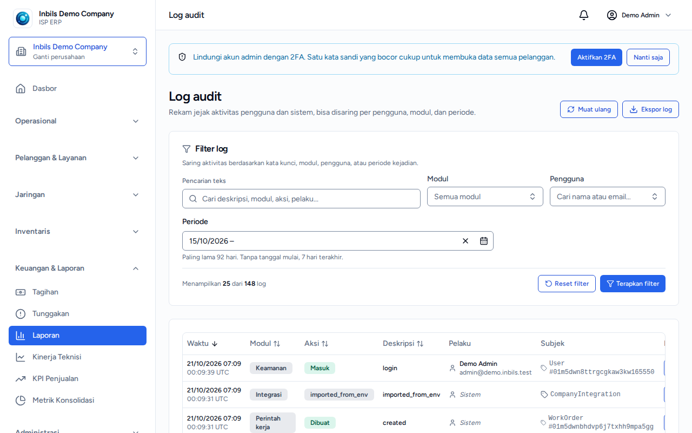

2. Isi filter yang diperlukan:
   - **Pencarian Teks** mencari pada deskripsi, modul, event, serta nama atau email pelaku.
   - **Modul** memilih nama log. Daftar awal memuat customer, billing, inventory, spk, ticket, user, auth, location, network_asset, organization, approval, dan setting, lalu menambah nama yang muncul pada data.
   - **ID Pengguna (Causer)** menerima ID pengguna berupa angka 1 atau lebih.
   - **Periode** membatasi `created_at` menurut hari kalender perusahaan.
3. Klik **Terapkan Filter**. Klik **Atur Ulang** untuk menghapus semua filter dan mengembalikan urutan waktu terbaru.
4. Klik **Muat Ulang** untuk mengambil data terbaru tanpa mengubah filter.
5. Baca tabel:
   - **Waktu** menampilkan waktu terformat dan waktu UTC di bawahnya.
   - **Modul** menampilkan `log_name` sebagai lencana.
   - **Aksi** menerjemahkan `created`, `updated`, `deleted`, dan `restored` menjadi Dibuat, Diperbarui, Dihapus, dan Dipulihkan. Event kosong tampil sebagai **Aktivitas**.
   - **Deskripsi** memuat keterangan aktivitas.
   - **Pelaku** memuat nama dan email, tulisan User diikuti ID, atau **Sistem**.
   - **Subjek** memuat jenis data dan ID, misalnya Customer diikuti nomor.
   - **Detail** membuka dialog rincian log.
6. Urutkan lewat **Waktu**, **Modul**, **Aksi**, atau **Deskripsi**. **Pelaku** dan **Subjek** tidak dapat diurutkan.
7. Atur jumlah baris menjadi 10, 15, 25, 50, atau 100. Nilai awal dari halaman ini adalah 25.

Pada layar sempit, tabel berubah menjadi kartu. Tombol **Lihat Detail Properti** menggantikan kolom **Detail**.

### Membaca detail perubahan

1. Klik **Detail** pada baris log.
2. Baca **Informasi Ringkasan**: Waktu Kejadian, Modul & Aksi, Pelaku, Objek atau Subjek, dan Deskripsi Aktivitas.
3. Baca bagian **Properti & Perubahan Nilai**:
   - Perubahan model tampil sebagai tabel **Kolom / Field**, **Nilai Lama (Sebelumnya)**, dan **Nilai Baru (Sesudahnya)**.
   - Klik **Lihat JSON Lengkap** untuk melihat seluruh properti pada perubahan model.
   - Aktivitas dengan struktur lain menampilkan JSON langsung.
   - Bila tidak ada properti, layar menulis bahwa tidak ada data perubahan tambahan yang dicatat.
4. Klik **Salin JSON** untuk menyalin data properti. Tombol berubah menjadi **Tersalin!** setelah berhasil.
5. Klik **Tutup** untuk menutup dialog.

### Mengekspor log

1. Terapkan filter dan urutan yang diperlukan.
2. Klik **Ekspor Log**.
3. Pilih **Export CSV** atau **Export PDF**.

Kedua file memuat ID, Time, Module, Event, Description, Actor, Actor ID, Subject type, dan Subject ID. CSV juga memuat Properties sebagai JSON. PDF sengaja tidak memuat Properties.

### Kesalahan umum

- Audit Log hanya menampilkan baris milik perusahaan aktif. Baris lama tanpa `company_id` tidak ditampilkan.
- ID pengguna yang bukan milik perusahaan aktif menghasilkan daftar kosong, bukan data perusahaan lain.
- **Pencarian Teks** tidak mencari jenis atau ID subjek. Gunakan Modul, Pelaku, atau Deskripsi untuk mempersempit hasil.
- Isian filter belum berlaku sebelum **Terapkan Filter** diklik. **Ekspor Log** memakai filter yang terakhir diterapkan.
- **Waktu** utama mengikuti jam browser, sedangkan baris kecil menunjukkan UTC. Filter tanggal tetap mengikuti zona waktu perusahaan.
- CSV memuat Properties, sedangkan PDF tidak. Buka dialog **Detail** atau gunakan CSV bila nilai lama dan baru diperlukan.
- Halaman **Access denied** berarti akun tidak memegang `report.audit.view`. Peran bawaan manajer dan staf tidak mempunyai izin ini.

## 7.13 Penomoran

Penomoran mengatur awalan, format, dan hitungan nomor otomatis untuk tagihan dan data lain. Menu ini ada di grup **Administrasi**, tetapi dibahas di sini karena menentukan nomor tagihan dan nomor dokumen lain.

Peran yang dapat memakai: pengguna dengan izin `system.setting`, yaitu admin pada peran bawaan. Manajer dan staf tidak melihat menu ini, dan alamatnya langsung ditolak (galat 403). Izin ini bisa diberikan ke peran buatan sendiri di **Peran** (bagian 8.6). Tiap perusahaan punya hitungan sendiri, dan layar menampilkan hitungan perusahaan aktif.

### Membuka dan membaca daftar

1. Di sidebar, buka grup **Administrasi**, lalu klik **Penomoran**.
2. Catatan kuning di atas menulis "Perubahan format hanya berlaku untuk data baru. Kode yang sudah dibuat tidak berubah." Di bawahnya ada satu baris untuk tiap entitas bernomor.

   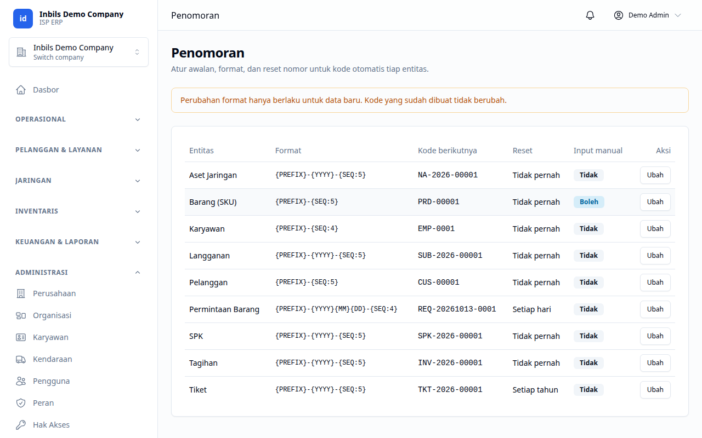
3. Kolom: **Entitas**, **Format** (pola yang dipakai), **Kode berikutnya** (kode yang akan keluar sekarang), **Reset**, **Input manual** (**Boleh** atau **Tidak**), dan **Aksi** dengan tombol **Ubah**. **Kode berikutnya** hanya perkiraan, karena pembuatan lain pada saat yang sama dapat mengambil nomor itu.
4. Entitas yang diatur (nilai awalnya terlihat di layar):
   - Aset Jaringan: kode aset jaringan (bagian 5.2).
   - Barang (SKU): SKU barang (bagian 6.2). Input manual awalnya **Boleh**.
   - Karyawan: nomor karyawan (bagian 8.3).
   - Langganan: kode langganan (bagian 4.1).
   - Pelanggan: kode pelanggan (bagian 4.1).
   - Permintaan Barang: kode permintaan barang (bagian 6.1). Reset awalnya **Setiap hari**.
   - SPK: kode SPK (bagian 3.3).
   - Tagihan: nomor tagihan (bagian 7.1). Format awalnya `{PREFIX}-{YYYY}-{SEQ:5}` dan tidak pernah reset. Pada screenshot, **Kode berikutnya** adalah `INV-2026-00001`.
   - Tiket: kode tiket (bagian 3.4). Reset awalnya **Setiap tahun**.

Nomor tagihan dari semua sumber (**New invoice**, **Generate Tagihan**, dan tagihan dari SPK) memakai satu hitungan **Tagihan**.

### Mengubah penomoran

1. Klik **Ubah** pada baris entitas. Jendela `Ubah penomoran <entitas>` terbuka dan mengingatkan bahwa hanya kode yang dibuat setelah ini memakai format baru.
2. Isi form:
   - **Awalan**: wajib, 1 sampai 20 karakter, hanya huruf, angka, `-`, dan `_`.
   - **Nomor berikutnya**: wajib, bilangan bulat minimal 1, tidak lebih besar dari angka terbesar yang muat di `{SEQ:n}` (99999 untuk `{SEQ:5}`).
   - **Format**: wajib, maksimal 100 karakter. Ketik teks dan token, atau klik tombol token di bawah isian untuk menyisipkannya di posisi kursor.
   - **Reset nomor**: pilih **Tidak pernah**, **Setiap tahun**, **Setiap bulan**, atau **Setiap hari**.
   - **Izinkan input kode manual**: saklar. Bila mati, kolom kode di formulir dikunci dan selalu dibuat otomatis.
3. Baca **Pratinjau kode berikutnya**. Pratinjau berubah saat Anda mengetik dan memakai zona waktu perusahaan.
4. Klik **Simpan**. Toast "Penomoran diperbarui." muncul, jendela tertutup, dan kolom **Kode berikutnya** berubah.

Aturan **Format**:

- Token yang dikenal: `{PREFIX}` (isi **Awalan**), `{YYYY}` (tahun 4 digit), `{YY}` (tahun 2 digit), `{MM}` (bulan), `{DD}` (tanggal), `{COMPANY}` (kode perusahaan), dan `{SEQ:n}` (nomor urut dengan nol di depan, n adalah jumlah digit dari 1 sampai 10). `{SEQ:n}` wajib ada tepat satu.
- Selain token, hanya huruf, angka, `-`, `_`, `/`, dan `.` yang boleh.
- **Setiap tahun** memerlukan `{YYYY}` atau `{YY}`. **Setiap bulan** memerlukan `{MM}` juga, dan **Setiap hari** memerlukan `{MM}` dan `{DD}` juga. Hitungan kembali ke 1 pada awal periode baru.
- Kode terpanjang yang mungkin tidak boleh melebihi 255 karakter.

Setelah **Simpan**:

- Hanya nomor yang dibuat sesudahnya yang berubah. Nomor lama tetap.
- Hitungan melanjutkan dari **Nomor berikutnya** yang Anda simpan. Format atau reset baru mulai dihitung pada periode saat Anda menyimpan.
- Sistem melewati nomor yang sudah dipakai data entitas itu, termasuk data yang sudah dihapus, jadi nomor tidak pernah ganda. Bila 1000 nomor berturut-turut sudah terpakai, pembuatan data gagal dan pesannya meminta **Nomor berikutnya** dinaikkan.
- Perubahan tercatat di Audit Log (bagian 7.12).

### Kesalahan umum

- Nomor lama tidak berubah setelah **Simpan**. Itu disengaja: hanya nomor baru yang memakai format baru.
- "Reset berkala memerlukan {YYYY} atau {YY}.", "Reset bulanan atau harian memerlukan {MM}.", dan "Reset harian memerlukan {DD}." muncul bila **Format** kurang token untuk **Reset nomor** yang dipilih. Tambahkan token itu atau pilih **Tidak pernah**.
- "Format harus memuat tepat satu {SEQ:n}, n antara 1 dan 10." muncul bila **Format** tidak punya `{SEQ:n}` atau punya lebih dari satu.
- "Prefix hanya boleh berisi huruf, angka, - dan _ (maksimal 20 karakter)." muncul bila **Awalan** memuat spasi atau tanda lain.
- "Nomor berikutnya maksimal 99999 untuk {SEQ:5}." (angkanya mengikuti n) muncul bila **Nomor berikutnya** terlalu besar. Perbesar n atau kecilkan nomornya.
- Pengaturan **Input manual** pada **Tagihan** tidak berpengaruh, karena formulir tagihan tidak punya kolom nomor dan nomornya selalu otomatis.
- Menurunkan **Nomor berikutnya** tidak memakai ulang nomor lama. Sistem melewati nomor yang sudah ada.
- Kunci `invoice_prefix`, `spk_prefix`, dan `ticket_prefix` di Company Settings (bila ada) tidak dipakai sistem. Awalan hanya diatur di **Penomoran**.

# 8. Administrasi

## 8.1 Perusahaan

Menu ini memuat identitas perusahaan yang sedang aktif dan pengaturan operasionalnya. Buka saat logo, kontak, tarif pajak, jatuh tempo tagihan, isolir otomatis atau notifikasi WhatsApp perlu diubah.

Peran yang dapat memakai: admin. Izin: `company.manage`. Manajer dan staf tidak memegang izin ini, jadi item **Perusahaan** tidak tampil di sidebar mereka dan alamat layarnya ditolak. Perubahan berlaku untuk perusahaan yang sedang aktif; untuk berpindah perusahaan, lihat bagian 1.6.

### Membuka dan mengubah profil

1. Di sidebar, buka grup **Administrasi**, lalu klik **Perusahaan**. Layar **Perusahaan** terbuka dengan form profil dan tautan **Settings** di kanan atas.

   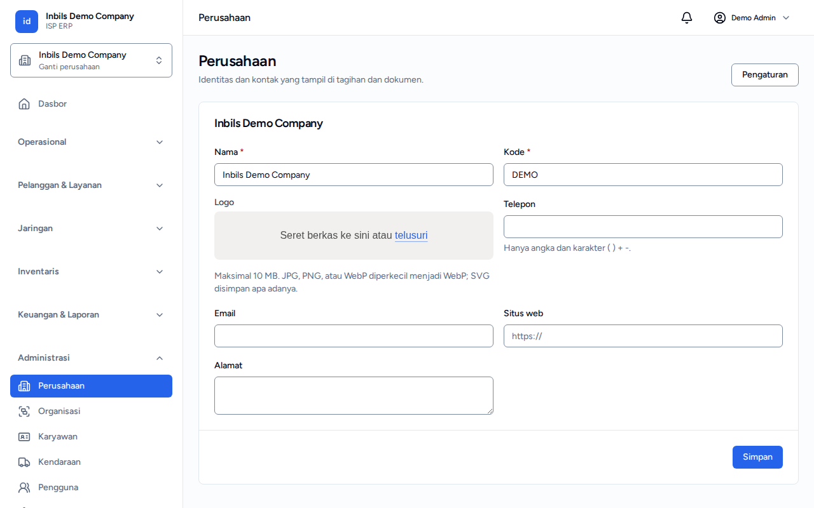

2. Isi form:
   - **Name**: wajib, paling banyak 255 karakter.
   - **Code**: wajib, paling banyak 50 karakter, dan belum dipakai perusahaan lain. Contoh di demo: `DEMO`.
   - **Logo**: opsional. Seret berkas ke kotak atau klik **browse**. Pakai JPG, PNG atau WebP, paling besar 10 MB. Berkasnya diubah menjadi WebP dan diperkecil bila sisi terpanjangnya lebih dari 512 piksel. Petunjuk di layar juga menyebut SVG, tetapi aturan `image` di server tidak mengizinkan SVG, jadi jangan memakainya. Logo baru menggantikan logo lama; tanpa berkas baru, logo lama tetap.
   - **Phone**: opsional, paling banyak 50 karakter. Hanya angka 0 sampai 9 dan tanda `(`, `)`, `+`, `-`. Karakter lain terhapus saat Anda mengetik.
   - **Email**: opsional, alamat e-mail yang valid, paling banyak 255 karakter.
   - **Website**: opsional, URL lengkap dengan awalan `https://`, paling banyak 255 karakter.
   - **Address**: opsional, paling banyak 1000 karakter.
3. Klik **Save Profile**. Selama logo diunggah, bilah **Mengunggah logo** menunjukkan kemajuan. Setelah berhasil, toast "Company profile updated." muncul, dan nama serta logo di kepala sidebar ikut berubah.

### Membuka dan mengubah pengaturan

1. Di layar **Perusahaan**, klik tautan **Settings** di kanan atas. Layar **Company Settings** terbuka. Tautan **Profile** di layar itu membawa Anda kembali. Kedua tautan adalah teks biasa, bukan tab.

   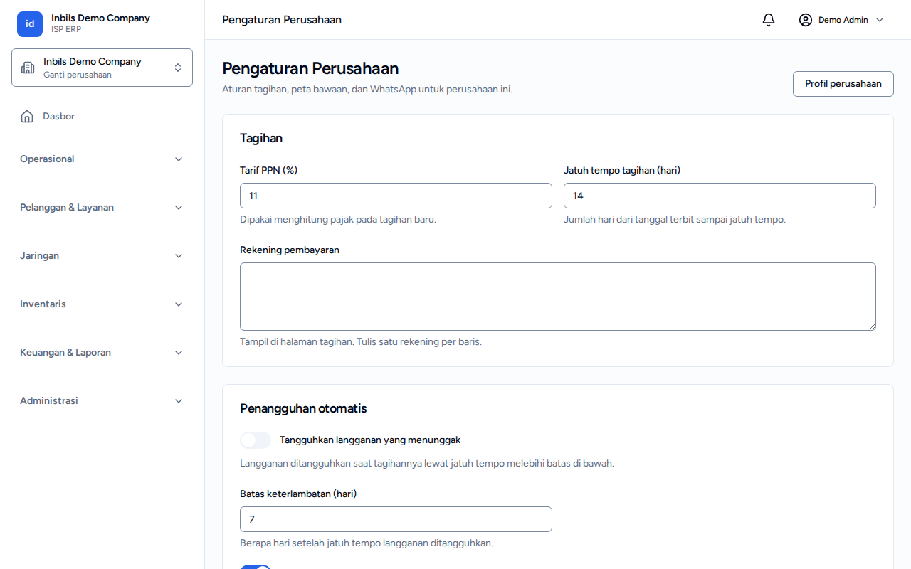

2. Ubah kartu **Settings JSON**. Setiap kunci tampil dengan nama aslinya, urut abjad: saklar untuk nilai ya atau tidak, kotak angka untuk angka, kotak teks untuk teks. Perusahaan demo menampilkan enam kunci:
   - `auto_reactivate_on_payment`: saklar, bawaan aktif. Bila aktif, langganan yang diisolir otomatis kembali aktif setelah pembayaran, selama tidak ada lagi tagihannya yang lewat masa tenggang. Isolir manual tidak pernah dibuka otomatis.
   - `auto_suspend_enabled`: saklar, bawaan mati. Bila aktif, sistem mengisolir langganan aktif yang punya tagihan belum lunas dan lewat jatuh tempo lebih dari `auto_suspend_overdue_days` hari. Pemeriksaannya berjalan setiap hari pukul 08:00.
   - `auto_suspend_overdue_days`: angka bulat 1 sampai 60, bawaan 7.
   - `bank_account_info`: teks, bawaan kosong. Isinya tercetak di PDF tagihan di bawah label **Pembayaran:**.
   - `invoice_due_days`: angka, bawaan 14. Jumlah hari dari tanggal terbit sampai jatuh tempo pada tagihan bulanan buatan sistem (bagian 7.1).
   - `tax_ppn_rate`: angka, bawaan 11 (persen). Tarif pajak pada tagihan bulanan dan pada tagihan yang dibuat dari SPK.
3. Perusahaan yang dibuat lewat Setup Wizard atau sebagai anak perusahaan menyimpan kunci tambahan, dan semuanya tampil di kartu yang sama. Dua di antaranya dijelaskan di sini: `date_format` mengatur format tanggal di layar (bawaan `d M Y`, tampil seperti 13 Okt 2026; format yang tidak dikenal kembali ke 13/10/2026), dan `spk_auto_invoice`, bila aktif, membuat tagihan draf otomatis saat SPK selesai (bab 3). Jangan mengubah kunci yang tidak dijelaskan di panduan ini.
4. Gulir ke kartu **WhatsApp**. Bagian ini ada di bawah batas tangkapan layar di atas:
   - Peringatan "Notifikasi tidak akan terkirim sampai kredensial diatur di server." muncul bila server belum punya kredensial pengirim. Baris **Kredensial terkonfigurasi** menunjukkan Ya atau Tidak. Pengelola server yang mengatur kredensial, bukan layar ini.
   - **Aktifkan notifikasi WhatsApp**: saklar, bawaan mati.
   - **Jenis pesan yang dikirim**: sembilan kotak centang, semuanya tercentang secara bawaan: **Tagihan terbit**, **Pengingat jatuh tempo (H-3, H-1, H+1)**, **Pembayaran diterima**, **Tiket dibuat**, **Tiket mulai ditangani**, **Tiket selesai**, **Penugasan SPK ke teknisi**, **Jadwal kunjungan teknisi ke pelanggan** dan **Info link akses portal (tanpa link)**. Hanya **Penugasan SPK ke teknisi** berketerangan **Untuk teknisi**; delapan lainnya berketerangan **Untuk pelanggan**.
   - **Jam tenang mulai** dan **Jam tenang selesai**: jam HH:MM menurut zona waktu perusahaan, bawaan 21:00 dan 07:00. Rentang boleh melewati tengah malam. Pesan **Tagihan terbit** dan pengingat jatuh tempo menunggu sampai jam tenang selesai; jenis pesan lain dikirim langsung. Jam mulai yang sama dengan jam selesai berarti tidak ada jam tenang.
   - **Batas pesan per bulan**: angka bulat 0 sampai 100000, bawaan 1000. Pesan di atas batas dilewati; 0 berarti tidak ada pesan terkirim. Isian tidak boleh kosong.
   - **Pemakaian bulan ini**: empat angka yang hanya dibaca, **Terkirim**, **Diterima**, **Gagal** dan **Berbayar**, untuk bulan kalender berjalan.

   Pelanggan hanya menerima pesan bila persetujuan WhatsApp mereka tercatat di data pelanggan (bab 4).
5. Klik **Save Settings**. Toast "Company settings updated." muncul. Nilai baru dipakai oleh proses berikutnya: tagihan yang dibuat sesudahnya, pemeriksaan isolir berikutnya dan pesan WhatsApp yang dikirim sesudahnya.

Mata uang, zona waktu dan alamat Play Store aplikasi tidak punya isian di kedua layar ini.

### Kesalahan umum

- Logo ditolak dan muncul toast "Failed to update company profile." dengan keterangan "Check required fields and allowed file type.": formatnya bukan JPG, PNG atau WebP (SVG juga ditolak oleh aturan `image` di server, walau petunjuk di layar menyebutnya), atau berkasnya lebih dari 10 MB. Perkecil atau ubah format lalu unggah lagi.
- **Code** ditolak: kode itu sudah dipakai perusahaan lain. Pilih kode lain.
- **Website** ditolak: tulis URL lengkap, misalnya dengan awalan `https://`.
- Mengosongkan kotak angka di kartu **Settings JSON** menyimpan angka 0, bukan nilai kosong. Untuk `tax_ppn_rate` artinya tanpa pajak, untuk `invoice_due_days` jatuh tempo di hari terbit, dan `auto_suspend_overdue_days` ditolak karena minimal 1. Isi angkanya sebelum menyimpan.
- Server tidak memeriksa rentang `tax_ppn_rate` dan `invoice_due_days`. Periksa angkanya sendiri sebelum menyimpan.
- Pesan WhatsApp tidak terkirim padahal saklar aktif: periksa **Kredensial terkonfigurasi**, kotak centang jenis pesan, jam tenang, **Batas pesan per bulan** dan persetujuan WhatsApp di data pelanggan.

## 8.2 Organisasi

Organisasi menyimpan struktur perusahaan sebagai pohon unit: cabang, area, unit dan tim. Buka menu ini saat Anda menyusun struktur baru, memindahkan unit ke induk lain, atau menyiapkan unit sebelum menempatkan karyawan di dalamnya (bagian 8.3).

Peran yang dapat memakai: admin. Izin: `organization.view` membuka menu dan daftar, `organization.manage` mengizinkan tambah, ubah dan hapus unit, `organization.export` menampilkan tombol **Export**. Pada peran bawaan hanya admin yang memegang ketiganya. Manajer, staf dan teknisi tidak melihat menu ini, kecuali admin memberi izinnya pada peran khusus (bagian 8.6 dan 8.7). Daftar memuat unit perusahaan aktif (bagian 1.6).

### Membuka dan membaca daftar

1. Di sidebar, buka grup **Administrasi**, lalu klik **Organisasi**.
2. Baca daftar. Layar ini berupa tabel, bukan tampilan pohon: kolom **Path** menunjukkan letak unit di pohon. Cara kerja pencarian, urutan, tombol baris dan dialog hapus ada di bagian 1.5.

   - Kotak **Search** (teks petunjuk `Code, name, path...`) mencari di kode, nama dan path.
   - Kolom: **Code**, **Name**, **Type**, **Path**, **Children**, **Status** dan **Actions**. **Code**, **Name** dan **Type** bisa diurutkan. Tidak ada tombol **Show**.
   - Di bawah nama unit tertulis `Parent: <nama induk>`, atau `Root unit` untuk unit paling atas.
   - **Type** berisi `company`, `branch`, `area`, `unit` atau `team`.
   - **Path** menulis kode unit dari yang paling atas sampai unit itu, dipisah tanda `>`. Unit paling atas hanya menampilkan kodenya sendiri.
   - **Children** menghitung unit anak langsung, misalnya `1 child` atau `2 children`.
   - Tombol **Add Unit**, **Edit** dan **Delete** tampil untuk semua pemegang `organization.view`. Server menolak aksi dari pengguna tanpa `organization.manage`.

   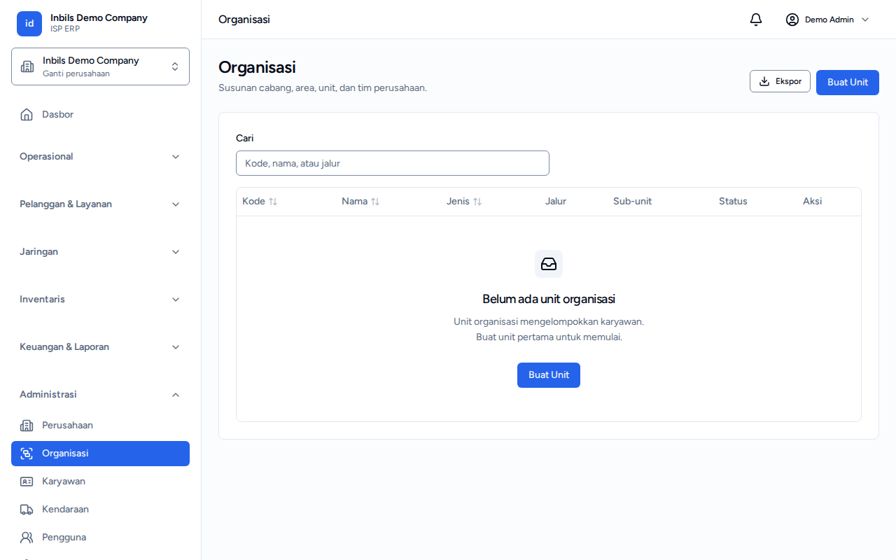

### Menambah unit

1. Klik **Add Unit**.
2. Isi form pada dialog **Add Unit**:
   - **Code**: wajib, maksimal 50 karakter. Kode tidak boleh sama dengan kode unit lain di perusahaan yang sama, termasuk unit yang sudah dihapus. Kode ikut menyusun **Path**.
   - **Name**: wajib, maksimal 255 karakter.
   - **Type**: wajib. Pilih **Company**, **Branch**, **Area**, **Unit** atau **Team**. Isian awalnya **Branch**. Sistem tidak memeriksa kecocokan tingkat dengan induknya.
   - **Parent**: opsional. Ketik untuk mencari, lalu klik unit di daftar. Daftar hanya memuat unit aktif, ditulis `kode - nama` dengan path di bawahnya. Kosongkan isian (tombol X di sisi kanan) agar unit menjadi unit paling atas, sesuai teks bantuan `Clear field for root unit.` Isian ini nonaktif dengan teks `No parent units yet` selama belum ada unit.
   - **Phone**: opsional, maksimal 50 karakter.
   - **Email**: opsional, harus berformat email, maksimal 255 karakter.
   - **Address**: opsional, teks bebas.
   - **Active**: saklar, aktif secara awal.
3. Klik **Add**. Dialog menutup dan muncul toast `Organization unit created.` Sistem mengisi **Path** otomatis.

### Mengubah dan memindahkan unit

1. Klik **Edit** pada baris unit. Dialog **Edit Unit** terbuka dengan data unit.
2. Ubah isian. Untuk memindahkan unit, pilih **Parent** yang baru, atau kosongkan **Parent** agar unit menjadi unit paling atas.
3. Klik **Save**. Muncul toast `Organization unit updated.`

Mengubah **Code** atau **Parent** menghitung ulang **Path** unit itu dan semua unit di bawahnya. Unit yang sedang Anda ubah tidak muncul di pilihan **Parent**. Layar ini tidak punya tombol pindah atau seret-dan-lepas.

### Menghapus unit

1. Klik **Delete** pada baris unit.
2. Konfirmasi di dialog `Delete <nama unit>?`. Muncul toast `Organization unit deleted.`

Unit yang masih punya unit anak (kolom **Children** lebih dari 0) tidak bisa dihapus: dialog tetap terbuka dan muncul toast `Data gagal disimpan. Periksa input.` Pindahkan atau hapus unit anaknya lebih dulu.

### Menempatkan karyawan dan manajer di unit

Unit dipakai lewat isian **Organization** pada profil karyawan (bagian 8.3). Layar ini tidak punya isian kepala unit. Seorang manajer terhubung ke unit hanya lewat isian **Organization** pada profil karyawannya sendiri.

- Di Kinerja Teknisi (bagian 7.9), manajer (peran `manager` dengan izin `report.technician`) melihat teknisi yang ditempatkan di unitnya sendiri dan di semua unit di bawahnya. Admin (izin `report.manage`) melihat semua teknisi perusahaan.
- Syarat untuk manajer: profil karyawannya berstatus `active` dan unitnya aktif. Bila belum, menu **Kinerja Teknisi** tidak tampil. Teknisi tanpa unit atau di unit nonaktif tidak terlihat oleh manajer.
- Di halaman SPK (bagian 3.3), daftar **Technician** pada dialog penugasan menampilkan nomor karyawan, nama unit dan nomor telepon di bawah nama teknisi. Unit tidak membatasi pilihan: Penugasan (bagian 3.1) dan halaman SPK menawarkan semua teknisi aktif di perusahaan.

### Mengekspor daftar

1. Isi kotak **Search** bila Anda hanya butuh sebagian unit.
2. Klik **Export**, lalu pilih **Export CSV** atau **Export Excel**. Keduanya mengunduh berkas CSV, bukan berkas `.xlsx`.

Berkas bernama `organizations-export-<tanggal>-<jam>.csv` dan berisi kolom Code, Name, Type, Path, Children dan Status. Tombol **Export** hanya tampil bagi pemegang `organization.export`.

### Kesalahan umum

- Muncul `Cannot move unit below itself.` di bawah **Parent**: induk yang Anda pilih berada di bawah unit itu sendiri. Pilih unit lain, atau pindahkan dulu unit anaknya.
- Unit menjadi unit paling atas setelah disimpan: Anda mengetik di kotak **Parent** tanpa memilih baris dari daftar, dan mengetik menghapus pilihan induk. Pilih unitnya dari daftar sebelum klik **Save**.
- Penyimpanan gagal dengan toast `Data gagal disimpan. Periksa input.` tanpa pesan di bawah isian: hanya **Code**, **Name**, **Type** dan **Parent** menampilkan pesan kesalahan sendiri. Periksa **Email** (harus berformat email) dan panjang **Phone**.
- Menghapus unit yang masih berisi karyawan tidak ditolak. Karyawan itu lalu tampil tanpa unit, dan manajer yang ditempatkan di sana tidak lagi melihat Kinerja Teknisi. Pindahkan karyawan ke unit lain (bagian 8.3) sebelum menghapus.
- Unit yang dinonaktifkan (saklar **Active** mati) tidak muncul di pilihan **Parent** dan **Organization**, dan tidak dihitung untuk Kinerja Teknisi manajer. Nyalakan lagi lewat **Edit**.

## 8.3 Karyawan

Karyawan menyimpan profil karyawan yang terhubung ke satu akun pengguna: nomor karyawan, unit, kendaraan, nomor telepon dan tanggal masuk. Akun pengguna saja belum cukup untuk pekerjaan lapangan, karena fitur lapangan juga meminta profil berstatus `active`. Buka menu ini setelah Anda membuat akun baru di Pengguna (bagian 8.5).

Peran yang dapat memakai: admin. Izin: `employee.view` membuka menu dan daftar, `employee.manage` menampilkan tombol **Add Employee** dan **Edit**, `employee.export` menampilkan tombol **Export**. Pada peran bawaan hanya admin yang memegang ketiganya. Layar ini tidak punya tombol **Show** dan **Delete**, dan form tidak punya isian status.

### Membuka dan membaca daftar

1. Di sidebar, buka grup **Administrasi**, lalu klik **Karyawan**.
2. Baca daftar. Cara kerja pencarian, urutan dan halaman ada di bagian 1.5.

   - Kotak **Search** (teks petunjuk `Employee number, name, email, phone`) mencari nomor karyawan, telepon, nama dan email pengguna.
   - Filter **Organization** berisi `All organizations` dan nama unit aktif. Filter **Status** berisi `All statuses`, `Active`, `Inactive` dan `Terminated`.
   - Kolom: **Emp No**, **Name** (nama akun pengguna), **Organization**, **Vehicle** (plat kendaraan), **Status** dan **Actions**. **Emp No** dan **Status** bisa diurutkan. Sel kosong berisi `-`.
   - Lencana **Status** hijau untuk `active` dan merah untuk status lain.
   - Tombol **Add Employee** dan tombol **Edit** di tiap baris hanya tampil bagi pemegang `employee.manage`.

   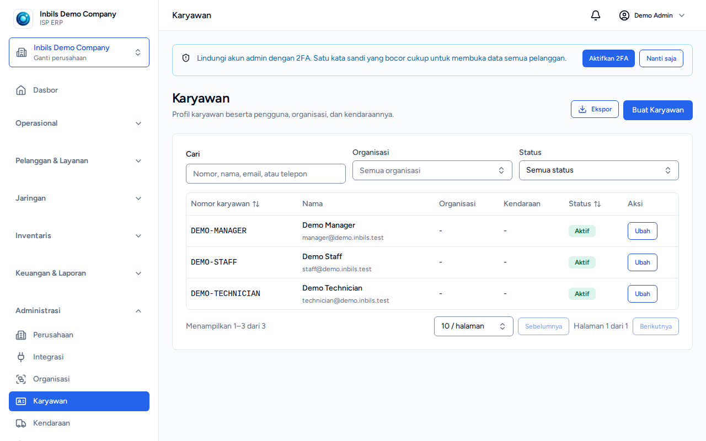

### Menambah profil karyawan

1. Pastikan akun pengguna karyawan sudah ada dan aktif (bagian 8.5).
2. Klik **Add Employee**.
3. Isi form pada dialog **Add Employee**:
   - **User**: wajib. Pilih akun dari daftar. Daftar hanya memuat pengguna aktif di perusahaan ini yang belum punya profil karyawan. Satu akun hanya bisa punya satu profil.
   - **Employee Number**: terisi otomatis dan terkunci selama Penomoran (bagian 7.13) tidak mengizinkan input manual. Isian menampilkan perkiraan nomor berikutnya, bentuk awalnya `EMP-0001`, dengan teks `Dibuat otomatis saat disimpan, perkiraan: <nomor>`. Bila input manual diizinkan, Anda bisa mengetik nomor (maksimal 50 karakter, unik per perusahaan) atau mengosongkannya agar dibuat otomatis.
   - **Organization**: opsional. Pilih unit aktif, atau `None`.
   - **Vehicle**: opsional. Pilih kendaraan aktif menurut plat, atau `None`.
   - **Phone**: opsional, maksimal 50 karakter. Sistem memakai nomor ini untuk pesan WhatsApp penjadwalan SPK bila WhatsApp perusahaan aktif. Sistem melewati nomor yang bukan seluler Indonesia dengan awalan `08` atau `+62`.
   - **Hire Date**: opsional, tanggal.
4. Klik **Add**. Muncul toast `Employee profile created.` Profil baru berstatus `active`.

### Mencoba mengubah profil karyawan

1. Klik **Edit** pada baris karyawan. Dialog **Edit Employee** terbuka.
2. Dialog hanya memuat **Employee Number**. Isian **Organization**, **Vehicle**, **Phone** dan **Hire Date** tidak memuat data lama, jadi jangan anggap isian kosong sebagai data sebenarnya.
3. Klik **Save**. Pada checkout ini penyimpanan ditolak: form mengirim **User** kosong, sedangkan server masih mewajibkan akun pengguna bila nilai itu ikut dikirim. Layar menampilkan toast `Data gagal disimpan. Periksa input.`, tetapi tidak menampilkan kesalahan **User** karena isian itu disembunyikan saat mengubah.

Isian **User** memang tidak tampil pada dialog ubah, sehingga pengguna web tidak bisa memperbaiki penolakan tersebut. **Employee Number** hanya bisa dibaca (teks `Dibuat otomatis dan tidak dapat diubah.`) selama input manual tidak diizinkan. Layar ini juga tidak menyediakan cara untuk mengubah status atau menghapus profil.

### Menyiapkan karyawan untuk pekerjaan lapangan

- Pekerjaan Saya (bagian 3.6) tampil di sidebar hanya untuk pengguna aktif yang memegang izin kerja (`ticket.start`, `ticket.resolve`, `ticket.close`, `spk.start` atau `spk.submit`) dan punya profil `active` di perusahaan aktif.
- Aplikasi teknisi memakai syarat tersebut, ditambah email pengguna yang sudah diverifikasi. Aplikasi memeriksanya saat masuk dan pada setiap permintaan berikutnya. Teknisi mengerjakan tugasnya di aplikasi itu, bukan di web.
- Pilihan teknisi untuk SPK, di Penugasan (bagian 3.1) dan di halaman SPK (bagian 3.3), hanya memuat pengguna aktif dengan profil `active` dan izin `spk.start` atau `spk.submit`.
- Pilihan penerima tiket di Penugasan tidak meminta profil. Tiket yang ditugaskan ke pengguna tanpa profil `active` tidak muncul di Pekerjaan Saya.
- Isian **Acquired by** pada pelanggan (bagian 4.1) hanya menawarkan pengguna aktif dengan profil `active` yang memegang `customer.create`. Admin tanpa profil tidak ditawarkan.
- Evaluasi (bagian 3.5) menilai akun pengguna. Nilai evaluasi itu masuk ke rata-rata skor dan rating pelanggan di Kinerja Teknisi (bagian 7.9).
- Kinerja Teknisi hanya memuat teknisi dengan profil `active`.

### Mengekspor daftar

1. Atur kotak **Search**, filter **Organization** dan filter **Status** sesuai data yang Anda butuhkan.
2. Klik **Export**, lalu pilih **Export CSV** atau **Export PDF**.

Berkas `employees-export-<tanggal>-<jam>.csv` atau `.pdf` memuat Employee Number, Name, Email, Organization, Vehicle, Status dan Phone. Tombol **Export** hanya tampil bagi pemegang `employee.export`.

### Kesalahan umum

- Akun tidak ada di pilihan **User**: daftar hanya memuat pengguna aktif di perusahaan ini yang belum punya profil. Buat atau aktifkan akunnya di Pengguna (bagian 8.5). Akun yang sudah punya profil tidak bisa dipilih lagi.
- Pekerjaan Saya atau aplikasi teknisi tidak terbuka untuk karyawan yang sudah punya profil: periksa akun aktif, email terverifikasi, profil `active` (kolom **Status**) dan izin kerja pada perannya.
- Teknisi tidak muncul di pilihan SPK: perannya belum memegang `spk.start` atau `spk.submit`, atau profilnya belum `active`.
- **Edit Employee** selalu gagal pada checkout ini karena form menyembunyikan **User** tetapi tetap mengirimkannya kosong. Tidak ada langkah di dialog yang dapat memperbaikinya.
- Layar ini tidak punya isian jabatan, saklar status, dan tombol **Delete**. Untuk mencabut akses lapangan, matikan saklar **Active** pada akun orangnya di Pengguna (bagian 8.5).

## 8.4 Kendaraan

Kendaraan mencatat kendaraan operasional teknisi: plat, jenis, merek, model dan status aktif. Buka menu ini saat perusahaan menambah, mengganti atau menghentikan kendaraan. Siapa yang memakai kendaraan dicatat di profil karyawan (bagian 8.3), bukan di layar ini.

Peran yang dapat memakai: admin. Izin: `vehicle.view` membuka menu dan daftar, `vehicle.manage` mengizinkan tambah, ubah dan hapus. Izin `vehicle.export` ada, tetapi layar ini tidak punya tombol **Export**. Pada peran bawaan hanya admin yang memegang izin kendaraan. Tombol **Add Vehicle**, **Edit** dan **Delete** tampil untuk semua pemegang `vehicle.view`. Server menolak aksi dari pengguna tanpa `vehicle.manage`.

### Membuka dan membaca daftar

1. Di sidebar, buka grup **Administrasi**, lalu klik **Kendaraan**.
2. Baca daftar. Kolomnya **Plate**, **Type**, **Brand**, **Model**, **Status** dan **Actions**. Sel kosong berisi `-`, dan lencana **Status** berisi `Active` atau `Inactive`. Daftar tidak punya kotak pencarian dan tidak bisa diurutkan. Kendaraan terbaru tampil paling atas. Cara kerja tombol baris dan dialog hapus ada di bagian 1.5.

   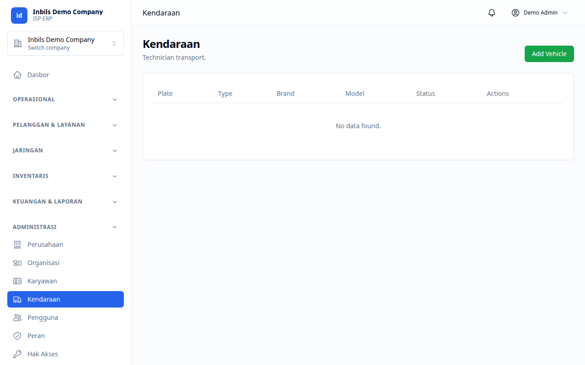

### Menambah kendaraan

1. Klik **Add Vehicle**.
2. Isi form pada dialog **Add Vehicle**:
   - **Plate Number**: wajib, maksimal 20 karakter. Plat tidak boleh sama dengan plat kendaraan lain di perusahaan yang sama, termasuk kendaraan yang sudah dihapus.
   - **Type**: opsional, maksimal 50 karakter. Teks petunjuk `motorcycle, car, truck`.
   - **Brand**: opsional, maksimal 100 karakter.
   - **Model**: opsional, maksimal 100 karakter.
   - **Purchase Date**: opsional, tanggal.
   - **Active**: saklar, aktif secara awal. Hanya kendaraan aktif yang muncul di pilihan **Vehicle** pada profil karyawan.
3. Klik **Add**. Muncul toast `Vehicle created.`

### Mengubah kendaraan

1. Klik **Edit** pada baris kendaraan. Dialog **Edit Vehicle** terbuka.
2. Ubah isian. Dialog memuat **Plate Number**, **Type**, **Brand**, **Model** dan **Active**. Dialog tidak memuat tanggal lama ke **Purchase Date**; isian dapat kosong atau masih menyimpan input dari dialog sebelumnya.
3. Isi lagi **Purchase Date** yang harus dipertahankan, lalu klik **Save**. Muncul toast `Vehicle updated.` Nilai kosong menghapus tanggal beli yang sudah tersimpan.

### Menghapus kendaraan

1. Klik **Delete** pada baris kendaraan.
2. Konfirmasi di dialog `Delete <plat>?` (keterangan `This will permanently remove the vehicle "<plat>".`). Muncul toast `Vehicle deleted.`

Kendaraan hilang dari daftar dan dari pilihan **Vehicle** pada form karyawan. Karyawan yang memakainya lalu tampil dengan **Vehicle** `-`.

### Kesalahan umum

- Pesan `The plate number has already been taken.` di bawah **Plate Number**: plat itu sudah dipakai kendaraan lain, termasuk kendaraan yang sudah dihapus. Plat yang sudah dihapus tetap dianggap terpakai, jadi untuk kendaraan yang berhenti dipakai matikan saklar **Active** lewat **Edit**, jangan hapus.
- Kendaraan ke-11 dan seterusnya tidak terlihat: daftar hanya memuat 10 kendaraan terbaru dan tidak punya tombol halaman. Tambahkan `?per_page=50` atau `?page=2` di ujung alamat `/admin/vehicles` untuk melihat sisanya.
- Penyimpanan gagal dengan toast `Data gagal disimpan. Periksa input.` tanpa pesan di bawah isian: hanya **Plate Number** menampilkan pesan kesalahan sendiri. Periksa batas panjang **Type**, **Brand** dan **Model**.
- Tombol **Add Vehicle**, **Edit** atau **Delete** ditolak server: peran Anda belum memegang `vehicle.manage`. Minta admin menambahkannya (bagian 8.6 dan 8.7).

## 8.5 Pengguna

Menu ini mengelola akun login karyawan back-office: nama, e-mail, kata sandi awal, status aktif dan peran. Buka saat ada orang baru, saat peran berubah, saat akun perlu dinonaktifkan, atau saat seseorang kehilangan perangkat autentikasi dua langkah.

Peran yang dapat memakai: admin. Izin: `users.manage` (daftar, tambah, ubah, hapus, ekspor) dan `users.two_factor.reset` (reset 2FA, hanya admin). Daftar hanya memuat pengguna yang perusahaan asalnya adalah perusahaan yang sedang aktif.

### Membuka dan membaca daftar

1. Di sidebar, buka grup **Administrasi**, lalu klik **Pengguna**.
2. Baca layar:
   - **Search** (kotak "Name or email") mencari di nama dan e-mail. **Status** menyaring **All statuses**, **Active** atau **Inactive**.
   - Kolom: **Name** dan **Email** (bisa diurutkan), **Roles** (satu lencana per peran), **Status** (bisa diurutkan; **Active** atau **Inactive**), **2FA** (**On** atau **Off**) dan **Actions** (**Show**, **Edit**, **Delete**).
   - **Delete** tidak muncul di baris akun Anda sendiri, dan di baris admin bila Anda bukan admin.
   - **Export** menawarkan **Export CSV** dan **Export PDF** dengan kolom Name, Email, Roles dan Status. Hasilnya mengikuti pencarian dan filter yang aktif, paling banyak 5000 baris (batas bawaan). Bila lebih, persempit filter.

   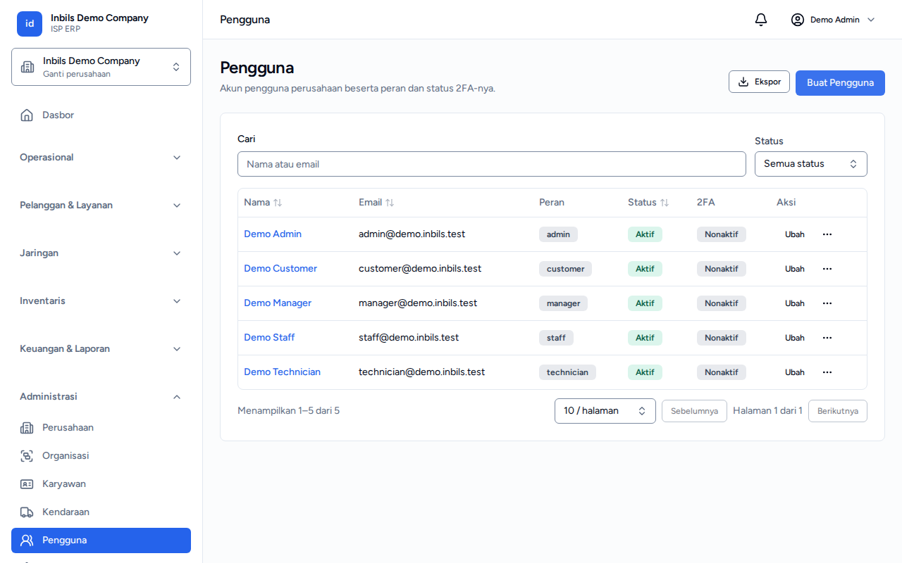

### Membuat pengguna

1. Klik **Create User**.
2. Isi form:
   - **Name**: wajib, paling banyak 255 karakter.
   - **Email**: wajib, e-mail yang valid, paling banyak 255 karakter, belum dipakai akun lain di sistem (perusahaan mana pun).
   - **Password**: wajib, paling sedikit 8 karakter. Ini kata sandi awal. Sistem tidak mengirim e-mail apa pun ke pengguna baru, jadi sampaikan sendiri kata sandi itu dan minta pengguna menggantinya di profilnya (bagian 1.7).
   - **Active**: saklar, bawaan aktif. Pada versi ini saklar tersebut tidak ikut tersimpan saat membuat akun, sehingga akun baru selalu aktif. Nonaktifkan lewat **Edit**.
   - **Roles**: satu kotak centang per peran (lima peran bawaan dan peran buatan sendiri). Boleh memilih lebih dari satu; baca "Aturan saat memberi peran" di bawah.
3. Klik **Create**. Anda kembali ke daftar dan toast "User created." muncul.

Akun baru berasal dari perusahaan yang sedang aktif dan e-mailnya langsung terverifikasi. Akun yang hanya berperan **technician** dan atau **customer** dialihkan di web ke halaman yang meminta mereka memakai aplikasi Android; peran lain yang ikut dicentang menghilangkan pengalihan itu. Login pelanggan dibuat otomatis saat pelanggan dibuat (bab 4), jadi jangan membuatnya di sini. Teknisi juga memerlukan profil karyawan aktif (bagian 8.3).

### Aturan saat memberi peran

- Hanya admin yang dapat mencentang peran **admin**. Bila yang menyimpan bukan admin, simpan ditolak.
- Hanya admin yang dapat membuka **Edit**, menghapus atau mereset 2FA akun ber-peran admin.
- Bila yang menyimpan bukan admin, izin gabungan dari semua peran yang dicentang tidak boleh memuat pasangan yang bertentangan menurut pemisahan tugas (daftar pasangan ada di bagian 8.6). Contoh: **manager** dan **staff** pada satu akun ditolak, karena manajer menyetujui permintaan barang sedangkan staf menyiapkan dan mengeluarkannya. Admin dikecualikan sebagai jalan darurat.
- Pada versi ini alasan penolakan tidak tampil di bawah daftar **Roles**. Yang muncul hanya toast "Data gagal disimpan. Periksa input."
- Bila pengguna juga tergabung di perusahaan lain yang tidak Anda ikuti, **Show**, **Edit** dan **Delete** ditolak (403).

### Mengubah pengguna

1. Di daftar, klik **Edit** pada baris pengguna, atau klik **Edit** di halaman detail.
2. Ubah isian di form **Edit User**. Isiannya sama dengan form pembuatan, dengan perbedaan berikut:
   - **Email**: tetap harus unik. Mengubahnya di sini tidak mereset status verifikasi e-mail.
   - **Password**: kosongkan untuk mempertahankan kata sandi lama ("Leave blank to keep current password."). Bila diisi, paling sedikit 8 karakter.
   - **Active**: saklar bekerja di form ini. Lencana **Active** atau **Inactive** di judul kartu mengikuti saklar.
   - **Roles**: hasilnya persis peran yang tercentang. Peran yang tidak dicentang dilepas.
3. Klik **Save**. Anda kembali ke daftar dan toast "User updated." muncul. **Cancel** kembali ke daftar tanpa menyimpan.

Menonaktifkan akun atau mengganti kata sandinya langsung mencabut semua token aplikasi pengguna itu, sehingga aplikasi Android meminta masuk ulang pada panggilan berikutnya. Pengguna nonaktif tidak dapat masuk lagi, dan login menolaknya dengan pesan yang sama seperti kata sandi salah. Sesi web yang sudah terbuka tidak ditutup otomatis dan berjalan sampai sesinya berakhir. Penugasan SPK dan tiket menolak pengguna nonaktif (bab 3).

### Melihat detail pengguna

1. Klik **Show** pada baris pengguna.
2. Judul halaman memuat nama dan e-mail, dengan tombol **Back** dan **Edit**. Kartu **User Info** menampilkan Company ID, status, Created, Last login, Customer (kode dan nama, bila akun tertaut ke pelanggan), **Roles** dan **Two-factor authentication** (**On** atau **Off**). Kartu **Activity Log** pada versi ini selalu menampilkan "No activity available."
3. Di bawahnya muncul tab riwayat sesuai izin Anda: **Billing History (n)** (`billing.view`), **Ticket History (n)** (`ticket.view`) dan **SPK History (n)** (`spk.view`). Tiap tab memuat paling banyak 50 baris terbaru yang terkait pengguna itu (dibuat olehnya, ditugaskan kepadanya, atau milik pelanggan yang tertaut), dengan tombol **Show** ke dokumennya. Tanpa satu pun izin itu, tab tidak tampil.

### Mereset autentikasi dua langkah

Pakai fitur ini bila pengguna kehilangan perangkat autentikator dan kode pemulihannya. Pengguna yang masih memegang kode pemulihan dapat memakainya sendiri (bagian 1.4). Tombol hanya tampil bila pengguna berstatus 2FA **On**, Anda memegang `users.two_factor.reset` (bawaan: admin saja), ini bukan akun Anda sendiri, Anda boleh mengubah akun itu (akun admin hanya oleh admin) dan Anda tergabung di semua perusahaan pengguna itu.

1. Buka halaman detail pengguna dengan **Show**.
2. Pada **Two-factor authentication**, klik **Reset two-factor**.
3. Baca dialog yang berjudul "Reset two-factor authentication for" diikuti nama pengguna. Pengguna dapat masuk hanya dengan kata sandi sampai ia mengaktifkan 2FA lagi, dan kode pemulihannya berhenti berlaku. Pastikan dulu bahwa yang meminta benar orangnya, lalu klik **Reset**. **Cancel** menutup dialog.
4. Toast "Two-factor authentication reset." muncul, disusul nama pengguna dan keterangan bahwa ia dapat masuk dengan kata sandi saja lalu menyiapkan 2FA lagi. Badge berubah menjadi **Off**.

Reset menghapus rahasia autentikator dan kode pemulihan, mengakhiri login lain pengguna itu (cookie "ingat saya", token aplikasi, dan sesi web lainnya bila server memakai sesi database) dan tercatat di log keamanan bersama id admin yang melakukannya.

### Menghapus pengguna

1. Klik **Delete** pada baris pengguna, lalu klik **Delete** di dialog konfirmasi (judulnya "Delete" diikuti nama pengguna).
2. Penghapusan bersifat permanen dan tidak bisa dibatalkan. Semua token aplikasi pengguna itu ikut dicabut.

Penghapusan ditolak bila pengguna dikreditkan sebagai pembawa pelanggan (bab 4), atau pernah mengajukan atau meninjau penyesuaian stok (bab 6). Dialog tetap terbuka dan toast "Data gagal disimpan. Periksa input." muncul. Alasan yang dikirim server berbunyi "Cannot delete a user credited with acquiring customers. Deactivate the account instead." atau "Cannot delete a user who requested or reviewed stock adjustments. Deactivate the account instead." Tutup dialog, lalu nonaktifkan akunnya lewat **Edit**.

### Kesalahan umum

- Simpan ditolak dengan toast "Data gagal disimpan. Periksa input." tanpa pesan di bawah **Roles**: periksa kombinasi peran (lihat "Aturan saat memberi peran"), e-mail yang sudah dipakai akun lain, dan **Password** yang kurang dari 8 karakter.
- Akun baru yang seharusnya nonaktif ternyata aktif: saklar **Active** di form pembuatan tidak berpengaruh. Nonaktifkan lewat **Edit**.
- Teknisi atau pelanggan melihat halaman yang menyuruh memakai aplikasi: itu perilaku normal untuk akun yang hanya berperan **technician** dan atau **customer**. Beri peran back-office bila orangnya memang harus memakai web.
- Pengguna sudah dinonaktifkan tetapi masih bisa bekerja di web: sesi yang sudah terbuka belum berakhir. Token aplikasinya sudah dicabut.
- Tombol **Reset two-factor** tidak ada: pengguna belum mengaktifkan 2FA, Anda bukan admin, akun itu milik Anda sendiri, atau akun itu berperan admin dan Anda bukan admin.
- Admin tunggal yang kehilangan perangkat 2FA tidak dapat direset dari layar ini karena tidak ada admin lain. Pengelola server mematikan 2FA-nya lewat perintah server.

## 8.6 Peran

Menu ini mendaftar peran (kumpulan izin) dan membuat atau mengubah peran buatan sendiri. Buka saat seseorang memerlukan hak akses yang tidak cocok dengan lima peran bawaan.

Peran yang dapat memakai: admin. Izin: `roles.manage` (daftar dan form) dan `roles.export` (tombol **Export**). Peran bersifat global dan berlaku untuk semua perusahaan. Karena itu membuat, mengubah dan menghapus peran hanya bisa dilakukan saat perusahaan aktif Anda adalah perusahaan induk (Head) atau perusahaan mandiri. Di anak perusahaan tombol **Create Role** hilang dan **Edit** ditolak.

### Membuka dan membaca daftar

1. Di sidebar, buka grup **Administrasi**, lalu klik **Peran**.
2. Baca layar:
   - **Search** (kotak "Role name") mencari di nama peran.
   - Kolom: **Name** (bisa diurutkan; lencana **Protected** pada lima peran bawaan), **Permissions** (jumlah izin), **Users** (jumlah pengguna ber-peran itu di perusahaan yang sedang aktif) dan **Actions**. Baris tidak punya tombol **Show**.
   - **Delete** hanya ada pada peran buatan sendiri.
   - Tombol **Export** (**Export CSV** dan **Export PDF**; kolom Name, Permissions, Users, Guard) dan **Create Role** tampil di kanan atas bila Anda berhak.

   

3. Lima peran bawaan berlaku global. Angka izin berikut dari data demo:

   | Peran | Fungsi | Izin di demo |
   |---|---|---|
   | `admin` | Administrator penuh dan jalan darurat. Memegang semua izin kecuali izin portal pelanggan | 163 |
   | `manager` | Pengendali: menyetujui permintaan barang, SPK dan penyesuaian stok, membatalkan tagihan, membalik pembayaran, melihat laporan | 102 |
   | `staff` | Operator: mencatat pelanggan, membuat SPK, tiket dan tagihan, menjalankan stok masuk dan keluar | 50 |
   | `technician` | Pekerjaan lapangan, di aplikasi teknisi | 26 |
   | `customer` | Tiket, evaluasi dan portal tagihan, di aplikasi pelanggan | 8 |

   Hanya admin yang dapat mengubah lima peran ini, dan tidak ada yang dapat menghapusnya.

### Membuat peran

1. Klik **Create Role**.
2. Isi **Name**: wajib, paling banyak 255 karakter, dan belum dipakai peran lain.
3. Pilih izin dengan pemilih izin (aturannya di bawah). Peran tanpa izin tercentang tetap boleh disimpan.
4. Klik **Create**. Toast "Role created." muncul dan Anda kembali ke daftar. **Cancel** kembali tanpa menyimpan.

### Memakai pemilih izin

- Kolom kiri berisi kategori izin, urut sesuai sidebar dan dikelompokkan di bawah judul grup sidebar. Kategori yang tidak punya menu di sidebar masuk di bawah judul **OTHER**.
- Kategori adalah awalan nama izin sebelum titik pertama, misalnya `billing`, `inventory`, `spk`. Nama kategori sepanjang 4 huruf atau kurang ditulis kapital (SPK, IPAM).
- Kotak centang di samping nama kategori memilih atau mencabut seluruh izin kategori itu. Tanda setengah muncul bila baru sebagian terpilih. Lencana di kanan nama menunjukkan jumlah izin terpilih dan jumlah seluruh izin kategori itu, dua angka dipisah garis miring.
- Klik nama kategori untuk melihat izinnya di panel kanan. Setiap izin adalah kotak centang berlabel nama tanpa awalan, berhuruf awal kapital (`billing.payment.record` tampil sebagai Payment Record). Arahkan kursor ke label untuk melihat kode lengkapnya.
- Kotak **Cari hak akses** (placeholder "Nama atau label, mis. export") menyaring semua kategori. Baris status menyebut jumlah izin yang cocok dan jumlah kategorinya, atau bahwa tidak ada yang cocok. Selama pencarian aktif, kotak centang kategori hanya memilih izin yang cocok. Tombol Enter di kotak ini tidak mengirim form.

### Mengubah peran

1. Di daftar, klik **Edit** pada baris peran. Judul kartu memuat nama peran dan lencana berisi angka diikuti "users" (jumlah pengguna ber-peran itu di perusahaan yang sedang aktif).
2. Ubah **Name** dan izin, lalu klik **Save**. Toast "Role updated." muncul. Izin peran menjadi persis himpunan yang tercentang, dan perubahan berlaku bagi semua pengguna ber-peran itu di semua perusahaan.

Jangan mengganti nama lima peran bawaan: aplikasi mengenalinya dari namanya. Perubahan manual pada lima peran itu juga ditimpa kembali ke matriks standar saat pengelola server menjalankan seeder peran pada pembaruan sistem.

### Pemisahan tugas saat menyimpan

Bila yang menyimpan bukan admin, simpan ditolak jika peran memuat salah satu pasangan izin ini. Admin dikecualikan.

- Pengendali permintaan barang (`inventory.request.approve`, `inventory.request.reject`) bersama pelaksana gudang (`inventory.request.prepare`, `inventory.request.issue`, `inventory.stock.receive`, `inventory.stock.issue`, `inventory.stock.transfer`).
- Penyetuju penyesuaian stok (`inventory.stock.adjust.approve`) bersama pengaju atau pelaksana (`inventory.stock.adjust.request`, `inventory.stock.receive`, `inventory.stock.issue`, `inventory.stock.transfer`).
- `inventory.stock.adjust` (penyesuaian langsung, jalan darurat) hanya boleh diberikan oleh admin.

Pesan merah muncul di bawah pemilih izin, misalnya "Separation of duties (inventory request control vs warehouse execution): ... cannot be combined with ..." atau "Only an administrator may grant the break-glass permission inventory.stock.adjust." Lepas salah satu sisi, atau bagi tugasnya menjadi dua peran untuk dua orang.

### Menghapus peran

1. Klik **Delete** pada baris peran buatan sendiri, lalu klik **Delete** di dialog konfirmasi (judulnya "Delete" diikuti nama peran). Toast "Role deleted." muncul.
2. Tidak ada pemeriksaan "peran masih dipakai". Semua pengguna yang memegang peran itu kehilangan peran tersebut seketika. Lihat kolom **Users** lebih dulu, dan ingat angkanya hanya menghitung perusahaan yang sedang aktif.

### Kesalahan umum

- **Create Role** tidak ada, atau **Edit** menghasilkan 403: Anda bekerja di anak perusahaan. Pindah ke perusahaan induk lewat pemilih perusahaan (bagian 1.6).
- **Name** ditolak: nama itu sudah dipakai peran lain.
- Simpan ditolak dengan pesan "Separation of duties": lepas izin yang bertentangan, seperti dijelaskan di atas.
- **Edit** pada lima peran bawaan ditolak: hanya admin yang boleh mengubahnya.
- Izin peran bawaan kembali ke standar setelah pembaruan sistem: seeder menimpanya. Buat peran buatan sendiri bila perlu izin tambahan yang permanen.
- Tombol **Export** tidak ada: Anda tidak memegang `roles.export`.

## 8.7 Hak Akses

Menu ini adalah katalog kode izin yang dikenal sistem, hanya untuk dibaca. Buka saat menyusun peran (bagian 8.6) dan perlu memastikan kode izin yang tepat atau kelompoknya.

Peran yang dapat memakai: admin. Izin: `roles.manage`, sama dengan menu **Peran**. Layar ini tidak punya tombol tambah, ubah atau hapus.

### Membuka dan membaca daftar

1. Di sidebar, buka grup **Administrasi**, lalu klik **Hak Akses**.
2. Baca layar (subjudul "Read-only permission matrix."):
   - **Search** (kotak "Permission name") mencari bagian dari kode izin.
   - **Name** (bisa diurutkan): kode izin, berpola `<area>.<aksi>` atau `<area>.<objek>.<aksi>`, misalnya `billing.payment.record`.
   - **Group**: lencana berwarna berisi awalan kode sebelum titik pertama, misalnya `billing`. Grup ini sama dengan kategori di pemilih izin pada layar **Peran**.
   - Halaman memuat 10, 25 atau 50 baris. Data demo mencatat 165 izin.

   

3. Pakai katalog ini sebagai kamus. Cari "export" untuk izin ekspor atau "approve" untuk izin persetujuan, lalu centang izin yang sama di layar **Peran** (bagian 8.6). Ringkasan izin per peran ada di lampiran 10.1.

Layar ini tidak menunjukkan peran mana yang memegang suatu izin. Untuk itu buka **Edit** pada peran yang bersangkutan.

### Kesalahan umum

- Item **Hak Akses** tidak tampil di sidebar: akun Anda tidak memegang `roles.manage`.
- Izin yang dicari tidak ada di daftar: katalog hanya memuat izin yang dibuat sistem. Admin tidak dapat menambah izin dari layar ini.
- Izin sudah ada tetapi tidak berefek pada seseorang: izin itu harus tercentang di peran (bagian 8.6) dan peran itu harus diberikan ke penggunanya (bagian 8.5).

## 8.8 Dokumen

Dokumen mengelola jenis dokumen bisnis, yaitu kategori berkas dengan nama, kode, objek yang dicakup, status wajib dan masa berlaku. Buka menu ini saat Anda menambah atau mengubah jenis dokumen. Halaman ini hanya mengelola jenisnya: tidak ada tombol untuk mengunggah atau menghapus berkas di sini, dan lampiran tiket serta bukti SPK dikelola di halaman tiket (bagian 3.4) dan SPK (bagian 3.3).

Peran yang dapat memakai: admin. Izin: `system.setting` membuka menu dan mengizinkan semua aksi (lihat, tambah, ubah, hapus), `system.document.export` menampilkan tombol **Export**. Pada peran bawaan hanya admin yang memegang keduanya. Izin `system.setting` juga membuka menu Penomoran (bagian 7.13).

### Membuka dan membaca daftar

1. Di sidebar, buka grup **Administrasi**, lalu klik **Dokumen**.
2. Baca daftar. Cara kerja pencarian, urutan, tombol baris dan dialog hapus ada di bagian 1.5.

   - Kotak **Search** (teks petunjuk `Name or code...`) mencari di nama, kode dan **Applies To**.
   - Kolom: **Name**, **Code**, **Applies To**, **Required**, **Expiry**, **Status** dan **Actions**. **Name**, **Code** dan **Applies To** bisa diurutkan.
   - **Required** berisi `Yes` atau `-`. **Expiry** berisi jumlah hari diikuti kata `days`, atau `-`. **Status** berisi `Active` atau `Inactive`.
   - Daftar menampilkan 10 baris per halaman dan tidak punya pemilih jumlah baris.
   - Tombol **Add Type**, **Edit** dan **Delete** tampil untuk semua orang yang bisa membuka halaman ini.

   

### Menambah jenis dokumen

1. Klik **Add Type**.
2. Isi form pada dialog **Add Type**:
   - **Name**: wajib, maksimal 255 karakter.
   - **Code**: wajib, maksimal 50 karakter. Kode tidak boleh sama dengan kode jenis lain di perusahaan yang sama, termasuk jenis yang sudah dihapus. Kode tidak bisa diubah setelah disimpan.
   - **Applies To**: opsional, teks bebas maksimal 100 karakter. Teks petunjuk `Customer, Employee, Vehicle...`. Sistem tidak memeriksa isinya.
   - **Expiry (days)**: opsional, bilangan bulat 1 atau lebih. Kosong berarti jenis ini tanpa masa berlaku.
   - **Required**: saklar, mati secara awal. Saklar ini hanya penanda yang tampil di kolom **Required** dan di ekspor. Layar lain tidak memakainya untuk menolak atau mengingatkan apa pun.
   - **Active**: saklar. Dialog tambah tidak menyimpan nilainya: jenis baru selalu berstatus `Active`. Nonaktifkan lewat **Edit**.
3. Klik **Add**. Muncul toast `Document type created.`

### Mengubah jenis dokumen

1. Klik **Edit** pada baris jenis dokumen. Dialog **Edit Type** terbuka dengan data jenis itu.
2. Ubah **Name**, **Applies To**, **Expiry (days)**, **Required** atau **Active**. Isian **Code** tetap tampil, tetapi perubahannya tidak disimpan.
3. Klik **Save**. Muncul toast `Document type updated.`

### Menghapus jenis dokumen

1. Klik **Delete** pada baris jenis dokumen.
2. Konfirmasi di dialog `Delete <nama>?` (keterangan `This will permanently remove the document type "<nama>".`). Muncul toast `Document type deleted.`

Kode jenis yang sudah dihapus tetap dianggap terpakai. Untuk jenis yang tidak dipakai lagi, matikan saklar **Active** lewat **Edit**.

### Berkas dokumen pelanggan

Halaman **Dokumen** tidak menyediakan kontrol unggah, daftar berkas atau tombol hapus berkas. Backend hanya menyediakan rute untuk berkas pelanggan, tetapi belum ada layar web yang memakainya.

- Unggah berkas memerlukan `system.setting`, hanya menerima pelanggan di perusahaan aktif sebagai pemilik, dan hanya memakai koleksi `documents`.
- Validasi menerima semua jenis berkas yang dikenali sebagai file. Tidak ada pembatasan ekstensi atau MIME. Ukuran maksimalnya 10.240 KB.
- Kode jenis dokumen bersifat opsional. Bila diisi, kodenya harus menunjuk jenis dokumen perusahaan aktif. Sistem menyimpan kode jenis, pengunggah dan tanggal kedaluwarsa sebagai metadata berkas.
- Penghapusan berkas juga memerlukan `system.setting`. Sistem hanya menghapus berkas koleksi `documents` milik pelanggan di perusahaan aktif.

### Mengekspor daftar

1. Isi kotak **Search** bila Anda hanya butuh sebagian jenis.
2. Klik **Export**, lalu pilih **Export CSV** atau **Export Excel**. Keduanya mengunduh berkas CSV.

Berkas `document-types-export-<tanggal>-<jam>.csv` berisi kolom Code, Name, Applies To, Required (`Yes` atau `No`), Expiry Days dan Status. Tombol **Export** hanya tampil bagi pemegang `system.document.export`.

### Kesalahan umum

- Anda mematikan saklar **Active** di **Add Type**, tetapi jenis baru tetap `Active`: dialog tambah tidak menyimpan saklar itu. Buka **Edit** dan matikan di sana.
- Anda mengubah **Code** di **Edit Type**, tetapi kode lama tetap: kode tidak bisa diubah setelah disimpan. Untuk kode lain, tambahkan jenis baru.
- Penyimpanan gagal dengan toast `Data gagal disimpan. Periksa input.` tanpa pesan di bawah isian: hanya **Name** dan **Code** menampilkan pesan kesalahan sendiri. Periksa **Expiry (days)** (bilangan bulat 1 atau lebih) dan panjang **Applies To** (maksimal 100 karakter).
- Anda mencari tombol untuk mengunggah berkas: halaman ini tidak punya tombol itu. Halaman ini hanya mengelola jenisnya.

# 9. Alur kerja

## 9.1 Pelanggan baru sampai pembayaran

Bab ini menyambung menu di bab 3 sampai 8 menjadi tiga alur kerja. Setiap langkah menyebut siapa yang bertindak, menu yang dipakai, dan bagian yang menjelaskan layarnya.

Alur pertama mengikuti satu pelanggan dari pendaftaran sampai tagihan pertamanya lunas. Alur ini melibatkan admin atau manajer, teknisi, dan pelanggan.

Siapkan dulu:

- Paket layanan yang aktif, lengkap dengan profil bandwidth, profil kecepatan, dan tingkat SLA yang aktif (bagian 4.2 sampai 4.5).
- Lokasi POP yang melayani alamat pelanggan (bagian 5.1). Bila port drop ODP ingin dicatat sejak awal, siapkan juga ODP dengan port bebas (bagian 5.5).
- Akun teknisi yang aktif, dengan profil karyawan aktif (bagian 8.3) dan aplikasi teknisi terpasang.
- Dua orang berbeda untuk mendaftarkan dan menyetujui SPK. Orang yang membuat SPK tidak boleh menyetujuinya (bagian 3.3).
- Perangkat ONT sebagai aset berstatus `available` di Aset Jaringan (bagian 5.2), bila SPK akan memasang perangkat.

### Langkah

1. Admin atau manajer membuka **Pelanggan** (bagian 4.1) lalu klik **Create Customer**. Staf bawaan tidak melihat tombol ini karena onboarding juga memerlukan izin langganan.
2. Isi empat tab: **Customer Data**, **Addresses**, **Contacts**, dan **Subscription & SPK**. Di **Customer Data**, centang persetujuan WhatsApp hanya bila pelanggan sudah menyetujuinya, dan pilih **Acquired by** bila penjualan perlu dikreditkan (bagian 7.10). Klik **Create Customer & SPK**.
3. Dalam satu transaksi, Inbils membuat pelanggan, akun masuk berperan `customer`, alamat, kontak, langganan berstatus `pending`, dan SPK `installation` berstatus `generated`. SPK itu berjudul "Installation &lt;kode langganan&gt; - &lt;nama&gt;" dan memakai serving POP sebagai **Location**. Status pelanggan masih **Prospective**.
4. Bila **Account active** menyala, pelanggan menerima email **Akun pelanggan Anda sudah dibuat** dengan tombol **Atur kata sandi**, berlaku 60 menit. Setelah mengatur kata sandi, pelanggan masuk ke aplikasi pelanggan. Bila email hilang, buka detail pelanggan dan klik **Kirim ulang link akses**.
5. Admin atau manajer membuka **Penugasan** (bagian 3.1), mencari SPK `generated` itu, lalu klik **Tugaskan**. Pilih teknisi di **Pilih Teknisi Lapangan** dan klik **Simpan Penugasan**. Status SPK menjadi `assigned`. Teknisi menerima WhatsApp bila WhatsApp perusahaan aktif, dan pelanggan menerima satu pesan jadwal bila SPK punya tanggal kunjungan.
6. Bila SPK harus memasang perangkat atau memakai barang, admin atau manajer membuka SPK itu (bagian 3.3) dan klik **Add Item**. Pilih produk bertipe aset dan **Network Asset** yang `available`, atau isi rencana jumlah bahan. Bila bahan diambil dari gudang lewat permintaan barang, ikuti alur 9.3.
7. Teknisi mengerjakan SPK di aplikasi teknisi: memulai pekerjaan (`in_progress`), mencatat bahan yang dipakai, mengunggah foto bukti, lalu mengajukan hasil (`waiting_review`). Pengajuan ditolak bila belum ada bukti, atau bila ada permintaan barang `issued` yang sisa materialnya belum dideklarasikan (bagian 6.8).
8. Manajer atau admin yang bukan pembuat SPK dan bukan teknisinya membuka **Persetujuan** (bagian 3.2), klik **Tinjau**, lalu **Setujui**. Persetujuan butuh minimal satu bukti dan tidak bisa dibatalkan.
9. Saat disetujui, SPK menjadi `completed` dan Inbils menjalankan langkah ini dalam satu transaksi:
   - Stok bahan **Used** berkurang di **Location** SPK, dengan mutasi `issue` (bagian 6.7). Jumlah yang sudah keluar lewat permintaan barang tidak dikurangi dua kali.
   - Aset yang dipilih menjadi `installed` pada pelanggan dan langganan (bagian 5.2).
   - Langganan `pending` menjadi `active`, dan status pelanggan menjadi **Active**.
   - Bila saklar `spk_auto_invoice` menyala, Inbils membuat tagihan sekali bayar berstatus `draft` dengan jatuh tempo 14 hari. Isinya bahan terpakai dan baris "Biaya Instalasi installation" bila langganan punya biaya pemasangan.
10. Untuk tagihan pemasangan, buka **Tagihan** (bagian 7.1) dan cari tagihan `draft` itu. Periksa itemnya, tambah item lewat **Add Item** bila perlu (izin `billing.update`, admin dan manajer), lalu klik **Send**. Status menjadi `sent`, dan pelanggan melihatnya di aplikasi pelanggan. Bila `spk_auto_invoice` mati, tidak ada tagihan otomatis. Buat tagihan lewat **New invoice** bila biaya pemasangan tetap perlu ditagih.
11. Untuk tagihan bulanan, klik **Generate Tagihan** di **Tagihan**, pilih **Periode**, klik **Preview**, lalu **Terbitkan &lt;n&gt; Tagihan**. Penerbitan juga berjalan terjadwal. Tagihan langsung berstatus `sent`, dan bulan pertama dihitung prorata sejak tanggal aktivasi.
12. Pelanggan membayar lewat aplikasi pelanggan. Pembayaran masuk ke tagihan setelah Midtrans mengonfirmasi. Staf juga dapat mencatat pembayaran: buka tagihan `sent`, klik **Record Payment**, isi **Amount** (tidak lebih dari sisa) dan **Method** (**Cash**, **Transfer**, **Cheque**, atau **Other**), isi **Reference** bila ada, lalu klik **Record**. Tagihan menjadi `partial` atau `paid`.
13. Bila tagihan tidak dibayar sampai lewat jatuh tempo, pekerjaan terjadwal menandainya `overdue` dan pelanggan menerima pengingat WhatsApp. Bila `auto_suspend_enabled` menyala di Company Settings (bagian 8.1), langganan yang tunggakannya melewati batas hari (`auto_suspend_overdue_days`) diisolir otomatis dan statusnya `suspended`. Pembayaran yang melunasi semua tunggakan mengaktifkan kembali langganan yang diisolir otomatis, bila `auto_reactivate_on_payment` menyala. Suspend manual dan Block tidak pernah dibuka otomatis. Staf juga dapat mengisolir atau memblokir sendiri dari **Tunggakan** (bagian 7.2 dan 5.3).

Hasil akhirnya: langganan `active` dan tagihan `paid`. Tagihan dan pembayaran pelanggan itu ikut terhitung di Business Metrics dan KPI Penjualan (bagian 7.4 dan 7.10).

### Kesalahan umum

- Tombol **Create Customer** tidak ada: peran Anda belum memegang izin onboarding. Minta admin atau manajer mendaftarkan pelanggan, atau tambahkan izinnya di Peran (bagian 8.6).
- Anda mendaftarkan pelanggan lalu tidak bisa menyetujui SPK-nya. Itu aturan pemisahan tugas dan berlaku juga untuk admin. Minta rekan yang berhak menyetujuinya.
- Langganan masih `pending` padahal teknisi sudah selesai: SPK belum disetujui. Buka **Persetujuan**.
- Stok tidak berkurang dan aset tidak terpasang setelah persetujuan: SPK tidak punya **Location**. SPK dari pendaftaran selalu punya **Location**, tetapi SPK manual belum tentu, dan **Location** tidak bisa diubah sesudah SPK dibuat.
- Tagihan pemasangan tidak muncul setelah persetujuan: `spk_auto_invoice` mati. Nilai awalnya mati.
- Pelanggan tidak bisa masuk ke aplikasi: **Account active** mati saat pendaftaran sehingga email tidak terkirim, atau tautannya sudah lewat 60 menit. Link hanya terkirim bila pelanggan dan akun penggunanya aktif. Aktifkan keduanya di Pelanggan (bagian 4.1) dan Pengguna (bagian 8.5), lalu klik **Kirim ulang link akses**. Tombol ini dibatasi tiga kali per menit.
- Pembayaran gagal dengan pesan jumlah melebihi sisa atau referensi sudah ada: kurangi **Amount** atau pakai referensi lain (bagian 7.1).

## 9.2 Tiket sampai SPK

Alur kedua mengikuti satu gangguan layanan dari laporan sampai tiket ditutup, lewat satu SPK perbaikan. Alur ini melibatkan staf atau admin yang mencatat tiket, admin atau manajer yang menugaskan, dan teknisi yang mengerjakannya.

Gangguan yang selesai dari jarak jauh berhenti di langkah 5 sampai 7 dan tidak butuh SPK. SPK perbaikan hanya perlu bila ada kunjungan lapangan.

### Langkah

1. Catat tiket. Buka **Tiket** (bagian 3.4), klik **New ticket**, isi **Title**, **Source** (**Customer**, **NOC**, atau **Internal**), **Category**, **Priority**, dan **Customer** untuk tiket pelanggan, lalu klik **Create**. Isi **Subscription**, **Network Asset**, dan **Location** bila diketahui. Pelanggan juga dapat membuat tiket sendiri dari aplikasi pelanggan, dan tiketnya tampil di daftar yang sama.
2. Tiket baru berstatus `open`. **Target respons** dan **Target penyelesaian** dihitung dari waktu pembuatan. Sumbernya tingkat SLA paket langganan tiket itu, atau **Kategori Tiket** bila tidak ada langganan atau tingkatnya nonaktif. Prioritas **Urgent** memotong keduanya jadi separuh. Tiket yang lewat **Target penyelesaian** tampil di kartu **SLA terlampaui** di Dasbor (bagian 2.1).
3. Tugaskan petugas. Admin atau manajer membuka **Penugasan** (bagian 3.1), mencari tiket itu, klik **Tugaskan**, pilih **Petugas Tiket (Handler)**, lalu klik **Simpan Penugasan**. Dari halaman tiket, tombol **Assign** meminta **Handler ID**. Status menjadi `assigned`. Petugas menerima email dan notifikasi di lonceng. Pada penugasan pertama, pelanggan menerima WhatsApp bahwa tiketnya ditangani, bila WhatsApp perusahaan aktif.
4. Petugas memulai tiket. Teknisi melakukannya di aplikasi teknisi. Pengguna web yang memegang `ticket.start` memakai **Start** di halaman tiket atau di **Pekerjaan Saya** (bagian 3.6). Status menjadi `on_progress` dan **First Response** terisi.
5. Bila gangguan butuh kunjungan, admin atau manajer dengan izin `ticket.spawn_spk` membuka tiket berstatus `assigned` atau `on_progress` yang belum punya catatan penyelesaian, klik **Spawn SPK**, lalu **Confirm**. Inbils membuka SPK `maintenance` berstatus `generated` dengan judul "SPK from Ticket &lt;kode tiket&gt;". **Customer**, **Subscription**, **Location**, **Priority**, dan deskripsi disalin dari tiket. Aset jaringan tiket tidak ikut disalin ke SPK.
6. Tiket tidak ikut selesai dan tidak punya tautan ke SPK. Cari SPK-nya di **SPK** (bagian 3.3) dengan kode tiket di kotak **Search**. Satu tiket hanya boleh melahirkan satu SPK.
7. Tugaskan SPK. Buka **Penugasan** atau halaman SPK, klik **Tugaskan** atau **Assign**, lalu pilih teknisi. Status SPK menjadi `assigned` dan teknisi menerima WhatsApp.
8. Teknisi mengerjakan SPK di aplikasi: memulai, mencatat bahan, mengunggah foto bukti, lalu mengajukan hasil. Bahan yang diambil dari gudang mengikuti alur 9.3.
9. Manajer atau admin yang bukan pembuat SPK dan bukan teknisinya menyetujui SPK di **Persetujuan** (bagian 3.2). Pembuat SPK adalah orang yang melakukan **Spawn SPK**, jadi orang itu butuh rekan untuk menyetujui. SPK menjadi `completed`, dan stok bahan **Used** berkurang di **Location** SPK bila SPK punya lokasi.
10. Petugas tiket mengisi catatan penyelesaian: klik **Resolve**, isi **Resolution Note** (wajib, maksimal 1000 karakter), lalu klik **Confirm**. Status menjadi `resolved` dan pelanggan menerima WhatsApp bahwa tiketnya selesai. Tiket hanya bisa diselesaikan dari status `on_progress`.
11. Pemegang `ticket.close` yang bukan petugas tiket itu membuka tiket dan klik **Close** lalu **Confirm**. Status menjadi `closed`.
12. Setelah itu, buat Evaluasi (bagian 3.5) untuk tiket atau SPK tadi bila perlu. Waktu respons dan penyelesaian tiket masuk ke SLA Compliance dan Kinerja Teknisi (bagian 7.6 dan 7.9).

### Kesalahan umum

- **Spawn SPK** tidak tampil: tiket harus `assigned` atau `on_progress`, belum punya catatan penyelesaian, dan belum pernah melahirkan SPK. Anda juga butuh `ticket.spawn_spk`.
- SPK perbaikan tidak bisa Anda setujui sendiri karena Anda pembuatnya. Minta rekan yang berhak.
- Persetujuan SPK perbaikan ikut membuat tagihan: bila `spk_auto_invoice` menyala, Inbils membuat tagihan `draft` berisi bahan terpakai, dan baris "Biaya Instalasi maintenance" bila langganan punya biaya pemasangan. Periksa tagihan itu di **Tagihan** (bagian 7.1) sebelum **Send**. Tagihan yang tidak perlu dibatalkan oleh pengguna lain dengan izin `billing.cancel`, karena pembuat tagihan adalah penyetuju SPK.
- **Resolve** ditolak pada tiket `assigned`: petugas klik **Start** dulu.
- **Close** tidak tampil: tiket belum `resolved`, Anda tidak memegang `ticket.close`, atau Anda petugas tiket itu.
- Tiket yang `resolved` atau `closed` tidak bisa dibuka lagi di web. Catat masalah yang muncul lagi sebagai tiket baru.

## 9.3 Permintaan barang sampai pengeluaran stok

Alur ketiga mengikuti barang dari permintaan sampai keluar dari gudang, lalu sisanya kembali. Alur ini melibatkan pemohon (biasanya teknisi), penyetuju (manajer), petugas gudang (staf), dan penerima retur. Pemisahan tugas berlaku di setiap titik, termasuk untuk admin.

### Langkah

1. Pemohon membuat permintaan. Teknisi membuatnya di aplikasi teknisi, dan permintaan itu langsung berstatus **Menunggu Persetujuan**. Di web, hanya peran yang memegang `inventory.request.create` (admin pada peran bawaan) melihat **Buat Permintaan Baru** di **Permintaan Barang** (bagian 6.1). Isi **Gudang Tujuan**, **Alasan Kebutuhan Barang**, **Kategori Referensi (Opsional)** (SPK atau tiket, dengan angka ID-nya), dan daftar barang. Klik **Ajukan ke Antrean Gudang**. Pilihan **Simpan sebagai Draf** menyimpan tanpa mengajukan, dan draf diajukan nanti lewat **Ajukan ke Gudang**.
2. Pengguna dengan izin setujui menerima email. Permintaan masuk ke **Persetujuan** (bagian 3.2) dan ke kartu **Menunggu persetujuan saya** di Dasbor.
3. Manajer atau admin yang bukan pemohon memutuskan. Di **Persetujuan**, klik **Tinjau** lalu **Setujui** untuk menyetujui seluruh jumlah. Untuk menyetujui sebagian, buka halaman detail permintaan, klik **Setujui & Reservasi Stok**, ubah **Penyesuaian Kuantitas yang Disetujui**, lalu klik **Setujui & Reservasi**. Untuk menolak, klik **Tolak Permintaan** dan isi alasan 3 sampai 1000 karakter.
4. Saat disetujui, Inbils memeriksa stok tersedia (**Quantity** dikurangi **Reserved**) di **Gudang Tujuan** untuk setiap barang. Bila semuanya cukup, stok direservasi dengan mutasi `reserve`, status menjadi **Disetujui (Stok Direservasi)**, dan pemohon menerima email. Bila satu barang kurang, tidak ada yang direservasi dan dialog menampilkan pesan kesalahan.
5. Petugas gudang yang bukan penyetuju membuka tab **Persiapan & Antrean Gudang** (kartu **Antrean permintaan gudang** di Dasbor membukanya) lalu membuka detail permintaan. Klik **Mulai Penyiapan Barang** lalu **Ya, Mulai Penyiapan**. Status menjadi **Sedang Disiapkan Gudang**.
6. Setelah barang terkumpul, klik **Tandai Siap Diambil** lalu konfirmasi. Status menjadi **Siap Diambil (Ready for Pickup)**, dan pemohon menerima email serta notifikasi di lonceng.
7. Saat pemohon menerima barang fisik, petugas yang bukan pemohon dan bukan penyetuju klik **Serah Terima (Issue & Kurangi Stok)**, lalu **Konfirmasi Serah Terima (Issue)**. Status menjadi **Selesai Diserahkan (Issued)**. Reservasi dilepas (mutasi `release`), stok fisik berkurang (mutasi `issue`), dan **Qty Diserahkan** terisi. Serah terima tidak bisa dibatalkan.
8. Inbils membuka berkas pengembalian untuk permintaan itu dengan status **Menunggu Deklarasi Teknisi**. Setelah pekerjaan selesai, teknisi melaporkan pemakaian aktual dan sisa barang di aplikasi teknisi. Jumlah dipakai, sisa baik, dan selisih harus berjumlah sama dengan jumlah yang dikeluarkan. Berkas menjadi **Menunggu Penerimaan Gudang**, dan stok belum berubah.
9. Pemegang `inventory.return.receive` yang bukan pemilik berkas membuka **Permintaan Barang**, tab **Antrean Pengembalian (Custody Return)** (bagian 6.8), lalu klik **Buka Permintaan & Terima Fisik**. Klik **Terima Pengembalian Fisik**, isi **Diterima Baik (Tambah Stok)** dan **Kondisi Rusak (Damaged)** per barang, lalu klik **Konfirmasi Penerimaan Fisik**. Barang baik masuk kembali ke stok dengan mutasi `receive`.
10. Bila tidak ada barang rusak, berkas menjadi **Selesai Rekonsiliasi (Diterima)**. Bila ada, berkas menjadi **Diskrepansi (Perlu Resolusi)**, dan pemegang `inventory.return.resolve` menerima email. Manajer yang bukan penerima fisik klik **Buka & Selesaikan Diskrepansi**, **Selesaikan Diskrepansi (Resolve)**, isi **Catatan Resolusi**, lalu **Konfirmasi Penyelesaian**. Berkas menjadi **Diskrepansi Diselesaikan**, dan stok tidak berubah lagi.
11. Bila barang tidak sampai di meja gudang atau tidak sesuai laporan, klik **Tolak Fisik Barang**, isi **Alasan Penolakan Fisik**, lalu **Tolak Penyerahan**. Berkas menjadi **Perlu Koreksi / Ditolak Gudang**. Teknisi menerima email berisi alasan dan melapor ulang.
12. Periksa hasilnya. **Stok** (bagian 6.5) menunjukkan **Quantity**, **Reserved**, dan **Available**. **Mutasi Stok** (bagian 6.7) menunjukkan jejak `reserve`, `release`, `issue`, dan `receive` untuk permintaan itu, dengan catatan berisi kode permintaan.

Permintaan yang masih **Draf** atau **Menunggu Persetujuan** bisa dibatalkan lewat **Batalkan Permintaan**. Setelah disetujui, layar ini tidak menyediakan pembatalan.

### Hubungan dengan SPK

Bila permintaan memakai **Kategori Referensi** SPK, berkas pengembaliannya terhubung ke SPK itu.

- Teknisi tidak bisa mengajukan SPK untuk ditinjau selama ada berkas yang belum dilaporkan, yaitu **Menunggu Deklarasi Teknisi** atau **Perlu Koreksi / Ditolak Gudang**.
- Penyetuju tidak bisa menyetujui SPK sampai semua berkasnya **Selesai Rekonsiliasi (Diterima)** atau **Diskrepansi Diselesaikan**.
- Saat SPK disetujui, jumlah pakai pada material SPK disesuaikan dengan **Dipakai Aktual**, dan stok bahan hanya berkurang untuk bagian yang belum keluar lewat permintaan barang.

### Kesalahan umum

- Dialog persetujuan menampilkan "Stok tidak mencukupi untuk produk ID ... Tersedia: ..., Diminta: ...": kurangi jumlah yang disetujui, atau tambah stok lewat **Terima Barang** di **Stok** (bagian 6.5), lalu setujui lagi. Bila tidak dapat dipenuhi, tolak permintaan dengan alasan.
- Tombol **Setujui & Reservasi Stok**, **Mulai Penyiapan Barang**, atau **Serah Terima (Issue & Kurangi Stok)** tidak tampil: cek status permintaan dan izin Anda, dan apakah Anda pemohon atau penyetuju permintaan itu. Pemohon tidak boleh menyetujui atau menyerahkan permintaannya sendiri, dan penyetuju tidak boleh menyiapkan atau menyerahkan barang yang ia setujui.
- Peran non-admin tidak boleh memegang izin setujui bersama izin siapkan atau serahkan. Di peran bawaan, manajer menyetujui dan staf menyiapkan dan menyerahkan. Bila perusahaan Anda hanya punya satu orang gudang yang juga penyetuju, tambahkan orang kedua.
- Daftar **Antrean Pengembalian (Custody Return)** menampilkan kotak galat: peran Anda memegang izin retur tetapi tanpa `inventory.return.view.all` atau `inventory.return.view.own`. Minta admin menambahkannya (bagian 8.6).
- Pesan yang diawali `Invariant gagal pada baris` muncul bila angka satu barang tidak berjumlah sama dengan **Dikeluarkan**. Ubah angkanya sampai cocok.
- Koreksi jumlah stok yang bukan akibat permintaan barang memakai **Ajukan Penyesuaian** di **Stok**, yang butuh persetujuan orang lain (bagian 6.5).

# 10. Lampiran

## 10.1 Peran dan izin ringkas

Inbils memakai lima peran bawaan: admin, manajer, staf, teknisi, dan pelanggan. Peran bersifat global, jadi isinya sama di setiap perusahaan. Satu peran adalah kumpulan izin, dan izin adalah hak untuk satu tindakan, misalnya `spk.approve`. Admin dapat membuat peran lain di menu Peran (bagian 8.6) dan melihat daftar izin di Hak Akses (bagian 8.7).

Tabel di bagian ini menggambarkan peran bawaan saat ini. Peran khusus dan izin yang diberikan langsung ke satu pengguna dapat berbeda. Bila tabel dan layar Anda tidak cocok, cek peran pengguna itu di menu Pengguna (bagian 8.5).

Teknisi dan pelanggan memakai aplikasi Android, bukan web. Akun yang hanya berperan teknisi atau pelanggan dialihkan ke halaman **Gunakan aplikasi Inbils** (bagian 1.1). Akun yang juga memegang peran admin, manajer, atau staf tidak dialihkan.

### Menu yang tampil di sidebar

Kolom izin menyebut izin yang membuka menu: satu saja sudah cukup. Menu hanya menentukan apakah tautannya tampil. Setiap layar tetap memeriksa izin untuk setiap tindakan.

| Menu | Izin yang membuka | Admin | Manajer | Staf |
| --- | --- | --- | --- | --- |
| Dasbor | `dashboard.view` | ya | ya | ya |
| Pekerjaan Saya | izin kerja lapangan dan profil karyawan aktif | bila profil aktif | bila profil aktif | bila profil aktif |
| Penugasan | `ticket.assign` atau `ticket.reassign` atau `spk.assign` atau `spk.reassign` | ya | ya | tidak |
| Persetujuan | `spk.approve` atau `spk.reject` atau `inventory.request.approve` atau `inventory.request.reject` | ya | ya | tidak |
| SPK | `spk.view` | ya | ya | ya |
| Tiket | `ticket.view` | ya | ya | ya |
| Evaluasi | `evaluation.view` atau `evaluation.view.own` | ya | ya | ya |
| Pelanggan | `customer.view` | ya | ya | ya |
| Paket Layanan | `service.view` atau `service.manage` | ya | ya | ya |
| Kategori Paket | `service.view` atau `service.manage` | ya | ya | ya |
| Profil Bandwidth | `service.view` atau `service.manage` | ya | ya | ya |
| Profil Kecepatan | `service.view` atau `service.manage` | ya | ya | ya |
| Tingkat SLA | `service.view` atau `service.manage` | ya | ya | ya |
| Kategori Tiket | `ticket.category.manage` | ya | ya | tidak |
| Lokasi | `location.view` | ya | ya | ya |
| Aset Jaringan | `network_asset.view` | ya | ya | ya |
| Router NAS | `network_asset.nas.view` | ya | ya | ya |
| Alamat IP | `ipam.view` | ya | ya | ya |
| ODN | `odn.view` | ya | ya | ya |
| Permintaan Barang | `inventory.request.view.own` atau `inventory.request.view.all` | ya | ya | ya |
| Barang | `inventory.view` | ya | ya | ya |
| Kategori | `inventory.view` | ya | ya | ya |
| Satuan | `inventory.view` | ya | ya | ya |
| Stok | `inventory.view` | ya | ya | ya |
| Cari Barang | `inventory.view` | ya | ya | ya |
| Mutasi Stok | `inventory.view` | ya | ya | ya |
| Tagihan | `billing.view` | ya | ya | ya |
| Tunggakan | `billing.view` | ya | ya | ya |
| Laporan | `report.view` | ya | ya | ya |
| Kinerja Teknisi | `report.technician`, lalu aturan akses laporan teknisi | ya | bila profil aktif dan ditempatkan di organisasi aktif | tidak |
| KPI Penjualan | `report.sales.view` | ya | ya | tidak |
| Metrik Konsolidasi | `report.consolidated.view`, perusahaan aktif berupa Head | bila Head | tidak | tidak |
| Perusahaan | `company.manage` | ya | tidak | tidak |
| Organisasi | `organization.view` | ya | tidak | tidak |
| Karyawan | `employee.view` | ya | tidak | tidak |
| Kendaraan | `vehicle.view` | ya | tidak | tidak |
| Pengguna | `users.manage` | ya | tidak | tidak |
| Peran | `roles.manage` | ya | tidak | tidak |
| Hak Akses | `roles.manage` | ya | tidak | tidak |
| Dokumen | `system.setting` | ya | tidak | tidak |
| Penomoran | `system.setting` | ya | tidak | tidak |

Catatan untuk menu bersyarat:

- **Pekerjaan Saya** tampil bagi pengguna yang memegang izin kerja lapangan (`spk.start`, `spk.submit`, `ticket.start`, `ticket.resolve`, atau `ticket.close`) dan punya profil karyawan yang aktif di perusahaan aktif (bagian 3.6 dan 8.3).
- **Penugasan** juga mensyaratkan pengguna yang aktif.
- **Kinerja Teknisi** tampil bagi admin, dan bagi manajer yang berizin `report.technician`, punya profil karyawan aktif, dan ditempatkan di organisasi aktif (bagian 7.9).
- **Metrik Konsolidasi** tampil hanya saat perusahaan aktif berupa Head dan akun memegang `report.consolidated.view` (bagian 1.6 dan 7.11).
- Menu **Komponen** di grup **Administrasi** hanya muncul di lingkungan pengembangan dan tidak dibahas di panduan ini.
- Menu **Dasbor** terbuka untuk semua peran bawaan.

### Kemampuan: Operasional

| Kemampuan | Izin | Admin | Manajer | Staf |
| --- | --- | --- | --- | --- |
| Menugaskan tiket dan SPK | `ticket.assign`, `spk.assign` | ya | ya | tidak |
| Menugaskan ulang tiket dan SPK | `ticket.reassign`, `spk.reassign` | ya | ya | tidak |
| Mengubah nama, target, dan status Kategori Tiket | `ticket.category.manage` | ya | ya | tidak |
| Membuat SPK | `spk.create` | ya | ya | ya |
| Mengubah SPK (item, bukti) | `spk.update` | ya | ya | tidak |
| Menyetujui dan menolak SPK | `spk.approve`, `spk.reject` | ya | ya | tidak |
| Membatalkan SPK | `spk.cancel` | ya | ya | tidak |
| Memulai dan mengajukan SPK | `spk.start`, `spk.submit` | ya | tidak | ya |
| Mengekspor SPK | `spk.export` | ya | ya | tidak |
| Membuat tiket | `ticket.create` | ya | ya | ya |
| Membuat SPK dari tiket | `ticket.spawn_spk` | ya | ya | tidak |
| Menutup tiket | `ticket.close` | ya | ya | tidak |
| Memulai dan menyelesaikan tiket | `ticket.start`, `ticket.resolve` | ya | tidak | tidak |
| Komentar dan lampiran tiket | `ticket.comment.create`, `ticket.attachment.upload` | ya | tidak | ya |
| Mengekspor tiket | `ticket.export` | ya | ya | tidak |
| Melihat dan membuat evaluasi | `evaluation.view`, `evaluation.create`, `evaluation.update` | ya | ya | ya |

### Kemampuan: Pelanggan dan layanan

| Kemampuan | Izin | Admin | Manajer | Staf |
| --- | --- | --- | --- | --- |
| Melihat pelanggan | `customer.view` | ya | ya | ya |
| Membuat dan mengubah pelanggan, alamat, kontak | `customer.create`, `customer.update`, `customer.address.manage` | ya | ya | ya |
| Mengekspor pelanggan | `customer.export` | ya | ya | tidak |
| Menghapus pelanggan | `customer.delete` | ya | tidak | tidak |
| Melihat langganan | `customer.subscription.view` | ya | ya | ya |
| Membuat langganan, aktivasi, dan suspend | `customer.subscription.manage`, `customer.subscription.activate`, `customer.subscription.suspend` | ya | ya | tidak |
| Reaktivasi, blokir, dan terminasi langganan | `customer.subscription.reactivate`, `customer.subscription.block`, `customer.subscription.terminate` | ya | ya | tidak |
| Menetapkan Acquired by | `customer.sales.assign` | ya | ya | ya |
| Mengoreksi Acquired by | `customer.sales.correct` | ya | ya | tidak |
| Melihat paket, kategori paket, dan profil layanan | `service.view` | ya | ya | ya |
| Membuat dan mengubah paket dan profil layanan | `service.create`, `service.update`, `service.manage` | ya | ya | tidak |
| Menghapus dan mengekspor paket dan profil layanan | `service.delete`, `service.export` | ya | tidak | tidak |
| Kategori Paket: lihat, buat, ubah, nonaktifkan, hapus | sama dengan paket: `service.view`, `service.create`, `service.update`, `service.delete`, `service.manage` | lihat, buat, ubah, hapus | lihat, buat, ubah, hapus | lihat saja |

### Kemampuan: Jaringan

| Kemampuan | Izin | Admin | Manajer | Staf |
| --- | --- | --- | --- | --- |
| Melihat aset jaringan | `network_asset.view` | ya | ya | ya |
| Membuat, mengubah, memasang, dan melepas aset | `network_asset.create`, `network_asset.update`, `network_asset.install`, `network_asset.remove` | ya | ya | tidak |
| Pemeliharaan, perbaikan, dan pensiun aset | `network_asset.maintenance`, `network_asset.repair`, `network_asset.retire` | ya | ya | tidak |
| Menghapus aset | `network_asset.delete` | ya | tidak | tidak |
| Melihat Router NAS | `network_asset.nas.view` | ya | ya | ya |
| Mengelola Router NAS | `network_asset.nas.manage` | ya | tidak | tidak |
| Melihat, mengelola, dan membuka secret akun jaringan | `network_asset.account.view`, `network_asset.account.manage`, `network_asset.account.reveal` | ya | ya | ya |
| Melihat Alamat IP | `ipam.view` | ya | ya | ya |
| Mengelola prefix dan VLAN | `ipam.manage` | ya | ya | tidak |
| Mencatat alamat IP statis | `ipam.assign` | ya | ya | tidak |
| Melihat ODN | `odn.view` | ya | ya | ya |
| Mengelola port PON dan splitter | `odn.manage` | ya | ya | tidak |
| Mencatat port drop | `odn.assign` | ya | ya | ya |
| Melihat lokasi | `location.view` | ya | ya | ya |
| Membuat, mengubah, dan memindahkan lokasi | `location.create`, `location.update`, `location.move` | ya | ya | tidak |
| Menghapus lokasi | `location.delete` | ya | tidak | tidak |

### Kemampuan: Inventaris

| Kemampuan | Izin | Admin | Manajer | Staf |
| --- | --- | --- | --- | --- |
| Melihat barang, stok, dan mutasi | `inventory.view` | ya | ya | ya |
| Membuat dan mengubah barang, kategori, satuan | `inventory.create`, `inventory.update` | ya | ya | ya |
| Menghapus barang, kategori, satuan | `inventory.delete` | ya | tidak | tidak |
| Mengekspor data inventaris | `inventory.export` | ya | ya | tidak |
| Menerima dan memindahkan stok | `inventory.stock.receive`, `inventory.stock.transfer` | ya | tidak | ya |
| Mengeluarkan stok | `inventory.stock.issue` | ya | tidak | ya |
| Mengajukan penyesuaian stok | `inventory.stock.adjust.request` | ya | tidak | ya |
| Menyetujui penyesuaian stok | `inventory.stock.adjust.approve` | ya | ya | tidak |
| Penyesuaian stok langsung (break-glass) | `inventory.stock.adjust` | ya | tidak | tidak |
| Melihat semua permintaan barang | `inventory.request.view.all` | ya | ya | ya |
| Membuat permintaan barang | `inventory.request.create` | ya | tidak | tidak |
| Menyetujui dan menolak permintaan barang | `inventory.request.approve`, `inventory.request.reject` | ya | ya | tidak |
| Menyiapkan dan menyerahkan barang | `inventory.request.prepare`, `inventory.request.issue` | ya | tidak | ya |
| Melihat semua pengembalian barang | `inventory.return.view.all` | ya | ya | ya |
| Menerima pengembalian fisik | `inventory.return.receive` | ya | ya | ya |
| Menyelesaikan diskrepansi pengembalian | `inventory.return.resolve` | ya | ya | tidak |

### Kemampuan: Keuangan dan laporan

| Kemampuan | Izin | Admin | Manajer | Staf |
| --- | --- | --- | --- | --- |
| Melihat tagihan dan tunggakan | `billing.view` | ya | ya | ya |
| Membuat dan mengirim tagihan, mencatat pembayaran | `billing.create`, `billing.send`, `billing.payment.record` | ya | ya | ya |
| Menambah item tagihan | `billing.update` | ya | ya | tidak |
| Membalik pembayaran dan membatalkan tagihan | `billing.payment.reverse`, `billing.cancel` | ya | ya | tidak |
| Mengekspor tagihan | `billing.export` | ya | ya | tidak |
| Hub Laporan, Business Metrics, Asset Utilization | `report.view`, `report.business.view`, `report.asset.view` | ya | ya | ya |
| SLA Compliance, Stock Card, Data Dictionary | `report.sla.view`, `report.stock_card.view`, `report.dictionary.view` | ya | ya | ya |
| KPI Penjualan | `report.sales.view` | ya | ya | tidak |
| Kinerja Teknisi | `report.technician` | ya | ya | tidak |
| Mengekspor laporan | `report.export` | ya | ya | tidak |
| Audit Log | `report.audit.view` | ya | tidak | tidak |
| Metrik Konsolidasi | `report.consolidated.view` | ya | tidak | tidak |

### Kemampuan: Administrasi

| Kemampuan | Izin | Admin | Manajer | Staf |
| --- | --- | --- | --- | --- |
| Melihat Dasbor | `dashboard.view` | ya | ya | ya |
| Mengelola pengguna | `users.manage` | ya | tidak | tidak |
| Mereset 2FA pengguna lain | `users.two_factor.reset` | ya | tidak | tidak |
| Mengelola peran dan melihat Hak Akses | `roles.manage` | ya | tidak | tidak |
| Mengelola profil dan pengaturan perusahaan | `company.manage` | ya | tidak | tidak |
| Berpindah perusahaan | `company.switch` | ya | ya | tidak |
| Mengelola organisasi | `organization.manage` | ya | tidak | tidak |
| Mengelola karyawan | `employee.manage` | ya | tidak | tidak |
| Mengelola kendaraan | `vehicle.manage` | ya | tidak | tidak |
| Mengelola jenis dokumen dan penomoran | `system.setting` | ya | tidak | tidak |

Nilai "ya" berarti peran memegang semua izin di baris itu.

### Teknisi dan pelanggan

Dua peran ini bekerja di aplikasi. Izin peran teknisi:

- `customer.view`
- `dashboard.view`
- `evaluation.view.own`
- `inventory.request.cancel.own`, `inventory.request.create`, `inventory.request.view.own`, `inventory.return.declare`, `inventory.return.view.own`, `inventory.stock.issue`, `inventory.view`
- `ipam.view`
- `location.view`
- `network_asset.view`
- `odn.view`
- `report.technician`
- `spk.evidence.upload`, `spk.evidence.view`, `spk.start`, `spk.submit`, `spk.view`
- `ticket.attachment.upload`, `ticket.comment.create`, `ticket.create`, `ticket.resolve`, `ticket.start`, `ticket.view`

Izin peran pelanggan:

- `dashboard.view`
- `evaluation.customer.submit`
- `portal.invoice.pay`, `portal.invoice.view`
- `ticket.attachment.upload`, `ticket.comment.create`, `ticket.create`, `ticket.view`

### Pemisahan tugas

Beberapa keputusan tidak boleh diambil oleh orang yang sama dengan yang membuat atau mengajukannya. Server memeriksa aturan ini untuk semua pengguna, termasuk admin, jadi tombolnya bisa tampil tetapi tindakannya ditolak.

| Tindakan | Tidak boleh dilakukan oleh | Bagian |
| --- | --- | --- |
| Menyetujui atau menolak SPK | Pembuat SPK dan teknisi yang ditugaskan | 3.3 |
| Menyetujui atau menolak permintaan barang | Pemohon | 6.1 |
| Menyiapkan barang untuk permintaan | Penyetuju permintaan | 6.1 |
| Menyerahkan barang untuk permintaan | Pemohon dan penyetuju | 6.1 |
| Menyetujui atau menolak penyesuaian stok | Pemohon penyesuaian | 6.5 |
| Membatalkan tagihan | Pembuat tagihan | 7.1 |
| Membalik pembayaran | Pencatat pembayaran | 7.1 |
| Menutup tiket | Petugas tiket itu | 3.4 |
| Menerima, menolak, atau menyelesaikan berkas pengembalian | Pemilik berkas | 6.8 |
| Menyelesaikan diskrepansi pengembalian | Orang yang menerima fisik barangnya | 6.8 |
| Mereset 2FA sebuah akun | Pemilik akun itu sendiri dan semua pengguna selain admin | 1.4 dan 8.5 |
| Memberi peran admin, mengubah peran bawaan, mengubah atau menghapus pengguna admin | Semua pengguna selain admin | 8.5 dan 8.6 |

Selain itu, peran non-admin tidak boleh memegang pasangan izin yang berbenturan. Izin menyetujui atau menolak permintaan barang tidak boleh bersama izin menyiapkan atau menyerahkan barang, atau menerima, mengeluarkan, dan memindahkan stok. Izin menyetujui penyesuaian stok tidak boleh bersama izin mengajukan penyesuaian, atau menerima, mengeluarkan, dan memindahkan stok. Inbils menolak penyimpanan peran atau pengguna yang melanggarnya, sehingga manajer dan staf bawaan tidak bisa digabung dalam satu akun. Admin dikecualikan dari pemeriksaan ini.

## 10.2 Istilah

| Istilah | Arti |
| --- | --- |
| 2FA | Autentikasi dua langkah. Kode 6 digit dari aplikasi authenticator diminta setelah kata sandi (bagian 1.4). |
| Acquired by | Karyawan yang dikreditkan memperoleh pelanggan. Angkanya dibaca KPI Penjualan (bagian 4.1 dan 7.10). |
| Aset jaringan | Perangkat jaringan yang dilacak satu per satu, dengan nomor seri, lokasi, dan status (bagian 5.2). |
| Available | Jumlah stok yang bisa dipakai, yaitu **Quantity** dikurangi **Reserved** (bagian 6.5). |
| Block | Isolasi jaringan manual pada satu langganan. Block bukan status, dan pembayaran tidak mencabutnya (bagian 4.1 dan 7.2). |
| Break-glass | Penyesuaian stok langsung oleh admin tanpa persetujuan. Layar web tidak menyediakan tombolnya (bagian 6.5). |
| Drill-down | Membuka baris data sumber di balik satu angka laporan (bagian 7.3). |
| Drop port | Port output ODP yang dipakai satu langganan (bagian 5.5). |
| First Response | Waktu petugas pertama kali memulai tiket (bagian 3.4). |
| Handler | Petugas yang ditunjuk menangani tiket (bagian 3.4). |
| Head | Perusahaan induk: perusahaan tanpa induk yang punya minimal satu anak perusahaan aktif (bagian 1.6). |
| Isolir | Pembatasan akses jaringan pelanggan yang menunggak. Berjalan otomatis atau lewat tombol isolir di Tunggakan, dan langganan menjadi `suspended` (bagian 5.3 dan 7.2). |
| Izin | Hak untuk satu tindakan, misalnya `spk.approve`. Peran adalah kumpulan izin (bagian 8.6 dan 8.7). |
| Langganan | Layanan satu paket untuk satu pelanggan. Statusnya `pending`, `active`, `suspended`, atau `terminated` (bagian 4.1). |
| Maker-checker | Pemisahan tugas: orang yang membuat atau mengajukan tidak boleh memutuskan persetujuannya (bagian 10.1). |
| MRC | Monthly Recurring Charge, harga langganan per bulan (bagian 4.2). |
| NAS | Router yang meneruskan otentikasi pelanggan ke RADIUS (bagian 5.3). |
| NPWP | Nomor pokok wajib pajak, diisi di **Tax ID** pelanggan (bagian 4.1). |
| ODN | Register jaringan serat optik: port PON pada OLT, splitter pada ODC dan ODP, dan port drop tiap langganan. OLT, ODC, dan ODP didaftarkan sebagai aset jaringan (bagian 5.5). |
| OTC | One-Time Charge, biaya sekali bayar seperti biaya pemasangan (bagian 4.2). |
| Periode | Rentang tanggal yang dihitung sebuah laporan (bagian 7.3). |
| PPN | Pajak pertambahan nilai pada item tagihan, dengan tarif perusahaan (bagian 7.1). |
| PPPoE, Hotspot | Dua jenis layanan untuk akun jaringan pelanggan (bagian 4.1). |
| Prefix | Blok alamat IP dalam notasi CIDR yang dicatat di Alamat IP (bagian 5.4). |
| RADIUS | Server otentikasi akses jaringan. Inbils mengisinya dengan akun dan grup kecepatan pelanggan (bagian 4.4 dan 5.3). |
| Reserved | Jumlah stok yang dicadangkan oleh permintaan barang yang sudah disetujui (bagian 6.5). |
| Serving POP | Lokasi POP yang melayani sebuah langganan (bagian 4.1 dan 5.5). |
| SLA | Service Level Agreement, batas waktu layanan. Tingkat SLA dipilih di paket (bagian 4.5). Target respons dan penyelesaian sebuah tiket diambil dari tingkat SLA paket langganannya, atau dari Kategori Tiket bila tidak ada tingkat aktif (bagian 3.4). |
| Splitter | Pembagi yang mengubah satu port hulu menjadi beberapa port output, dengan rasio 1:2 sampai 1:64 (bagian 5.5). |
| SPK | Surat Perintah Kerja, perintah kerja lapangan untuk teknisi (bagian 3.3). |
| Tunggakan | Tagihan terbuka yang sudah lewat jatuh tempo dan masih bersisa (bagian 7.2). |
| VLAN | Nomor jaringan virtual yang dicatat di Alamat IP dan ditautkan ke prefix (bagian 5.4). |
